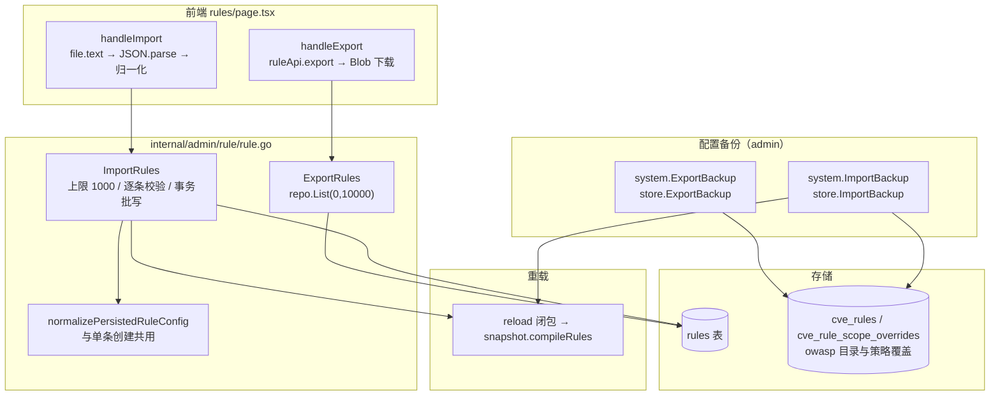
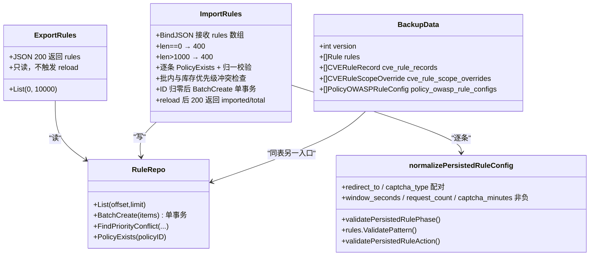
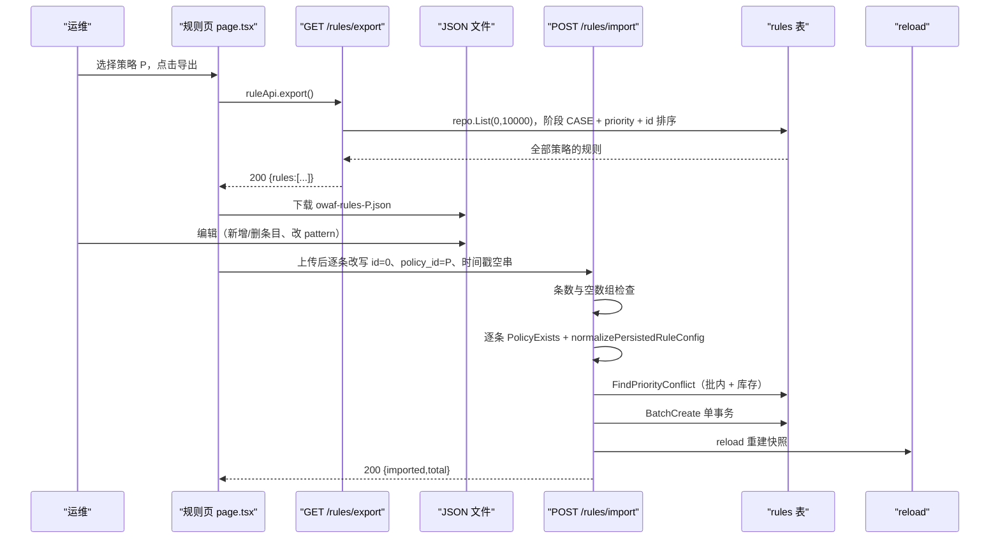
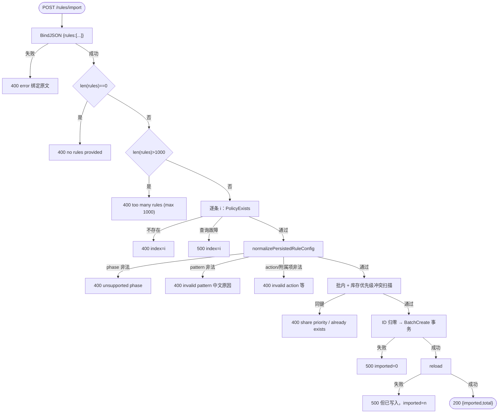
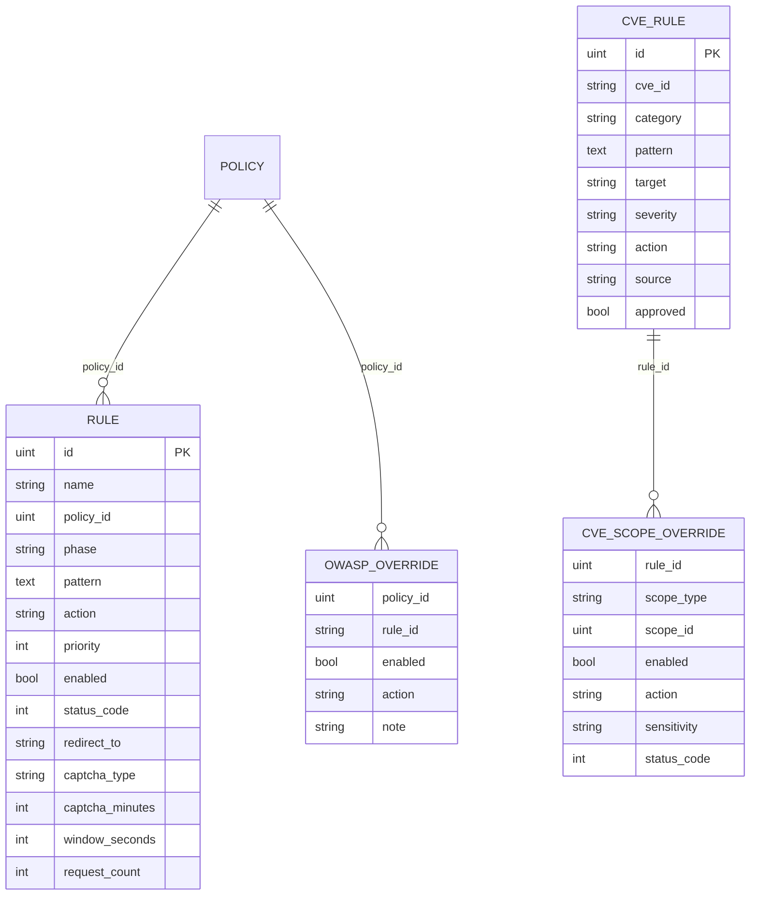
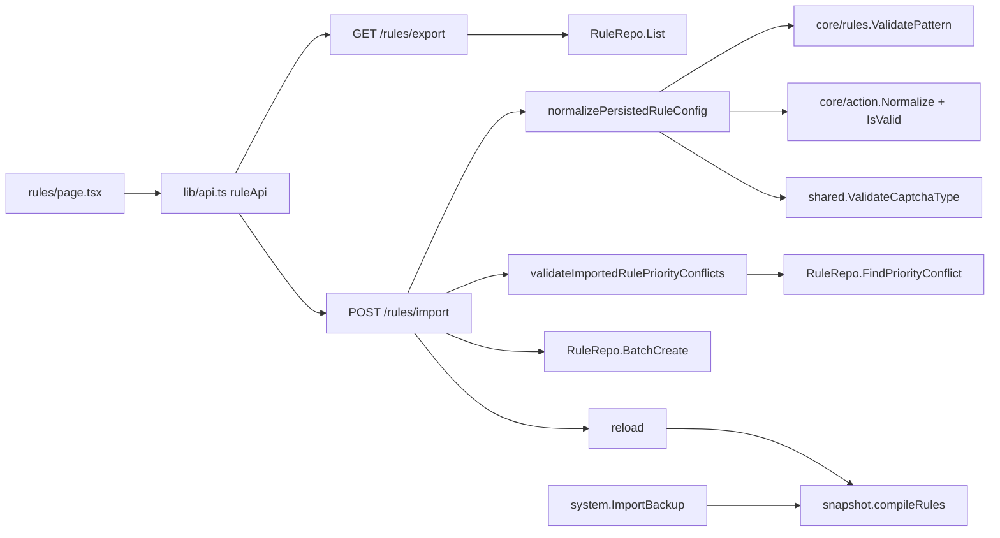
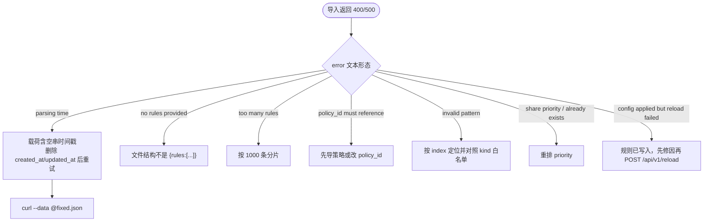

# 规则导入导出

> [返回 管理 API 系统](../管理 API 系统.md)

<cite>
**本文档引用的文件**
- [router.go](file://internal/admin/router.go)
- [config.go](file://internal/core/config.go)
- [rule.go](file://internal/admin/rule/rule.go)
- [validate.go](file://internal/admin/rule/validate.go)
- [helpers.go](file://internal/admin/shared/helpers.go)
- [rule.go](file://internal/store/repository/rule.go)
- [policy.go](file://internal/store/policy.go)
- [zero_defaults.go](file://internal/store/zero_defaults.go)
- [cve_rule.go](file://internal/store/repository/cve/cve_rule.go)
- [build.go](file://internal/snapshot/build.go)
- [backup.go](file://internal/admin/system/backup.go)
- [backup.go](file://internal/store/backup.go)
- [cve.go](file://internal/store/cve/cve.go)
- [cve_scope.go](file://internal/store/cve/cve_scope.go)
- [owasp.go](file://internal/store/owasp/owasp.go)
- [rule_test.go](file://internal/admin/rule/rule_test.go)
- [rule_import_limit_test.go](file://internal/admin/rule/rule_import_limit_test.go)
- [page.tsx](file://frontend/app/(dashboard)/rules/page.tsx)
- [api.ts](file://frontend/lib/api.ts)
- [types.ts](file://frontend/lib/types.ts)
- [规则导入导出.md](file://docs/管理 API 系统/规则管理 API/规则导入导出.md)
- [规则 CRUD 操作.md](file://docs/管理 API 系统/规则管理 API/规则 CRUD 操作.md)
- [规则管理 API.md](file://docs/管理 API 系统/规则管理 API/规则管理 API.md)
- [规则验证与测试.md](file://docs/管理 API 系统/规则管理 API/规则验证与测试.md)
- [API 端点参考.md](file://docs/管理 API 系统/REST API 设计规范/API 端点参考.md)
</cite>

## 目录

1. [简介](#简介)
2. [项目结构](#项目结构)
3. [核心组件](#核心组件)
4. [架构总览](#架构总览)
5. [详细组件分析](#详细组件分析)
6. [依赖关系分析](#依赖关系分析)
7. [性能考虑](#性能考虑)
8. [故障排查指南](#故障排查指南)
9. [结论](#结论)
10. [附录](#附录)

## 简介

本篇只讲**规则的搬运**：把一组自定义规则从数据库里取出来（导出）、把一组规则写回数据库（导入），以及跨环境同步时两者如何配对。

三条实测边界决定了本篇的写法：

- **导出是全局的，不是按策略的**。`ExportRules` 调 `repo.List(0, 10000)`，一次拿完所有策略的规则（rule.go:396-405），导出文件名里的策略号只是前端标签（page.tsx:135）。
- **导入是整批事务，任一条失败即全批不落库**。校验在前、写入在后，且写入是一次 `BatchCreate` 事务（rule.go:426-455）。
- **单条导入上限 1000**。`maxImportedRules = 1000`（rule.go:20），超限直接 400，且被拒的批次不得触发 reload（rule_import_limit_test.go:41-59）。

CVE 与 OWASP 两类规则**没有专用导入导出端点**，只能通过 admin 的配置备份链路 `GET /api/v1/backup/export` / `POST /api/v1/backup/import` 整体搬运（router.go:381-388）。

## 项目结构



**图表来源**
- [page.tsx:122-182](file://frontend/app/(dashboard)/rules/page.tsx#L122-L182)
- [rule.go:396-463](file://internal/admin/rule/rule.go#L396-L463)
- [rule.go:298-339](file://internal/admin/rule/rule.go#L298-L339)
- [backup.go:30-166](file://internal/admin/system/backup.go#L30-L166)
- [router.go:381-388](file://internal/admin/router.go#L381-L388)

| 文件 | 关键符号 | 行区间 | 导入导出中的角色 |
|---|---|:---:|---|
| `internal/admin/rule/rule.go` | `ExportRules` `ImportRules` `maxImportedRules` | 20、396-463 | 两条端点的处理器 |
| `internal/admin/rule/rule.go` | `normalizePersistedRuleConfig` | 298-339 | 单条与批量共用的校验归一 |
| `internal/admin/rule/rule.go` | `validatePersistedRulePriorityConflict` | 347-365 | 与库存量的优先级冲突 |
| `internal/admin/rule/rule.go` | `validateImportedRulePriorityConflicts` | 367-393 | 批内优先级冲突（含索引号） |
| `internal/store/repository/rule.go` | `List` `BatchCreate` | 24-32 | 全量读与事务批写 |
| `internal/store/policy.go` | `Rule` | 70-97 | 载荷字段与 JSON tag 的唯一来源 |
| `internal/admin/system/backup.go` | `ExportBackup` `ImportBackup` | 30-166 | 含规则在内的全配置搬运 |
| `frontend/app/(dashboard)/rules/page.tsx` | `handleExport` `handleImport` | 122-182 | 文件名、策略归一与时间戳清洗 |

**章节来源**
- [rule.go:20](file://internal/admin/rule/rule.go#L20)
- [rule.go:298-393](file://internal/admin/rule/rule.go#L298-L393)
- [rule.go:396-463](file://internal/admin/rule/rule.go#L396-L463)
- [rule.go:12-32](file://internal/store/repository/rule.go#L12-L32)
- [policy.go:70-97](file://internal/store/policy.go#L70-L97)
- [backup.go:30-166](file://internal/admin/system/backup.go#L30-L166)
- [page.tsx:122-182](file://frontend/app/(dashboard)/rules/page.tsx#L122-L182)

## 核心组件



**图表来源**
- [rule.go:396-463](file://internal/admin/rule/rule.go#L396-L463)
- [rule.go:298-339](file://internal/admin/rule/rule.go#L298-L339)
- [rule.go:12-32](file://internal/store/repository/rule.go#L12-L32)
- [backup.go:33-56](file://internal/store/backup.go#L33-L56)

| 组件 | 幂等性 | 失败原子性 | 是否触发 reload |
|---|:---:|:---:|:---:|
| `ExportRules` | 是（纯读） | 不适用 | 否 |
| `ImportRules` | 否（每次新建行） | 整批事务，失败零写入 | 成功才 reload |
| `system.ExportBackup` | 是（纯读） | 任一表查询失败整体失败 | 否 |
| `system.ImportBackup` | 否（按主键 upsert） | 单事务，失败回滚 | 是，并撤销访问会话 |

**章节来源**
- [rule.go:396-463](file://internal/admin/rule/rule.go#L396-L463)
- [backup.go:30-166](file://internal/admin/system/backup.go#L30-L166)
- [backup.go:78-104](file://internal/store/backup.go#L78-L104)
- [router.go:381-388](file://internal/admin/router.go#L381-L388)

## 架构总览

导出→编辑→导入是跨环境同步的唯一闭环，其中「编辑」环节最容易引入不可见差异。



**图表来源**
- [page.tsx:122-182](file://frontend/app/(dashboard)/rules/page.tsx#L122-L182)
- [rule.go:396-405](file://internal/admin/rule/rule.go#L396-L405)
- [rule.go:408-463](file://internal/admin/rule/rule.go#L408-L463)
- [rule.go:34-62](file://internal/store/repository/rule.go#L34-L62)

| 环节 | 数据形态变化 | 风险 |
|---|---|---|
| 导出 | 全策略规则 → `{rules:[...]}` | 文件名带策略号但内容不含策略过滤 |
| 落盘 | 对象数组，缩进 2 空格 | 人工编辑易漏逗号 |
| 前端归一 | `id=0`、`policy_id` 改写、时间戳置空串 | 空串触发后端绑定失败，见故障排查 |
| 后端校验 | 逐条归一，非法即返 `index` | 整批中止，不留部分结果 |
| 批写 | 新主键自增 | 与库存同优先级即冲突 |

**章节来源**
- [page.tsx:122-182](file://frontend/app/(dashboard)/rules/page.tsx#L122-L182)
- [rule.go:396-463](file://internal/admin/rule/rule.go#L396-L463)

## 详细组件分析

### 端点总表

| 方法 | 路径 | 处理函数 | 注册行 | 权限 | 上限 | 触发 reload |
|---|---|---|:---:|:---:|:---:|:---:|
| GET | `/api/v1/rules/export` | `rule.ExportRules` | 147 | readonly+ | 10000 行 | 否 |
| POST | `/api/v1/rules/import` | `rule.ImportRules` | 285 | operator+ | 1000 条 | 是 |
| GET | `/api/v1/rules/templates` | `rule.GetRuleTemplates` | 146 | readonly+ | 23 条模板 | 否 |
| GET | `/api/v1/backup/export` | `system.ExportBackup` | 381 | admin | 全配置 | 否 |
| POST | `/api/v1/backup/import` | `system.ImportBackup` | 382 | admin | `version ≤ 1` | 是 |

`/rules/import` 与 `/backup/import` 是两套语义：前者**追加**（主键归零、批量新建），后者**按主键覆盖**（保留原始 ID 以维持外键关系，`replace_mode` 可先清空配置表）。两者不可互换。

**章节来源**
- [router.go:144-147](file://internal/admin/router.go#L144-L147)
- [router.go:280-285](file://internal/admin/router.go#L280-L285)
- [router.go:381-388](file://internal/admin/router.go#L381-L388)
- [validate.go:83-277](file://internal/admin/rule/validate.go#L83-L277)
- [backup.go:30-166](file://internal/admin/system/backup.go#L30-L166)
- [backup.go:33-59](file://internal/store/backup.go#L33-L59)

### 请求参数表

| 端点 | 参数 | 位置 | 类型 | 必填 | 默认 | 约束 |
|---|---|---|---|:---:|:---:|---|
| `GET /rules/export` | - | - | - | 否 | - | 无查询参数，恒返回全表前 10000 行 |
| `POST /rules/import` | `rules` | body | array | 是 | - | 空数组返 400 `no rules provided` |
| 同上 | `rules[].name` | body | string | 否 | 空 | 仅展示用 |
| 同上 | `rules[].policy_id` | body | uint | 是 | - | 必须指向存在且未软删的策略 |
| 同上 | `rules[].phase` | body | string | 是 | - | 仅 `acl`/`signature`/`custom` |
| 同上 | `rules[].pattern` | body | string | 是 | - | 过 `rules.ValidatePattern` |
| 同上 | `rules[].action` | body | string | 是 | - | `allow` 仅限 `acl`，禁 `tag` |
| 同上 | `rules[].priority` | body | int | 是 | - | 批内与库存同策略同阶段需唯一 |
| 同上 | `rules[].enabled` | body | bool | 是 | - | 假值仍入库，编译期跳过 |
| 同上 | `rules[].status_code` | body | int | 否 | 0 | 0 表示用动作默认码 |
| 同上 | `rules[].redirect_to` | body | string | 否 | 空 | `redirect` 动作必填 |
| 同上 | `rules[].captcha_type` | body | string | 否 | 空 | 需与 `captcha_challenge` 配对 |
| 同上 | `rules[].window_seconds` `request_count` `captcha_minutes` | body | int | 否 | 0 | 负值一律 400 |
| 同上 | `rules[].id` | body | uint | 否 | 0 | 服务端强制归零，客户端传值无效 |
| `POST /backup/import` | `data` | body | object | 是 | - | `version` 缺失或 >1 直接 400 |
| `POST /backup/import` | `replace_mode` | body | bool | 否 | false | true 时先清空配置表 |

导入载荷字段名一律 snake_case，与 `store.Rule` 的 JSON tag 逐字相同（policy.go:71-96）。

**章节来源**
- [rule.go:408-441](file://internal/admin/rule/rule.go#L408-L441)
- [rule.go:288-339](file://internal/admin/rule/rule.go#L288-L339)
- [policy.go:71-96](file://internal/store/policy.go#L71-L96)
- [backup.go:92-131](file://internal/admin/system/backup.go#L92-L131)

### 导入格式与字段映射表

导出文件的每个字段在导入时的实际处理：

| 字段 | 导出值 | 导入处理 | 依据 |
|---|---|---|---|
| `id` | 原主键 | 全批置 0，由数据库重新分配 | rule.go:449-451 |
| `created_at` | RFC3339 时间 | 绑定进 `time.Time`；空串会直接 400 | policy.go:72-73 |
| `updated_at` | RFC3339 时间 | 同上，落库时由 GORM 重写 | policy.go:73 |
| `deleted_at` | **不导出** | `json:"-"`，任何端点都看不到 | policy.go:74 |
| `name` | 原值 | 原样入库 | rule.go:411 |
| `policy_id` | 原策略 | 原样校验；前端会改写为目标策略 | rule.go:427-435 |
| `phase` | `acl`/`signature`/`custom` | `TrimSpace` 后白名单校验 | rule.go:288-296 |
| `pattern` | DSL 或复合 JSON | 交 `rules.ValidatePattern`，中文错误串 | rule.go:305-307 |
| `action` | 可能是 legacy `block`/`log_only` | `action.Normalize` 归一为 `intercept`/`observe` 后入库 | rule.go:270-286 |
| `priority` | 原值 | **缺省或显式 0 会被顶替成 100**；批内与库存仍需同策略同阶段唯一 | rule.go:367-393 |
| `enabled` | bool | **显式 `false` 会被顶替成 `true`** | rule.go:411 |
| `status_code` | int | 原样入库 | rule.go:300-339 |
| `redirect_to` | string | 仅 `redirect` 动作要求非空 | rule.go:314-316 |
| `captcha_type` | string 或缺省 | 非空必须是四种类型之一且动作为 `captcha_challenge` | rule.go:317-326 |
| `window_seconds` `request_count` | int | 非负即可；两者同时 >0 时快照期包装为 `cc_rate` | rule.go:329-337 |
| `captcha_minutes` | int | 非负；0 表示继承全局有效期 | rule.go:335-337 |

一个可直接复用的导入载荷（不含时间戳字段，见故障排查）：

```json
{
  "rules": [
    {
      "name": "放行办公网段",
      "policy_id": 3,
      "phase": "acl",
      "pattern": "allow_ip:10.0.0.0/8",
      "action": "allow",
      "priority": 10,
      "enabled": true,
      "status_code": 0,
      "redirect_to": "",
      "window_seconds": 0,
      "request_count": 0,
      "captcha_minutes": 0
    },
    {
      "name": "拦截敏感文件",
      "policy_id": 3,
      "phase": "signature",
      "pattern": "block_path_regex:(?i)\\.(env|git|bak)$",
      "action": "captcha_challenge",
      "priority": 20,
      "enabled": true,
      "status_code": 0,
      "captcha_type": "slide"
    }
  ]
}
```

**章节来源**
- [rule.go:449-455](file://internal/admin/rule/rule.go#L449-L455)
- [rule.go:288-339](file://internal/admin/rule/rule.go#L288-L339)
- [rule.go:408-441](file://internal/admin/rule/rule.go#L408-L441)
- [policy.go:70-97](file://internal/store/policy.go#L70-L97)
- [build.go:938-954](file://internal/snapshot/build.go#L938-L954)

### 导入侧的 GORM 默认值顶替

单条创建与批量导入对「显式零值」的处理并不对称，这是导入最容易踩的静默改写：

| 路径 | 绑定前 | 写入 | 结果 |
|---|---|---|---|
| `POST /rules` | `ApplyModelDefaults` 先填模型默认值（`admin/rule/rule.go:103`） | `CreateWithZeroDefaults` 回写被顶替的零值（`repository/rule.go:91-98`） | 显式 `false`/`0` 如实落库 |
| `POST /rules/import` | 无 | 裸 `tx.Create(&items)`（`repository/rule.go:24-28`） | GORM 把带 `default` 标签的零值当「未设置」并写入默认值 |

实测（本地 `gorm v1.31.2` + `Rule` 同标签模型，`priority:0`、`enabled:false` 批量插入）：结构体与库行都变成 `priority=100`、`enabled=true`，且 `zero_defaults.go:70-77` 的注释明确把这列为事故源。因此导入想表达「停用」或「抢在默认优先级之前」必须显式避开零值：`enabled` 想为假就先导入再单条更新，`priority` 想为 0 就改用 1。本篇只登记，不改代码。

**章节来源**
- [rule.go:98-138](file://internal/admin/rule/rule.go#L98-L138)
- [rule.go:449-455](file://internal/admin/rule/rule.go#L449-L455)
- [rule.go:24-28](file://internal/store/repository/rule.go#L24-L28)
- [rule.go:91-98](file://internal/store/repository/rule.go#L91-L98)
- [zero_defaults.go:35-77](file://internal/store/zero_defaults.go#L35-L77)
- [policy.go:81-82](file://internal/store/policy.go#L81-L82)

### 校验失败行为表

导入的处理顺序是固定的七段（五段校验 + 一段写入 + 一段重载），每段的失败形态不同：

| 序号 | 校验 | 失败响应 | 响应额外字段 | 是否已写库 | 是否 reload |
|:---:|---|:---:|---|:---:|:---:|
| 1 | 请求体 JSON 绑定 | 400 | `error` 为绑定原文 | 否 | 否 |
| 2 | `rules` 非空、条数 ≤1000 | 400 | `no rules provided` / `too many rules (max 1000)` | 否 | 否 |
| 3 | 逐条策略存在 | 400 或 500 | 带 `index`；查询故障走 500 | 否 | 否 |
| 4 | 逐条 phase/pattern/action 归一 | 400 | 带 `index` 与中文原因 | 否 | 否 |
| 5 | 优先级冲突（批内 + 库存） | 400 或 500 | 仅 `error`：批内冲突在文案里给出两个下标，库存冲突给出冲突规则 ID | 否 | 否 |
| 6 | `BatchCreate` 事务 | 500 | `{error, imported:0, total:n}` | 回滚，零写入 | 否 |
| 7 | reload 失败 | 500 | `{error, imported:n, total:n}` | **是，已写入** | 已尝试 |

第 7 行是最需要警惕的：规则已经落库但快照未重建，返回值同时给出 `imported` 与 `total` 表明「已全部写入」，此时应修因后再 `POST /api/v1/reload`，不要重复导入。

**章节来源**
- [rule.go:408-463](file://internal/admin/rule/rule.go#L408-L463)
- [rule.go:367-393](file://internal/admin/rule/rule.go#L367-L393)
- [rule_import_limit_test.go:41-59](file://internal/admin/rule/rule_import_limit_test.go#L41-L59)
- [rule_import_limit_test.go:24-60](file://internal/admin/rule/rule_import_limit_test.go#L24-L60)

### 响应字段表

| 端点 | 字段 | 类型 | 出现条件 | 说明 |
|---|---|---|---|---|
| `GET /rules/export` | `rules` | array | 恒有 | 元素为完整 `Rule` 对象 |
| `POST /rules/import` | `imported` | int | 200 | 等于 `len(rules)` |
| `POST /rules/import` | `total` | int | 200 | 同上，二者当前恒等 |
| `POST /rules/import` | `error` | string | 400/500 | 失败原因原文 |
| `POST /rules/import` | `index` | int | 400 | 逐条校验失败的下标 |
| `POST /rules/import` | `imported:0` | int | 500（写入失败） | 表示零写入 |
| `GET /rules/templates` | `templates` | array | 恒有 | 23 条 `RuleTemplate` |
| `GET /rules/templates` | `total` | int | 恒有 | 模板条数 |
| `POST /backup/import` | `status` | string | 200 | 固定 `restored` |
| `POST /backup/import` | `rules` | int | 200 | 本次恢复的规则条数 |

成功响应示例：

```json
{
  "imported": 2,
  "total": 2
}
```

失败响应示例（逐条校验失败）：

```json
{
  "error": "invalid pattern: tls_version 需要合法的 TLS 版本标识",
  "index": 1
}
```

**章节来源**
- [rule.go:403](file://internal/admin/rule/rule.go#L403)
- [rule.go:417-461](file://internal/admin/rule/rule.go#L417-L461)
- [validate.go:271-277](file://internal/admin/rule/validate.go#L271-L277)
- [backup.go:157-164](file://internal/admin/system/backup.go#L157-L164)
- [rule.go:300-339](file://internal/admin/rule/rule.go#L300-L339)

### 导入校验决策树



**图表来源**
- [rule.go:408-463](file://internal/admin/rule/rule.go#L408-L463)
- [rule.go:288-339](file://internal/admin/rule/rule.go#L288-L339)
- [rule.go:367-393](file://internal/admin/rule/rule.go#L367-L393)

**章节来源**
- [rule.go:367-393](file://internal/admin/rule/rule.go#L367-L393)
- [rule.go:408-463](file://internal/admin/rule/rule.go#L408-L463)

### 配置备份里的规则面

`BackupData` 中与规则相关的切片共 5 个，覆盖自定义规则、CVE、OWASP、应用路由四类：

| JSON 键 | 模型 | 覆盖范围 | 导入侧处理 |
|---|---|---|---|
| `rules` | `store.Rule` | 自定义黑白名单 | 保留主键 upsert |
| `policy_owasp_rule_configs` | `owasp.PolicyOWASPRuleConfig` | OWASP 按策略覆盖 | 校验 `captcha_type`/`note`/`cisco_asa_mode` |
| `cve_rule_records` | `cve.CVERuleRecord` | CVE 目录与自定义规则 | 与目录对账后再建 |
| `cve_rule_scope_overrides` | `cve.CVERuleScopeOverride` | CVE 作用域覆盖 | 按 `(rule_id,scope,scope_id)` 唯一 |
| `application_routes` | `approute.ApplicationRouteRule` | 站点应用路由规则 | 保留站点外键 |

备份导出会做两件脱敏：威胁情报订阅的 `auth_header_value` 与 OAuth 提供方的 `client_secret` 都被替换为掩码值（backup.go:56-87），恢复后需重新录入。备份导入还会无条件撤销数据面全部访问会话（router.go:382-388），因为库里的用户被替换后旧 token 仍可能有效。



**图表来源**
- [policy.go:70-97](file://internal/store/policy.go#L70-L97)
- [cve.go:10-35](file://internal/store/cve/cve.go#L10-L35)
- [cve_scope.go:12-25](file://internal/store/cve/cve_scope.go#L12-L25)
- [owasp.go:23-38](file://internal/store/owasp/owasp.go#L23-L38)
- [backup.go:33-56](file://internal/store/backup.go#L33-L56)

**章节来源**
- [backup.go:33-56](file://internal/store/backup.go#L33-L56)
- [backup.go:56-87](file://internal/admin/system/backup.go#L56-L87)
- [backup.go:300-334](file://internal/store/backup.go#L300-L334)
- [cve.go:10-33](file://internal/store/cve/cve.go#L10-L33)
- [cve_scope.go:5-25](file://internal/store/cve/cve_scope.go#L5-L25)
- [owasp.go:5-38](file://internal/store/owasp/owasp.go#L5-L38)
- [router.go:381-388](file://internal/admin/router.go#L381-L388)

### 前端与后端契约差异

| 行为 | 前端（page.tsx） | 后端（rule.go） | 差异后果 |
|---|---|---|---|
| 导出范围 | 按钮标签按当前策略 | 恒返回全策略规则 | 文件含别的策略的规则 |
| 导入目标 | 强制改写 `policy_id` 为当前策略 | 只校验策略是否存在 | 跨策略搬运被前端「锁定」 |
| `id` | 置 0 | 再置一次 0 | 无冲突 |
| 时间戳 | 置空串 `""` | 绑定进 `time.Time` | 绑定失败直接 400 |
| 空文件 | 前端 toast `importEmpty` | 后端 400 `no rules provided` | 双层防护 |
| 权限 | `canManage` 为 admin/operator | `opsGroup` 同档 | 一致 |

最后一行需要实测背书：前端在提交前把 `created_at`、`updated_at` 归一为空串（page.tsx:167-168），而 `store.Rule` 的这两个字段是 `time.Time`（policy.go:72-73）。`BindJSON` 对空串报 `parsing time "" as "2006-01-02T15:04:05Z07:00"`，导入以 400 结束。既有测试用的最小载荷不带时间戳（rule_test.go 的 `TestImportRulesSuccess`），所以这条路径没有回归保护。本篇只登记，不改代码。

**章节来源**
- [page.tsx:122-182](file://frontend/app/(dashboard)/rules/page.tsx#L122-L182)
- [rule.go:408-424](file://internal/admin/rule/rule.go#L408-L424)
- [policy.go:70-97](file://internal/store/policy.go#L70-L97)
- [rule_test.go:1](file://internal/admin/rule/rule_test.go#L1)
- [types.ts:447-455](file://frontend/lib/types.ts#L447-L455)

## 依赖关系分析



**图表来源**
- [rule.go:396-463](file://internal/admin/rule/rule.go#L396-L463)
- [rule.go:298-339](file://internal/admin/rule/rule.go#L298-L339)
- [rule.go:12-32](file://internal/store/repository/rule.go#L12-L32)
- [api.ts:843-857](file://frontend/lib/api.ts#L843-L857)

| 依赖方 | 被依赖方 | 说明 |
|---|---|---|
| `ImportRules` | `rules.ValidatePattern` | 与单条创建同一校验器，无旁路 |
| `ImportRules` | `shared.ValidateCaptchaType` | 规则级验证码类型 |
| `ImportRules` | `Repository.PolicyExists` | 逐条一次查询，未批量化 |
| `ExportRules` | `RuleRepo.List` | 固定 offset 0、limit 10000 |
| `system.ImportBackup` | `reload` + 缓存失效回调 | CVE 规范快照与 OWASP 读快照 |
| `rules/page.tsx` | `ruleApi.import` | 唯一的前端导入入口 |

**章节来源**
- [rule.go:396-463](file://internal/admin/rule/rule.go#L396-L463)
- [api.ts:843-857](file://frontend/lib/api.ts#L843-L857)
- [router.go:381-388](file://internal/admin/router.go#L381-L388)
- [cve_rule.go:107-114](file://internal/store/repository/cve/cve_rule.go#L107-L114)

## 性能考虑

- **1000 条上限来自数据库而非协议**：`BatchCreate` 走 `tx.Create(&items)`，绑定变量数随条数线性增长，SQLite 变量上限 2077 使 2100 条必失败，因此上限取 1000（rule_import_limit_test.go:9-16 的注释与断言）。
- **逐条 `PolicyExists` 是 N 次查询**：导入 1000 条即 1000 次 COUNT，前端分批不会减少总量，只会增加请求数。
- **导出用 10000 行上限换一次往返**：规则数超过 1 万时导出会静默截断，需改用备份端点。
- **优先级冲突检查在写入前完成**：批内用 map、库存用一次查询/条（rule.go:367-393），失败即零写入，避免「半批回滚」成本。
- **建议**：跨环境同步按策略拆分文件，单批控制在 200 条以内，导入前先跑一次 `/rules/validate`（见 [规则验证与测试.md](file://docs/管理%20API%20系统/规则管理%20API/规则验证与测试.md)）。

**章节来源**
- [rule.go:421-441](file://internal/admin/rule/rule.go#L421-L441)
- [rule.go:367-393](file://internal/admin/rule/rule.go#L367-L393)
- [rule_import_limit_test.go:9-16](file://internal/admin/rule/rule_import_limit_test.go#L9-L16)
- [rule.go:396-405](file://internal/admin/rule/rule.go#L396-L405)

## 故障排查指南



**图表来源**
- [rule.go:413-461](file://internal/admin/rule/rule.go#L413-L461)
- [rule.go:298-339](file://internal/admin/rule/rule.go#L298-L339)

自检命令（本地 Go 环境可直接跑；管理端口默认 `:9443`，由 `MY_OPENWAF_ADMIN_BIND` 覆盖，见 config.go:362-364）：

```bash
# 1. 后端是否接受空串时间戳：预期看到 parsing time "" as ... 类错误
cat <<'EOF' > /tmp/import-probe.json
{"rules":[{"id":0,"created_at":"","updated_at":"","name":"probe","policy_id":1,"phase":"custom","pattern":"block_path:/probe","action":"observe","priority":1,"enabled":true}]}
EOF
curl -sS -X POST http://127.0.0.1:9443/api/v1/rules/import \
  -H "Authorization: Bearer {占位}" -H "Content-Type: application/json" \
  --data @/tmp/import-probe.json

# 2. 去掉时间戳字段后应返回 {"imported":1,"total":1}
jq 'del(.rules[].created_at, .rules[].updated_at, .rules[].id)' /tmp/import-probe.json > /tmp/import-ok.json
curl -sS -X POST http://127.0.0.1:9443/api/v1/rules/import \
  -H "Authorization: Bearer {占位}" -H "Content-Type: application/json" \
  --data @/tmp/import-ok.json

# 3. 导出是否含其他策略：统计 policy_id 分布
curl -sS http://127.0.0.1:9443/api/v1/rules/export \
  -H "Authorization: Bearer {占位}" | jq '[.rules[].policy_id] | group_by(.) | map({policy_id: .[0], n: length})'
```

| 症状 | 根因 | 处置 |
|---|---|---|
| 导入必返 400 且错误带 `parsing time ""` | 前端把时间戳置空串 | 手工删字段，或用 API 直连 |
| 导入的文件里有别的策略规则 | 导出是全局 | 前端已强制改写 `policy_id`，API 直连需自行过滤 |
| `imported` 与预期条数不符 | 无：二者恒等 | 以 `total` 判断批大小 |
| 导入成功但规则不生效 | kind 越界被快照丢弃 | 见验证与测试篇的 `comm -23` 自检 |
| 500 且带 `imported` | 写入成功、reload 失败 | 修因后 `POST /api/v1/reload`，勿重复导入 |

**章节来源**
- [page.tsx:151-182](file://frontend/app/(dashboard)/rules/page.tsx#L151-L182)
- [rule.go:413-461](file://internal/admin/rule/rule.go#L413-L461)
- [rule.go:396-405](file://internal/admin/rule/rule.go#L396-L405)
- [config.go:362-364](file://internal/core/config.go#L362-L364)

## 结论

规则的导入导出在实现上是「一条全表读 + 一条整批事务写」，简单但没有缓冲：导出忽略策略边界，导入忽略客户端传来的主键，中间所有语义差异都压在校验层。

- **成果**：本篇把五段校验、16 个字段的导入映射、备份侧 5 个规则切片整理成可核对表格，并用实测补了一条前端→后端契约断点（空串时间戳导致导入必失败，且现有测试无覆盖）。
- **原则落点**：KISS 体现为复用单条创建的 `normalizePersistedRuleConfig`，导入没有第二套校验实现；DRY 同样落在这一次复用上；SRP 让 `ExportRules` 只做读、`ImportRules` 只做校验与批写、reload 由注入闭包负责；YAGNI 表现为没有「增量导入」「按名去重」「导入预演」这类未实现能力——需要时应用 `POST /rules/validate` 逐条预检。
- **下一步**：若要修断点，最小改动是在前端 `handleImport` 里删除时间戳字段而不是改为空串；本篇不改代码，只在故障排查与问题登记中留痕。

## 附录

### 错误码表

| HTTP | 端点 | 错误文案 | 触发条件 | 位置 |
|:---:|---|---|---|---|
| 400 | `POST /rules/import` | `parsing time "" as …` | 载荷带空串时间戳 | rule.go:413 |
| 400 | `POST /rules/import` | `no rules provided` | `rules` 缺失或为空数组 | rule.go:417-419 |
| 400 | `POST /rules/import` | `too many rules (max 1000)` | 条数超过 1000 | rule.go:421-423 |
| 400 | `POST /rules/import` | `policy_id must reference an existing policy` + `index` | 策略不存在或已软删 | rule.go:433 |
| 400 | `POST /rules/import` | `unsupported phase: only acl, signature, custom …` + `index` | 阶段非法 | rule.go:301 |
| 400 | `POST /rules/import` | `invalid pattern: …` + `index` | 表达式语义校验失败 | rule.go:305-306 |
| 400 | `POST /rules/import` | `invalid action` + `index` | 动作非法或 `allow` 用在非 `acl` | rule.go:309-312 |
| 400 | `POST /rules/import` | `redirect_to required` + `index` | `redirect` 无目标 | rule.go:314-316 |
| 400 | `POST /rules/import` | `invalid captcha_type` / `captcha_type requires captcha_challenge action` | 验证码类型与动作不配对 | rule.go:317-326 |
| 400 | `POST /rules/import` | `window_seconds must be non-negative` 等 | 执行参数为负 | rule.go:329-337 |
| 400 | `POST /rules/import` | `import rules at indexes i and j share priority …` | 批内优先级同键 | rule.go:376-384 |
| 400 | `POST /rules/import` | `priority N already exists in policy P phase X (rule id R)` | 与库存优先级同键 | rule.go:358-364 |
| 500 | `POST /rules/import` | `{error, imported:0, total:n}` | 批量写入失败（事务回滚） | rule.go:452-454 |
| 500 | `POST /rules/import` | `config applied but reload failed: …` | 已写入，快照重建失败 | rule.go:457-459 |
| 400 | `GET /rules/export` | 仓库错误原文 | 数据库读失败返 500；无 400 分支 | rule.go:398-401 |
| 400 | `POST /backup/import` | `invalid backup json: …` | 备份体解析失败 | backup.go:121 |
| 400 | `POST /backup/import` | `missing or invalid backup version` | `version` 为 0 | backup.go:124-126 |
| 400 | `POST /backup/import` | `unsupported backup version N (max supported 1)` | 版本高于 `BackupVersion` | backup.go:128-130 |
| 400 | `POST /backup/import` | `invalid rule config backup: …` | 规则级 `captcha_type`/`note`/`cisco_asa_mode` 非法 | backup.go:300-334 |
| 500 | `POST /backup/import` | `import failed, check server logs for details` | 事务内其他错误 | backup.go:141-143 |

**章节来源**
- [rule.go:300-339](file://internal/admin/rule/rule.go#L300-L339)
- [rule.go:358-393](file://internal/admin/rule/rule.go#L358-L393)
- [rule.go:408-463](file://internal/admin/rule/rule.go#L408-L463)
- [backup.go:117-166](file://internal/admin/system/backup.go#L117-L166)
- [backup.go:300-334](file://internal/store/backup.go#L300-L334)

### 规则模板清单

`GET /api/v1/rules/templates` 返回 23 条模板，字段为 `name`/`description`/`pattern`/`category`/`phase`/`action`（validate.go:25-32）。按类别汇总：

| 类别 | 条数 | 代表 pattern | 默认阶段 | 默认动作 |
|---|:---:|---|:---:|:---:|
| IP 过滤 | 2 | `block_ip:192.168.1.100`、`allow_ip:10.0.0.0/8` | `acl` | `intercept` / `allow` |
| 路径过滤 | 3 | `block_path:/admin`、`block_path_regex:(?i)\.(git\|env\|bak)$`、`block_path_exact:/wp-admin/install.php` | `acl`/`signature` | `intercept` |
| 查询过滤 | 2 | `block_query_contains:union select`、`block_query_regex:(?i)(union\|select\|...)` | `custom` | `intercept` |
| Header 过滤 | 2 | `block_header:X-Scanner:sqlmap`、`block_header_regex:User-Agent:(?i)(bot\|crawler)` | `acl`/`signature` | `intercept` |
| 方法与内容 | 2 | `block_method:TRACE`、`block_content_type:application/x-www-form-urlencoded` | `acl` | `intercept` |
| User-Agent 过滤 | 2 | `block_user_agent:curl`、`block_user_agent_regex:(?i)(nikto\|nmap\|masscan)` | `acl`/`signature` | `intercept` |
| 指纹过滤 | 7 | `tls_ja3`、`tls_ja3_hash`、`tls_ja4`、`tls_version`、`tls_sni`、`tls_alpn`、`tls_cipher_suites` | `custom` | `intercept` |
| 指纹过滤（顺序） | 1 | `header_order_contains:user-agent,accept` | `custom` | `intercept` |
| 复合规则 | 2 | `{"op":"and","children":[...]}`、`{"op":"or","children":[...]}` | `custom` | `intercept` |

模板不是导入端点的替代品：它只供前端填充表单，真正入库仍走 `POST /rules` 或 `POST /rules/import`。指纹过滤 8 条里 `tls_cipher_suites` 与 `header_order_contains` 属运行期派生字段类规则，试运行接口的覆盖情况见验证与测试篇。

**章节来源**
- [validate.go:25-277](file://internal/admin/rule/validate.go#L25-L277)
- [types.ts:437-445](file://frontend/lib/types.ts#L437-L445)
- [api.ts:856](file://frontend/lib/api.ts#L856)

### 跨环境同步流程

1. 源环境 `GET /api/v1/rules/export`，保存为 `owaf-rules-{policyId}.json`
2. 用 `jq` 删除 `id`、`created_at`、`updated_at`，并把 `policy_id` 改成目标环境的策略号
3. 目标环境先确认策略存在（`GET /api/v1/policies`）
4. `POST /api/v1/rules/import`，单批 ≤1000 条
5. 用 `GET /api/v1/sites/:id/rules` 复核目标站点生效策略下的规则
6. 若规则用了 30 项白名单之外的 kind，先按验证与测试篇的差集自检再决定是否替换

[本节为总结，无需特定文件来源]
