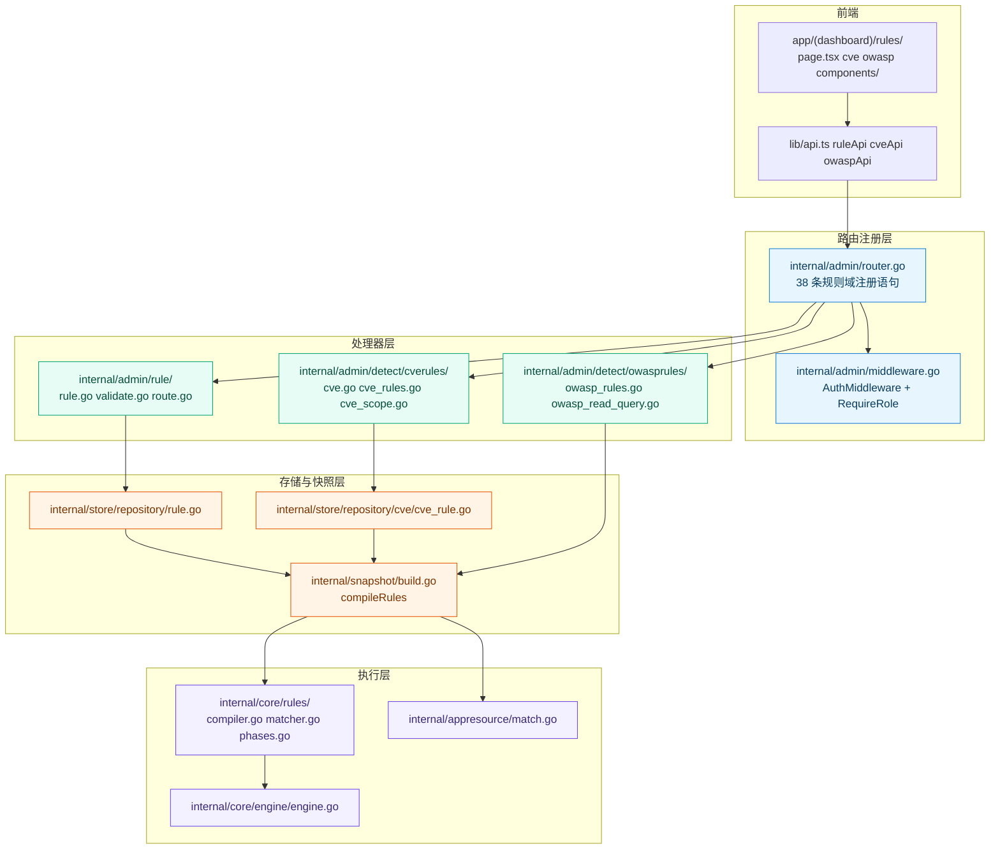
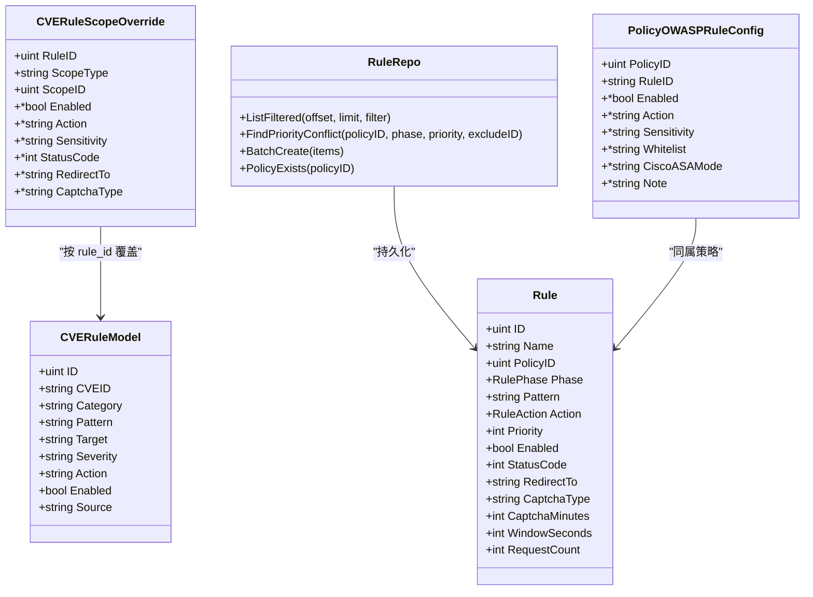
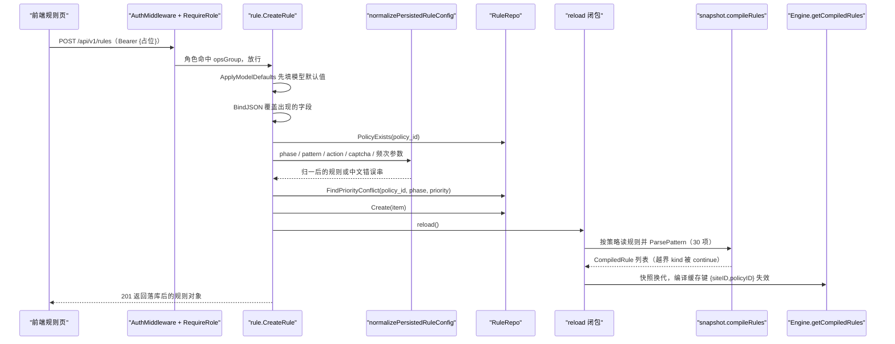
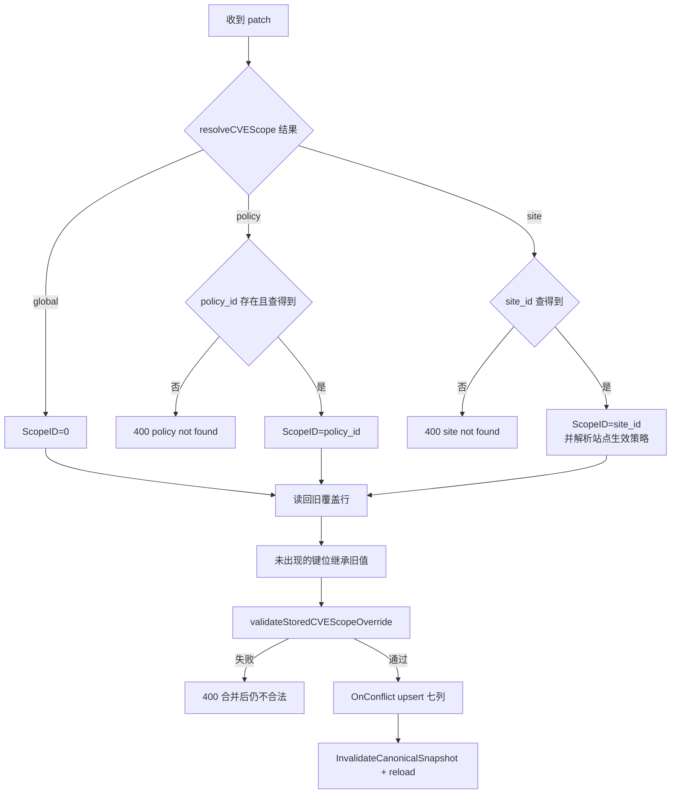
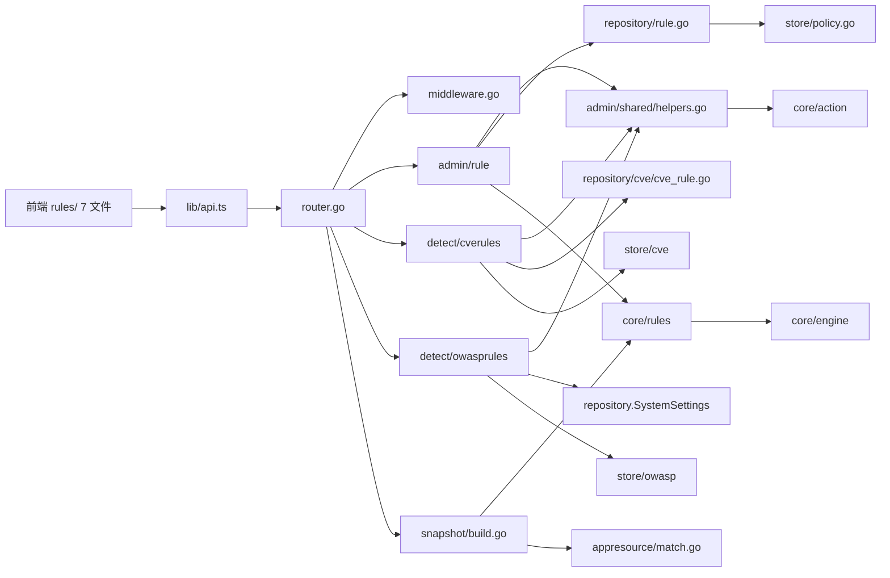
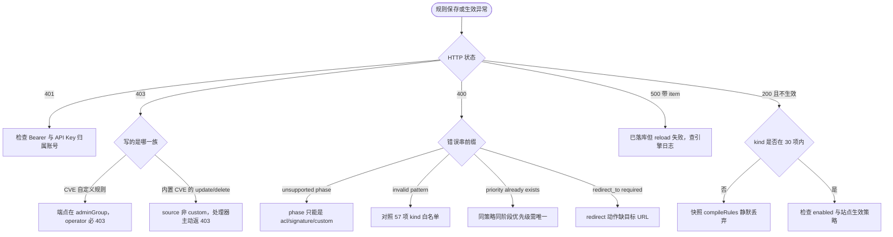

# 规则管理 API

> [返回 管理 API 系统](../管理 API 系统.md)

<cite>
**本文档引用的文件**
- [router.go](file://internal/admin/router.go)
- [middleware.go](file://internal/admin/middleware.go)
- [rule.go](file://internal/admin/rule/rule.go)
- [validate.go](file://internal/admin/rule/validate.go)
- [route.go](file://internal/admin/rule/route.go)
- [helpers.go](file://internal/admin/shared/helpers.go)
- [backup.go](file://internal/admin/system/backup.go)
- [cve.go](file://internal/admin/detect/cverules/cve.go)
- [cve_rules.go](file://internal/admin/detect/cverules/cve_rules.go)
- [cve_scope.go](file://internal/admin/detect/cverules/cve_scope.go)
- [feed.go](file://internal/waf/cve/feed.go)
- [owasp_rules.go](file://internal/admin/detect/owasprules/owasp_rules.go)
- [owasp_read_query.go](file://internal/admin/detect/owasprules/owasp_read_query.go)
- [detectlimit.go](file://internal/admin/detect/detectlimit/detectlimit.go)
- [policy.go](file://internal/store/policy.go)
- [rule.go](file://internal/store/repository/rule.go)
- [cve_rule.go](file://internal/store/repository/cve/cve_rule.go)
- [cve.go](file://internal/store/cve/cve.go)
- [cve_scope.go](file://internal/store/cve/cve_scope.go)
- [owasp.go](file://internal/store/owasp/owasp.go)
- [app_route.go](file://internal/store/approute/app_route.go)
- [compiler.go](file://internal/core/rules/compiler.go)
- [matcher.go](file://internal/core/rules/matcher.go)
- [phases.go](file://internal/core/rules/phases.go)
- [action.go](file://internal/core/action/action.go)
- [engine.go](file://internal/core/engine/engine.go)
- [build.go](file://internal/snapshot/build.go)
- [match.go](file://internal/appresource/match.go)
- [utils.go](file://internal/utils/utils.go)
- [page.tsx](file://frontend/app/(dashboard)/rules/page.tsx)
- [rule-pattern-mapper.ts](file://frontend/app/(dashboard)/rules/components/rule-pattern-mapper.ts)
- [rule-form-dialog.tsx](file://frontend/app/(dashboard)/rules/components/rule-form-dialog.tsx)
- [builtin-rule-edit-dialog.tsx](file://frontend/app/(dashboard)/rules/components/builtin-rule-edit-dialog.tsx)
- [use-api.ts](file://frontend/hooks/use-api.ts)
- [types.ts](file://frontend/lib/types.ts)
- [api.ts](file://frontend/lib/api.ts)
- [规则 CRUD 操作.md](file://docs/管理 API 系统/规则管理 API/规则 CRUD 操作.md)
- [规则导入导出.md](file://docs/管理 API 系统/规则管理 API/规则导入导出.md)
- [规则验证与测试.md](file://docs/管理 API 系统/规则管理 API/规则验证与测试.md)
- [API 端点参考.md](file://docs/管理 API 系统/REST API 设计规范/API 端点参考.md)
- [错误处理机制.md](file://docs/管理 API 系统/REST API 设计规范/错误处理机制.md)
</cite>

## 目录

1. [简介](#简介)
2. [项目结构](#项目结构)
3. [核心组件](#核心组件)
4. [架构总览](#架构总览)
5. [详细组件分析](#详细组件分析)
6. [依赖关系分析](#依赖关系分析)
7. [性能考虑](#性能考虑)
8. [故障排查指南](#故障排查指南)
9. [结论](#结论)
10. [附录](#附录)

## 简介

规则管理 API 是控制面里唯一负责「检测规则」的接口族，覆盖三类彼此独立的规则体系：

- **自定义规则**（`store.Rule`，`/api/v1/rules*`）：管理员用 DSL 或复合 JSON 表达的黑白名单，共 17 个端点。
- **CVE 规则**（`cve_rules` 表 + 作用域覆盖表，`/api/v1/cve-rules*`）：内置目录与自定义探测器，共 11 个端点。
- **OWASP 规则**（目录表 + 按策略覆盖表，`/api/v1/owasp-rules*`）：553 条目录项的启停、动作与敏感度覆盖，共 10 个端点。

本篇是这三族端点的**索引与对照层**：给出端点总表、权限分组、请求参数、响应字段与错误码的权威取值，并把细节让给同目录的三篇专题文档。单条 `/rules*` 端点的逐条规范见 [API 端点参考.md](file://docs/管理 API 系统/REST API 设计规范/API 端点参考.md) 与 [规则 CRUD 操作.md](file://docs/管理%20API%20系统/规则管理%20API/规则%20CRUD%20操作.md)，本篇不重复其表格。

三个必须提前知道的实测结论：

1. **写操作只有 POST**。全库 admin 路由零 `PUT`/`DELETE`，更新与删除走 `/{id}/update`、`/{id}/delete`，状态切换走 `/toggle`、`/start`、`/stop`。
2. **CVE 自定义规则的增删改仅 admin**。`POST /api/v1/cve-rules`、`/api/v1/cve-rules/:id/update`、`/api/v1/cve-rules/:id/delete` 注册在 `adminGroup`（router.go:410-412），operator 无权；旧文档写的 admin/operator 是错的。
3. **规则能否生效取决于两套白名单**。保存期用 57 项 kind 白名单，快照编译期用 30 项，差集 27 项会被静默丢弃，详见 [规则验证与测试.md](file://docs/管理%20API%20系统/规则管理%20API/规则验证与测试.md)。

## 项目结构

规则管理 API 的代码按「路由注册 → 处理器 → 校验归一 → 仓储 → 快照编译 → 引擎执行」六段分层，前后端各持一半契约。



**图表来源**
- [router.go:144-147](file://internal/admin/router.go#L144-L147)
- [router.go:193-195](file://internal/admin/router.go#L193-L195)
- [router.go:220-227](file://internal/admin/router.go#L220-L227)
- [router.go:280-285](file://internal/admin/router.go#L280-L285)
- [router.go:317-328](file://internal/admin/router.go#L317-L328)
- [router.go:345-348](file://internal/admin/router.go#L345-L348)
- [router.go:410-412](file://internal/admin/router.go#L410-L412)
- [build.go:920-936](file://internal/snapshot/build.go#L920-L936)
- [engine.go:625-646](file://internal/core/engine/engine.go#L625-L646)

| 层 | 文件 | 行数 | 规则域职责 |
|---|---|:---:|---|
| 路由 | `internal/admin/router.go` | 465 | 38 条规则域注册语句与三个权限组 |
| 路由 | `internal/admin/middleware.go` | 334 | Bearer JWT / API Key 认证、`RequireRole` 角色闸 |
| 处理器 | `internal/admin/rule/rule.go` | 463 | 自定义规则 CRUD、试运行、导入导出、优先级冲突 |
| 处理器 | `internal/admin/rule/validate.go` | 277 | `ValidateRule`、`ValidateRuleResponse`、23 条 `RuleTemplate` |
| 处理器 | `internal/admin/rule/route.go` | 312 | 应用路由规则 CRUD、录制资源查询与清空 |
| 处理器 | `internal/admin/detect/cverules/` | 955 | CVE 目录读写、作用域覆盖、feed 同步与统计 |
| 处理器 | `internal/admin/detect/owasprules/` | 959 | OWASP 目录视图、按策略覆盖、批量与重置 |
| 存储 | `internal/store/policy.go` | 97 | `Rule` 模型、`RulePhase`、`RuleAction`、`NormalizeAction` |
| 存储 | `internal/store/repository/rule.go` | 119 | 分页过滤、执行序排序、优先级冲突查询 |
| 快照 | `internal/snapshot/build.go` | 1644 | `ParsePattern`（30 项）、`compileRules` 静默丢弃点 |
| 执行 | `internal/core/rules/` | 4048 | `knownPrefixes`（57 项）、编译、匹配器、阶段链 |

**章节来源**
- [router.go:89-440](file://internal/admin/router.go#L89-L440)
- [rule.go:1-463](file://internal/admin/rule/rule.go#L1-L463)
- [validate.go:1-277](file://internal/admin/rule/validate.go#L1-L277)
- [route.go:1-312](file://internal/admin/rule/route.go#L1-L312)
- [cve.go:1-409](file://internal/admin/detect/cverules/cve.go#L1-L409)
- [owasp_rules.go:1-523](file://internal/admin/detect/owasprules/owasp_rules.go#L1-L523)
- [rule.go:1-119](file://internal/store/repository/rule.go#L1-L119)
- [build.go:920-1222](file://internal/snapshot/build.go#L920-L1222)

## 核心组件



**图表来源**
- [policy.go:70-97](file://internal/store/policy.go#L70-L97)
- [feed.go:36-56](file://internal/waf/cve/feed.go#L36-L56)
- [cve_scope.go:12-25](file://internal/store/cve/cve_scope.go#L12-L25)
- [owasp.go:23-38](file://internal/store/owasp/owasp.go#L23-L38)
- [rule.go:12-119](file://internal/store/repository/rule.go#L12-L119)
- [app_route.go:39-55](file://internal/store/approute/app_route.go#L39-L55)

| 组件 | 归属 | 关键符号 | 职责 |
|---|---|---|---|
| 自定义规则处理器 | `internal/admin/rule` | `ListRules` `CreateRule` `UpdateRule` `DeleteRule` `TestRule` `ExportRules` `ImportRules` | 规则 CRUD、试运行、批量导入导出 |
| 校验与模板 | `internal/admin/rule` | `ValidateRule` `RuleTemplate` `normalizePersistedRuleConfig` | 表达式校验与 23 条内置模板 |
| 应用路由规则 | `internal/admin/rule` | `CreateApplicationRouteRule` `validAppRouteTarget` | 站点级资源画像规则（9 目标 / 8 操作符） |
| CVE 规则处理器 | `internal/admin/detect/cverules` | `ListCVERules` `CreateCVERule` `UpdateSingleCVERule` `BatchUpdateCVERules` `ResetCVERuleOverride` | 目录读取、作用域覆盖、自定义探测器 |
| OWASP 规则处理器 | `internal/admin/detect/owasprules` | `ListOWASPRulesFromRegistry` `UpdateSingleOWASPRule` `BatchUpdateOWASPRules` | 目录视图与按策略覆盖 |
| 规则仓库 | `internal/store/repository` | `RuleRepo` `CVERuleRepo` | 分页、执行序、优先级冲突、快照缓存 |
| 编译与快照装配 | `internal/core/rules` `internal/snapshot` | `ParsePattern` `Compile` `buildMatcher` `compileRules` | 57 项 kind 编译；30 项 kind 入快照，差集在此丢弃 |

**章节来源**
- [rule.go:22-463](file://internal/admin/rule/rule.go#L22-L463)
- [validate.go:13-277](file://internal/admin/rule/validate.go#L13-L277)
- [route.go:108-312](file://internal/admin/rule/route.go#L108-L312)
- [cve.go:112-409](file://internal/admin/detect/cverules/cve.go#L112-L409)
- [cve_rules.go:49-179](file://internal/admin/detect/cverules/cve_rules.go#L49-L179)
- [owasp_rules.go:100-523](file://internal/admin/detect/owasprules/owasp_rules.go#L100-L523)
- [cve_rule.go:43-147](file://internal/store/repository/cve/cve_rule.go#L43-L147)
- [compiler.go:119-170](file://internal/core/rules/compiler.go#L119-L170)
- [build.go:920-1222](file://internal/snapshot/build.go#L920-L1222)

## 架构总览

一次自定义规则写入的完整链路是「请求 → 校验 → 编译 → 落库 → reload」，五步任一失败都不会留下半条规则。



**图表来源**
- [middleware.go:42-147](file://internal/admin/middleware.go#L42-L147)
- [rule.go:98-138](file://internal/admin/rule/rule.go#L98-L138)
- [rule.go:298-339](file://internal/admin/rule/rule.go#L298-L339)
- [rule.go:69-84](file://internal/store/repository/rule.go#L69-L84)
- [build.go:275](file://internal/snapshot/build.go#L275)
- [build.go:920-936](file://internal/snapshot/build.go#L920-L936)
- [engine.go:386-390](file://internal/core/engine/engine.go#L386-L390)

链路上除最后一步「快照编译」外，任一失败都返回 4xx/5xx 且不会留下半条规则；只有快照编译不报错——越界 kind 在那里被静默跳过，这正是「保存成功但不生效」的唯一成因。各步的对外状态码见附录错误码表。

**章节来源**
- [rule.go:98-138](file://internal/admin/rule/rule.go#L98-L138)
- [rule.go:298-365](file://internal/admin/rule/rule.go#L298-L365)
- [rule.go:128-135](file://internal/admin/rule/rule.go#L128-L135)
- [middleware.go:42-147](file://internal/admin/middleware.go#L42-L147)
- [build.go:275](file://internal/snapshot/build.go#L275)
- [engine.go:386-390](file://internal/core/engine/engine.go#L386-L390)

## 详细组件分析

### 权限分组与端点分布

三个路由组的角色集合由 `RequireRole` 声明式给定（router.go:125、256、373），规则域 38 条端点按组分布如下。

| 路由组 | 允许角色 | 规则域端点数 | 注册行区间 |
|---|---|:---:|---|
| `readGroup` | admin、operator、readonly | 14 | 144-147、193-195、220-222、224-227 |
| `opsGroup` | admin、operator | 21 | 280-285、317-321、323-328、345-348 |
| `adminGroup` | admin | 3 | 410-412 |

`readGroup` 里唯一的 POST 是只读语义的 `/certificates/parse`；规则域不落库的两条写接口 `/rules/test`、`/rules/validate` 位于 `opsGroup`（rule.go:224、validate.go:34），只读角色连试运行都不允许。API Key 认证路径的角色取**归属账号**而非固定 admin（middleware.go:103-120）。

**章节来源**
- [router.go:124-125](file://internal/admin/router.go#L124-L125)
- [router.go:255-256](file://internal/admin/router.go#L255-L256)
- [router.go:372-373](file://internal/admin/router.go#L372-L373)
- [middleware.go:103-120](file://internal/admin/middleware.go#L103-L120)

### CVE 规则端点总表

11 条端点全部逐字取自注册语句。写权限分两档：作用域覆盖走 `opsGroup`，自定义探测器本体走 `adminGroup`。

| 方法 | 路径 | 处理函数 | 注册行 | 权限 | 是否 reload |
|---|---|---|:---:|:---:|:---:|
| GET | `/api/v1/cve-rules` | `cverules.ListCVERules` | 220 | readonly+ | - |
| GET | `/api/v1/cve-rules/stats` | `cverules.GetCVERuleStats` | 221 | readonly+ | - |
| GET | `/api/v1/cve-feed/status` | `cverules.GetCVEFeedStatus` | 222 | readonly+ | - |
| POST | `/api/v1/cve-rules/:id/toggle` | `cverules.ToggleCVERule` | 317 | operator+ | 是 |
| POST | `/api/v1/cve-rules/:id/patch` | `cverules.UpdateSingleCVERule` | 318 | operator+ | 是 |
| POST | `/api/v1/cve-rules/:id/reset` | `cverules.ResetCVERuleOverride` | 319 | operator+ | 是 |
| POST | `/api/v1/cve-rules/batch` | `cverules.BatchUpdateCVERules` | 320 | operator+ | 是 |
| POST | `/api/v1/cve-rules/sync` | `cverules.SyncCVERules` | 321 | operator+ | 否 |
| POST | `/api/v1/cve-rules` | `cverules.CreateCVERule` | 410 | admin | 是 |
| POST | `/api/v1/cve-rules/:id/update` | `cverules.UpdateCVERule` | 411 | admin | 是 |
| POST | `/api/v1/cve-rules/:id/delete` | `cverules.DeleteCVERule` | 412 | admin | 是 |

`/cve-rules/sync` 只调 `feedMgr.SyncNow()` 并 `InvalidateCanonicalSnapshot()`，不触发快照重建 reload（cve.go:369-385）；`toggle`、`update`、`delete` 三条对 `source != "custom"` 的目录规则直接返 403（cve.go:205-208、297-300、330-333）。

**章节来源**
- [router.go:220-222](file://internal/admin/router.go#L220-L222)
- [router.go:317-321](file://internal/admin/router.go#L317-L321)
- [router.go:410-412](file://internal/admin/router.go#L410-L412)
- [cve.go:112-385](file://internal/admin/detect/cverules/cve.go#L112-L385)
- [cve_rules.go:49-179](file://internal/admin/detect/cverules/cve_rules.go#L49-L179)

### OWASP 规则端点总表

10 条端点是两组等价路由：`/owasp-rules*` 与 `/policies/:policyId/owasp-rules*` 复用同一批处理函数，差异只在策略 ID 的来源（路径段优先）。

| 方法 | 路径 | 处理函数 | 注册行 | 权限 |
|---|---|---|:---:|:---:|
| GET | `/api/v1/owasp-rules` | `ListOWASPRulesFromRegistry` | 224 | readonly+ |
| GET | `/api/v1/owasp-rules/stats` | `GetOWASPRuleStats` | 225 | readonly+ |
| GET | `/api/v1/policies/:policyId/owasp-rules` | `ListOWASPRulesFromRegistry` | 226 | readonly+ |
| GET | `/api/v1/policies/:policyId/owasp-rules/stats` | `GetOWASPRuleStats` | 227 | readonly+ |
| POST | `/api/v1/owasp-rules/:id/update` | `UpdateSingleOWASPRule` | 323 | operator+ |
| POST | `/api/v1/owasp-rules/:id/reset` | `ResetOWASPRuleOverride` | 324 | operator+ |
| POST | `/api/v1/owasp-rules/batch` | `BatchUpdateOWASPRules` | 325 | operator+ |
| POST | `/api/v1/policies/:policyId/owasp-rules/:id` | `UpdateSingleOWASPRule` | 326 | operator+ |
| POST | `/api/v1/policies/:policyId/owasp-rules/:id/reset` | `ResetOWASPRuleOverride` | 327 | operator+ |
| POST | `/api/v1/policies/:policyId/owasp-rules/batch` | `BatchUpdateOWASPRules` | 328 | operator+ |

`:id` 有两种取值形态：目录数字主键或 `owasp:` 前缀的内置 ID，`findOWASPCatalog` 先试 `strconv.ParseUint` 再回退 `rule_id` 字符串查询（owasp_rules.go:131-137）。

**章节来源**
- [router.go:224-227](file://internal/admin/router.go#L224-L227)
- [router.go:323-328](file://internal/admin/router.go#L323-L328)
- [owasp_rules.go:100-137](file://internal/admin/detect/owasprules/owasp_rules.go#L100-L137)

### 站点作用域规则端点总表

7 条以 `:id`（站点 ID）为前缀，其中应用路由规则是**独立的一套 kind 体系**：目标与操作符白名单来自 `approute`，不复用 57 项 DSL。

| 方法 | 路径 | 处理函数 | 注册行 | 权限 | 是否 reload |
|---|---|---|:---:|:---:|:---:|
| GET | `/api/v1/sites/:id/rules` | `rule.ListSiteRules` | 193 | readonly+ | - |
| GET | `/api/v1/sites/:id/application-route-rules` | `rule.ListApplicationRouteRules` | 194 | readonly+ | - |
| GET | `/api/v1/sites/:id/recorded-resources` | `rule.ListRecordedResources` | 195 | readonly+ | - |
| POST | `/api/v1/sites/:id/application-route-rules` | `rule.CreateApplicationRouteRule` | 345 | operator+ | 是 |
| POST | `/api/v1/sites/:id/application-route-rules/:rid/update` | `rule.UpdateApplicationRouteRule` | 346 | operator+ | 是 |
| POST | `/api/v1/sites/:id/application-route-rules/:rid/delete` | `rule.DeleteApplicationRouteRule` | 347 | operator+ | 是 |
| POST | `/api/v1/sites/:id/recorded-resources/clear` | `rule.ClearRecordedResources` | 348 | operator+ | 否 |

`GET /sites/:id/rules` 在站点 `policy_id` 为空或 0 时回落默认策略，并在响应里同时给出 `policy_id` 与 `inherited`，避免前端猜继承状态（rule.go:62-78）。

**章节来源**
- [router.go:193-195](file://internal/admin/router.go#L193-L195)
- [router.go:345-348](file://internal/admin/router.go#L345-L348)
- [rule.go:50-80](file://internal/admin/rule/rule.go#L50-L80)
- [route.go:19-79](file://internal/admin/rule/route.go#L19-L79)
- [route.go:108-312](file://internal/admin/rule/route.go#L108-L312)
- [app_route.go:13-35](file://internal/store/approute/app_route.go#L13-L35)

### 请求参数表

| 端点 | 参数 | 位置 | 类型 | 必填 | 默认 | 取值口径 |
|---|---|---|---|:---:|:---:|---|
| `GET /rules` | `page` | query | int | 否 | 1 | 下界钳到 1 |
| `GET /rules` | `page_size` | query | int | 否 | 20 | 上限 200，超出钳制 |
| `GET /rules` | `q` | query | string | 否 | - | `name LIKE` 或 `pattern LIKE` |
| `GET /rules` | `policy_id` | query | uint | 否 | - | 非数字返 400 `invalid policy_id` |
| `GET /rules` | `action` | query | string | 否 | - | 先 `NormalizeAction` 再过滤 |
| `POST /rules` | 规则对象 | body | json | 是 | - | 见响应字段表全部列 |
| `POST /rules/:id/update` | 规则对象 | body | json | 否 | - | 绑定到既有对象，缺省字段保留 |
| `POST /rules/test` | `pattern` | body | string | 是 | - | 解析失败返 400 `invalid pattern` |
| `POST /rules/import` | `rules` | body | array | 是 | - | 空数组返 400，上限 1000 条 |
| `GET /cve-rules` | `scope` | query | string | 否 | `global` | `global`/`policy`/`site` |
| `GET /cve-rules` | `policy_id` `site_id` | query | uint | 否 | - | 随 scope 必填其一 |
| `GET /cve-rules` | `category` `severity` `source` `q` `enabled` | query | string | 否 | - | `q` 超 256 字节返 400 |
| `POST /cve-rules/:id/patch` | 覆盖补丁 | body | json | 否 | - | 全字段指针语义，见下节 |
| `GET /owasp-rules` | `category` `q` `page` `page_size` | query | - | 否 | 1 / 500 | `page_size` 上限 500 |
| `GET /owasp-rules` | `include_grouped` | query | string | 否 | 非 `false` | 等于 `false` 时不返回 `grouped` |
| `POST /owasp-rules/:id/update` | `policy_id` + 补丁 | body | json | 否 | 默认策略 | 也接受 query 与路径段 |

`detectlimit.MaxRuleSearchQueryBytes = 256` 同时约束 CVE 与 OWASP 的 `q`（detectlimit.go:5）。OWASP 列表页大小缺省或超界时取上限 500（`owasp_read_query.go` 的 `paginateOWASPViews`），与 `/rules` 的钳到 200 行为不同。

**章节来源**
- [rule.go:22-48](file://internal/admin/rule/rule.go#L22-L48)
- [rule.go:212-267](file://internal/admin/rule/rule.go#L212-L267)
- [rule.go:408-424](file://internal/admin/rule/rule.go#L408-L424)
- [rule.go:28-37](file://internal/store/repository/rule.go#L28-L37)
- [utils.go:8-37](file://internal/utils/utils.go#L8-L37)
- [cve.go:112-158](file://internal/admin/detect/cverules/cve.go#L112-L158)
- [cve_rules.go:129-165](file://internal/admin/detect/cverules/cve_rules.go#L129-L165)
- [owasp_read_query.go:15-102](file://internal/admin/detect/owasprules/owasp_read_query.go#L15-L102)
- [detectlimit.go:1-5](file://internal/admin/detect/detectlimit/detectlimit.go#L1-L5)

### 作用域三参与三态覆盖语义

CVE 作用域由 `scope`、`policy_id`、`site_id` 三个参数决定，**query 优先于 body**：`resolveCVEScope` 先用 body 值初始化，再无条件被同名 query 覆盖（cve_scope.go:46-73）。OWASP 同构，优先级是路径段 `:policyId` > query `policy_id` > body `policy_id` > 默认策略（owasp_rules.go:67-97）。

| 语义 | 载体 | 请求写法 | 落库结果 | 有效值来源 |
|---|---|---|---|---|
| 继承 | 字段缺省或 `null` | patch 不带该键 | 覆盖行该列为 `NULL` | 目录行原值 |
| 覆盖开启 | `*bool` 指向 true | `"enabled": true` | 写 `1` | 覆盖行 |
| 覆盖关闭 | `*bool` 指向 false | `"enabled": false` | 写 `0` | 覆盖行 |
| 清除覆盖 | 无请求体或空体 | `POST /cve-rules/:id/reset` | 删除该作用域行 | 目录行 |

`saveCVEScopeOverride` 在合并前先按 `(rule_id, scope_type, scope_id)` 读回旧行，把本次未出现的键位回填为旧值，再整体校验（cve_scope.go:286-323）——这一步是三态不被部分更新打坏的根因：省略 `enabled` 不会把它误写成 false。作用域合并顺序固定为 `global(0)` → `policy` → `site`，后写者胜（cve_scope.go:145-151）。

`POST /api/v1/cve-rules/:id/patch` 的最小载荷只声明要覆盖的键位：

```json
{
  "scope": "site",
  "site_id": 7,
  "policy_id": 3,
  "enabled": false,
  "action": "observe"
}
```

成功响应形如 `{"id":214,"scope":"site","scope_id":7,"override":{…}}`。需要特别注意：`override` 是**请求补丁的原样回显**，不是合并后的库存行——`saveCVEScopeOverride` 按值接收补丁，调用方的副本不会被回填，因此其中的 `id`/`rule_id`/`scope` 保持零值，两个时间字段是 `0001-01-01T00:00:00Z`（cve_rules.go:161-177 与 cve_scope.go:286）。前端要确认合并结果必须重新读取列表里的 `effective` 与 `override`。上例省略 `sensitivity`、`status_code`、`redirect_to`、`captcha_type`，这四个键会在合并阶段从旧覆盖行继承；旧行也为 `NULL` 时继续继承目录值。



**图表来源**
- [cve_scope.go:46-108](file://internal/admin/detect/cverules/cve_scope.go#L46-L108)
- [cve_scope.go:206-323](file://internal/admin/detect/cverules/cve_scope.go#L206-L323)
- [owasp_rules.go:67-98](file://internal/admin/detect/owasprules/owasp_rules.go#L67-L98)

**章节来源**
- [cve_scope.go:46-108](file://internal/admin/detect/cverules/cve_scope.go#L46-L108)
- [cve_scope.go:110-159](file://internal/admin/detect/cverules/cve_scope.go#L110-L159)
- [cve_scope.go:286-367](file://internal/admin/detect/cverules/cve_scope.go#L286-L367)
- [cve_scope.go:12-25](file://internal/store/cve/cve_scope.go#L12-L25)
- [owasp_rules.go:67-98](file://internal/admin/detect/owasprules/owasp_rules.go#L67-L98)
- [owasp.go:23-38](file://internal/store/owasp/owasp.go#L23-L38)

### 响应字段表

自定义规则读接口的响应字段与 `store.Rule` 的 JSON tag 一一对应，全库命名为 **snake_case**。

| 字段 | 类型 | 出现端点 | 默认 | 说明 |
|---|---|---|:---:|---|
| `id` | uint | 列表/详情/导出 | 自增 | 删除走 `/{id}/delete` |
| `created_at` | time | 列表/详情/导出 | 自动 | 导入前置零值 |
| `updated_at` | time | 列表/详情/导出 | 自动 | 前端列表按 19 字符截断展示 |
| `name` | string | 全部 | 空 | 前端空值显示 `-` |
| `policy_id` | uint | 全部 | 必填 | 必须指向已存在策略 |
| `phase` | string | 全部 | 必填 | 可持久化仅 `acl`/`signature`/`custom` |
| `pattern` | text | 全部 | 必填 | DSL 或复合 JSON |
| `action` | string | 全部 | 必填 | 归一后落库 |
| `priority` | int | 全部 | 100 | 同策略同阶段唯一 |
| `enabled` | bool | 全部 | true | 假值不参与编译 |
| `status_code` | int | 全部 | 0 | 0 表示用动作默认码 |
| `redirect_to` | string | 全部 | 空 | `redirect` 动作必填 |
| `captcha_type` | string | 全部 | 空 | 空=继承全局；`omitempty` |
| `captcha_minutes` | int | 全部 | 0 | 0=继承 `captcha_pass_ttl` |
| `window_seconds` | int | 全部 | 0 | 与 `request_count` 同时 >0 才生效 |
| `request_count` | int | 全部 | 0 | 快照编译期包装为 `cc_rate` |

`deleted_at` 带 `json:"-"`，任何端点都不返回（policy.go:74）。CVE 列表返回的是 `cveScopedRuleView`，在模型之上追加 `effective`、`override`、`overridden`、`inherited_from` 四个包装字段（cve_scope.go:31-37）。

**章节来源**
- [policy.go:70-97](file://internal/store/policy.go#L70-L97)
- [rule.go:46-48](file://internal/admin/rule/rule.go#L46-L48)
- [rule.go:78](file://internal/admin/rule/rule.go#L78)
- [cve_scope.go:22-37](file://internal/admin/detect/cverules/cve_scope.go#L22-L37)
- [owasp_rules.go:35-58](file://internal/admin/detect/owasprules/owasp_rules.go#L35-L58)
- [types.ts:396-455](file://frontend/lib/types.ts#L396-L455)

### 规则创建载荷示例

```json
{
  "name": "拦截扫描器 UA",
  "policy_id": 3,
  "phase": "custom",
  "pattern": "{\"op\":\"or\",\"children\":[{\"kind\":\"block_user_agent\",\"arg\":\"sqlmap\"},{\"kind\":\"path_contains\",\"arg\":\"/.env\"}]}",
  "action": "captcha_challenge",
  "priority": 40,
  "enabled": true,
  "status_code": 0,
  "captcha_type": "slide",
  "captcha_minutes": 15,
  "window_seconds": 60,
  "request_count": 10
}
```

成功响应 `201` 回显整条落库后的对象，额外补上 `id`、`created_at`、`updated_at`、`redirect_to`（未设置为空串）四类字段；`pattern` 与提交值逐字一致，因为后端不做 DSL 重写。

**章节来源**
- [rule.go:98-138](file://internal/admin/rule/rule.go#L98-L138)
- [policy.go:70-97](file://internal/store/policy.go#L70-L97)

### 动作与阶段的合法集

| 维度 | 合法取值 | 归一化 | 拒绝条件 |
|---|---|---|---|
| `phase` | `acl`、`signature`、`custom` | 仅 `TrimSpace` | 其余一律 `unsupported phase`（rule.go:288-296） |
| `action`（持久化规则） | `allow`、`intercept`、`observe`、`drop`、`challenge`、`captcha_challenge`、`shield_challenge`、`chain_challenge`、`redirect`、`rate_limit` | `block`→`intercept`，`log_only`→`observe` | 空值、`tag`、非 `acl` 阶段用 `allow`（rule.go:270-286） |
| `action`（CVE/OWASP 覆盖） | 同上但**排除 `allow`** | 同一 `action.Normalize` | `ValidateRuleAction` 直接拒 `allow`/`tag`（helpers.go:104-113） |
| `captcha_type` | `math`、`click`、`slide`、`rotate`、空串 | 空串视为合法 | 非 `captcha_challenge` 动作携带类型时报错 |
| `sensitivity` | `off`、`low`、`mid`、`medium`、`high`、`very_high`、`strict` | 原样存 | 其余 `invalid sensitivity` |

CVE 侧 `sensitivity` 同时接受 `mid` 与 `medium` 两种拼法（cve_scope.go:262-268），而前端内置规则对话框的选项数组写的是 `medium`（builtin-rule-edit-dialog.tsx:41），目录默认值则用 `mid`，三处拼写并存但都被后端接住。

**章节来源**
- [rule.go:270-339](file://internal/admin/rule/rule.go#L270-L339)
- [policy.go:27-67](file://internal/store/policy.go#L27-L67)
- [action.go:8-84](file://internal/core/action/action.go#L8-L84)
- [helpers.go:104-136](file://internal/admin/shared/helpers.go#L104-L136)
- [cve_scope.go:206-284](file://internal/admin/detect/cverules/cve_scope.go#L206-L284)
- [owasp_rules.go:139-218](file://internal/admin/detect/owasprules/owasp_rules.go#L139-L218)

## 依赖关系分析



**图表来源**
- [router.go:12-56](file://internal/admin/router.go#L12-L56)
- [rule.go:12-18](file://internal/admin/rule/rule.go#L12-L18)
- [cve_scope.go:13-20](file://internal/admin/detect/cverules/cve_scope.go#L13-L20)
- [owasp_rules.go:14-21](file://internal/admin/detect/owasprules/owasp_rules.go#L14-L21)

| 依赖方 | 被依赖方 | 依赖内容 | 缺失后果 |
|---|---|---|---|
| `admin/rule` | `store/repository` | `RuleRepo` 全部方法 | 编译期失败 |
| `admin/rule` | `core/rules` | `ParsePattern` `Compile` `ValidatePattern` | 校验与试运行不可用 |
| `detect/cverules` | `repository/cve` | `CanonicalSnapshot` 10 秒缓存 | 列表退化为逐请求全表扫 |
| `snapshot` | `core/rules` | 经 `convertAndCompile` 二次编译 | 阶段链无规则可执行 |

**章节来源**
- [router.go:12-56](file://internal/admin/router.go#L12-L56)
- [rule.go:12-18](file://internal/admin/rule/rule.go#L12-L18)
- [cve.go:13-18](file://internal/admin/detect/cverules/cve.go#L13-L18)
- [owasp_rules.go:14-21](file://internal/admin/detect/owasprules/owasp_rules.go#L14-L21)
- [cve_rule.go:71-132](file://internal/store/repository/cve/cve_rule.go#L71-L132)
- [engine.go:625-646](file://internal/core/engine/engine.go#L625-L646)
- [match.go:43-88](file://internal/appresource/match.go#L43-L88)

## 性能考虑

- **CVE 列表是内存过滤 + 内存分页**：`ListCVERules` 先取全量有效视图再按筛选器切片（cve.go:131-156），底层靠 `CanonicalSnapshot` 的 10 秒缓存与 singleflight 合并冷读（cve_rule.go:73-105），代价是首次请求要为整个目录做一次深拷贝；OWASP 侧则由 `loadOWASPViews` 在无 `category`/`q` 时直接返回缓存视图，SQLite 用应用层 LIKE 模拟、非 SQLite 把匹配下推到数据库（owasp_read_query.go:15-82）。
- **规则列表排序成本固定**：`ruleExecutionOrderClause` 用 `CASE phase` 表达式排序（repository/rule.go:18），阶段列无索引可用，数据量大时是全表排序；`page_size` 上限 200 是主要护栏。
- **导出是一次 10000 行全表读**：`ExportRules` 调 `repo.List(0, 10000)`（rule.go:398），超出上限的规则不会出现在导出结果里；全量迁移请改走 `GET /api/v1/backup/export`。
- **建议**：批量开关优先用 `/cve-rules/batch`、`/owasp-rules/batch`，单事务一次 reload，别用 N 次单条 patch 造成 N 次快照重建。

**章节来源**
- [cve.go:131-156](file://internal/admin/detect/cverules/cve.go#L131-L156)
- [cve_rule.go:73-147](file://internal/store/repository/cve/cve_rule.go#L73-L147)
- [owasp_read_query.go:15-102](file://internal/admin/detect/owasprules/owasp_read_query.go#L15-L102)
- [rule.go:18](file://internal/store/repository/rule.go#L18)
- [rule.go:396-405](file://internal/admin/rule/rule.go#L396-L405)
- [cve_rules.go:99-127](file://internal/admin/detect/cverules/cve_rules.go#L99-L127)

## 故障排查指南



**图表来源**
- [middleware.go:56-147](file://internal/admin/middleware.go#L56-L147)
- [cve.go:205-208](file://internal/admin/detect/cverules/cve.go#L205-L208)
- [router.go:410-412](file://internal/admin/router.go#L410-L412)
- [rule.go:298-339](file://internal/admin/rule/rule.go#L298-L339)
- [rule.go:347-365](file://internal/admin/rule/rule.go#L347-L365)
- [build.go:920-936](file://internal/snapshot/build.go#L920-L936)

| 症状 | 根因 | 定位命令或代码 | 处置 |
|---|---|---|---|
| operator 调 `POST /cve-rules` 得 403 | 三条自定义探测器端点仅 admin | `router.go:410-412` | 换 admin 令牌，或改走作用域覆盖 |
| 规则创建返回 200 但流量不拦 | kind 在 57 项内但不在快照 30 项内 | `comm -23` 差集，见验证与测试篇 | 换成 30 项内的等价 DSL |
| 内置 CVE 规则 `update` 返 403 | `source != "custom"` | `cve.go:205-208` | 改用 `/cve-rules/:id/patch` |
| 列表 `total` 与页内条数不符 | `/rules` 返回筛选后全量计数 | `rule.go:41-46` | 以 `items` 长度为当前页 |
| 导出缺规则 | 10000 行上限 | `rule.go:398` | 走 `GET /api/v1/backup/export` |
| reload 失败但数据已写 | 落库与重载非同一事务 | `rule.go:132-135` | 修引擎侧原因后 `POST /api/v1/reload` |
| 站点覆盖没生效 | 作用域参数被 query 覆盖 | `cve_scope.go:46-73` | 检查 URL 上的 `scope` |

完整错误码取值见 [错误处理机制.md](file://docs/管理%20API%20系统/REST%20API%20设计规范/错误处理机制.md)。

**章节来源**
- [router.go:410-412](file://internal/admin/router.go#L410-L412)
- [cve.go:192-315](file://internal/admin/detect/cverules/cve.go#L192-L315)
- [cve_scope.go:46-73](file://internal/admin/detect/cverules/cve_scope.go#L46-L73)
- [rule.go:396-405](file://internal/admin/rule/rule.go#L396-L405)
- [rule.go:128-135](file://internal/admin/rule/rule.go#L128-L135)
- [build.go:920-936](file://internal/snapshot/build.go#L920-L936)

## 结论

规则管理 API 的 38 条端点在形状上高度一致（读走 `readGroup`、写走 POST 动作段、成功即 reload），但三族规则的实际语义差别很大：自定义规则是「自由 DSL + 双白名单」，CVE 是「目录 + 作用域覆盖」，OWASP 是「目录 + 策略覆盖」，应用路由规则则是完全独立的 9 目标 / 8 操作符体系。

- **成果**：本篇把三族端点、权限、参数、字段、错误面收敛为可核对的表格，并订正了 CVE 写权限（admin 而非 admin/operator）、`/cve-rules/sync` 不 reload、OWASP 页大小缺省与越界取上限 500 等实测差异。
- **原则落点**：KISS 表现为端点表按子域拆三张而非一张 38 行大表；DRY 表现为 `/rules*` 逐条规范只链接不复制；YAGNI 表现为不引入「统一规则网关」这类当前不存在的抽象；SRP 体现在 `rule`/`cverules`/`owasprules` 三个处理器包各自只依赖自己的仓储。
- **已知风险（仅登记，未改代码）**：57 与 30 两套 kind 白名单无一致性测试；`TestRule` 只填 6/15 个 `MatchCtx` 字段；`useRuleTemplates` 无消费者。

## 附录

### 速查：端点与错误码

| HTTP | 触发面 | 响应字段 | 出处 |
|:---:|---|---|---|
| 400 | 路径参数非数字 | `error: invalid id` | `rule.go:86`、`route.go:112` |
| 400 | 载荷绑定失败 | `error` 为绑定原文 | `rule.go:105`、`rule.go:413` |
| 400 | 表达式不可解析 | `error: invalid pattern` | `rule.go:234` |
| 400 | 校验不通过（CVE/OWASP/自定义） | `error` 中文或英文原因，导入类带 `index` | `rule.go:118`、`cve.go:169`、`owasp_rules.go:331` |
| 400 | 作用域参数非法 | `error: policy_id required` 等 | `cve_scope.go:78-105` |
| 401 | 缺 Authorization / 格式错 / 令牌失效 | `error` 固定文案 | `middleware.go:57-101` |
| 403 | 角色不足或内置 CVE 规则被改写 | `error: access denied: insufficient permissions` / `only custom rules can be edited` | `middleware.go:141`、`cve.go:206` |
| 404 | 规则或站点不存在 | `error: not found` / `site not found` | `rule.go:91`、`rule.go:59` |
| 500 | 仓储读写或重载失败 | `error`，写侧失败常带 `item` | `rule.go:128-134` |
| 503 | 令牌黑名单不可用 | `error: authentication service unavailable` | `middleware.go:86` |

端点与处理器包的对应关系：

| 族 | 端点数 | 处理器包 | 详情文档 |
|---|:---:|---|---|
| 自定义规则 `/rules*` | 10 | `internal/admin/rule` | 规则 CRUD 操作、规则导入导出、规则验证与测试 |
| 站点作用域规则 | 7 | `internal/admin/rule` | 本篇「站点作用域规则端点总表」 |
| CVE 规则 | 11 | `internal/admin/detect/cverules` | 安全防护功能/CVE 漏洞检测 |
| OWASP 规则 | 10 | `internal/admin/detect/owasprules` | 安全防护功能/OWASP 检测 |

**章节来源**
- [rule.go:82-138](file://internal/admin/rule/rule.go#L82-L138)
- [rule.go:224-267](file://internal/admin/rule/rule.go#L224-L267)
- [route.go:108-129](file://internal/admin/rule/route.go#L108-L129)
- [cve.go:160-315](file://internal/admin/detect/cverules/cve.go#L160-L315)
- [cve_scope.go:74-108](file://internal/admin/detect/cverules/cve_scope.go#L74-L108)
- [owasp_rules.go:320-368](file://internal/admin/detect/owasprules/owasp_rules.go#L320-L368)
- [middleware.go:42-147](file://internal/admin/middleware.go#L42-L147)
- [router.go:144-147](file://internal/admin/router.go#L144-L147)
- [router.go:193-195](file://internal/admin/router.go#L193-L195)
- [router.go:220-227](file://internal/admin/router.go#L220-L227)
- [router.go:280-285](file://internal/admin/router.go#L280-L285)
- [router.go:317-328](file://internal/admin/router.go#L317-L328)
- [router.go:345-348](file://internal/admin/router.go#L345-L348)
- [router.go:410-412](file://internal/admin/router.go#L410-L412)

### 前端调用面

| 前端入口 | 调用 | 说明 |
|---|---|---|
| `rules/page.tsx` | `useRules` `useRuleMutation` `useRuleDelete` | 列表 50 条/页，策略由选择器锁定 |
| `rules/components/rule-form-dialog.tsx` | `ruleApi.validate` 后再 `create`/`update` | 提交前逐行做后端校验 |
| `rules/cve/page.tsx` | `cveApi.patch` `reset` `create` `update` `delete` | 自定义探测器门控 `canManageCustom`，仅 admin |
| `rules/owasp/page.tsx` | `owaspApi.update` `reset`、`useOwaspBatchUpdate` | 批量重置逐条调用 `reset` |
| `lib/api.ts` `ruleApi.test` | 无调用方 | 端点存在但前端未接 |
| `cveApi.batch` `toggle` `sync` | 前端无有效调用方（`useCveBatchUpdate` 亦无消费者） | 三条写端点仅可由 API 调用 |
| `hooks/use-api.ts` `useRuleTemplates` | 无调用方 | `GET /rules/templates` 未被页面消费 |

`invalidateKeys: ["rules", "site-rules"]`（use-api.ts:717、723）保证写成功后列表与站点视图一起失效。

**章节来源**
- [page.tsx:78-232](file://frontend/app/(dashboard)/rules/page.tsx#L78-L232)
- [api.ts:843-857](file://frontend/lib/api.ts#L843-L857)
- [api.ts:1001-1051](file://frontend/lib/api.ts#L1001-L1051)
- [rule-pattern-mapper.ts:72-131](file://frontend/app/(dashboard)/rules/components/rule-pattern-mapper.ts#L72-L131)
- [types.ts:396-455](file://frontend/lib/types.ts#L396-L455)

### 相关文档索引

单条端点逐字段规范见 [规则 CRUD 操作.md](file://docs/管理%20API%20系统/规则管理%20API/规则%20CRUD%20操作.md)；导入导出与备份链路见 [规则导入导出.md](file://docs/管理%20API%20系统/规则管理%20API/规则导入导出.md)；kind 白名单差集与 dry-run 缺口见 [规则验证与测试.md](file://docs/管理%20API%20系统/规则管理%20API/规则验证与测试.md)；全库 217 个端点清单见 [API 端点参考.md](file://docs/管理%20API%20系统/REST%20API%20设计规范/API%20端点参考.md)。

[本节为索引，无需特定文件来源]
