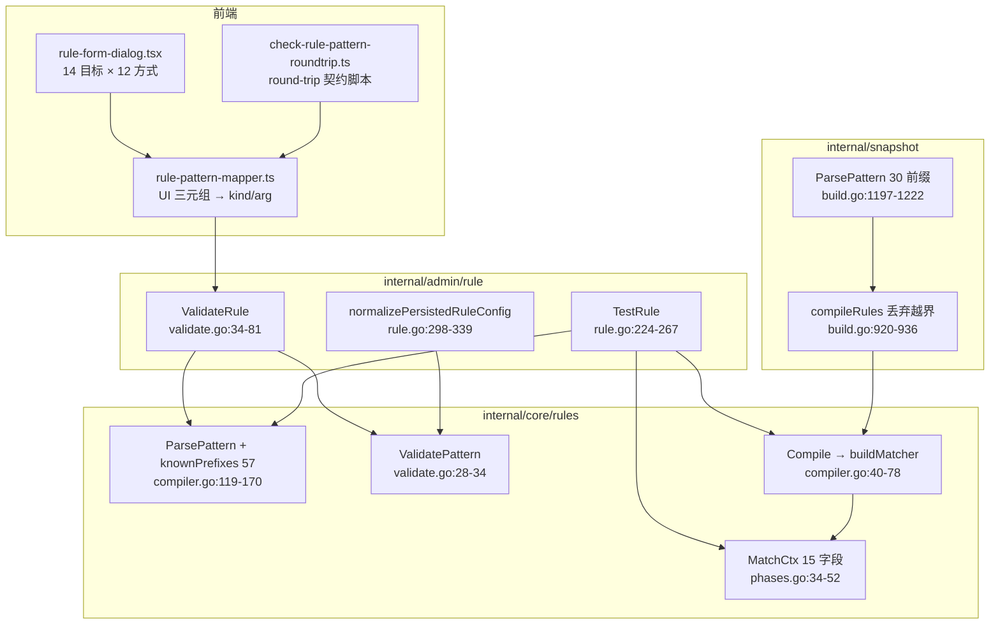
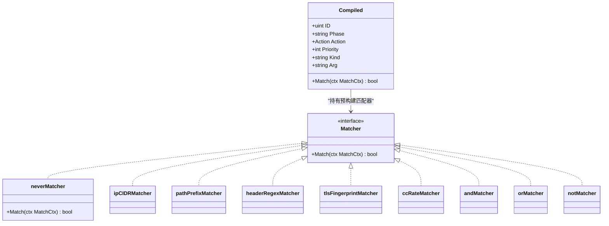
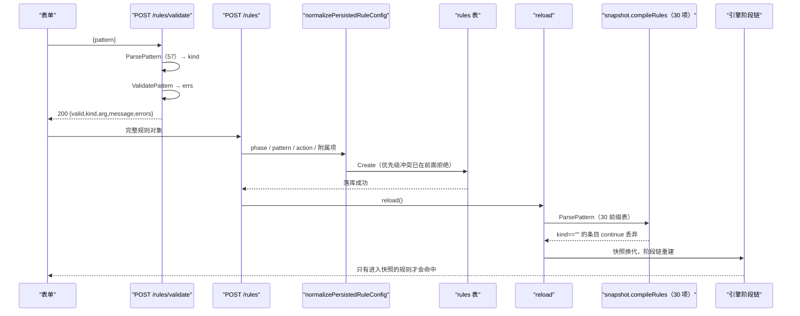
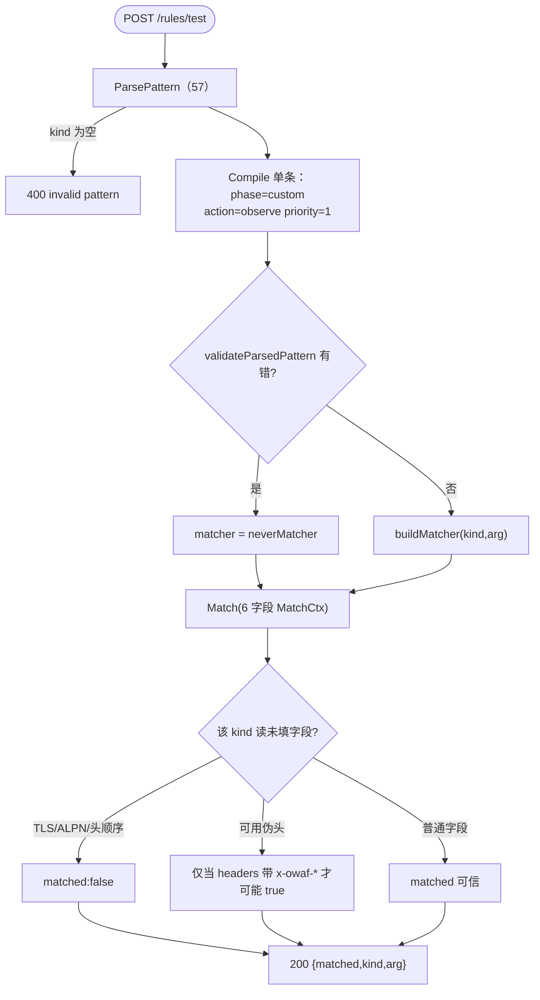
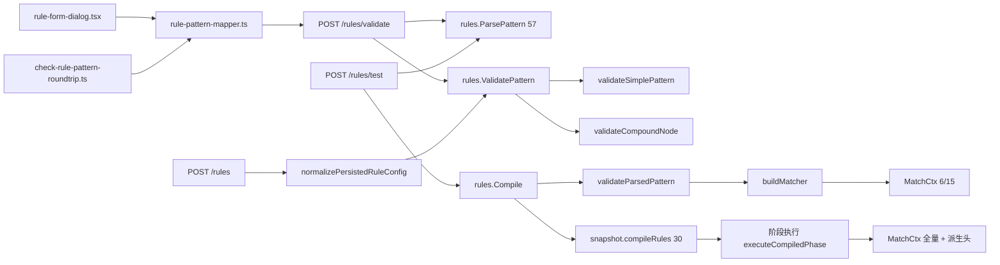
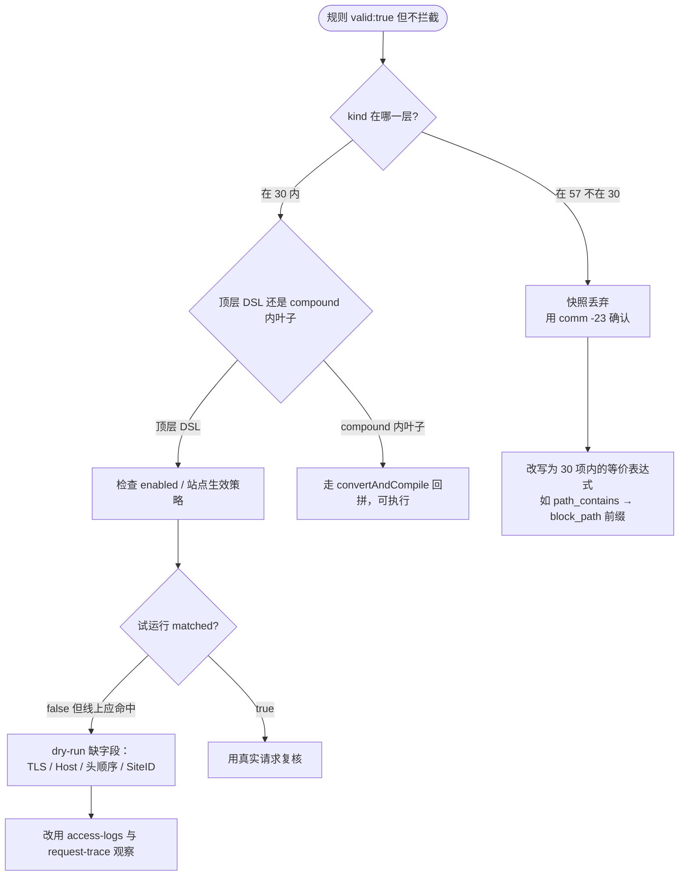

# 规则验证与测试

> [返回 管理 API 系统](../管理 API 系统.md)

<cite>
**本文档引用的文件**
- [router.go](file://internal/admin/router.go)
- [rule.go](file://internal/admin/rule/rule.go)
- [validate.go](file://internal/admin/rule/validate.go)
- [route.go](file://internal/admin/rule/route.go)
- [compiler.go](file://internal/core/rules/compiler.go)
- [validate.go](file://internal/core/rules/validate.go)
- [matcher.go](file://internal/core/rules/matcher.go)
- [phases.go](file://internal/core/rules/phases.go)
- [engine.go](file://internal/core/engine/engine.go)
- [build.go](file://internal/snapshot/build.go)
- [rule.go](file://internal/store/repository/rule.go)
- [policy.go](file://internal/store/policy.go)
- [app_route.go](file://internal/store/approute/app_route.go)
- [match.go](file://internal/appresource/match.go)
- [rule_test.go](file://internal/admin/rule/rule_test.go)
- [rule-pattern-mapper.ts](file://frontend/app/(dashboard)/rules/components/rule-pattern-mapper.ts)
- [rule-form-dialog.tsx](file://frontend/app/(dashboard)/rules/components/rule-form-dialog.tsx)
- [check-rule-pattern-roundtrip.ts](file://frontend/scripts/check-rule-pattern-roundtrip.ts)
- [package.json](file://frontend/package.json)
- [README.md](file://README.md)
- [规则验证与测试.md](file://docs/管理 API 系统/规则管理 API/规则验证与测试.md)
- [规则管理 API.md](file://docs/管理 API 系统/规则管理 API/规则管理 API.md)
- [规则导入导出.md](file://docs/管理 API 系统/规则管理 API/规则导入导出.md)
- [规则 CRUD 操作.md](file://docs/管理 API 系统/规则管理 API/规则 CRUD 操作.md)
</cite>

## 目录

1. [简介](#简介)
2. [项目结构](#项目结构)
3. [核心组件](#核心组件)
4. [架构总览](#架构总览)
5. [详细组件分析](#详细组件分析)
6. [依赖关系分析](#依赖关系分析)
7. [性能考虑](#性能考虑)
8. [故障排查指南](#故障排查指南)
9. [结论](#结论)
10. [附录](#附录)

## 简介

本篇讲两件事：**`POST /api/v1/rules/validate` 到底校验了什么**，以及 **`POST /api/v1/rules/test` 的「试运行」能证明什么、不能证明什么**。

三条必须先记住的实测结论：

1. **`valid:true` 不等于规则会生效**。保存期校验用 `internal/core/rules` 的 57 项 kind 白名单，快照编译期用 `internal/snapshot` 自己的 30 项前缀表，差集 **27 项**在 `compileRules` 被静默丢弃（build.go:923-926）。前端编辑器可达 **33 个字面量 kind**，其中 **21 项**落在这 27 项里——用图形表单造出来的规则有一大半是「存得下、跑不了」。
2. **试运行只填 6 个上下文字段**。`TestRule` 构造的 `MatchCtx` 覆盖 15 个字段中的 6 个（rule.go:251-258 与 phases.go:34-51），TLS 类、`header_order` 类、Host 类要么恒不命中，要么只能靠伪造 `x-owaf-*` 内部头才命中。
3. **试运行会写进真实的限流状态表**。`cc_rate` 的共享状态按「子条件 + 窗口 + 阈值 + 时长」的 MD5 取键（matcher.go:1858-1876），与规则参数一一对应；试运行会 LoadOrStore 同一对象，只是客户端计数键因 `bind`/`site_id` 为空而与线上不同（matcher.go:107-109）。**不会串改同一 IP 的线上配额，但会向生产状态表写入条目并参与 60 秒清扫**。

本篇只登记事实与给出可复现的自检命令，不改代码。

## 项目结构



**图表来源**
- [rule.go:224-339](file://internal/admin/rule/rule.go#L224-L339)
- [validate.go:34-81](file://internal/admin/rule/validate.go#L34-L81)
- [compiler.go:40-170](file://internal/core/rules/compiler.go#L40-L170)
- [validate.go:28-44](file://internal/core/rules/validate.go#L28-L44)
- [phases.go:34-52](file://internal/core/rules/phases.go#L34-L52)
- [build.go:920-936](file://internal/snapshot/build.go#L920-L936)
- [build.go:1197-1222](file://internal/snapshot/build.go#L1197-L1222)

| 校验面 | 入口 | 白名单规模 | 失败对外表现 |
|---|---|:---:|---|
| 表达式结构 | `POST /rules/validate` | 57 项 kind | `valid:false` + 中文错误数组 |
| 保存前归一 | `normalizePersistedRuleConfig` | 同一 57 项 + 动作/阶段 | 400，单条无 `index`，导入带 `index` |
| 快照装配 | `snapshot.compileRules` | 30 项前缀 | **无错误**，规则直接消失 |
| 运行期兜底 | `validateParsedPattern` | 57 项 | 非法 pattern 落到 `neverMatcher` |
| 应用路由规则 | `validateApplicationRouteRule` | 9 目标 / 8 操作符 | 400 英文短码 |

**章节来源**
- [validate.go:34-81](file://internal/admin/rule/validate.go#L34-L81)
- [rule.go:298-339](file://internal/admin/rule/rule.go#L298-L339)
- [build.go:920-936](file://internal/snapshot/build.go#L920-L936)
- [compiler.go:40-78](file://internal/core/rules/compiler.go#L40-L78)
- [route.go:19-79](file://internal/admin/rule/route.go#L19-L79)

## 核心组件



**图表来源**
- [matcher.go:20-23](file://internal/core/rules/matcher.go#L20-L23)
- [compiler.go:13-37](file://internal/core/rules/compiler.go#L13-L37)
- [matcher.go:317-321](file://internal/core/rules/matcher.go#L317-L321)
- [matcher.go:504-508](file://internal/core/rules/matcher.go#L504-L508)
- [matcher.go:47-53](file://internal/core/rules/matcher.go#L47-L53)
- [matcher.go:381-391](file://internal/core/rules/matcher.go#L381-L391)

| 组件 | 位置 | 职责 | 不做的事 |
|---|---|---|---|
| `ValidateRule` | `admin/rule/validate.go:34` | 解析 kind/arg 并收集语义错误 | 不查快照白名单、不落库 |
| `TestRule` | `admin/rule/rule.go:224` | 合成上下文跑一次匹配 | 不建阶段链、不填 TLS/Host/派生头 |
| `normalizePersistedRuleConfig` | `admin/rule/rule.go:298` | 保存前统一归一与拒绝 | 不检查 30 项前缀表 |
| `ParsePattern`（57） | `core/rules/compiler.go:146` | 决定表达式能否被识别 | 不判断该 kind 是否会被执行 |
| `validateParsedPattern` | `core/rules/validate.go:36` | 语义校验，决定用真匹配器还是 `neverMatcher` | 无 `default` 分支 |
| `ParsePattern`（30） | `snapshot/build.go:1197` | 快照期决定规则是否进入执行集 | 越界不报错 |
| `GetRuleTemplates` | `admin/rule/validate.go:83` | 返回 23 条模板 | 模板不校验快照白名单 |

**章节来源**
- [validate.go:34-81](file://internal/admin/rule/validate.go#L34-L81)
- [rule.go:224-267](file://internal/admin/rule/rule.go#L224-L267)
- [rule.go:298-339](file://internal/admin/rule/rule.go#L298-L339)
- [compiler.go:146-170](file://internal/core/rules/compiler.go#L146-L170)
- [validate.go:28-44](file://internal/core/rules/validate.go#L28-L44)
- [build.go:1197-1222](file://internal/snapshot/build.go#L1197-L1222)

## 架构总览

保存路径与试运行路径共用同一个编译器，但在上下文装配与白名单校验处分道而行。



**图表来源**
- [validate.go:34-81](file://internal/admin/rule/validate.go#L34-L81)
- [rule.go:98-138](file://internal/admin/rule/rule.go#L98-L138)
- [rule.go:298-339](file://internal/admin/rule/rule.go#L298-L339)
- [build.go:275](file://internal/snapshot/build.go#L275)
- [build.go:920-936](file://internal/snapshot/build.go#L920-L936)

**章节来源**
- [validate.go:34-81](file://internal/admin/rule/validate.go#L34-L81)
- [rule.go:98-138](file://internal/admin/rule/rule.go#L98-L138)
- [build.go:275](file://internal/snapshot/build.go#L275)
- [build.go:920-936](file://internal/snapshot/build.go#L920-L936)

## 详细组件分析

### 端点总表

5 条参与校验与测试语义的端点，逐条取自注册语句。

| 方法 | 路径 | 处理函数 | 注册行 | 权限 | 落库 | 触发 reload |
|---|---|---|:---:|:---:|:---:|:---:|
| POST | `/api/v1/rules/validate` | `rule.ValidateRule` | 284 | operator+ | 否 | 否 |
| POST | `/api/v1/rules/test` | `rule.TestRule` | 283 | operator+ | 否 | 否 |
| GET | `/api/v1/rules/templates` | `rule.GetRuleTemplates` | 146 | readonly+ | 否 | 否 |
| POST | `/api/v1/rules` | `rule.CreateRule` | 280 | operator+ | 是 | 是 |
| POST | `/api/v1/rules/import` | `rule.ImportRules` | 285 | operator+ | 是（批） | 是 |

`validate` 与 `test` 都在 `opsGroup`：只读角色连「试一下」都不允许（router.go:298-299 的同源判断适用于 Lua 插件的 `validate`/`dry-run`，规则侧同理）。

**章节来源**
- [router.go:144-147](file://internal/admin/router.go#L144-L147)
- [router.go:280-285](file://internal/admin/router.go#L280-L285)
- [router.go:298-305](file://internal/admin/router.go#L298-L305)
- [rule.go:224-267](file://internal/admin/rule/rule.go#L224-L267)
- [validate.go:34-81](file://internal/admin/rule/validate.go#L34-L81)

### 请求参数表

| 端点 | 字段 | 类型 | 必填 | 语义 | 代码位置 |
|---|---|---|:---:|---|---|
| `/rules/validate` | `pattern` | string | 是 | 空串（`TrimSpace` 后）即失败 | validate.go:42-49 |
| `/rules/test` | `pattern` | string | 是 | 解析不出 kind 直接 400 | rule.go:232-236 |
| `/rules/test` | `client_ip` | string | 否 | `net.ParseIP`，非法得 nil | rule.go:246-249 |
| `/rules/test` | `method` | string | 否 | 大小写由匹配器折叠处理 | matcher.go:477 |
| `/rules/test` | `path` | string | 否 | 只作原值，不做 URL 解码 | phases.go:76 |
| `/rules/test` | `query` | string | 否 | 原值，`;` 会被当 `&` 解析 | matcher.go:797 |
| `/rules/test` | `headers` | map | 否 | 唯一可注入派生值的通道 | rule.go:256 |
| `/rules/test` | `body` | string | 否 | 转 `[]byte` 后交 body 类匹配器 | rule.go:257 |

`TestRuleRequest` 只有这 7 个字段（rule.go:213-221），没有任何入口可以指定 `site_id`、`bind`、`host`、TLS 指纹或头顺序——要测这些维度只能通过 `headers` 注入内部伪头。

**章节来源**
- [rule.go:212-258](file://internal/admin/rule/rule.go#L212-L258)
- [validate.go:13-15](file://internal/admin/rule/validate.go#L13-L15)
- [validate.go:42-49](file://internal/admin/rule/validate.go#L42-L49)
- [matcher.go:475-479](file://internal/core/rules/matcher.go#L475-L479)
- [matcher.go:790-806](file://internal/core/rules/matcher.go#L790-L806)
- [phases.go:72-84](file://internal/core/rules/phases.go#L72-L84)

### 响应字段表

| 端点 | 字段 | 类型 | 出现条件 | 实测取值示例 |
|---|---|---|---|---|
| `/rules/validate` | `valid` | bool | 恒有 | `true` / `false` |
| `/rules/validate` | `message` | string | 非空才出现 | `规则表达式有效` |
| `/rules/validate` | `kind` | string | 通过时 | `block_ip` |
| `/rules/validate` | `arg` | string | 通过时 | `192.168.1.100` |
| `/rules/validate` | `errors` | string[] | 失败时 | `["IP/CIDR 匹配器要求合法的 IP 地址或 CIDR"]` |
| `/rules/test` | `matched` | bool | 恒有 | `false` |
| `/rules/test` | `kind` | string | 恒有 | `path_contains` |
| `/rules/test` | `arg` | string | 恒有 | `/.env` |
| `/rules/templates` | `templates` | array | 恒有 | 23 条 |
| `/rules/templates` | `total` | int | 恒有 | `23` |

`message`/`kind`/`arg`/`errors` 都带 `json:",omitempty"`，前端不能假设键存在（validate.go:17-23）。

```json
{
  "valid": false,
  "message": "规则表达式无法编译",
  "errors": [
    "tls_version 需要合法的 TLS 版本标识"
  ]
}
```

```json
{
  "matched": false,
  "kind": "tls_sni",
  "arg": "login.example.com"
}
```

第二个例子是 dry-run 缺口的直接体现：`tls_sni` 语法合法，但 `MatchCtx.TLS` 为 nil 且调用方没给 `x-owaf-tls-sni` 伪头，结果恒为 `matched:false`。

**章节来源**
- [validate.go:13-23](file://internal/admin/rule/validate.go#L13-L23)
- [validate.go:42-80](file://internal/admin/rule/validate.go#L42-L80)
- [rule.go:261-265](file://internal/admin/rule/rule.go#L261-L265)
- [rule_test.go:1](file://internal/admin/rule/rule_test.go#L1)

### 错误码表

| HTTP | 触发条件 | 响应体 | 位置 |
|:---:|---|---|---|
| 400 | `validate` 请求体不是对象 | `{"error":"请求体格式无效"}` | validate.go:37-40 |
| 400 | `pattern` 为空 | `{"valid":false,"message":"规则表达式不能为空"}` | validate.go:43-49 |
| 200 | kind 解析失败（合法 200 + `valid:false`） | `errors` 给出前缀要求 | validate.go:51-59 |
| 200 | 语义校验失败 | `message:"规则表达式无法编译"` | validate.go:61-72 |
| 400 | `test` 请求体绑定失败 | `{"error":绑定原文}` | rule.go:227-230 |
| 400 | `test` 的 pattern 解析不出 kind | `{"error":"invalid pattern"}` | rule.go:232-236 |
| 400 | 编译后规则数为 0 | `{"error":"pattern compiled to no rules"}` | rule.go:241-244（实测为死分支） |
| 200 | 规则永不命中 | `matched:false`，**不报错** | compiler.go:50-53 |

两处语义倒挂值得登记：**表达式格式错误返 200**（只有空表达式返 400），以及 **`rule.go:241-244` 的「编译为空」分支不可达**——`rules.Compile` 在 `kind != ""` 时无条件追加一条 `Compiled`（非法 pattern 用 `neverMatcher` 兜底），所以 `len(compiled) == 0` 永不成立。调用方不能靠状态码区分「语法错」和「跑不起来」。

**章节来源**
- [validate.go:34-80](file://internal/admin/rule/validate.go#L34-L80)
- [rule.go:224-267](file://internal/admin/rule/rule.go#L224-L267)
- [compiler.go:40-78](file://internal/core/rules/compiler.go#L40-L78)

### kind 三处白名单对照表

同一套规则 kind 在三处各自维护一份清单，规模互不相等：

| 处 | 位置 | 数量 | 数据结构 | 越界后果 |
|---|---|:---:|---|---|
| 保存期 | `internal/core/rules/compiler.go:119-142` `knownPrefixes` | **57** | `map[string]struct{}` | `ParsePattern` 返空 kind，400 |
| 快照期 | `internal/snapshot/build.go:1205-1215` `prefixes` | **30** | 前缀字符串切片 | **静默丢弃**，规则不执行 |
| 应用路由 | `internal/store/approute/app_route.go:13-23` | **9** | 目标常量（另有 8 个操作符） | 400 `invalid target` |

差集 27 项即「保存期认得、快照期不认」的 kind。用 `comm -23` 可现场复现：

```bash
# 57 与 30 的差集，预期输出 27 行
comm -23 \
  <(sed -n '/kinds := \[\]string{/,/^\t}$/p' internal/core/rules/compiler.go \
      | grep -oE '"[a-z0-9_]+"' | tr -d '"' | sort -u) \
  <(sed -n '/prefixes := \[\]string{/,/^\t}$/p' internal/snapshot/build.go \
      | grep -oE '"[a-z0-9_]+:"' | tr -d '":' | sort -u) | wc -l

# 三处白名单规模，预期 57 / 30 / 9
sed -n '/kinds := \[\]string{/,/^\t}$/p' internal/core/rules/compiler.go | grep -oE '"[a-z0-9_]+"' | tr -d '"' | sort -u | wc -l
sed -n '/prefixes := \[\]string{/,/^\t}$/p' internal/snapshot/build.go | grep -oE '"[a-z0-9_]+:"' | tr -d '":' | sort -u | wc -l
grep -cE '^	AppRouteTarget' internal/store/approute/app_route.go
```

**章节来源**
- [compiler.go:119-142](file://internal/core/rules/compiler.go#L119-L142)
- [build.go:1197-1222](file://internal/snapshot/build.go#L1197-L1222)
- [build.go:920-936](file://internal/snapshot/build.go#L920-L936)
- [app_route.go:13-35](file://internal/store/approute/app_route.go#L13-L35)
- [route.go:19-50](file://internal/admin/rule/route.go#L19-L50)
- [match.go:43-88](file://internal/appresource/match.go#L43-L88)

### 越界 kind 清单与后果

27 项差集里 **21 项**可由前端编辑器直接产出（「编辑器可达」列），这类规则点保存会返 201、`/rules/validate` 返 `valid:true`，但永远不会进快照。

| kind | 编辑器可达 | 语义校验分支 | 快照结果 |
|---|:---:|:---:|:---:|
| `block_header_exact` | 是 | 有 | 丢弃 |
| `block_header_not_exact` | 是 | 有 | 丢弃 |
| `block_header_prefix` | 是 | 有 | 丢弃 |
| `header_wildcard` | 是 | 有 | 丢弃 |
| `path_contains` | 是 | 有 | 丢弃 |
| `path_not_contains` | 否 | 有 | 丢弃 |
| `path_wildcard` | 是 | 有 | 丢弃 |
| `path_not_exact` | 是 | 有 | 丢弃 |
| `full_url_contains` | 是 | 有 | 丢弃 |
| `full_url_regex` | 是 | 有 | 丢弃 |
| `full_url_wildcard` | 是 | 有 | 丢弃 |
| `full_url_not_exact` | 是 | 有 | 丢弃 |
| `host_full` | 是 | 有 | 丢弃 |
| `host_regex` | 是 | 有 | 丢弃 |
| `host_contains` | 是 | 有 | 丢弃 |
| `host_not_contains` | 否 | 有 | 丢弃 |
| `host_wildcard` | 是 | 有 | 丢弃 |
| `host_not_exact` | 是 | 有 | 丢弃 |
| `query_param_regex` | 是 | 有 | 丢弃 |
| `query_param_not_exact` | 是 | 有 | 丢弃 |
| `geo_block` | 是 | 有 | 丢弃 |
| `body_not_exact` | 是 | 有 | 丢弃 |
| `body_wildcard` | 是 | 有 | 丢弃 |
| `block_body_contains` | 否 | 有 | 丢弃 |
| `block_body_regex` | 否 | 有 | 丢弃 |
| `block_body_json_path` | 否 | 有 | 丢弃 |
| `block_multipart` | 否 | 有 | 丢弃 |

复现命令（预期 33 与 21）：

`path_not_contains` 与 `host_not_contains` 属历史形态：新表单只能产出对应的 `*_not_exact`，但 `backendToRow` 会把它们回显成 `ne` 行并靠 `source` 元数据原样保存（契约脚本对这两种 kind 有专门的 round-trip 断言），所以「编辑器可达」列按**能否新建**取值，回显保留不计入。

```bash
# 编辑器可达 kind（字面量形态），预期 33
grep -oE 'kind: "[a-z0-9_]+"' "frontend/app/(dashboard)/rules/components/rule-pattern-mapper.ts" \
  | sed 's/^kind: //; s/"//g' | sort -u | wc -l

# 其中不在快照 30 项白名单内的，预期 21
comm -23 \
  <(grep -oE 'kind: "[a-z0-9_]+"' "frontend/app/(dashboard)/rules/components/rule-pattern-mapper.ts" \
      | sed 's/^kind: //; s/"//g' | sort -u) \
  <(sed -n '/prefixes := \[\]string{/,/^\t}$/p' internal/snapshot/build.go \
      | grep -oE '"[a-z0-9_]+:"' | tr -d '":' | sort -u) | wc -l
```

另需注意一处不对称：站点 CC 规则经 `compileCCCondition`（build.go:1118-1153）**直接产出** `path_contains`、`block_header_exact` 等 kind，绕开 `ParsePattern`，因此这类 kind 在 CC 规则里可用、在自定义规则里被丢。两条路径的唯一汇合点是 `convertAndCompile`（engine.go:625-646）。

**章节来源**
- [build.go:920-936](file://internal/snapshot/build.go#L920-L936)
- [build.go:1118-1153](file://internal/snapshot/build.go#L1118-L1153)
- [engine.go:623-646](file://internal/core/engine/engine.go#L623-L646)
- [rule-pattern-mapper.ts:72-459](file://frontend/app/(dashboard)/rules/components/rule-pattern-mapper.ts#L72-L459)
- [compiler.go:119-142](file://internal/core/rules/compiler.go#L119-L142)

### dry-run 覆盖缺口表

`MatchCtx` 共 15 个字段（14 个导出 + 1 个未导出的 `reqCtx`），`TestRule` 只填 6 个（rule.go:251-258）。运行期由 `fillMatchCtxFromPipeline` 填齐（phases.go:72-104）。

| 字段 | dry-run 是否填 | 受影响 kind | 后果 |
|---|:---:|---|---|
| `ClientIP` | 是 | `allow_ip` `block_ip` `geo_block` | 正常 |
| `Method` | 是 | `block_method` | 正常 |
| `Path` | 是 | 路径类 | 正常 |
| `Query` | 是 | 查询类 | 正常 |
| `Headers` | 是 | 头部类 | 正常 |
| `Body` | 是 | body 类 | 正常 |
| `HeadersLowercase` | 否（恒 `false`） | 全部头部类 | 走 `EqualFold` 全表扫描分支 |
| `Host` | 否 | `host` `host_full` `host_regex` 等 | 可靠 `headers` 里的 `Host` 间接触发 |
| `SiteID` | 否（恒 0） | `cc_rate` 计数键 | 键退化，与真实计数不同源 |
| `Bind` | 否（恒空） | `cc_rate` 计数键 | 同上 |
| `HeaderOrder` | 否 | `header_order_contains` `header_order_regex` | 需伪造 `x-owaf-header-order` |
| `TLSALPN` | 否 | `tls_alpn` | **恒不命中**，无伪头回落 |
| `TLSCipherSuites` | 否 | `tls_cipher_suites` | 可伪造 `x-owaf-tls-cipher-suites` |
| `TLS` | 否（恒 `nil`） | `tls_ja3` `tls_ja3_hash` `tls_ja4` `tls_version` `tls_sni` | 走伪头 `x-owaf-tls-*` 才可能命中 |
| `reqCtx` | 否（恒 `nil`） | `query_param` `block_body_json_path` | 无 per-request 缓存，每次直接解析 |

派生字段在运行期是**按需计算**的：只有阶段内存在 `tls_alpn`、`tls_cipher_suite(s)`、`header_order_*` 或含这些叶子的复合规则时，`needsDerivedHeaders` 才为真并触发 `DerivedALPN`/`DerivedCipherSuites`/`DerivedHeaderOrder`（phases.go:85-103 与 236-248）。dry-run 完全没有这一层，所以「试运行不命中」与「运行期不计算派生头」是两回事。



**图表来源**
- [rule.go:232-265](file://internal/admin/rule/rule.go#L232-L265)
- [compiler.go:40-78](file://internal/core/rules/compiler.go#L40-L78)
- [validate.go:36-44](file://internal/core/rules/validate.go#L36-L44)
- [phases.go:72-104](file://internal/core/rules/phases.go#L72-L104)
- [phases.go:236-248](file://internal/core/rules/phases.go#L236-L248)

**章节来源**
- [phases.go:34-52](file://internal/core/rules/phases.go#L34-L52)
- [phases.go:72-104](file://internal/core/rules/phases.go#L72-L104)
- [phases.go:236-248](file://internal/core/rules/phases.go#L236-L248)
- [rule.go:212-267](file://internal/admin/rule/rule.go#L212-L267)
- [matcher.go:155-204](file://internal/core/rules/matcher.go#L155-L204)
- [matcher.go:107-109](file://internal/core/rules/matcher.go#L107-L109)

### 语义校验规则表

`validateSimplePattern` 对每个 kind 的最低要求（core/rules/validate.go:123-257）：

| 校验类别 | 覆盖 kind | 拒绝文案 |
|---|---|---|
| 仅要求非空 | `block_path` `block_path_exact` `block_method` `block_content_type` `block_user_agent` `header_order_contains` `body_contains` `path_contains` `host` `host_full` `full_url_contains` `cookie_contains` `referer_contains` `geo_block` 等 | `规则表达式不能为空` |
| IP/CIDR 合法 | `allow_ip` `block_ip` | `IP/CIDR 匹配器要求合法的 IP 地址或 CIDR` |
| 正则可编译 | `block_path_regex` `block_query_regex` `block_user_agent_regex` `header_order_regex` `full_url_regex` `host_regex` `body_regex` `block_body_regex` | `规则表达式使用了非法的正则表达式` |
| `name:value` 双段 | `block_header` `block_header_exact` `block_header_not_exact` | `Header 匹配器需要 name:value 格式` |
| `name:prefix` / `name:pattern` | `block_header_prefix` `block_header_regex` `header_regex` `header_wildcard` | 对应格式错误文案 |
| `param:value` / `param:regex` | `query_param` `query_param_not_exact` `query_param_regex` | `query_param 需要非空的 param:value 格式` |
| 通配符可编译且非空 | `path_wildcard` `full_url_wildcard` `host_wildcard` `body_wildcard` | `通配符匹配器需要非空的通配符模式` |
| TLS 版本标识合法 | `tls_version` | `tls_version 需要合法的 TLS 版本标识` |
| 密码套件至少一个合法 | `tls_cipher_suite` `tls_cipher_suites` | `tls_cipher_suites 至少需要一个合法的密码套件标识` |

**该 switch 没有 `default` 分支**（validate.go:255-256）：未来往 57 项里加 kind 却忘了加 case，会静默通过校验；当前 57 项都落在 case 里，属**前瞻风险**而非现存缺陷。

**章节来源**
- [validate.go:123-257](file://internal/core/rules/validate.go#L123-L257)
- [validate.go:36-44](file://internal/core/rules/validate.go#L36-L44)

### 复合条件操作符支持表

| `op` | 合法子结构 | 校验位置 | 快照白名单 | 说明 |
|---|---|---|:---:|---|
| `and` / `or` | `children` ≥1 | validate.go:57-61 | 是（`{` 开头即 `compound`） | 空 children 报「复合条件至少需要一个子条件」 |
| `not` | `children` ==1 | validate.go:62-66 | 是 | 多子节点报错 |
| `if` / `if_else` / `ifelse` | `if` + `then`（可选 `else`） | validate.go:67-75 | 是 | 前端映射器不产出此形态 |
| `cc_rate` | `children` ==1、`window` >0、`threshold` >0、`duration_unit` ∈ {"",seconds,minutes} | validate.go:76-92 | 是 | 计数键与站点限流同源 |
| 叶子（无 `op`） | `kind` 非空且在 57 项内 | validate.go:93-100 | 视 kind 而定 | 「复合条件叶子节点使用了不支持的 kind」在此报出 |
| 其他 | - | validate.go:101-103 | - | `复合条件使用了不支持的操作符` |

`compound` 是唯一能绕过 30 项**前缀**表检查的通路吗？不是：`snapshot.ParsePattern` 对以 `{` 开头的 pattern 一律返回 `compound`，但引擎侧 `convertAndCompile` 会把它拼回 `kind:arg` 交给 `rules.Compile`，叶子仍要过 57 项检查。**若复合体内含 27 项差集 kind，快照期不丢弃、运行期却能编译成功**——这与顶层 DSL 用差集 kind 立刻被丢的行为相反，是排查「同一条规则写成 DSL 不生效、包进 and 却生效」的关键。

**章节来源**
- [validate.go:54-104](file://internal/core/rules/validate.go#L54-L104)
- [validate.go:123-126](file://internal/core/rules/validate.go#L123-L126)
- [build.go:1197-1222](file://internal/snapshot/build.go#L1197-L1222)
- [engine.go:625-646](file://internal/core/engine/engine.go#L625-L646)
- [matcher.go:1825-1928](file://internal/core/rules/matcher.go#L1825-L1928)

### 契约脚本的实际覆盖面

`bun run check:rule-pattern-roundtrip`（frontend/package.json:17，README.md:447 登记）跑的是 `frontend/scripts/check-rule-pattern-roundtrip.ts`（269 行）。

| 断言族 | 条数 | 内容 |
|---|:---:|---|
| round-trip 用例 | 13 | 脚本内 `roundTripCases`；另有 4 次补充断言（空白容错、op 大写与空白、两个 legacy `not_contains`），合计 17 次 |
| 只读降级用例 | 8 | `assertUneditableRaw` 数组：`block_query_contains`、`block_query_regex`、`header_order_contains`、`header_order_regex`、`block_body_json_path`、`block_multipart`、`block_content_type`、`geo_block:CN,US` |
| TLS 参考 kind | 7 | `dslReferenceKinds`，断言必须降级为只读行 |
| 非法 JSON 根类型 | 5 | `[]`、`42`、字符串、`null`、`true` |
| 结构非法降级 | 6 | 截断 JSON、`kind` 与 `op` 混用、`arg` 非字符串、`not` 多子、含未知 kind 的 `and`、含未知 kind 的 `or` 套 `and` |
| 翻译拒绝断言 | 7 | `headerName`/`paramName` 含冒号各一次、`post_param`、`resp_body`、`http_req`、`http_resp`、`op:"if"` 降级只读 |

脚本守的是**前端可编辑性契约**（打开并原样保存不得改语义），不比对 `knownPrefixes` 与快照 `prefixes`，也不检查 `MatchCtx` 覆盖度。**57↔30 的一致性当前无任何自动化保护**。

**章节来源**
- [check-rule-pattern-roundtrip.ts:72-268](file://frontend/scripts/check-rule-pattern-roundtrip.ts#L72-L268)
- [package.json:13-22](file://frontend/package.json#L13-L22)
- [README.md:443-452](file://README.md#L443-L452)
- [rule-pattern-mapper.ts:1-17](file://frontend/app/(dashboard)/rules/components/rule-pattern-mapper.ts#L1-L17)

### 前端映射器与注释漂移

`rule-pattern-mapper.ts` 头注释写「不破坏现有 9 个 matchMethods / 13 个 matchTargets」（该文件第 15-16 行），实测表单为 **12 个方式 / 14 个目标**：

| 维度 | 注释声称 | 实测 | 实测位置 |
|---|:---:|:---:|---|
| `matchTargets` | 13 | **14** | rule-form-dialog.tsx:55-70 |
| `matchMethods` | 9 | **12** | rule-form-dialog.tsx:73-86 |
| 可达字面量 kind | — | **33**（另有 `allow_ip` 走三元表达式，合计 34 项可达） | rule-pattern-mapper.ts:133-459 |
| 明确拒绝的目标 | — | 4（`post_param` `resp_body` `http_req` `http_resp`） | rule-pattern-mapper.ts:101-123 |

映射器自身对不可映射组合是诚实的：`translateRow` 返回 `ok:false` 并给原因，`rule-form-dialog.tsx` 在提交前逐行调用 `ruleApi.validate`（该文件 397-408 行）。问题不在前端，而在**后端没有第二道 30 项检查**——`normalizePersistedRuleConfig` 只调 `rules.ValidatePattern`。

**章节来源**
- [rule-pattern-mapper.ts:1-17](file://frontend/app/(dashboard)/rules/components/rule-pattern-mapper.ts#L1-L17)
- [rule-pattern-mapper.ts:88-131](file://frontend/app/(dashboard)/rules/components/rule-pattern-mapper.ts#L88-L131)
- [rule-form-dialog.tsx:54-92](file://frontend/app/(dashboard)/rules/components/rule-form-dialog.tsx#L54-L92)
- [rule-form-dialog.tsx:361-418](file://frontend/app/(dashboard)/rules/components/rule-form-dialog.tsx#L361-L418)
- [rule.go:298-339](file://internal/admin/rule/rule.go#L298-L339)

## 依赖关系分析



**图表来源**
- [validate.go:28-51](file://internal/core/rules/validate.go#L28-L51)
- [compiler.go:40-78](file://internal/core/rules/compiler.go#L40-L78)
- [rule.go:224-339](file://internal/admin/rule/rule.go#L224-L339)
- [phases.go:112-129](file://internal/core/rules/phases.go#L112-L129)
- [build.go:920-936](file://internal/snapshot/build.go#L920-L936)

| 上游 | 下游 | 一致性保障 | 缺口 |
|---|---|---|---|
| `knownPrefixes`（57） | 快照 `prefixes`（30） | 无 | 27 项静默丢弃 |
| `knownPrefixes`（57） | 前端映射器（34 项可达） | 注释约定 | 21 项越界仍可保存 |
| `validateSimplePattern` | `knownPrefixes` | 编译期靠人工 | 无 `default`，新增 kind 可漏 |
| `TestRule` | `MatchCtx` | 无 | 6/15 字段 |
| 阶段链 | `MatchCtx` 派生头 | `needsDerivedHeaders` | dry-run 无该路径 |
| 契约脚本 | 前端映射器 | round-trip | 不校验后端白名单 |

**章节来源**
- [compiler.go:119-170](file://internal/core/rules/compiler.go#L119-L170)
- [build.go:920-936](file://internal/snapshot/build.go#L920-L936)
- [phases.go:227-249](file://internal/core/rules/phases.go#L227-L249)
- [check-rule-pattern-roundtrip.ts:1-58](file://frontend/scripts/check-rule-pattern-roundtrip.ts#L1-L58)

## 性能考虑

- **`validate` 每次都会构造一次语义校验**，其中正则类 kind 走 `cachedCompile`（RWMutex 保护的进程级 map），首次编译后复用；非法正则在保存期即拒，不会把成本推到运行期（matcher.go:1785-1808）。
- **`test` 每请求重新 `Compile`**，不做任何缓存：`rules.Compile` 会新建匹配器并排序，单条规则的开销可忽略，但该接口不能用于压测式批量验证。
- **`cc_rate` 的 dry-run 会写生产状态对象**：`ccRateStates` 是包级 `sync.Map`，按规则参数 MD5 取共享状态（matcher.go:45、1907-1919），试运行会 `LoadOrStore` 并递增窗口计数；客户端键含 `bind|siteID|host|ip`（phases.go:63-70），dry-run 的 `bind`/`siteID` 为空，因此与线上键不同源，但条目确实进入同一 map 并参与 60 秒清扫。
- **`query_param` 与 `block_body_json_path` 在 dry-run 下无缓存**：`reqCtx` 为 nil 时每次直接 `url.ParseQuery`/`json.Unmarshal`，功能正确但重复解析。
- **建议**：把 `validate` 当语法门、把 `test` 当「仅路径/查询/头/方法/IP/body 可用」的弱信号，真正的生效判定必须走一次真实请求或读快照。

**章节来源**
- [matcher.go:1785-1808](file://internal/core/rules/matcher.go#L1785-L1808)
- [matcher.go:45-45](file://internal/core/rules/matcher.go#L45-L45)
- [matcher.go:1899-1928](file://internal/core/rules/matcher.go#L1899-L1928)
- [rule.go:238-244](file://internal/admin/rule/rule.go#L238-L244)
- [matcher.go:574-586](file://internal/core/rules/matcher.go#L574-L586)

## 故障排查指南



**图表来源**
- [build.go:920-936](file://internal/snapshot/build.go#L920-L936)
- [compiler.go:119-142](file://internal/core/rules/compiler.go#L119-L142)
- [engine.go:625-646](file://internal/core/engine/engine.go#L625-L646)
- [rule.go:251-258](file://internal/admin/rule/rule.go#L251-L258)

| 症状 | 判定命令 | 结论 |
|---|---|---|
| 保存 201、`/rules` 有记录、就是不拦 | `comm -23` 差集里能否找到该 kind | 命中 27 项越界 |
| `tls_version` 试运行恒 `false` | 带 `-H` 注入 `x-owaf-tls-version` 再试 | 缺 `MatchCtx.TLS` |
| `tls_alpn` 怎么试都 `false` | 无伪头回落路径 | `TLSALPN` 字段未填 |
| `host:*` 试运行 `false` | `headers` 里补 `Host` | `ctx.Host` 未填但有回落 |
| `cc_rate` 试跑后再保存同参数规则 | 观察 `ccRateStates` 条目与窗口计数 | dry-run 写入同一状态对象，客户端键不同源 |
| 同一规则 DSL 形式失效、复合形式生效 | 对比 `snapshot.ParsePattern` 与 `convertAndCompile` | 两路径白名单不同 |

**章节来源**
- [rule.go:224-267](file://internal/admin/rule/rule.go#L224-L267)
- [matcher.go:155-204](file://internal/core/rules/matcher.go#L155-L204)
- [matcher.go:819-824](file://internal/core/rules/matcher.go#L819-L824)
- [build.go:920-936](file://internal/snapshot/build.go#L920-L936)
- [engine.go:625-646](file://internal/core/engine/engine.go#L625-L646)

## 结论

验证与测试这两个接口只做「表达式能不能被 core 层理解」，不做「快照会不会带上它」。由此形成三档判定强度：

| 手段 | 能证明 | 不能证明 |
|---|---|---|
| `POST /rules/validate` | 语法与语义合法（57 项） | 是否会被快照执行 |
| `POST /rules/test` | IP/方法/路径/查询/头/体六类匹配逻辑 | TLS、Host、派生头、站点归属、限流计数 |
| 真实请求 + 访问日志 | 端到端生效 | — |

- **成果**：本篇把三处白名单、27 项差集、21 项编辑器越界、6/15 的 dry-run 字段覆盖，以及契约脚本的真实覆盖面全部落到可复核的表格与 `comm` 命令。
- **原则落点**：KISS 要求判定口径只有一处，现实是三处各自维护——这是问题根源；DRY 的正解是让快照复用 `core/rules` 的 `ParsePattern`；SRP 上 `TestRule` 目前同时负责「合成上下文」和「执行匹配」，缺一个可注入的上下文构造边界。本篇按约定**只登记不改码**。
- **风险登记**：57↔30 无自动比对、`validateSimplePattern` 无 `default`、`TestRule` 的「编译为空」分支不可达、`cc_rate` 试运行会写入与线上同参数的共享状态对象、映射器头注释与实际数量不符。

## 附录

### 请求与响应示例

合法表达式：

```json
{
  "pattern": "block_header_regex:User-Agent:(?i)(bot|crawler|spider)"
}
```

响应：

```json
{
  "valid": true,
  "message": "规则表达式有效",
  "kind": "block_header_regex",
  "arg": "User-Agent:(?i)(bot|crawler|spider)"
}
```

试运行一个 30 项白名单内的规则：

```json
{
  "pattern": "{\"op\":\"and\",\"children\":[{\"kind\":\"block_ip\",\"arg\":\"10.0.0.0/8\"},{\"kind\":\"block_method\",\"arg\":\"DELETE\"}]}",
  "client_ip": "10.1.2.3",
  "method": "DELETE",
  "path": "/api/item/9",
  "query": "",
  "headers": {
    "User-Agent": "curl/8"
  },
  "body": ""
}
```

响应：

```json
{
  "matched": true,
  "kind": "compound",
  "arg": "{\"op\":\"and\",\"children\":[{\"kind\":\"block_ip\",\"arg\":\"10.0.0.0/8\"},{\"kind\":\"block_method\",\"arg\":\"DELETE\"}]}"
}
```

**章节来源**
- [validate.go:34-80](file://internal/admin/rule/validate.go#L34-L80)
- [rule.go:212-266](file://internal/admin/rule/rule.go#L212-L266)
- [matcher.go:1878-1928](file://internal/core/rules/matcher.go#L1878-L1928)

### 自检清单

1. 跑 `comm -23` 差集，确认新 kind 不在 27 项内
2. 跑 `bun run check:rule-pattern-roundtrip` 确认前端语义不漂移
3. 用 `POST /rules/validate` 断语法，用 `POST /rules/test` 只断六类可测字段
4. 上线后到访问日志按 `rule_id_str`（形如 `rule:custom:block_ip`）确认确实执行
5. 涉及 TLS、头顺序、站点维度的规则，验证一律走真实请求

`rule_id_str` 由 `Compiled.ruleIDStr` 拼成 `"rule:" + phase + ":" + kind`（compiler.go:67），差集 kind 的规则不会出现在这里——这本身就是最直接的判定证据。

**章节来源**
- [compiler.go:67](file://internal/core/rules/compiler.go#L67)
- [phases.go:1312-1339](file://internal/core/rules/phases.go#L1312-L1339)
- [package.json:17](file://frontend/package.json#L17)
