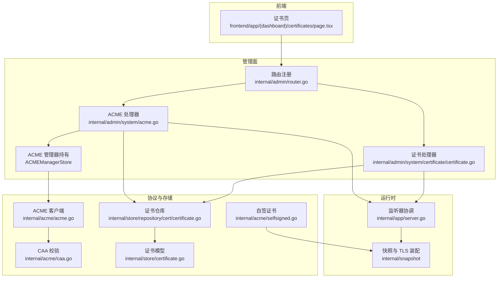
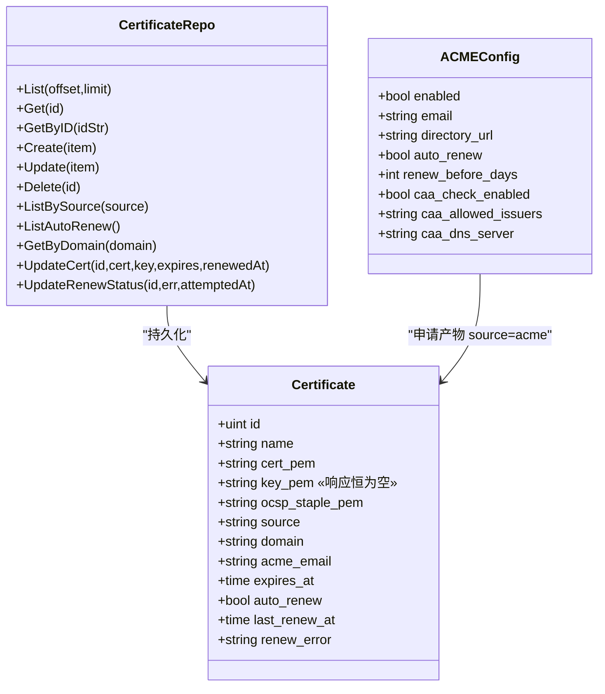
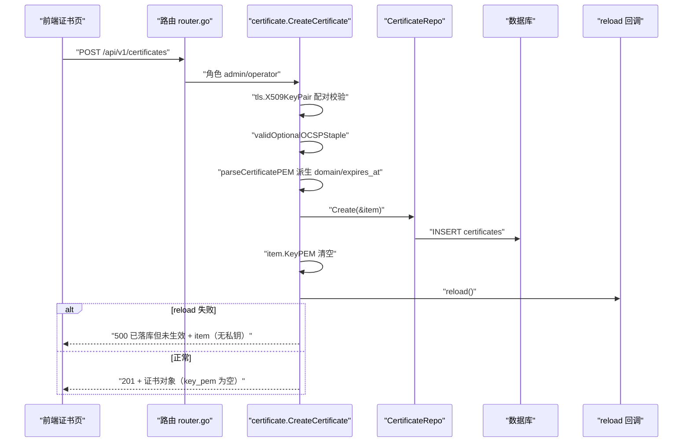
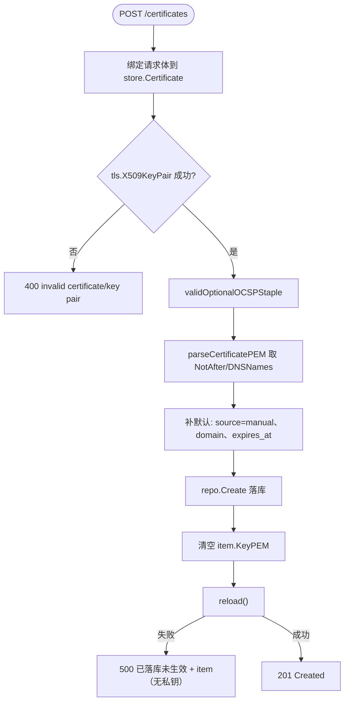
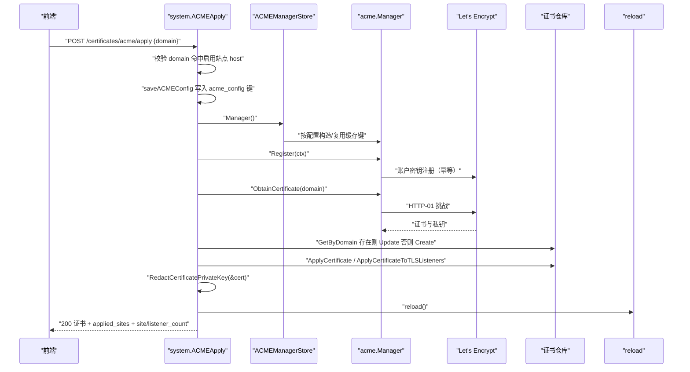
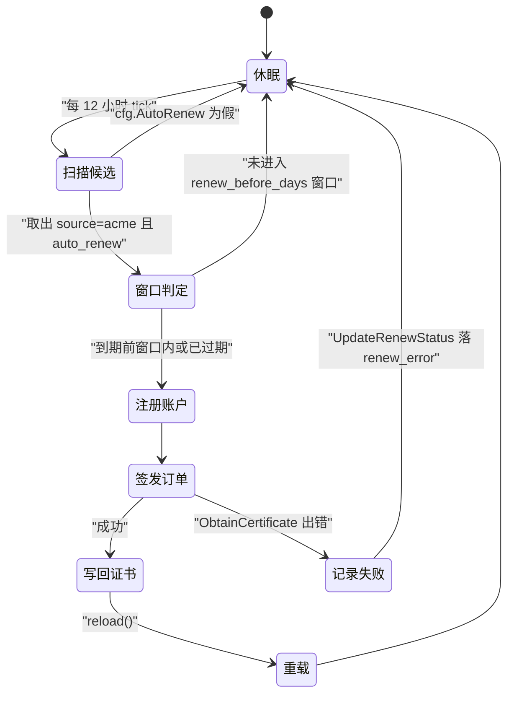
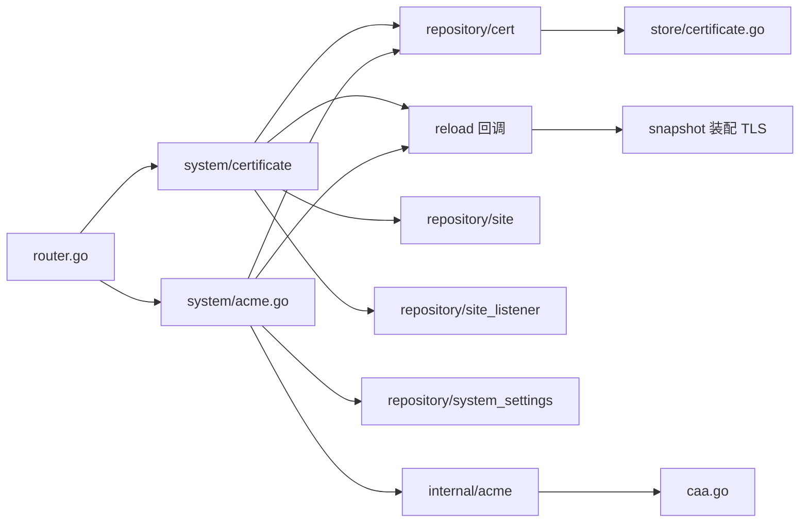
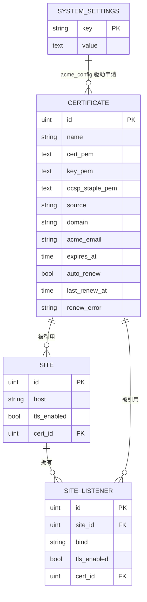

# 证书管理 API

> [返回 管理 API 系统](管理 API 系统.md)

<cite>
**本文档引用的文件**
- [router.go](file://internal/admin/router.go)
- [certificate.go](file://internal/admin/system/certificate/certificate.go)
- [acme.go](file://internal/admin/system/acme.go)
- [certificate.go](file://internal/store/certificate.go)
- [certificate.go](file://internal/store/repository/cert/certificate.go)
- [acme.go](file://internal/acme/acme.go)
- [caa.go](file://internal/acme/caa.go)
- [selfsigned.go](file://internal/acme/selfsigned.go)
- [settings.go](file://internal/admin/system/settings.go)
- [site.go](file://internal/store/site.go)
- [server.go](file://internal/app/server.go)
- [certificates page.tsx](file://frontend/app/(dashboard)/certificates/page.tsx)
</cite>

## 目录

1. [简介](#简介)
2. [项目结构](#项目结构)
3. [核心组件](#核心组件)
4. [架构总览](#架构总览)
5. [详细组件分析](#详细组件分析)
6. [依赖关系分析](#依赖关系分析)
7. [性能考虑](#性能考虑)
8. [故障排查指南](#故障排查指南)
9. [结论](#结论)
10. [附录](#附录)

## 简介

证书管理 API 覆盖两类能力：手工上传的 TLS 证书生命周期（CRUD、PEM 配对校验、按名称批量应用到站点），以及 ACME 自动签发与续期（配置、申请、手动续期、状态查询、HTTP-01 应答）。共 13 个端点。

必须记住的一条行为：**任何响应都不回显私钥**。列表、详情、创建、更新四条路径都在落库后、返回前把 `key_pem` 清空；ACME 申请与续期则调用 `RedactCertificatePrivateKey` 完成同样动作，注释明确要求「先脱敏再 reload」，否则 reload 失败的 500 分支会把私钥带回响应体。

**章节来源**
- [certificate.go:47-51](file://internal/admin/system/certificate/certificate.go#L47-L51)
- [certificate.go:120-124](file://internal/admin/system/certificate/certificate.go#L120-L124)
- [acme.go:627-630](file://internal/admin/system/acme.go#L627-L630)

## 项目结构

证书处理器在 `internal/admin/system/certificate/` 子包，ACME 端点处理器在 `internal/admin/system/acme.go`（根包 `system`），协议实现在 `internal/acme/`。

**图表来源**
- [router.go:132-138](file://internal/admin/router.go#L132-L138)
- [router.go:267-272](file://internal/admin/router.go#L267-L272)
- [router.go:397-398](file://internal/admin/router.go#L397-L398)
- [certificate.go:1-402](file://internal/admin/system/certificate/certificate.go#L1-L402)
- [acme.go:1-741](file://internal/admin/system/acme.go#L1-L741)

| 模块 | 路径 | 行数 | 职责 |
|------|------|-----:|------|
| 证书处理器 | `internal/admin/system/certificate/certificate.go` | 402 | CRUD、PEM 校验、名称匹配、批量应用 |
| ACME 处理器 | `internal/admin/system/acme.go` | 741 | ACME 配置读写、申请、续期、状态 |
| ACME 客户端 | `internal/acme/acme.go` | 396 | 账户注册、订单与域名验证、续期窗口 |
| CAA 校验 | `internal/acme/caa.go` | 395 | 签发许可解析与允许签发方比对 |
| 自签证书 | `internal/acme/selfsigned.go` | 176 | IP 直访与临时证书生成 |
| 证书仓库 | `internal/store/repository/cert/certificate.go` | 87 | 分页、按来源/域名查询、续期状态更新 |
| 证书模型 | `internal/store/certificate.go` | 39 | Certificate 字段与来源枚举 |

**章节来源**
- [certificate.go:1-402](file://internal/admin/system/certificate/certificate.go#L1-L402)
- [acme.go:1-741](file://internal/admin/system/acme.go#L1-L741)
- [acme.go:1-396](file://internal/acme/acme.go#L1-L396)
- [caa.go:1-395](file://internal/acme/caa.go#L1-L395)
- [selfsigned.go:1-176](file://internal/acme/selfsigned.go#L1-L176)
- [certificate.go:1-87](file://internal/store/repository/cert/certificate.go#L1-L87)
- [certificate.go:1-39](file://internal/store/certificate.go#L1-L39)

## 核心组件

**图表来源**
- [certificate.go:19-39](file://internal/store/certificate.go#L19-L39)
- [certificate.go:11-87](file://internal/store/repository/cert/certificate.go#L11-L87)
- [acme.go:25-34](file://internal/admin/system/acme.go#L25-L34)

| 来源取值 | 常量 | 产生路径 | 可否自动续期 |
|----------|------|----------|:------------:|
| `manual` | `CertSourceManual` | `POST /certificates` 未指定 `source` 时 | 否 |
| `acme` | `CertSourceACME` | `POST /certificates/acme/apply` | 是（`auto_renew` 置 true） |
| `self_signed` | `CertSourceSelfSigned` | 运行时按需生成，不由 CRUD 端点写入 | 否 |

`ListAutoRenew` 的过滤条件是 `auto_renew = true AND source = 'acme'`，因此手工证书即使把 `auto_renew` 设为 true 也不会进入续期循环。

**章节来源**
- [certificate.go:9-16](file://internal/store/certificate.go#L9-L16)
- [certificate.go:55-59](file://internal/store/repository/cert/certificate.go#L55-L59)
- [acme.go:583-592](file://internal/admin/system/acme.go#L583-L592)

## 架构总览

**图表来源**
- [router.go:267](file://internal/admin/router.go#L267)
- [certificate.go:87-127](file://internal/admin/system/certificate/certificate.go#L87-L127)

| 端点分组 | 数量 | 权限组 | 注册行 |
|----------|-----:|--------|--------|
| 证书读取 | 4 | readGroup（readonly+） | 132、133、134、138 |
| 证书写入与应用 | 6 | opsGroup（admin/operator） | 267-272 |
| ACME 配置与状态 | 2 | adminGroup（仅 admin） | 397、398 |
| HTTP-01 应答 | 1 | 公开（Hertz 根） | 425 |
| **合计** | **13** | — | — |

`POST /api/v1/certificates/parse` 是只读组里唯一的 POST：它只解析用户提交的 PEM 文本并读取站点列表做匹配展示，不写库存私钥，因此归入 readonly+ 而非写权限组（`router.go:136-138`）。

**章节来源**
- [router.go:132-138](file://internal/admin/router.go#L132-L138)
- [router.go:267-272](file://internal/admin/router.go#L267-L272)
- [router.go:397-398](file://internal/admin/router.go#L397-L398)
- [router.go:425-437](file://internal/admin/router.go#L425-L437)

## 详细组件分析

### 端点总表

| 方法 | 路径 | 权限 | 处理器 | 注册行 | 实现行 |
|------|------|------|--------|-------:|-------:|
| GET | `/api/v1/certificates` | readonly+ | `certificate.ListCertificates` | 132 | 53 |
| GET | `/api/v1/certificates/:id` | readonly+ | `certificate.GetCertificate` | 133 | 70 |
| GET | `/api/v1/certificates/acme/config` | readonly+ | `system.GetACMEConfig` | 134 | 444 |
| POST | `/api/v1/certificates/parse` | readonly+ | `certificate.ParseCertificate` | 138 | 129 |
| POST | `/api/v1/certificates` | admin/operator | `certificate.CreateCertificate` | 267 | 87 |
| POST | `/api/v1/certificates/:id/update` | admin/operator | `certificate.UpdateCertificate` | 268 | 210 |
| POST | `/api/v1/certificates/:id/apply-to-sites` | admin/operator | `certificate.ApplyCertificateToSites` | 269 | 156 |
| POST | `/api/v1/certificates/:id/delete` | admin/operator | `certificate.DeleteCertificate` | 270 | 371 |
| POST | `/api/v1/certificates/acme/apply` | admin/operator | `system.ACMEApply` | 271 | 523 |
| POST | `/api/v1/certificates/acme/:id/renew` | admin/operator | `system.ACMERenew` | 272 | 637 |
| POST | `/api/v1/certificates/acme/config` | 仅 admin | `system.UpdateACMEConfig` | 397 | 451 |
| GET | `/api/v1/certificates/acme/status` | 仅 admin | `system.ACMEStatus` | 398 | 709 |
| GET | `/.well-known/acme-challenge/:token` | 公开 | `router.go` 内联闭包 | 425 | 425-437 |

注意路由顺序：`/certificates/acme/config`、`/certificates/acme/status` 是静态段，与 `/certificates/:id` 共存时 Hertz 静态优先，因此 `acme` 不会被当作证书 ID。

**章节来源**
- [router.go:132-138](file://internal/admin/router.go#L132-L138)
- [router.go:267-272](file://internal/admin/router.go#L267-L272)
- [router.go:397-398](file://internal/admin/router.go#L397-L398)
- [certificate.go:53-402](file://internal/admin/system/certificate/certificate.go#L53-L402)
- [acme.go:444-741](file://internal/admin/system/acme.go#L444-L741)

### 请求参数表

| 端点 | 参数 | 位置 | 类型 | 必填 | 约束与默认 |
|------|------|------|------|:----:|------------|
| `GET /certificates` | `page` | query | int | 否 | 缺省 1 |
| `GET /certificates` | `page_size` | query | int | 否 | 缺省 20 |
| `POST /certificates` | `name` | body | string | 是 | `size:128;not null` |
| `POST /certificates` | `cert_pem` | body | text | 是 | PEM 块类型必须为 `CERTIFICATE` |
| `POST /certificates` | `key_pem` | body | text | 是 | 必须与 `cert_pem` 配对（`tls.X509KeyPair`） |
| `POST /certificates` | `ocsp_staple_pem` | body | text | 否 | 非空时必须能被 `snapshot.ParseOCSPStaple` 解析 |
| `POST /certificates` | `source` | body | string | 否 | 空则置 `manual` |
| `POST /certificates` | `domain` | body | string | 否 | 空则取 `DNSNames[0]`，再回落 `Subject.CommonName` |
| `POST /certificates` | `expires_at` | body | time | 否 | 空则取证书 `NotAfter` |
| `POST /certificates/:id/update` | 各字段 | body | — | 否 | 先 `Get` 原对象再绑定请求体，缺省字段保留 |
| `POST /certificates/parse` | `cert_pem` | body | string | 是 | 只解析不入库；格式错误返回中文文案「请求体格式无效」 |
| `POST /certificates/:id/apply-to-sites` | `id` | path | uint | 是 | 无匹配站点时返回 200 且 `applied_sites` 为空 |
| `POST /certificates/acme/apply` | `domain` | body | string | 是 | 小写化去空白；必须命中某个启用站点 host |
| `POST /certificates/acme/apply` | `email` | body | string | 否 | 空则生成随机 ACME 邮箱 |
| `POST /certificates/acme/apply` | `name` | body | string | 否 | 空则用 `domain` |
| `POST /certificates/acme/config` | 八字段 | body | 指针 | 否 | 全部为 `*T`，未提供的字段保留库中原值 |

`UpdateACMEConfig` 的请求体字段类型是 `*bool`/`*string`/`*int`，语义与站点级三态一致：**未出现在请求体里的字段不改动**，显式 `false` 才是关闭。

**章节来源**
- [certificate.go:87-127](file://internal/admin/system/certificate/certificate.go#L87-L127)
- [certificate.go:210-248](file://internal/admin/system/certificate/certificate.go#L210-L248)
- [certificate.go:129-154](file://internal/admin/system/certificate/certificate.go#L129-L154)
- [acme.go:451-470](file://internal/admin/system/acme.go#L451-L470)
- [acme.go:523-560](file://internal/admin/system/acme.go#L523-L560)

### 响应字段表

| 字段 | 类型 | 出现端点 | 说明 |
|------|------|----------|------|
| `items` | array | `GET /certificates` | 证书数组，按 `id ASC`；`key_pem` 逐个清空 |
| `total` | int64 | `GET /certificates` | 总行数 |
| `name` | string | 证书对象 | 展示名 |
| `cert_pem` | text | 证书对象 | 完整链路 PEM（含中间证书） |
| `key_pem` | string | 证书对象 | **响应中恒为 `""`**，不可用于回读 |
| `ocsp_staple_pem` | string | 证书对象 | 可选，空时因 `omitempty` 不出键 |
| `source` | string | 证书对象 | `manual`/`acme`/`self_signed` |
| `domain` | string | 证书对象 | ACME 匹配键，`omitempty` |
| `acme_email` | string | 证书对象 | 申请时使用的邮箱 |
| `expires_at` | time | 证书对象 | 到期时间，`*time.Time`，可为 null |
| `auto_renew` | bool | 证书对象 | 与 `source=acme` 同时为真才生效 |
| `last_renew_at` | time | 证书对象 | 最近一次续期尝试时间 |
| `renew_error` | string | 证书对象 | 最近续期失败原因（已脱敏、限长 512） |
| `common_name` | string | `POST /parse` | 证书主体 CN |
| `dns_names` | array | `POST /parse` | SAN 域名列表 |
| `ip_addresses` | array | `POST /parse` | SAN IP 列表（字符串形式） |
| `matched_sites` | array | `POST /parse` | 命中站点：`id`、`host`、`tls_enabled`、`cert_id`、`matched_name` |
| `certificate_id` | uint | `POST /:id/apply-to-sites` | 被应用的证书 ID |
| `applied_sites` | array | `POST /:id/apply-to-sites` | 实际写入的站点集合 |
| `site_count` | int64 | 同上 | 站点表更新行数 |
| `listener_count` | int64 | 同上 | TLS 监听器更新行数 |
| `message` | string | `POST /acme/:id/renew` | 固定 `certificate renewed successfully` |
| `items[].error` | string | `GET /acme/status` | 仅 ACME 来源证书，`omitempty` |

**章节来源**
- [certificate.go:20-45](file://internal/admin/system/certificate/certificate.go#L20-L45)
- [certificate.go:53-85](file://internal/admin/system/certificate/certificate.go#L53-L85)
- [certificate.go:146-207](file://internal/admin/system/certificate/certificate.go#L146-L207)
- [certificate.go:249-285](file://internal/admin/system/certificate/certificate.go#L249-L285)
- [acme.go:709-740](file://internal/admin/system/acme.go#L709-L740)

### 错误码表

| 状态码 | 触发条件 | 响应体关键字 | 依据 |
|-------:|----------|--------------|------|
| 400 | `id` 非数值 | `invalid id` | `certificate.go:72`、`certificate.go:158`、`certificate.go:212`、`certificate.go:373` |
| 400 | 证书与私钥不配对 | `invalid certificate/key pair: …` | `certificate.go:94-96`、`certificate.go:226-228` |
| 400 | OCSP staple 非法 | `invalid ocsp_staple_pem` | `certificate.go:98-100` |
| 400 | PEM 块缺失或类型不符 | `invalid certificate pem: …` | `certificate.go:102-105`、`certificate.go:136-139` |
| 400 | 请求体 JSON 非法 | `请求体格式无效` | `certificate.go:131-134`、`acme.go:464` |
| 400 | 证书仍被引用 | `certificate is still referenced` + `site_refs` + `listener_refs` | `certificate.go:388-390` |
| 400 | ACME 域名不匹配任何启用站点 | `domain does not match any enabled site host` | `acme.go:548` |
| 400 | `renew_before_days` ≤ 0 | `renew_before_days must be > 0` | `acme.go:501` |
| 400 | 开启 CAA 校验但缺 DNS 服务器或允许签发方 | `caa_dns_server is required…` / `caa_allowed_issuers is required…` | `acme.go:501-509` |
| 400 | 续期非 ACME 证书 | `only ACME certificates can be renewed` | `acme.go:652` |
| 400 | ACME 证书无 domain | `certificate has no domain configured` | `acme.go:657` |
| 404 | 证书不存在 | `not found` / `certificate not found` | `certificate.go:77-80`、`acme.go:647` |
| 404 | HTTP-01 token 无对应应答 | 空响应体 + 404 | `router.go:431-436` |
| 500 | 数据库读写失败 | `{"error":"<文本>"}` | `certificate.go:59`、`certificate.go:116` |
| 500 | ACME 注册/签发失败 | `ACME register failed: …` / `certificate obtain failed: …` | `acme.go:571-577` |
| 500 | 已落库但 reload 失败 | `config applied but reload failed: …` + `item` | `certificate.go:121-123`、`acme.go:629-632` |

**章节来源**
- [certificate.go:53-402](file://internal/admin/system/certificate/certificate.go#L53-L402)
- [acme.go:444-740](file://internal/admin/system/acme.go#L444-L740)
- [router.go:425-437](file://internal/admin/router.go#L425-L437)

### 校验与写入流程

**图表来源**
- [certificate.go:87-127](file://internal/admin/system/certificate/certificate.go#L87-L127)

`UpdateCertificate` 走同一套校验，但先 `Get` 再绑定，因此请求体可以只写需要变更的字段；关键是 `existing.ID = id` 的强制赋值——请求体里的 `id` 无法越权改写其他记录（`certificate.go:234`）。

**章节来源**
- [certificate.go:87-127](file://internal/admin/system/certificate/certificate.go#L87-L127)
- [certificate.go:210-248](file://internal/admin/system/certificate/certificate.go#L210-L248)
- [certificate.go:250-264](file://internal/admin/system/certificate/certificate.go#L250-L264)

### 名称匹配与批量应用

`apply-to-sites` 与 `parse` 共用同一匹配函数，规则如下：

| 环节 | 实现 | 口径 |
|------|------|------|
| 候选名集合 | `certificateMatchNames` | `DNSNames` 去重去空 + `Subject.CommonName`（若未出现） |
| 站点名集合 | `SplitSiteHosts` | 站点 `host` 按英文逗号切分，逐段 `TrimSpace` 后转小写 |
| 匹配规则 | `CertificateNameMatchesHost` | 全等命中；`*.` 前缀仅匹配单级子域（左侧非空且不含点） |
| 去重 | `matchCertificateSites` | 以 `site.ID` 去重，一个站点最多一条命中 |
| 写库范围 | `siteRepo.ApplyCertificate` + `listenerRepo.ApplyCertificateToTLSListeners` | 站点表与 TLS 监听器表分别更新 |

`*.example.com` 能匹配 `a.example.com`，但**不能**匹配 `a.b.example.com`（`certificate.go:367-368`）。这与快照的站点解析一致：解析只做精确、`*.` 单级父域、`*` 兜底三级查找。

**章节来源**
- [certificate.go:287-337](file://internal/admin/system/certificate/certificate.go#L287-L337)
- [certificate.go:339-369](file://internal/admin/system/certificate/certificate.go#L339-L369)

### ACME 申请与续期

**图表来源**
- [acme.go:523-635](file://internal/admin/system/acme.go#L523-L635)
- [acme.go:281](file://internal/admin/system/acme.go#L281)

| ACME 配置项 | JSON 键 | 默认值 | 校验 |
|-------------|---------|--------|------|
| 开关 | `enabled` | `false` | 开启且邮箱为空时自动生成随机邮箱 |
| 联系邮箱 | `email` | 空 | `TrimSpace` |
| 目录地址 | `directory_url` | Let's Encrypt 生产目录 | 空则回落生产 URL |
| 自动续期 | `auto_renew` | `true` | — |
| 提前天数 | `renew_before_days` | `30` | 必须 > 0，加载时 ≤0 也抬到 30 |
| CAA 校验 | `caa_check_enabled` | `false` | 开启时下面两项必填 |
| 允许签发方 | `caa_allowed_issuers` | `letsencrypt.org` | 空则回落默认签发方 |
| CAA DNS 服务器 | `caa_dns_server` | 空 | 开启校验时必填 |

`GET /certificates/acme/config` 在只读组（readonly 可见），`POST` 在仅 admin 组：ACME 会触发对外签发请求，属高危写操作。

**章节来源**
- [acme.go:25-34](file://internal/admin/system/acme.go#L25-L34)
- [acme.go:173-180](file://internal/admin/system/acme.go#L173-L180)
- [acme.go:192-231](file://internal/admin/system/acme.go#L192-L231)
- [acme.go:444-521](file://internal/admin/system/acme.go#L444-L521)
- [acme.go:57-61](file://internal/acme/acme.go#L57-L61)
- [caa.go:17-26](file://internal/acme/caa.go#L17-L26)

### 自动续期循环状态

续期循环由 `server.go:1059` 以 `12 * time.Hour` 的检查间隔启动，每轮读取 `ListAutoRenew()` 的候选并用 `ShouldRenewAt` 判定是否进入窗口。

**图表来源**
- [acme.go:372-400](file://internal/admin/system/acme.go#L372-L400)
- [acme.go:402-437](file://internal/admin/system/acme.go#L402-L437)
- [acme.go:288-293](file://internal/acme/acme.go#L288-L293)
- [server.go:1059](file://internal/app/server.go#L1059)

`ShouldRenewAt` 在 `renewBefore <= 0` 或到期时间为零值（未知）时返回真，即「信息不全就尝试续期」，把保守性交给调用方配置而非默认跳过。

**章节来源**
- [acme.go:372-437](file://internal/admin/system/acme.go#L372-L437)
- [acme.go:384-401](file://internal/admin/system/acme.go#L384-L401)
- [acme.go:280-293](file://internal/acme/acme.go#L280-L293)

### 脱敏与错误文本收口

| 对象 | 处理 | 位置 |
|------|------|------|
| `key_pem` | 列表/详情/创建/更新响应逐个清空 | `certificate.go:64`、`certificate.go:82`、`certificate.go:120`、`certificate.go:241` |
| ACME 证书对象 | `RedactCertificatePrivateKey` 后才可 reload | `acme.go:627`、`acme.go:695` |
| ACME 错误文本 | 4 条正则抹除 PEM 块、残缺 PEM、JWK 私钥参数、密钥样式键值 | `acme.go:108-131` |
| `renew_error` | 落库与响应使用同一份脱敏文本，长度上限 512 对齐列宽 | `acme.go:94`、`acme.go:133`、`certificate.go:38` |
| `GET /acme/status` | 对历史 `renew_error` 再过一次脱敏兜底 | `acme.go:735` |
| HTTP-01 token | 仅回显挑战应答文本，无密钥材料 | `router.go:431-434` |

配置示例中的机密一律写作占位值，例如 `email` 为 `{ACME 邮箱}`、`directory_url` 为 `{ACME 目录地址}`。

**章节来源**
- [certificate.go:47-51](file://internal/admin/system/certificate/certificate.go#L47-L51)
- [certificate.go:60-84](file://internal/admin/system/certificate/certificate.go#L60-L84)
- [acme.go:88-131](file://internal/admin/system/acme.go#L88-L131)
- [acme.go:690-735](file://internal/admin/system/acme.go#L690-L735)
- [certificate.go:1-39](file://internal/store/certificate.go#L1-L39)

### 前端集成

证书页以列表 + 表单为主：表单字段为名称、证书 PEM、私钥 PEM；私钥仅提交不回读，编辑时留空表示按当前流程重新提交配对材料。`parse` 接口用于在保存前预览 SAN 与命中站点，`apply-to-sites` 用于一次签发后批量挂到匹配站点。

**章节来源**
- [page.tsx:1-20](file://frontend/app/(dashboard)/certificates/page.tsx#L1-L20)
- [certificate.go:129-154](file://internal/admin/system/certificate/certificate.go#L129-L154)

## 依赖关系分析

**图表来源**
- [router.go:132-138](file://internal/admin/router.go#L132-L138)
- [certificate.go:1-402](file://internal/admin/system/certificate/certificate.go#L1-L402)
- [acme.go:1-741](file://internal/admin/system/acme.go#L1-L741)

| 依赖 | 类型 | 失败表现 |
|------|------|----------|
| `CertificateRepo` | 数据访问 | 500 或 404 |
| `SiteRepo` / `SiteListenerRepo` | 引用计数与批量应用 | 删除返回 400 计数、应用返回 500 |
| `SystemSettingsRepo` | ACME 配置持久化（键 `acme_config`） | 保存失败 500 |
| `internal/acme.Manager` | 对外签发 | 注册或签发失败 500，文本已脱敏 |
| `snapshot.Holder` | 装配 TLS 材料 | reload 失败时旧快照继续服务 |
| `AdminAPIKeyRepo`/`AuthMiddleware` | 鉴权前置 | 401/403 |

**章节来源**
- [certificate.go:371-402](file://internal/admin/system/certificate/certificate.go#L371-L402)
- [acme.go:215-231](file://internal/admin/system/acme.go#L215-L231)
- [certificate.go:11-87](file://internal/store/repository/cert/certificate.go#L11-L87)

## 性能考虑

- 列表分页由 `utils.Paginate` 统一计算偏移与上限，`total` 由独立 `Count` 得出，避免整表载入。
- 批量应用把站点与监听器更新收敛到两条 `IN` 语句，只触发一次 reload，而不是逐站点写逐站点重载。
- `ACMEManagerStore` 按 `email + directory_url + caa_*` 组合缓存键复用 manager，配置未变时不重复解析账户密钥。
- 名称匹配为三重循环（候选名 × 站点 × 站点 host），站点规模大时建议先在 `parse` 中确认命中数量再执行 `apply-to-sites`。

**章节来源**
- [certificate.go:53-68](file://internal/admin/system/certificate/certificate.go#L53-L68)
- [certificate.go:183-200](file://internal/admin/system/certificate/certificate.go#L183-L200)
- [acme.go:182-190](file://internal/admin/system/acme.go#L182-L190)

## 故障排查指南

| 症状 | 成因 | 处置 |
|------|------|------|
| 创建返回 400 `invalid certificate/key pair` | PEM 尾部换行被裁剪、私钥加密、或链顺序颠倒 | 用完整链路重新提交，私钥不得带口令加密 |
| 更新返回 400 但请求只改了 `name` | 更新会重新校验配对，而响应里没有 `key_pem` 可回读 | 同时提交 `cert_pem` 与 `key_pem` |
| 删除返回 400 `certificate is still referenced` | 站点或 TLS 监听器仍指向该证书 | 看 `site_refs`/`listener_refs`，先改绑定 |
| `apply-to-sites` 返回空 `applied_sites` | 证书 CN/SAN 与任何站点 host 不匹配 | 用 `parse` 查看候选名，或调整站点 host |
| ACME 申请 400 `domain does not match…` | 站点未启用或 host 与域名不符 | 先启用站点或修正 host 列表 |
| 续期失败但状态不可见 | `renew_error` 已截断脱敏 | `GET /certificates/acme/status` 看 `items[].error` |
| HTTP-01 返回 404 | token 已过期的挑战或请求打到非管理监听 | 确认站点 80/443 监听与 `acme_config` 已保存 |
| 只读用户看不到 ACME 状态 | `GET /acme/status` 在仅 admin 组 | 用 admin 角色查询 |

**章节来源**
- [certificate.go:94-105](file://internal/admin/system/certificate/certificate.go#L94-L105)
- [certificate.go:210-248](file://internal/admin/system/certificate/certificate.go#L210-L248)
- [certificate.go:378-390](file://internal/admin/system/certificate/certificate.go#L378-L390)
- [acme.go:548](file://internal/admin/system/acme.go#L548)
- [acme.go:709-740](file://internal/admin/system/acme.go#L709-L740)
- [router.go:397-398](file://internal/admin/router.go#L397-L398)
- [router.go:425-437](file://internal/admin/router.go#L425-L437)

## 结论

证书管理 API 的边界很清楚：CRUD 与校验在 `system/certificate`，对外签发与续期在 `system/acme.go`，协议细节在 `internal/acme`。三处设计值得注意——私钥单向写入（响应永不回显）、删除与应用的引用守卫、ACME 错误文本的定长脱敏收口。自动续期只对 `source=acme` 生效，手工证书仍需通过轮换流程替换。

**章节来源**
- [本节为总结，无需特定文件来源]

## 附录

### 数据模型关系

**图表来源**
- [certificate.go:19-39](file://internal/store/certificate.go#L19-L39)
- [site.go:76-110](file://internal/store/site.go#L76-L110)
- [acme.go:25-34](file://internal/admin/system/acme.go#L25-L34)

站点表与 TLS 监听器表各以 `cert_id` 引用证书行，因此删除前必须同时统计两处引用；`acme_config` 作为唯一配置行驱动申请产物写入同一张证书表。

**章节来源**
- [certificate.go:19-39](file://internal/store/certificate.go#L19-L39)
- [certificate.go:378-390](file://internal/admin/system/certificate/certificate.go#L378-L390)
- [site.go:76-110](file://internal/store/site.go#L76-L110)
- [acme.go:25-34](file://internal/admin/system/acme.go#L25-L34)

### 端点与权限速查

| 能力 | 端点 | 权限 |
|------|------|------|
| 查看证书 | `GET /api/v1/certificates`、`GET /api/v1/certificates/:id` | readonly+ |
| 预览与匹配 | `POST /api/v1/certificates/parse` | readonly+ |
| 维护证书 | `POST /api/v1/certificates`、`…/:id/update`、`…/:id/delete`、`…/:id/apply-to-sites` | admin/operator |
| 申请与续期 | `POST /api/v1/certificates/acme/apply`、`…/acme/:id/renew` | admin/operator |
| ACME 配置读 | `GET /api/v1/certificates/acme/config` | readonly+ |
| ACME 配置写与状态 | `POST /api/v1/certificates/acme/config`、`GET /api/v1/certificates/acme/status` | 仅 admin |
| 挑战应答 | `GET /.well-known/acme-challenge/{token}` | 公开 |

**章节来源**
- [router.go:132-138](file://internal/admin/router.go#L132-L138)
- [router.go:267-272](file://internal/admin/router.go#L267-L272)
- [router.go:397-398](file://internal/admin/router.go#L397-L398)
- [router.go:425-437](file://internal/admin/router.go#L425-L437)

### 字段命名与序列化约定

| 约定 | 口径 | 示例 |
|------|------|------|
| JSON 字段名 | `snake_case` | `cert_pem`、`auto_renew` |
| 可空时间 | `*time.Time` + `omitempty`，null 表示未知 | `expires_at`、`last_renew_at` |
| 软删除 | `deleted_at` 标记 `json:"-"`，不出现在响应 | `gorm.DeletedAt` |
| 布尔开关 | 配置体用指针区分「未提供」与「显式关闭」 | `UpdateACMEConfig` 的 `*bool` |
| 机密 | 响应永不回显；示例用占位 | `key_pem=""`、`{ACME 邮箱}` |

**章节来源**
- [certificate.go:19-39](file://internal/store/certificate.go#L19-L39)
- [acme.go:451-470](file://internal/admin/system/acme.go#L451-L470)

### 关联文档

- [站点管理 API](站点管理 API.md)：`cert_id` 绑定与监听器 TLS 装配
- [系统设置 API](系统设置 API.md)：`acme_config` 属受保护键，只能走专用端点
- [API 端点参考](REST API 设计规范/API 端点参考.md)：全量端点清单

**章节来源**
- [settings.go:18-34](file://internal/admin/system/settings.go#L18-L34)
