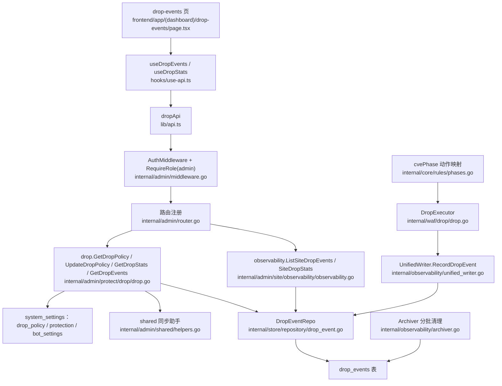
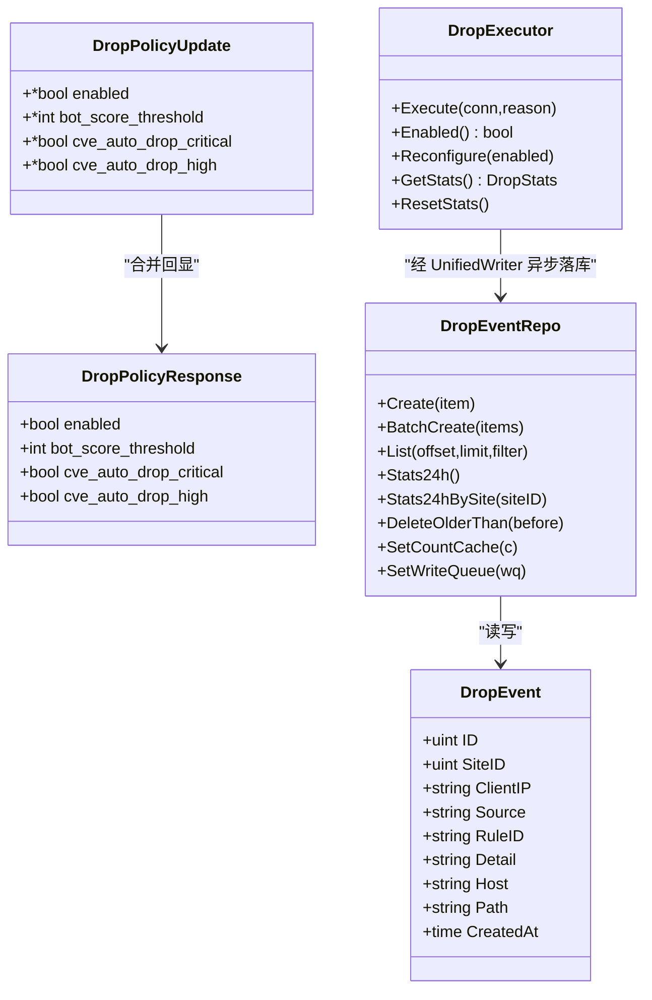
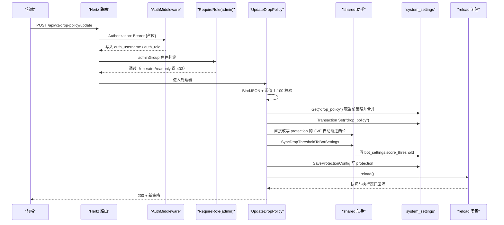
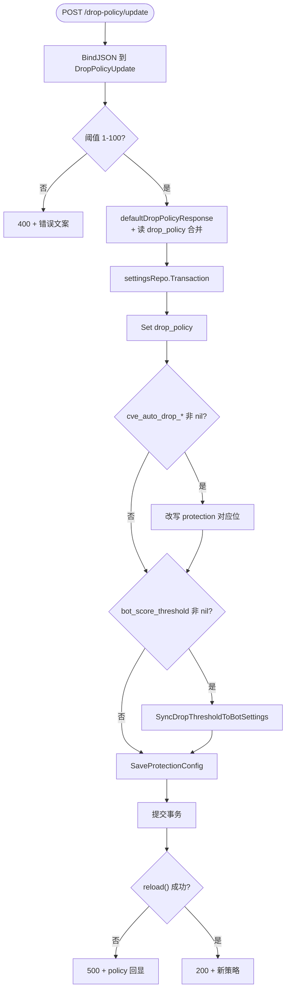
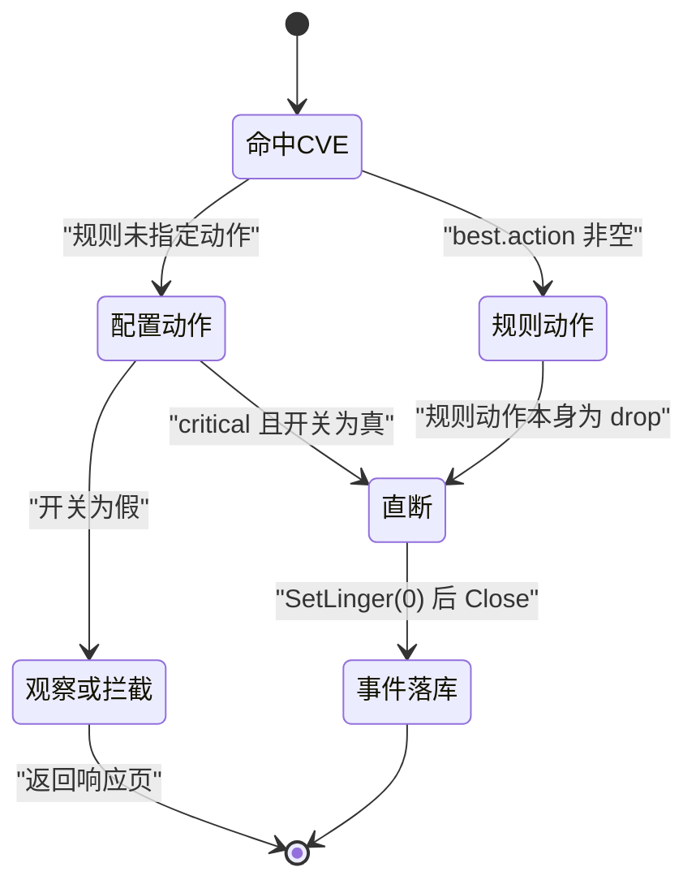
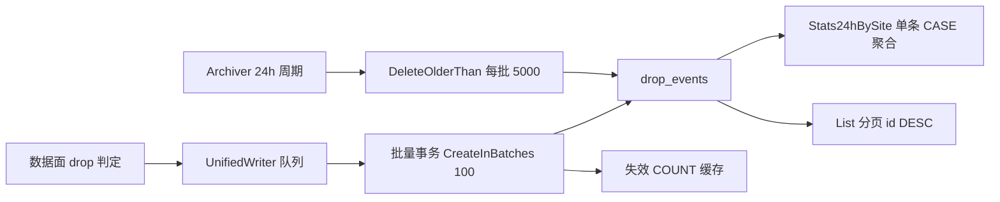
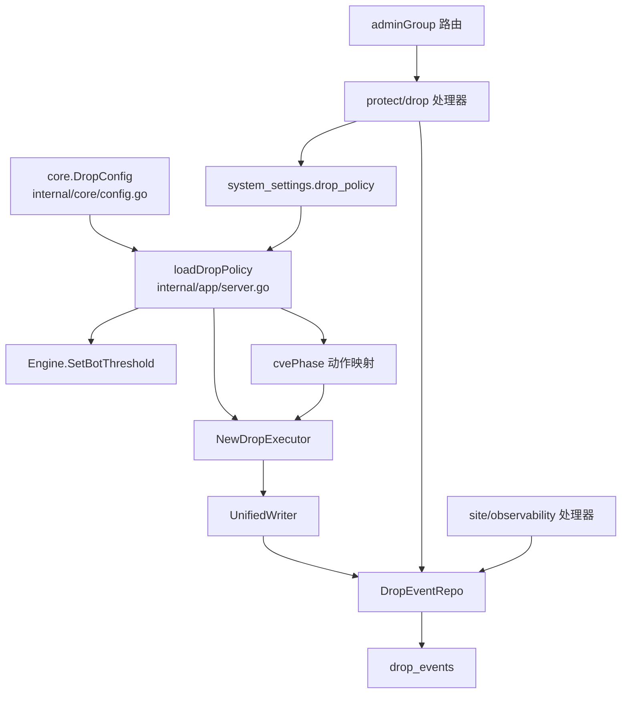

# 阻断策略 API

> [返回 管理 API 系统](管理 API 系统.md)

<cite>
**本文档引用的文件**
- [router.go](file://internal/admin/router.go)
- [drop.go](file://internal/admin/protect/drop/drop.go)
- [helpers.go](file://internal/admin/shared/helpers.go)
- [protection.go](file://internal/admin/protect/protection.go)
- [observability.go](file://internal/admin/site/observability/observability.go)
- [drop_event.go](file://internal/store/repository/drop_event.go)
- [events.go](file://internal/store/events.go)
- [protection.go](file://internal/store/protection.go)
- [config.go](file://internal/core/config.go)
- [server.go](file://internal/app/server.go)
- [middleware.go](file://internal/admin/middleware.go)
- [drop.go](file://internal/waf/drop/drop.go)
- [action.go](file://internal/core/action/action.go)
- [phases.go](file://internal/core/rules/phases.go)
- [handler.go](file://internal/dataplane/handler.go)
- [handler_support.go](file://internal/dataplane/handler_support.go)
- [unified_writer.go](file://internal/observability/unified_writer.go)
- [archiver.go](file://internal/observability/archiver.go)
- [api.ts](file://frontend/lib/api.ts)
- [use-api.ts](file://frontend/hooks/use-api.ts)
- [page.tsx](file://frontend/app/(dashboard)/drop-events/page.tsx)
- [bot-observation-card.tsx](file://frontend/app/(dashboard)/captcha/components/bot-observation-card.tsx)
</cite>

## 目录

1. [简介](#简介)
2. [项目结构](#项目结构)
3. [核心组件](#核心组件)
4. [架构总览](#架构总览)
5. [详细组件分析](#详细组件分析)
6. [依赖关系分析](#依赖关系分析)
7. [性能考虑](#性能考虑)
8. [故障排查指南](#故障排查指南)
9. [结论](#结论)
10. [附录](#附录)

## 简介

阻断策略 API 管理「TCP 直断（drop）」这一最高优先级动作：策略配置的读写、24 小时阻断统计、阻断事件明细查询。处理器在 `internal/admin/protect/drop/`（176 行），事件查询另有站点作用域版本在 `internal/admin/site/observability/`（157 行），落库与执行分别由 `internal/observability/UnifiedWriter` 与 `internal/waf/drop.DropExecutor` 承担。

四个字段构成策略全部语义：`enabled`（总开关）、`bot_score_threshold`（与 Bot 页共用的分数阈值）、`cve_auto_drop_critical`、`cve_auto_drop_high`。三者都存在跨端点的双向同步，因此本篇把「谁是权威源」写清楚。

本组唯一的写端点 `POST /api/v1/drop-policy/update` 落在 `adminGroup`，仅 admin 角色可达；读端点在 `readGroup`，readonly 即可。写操作只有 POST，全库无 PUT/DELETE 路由。通用错误码语义与中间件链见 [REST API 设计规范](REST API 设计规范/REST API 设计规范.md)。

**章节来源**
- [router.go:242-244](file://internal/admin/router.go#L242-L244)
- [router.go:372-373](file://internal/admin/router.go#L372-L373)
- [router.go:408](file://internal/admin/router.go#L408)
- [drop.go:16-30](file://internal/admin/protect/drop/drop.go#L16-L30)

## 项目结构

阻断策略横跨控制面配置、运行时装配与事件链路三部分：配置写 `system_settings` 的 `drop_policy` 键，运行时按「代码默认 → 环境变量 → 落库值」三级覆盖，事件由数据面异步落 `drop_events` 表。

| 层 | 路径 | 行数 | 职责 |
|----|------|-----:|------|
| 路由 | `internal/admin/router.go` | 465 | 6 个端点注册，写端点置于 adminGroup |
| 处理器 | `internal/admin/protect/drop/drop.go` | 176 | 策略读写与阈值同步、统计与事件分页 |
| 处理器 | `internal/admin/site/observability/observability.go` | 157 | 站点作用域 drop 事件与统计 |
| 共享 | `internal/admin/shared/helpers.go` | 593 | `SyncDropThresholdToBotSettings`、`SyncCVEAutoDropToDropPolicy` |
| 仓储 | `internal/store/repository/drop_event.go` | 208 | 过滤查询、COUNT 缓存、异步写队列、分批清理 |
| 模型 | `internal/store/events.go` | 278 | `DropEvent` 表结构 |
| 观测 | `internal/observability/unified_writer.go` | 1198 | `RecordDropEvent` 入队与非阻塞写 |
| 观测 | `internal/observability/archiver.go` | 529 | 按保留期分批删除，默认 30 天、周期 24 小时 |
| 数据面 | `internal/waf/drop/drop.go` | 113 | `DropExecutor` RST 关闭与原子计数 |
| 数据面 | `internal/dataplane/handler.go` | — | drop 判定与事件写出 |
| 运行时 | `internal/app/server.go` | 2121 | `loadDropPolicy`、执行器构造、reload 回灌 |



**图表来源**
- [router.go:191-192](file://internal/admin/router.go#L191-L192)
- [router.go:242-244](file://internal/admin/router.go#L242-L244)
- [router.go:408](file://internal/admin/router.go#L408)
- [drop.go:54-176](file://internal/admin/protect/drop/drop.go#L54-L176)
- [drop_event.go:91-208](file://internal/store/repository/drop_event.go#L91-L208)
- [unified_writer.go:583-593](file://internal/observability/unified_writer.go#L583-L593)

**章节来源**
- [drop.go:1-14](file://internal/admin/protect/drop/drop.go#L1-L14)
- [observability.go:101-157](file://internal/admin/site/observability/observability.go#L101-L157)
- [api.ts:1056-1061](file://frontend/lib/api.ts#L1056-L1061)

## 核心组件

| 组件 | 类型 | 定义位置 | 说明 |
|------|------|----------|------|
| `DropPolicyResponse` | 响应结构 | `protect/drop/drop.go:17-22` | 值类型四字段，读写共用回显形态 |
| `DropPolicyUpdate` | 请求结构 | `protect/drop/drop.go:25-30` | 四字段全指针，nil 表示不修改 |
| `defaultDropPolicyResponse` | 构造函数 | `protect/drop/drop.go:32-52` | 默认 true/80/true/true，再被 `protection` 与 `bot_settings` 覆盖 |
| `GetDropPolicy` | 处理器 | `protect/drop/drop.go:54-68` | 读 `drop_policy`，缺失或 JSON 非法回落默认值 |
| `UpdateDropPolicy` | 处理器 | `protect/drop/drop.go:70-135` | 校验 → 合并 → 事务写三键 → reload |
| `GetDropStats` / `GetDropEvents` | 处理器 | `protect/drop/drop.go:137-176` | 固定 24 小时聚合；事件分页过滤 |
| `ListSiteDropEvents` / `SiteDropStats` | 处理器 | `site/observability/observability.go:101-157` | 站点作用域，先校验站点存在 |
| `DropEventFilter` | 过滤结构 | `repository/drop_event.go:40-47` | `SiteID`/`ClientIP`/`Source`/`StartTime`/`EndTime` |
| `DropStatsSummary` | 聚合结构 | `repository/drop_event.go:156-163` | 5 个 `CASE` 汇总列 |
| `DropExecutor` | 执行器 | `waf/drop/drop.go:19-113` | `SetLinger(0)` 后关闭连接并计数 |



**图表来源**
- [drop.go:16-52](file://internal/admin/protect/drop/drop.go#L16-L52)
- [drop_event.go:12-208](file://internal/store/repository/drop_event.go#L12-L208)
- [events.go:237-248](file://internal/store/events.go#L237-L248)
- [drop.go:19-113](file://internal/waf/drop/drop.go#L19-L113)

**章节来源**
- [drop.go:16-52](file://internal/admin/protect/drop/drop.go#L16-L52)
- [drop_event.go:12-47](file://internal/store/repository/drop_event.go#L12-L47)
- [events.go:237-248](file://internal/store/events.go#L237-L248)

## 架构总览

写路径是唯一经过鉴权与角色分组的高危链路：策略落库与两处投影同步在同一个事务内完成，提交后才触发快照重载。



**图表来源**
- [router.go:372-373](file://internal/admin/router.go#L372-L373)
- [router.go:408](file://internal/admin/router.go#L408)
- [middleware.go:42-141](file://internal/admin/middleware.go#L42-L141)
- [drop.go:70-135](file://internal/admin/protect/drop/drop.go#L70-L135)
- [helpers.go:501-520](file://internal/admin/shared/helpers.go#L501-L520)
- [server.go:660-661](file://internal/app/server.go#L660-L661)

运行时读取顺序为三级覆盖，`drop_policy` 是最后生效者：

| 阶段 | 来源 | 覆盖范围 | 依据 |
|------|------|----------|------|
| 1 | `core.DefaultDropConfig()` | true / 80 / true / true | `core/config.go:67-74` |
| 2 | 环境变量 | `MY_OPENWAF_DROP_ENABLED`、`MY_OPENWAF_DROP_BOT_THRESHOLD` | `core/config.go:419-427` |
| 3 | `system_settings.drop_policy` | 四字段逐项指针覆盖 | `app/server.go:1415-1448` |
| 4 | reload 链回灌 | `DropExecutor.Reconfigure(enabled)`、`Engine.SetBotThreshold` | `app/server.go:660-661` |

**章节来源**
- [config.go:59-74](file://internal/core/config.go#L59-L74)
- [config.go:419-427](file://internal/core/config.go#L419-L427)
- [server.go:1415-1448](file://internal/app/server.go#L1415-L1448)
- [server.go:458-459](file://internal/app/server.go#L458-L459)
- [server.go:660-661](file://internal/app/server.go#L660-L661)

## 详细组件分析

### 端点总表

| 方法 | 路径 | 权限 | 处理器 | 注册行 | 说明 |
|------|------|------|--------|-------:|------|
| GET | `/api/v1/drop-policy` | readonly+ | `drop.GetDropPolicy` | 242 | 读策略，异常回落默认值 |
| GET | `/api/v1/drop-stats` | readonly+ | `drop.GetDropStats` | 243 | 全局 24 小时聚合，无 `hours` 参数 |
| GET | `/api/v1/drop-events` | readonly+ | `drop.GetDropEvents` | 244 | 事件分页，返回 `{items,total}` |
| POST | `/api/v1/drop-policy/update` | admin | `drop.UpdateDropPolicy` | 408 | 唯一写端点，operator 不可达 |
| GET | `/api/v1/sites/:id/drop-events` | readonly+ | `observability.ListSiteDropEvents` | 191 | 站点作用域事件，站点不存在 404 |
| GET | `/api/v1/sites/:id/drop-stats` | readonly+ | `observability.SiteDropStats` | 192 | 站点作用域 24 小时聚合 |

关联端点：`POST /api/v1/protection-settings`（287）是 CVE 自动断连两位的第二写入者；`GET /api/v1/bot-settings`（216）与 `POST /api/v1/bot-settings/update`（315）共用 `bot_score_threshold`，详见 [机器人保护 API](机器人保护 API.md)。

**章节来源**
- [router.go:191-192](file://internal/admin/router.go#L191-L192)
- [router.go:242-244](file://internal/admin/router.go#L242-L244)
- [router.go:287](file://internal/admin/router.go#L287)
- [router.go:408](file://internal/admin/router.go#L408)

### 请求参数表

| 端点 | 参数 | 位置 | 类型 | 必填 | 约束与默认 |
|------|------|------|------|:----:|------------|
| `GET /drop-events` | `page` | query | int | 否 | 缺省 1 |
| `GET /drop-events` | `page_size` | query | int | 否 | 缺省 20，经 `utils.Paginate` 归一 |
| `GET /drop-events` | `ip` | query | string | 否 | `client_ip = ?` 精确匹配 |
| `GET /drop-events` | `source` | query | string | 否 | `source = ?` 精确匹配，取值见「来源取值表」 |
| `GET /drop-events` | `start_time` / `end_time` | query | string | 否 | RFC3339，解析失败即忽略该条件 |
| `GET /sites/:id/drop-events` | `id` | path | uint | 是 | 非数值 400；站点不存在 404 |
| `GET /sites/:id/drop-events` | `client_ip` | query | string | 否 | 与全局端点参数名不同，此处为 `client_ip` |
| `GET /sites/:id/drop-events` | `source` / `start_time` / `end_time` | query | string | 否 | 口径同全局端点 |
| `GET /sites/:id/drop-stats` | `id` | path | uint | 是 | 窗口固定 24 小时，不可调 |
| `POST /drop-policy/update` | `enabled` | body | *bool | 否 | nil 保留原值 |
| `POST /drop-policy/update` | `bot_score_threshold` | body | *int | 否 | 1–100，越界 400；生效后回写 `bot_settings` |
| `POST /drop-policy/update` | `cve_auto_drop_critical` | body | *bool | 否 | nil 保留；非 nil 同时写 `protection` |
| `POST /drop-policy/update` | `cve_auto_drop_high` | body | *bool | 否 | 同上 |

`POST /drop-policy/update` 载荷示例（仅升级严重级自动断连）：

```json
{
  "enabled": true,
  "cve_auto_drop_critical": true,
  "cve_auto_drop_high": false
}
```

**章节来源**
- [drop.go:70-176](file://internal/admin/protect/drop/drop.go#L70-L176)
- [observability.go:101-157](file://internal/admin/site/observability/observability.go#L101-L157)
- [drop_event.go:40-47](file://internal/store/repository/drop_event.go#L40-L47)
- [helpers.go:309-312](file://internal/admin/shared/helpers.go#L309-L312)

### 响应字段表

`GET /drop-policy` 与 `POST /drop-policy/update` 均回显完整 `DropPolicyResponse`：

| 字段 | 类型 | 默认值 | 权威源 |
|------|------|--------|--------|
| `enabled` | bool | `true` | `drop_policy.enabled`，缺失即默认 |
| `bot_score_threshold` | int | 80 | 先取 `bot_settings.score_threshold`（>0 时覆盖默认），写回时两处互相同步 |
| `cve_auto_drop_critical` | bool | `true` | `protection.cve_auto_drop_critical` |
| `cve_auto_drop_high` | bool | `true` | `protection.cve_auto_drop_high` |

`GET /drop-stats` 与 `GET /sites/:id/drop-stats` 返回 `DropStatsSummary`：

| 字段 | 类型 | 口径 |
|------|------|------|
| `total_24h` | int64 | 24 小时内 `drop_events` 行数 |
| `by_bot` | int64 | `source = 'bot'` 行数 |
| `by_cve` | int64 | `source = 'cve'` 行数 |
| `by_rule` | int64 | `source = 'rule'` 行数 |
| `by_ip_reputation` | int64 | `source = 'ip_reputation'` 行数 |

`GET /drop-events` 返回 `{items,total}`，`items` 元素为 `DropEvent` 全列：

| 字段 | 类型 | 说明 |
|------|------|------|
| `id` | uint | 自增主键，列表按 `id DESC` 排序 |
| `site_id` | uint | 站点作用域过滤键 |
| `client_ip` | string | `size:45`，索引列 |
| `source` | string | 写入方为判定阶段名，见「来源取值表」 |
| `rule_id` | string | 命中规则标识，内置规则带 `owasp:`/`cve:` 前缀 |
| `detail` | string | 命中描述，`size:512` |
| `host` / `path` | string | 请求主机与路径 |
| `created_at` | time | 事件时间，与 `source` 组成联合索引 |

**章节来源**
- [drop.go:17-52](file://internal/admin/protect/drop/drop.go#L17-L52)
- [drop_event.go:156-208](file://internal/store/repository/drop_event.go#L156-L208)
- [events.go:237-248](file://internal/store/events.go#L237-L248)

### 错误码表

| 状态码 | 触发条件 | 响应体 | 依据 |
|-------:|----------|--------|------|
| 400 | `drop-policy/update` 请求体非法 JSON | `{"error":"<绑定错误>"}` | `drop.go:72-76` |
| 400 | `bot_score_threshold` 不在 1–100 | `{"error":"bot_score_threshold must be between 1 and 100"}` | `drop.go:77-80` |
| 400 | 站点端点 `id` 非数值 | `{"error":"invalid id"}` | `observability.go:103-106` |
| 403 | operator 或 readonly 调用写端点 | `{"error":"access denied: insufficient permissions"}` | `middleware.go:127-142` |
| 404 | 站点作用域端点目标站点不存在 | `{"error":"site not found"}` | `observability.go:108-111` |
| 500 | 事务写库或序列化失败 | `{"error":"<错误文本>"}` | `drop.go:100-125` |
| 500 | 已落库但快照重载失败 | `{"error":"config applied but reload failed: …","policy":{…}}` | `drop.go:127-132` |
| 500 | 统计或事件查询失败 | `{"error":"<错误文本>"}` | `drop.go:139-144`、`drop.go:169-173` |

**章节来源**
- [drop.go:70-176](file://internal/admin/protect/drop/drop.go#L70-L176)
- [observability.go:101-157](file://internal/admin/site/observability/observability.go#L101-L157)
- [middleware.go:127-142](file://internal/admin/middleware.go#L127-L142)

### 策略写入与双投影同步

`drop_policy` 的四个字段并非各自独立：阈值与 CVE 两位在 `bot_settings`、`protection` 中都有镜像，写入时必须按「本次是否提交该字段」决定同步范围。



**图表来源**
- [drop.go:70-135](file://internal/admin/protect/drop/drop.go#L70-L135)
- [helpers.go:501-548](file://internal/admin/shared/helpers.go#L501-L548)

第二写入者是 `POST /api/v1/protection-settings`：当请求体包含 `cve_auto_drop_critical` 或 `cve_auto_drop_high` 时，`PutProtectionSettings` 在同一事务内调用 `SyncCVEAutoDropToDropPolicy` 反写 `drop_policy`（`protection.go:283-287`）。因此验证码页与阻断策略页不会形成两个配置源，只是同一份语义的两个入口。反向同步同理存在于阈值：`POST /bot-settings/update` 经 `SyncBotThresholdToDropPolicy` 写 `drop_policy.bot_score_threshold`。

**章节来源**
- [helpers.go:501-548](file://internal/admin/shared/helpers.go#L501-L548)
- [protection.go:283-287](file://internal/admin/protect/protection.go#L283-L287)
- [drop.go:100-125](file://internal/admin/protect/drop/drop.go#L100-L125)

### CVE 自动升级与阈值生效语义

两个 CVE 开关只在「规则未显式指定动作」时生效，且升级条件是 drop 的终止优先级严格高于当前动作：

| 条件 | 结果 |
|------|------|
| 命中 severity=critical 且 `cve_auto_drop_critical=true` 且规则无显式动作 | 动作升级为 `drop` |
| 命中 severity=high 且 `cve_auto_drop_high=true` 且规则无显式动作 | 动作升级为 `drop` |
| 规则显式给出 `action`（含 `intercept`） | 不升级，按规则动作执行 |
| 全局 CVE 动作缺省 | `intercept` |



**图表来源**
- [phases.go:789-841](file://internal/core/rules/phases.go#L789-L841)
- [drop.go:47-72](file://internal/waf/drop/drop.go#L47-L72)
- [action.go:88-119](file://internal/core/action/action.go#L88-L119)

`bot_score_threshold` 的实际消费者是引擎：`loadDropPolicy` 得出阈值后，reload 链调用 `Engine.SetBotThreshold`，Bot 阶段据此决定是否短路。策略关闭（`enabled=false`）时 `DropExecutor.Enabled()` 为假，数据面走 `CloseForDrop()` 分支而不是 RST 计数路径，因此关闭开关不等于不再断开连接，只是不再按 drop 语义记录执行器统计。

**章节来源**
- [phases.go:789-841](file://internal/core/rules/phases.go#L789-L841)
- [server.go:660-661](file://internal/app/server.go#L660-L661)
- [handler.go:725-760](file://internal/dataplane/handler.go#L725-L760)
- [drop.go:43-72](file://internal/waf/drop/drop.go#L43-L72)

### 来源取值表

`DropEvent.source` 由数据面写入，值是判定所在的阶段名，而非统计口径里的四个短名：

| 写入值（阶段名） | 阶段定义 | 是否被 `drop-stats` 计入分类列 |
|------------------|----------|--------------------------------|
| `ip_reputation` | `phases.go:356` | 是，`by_ip_reputation` |
| `bot_detection` | `phases.go:488` | 否，短名 `bot` 不匹配 |
| `cve_detection` | `phases.go:742` | 否，短名 `cve` 不匹配 |
| `owasp_default` | `phases.go:616` | 否 |
| `signature` / `custom` | `phases.go:167`、`phases.go:188` | 否，短名 `rule` 不匹配 |
| `acl` / `rate_limit` / `anti_replay` / `browser_sign` | `phases.go:146`、`314`、`1251`、`1351` | 否 |

这意味着 `total_24h` 与四个分类列之和不恒等，差值即为以阶段名落库的阻断量；`source` 查询参数同样按精确值匹配，前端若传 `bot` 会得到空列表。仪表板 `drop_by_source_24h` 使用同一组短名（`dashboard.go:196-209`），口径与此一致。执行器侧的进程内计数另有一套映射：`rule` 与 `ip_reputation` 都累加到 `DroppedByRule`（`waf/drop/drop.go:78-91`），与库内聚合口径不同，两者不可互相校验。

**章节来源**
- [handler.go:732-793](file://internal/dataplane/handler.go#L732-L793)
- [handler_support.go:334-352](file://internal/dataplane/handler_support.go#L334-L352)
- [phases.go:146-188](file://internal/core/rules/phases.go#L146-L188)
- [drop_event.go:190-208](file://internal/store/repository/drop_event.go#L190-L208)
- [drop.go:78-91](file://internal/waf/drop/drop.go#L78-L91)

### 事件写入与保留

事件写入全程非阻塞：数据面调用 `UnifiedWriter.RecordDropEvent` 入队，仓储在有写队列时把 `Create`/`BatchCreate` 提交为事务任务，并在成功后失效 COUNT 缓存。

| 环节 | 实现 | 关键参数 |
|------|------|----------|
| 入队 | `unified_writer.go:583-591` | 低频通道 `DropBufferSize`，默认 8192 |
| 批量落库 | `drop_event.go:67-89` | `CreateInBatches(items, 100)` |
| COUNT 缓存 | `drop_event.go:109-154` | 键由站点/IP/来源/起止时间拼合 |
| 分批清理 | `drop_event.go:167-188` | 每批 5000 行，批间 `Sleep(50ms)` |
| 保留期 | `archiver.go:26-57` | `drop_event_retention_days` 默认 30 天，周期 24 小时 |



**图表来源**
- [unified_writer.go:583-591](file://internal/observability/unified_writer.go#L583-L591)
- [drop_event.go:49-188](file://internal/store/repository/drop_event.go#L49-L188)
- [archiver.go:26-57](file://internal/observability/archiver.go#L26-L57)

**章节来源**
- [unified_writer.go:583-591](file://internal/observability/unified_writer.go#L583-L591)
- [drop_event.go:49-188](file://internal/store/repository/drop_event.go#L49-L188)
- [archiver.go:26-57](file://internal/observability/archiver.go#L26-L57)

### 前端调用点

| 调用方 | 位置 | 消费的端点 | 说明 |
|--------|------|------------|------|
| `useDropEvents` | `hooks/use-api.ts:600-602` | `GET /drop-events` | 阻断事件页列表 |
| `useDropStats` | `hooks/use-api.ts:1492-1496` | `GET /drop-stats` | Bot 观测卡展示阻断量 |
| `useDropPolicy` | `hooks/use-api.ts:596-598` | `GET /drop-policy` | 当前无页面消费 |
| `useDropPolicyUpdate` | `hooks/use-api.ts:1209-1212` | `POST /drop-policy/update` | 当前无页面消费 |
| 阻断事件页 | `app/(dashboard)/drop-events/page.tsx:22-33` | `GET /drop-events` | 过滤器为 `source`、`client_ip`、`host` |
| Bot 观测卡 | `captcha/components/bot-observation-card.tsx:16` | `GET /drop-stats` | 与 Bot 统计同卡展示 |

两处实测不一致需要记录：阻断事件页把过滤字段命名为 `client_ip` 与 `host`，而全局端点只读 `ip` 与 `source`，因此 `client_ip`、`host` 两项在该页不产生服务端过滤；`useDropPolicy` 与 `useDropPolicyUpdate` 已导出但无页面调用，策略修改实际经由 `POST /api/v1/protection-settings`。本篇按后端实现给出参数真名，不改代码。

**章节来源**
- [api.ts:1056-1061](file://frontend/lib/api.ts#L1056-L1061)
- [use-api.ts:596-602](file://frontend/hooks/use-api.ts#L596-L602)
- [use-api.ts:1209-1212](file://frontend/hooks/use-api.ts#L1209-L1212)
- [use-api.ts:1492-1496](file://frontend/hooks/use-api.ts#L1492-L1496)
- [page.tsx:22-33](file://frontend/app/(dashboard)/drop-events/page.tsx#L22-L33)
- [bot-observation-card.tsx:16](file://frontend/app/(dashboard)/captcha/components/bot-observation-card.tsx#L16)

## 依赖关系分析

| 依赖方 | 被依赖方 | 依赖性质 | 失败表现 |
|--------|----------|----------|----------|
| `protect/drop` | `SystemSettingsRepo` | 三键事务读写 | 400/500，事务整体回滚 |
| `protect/drop` | `shared.LoadProtectionConfig` | 读 CVE 两位权威源 | 回落默认值 |
| `protect/drop` | `shared.SyncDropThresholdToBotSettings` | 阈值反向同步 | 事务失败返回 500 |
| `protect/drop` | `DropEventRepo` | 只读统计与列表 | 500 |
| `protect/drop` | `reload` 闭包 | 策略生效 | 500 且回显已生效策略 |
| `site/observability` | `SiteRepo` | 站点存在性校验 | 400/404 |
| `site/observability` | `DropEventRepo` | 站点作用域查询 | 500 |
| `DropExecutor` | `UnifiedWriter` | 事件异步落库 | 队列满时受限等待或丢弃 |
| `Archiver` | `DropEventRepo.DeleteOlderThan` | 保留期清理 | 分批继续，失败上抛 |



**图表来源**
- [config.go:59-74](file://internal/core/config.go#L59-L74)
- [server.go:458-459](file://internal/app/server.go#L458-L459)
- [server.go:1415-1448](file://internal/app/server.go#L1415-L1448)
- [drop.go:54-176](file://internal/admin/protect/drop/drop.go#L54-L176)
- [observability.go:101-157](file://internal/admin/site/observability/observability.go#L101-L157)

**章节来源**
- [drop.go:10-14](file://internal/admin/protect/drop/drop.go#L10-L14)
- [helpers.go:501-548](file://internal/admin/shared/helpers.go#L501-L548)
- [server.go:1415-1448](file://internal/app/server.go#L1415-L1448)

## 性能考虑

- 统计是单条 `CASE` 聚合，一次扫描得到 5 列，窗口固定 24 小时，不带可调用参数，因此不存在慢窗口选择问题。
- 列表的 `COUNT` 结果按过滤条件组合缓存，写队列提交与直接写入都会失效缓存，避免总数与明细不一致。
- `source` 与 `created_at` 组成联合索引 `idx_drop_source_created`，来源过滤 + 时间范围是主查询形态；`client_ip` 为独立索引，等值匹配可命中。
- 清理采用每批 5000 行 + 50ms 间隔的分批删除，降低大表锁竞争，代价是保留期切换后需要数轮才收敛。
- 事件写入与请求处理解耦：执行器只做 `SetLinger(0)` 与 `Close`，落库走异步队列，热路径不触数据库。
- 执行器日志按前 16 条全量、之后每 1024 条一条的门控输出，阻断风暴下日志量有界。

[本节为总结，无需特定文件来源]

## 故障排查指南

| 症状 | 原因 | 排查 | 方案 |
|------|------|------|------|
| 修改 `bot_score_threshold` 后 Bot 页也变了 | 阈值双向同步，属设计 | 读 `GET /bot-settings` 确认 | 以任一处为准，勿并行提交两个写请求 |
| 更新返回 500 但配置已生效 | reload 失败，落库已完成 | 看响应 `policy` 字段与重载日志 | 重放 `POST /api/v1/reload` 或排查快照重建错误 |
| `by_bot`/`by_cve`/`by_rule` 恒为 0 | 事件按阶段名落库，短名不匹配 | 直接看 `GET /drop-events` 的 `source` 实际值 | 用真实阶段名过滤，或按 `total_24h` 判断总量 |
| 事件页按 IP 过滤无效果 | 前端传 `client_ip`，全局端点读 `ip` | 手工带 `?ip=` 复现 | 已知不一致，按端点真名调用 |
| `source=bot` 查询返回空 | 同上，取值应为 `bot_detection` | 先不带 `source` 列出观察 | 使用「来源取值表」中的阶段名 |
| 关闭 `enabled` 后仍断开连接 | `CloseForDrop()` 分支仍会关闭 | 比对执行器统计是否不再增长 | 需要保留响应请改规则动作而非 drop |
| 站点端点 404 | 站点不存在或 `id` 指向已删站点 | `GET /api/v1/sites` 核对 | 修正站点 ID |
| 事件表持续增长 | 归档器未启用或保留期过长 | 查 `drop_event_retention_days` | 缩短保留期，注意分批删除耗时 |

**章节来源**
- [drop.go:100-135](file://internal/admin/protect/drop/drop.go#L100-L135)
- [drop_event.go:156-208](file://internal/store/repository/drop_event.go#L156-L208)
- [observability.go:101-115](file://internal/admin/site/observability/observability.go#L101-L115)
- [handler.go:740-760](file://internal/dataplane/handler.go#L740-L760)
- [archiver.go:26-57](file://internal/observability/archiver.go#L26-L57)

## 结论

阻断策略 API 的字段很少，风险却很高：`drop` 是终止优先级 90 的动作，一次错误升级会让客户端拿不到任何 HTTP 响应。因此本组刻意把写端点收到 `adminGroup`、把阈值校验收到单一函数、把两处镜像同步收进一个事务，reload 失败也只回显而不回滚，保证「配置状态可判定、可回放」。

实测暴露的两处口径问题是文档外事实，不在本次改动范围：`drop_events.source` 用阶段名而统计与过滤用短名；`drop-events` 页的 `client_ip`/`host` 过滤在全局端点无效。二者都会让运维误读阻断量，建议后续统一为阶段名单一口径。

[本节为总结，无需特定文件来源]

## 附录

### 默认值速查

| 项 | 取值 | 来源 |
|----|------|------|
| `enabled` | `true` | `core/config.go:69`、`drop.go:34` |
| `bot_score_threshold` | 80 | `core/config.go:70`、`drop.go:35` |
| `cve_auto_drop_critical` / `cve_auto_drop_high` | `true` / `true` | `store/protection.go:180-181`、`drop.go:36-37` |
| 阈值合法区间 | 1–100 | `helpers.go:309-312` |
| 统计窗口 | 24 小时（固定） | `drop_event.go:195` |
| 批量写入 | 100 行/批 | `drop_event.go:76`、`drop_event.go:84` |
| 清理批次 | 5000 行 + 50ms | `drop_event.go:169-185` |
| 保留期与周期 | 30 天 / 24 小时 | `archiver.go:54-57` |
| 规范默认状态码 | drop 无响应（内部码 1000） | `action.go:283-307`、`action.go:323-340` |

**章节来源**
- [config.go:59-74](file://internal/core/config.go#L59-L74)
- [drop.go:32-52](file://internal/admin/protect/drop/drop.go#L32-L52)
- [protection.go:180-181](file://internal/store/protection.go#L180-L181)
- [drop_event.go:67-208](file://internal/store/repository/drop_event.go#L67-L208)
- [archiver.go:54-57](file://internal/observability/archiver.go#L54-L57)
- [action.go:283-340](file://internal/core/action/action.go#L283-L340)

### 响应示例

`GET /api/v1/drop-policy` 成功响应：

```json
{
  "enabled": true,
  "bot_score_threshold": 80,
  "cve_auto_drop_critical": true,
  "cve_auto_drop_high": false
}
```

`GET /api/v1/drop-stats` 成功响应：

```json
{
  "total_24h": 1284,
  "by_bot": 0,
  "by_cve": 0,
  "by_rule": 0,
  "by_ip_reputation": 37
}
```

`GET /api/v1/drop-events?page=1&page_size=2&source=cve_detection` 成功响应：

```json
{
  "items": [
    {
      "id": 90312,
      "site_id": 3,
      "client_ip": "203.0.113.10",
      "source": "cve_detection",
      "rule_id": "cve:CVE-2024-23897",
      "detail": "命中 CVE-2024-23897 特征",
      "host": "app.example.internal",
      "path": "/jobRead",
      "created_at": "2026-10-17T09:12:33Z"
    }
  ],
  "total": 214
}
```

**章节来源**
- [drop.go:54-68](file://internal/admin/protect/drop/drop.go#L54-L68)
- [drop.go:137-176](file://internal/admin/protect/drop/drop.go#L137-L176)
- [drop_event.go:156-163](file://internal/store/repository/drop_event.go#L156-L163)
- [events.go:237-248](file://internal/store/events.go#L237-L248)

### 验证命令

读取策略并确认阈值来源：

```bash
curl -s -H "Authorization: Bearer {占位}" \
  http://127.0.0.1:8080/api/v1/drop-policy
```

以 admin 身份关闭高危级自动断连（预期 200 + 新策略）：

```bash
curl -s -X POST -H "Authorization: Bearer {占位}" \
  -H "Content-Type: application/json" \
  -d '{"cve_auto_drop_high":false}' \
  http://127.0.0.1:8080/api/v1/drop-policy/update
```

用 operator 令牌重复上一步（预期 403 `access denied: insufficient permissions`），并核对事件来源真实取值：

```bash
curl -s -H "Authorization: Bearer {占位}" \
  "http://127.0.0.1:8080/api/v1/drop-events?page=1&page_size=5"

go test ./internal/admin/protect/drop/... ./internal/admin/site/observability/...
```

[本节为通用指导，无需特定文件来源]
