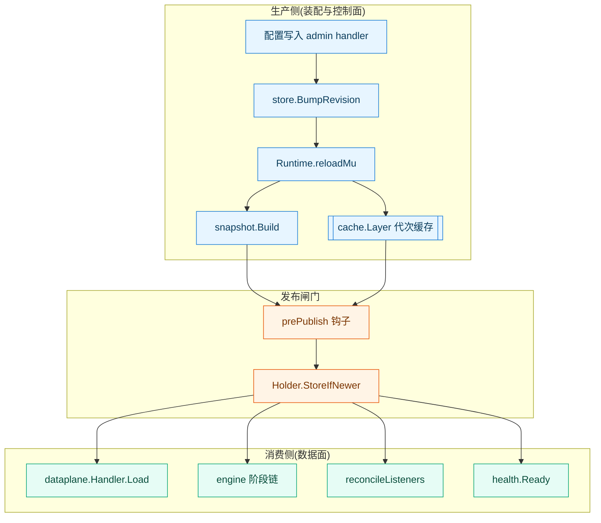
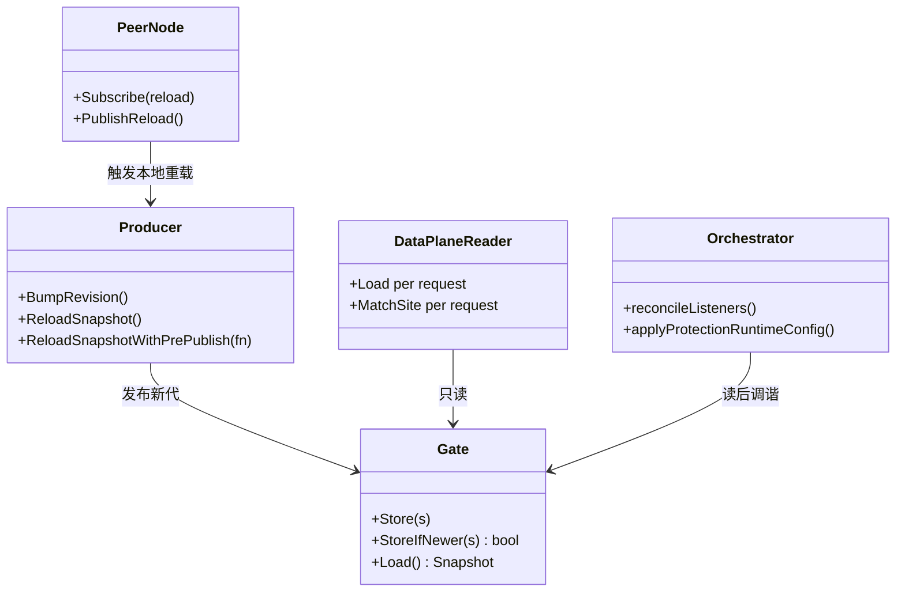
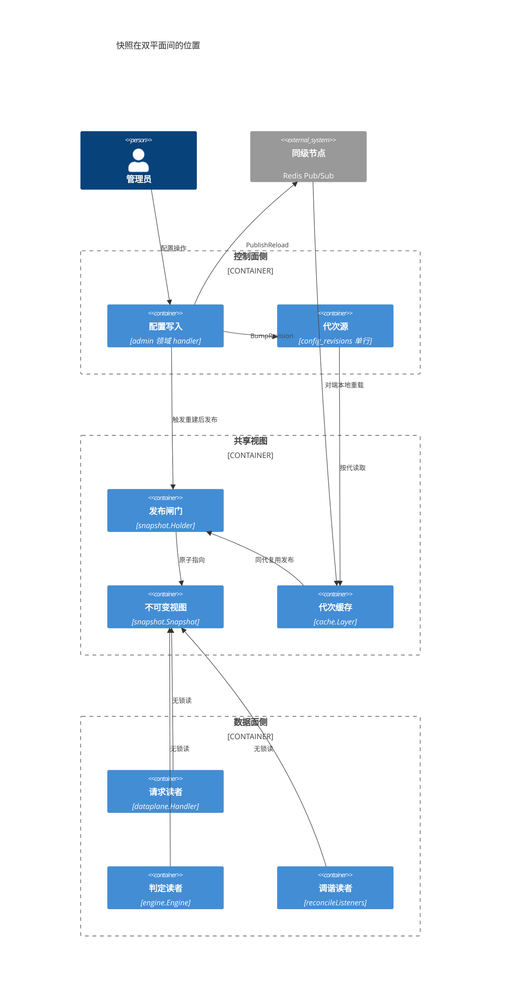
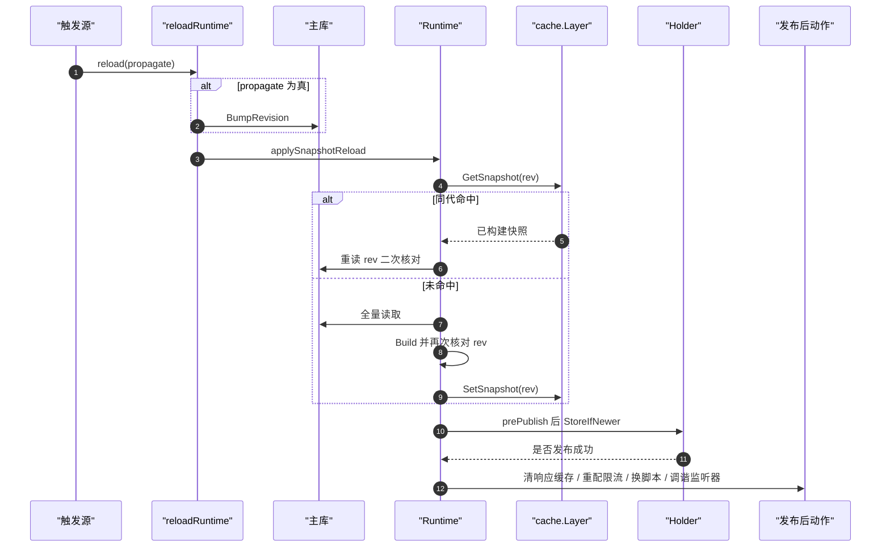
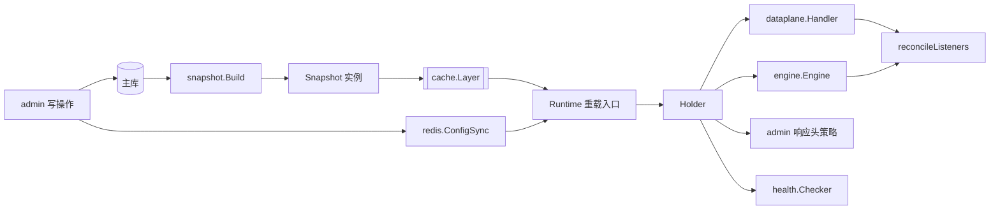
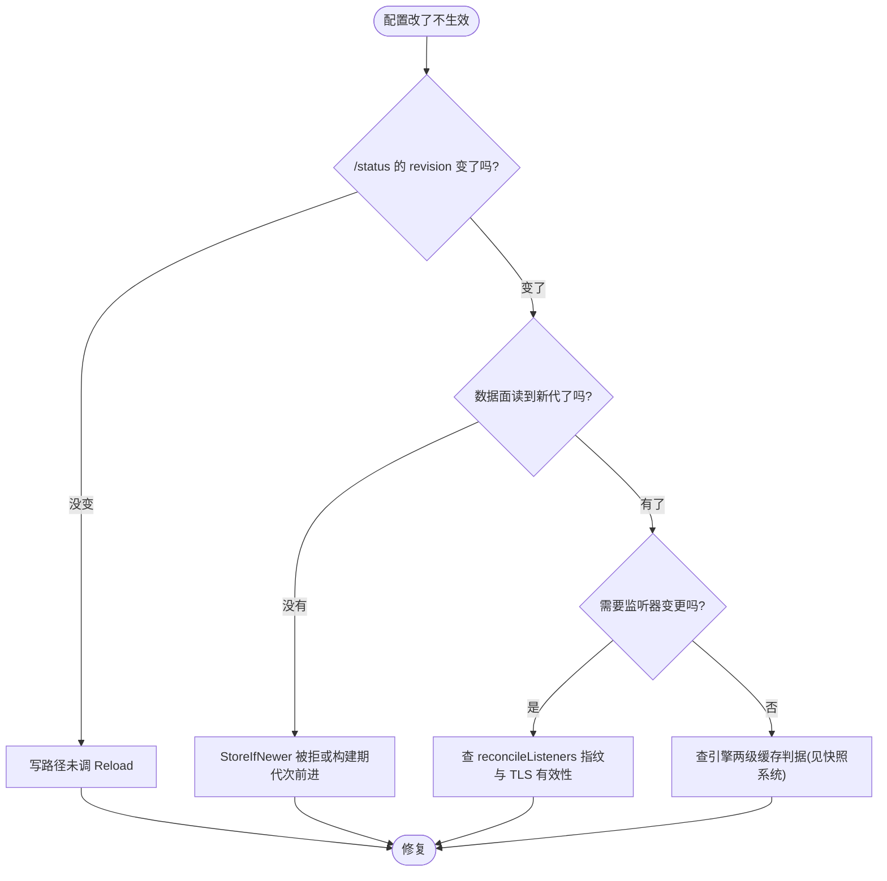

# 快照机制

> [返回 系统架构设计](系统架构设计.md)

<cite>
**本文档引用的文件**
- [internal/app/server.go](file://internal/app/server.go)
- [internal/core/runtime.go](file://internal/core/runtime.go)
- [internal/snapshot/snapshot.go](file://internal/snapshot/snapshot.go)
- [internal/snapshot/build.go](file://internal/snapshot/build.go)
- [internal/cache/layer.go](file://internal/cache/layer.go)
- [internal/core/redis/pubsub.go](file://internal/core/redis/pubsub.go)
- [internal/core/engine/engine.go](file://internal/core/engine/engine.go)
- [internal/core/health/health.go](file://internal/core/health/health.go)
- [internal/core/lifecycle/lifecycle.go](file://internal/core/lifecycle/lifecycle.go)
- [internal/dataplane/handler.go](file://internal/dataplane/handler.go)
- [internal/store/migrate.go](file://internal/store/migrate.go)
- [internal/admin/router.go](file://internal/admin/router.go)
- [internal/admin/middleware.go](file://internal/admin/middleware.go)
</cite>

## 目录

1. [简介](#简介)
2. [项目结构](#项目结构)
3. [核心组件](#核心组件)
4. [架构总览](#架构总览)
5. [详细组件分析](#详细组件分析)
6. [依赖关系分析](#依赖关系分析)
7. [性能考虑](#性能考虑)
8. [故障排查指南](#故障排查指南)
9. [结论](#结论)
10. [附录](#附录)

## 简介
本篇只讲快照的**架构视角**：它为什么是双平面之间唯一的共享物、它在什么时机被构建、以什么语义对请求可见、发布一次会牵动哪些组件。

**三处快照文档的分工**（同一事实只在一处展开）：

| 文档 | 视角 | 负责回答 |
|---|---|---|
| 本篇 | 架构 | 双平面中的角色、构建时机、发布可见性、发布牵动的组件 |
| [快照系统](../WAF 引擎系统/引擎核心架构/快照系统.md) | 引擎消费 | 引擎如何读快照、两级缓存键与失效判据 |
| [配置快照机制](../配置管理系统/配置快照机制.md) | 配置层 | 快照字段构成、构建期解析、与热重载落地的对应关系 |

## 项目结构
从架构上看，快照由「生产者—持有者—消费者」三种角色构成，三者之间没有直接调用，只通过对象与代次耦合。

| 平面归属 | 角色 | 承载 | 架构职责 |
|---|---|---|---|
| 双平面之间 | 共享视图 | `snapshot.Snapshot` | 唯一可跨平面传递的配置物 |
| 装配侧 | 生产者 | `Runtime.ReloadSnapshotWithPrePublish` | 把库里的配置变成一个代 |
| 装配侧 | 发布闸门 | `Holder.StoreIfNewer` | 只允许新代替换旧代 |
| 数据面 | 消费者 | `dataplane.Handler`、`engine.Engine` | 每请求读一次，不再回查库 |
| 控制面 | 间接消费者 | `health.Checker`、响应头策略 | 判断就绪与 HSTS 取值 |
| 编排侧 | 二次消费者 | `reconcileListeners` | 据快照决定监听器集合 |
| 缓存层 | 代次记忆 | `cache.Layer` | 同代不重复构建 |
| 存储层 | 代次来源 | `store.BumpRevision` | 单调递增的唯一写入点 |

**图表来源**
- [internal/core/runtime.go:211-274](file://internal/core/runtime.go#L211-L274)
- [internal/cache/layer.go:44-62](file://internal/cache/layer.go#L44-L62)
- [internal/snapshot/build.go:34-40](file://internal/snapshot/build.go#L34-L40)
- [internal/snapshot/snapshot.go:464-489](file://internal/snapshot/snapshot.go#L464-L489)
- [internal/dataplane/handler.go:119-141](file://internal/dataplane/handler.go#L119-L141)
- [internal/app/server.go:868-889](file://internal/app/server.go#L868-L889)
- [internal/core/health/health.go:32-44](file://internal/core/health/health.go#L32-L44)

**章节来源**
- [internal/core/runtime.go:201-274](file://internal/core/runtime.go#L201-L274)
- [internal/snapshot/snapshot.go:452-489](file://internal/snapshot/snapshot.go#L452-L489)

## 核心组件

| 模块清单（按架构角色） | 是否可变 | 可见范围 | 失效条件 |
|---|---|---|---|
| 配置写入者（admin 领域 handler） | — | 控制面 | 每次写后必须调 `Reload` |
| 代次源 `config_revisions` 单行 | 是（单调递增） | 全进程 | 无（只前进） |
| 构建器 `snapshot.Build` | 否（纯函数式产出） | 装配侧 | 修订号前进即重来 |
| 代次缓存 `cache.Layer` | 是 | 单进程 | 同代复用；进程重启清空 |
| 发布闸门 `Holder.StoreIfNewer` | 是（CAS） | 全进程 | 旧代被拒 |
| 不可变视图 `Snapshot` | 否 | 双平面 | 永不原地改 |
| 数据面读者 | — | 数据面 | 见「一次发布的牵动面」 |

**图表来源**
- [internal/core/runtime.go:201-274](file://internal/core/runtime.go#L201-L274)
- [internal/snapshot/snapshot.go:452-489](file://internal/snapshot/snapshot.go#L452-L489)
- [internal/app/server.go:722-889](file://internal/app/server.go#L722-L889)
- [internal/core/redis/pubsub.go:65-121](file://internal/core/redis/pubsub.go#L65-L121)

**章节来源**
- [internal/core/runtime.go:201-274](file://internal/core/runtime.go#L201-L274)
- [internal/app/server.go:868-889](file://internal/app/server.go#L868-L889)

## 架构总览
快照存在的理由是：数据面必须以**无锁**方式读配置，而配置又必须能被管理端随时改写。把「随时改写」收敛为「换指针」，把「无锁读」收敛为「读一次指针」，两侧就都不需要协调。这是整个架构里最关键的一次取舍。

| 架构层 | 快照在该层的作用 | 关键约束 |
|---|---|---|
| 装配层 | 构建并持有第一个代 | 构建失败即 `os.Exit(1)`，不允许无快照启动 |
| 控制面层 | 递增代次、触发重建 | 只写库，不直接改运行态 |
| 共享视图层 | 不可变承载 | 构建后零改写 |
| 数据面层 | 每请求读一次 | 读不到就 503，不猜测默认配置 |
| 编排层 | 依据快照算期望监听集 | 指纹变化才重启 |
| 观测层 | 就绪判定包含快照非空 | `/readyz` 会因空快照返回 503 |

| 外部实体 | 与快照的关系 | 契约 |
|---|---|---|
| 管理员 | 间接生产者 | 写入 + `Reload` |
| Redis 同级节点 | 触发对端重建 | 只传「reload」事件，不传快照内容 |
| 上游源站 | 无直接关系 | 其健康态存在进程内池中，不属快照 |
| Prometheus / 探针 | 读取代次数值 | `/status` 的 `revision` |
| ACME 续期循环 | 触发重建 | 与管理员同一条 reload |
| 威胁情报订阅源 | 定时触发重建 | `reload` 作为回调注入 |

**图表来源**
- [internal/core/runtime.go:211-274](file://internal/core/runtime.go#L211-L274)
- [internal/cache/layer.go:24-62](file://internal/cache/layer.go#L24-L62)
- [internal/snapshot/snapshot.go:452-489](file://internal/snapshot/snapshot.go#L452-L489)
- [internal/app/server.go:722-889](file://internal/app/server.go#L722-L889)
- [internal/core/redis/pubsub.go:65-121](file://internal/core/redis/pubsub.go#L65-L121)
- [internal/store/migrate.go:141-158](file://internal/store/migrate.go#L141-L158)

**章节来源**
- [internal/app/server.go:293-296](file://internal/app/server.go#L293-L296)
- [internal/core/health/health.go:32-44](file://internal/core/health/health.go#L32-L44)

## 详细组件分析

### 构建时机：四个触发源
快照不会自己更新。全库只有四处会真正发起重建，它们都汇到同一个入口 `reloadRuntime`。

| 时机 | 触发点 | 是否递增代次 | 位置 |
|---|---|---|---|
| 进程启动 | 首代构建，失败即退出 | 否（沿用库中当前代） | server.go:293 |
| 管理端写操作 | `deps.Reload` → `reloadRuntime(true)` | 是 | router.go:62、server.go:1031 |
| Redis 收到对端广播 | 订阅回调 → `reloadRuntime(false)` | 否（对端已递增） | server.go:1040、964-969 |
| 后台周期任务 | 威胁情报同步、ACME 续期 | 是（走同一个 `reload`） | server.go:1036、1057 |

**图表来源**
- [internal/app/server.go:1002-1042](file://internal/app/server.go#L1002-L1042)
- [internal/core/runtime.go:211-274](file://internal/core/runtime.go#L211-L274)
- [internal/cache/layer.go:44-62](file://internal/cache/layer.go#L44-L62)
- [internal/store/migrate.go:141-158](file://internal/store/migrate.go#L141-L158)
- [internal/app/server.go:868-889](file://internal/app/server.go#L868-L889)

**章节来源**
- [internal/app/server.go:1002-1042](file://internal/app/server.go#L1002-L1042)
- [internal/core/runtime.go:211-274](file://internal/core/runtime.go#L211-L274)
- [internal/admin/router.go:60-87](file://internal/admin/router.go#L60-L87)

### 发布语义：prePublish 与代次 CAS
`ReloadSnapshotWithPrePublish` 的契约有两层含义，都属于架构约束而非实现细节：

1. **回调时机**：`prePublish` 在该代快照对请求处理器**可见之前**执行（runtime.go:231-235 命中路径、257-261 构建路径）。当前唯一使用者是 JS 引擎的对齐——若脚本集合要求先切执行器再发布，反过来会让在途请求读到「新快照 + 旧执行器」。
2. **失败即不改态**：回调返回错误时整次重载失败，**已发布的快照保持不变**（runtime.go:232-234、258-260 直接返回错误，`StoreIfNewer` 不会被调用）。

发布本身用 CAS 而非无条件写：`StoreIfNewer` 只在当前已激活代更旧时才替换（snapshot.go:474-487）。`Holder.Store` 仍然存在但注释明确要求运行时重载不要用它，否则可能用旧修订覆盖更新的快照（snapshot.go:457-464）。

`reloadMu` 让同进程的重载彼此串行（runtime.go:212-213），因此「并发 reload」只可能发生在多节点之间，而跨节点冲突由 CAS 与代次单调性解决。

**章节来源**
- [internal/core/runtime.go:205-274](file://internal/core/runtime.go#L205-L274)
- [internal/snapshot/snapshot.go:457-487](file://internal/snapshot/snapshot.go#L457-L487)

### 一次发布的牵动面
换掉一个指针不是「配置生效」的全部。`applySnapshotReload` 在发布之后还串起六类副作用，它们决定了「哪些状态属于快照、哪些状态属于进程」这条边界。

| 副作用 | 触发条件 | 效果 | 位置 |
|---|---|---|---|
| 响应缓存清空 | 新旧快照指针不同 | `responseCache.Clear()` | server.go:879-882 |
| 保护参数重下发 | 新快照非空 | 限流、验证码超时、盾参数、链步骤、登录爆破、drop 阈值、GeoIP | server.go:884、637-688 |
| Lua 脚本热替换 | 新快照非空 | 整体原子替换脚本集合 | server.go:886 |
| IP 名单重载 | 每次 reload | 黑白名单全量重灌 | server.go:888 |
| 监听器调谐 | 每次 reload | 按 `bind` 增删重启，含 HTTP/3 | server.go:889、722-825 |
| 上游 transport 修剪 | 每次 reload | 清理不再活跃的池对象；端点集合变化时关闭空闲连接 | server.go:890-895 |

这条边界是可验证的：**「新代理的默认配置」不在快照里**（`upstream.Pool` 的健康态与 transport 是进程态），而**「站点的上游地址列表」在快照里**（`SiteRuntime.UpstreamURLs`）。二者混用会导致 reload 后行为不确定。

**章节来源**
- [internal/app/server.go:868-918](file://internal/app/server.go#L868-L918)
- [internal/app/server.go:637-688](file://internal/app/server.go#L637-L688)
- [internal/app/server.go:722-825](file://internal/app/server.go#L722-L825)

### 跨节点同步：只传事件不传快照
架构上刻意不做的事：不把序列化后的快照通过网络搬运。原因是 `Snapshot` 内含 `tls.Config`、已编译脚本、指针比较的 `*ProtectionConfig` 等不可序列化也不该重建的对象；跨节点只广播「该重载了」，各节点从**自己的**数据库读同一条代次，再用**自己的**代次缓存构建（pubsub.go:64-121、layer.go:18-23 的包注释明确写了这条设计判断）。

| 环节 | 取值/行为 | 位置 |
|---|---|---|
| 频道 | `openwaf:config:reload` | pubsub.go:16 |
| 载荷 | `{source_id, action}` | pubsub.go:19-22 |
| 发布超时 | 2 秒，失败仅告警 | pubsub.go:77-81 |
| 回环抑制 | `sourceID` 相同直接忽略 | pubsub.go:114-116 |
| 客户端缺失 | `NewConfigSync` 返回 nil，整链禁用 | pubsub.go:38-41 |
| 广播时点 | 可在 Redis 切换前抢先发布 | server.go:1013-1027 |

**章节来源**
- [internal/core/redis/pubsub.go:16-121](file://internal/core/redis/pubsub.go#L16-L121)
- [internal/cache/layer.go:1-23](file://internal/cache/layer.go#L1-L23)
- [internal/app/server.go:1013-1042](file://internal/app/server.go#L1013-L1042)

## 依赖关系分析

| 依赖 | 方向 | 是否必需 | 缺失后果 |
|---|---|---|---|
| `Runtime → cache.Layer` | 装配期 | 否（可无 Redis） | 每代都重新构建 |
| `Runtime → snapshot.Build` | 装配期 | 是 | 无法产出新代 |
| `Build → store` 模型 | 构建期 | 是 | 缺表即报错 |
| `Handler → Holder` | 请求期 | 是 | 503 |
| `调谐器 → Holder` | 重载期 | 是 | 监听器集合不更新 |
| `ConfigSync → Redis` | 跨节点 | 否 | 单节点模式 |

**图表来源**
- [internal/core/runtime.go:11-21](file://internal/core/runtime.go#L11-L21)
- [internal/snapshot/build.go:3-31](file://internal/snapshot/build.go#L3-L31)
- [internal/cache/layer.go:10-16](file://internal/cache/layer.go#L10-L16)
- [internal/app/server.go:722-889](file://internal/app/server.go#L722-L889)
- [internal/admin/middleware.go:172-192](file://internal/admin/middleware.go#L172-L192)

**章节来源**
- [internal/core/runtime.go:11-34](file://internal/core/runtime.go#L11-L34)
- [internal/snapshot/build.go:3-31](file://internal/snapshot/build.go#L3-L31)

## 性能考虑
- 读路径成本固定：每请求一次 `Load()` 加至多三次 map 探底，不随配置规模变化。
- 构建成本被代次缓存吸收：同一代在进程内只构建一次（layer.go:44-51，写入后 `Wait()` 保证可见）。
- 缓存参数属于**快照层**而非规则层：`NumCounters 1e4 / MaxCost 1<<20 / BufferItems 64`（layer.go:30-34）。规则编译缓存没有 LRU 与 MaxCost，它靠整体替换不可变 map 来控制规模。
- 二次核对会让 reload 多读两次 `config_revisions`（runtime.go:224-242），这是用一次极廉价的单行查询换「不用旧代覆盖新代」的正确性。
- 副作用链是同步执行的：`reconcileListeners` 与 transport 修剪都在 reload 调用栈内完成，因此高频写配置会把重载排队在 `reloadMu` 之后。

**章节来源**
- [internal/cache/layer.go:29-51](file://internal/cache/layer.go#L29-L51)
- [internal/core/runtime.go:211-274](file://internal/core/runtime.go#L211-L274)
- [internal/core/engine/engine.go:96-127](file://internal/core/engine/engine.go#L96-L127)

## 故障排查指南

| 症状 | 根因 | 定位顺序 |
|---|---|---|
| 启动即退出 | 首代构建失败 | 日志 `initial snapshot build failed`（server.go:293-296） |
| 启动即退出 | 动态防护密钥未配置 | `SetSnapshotDynamicKeyBase` 要求 32 字节，否则 reload 直接报错（runtime.go:145-151、215-217） |
| 改配置无效 | 忘记调 `Reload` | 确认写路径是否调用注入的 `deps.Reload` |
| 改配置无效 | 被更新代拒绝 | `StoreIfNewer` 返回 false 说明已有更新代（snapshot.go:479-482） |
| 改配置反复重来 | 构建期间代次又前进 | 观察是否持续 `continue`（runtime.go:254-256） |
| 对端不同步 | Redis 不可用 | `NewConfigSync` 是否为 nil、发布是否告警 |
| 对端反复重载 | 回环抑制失效 | 检查 `sourceID` 是否为空 |
| reload 后缓存异常 | 指针比较误判 | 同一代被重复发布不会触发清空（server.go:880） |
| 新站点未监听 | 上游为空被构建期剔除 | 站点必须有可用上游才会进入快照（build.go 一致性检查） |
| 监听器反复重启 | 指纹抖动 | 比较 `siteListenerFingerprint` 输入项（server.go:733-738） |

**图表来源**
- [internal/core/health/health.go:75-105](file://internal/core/health/health.go#L75-L105)
- [internal/core/runtime.go:215-274](file://internal/core/runtime.go#L215-L274)
- [internal/snapshot/snapshot.go:474-487](file://internal/snapshot/snapshot.go#L474-L487)
- [internal/app/server.go:722-801](file://internal/app/server.go#L722-L801)

**章节来源**
- [internal/app/server.go:293-296](file://internal/app/server.go#L293-L296)
- [internal/core/runtime.go:145-274](file://internal/core/runtime.go#L145-L274)
- [internal/core/redis/pubsub.go:38-121](file://internal/core/redis/pubsub.go#L38-L121)
- [internal/core/health/health.go:75-105](file://internal/core/health/health.go#L75-L105)

## 结论
从架构看，快照做的是三件事：把「可变配置」变成「不可变对象」，把「改配置」变成「换指针」，把「多节点一致」变成「各自重建」。它让数据面的读永远无锁、让控制面的写永远不必担心在途请求，同时把跨节点通信压缩成一个事件。代价也很明确：配置生效不再即时而是代次驱动，副作用链在重载栈内同步执行，且必须靠代次 CAS 与二次核对来防止旧覆盖新。

引擎如何消费这份视图、配置层如何组织这份视图，分别由另外两篇快照文档负责，本篇不重复。

## 附录

### 快照相关常量与阈值速查

| 项 | 取值 | 位置 |
|---|---|---|
| 代次存储 | `config_revisions` 单行 `id=1` | runtime.go:276-289 |
| 递增方式 | `UPDATE ... revision = revision + 1`，影响行数非 1 即报错 | migrate.go:151-158 |
| 动态防护密钥 | 必须 32 字节 | runtime.go:146-148 |
| ristretto NumCounters | 1e4 | layer.go:31 |
| ristretto MaxCost | 1 MiB | layer.go:32 |
| ristretto BufferItems | 64 | layer.go:33 |
| 缓存键格式 | `snapshot:{rev}` | layer.go:41-48 |
| 请求体扫描上限 | 48 KiB | snapshot.go:493 |
| 重载串行锁 | `reloadMu` | runtime.go:33、212 |

**章节来源**
- [internal/core/runtime.go:145-151](file://internal/core/runtime.go#L145-L151)
- [internal/core/runtime.go:276-289](file://internal/core/runtime.go#L276-L289)
- [internal/store/migrate.go:141-158](file://internal/store/migrate.go#L141-L158)
- [internal/cache/layer.go:29-51](file://internal/cache/layer.go#L29-L51)
- [internal/snapshot/snapshot.go:491-499](file://internal/snapshot/snapshot.go#L491-L499)

### 阅读顺序建议

| 你想做的事 | 建议顺序 |
|---|---|
| 理解为什么无锁 | 本篇「架构总览」→ [组件关系图](组件关系图.md) |
| 排查配置不生效 | 本篇「故障排查指南」→ [热重载系统](../配置管理系统/热重载系统.md) |
| 优化规则缓存 | [快照系统](../WAF 引擎系统/引擎核心架构/快照系统.md) → [缓存与性能优化](缓存与性能优化.md) |
| 增加新的配置字段 | [配置快照机制](../配置管理系统/配置快照机制.md) |

[本节为总结，无需特定文件来源]
