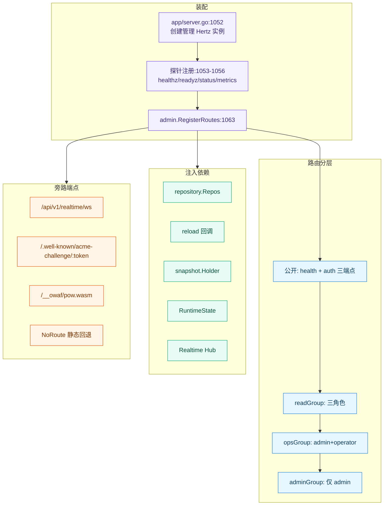
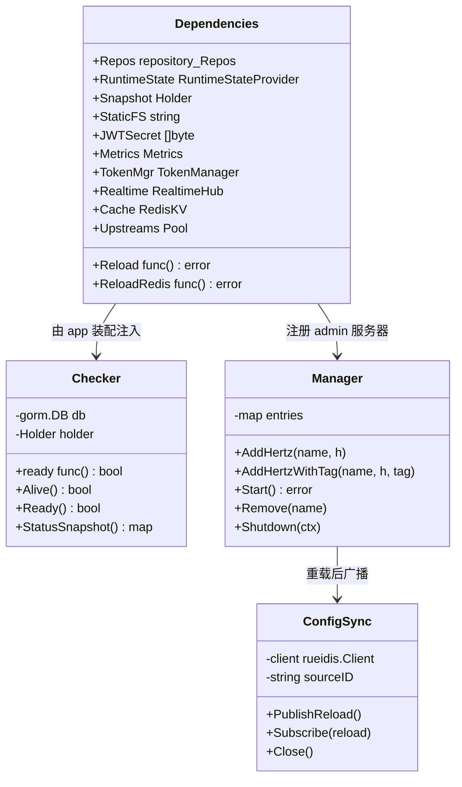
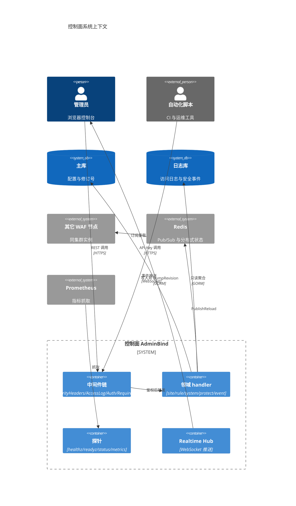
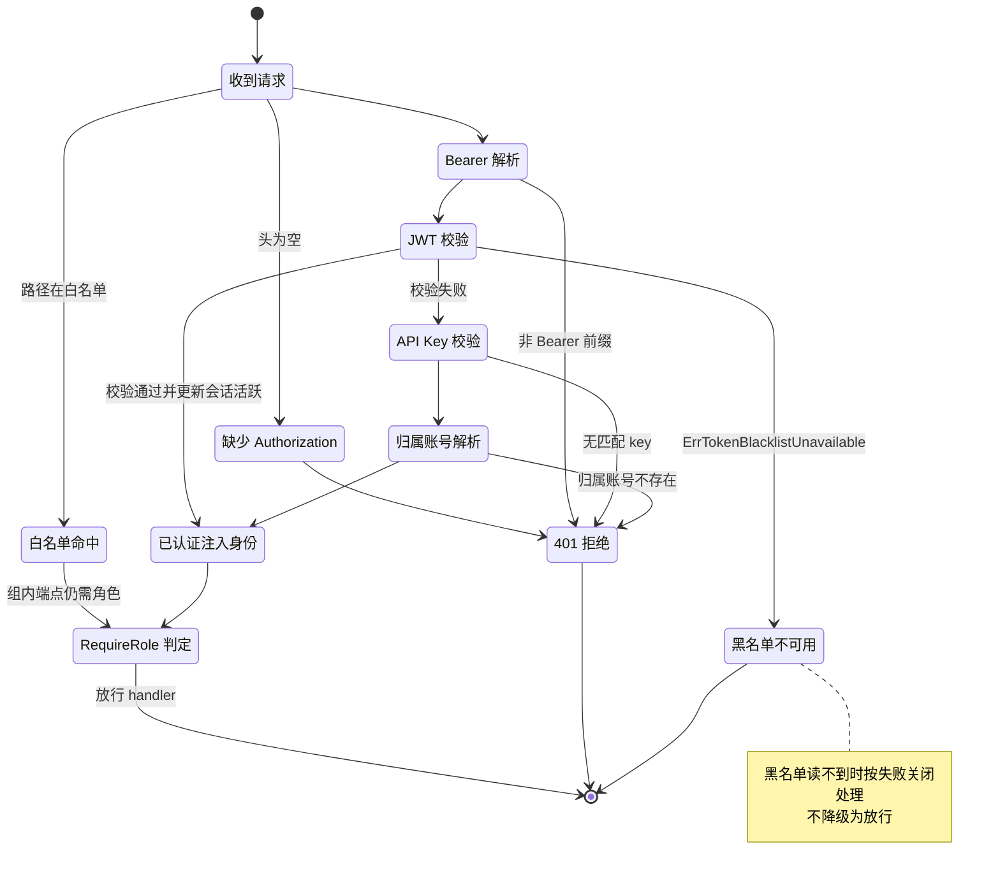
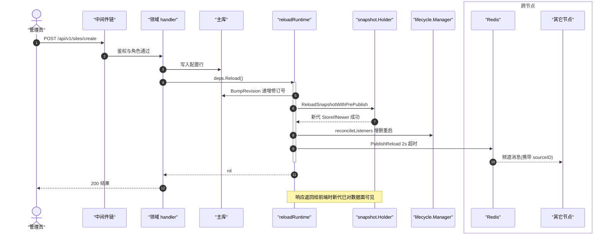
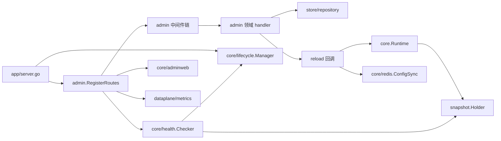

# 控制面设计

> [返回 系统架构设计](系统架构设计.md)

<cite>
**本文档引用的文件**
- [internal/app/server.go](file://internal/app/server.go)
- [internal/admin/router.go](file://internal/admin/router.go)
- [internal/admin/middleware.go](file://internal/admin/middleware.go)
- [internal/core/health/health.go](file://internal/core/health/health.go)
- [internal/core/lifecycle/lifecycle.go](file://internal/core/lifecycle/lifecycle.go)
- [internal/core/redis/pubsub.go](file://internal/core/redis/pubsub.go)
- [internal/core/runtime.go](file://internal/core/runtime.go)
- [internal/snapshot/snapshot.go](file://internal/snapshot/snapshot.go)
- [internal/store/migrate.go](file://internal/store/migrate.go)
- [internal/observability/metrics.go](file://internal/observability/metrics.go)
- [internal/dataplane/handler.go](file://internal/dataplane/handler.go)
- [cmd/main.go](file://cmd/main.go)
</cite>

## 目录

1. [简介](#简介)
2. [项目结构](#项目结构)
3. [核心组件](#核心组件)
4. [架构总览](#架构总览)
5. [详细组件分析](#详细组件分析)
6. [依赖关系分析](#依赖关系分析)
7. [性能考虑](#性能考虑)
8. [故障排查指南](#故障排查指南)
9. [结论](#结论)
10. [附录](#附录)

## 简介
本文件面向 My-OpenWaf 的控制面设计，系统性阐述控制面的核心职责、架构与实现细节，重点覆盖：
- 管理端口与健康/就绪/状态/指标四个探针端点的设计与实现
- 路由注册机制、角色分组与中间件体系
- 生命周期管理与优雅停机
- 配置变更如何触发重载并广播到其它节点
- 控制面与数据面的交互边界

**划界**：本篇只写控制面自身的装配与探针语义。快照在双平面之间的角色见 [快照机制](快照机制.md)，配置层热重载与迁移见 [热重载系统](../配置管理系统/热重载系统.md)，管理端点的逐条契约见 [管理 API 系统](../管理 API 系统/管理 API 系统.md)。

## 项目结构
控制面由 `internal/app/server.go` 在启动链第 16 阶段创建：`server.Default(server.WithHostPorts(rt.Config.AdminBind))`（server.go:1052），先把四个探针直接注册到服务器上（server.go:1053-1056），再把业务路由整体委托给 `admin.RegisterRoutes`（server.go:1063）。

| 子域 | 路径 | 规模(行) | 职责 |
|---|---|---:|---|
| 装配根 | `internal/admin` | 1589 | `RegisterRoutes`、中间件、静态回退 |
| 认证会话 | `internal/admin/auth` | 930 | `TokenManager`、`BruteForceDetector`、`SessionManager` |
| 访问控制 | `internal/admin/access` | 1077 | 站点访问控制网关管理 |
| 站点域 | `internal/admin/site` | 671 | 站点、错误页、监听、可观测 |
| 系统域 | `internal/admin/system` | 3495 | 设置、证书、插件、实时、仪表盘等最大子域 |
| 规则域 | `internal/admin/rule` | 1046 | ACL/签名/自定义规则管理 |
| 检测域 | `internal/admin/detect` | 1919 | `cverules`(955)、`owasprules`(959)、`detectlimit`(5) |
| 防护域 | `internal/admin/protect` | 351 + 1448 | bot/captcha/chain/drop/escalation/page/sensitivity |
| 事件域 | `internal/admin/event` | 649 | 安全事件、访问日志、误报反馈 |
| 共享层 | `internal/admin/shared` | 879 | 跨域响应与参数工具 |

**图表来源**
- [internal/app/server.go:1052-1093](file://internal/app/server.go#L1052-L1093)
- [internal/admin/router.go:89-140](file://internal/admin/router.go#L89-L140)
- [internal/admin/router.go:255-256](file://internal/admin/router.go#L255-L256)
- [internal/admin/router.go:372-373](file://internal/admin/router.go#L372-L373)
- [internal/admin/router.go:418-456](file://internal/admin/router.go#L418-L456)

**章节来源**
- [internal/app/server.go:1052-1093](file://internal/app/server.go#L1052-L1093)
- [internal/admin/router.go:89-140](file://internal/admin/router.go#L89-L140)
- [cmd/main.go:13-49](file://cmd/main.go#L13-L49)

## 核心组件

| 组件 | 位置 | 单一职责 | 关键约束 |
|---|---|---|---|
| 管理服务器 | server.go:1052 | 在 `AdminBind` 上承载全部管理流量 | 与数据面端口不重合 |
| 路由注册器 | router.go:89 | 按角色分组注册 217 个端点 | 无 PUT/DELETE，全部写操作走 POST 后缀 |
| 认证中间件 | middleware.go:42 | JWT 优先、API Key 回退 | 白名单只放行 health 与 auth 三端点 |
| 角色中间件 | middleware.go:127 | 校验 `auth_role` 是否在允许集合 | 无角色直接 403，不回落匿名 |
| 访问日志中间件 | middleware.go:150 | 生成 UUID `X-Request-ID` 并记录耗时 | 全局挂载，先于认证 |
| 安全头中间件 | middleware.go:172 | 固定安全头 + 按快照追加 HSTS/XSS/HPKP | `/api/v1/` 响应 `no-store` |
| 健康探针 | health.go:22-105 | 存活/就绪/状态三类判定 | 就绪包含数据库 Ping 与监听器就绪 |
| 生命周期管理器 | lifecycle.go:66-298 | 多服务器注册、启停、信号处理 | 移除超时 500ms，整体停机 10s |
| 配置同步 | pubsub.go:29-121 | 跨节点广播重载 | client 为 nil 时整体禁用 |
| 指标导出 | server.go:1056 | Prometheus 文本格式 | 只在控制面端口暴露 |

**图表来源**
- [internal/admin/router.go:60-87](file://internal/admin/router.go#L60-L87)
- [internal/core/health/health.go:14-105](file://internal/core/health/health.go#L14-L105)
- [internal/core/lifecycle/lifecycle.go:66-298](file://internal/core/lifecycle/lifecycle.go#L66-L298)
- [internal/core/redis/pubsub.go:29-121](file://internal/core/redis/pubsub.go#L29-L121)

**章节来源**
- [internal/admin/router.go:60-140](file://internal/admin/router.go#L60-L140)
- [internal/admin/middleware.go:42-192](file://internal/admin/middleware.go#L42-L192)
- [internal/core/health/health.go:14-105](file://internal/core/health/health.go#L14-L105)
- [internal/core/lifecycle/lifecycle.go:66-298](file://internal/core/lifecycle/lifecycle.go#L66-L298)

## 架构总览
控制面与数据面在进程内共享同一份快照持有者，但写入权只属于控制面。控制面永不下发「新配置内容」给数据面，只把「配置代次变了」这件事通过修订号与 Redis 事件传达。

| 层 | 控制面承载 | 职责 | 与数据面的边界 |
|---|---|---|---|
| 接入层 | Hertz + 全局中间件 | TLS、安全头、请求 ID、认证鉴权 | 不与数据面共享端口与中间件链 |
| 领域层 | `admin/<域>` 子包 | 参数校验、业务写入、只读聚合 | 领域 handler 不 import `internal/app` |
| 契约层 | `Dependencies.Reload` | 把写库动作兑换为一次重载 | 数据面不订阅数据库，只订阅 `Holder` |
| 视图层 | `snapshot.Holder` | 原子发布，双平面共读 | 控制面写代次，数据面只读 |
| 观测层 | `/metrics`、`/status`、Realtime | 聚合数据面指标与库内统计 | 读取而非干预 |
| 编排层 | `lifecycle.Manager` | 站点监听器的增删重启 | 由 reload 链驱动，不由请求驱动 |

| 外部实体 | 与控制面的交互 | 入口 | 判定依据 |
|---|---|---|---|
| 系统管理员（浏览器） | 提交配置、查看仪表盘 | `/api/v1/*` + SPA 静态资源 | router.go:109-140 |
| 自动化脚本 | 以 API Key 调用 | `Authorization: Bearer {api_key}` | middleware.go:95-124 |
| Prometheus | 抓取指标 | `GET /metrics` | server.go:1056 |
| 容器编排 / 负载均衡 | 存活与就绪探针 | `GET /healthz`、`GET /readyz` | health.go:46-66 |
| 同级 WAF 节点 | 接收重载广播 | Redis 频道 `openwaf:config:reload` | pubsub.go:16 |
| ACME 签发方 | 拉取 HTTP-01 应答 | `/.well-known/acme-challenge/:token` | router.go:425-436 |
| 上游源站 | 仅状态探测与连通性检查 | `Upstreams` 依赖注入 | server.go:1088 |

**图表来源**
- [internal/admin/router.go:89-140](file://internal/admin/router.go#L89-L140)
- [internal/admin/middleware.go:42-192](file://internal/admin/middleware.go#L42-L192)
- [internal/app/server.go:1052-1060](file://internal/app/server.go#L1052-L1060)
- [internal/core/redis/pubsub.go:65-82](file://internal/core/redis/pubsub.go#L65-L82)
- [internal/store/migrate.go:141-158](file://internal/store/migrate.go#L141-L158)

**章节来源**
- [internal/app/server.go:1052-1093](file://internal/app/server.go#L1052-L1093)
- [internal/admin/router.go:89-140](file://internal/admin/router.go#L89-L140)

## 详细组件分析

### 管理端口与探针端点
管理服务器在 `AdminBind` 上启动，四个探针绕过 `AuthMiddleware`——它们注册在 `h` 上而不是 `/api/v1` 组上（server.go:1053-1056），因此容器探针不需要携带凭据。

| 端点 | 方法 | 语义 | 判据 | 位置 |
|---|---|---|---|---|
| `/healthz` | GET | 存活 | `Alive()` 恒真 | health.go:29-55 |
| `/readyz` | GET | 就绪 | 快照非 nil ∧ `ready()` ∧ DB Ping 成功 | health.go:32-44 |
| `/status` | GET | 运行时状态 JSON | 九字段快照 | health.go:75-105 |
| `/metrics` | GET | Prometheus 文本 | 含 `owaf_cache_*` 缓存族 | server.go:1056、metrics.go:532-550 |
| `/api/v1/health` | GET | 认证前的管理侧健康检查 | 位于鉴权白名单 | router.go:94、middleware.go:45-52 |

`ready` 回调被装配两次：先设为 `lm.Ready()`（server.go:597），随后在令牌管理器构造完成后覆盖为 `lm.Ready() && tokenMgr.Ready()`（server.go:629）。语义是：持久化 JWT 黑名单若加载失败，实例不得对外声明自己已可接收需鉴权流量。`/status` 的 `sites` 与 `listeners` 分别按站点 ID 去重与按 `bind` 去重统计，两者不相等属正常（一个监听地址可承载多站点）。

**章节来源**
- [internal/app/server.go:595-629](file://internal/app/server.go#L595-L629)
- [internal/app/server.go:1052-1056](file://internal/app/server.go#L1052-L1056)
- [internal/core/health/health.go:14-105](file://internal/core/health/health.go#L14-L105)
- [internal/admin/router.go:94-94](file://internal/admin/router.go#L94-L94)
- [internal/admin/middleware.go:42-52](file://internal/admin/middleware.go#L42-L52)
- [internal/observability/metrics.go:532-550](file://internal/observability/metrics.go#L532-L550)

### 路由分组与角色模型
`RegisterRoutes` 把端点分成三档角色组，全部挂在 `/api/v1` 之下。实测端点总数 217 个：GET 100、POST 117、PUT 0、DELETE 0——所有更新与删除都以 POST 加语义后缀表达（如 `/api-keys/:id/delete`），以此简化反向代理与 CORS 配置。

| 分组 | 允许角色 | 注册区间 | 典型端点 |
|---|---|---|---|
| 免鉴权 | — | router.go:94-107 | `/api/v1/health`、`auth/login`、`auth/refresh`、`auth/logout` |
| `readGroup` | admin、operator、readonly | router.go:124-254 | `GET /sites`、`GET /certificates`、`GET /policies` |
| `opsGroup` | admin、operator | router.go:255-371 | 站点/规则创建更新、事件处置 |
| `adminGroup` | admin | router.go:372-417 | `backup/import`、`redis-config`、`admin-users/*`、`cve-rules/*` |
| 旁路 | — | router.go:418-437 | `pow.wasm`、`realtime/ws`、ACME challenge |

只读类里存在一个刻意例外：`POST /certificates/parse` 被放进 `readGroup`（router.go:138），因为它只解析用户提交的 PEM 文本，不触碰库存私钥、无副作用。高危的备份导入除触发 `reload` 外，还额外使 CVE/OWASP 读快照失效并吊销全部访问会话（router.go:381-388）。

**章节来源**
- [internal/admin/router.go:89-140](file://internal/admin/router.go#L89-L140)
- [internal/admin/router.go:255-256](file://internal/admin/router.go#L255-L256)
- [internal/admin/router.go:372-417](file://internal/admin/router.go#L372-L417)

### 中间件链与执行顺序
全局只挂两个中间件（`SecurityHeaders`、`AccessLog`），鉴权与角色是分组级 `Use`，因此探针天然不受认证影响。

| 序 | 中间件 | 挂载范围 | 职责 | 失败响应 |
|:--:|---|---|---|---|
| 1 | `SecurityHeaders` | 全局（router.go:91） | nosniff/DENY/Referrer-Policy/CSP；`/api/v1/` 追加 `no-store`；`c.Next()` 后按快照补 HSTS/XSS/HPKP | 不拦截 |
| 2 | `AccessLog` | 全局（router.go:92） | UUID `X-Request-ID`，记录方法/路径/状态/耗时/认证方式 | 不拦截 |
| 3 | `AuthMiddleware` | `/api/v1`（router.go:110） | JWT 优先，失败回退 API Key | 401 或 503 |
| 4 | `RequireRole(...)` | 各角色组 | 比对 `auth_role` 与允许集合 | 403 |

`SecurityHeaders` 在 `c.Next()` 前后各写一次 `Cache-Control: no-store`（middleware.go:177-183），是因为下游 handler 可能在响应阶段重置该头；HSTS、XSS 防护与 HPKP 三项取自快照配置，因此控制面自身的响应头策略与站点策略共用同一份配置视图（middleware.go:184-192）。

**章节来源**
- [internal/admin/router.go:89-125](file://internal/admin/router.go#L89-L125)
- [internal/admin/middleware.go:42-192](file://internal/admin/middleware.go#L42-L192)

### 认证判定状态机
认证是一条带回退与硬失败分支的判定链。API Key 的身份与角色都取自其归属账号：账号被删除后令牌立即失效，也不再无条件授予 admin。

**图表来源**
- [internal/admin/middleware.go:42-125](file://internal/admin/middleware.go#L42-L125)
- [internal/admin/middleware.go:127-148](file://internal/admin/middleware.go#L127-L148)

**章节来源**
- [internal/admin/middleware.go:42-148](file://internal/admin/middleware.go#L42-L148)

### 配置写路径与重载触发
控制面对外只暴露一个副作用契约：任何配置写入成功后调用注入的 `Reload`（server.go:1065）。该回调是 `reloadRuntime(true)`，内部顺序固定为「`store.BumpRevision` → `applySnapshotReload` → Redis 同步判定 → 广播」，其中广播时点可能提前到 Redis 切换之前，由 `shouldPublishConfigReloadBeforeRedisSwitch` 决定（server.go:1013-1027）。

**图表来源**
- [internal/app/server.go:1002-1042](file://internal/app/server.go#L1002-L1042)
- [internal/core/runtime.go:211-274](file://internal/core/runtime.go#L211-L274)
- [internal/store/migrate.go:141-158](file://internal/store/migrate.go#L141-L158)
- [internal/core/redis/pubsub.go:65-121](file://internal/core/redis/pubsub.go#L65-L121)
- [internal/app/server.go:722-825](file://internal/app/server.go#L722-L825)

**章节来源**
- [internal/app/server.go:1002-1042](file://internal/app/server.go#L1002-L1042)
- [internal/core/runtime.go:201-274](file://internal/core/runtime.go#L201-L274)
- [internal/core/redis/pubsub.go:16-121](file://internal/core/redis/pubsub.go#L16-L121)

### 跨节点同步与回环抑制
`ConfigSync` 以 `sourceID`（8 字节随机十六进制）标记消息来源，订阅端遇到 `event.SourceID == cs.sourceID` 直接丢弃，避免自己发布的通知把自己再重载一遍（pubsub.go:114-116）。发布带 2 秒超时，失败只记告警不回滚本地重载——本地一致性优先于跨节点通知。`NewConfigSync` 在 client 为 nil 时返回 nil，因此无 Redis 部署下整条广播链自动降级为单节点。

**章节来源**
- [internal/core/redis/pubsub.go:29-121](file://internal/core/redis/pubsub.go#L29-L121)
- [internal/app/server.go:834-866](file://internal/app/server.go#L834-L866)

### 实时通道、ACME 与 SPA 回退
- 实时通道是 **WebSocket**：`GET /api/v1/realtime/ws` 绑到 `deps.Realtime.WebSocketHandler()`（router.go:424），不是 SSE 端点。
- ACME HTTP-01 应答注册在控制面（router.go:425-436），同时数据面也有一份 `handleACMEChallenge`（handler.go:91），两者共用 `ACMEStore`；续期循环每 12 小时一轮（server.go:1059）。
- `mountStaticHandler` 只有当 `adminweb.ResolveFS` 成功时才注册 `NoRoute`（router.go:442-447）：`/api/` 前缀返回 JSON 404，其余路径尝试静态文件，未命中返回 `not found`。也就是说前端资源缺失时不会出现 SPA 回退，而是落到 Hertz 默认 404。

**章节来源**
- [internal/admin/router.go:418-456](file://internal/admin/router.go#L418-L456)
- [internal/app/server.go:1057-1060](file://internal/app/server.go#L1057-L1060)
- [internal/dataplane/handler.go:91-93](file://internal/dataplane/handler.go#L91-L93)

## 依赖关系分析

| 依赖方 | 被依赖方 | 方向 | 是否构成环 | 说明 |
|---|---|---|---|---|
| `admin` | `repository`、`snapshot.Holder` | 控制面 → 持久/视图 | 否 | 只读快照字段用于响应头策略 |
| `admin` | `dataplane` | 控制面 → 数据面 | 否 | 仅调用 `RevokeAllAccessSessions` 等显式导出函数 |
| `admin` | `app` | 不存在 | 否 | 重载以函数注入，避免反向依赖 |
| `health` | `snapshot`、`gorm.DB` | 观测 → 视图 | 否 | 无写入 |
| `lifecycle` | Hertz、`HTTP3Server` | 编排 → 服务器 | 否 | 依赖 `Server`/`Readiness` 接口而非具体类型 |
| `core/redis` | `rueidis` | 外部 | 否 | nil client 时整链禁用 |

**图表来源**
- [internal/app/server.go:1052-1093](file://internal/app/server.go#L1052-L1093)
- [internal/admin/router.go:12-57](file://internal/admin/router.go#L12-L57)
- [internal/core/health/health.go:4-12](file://internal/core/health/health.go#L4-L12)
- [internal/core/lifecycle/lifecycle.go:25-59](file://internal/core/lifecycle/lifecycle.go#L25-L59)

**章节来源**
- [internal/admin/router.go:12-87](file://internal/admin/router.go#L12-L87)
- [internal/core/lifecycle/lifecycle.go:25-59](file://internal/core/lifecycle/lifecycle.go#L25-L59)
- [internal/core/health/health.go:4-24](file://internal/core/health/health.go#L4-L24)

## 性能考虑
- 探针实现保持轻量：`/healthz` 无 IO，`/readyz` 只做一次 `sqlDB.Ping()` 与一次原子加载，适合高频容器探针而不引入数据库压力放大。
- `/status` 的站点与监听计数需要遍历当前快照 map（health.go:83-93），因此该端点的成本随站点规模线性增长，不宜作为毫秒级探针使用。
- 数据面指标由原子计数承载，控制面通过注入的 `dpmetrics.Metrics` 读取（server.go:1075），读取路径不加锁。
- 仪表盘类聚合走 `RedisKV` 缓存，配置广播走低频 Pub/Sub，两者都不进入请求热路径。
- 中间件里 UUID 生成用于每次管理请求，管理面 QPS 远低于数据面，此处成本可接受；数据面另用更快的 `dpreqid.FastRequestID()`（handler.go:56）。

[本节为通用性能讨论，取值依据见下方小节来源]

**章节来源**
- [internal/core/health/health.go:68-105](file://internal/core/health/health.go#L68-L105)
- [internal/app/server.go:1060-1088](file://internal/app/server.go#L1060-L1088)
- [internal/dataplane/handler.go:54-58](file://internal/dataplane/handler.go#L54-L58)

## 故障排查指南

| 症状 | 直接原因 | 排查动作 | 证据 |
|---|---|---|---|
| `/readyz` 持续 503 | 快照未加载、监听器未就绪或 JWT 黑名单不可用 | 依次确认 `holder.Load()`、`lm.Ready()`、`tokenMgr.Ready()`、DB Ping | health.go:32-44、server.go:597-629 |
| 401 `missing Authorization header` | 未携带凭据 | 使用 `Bearer {token}` 或 API Key | middleware.go:55-59 |
| 401 `invalid Authorization format` | 缺少 `Bearer ` 前缀 | 修正头格式 | middleware.go:62-66 |
| 401 `api key owner account no longer exists` | 归属账号已删除 | 重新签发或恢复账号 | middleware.go:103-115 |
| 403 `access denied: insufficient permissions` | 角色不在端点允许集合内 | 比对分组与角色 | middleware.go:127-148 |
| 503 `authentication service unavailable` | JWT 黑名单读取失败（失败关闭） | 检查主库连通性 | middleware.go:85-89 |
| 保存成功但防护未变 | 未调用 `Reload` 或重载被更新代拒绝 | 核对修订号是否递增、`StoreIfNewer` 返回值 | migrate.go:141-158、runtime.go:270-272 |
| 其它节点不同步 | Redis 未启用或广播超时 | 确认 `NewConfigSync` 非 nil、发布日志无 `config sync publish failed` | pubsub.go:38-54、pubsub.go:79-81 |
| 前端页面 404 无回退 | `adminweb.ResolveFS` 失败导致未注册 `NoRoute` | 检查嵌入资源或 `AdminStaticDir` | router.go:442-447 |

**章节来源**
- [internal/admin/middleware.go:42-148](file://internal/admin/middleware.go#L42-L148)
- [internal/admin/router.go:442-456](file://internal/admin/router.go#L442-L456)
- [internal/core/health/health.go:26-66](file://internal/core/health/health.go#L26-L66)
- [internal/core/redis/pubsub.go:65-121](file://internal/core/redis/pubsub.go#L65-L121)
- [internal/app/server.go:595-629](file://internal/app/server.go#L595-L629)

## 结论
控制面以一个独立的 Hertz 实例承载全部管理语义：四个免鉴权探针保证编排系统能在配置未就绪时正确摘除实例；三档角色分组把「读、运维、高危」分离到注册期而非 handler 内部；写路径统一收敛到注入的 `Reload` 回调，使「落库 → 递增修订号 → 重建快照 → 原子发布 → 调谐监听器 → 跨节点广播」成为唯一一条生效链路。控制面从不向数据面推送配置内容，只推进代次——这是本架构最重要的约束。

## 附录

### 依赖注入清单
`Dependencies` 共注入 27 项，按用途归类：

| 类别 | 字段 | 用途 |
|---|---|---|
| 数据 | `Repos`、`DB`、`LogDB` | 双库仓储 |
| 变更 | `Reload`、`ReloadRedis` | 普通重载 / 仅重建 Redis 运行时 |
| 视图 | `Snapshot` | 读取当前代以决定响应头 |
| 运行态 | `RuntimeState`、`StaticFS`、`JWTSecret` | 环境变量与密钥 |
| 观测 | `Metrics`、`Realtime`、`Cache` | 指标、WebSocket 推送、RedisKV |
| 子系统 | `TokenMgr`、`BruteForce`、`SessionMgr`、`CVEFeedMgr`、`EscalationMgr`、`CaptchaMgr`、`ChainMgr`、`ACMEStore`、`Upstreams`、`ThreatIntel`、`LuaEngine`、`JSEngine` | 各能力管理面 |

其中 `JSEngine` 被声明为 `func() *jsplugin.Engine` 而非具体指针（router.go:83-84），目的是让 dry-run 每次都读到当前 QuickJS runtime，避免 handler 闭包捕获 reload 前的旧指针。

**章节来源**
- [internal/admin/router.go:60-87](file://internal/admin/router.go#L60-L87)
- [internal/app/server.go:1063-1092](file://internal/app/server.go#L1063-L1092)

### 生命周期与优雅停机口径

| 参数 | 取值 | 位置 |
|---|---|---|
| 整体停机超时 | 10 秒 | lifecycle.go:18 |
| 热重载移除超时 | 500 毫秒 | lifecycle.go:21 |
| 单服务器就绪等待 | 5 秒截止、5 毫秒轮询 | lifecycle.go:210-227 |
| 信号 | SIGINT、SIGTERM | lifecycle.go:292 |
| 空注册表就绪判定 | `Ready()` 返回 false | lifecycle.go:233-235 |

移除超时显著短于停机超时，是有意的：热重载路径上调谐器要同步换掉一个监听器，若沿用 10 秒会把整次 reload 拖成长阻塞；而进程关闭可以等待在途请求收尾。`Remove` 对 `engine is not running` 错误按已完成处理（lifecycle.go:61-63、157-165），避免重复移除时误报。

**章节来源**
- [internal/core/lifecycle/lifecycle.go:17-21](file://internal/core/lifecycle/lifecycle.go#L17-L21)
- [internal/core/lifecycle/lifecycle.go:143-227](file://internal/core/lifecycle/lifecycle.go#L143-L227)
- [internal/core/lifecycle/lifecycle.go:229-298](file://internal/core/lifecycle/lifecycle.go#L229-L298)
