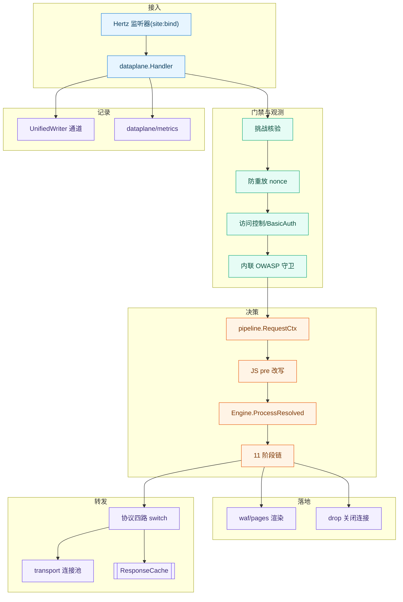
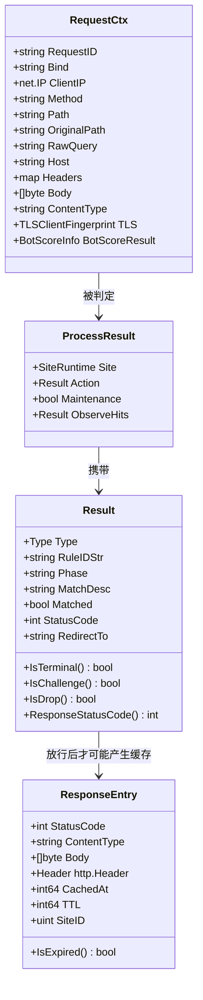
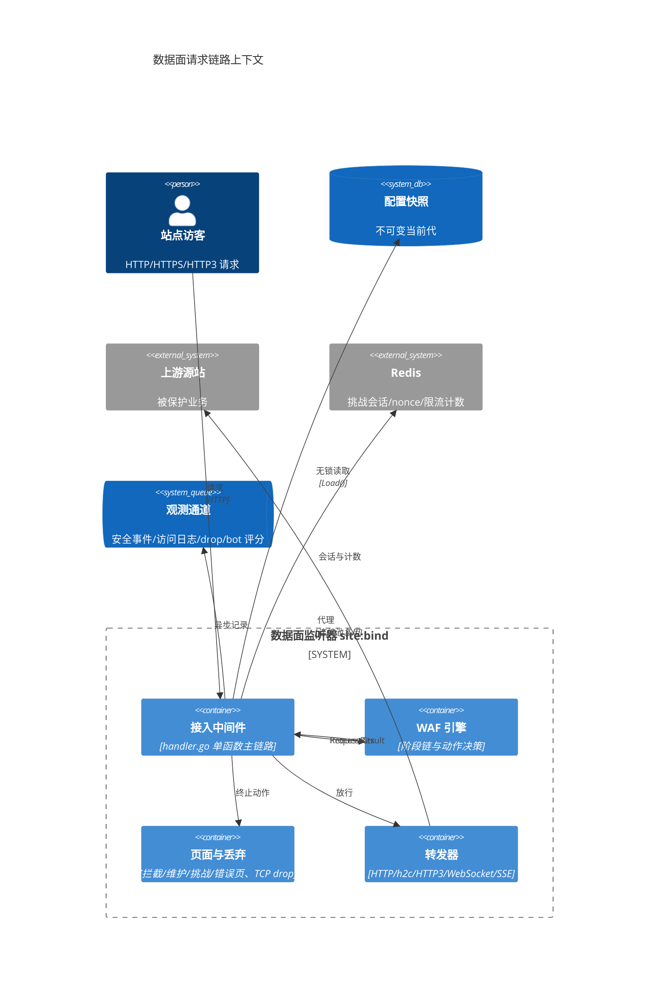
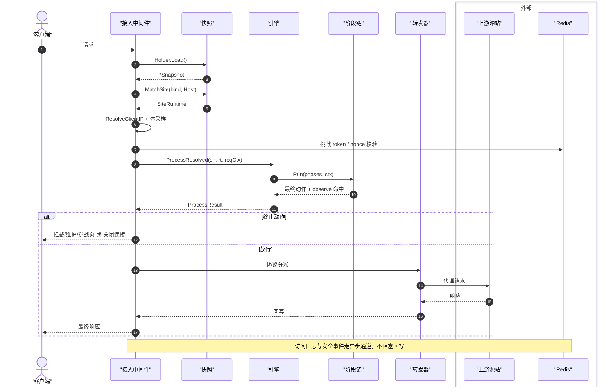
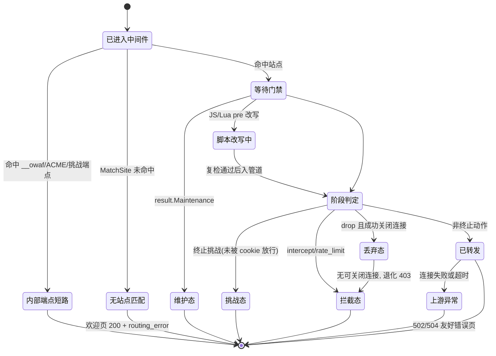
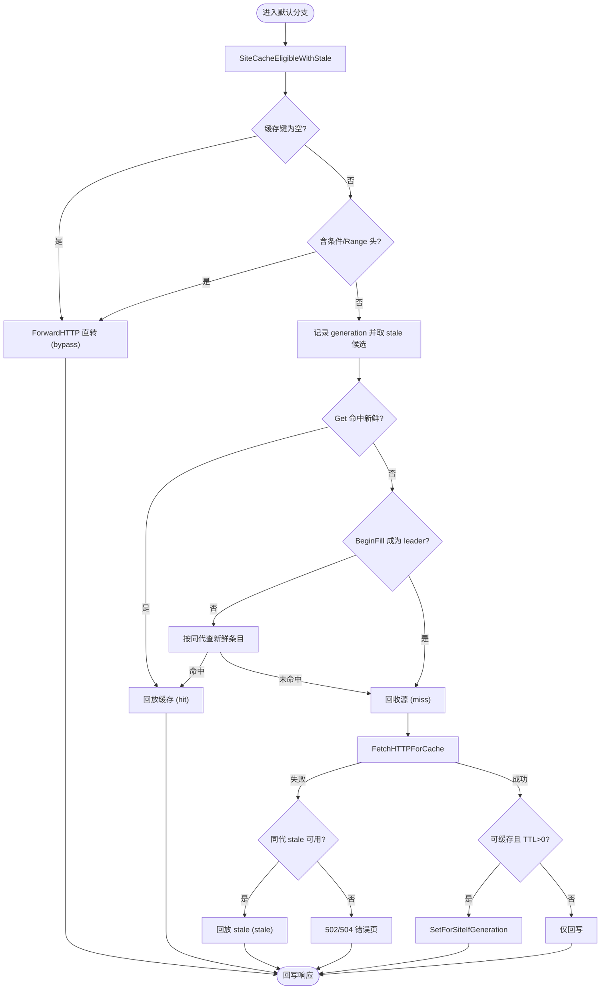
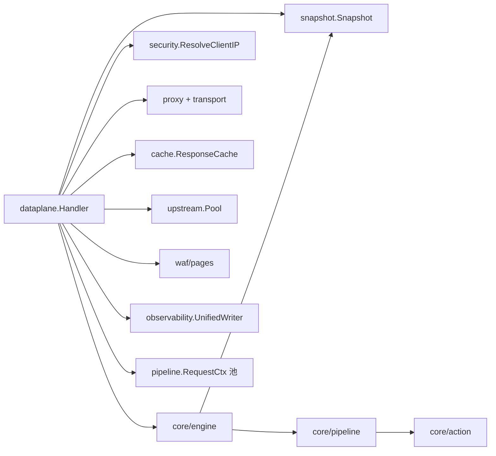

# 数据流分析

> [返回 系统架构设计](系统架构设计.md)

<cite>
**本文档引用的文件**
- [internal/dataplane/handler.go](file://internal/dataplane/handler.go)
- [internal/dataplane/handler_support.go](file://internal/dataplane/handler_support.go)
- [internal/core/engine/engine.go](file://internal/core/engine/engine.go)
- [internal/core/pipeline/pipeline.go](file://internal/core/pipeline/pipeline.go)
- [internal/core/pipeline/pool.go](file://internal/core/pipeline/pool.go)
- [internal/core/action/action.go](file://internal/core/action/action.go)
- [internal/core/sites/resolver.go](file://internal/core/sites/resolver.go)
- [internal/snapshot/snapshot.go](file://internal/snapshot/snapshot.go)
- [internal/app/server.go](file://internal/app/server.go)
- [internal/security/clientip.go](file://internal/security/clientip.go)
- [internal/proxy/transport/transport.go](file://internal/proxy/transport/transport.go)
- [internal/upstream/health.go](file://internal/upstream/health.go)
- [internal/waf/pages/block.go](file://internal/waf/pages/block.go)
- [internal/waf/pages/error_pages.go](file://internal/waf/pages/error_pages.go)
- [internal/cache/response_cache.go](file://internal/cache/response_cache.go)
- [internal/observability/unified_writer.go](file://internal/observability/unified_writer.go)
</cite>

## 目录

1. [简介](#简介)
2. [项目结构](#项目结构)
3. [核心组件](#核心组件)
4. [架构总览](#架构总览)
5. [详细组件分析](#详细组件分析)
6. [依赖关系分析](#依赖关系分析)
7. [性能考虑](#性能考虑)
8. [故障排查指南](#故障排查指南)
9. [结论](#结论)
10. [附录](#附录)

## 简介
本文件面向 My-OpenWaf 的数据流分析，围绕「一个请求从进入数据面到写出响应」的完整路径，逐跳说明数据形态的转换、状态的迁移与错误处理落点。内容覆盖站点匹配、门禁检查、WAF 阶段链执行、动作决策、上游转发与响应回写，并指出关键决策点与潜在瓶颈。

**划界**：本文只描述**流**——每一步读什么、改什么、把什么交给下一步。组件之间的静态拓扑与依赖边归 [组件关系图](组件关系图.md)；阶段链在引擎内部的构建与缓存归 [WAF 引擎系统](../WAF 引擎系统/WAF 引擎系统.md)；快照的构建与发布语义归 [快照机制](快照机制.md)。

## 项目结构
数据流的所有分支都发生在 `internal/dataplane` 的单个 Hertz 中间件里，其余包只被它调用而不感知流程。

| 层 | 承载 | 在数据流中的角色 | 是否改写请求 |
|---|---|---|---|
| 接入层 | `dataplane.Handler` | 端点短路、快照读取、站点匹配 | 是（补 `X-Request-ID`、删 `Server`） |
| 门禁层 | `dataplane` 内联检查 | 挑战、防重放、访问控制、Basic Auth | 否 |
| 观测层 | `dataplane` 采样 | 走私嗅探、体采样、指纹提取 | 否 |
| 改写层 | `jsplugin` / `luaplugin` pre | 脚本可改 method/path/query/body/UA | 是 |
| 决策层 | `core/engine` + `pipeline` | 11 阶段链顺序执行 | 是（Lua pre 改写回写） |
| 落地层 | `waf/pages`、`waf/drop` | 拦截/维护/挑战/错误页与连接关闭 | 是（写响应） |
| 转发层 | `proxy` + `proxy/transport` | 协议分派、连接池复用、响应回写 | 是（出站头改写） |
| 记录层 | `observability.UnifiedWriter` | 异步批量落库 | 否 |

**图表来源**
- [internal/dataplane/handler.go:39-120](file://internal/dataplane/handler.go#L39-L120)
- [internal/dataplane/handler.go:236-340](file://internal/dataplane/handler.go#L236-L340)
- [internal/dataplane/handler.go:398-530](file://internal/dataplane/handler.go#L398-L530)
- [internal/dataplane/handler.go:1100-1215](file://internal/dataplane/handler.go#L1100-L1215)
- [internal/core/engine/engine.go:441-548](file://internal/core/engine/engine.go#L441-L548)

**章节来源**
- [internal/dataplane/handler.go:39-120](file://internal/dataplane/handler.go#L39-L120)
- [internal/app/server.go:703-718](file://internal/app/server.go#L703-L718)

## 核心组件

| 组件 | 关键符号 | 输入 | 输出 | 位置 |
|---|---|---|---|---|
| 接入处理器 | `Handler(Options)` | Hertz `RequestContext` | 响应或转发决定 | handler.go:39 |
| 快照持有者 | `Holder.Load()` | — | `*Snapshot` 或 nil | snapshot.go:489 |
| 站点解析 | `Snapshot.MatchSite` | `(bind, hostHeader)` | `SiteRuntime`（拷贝） | snapshot.go:337 |
| 客户端 IP 解析 | `security.ResolveClientIP` | Hertz 上下文 + XFF 语义 | `net.IP` | clientip.go:17 |
| 请求上下文 | `pipeline.RequestCtx` | 采样后的请求视图 | 阶段可读的派生字段 | pipeline.go:15 |
| 上下文池 | `AcquireCtx` / `ReleaseCtx` | — | 复用对象 | pool.go:29-37 |
| 引擎 | `Engine.ProcessResolved` | `(sn, rt, reqCtx)` | `ProcessResult` | engine.go:570 |
| 流水线 | `pipeline.Run` | 阶段切片 | `RunResult{Action, ObserveHits}` | pipeline.go:517 |
| 动作模型 | `action.Type` / `Result` | 阶段判定 | 终止性与优先级 | action.go:88-179 |
| 上游池 | `Pool.Pick` / `Mark` | URL 列表 + 健康态 | 选中的 base URL | health.go:219-470 |
| 响应缓存 | `ResponseCache` 分片 | 缓存键 | 命中/未命中/stale | response_cache.go:53 |
| 页面渲染 | `pages.WriteBlockResponse` 等 | `action.Result` + 快照 | HTML 与状态码 | block.go:20 |
| 统一写入器 | `UnifiedWriter.Record*` | 日志结构体 | 通道入队 | unified_writer.go |

**图表来源**
- [internal/core/pipeline/pipeline.go:14-100](file://internal/core/pipeline/pipeline.go#L14-L100)
- [internal/core/engine/engine.go:564-575](file://internal/core/engine/engine.go#L564-L575)
- [internal/core/action/action.go:126-179](file://internal/core/action/action.go#L126-L179)
- [internal/cache/response_cache.go:16-35](file://internal/cache/response_cache.go#L16-L35)

**章节来源**
- [internal/core/pipeline/pipeline.go:14-100](file://internal/core/pipeline/pipeline.go#L14-L100)
- [internal/core/pipeline/pool.go:11-45](file://internal/core/pipeline/pool.go#L11-L45)
- [internal/core/action/action.go:5-90](file://internal/core/action/action.go#L5-L90)
- [internal/dataplane/handler.go:340-390](file://internal/dataplane/handler.go#L340-L390)

## 架构总览

数据面没有独立的「路由表」概念：监听器按 `bind` 建立，站点由 `Host` 在快照里查出来。因此一次请求的数据流可以概括为「一次哈希查找 + 一串按序执行的判定 + 一次协议分派」。

| 上下文要素 | 数据面视角 | 交互 | 失败语义 |
|---|---|---|---|
| 客户端 | 请求来源 | Hertz 中间件入参 | 头超限 431、无快照 503 |
| 快照 | 当前配置代 | `Holder.Load()` 一次 | nil 直接 503 `configuration_error` |
| 站点运行时 | 本请求的策略集 | `MatchSite(bind, host)` | 未命中写欢迎页 200 + `routing_error` |
| 引擎 | 判定机构 | `ProcessResolved` | 返回 `ProcessResult`，不 panic 到接入层 |
| 上游源站 | 放行目标 | 四路协议分派 | 502/504 友好错误页，`Mark` 记失败 |
| 响应缓存 | 边缘副本 | `Get`/`BeginFill`/`Set…IfGeneration` | generation 不符则退回收源 |
| 统一写入器 | 异步审计 | 四条通道入队 | 队列满计入 dropped 计数 |
| Redis | 挑战与限流状态 | 会话、nonce、计数器 | 不可用时降级而非站点不可用 |

**图表来源**
- [internal/dataplane/handler.go:39-163](file://internal/dataplane/handler.go#L39-L163)
- [internal/dataplane/handler.go:1100-1215](file://internal/dataplane/handler.go#L1100-L1215)
- [internal/snapshot/snapshot.go:337-398](file://internal/snapshot/snapshot.go#L337-L398)
- [internal/core/engine/engine.go:551-562](file://internal/core/engine/engine.go#L551-L562)
- [internal/app/server.go:703-718](file://internal/app/server.go#L703-L718)

**章节来源**
- [internal/dataplane/handler.go:39-163](file://internal/dataplane/handler.go#L39-L163)
- [internal/snapshot/snapshot.go:213-287](file://internal/snapshot/snapshot.go#L213-L287)

## 详细组件分析

### 主链路与数据转换
下表是本文的核心：每跳读什么、产出什么、写在哪里。行号均为 `internal/dataplane/handler.go`。

| 序 | 阶段 | 读入 | 产出/副作用 | 位置 |
|:--:|---|---|---|---|
| 1 | 请求标识 | `RemoteAddr` | `X-Request-ID`、删除 `Server` | 56-58 |
| 2 | 内部端点短路 | 路径前缀 | WASM/ACME/挑战校验/访问控制/静态资源直接返回 | 87-112 |
| 3 | 计数 | — | `Metrics.RecordRequest()` | 115-117 |
| 4 | 快照读取 | `Holder.Load()` | nil → 503 `configuration_error` | 119-127 |
| 5 | 协议规模检查 | `Header.Len()` | 超 `MaxHeaderFields` → 431 + `protocol_error` | 129-134 |
| 6 | 站点匹配 | `bind` + `Host` | `SiteRuntime`（值拷贝） | 136-141 |
| 7 | 压缩视图注入 | 快照全局压缩项 | 覆盖到 `rt` 的压缩字段 | 142-150 |
| 8 | 未命中兜底 | — | 欢迎页 200 + `routing_error`，`SiteID` 保持 0 | 151-163 |
| 9 | 客户端 IP | XFF 模式 + 信任网段 | `clientIP`，仅 `trust_outer` 且来源可信才采信头 | 170-174 |
| 10 | SNI 一致性观察 | TLS 指纹 | `tls:unknown_sni` observe 事件 | 201-222 |
| 11 | 请求体采样 | `Content-Encoding` | 48KB 采样，解压降级信号 | 230-234 |
| 12 | 挑战提交核验 | POST body + token | `challengePassed`，失败计入 IP 信誉 | 236-272 |
| 13 | 防重放 | Cookie nonce | 消费 nonce 或短路返回 | 284-308 |
| 14 | 访问控制 / Basic Auth | 路径与会话 | 302/401 或放行 | 310-328 |
| 15 | 内联 OWASP 守卫 | path + body + CT | 命中即 `WriteBlockResponse` 403 | 330-338 |
| 16 | 组装 `RequestCtx` | 上述全部 | 池化对象，Body 截到 48KB | 340-387 |
| 17 | JS 请求阶段 | 脚本 + 执行器 | 可改 method/path/query/body/UA；异常 fail-closed 503 | 398-434 |
| 18 | 改写后二次门禁 | 最终 path | 内部路径 404、防重放与访问控制复检 | 440-512 |
| 19 | 引擎判定 | `reqCtx` | `ProcessResult{Site, Action, ObserveHits}` | 514-530 |
| 20 | Bot 评分落库 | `reqCtx.BotScoreResult` | 补 TLS 字段后 `RecordBotScore` | 536-591 |
| 21 | observe 命中 | `result.ObserveHits` | 逐条记安全事件 + 指标 | 595-630 |
| 22 | 维护模式 | `result.Maintenance` | 维护页并写访问日志 | 632-645 |
| 23 | 挑战 cookie 放行 | 通行 cookie | 终止挑战降级为 `allow` | 646-658 |
| 24 | 分级升级 | IP + 站点命中史 | 动作可被抬升到更高严重度 | 674-705 |
| 25 | drop 执行 | `Phase` 与执行器 | H2 RST / H3 reset / 关闭连接 | 718-760 |
| 26 | 上游选择 | `UpstreamURLs` + 健康池 | base URL；无可用 → 502 | 1100-1114 |
| 27 | 协议分派 | 请求形态 | 扩展 CONNECT / WS / SSE / 缓冲 HTTP | 1123-1211 |
| 28 | 健康回写 | `upstreamErr` | `Pool.Mark`，非安全方法按路径清缓存 | 1215-1222 |
| 29 | 响应收尾 | 上游响应 | 502/504 错误页、空体兜底、逐跳头清理 | 1224-1255 |
| 30 | 访问日志 | 终态 | `RecordStatus` + `recordAccessLog` | 1257-1272 |

**图表来源**
- [internal/dataplane/handler.go:54-127](file://internal/dataplane/handler.go#L54-L127)
- [internal/dataplane/handler.go:236-338](file://internal/dataplane/handler.go#L236-L338)
- [internal/dataplane/handler.go:514-530](file://internal/dataplane/handler.go#L514-L530)
- [internal/dataplane/handler.go:1100-1222](file://internal/dataplane/handler.go#L1100-L1222)
- [internal/core/engine/engine.go:551-575](file://internal/core/engine/engine.go#L551-L575)

**章节来源**
- [internal/dataplane/handler.go:54-338](file://internal/dataplane/handler.go#L54-L338)
- [internal/dataplane/handler.go:340-530](file://internal/dataplane/handler.go#L340-L530)
- [internal/dataplane/handler.go:1100-1272](file://internal/dataplane/handler.go#L1100-L1272)
- [internal/security/clientip.go:17-33](file://internal/security/clientip.go#L17-L33)

### 请求处置状态迁移
请求在数据面的处置结果不是布尔值而是状态。三条最容易被误述的边：未命中站点不等于 404；drop 只有在真的关掉连接时才算 drop，否则退化为 403 拦截；挑战动作可被更高优先级动作覆盖。

**图表来源**
- [internal/dataplane/handler.go:151-163](file://internal/dataplane/handler.go#L151-L163)
- [internal/dataplane/handler.go:440-530](file://internal/dataplane/handler.go#L440-L530)
- [internal/dataplane/handler.go:632-658](file://internal/dataplane/handler.go#L632-L658)
- [internal/dataplane/handler.go:718-760](file://internal/dataplane/handler.go#L718-L760)
- [internal/dataplane/handler.go:1224-1231](file://internal/dataplane/handler.go#L1224-L1231)

**章节来源**
- [internal/dataplane/handler.go:151-163](file://internal/dataplane/handler.go#L151-L163)
- [internal/dataplane/handler.go:632-760](file://internal/dataplane/handler.go#L632-L760)
- [internal/core/action/action.go:8-25](file://internal/core/action/action.go#L8-L25)

### 阶段链执行与动作优先级
`pipeline.Run` 是顺序执行加两类特殊处理：非终止且需记录的命中被收进 `observeHits`；终止的**挑战类**动作不立即返回，而是暂存 `pendingChallenge` 继续跑完剩余阶段，最后取优先级最高者——比较用严格大于，因此同档挑战以先出现者为准。`drop` 例外，出现即短路。

| 动作 | 终止性 | 挑战类 | `TerminalPriority` | 短路行为 |
|---|---|---|---|---|
| `drop` | 是 | 否 | 90 | 立即返回 |
| `intercept` | 是 | 否 | 80 | 立即返回 |
| `rate_limit` | 是 | 否 | 70 | 立即返回 |
| `captcha_challenge` / `shield_challenge` / `chain_challenge` / `challenge` | 是 | 是 | 60（四者同档） | 暂存后继续 |
| `redirect` | 是 | 否 | 50 | 立即返回 |
| `observe` | 否 | 否 | 10 | 记入 observe 后继续 |
| `allow` / `tag` | 否 | 否 | 0 | 继续 |

优先级数值来自 `action.TerminalPriority`（action.go:88-119）。同档挑战之间不再排序，故链式与盾在同一请求里不会互相覆盖。

阶段链实测 11 项，顺序为 `ip_reputation → anti_replay → acl → lua_pre → owasp_default → cve → bot → browser_sign → rate_limit → signature → custom`，构建时按 11 预分配容量（engine.go:467）。其中 `signature` 与 `custom` 不参与按路径跳过装饰，其余阶段若配置了跳过路径会被包一层短路装饰器（engine.go:471-477、522-529）。

**章节来源**
- [internal/core/pipeline/pipeline.go:517-560](file://internal/core/pipeline/pipeline.go#L517-L560)
- [internal/core/engine/engine.go:466-548](file://internal/core/engine/engine.go#L466-L548)
- [internal/core/action/action.go:26-90](file://internal/core/action/action.go#L26-L90)

### 响应缓存与回写数据流
缓存路径的关键不是「命中与否」而是**代次**：`ResponseCache` 带 `generation` 计数，任何按站点的失效都会推进它。回写前先按当时的 generation 抓一次 stale 候选，回源失败时再用同一代重查，避免等待填充期间发生的失效被旧指针掩盖（handler.go:1152-1195）。

| 分支 | 触发条件 | 动作 | 记录值 |
|---|---|---|---|
| 不适用缓存 | 键为空或带条件/Range 头 | 直接 `ForwardHTTP` | `bypass` |
| 新鲜命中 | `Get` 返回未过期条目 | `WriteCachedResponseForSiteWithClientIP` | `hit` |
| 填充跟随 | `BeginFill` 返回非 leader | 只查同代新鲜条目 | `hit` |
| 回源 | leader 且未命中 | `FetchHTTPForCache` | `miss` |
| stale 回放 | 回源失败且同代有 stale 候选 | 回放旧条目 | `stale` |
| 写回 | 响应可缓存且 TTL>0 | `SetForSiteIfGeneration` | `miss` |

**图表来源**
- [internal/dataplane/handler.go:1141-1211](file://internal/dataplane/handler.go#L1141-L1211)
- [internal/cache/response_cache.go:16-120](file://internal/cache/response_cache.go#L16-L120)

**章节来源**
- [internal/dataplane/handler.go:1141-1222](file://internal/dataplane/handler.go#L1141-L1222)
- [internal/cache/response_cache.go:16-120](file://internal/cache/response_cache.go#L16-L120)

### 观测数据流
访问日志、安全事件、drop 事件与 bot 评分四类记录都不在请求路径上落库：接入层只把结构体投进通道，`UnifiedWriter` 以单 goroutine 抽干并在一个事务里批量写入，容量与批大小由 `rt.Config.Queue` 注入（server.go:340-350）。`SiteID` 在未命中站点时保持 0，是刻意的——路由层审计行不能伪造站点归属。

**章节来源**
- [internal/dataplane/handler.go:159-161](file://internal/dataplane/handler.go#L159-L161)
- [internal/dataplane/handler.go:536-591](file://internal/dataplane/handler.go#L536-L591)
- [internal/app/server.go:340-350](file://internal/app/server.go#L340-L350)

## 依赖关系分析

| 依赖 | 方向 | 可否缺省 | 缺省后果 |
|---|---|---|---|
| `Handler → Holder` | 必需 | 否 | 全部请求 503 |
| `Handler → Engine` | 必需 | 否 | 命中站点后 503 `waf engine unavailable` |
| `Handler → Upstreams` | 可空 | 是 | 退化为直接取首个上游 |
| `Handler → ResponseCache` | 可空 | 是 | 缓存键为空，全量回源 |
| `Handler → Writer` | 可空 | 是 | 丢审计，不影响放行 |
| `Engine → Resolver → Holder` | 必需 | 否 | `Process` 返回零值 |
| `proxy → transport` | 必需 | 否 | 无法复用连接 |

**图表来源**
- [internal/dataplane/handler.go:16-36](file://internal/dataplane/handler.go#L16-L36)
- [internal/core/engine/engine.go:88-110](file://internal/core/engine/engine.go#L88-L110)
- [internal/dataplane/handler_support.go:12-30](file://internal/dataplane/handler_support.go#L12-L30)

**章节来源**
- [internal/dataplane/handler.go:16-36](file://internal/dataplane/handler.go#L16-L36)
- [internal/dataplane/handler_support.go:31-45](file://internal/dataplane/handler_support.go#L31-L45)

## 性能考虑
- **每请求一次哈希查找**：站点匹配是至多三次 map 探底的哈希查找，不存在树遍历；`NormalizeMatchHost` 对规范 Host 走零分配快路径（snapshot.go:409-421）。
- **拷贝与零拷贝并存**：主链路用 `MatchSite`（返回值拷贝，便于请求内改压缩字段），引擎内部用 `MatchSitePtr`（零拷贝）（snapshot.go:337、373）。
- **上下文池化**：`RequestCtx` 经 `sync.Pool` 复用，池对象超过头 map/slice 上限时在 Release 侧重建，防止峰值后 RSS 不回落（pool.go:11-28）。
- **派生值单次计算**：`DerivedHeaderOrder`、`DerivedALPN` 等在请求内至多算一次并缓存（pipeline.go:88-100）。
- **体采样上限 48KB**：`maxWAFBody = 48 * 1024`，与快照常量一致（handler.go:377、snapshot.go:493）。
- **连接池参数**：主 transport `MaxIdleConns 256 / PerHost 32 / IdleConnTimeout 30s`、`MaxConnsPerHost 256`、16KiB 缓冲（transport.go:157-164、172）。
- **缓存代次**：`ResponseCache` 用 generation 避免跨代回放，非安全方法按站点+路径精准清理，不做全分片扫描（handler.go:1218-1222）。
- **瓶颈点**：阶段链构建成本集中在未命中缓存的首个请求；上游连接耗尽表现为 504 而非 502；观测通道满会静默丢弃并计入 dropped 计数。

**章节来源**
- [internal/snapshot/snapshot.go:337-450](file://internal/snapshot/snapshot.go#L337-L450)
- [internal/core/pipeline/pool.go:11-45](file://internal/core/pipeline/pool.go#L11-L45)
- [internal/core/pipeline/pipeline.go:88-120](file://internal/core/pipeline/pipeline.go#L88-L120)
- [internal/proxy/transport/transport.go:154-178](file://internal/proxy/transport/transport.go#L154-L178)
- [internal/dataplane/handler.go:377-387](file://internal/dataplane/handler.go#L377-L387)

## 故障排查指南

| 现象 | 首查阶段 | 判据 | 位置 |
|---|---|---|---|
| 全量 503 | 第 4 跳 | 响应体含 `configuration snapshot not loaded` | 119-127 |
| 431 | 第 5 跳 | 头字段数超过快照 `MaxHeaderFields` | 129-134 |
| 站点内容不对 | 第 6 跳 | `no site match` 告警里的 `host`/`bind`/`sites` 计数 | 151-158 |
| 未授权访问被放行 | 第 9 跳 | XFF 模式非 `trust_outer` 时头一律不被采信 | clientip.go:24-26 |
| 正常 POST 被判失败 | 第 12 跳 | 只有「确为挑战提交格式但未通过」才计信誉 | 265-271 |
| 脚本改写后行为异常 | 第 18 跳 | 改写后路径命中内部前缀会 404，不再复检门禁 | 440-453 |
| JS 脚本导致 503 | 第 17 跳 | `js_plugin_fail_closed` 动作记录 | 411-434 |
| 挑战反复弹出 | 第 23 跳 | 通行 cookie 绑定 IP/UA/Host/站点/`bind` | 646-658 |
| 期望 drop 却收到 403 | 第 25 跳 | drop 未成功执行会退化为拦截并只写一行日志 | 718-760 |
| 502 但站点有上游 | 第 26 跳 | `Pool.Pick` 全部标记不健康时返回 false | health.go:219 |
| 响应体偶发被旧内容覆盖 | 第 27 跳 | 非安全方法未走 `PurgeSiteTarget` | 1218-1222 |
| 审计缺失 | 第 30 跳 | 客户端已断开时普通访问日志会被跳过 | 1268-1272 |

排查顺序建议：先用 `X-Request-ID` 串起数据面日志与库内记录，再按上表定位到具体跳次，最后核对快照当前代（`/status` 的 `revision`）是否是预期配置。

**章节来源**
- [internal/dataplane/handler.go:119-163](file://internal/dataplane/handler.go#L119-L163)
- [internal/dataplane/handler.go:411-453](file://internal/dataplane/handler.go#L411-L453)
- [internal/dataplane/handler.go:646-760](file://internal/dataplane/handler.go#L646-L760)
- [internal/dataplane/handler.go:1215-1272](file://internal/dataplane/handler.go#L1215-L1272)
- [internal/security/clientip.go:17-33](file://internal/security/clientip.go#L17-L33)
- [internal/upstream/health.go:215-219](file://internal/upstream/health.go#L215-L219)

## 结论
My-OpenWaf 的数据流是一条**单函数、无倒钩**的线性链路：一次原子快照读取、一次哈希站点匹配、一串按序执行的判定、一次协议分派，最后统一收尾与异步记录。它有两个反直觉但重要的设计点——未命中站点返回欢迎页 200 而非 404（避免路由错误暴露站点存在性），以及挑战动作延迟裁决（让更严重的检测覆盖它）。性能来源集中在三处：不可变快照带来的无锁读、上下文与连接池复用、观测写入的批处理异步化。

## 附录

### 与相邻文档的分工

| 主题 | 归属文档 |
|---|---|
| 组件节点与依赖边 | [组件关系图](组件关系图.md) |
| 阶段链在引擎内的构建与缓存 | [WAF 引擎系统](../WAF 引擎系统/WAF 引擎系统.md) |
| 快照构建与发布 | [快照机制](快照机制.md) |
| 缓存分层与失效 | [缓存与性能优化](缓存与性能优化.md) |
| 监听器调谐 | [系统架构设计](系统架构设计.md) |
| 请求处理流程 | [请求处理流程](../数据平面处理/请求处理流程.md) |

[本节为总结，无需特定文件来源]

### 常用状态码对照

| 状态码 | 产生位置 | 语义 |
|---|---|---|
| 200 | handler.go:160 | 未命中站点的欢迎页 |
| 401 | handler.go:323 | Basic Auth 未通过 |
| 403 | handler.go:334 | 内联 OWASP 守卫拦截 |
| 404 | handler.go:441 | 脚本构造出内部路径 |
| 429 | block.go:44-47 | 限流动作渲染 |
| 431 | handler.go:131 | 头字段超限 |
| 502 | handler.go:1105、1228 | 无可用上游或上游错误 |
| 503 | handler.go:124、422 | 无快照、无引擎或 JS 失败关闭 |
| 504 | handler.go:1228 | 上游超时 |

**章节来源**
- [internal/dataplane/handler.go:124-131](file://internal/dataplane/handler.go#L124-L131)
- [internal/dataplane/handler.go:320-334](file://internal/dataplane/handler.go#L320-L334)
- [internal/dataplane/handler.go:440-441](file://internal/dataplane/handler.go#L440-L441)
- [internal/dataplane/handler.go:1100-1231](file://internal/dataplane/handler.go#L1100-L1231)
- [internal/waf/pages/block.go:20-55](file://internal/waf/pages/block.go#L20-L55)
- [internal/waf/pages/error_pages.go:19-27](file://internal/waf/pages/error_pages.go#L19-L27)
