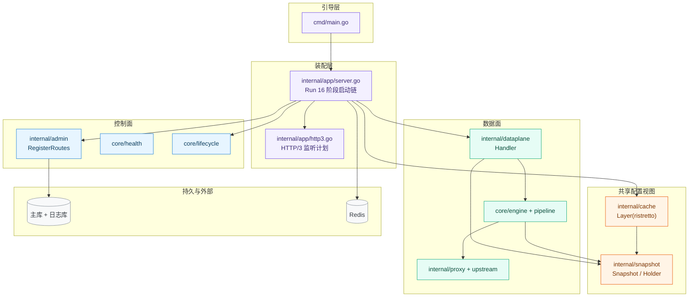
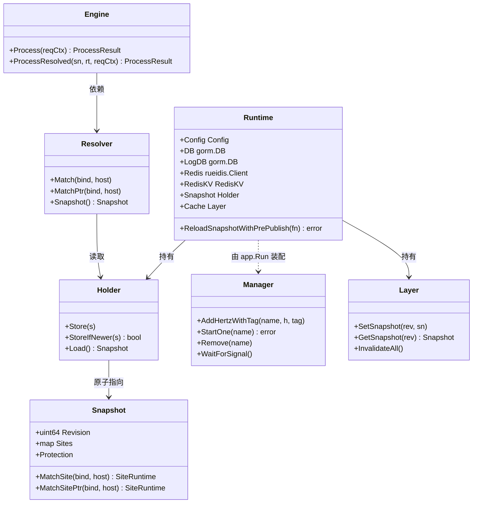
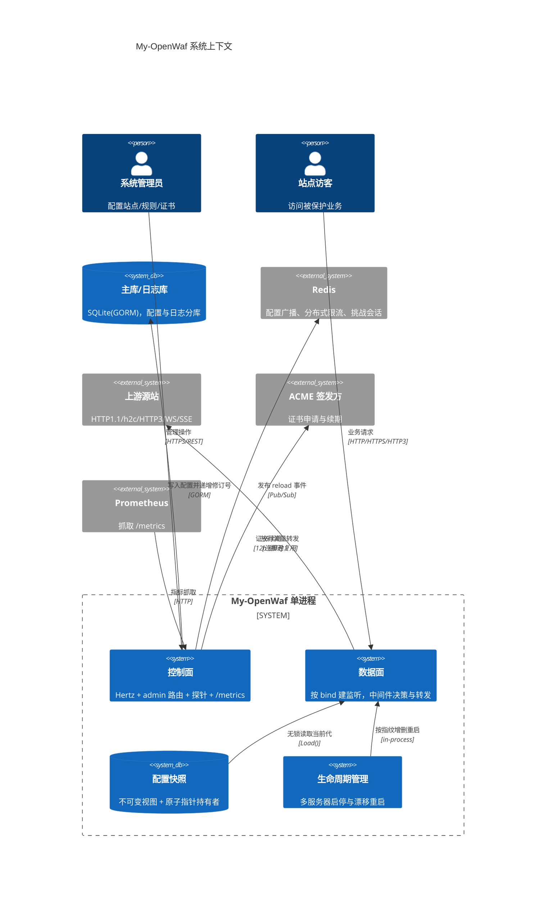
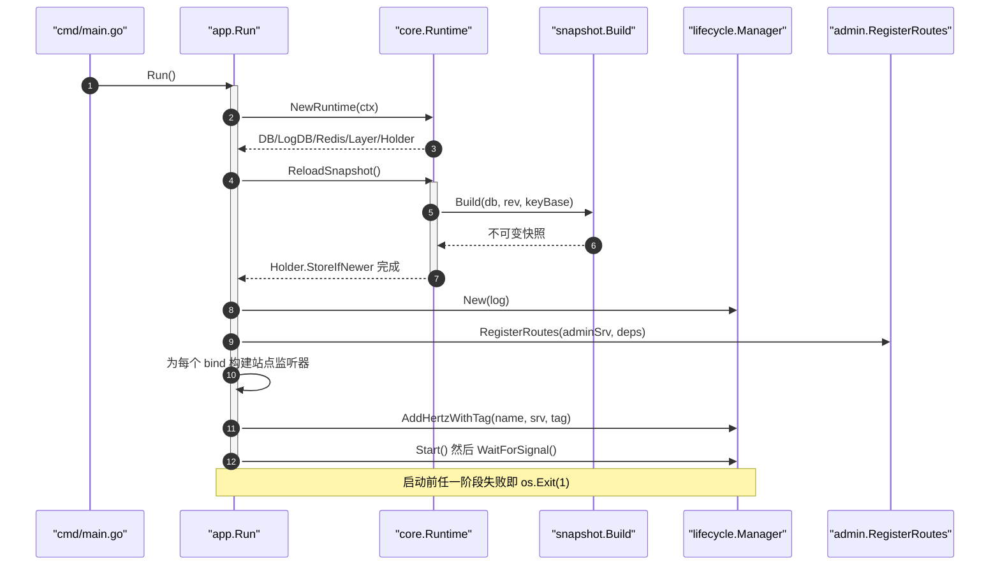
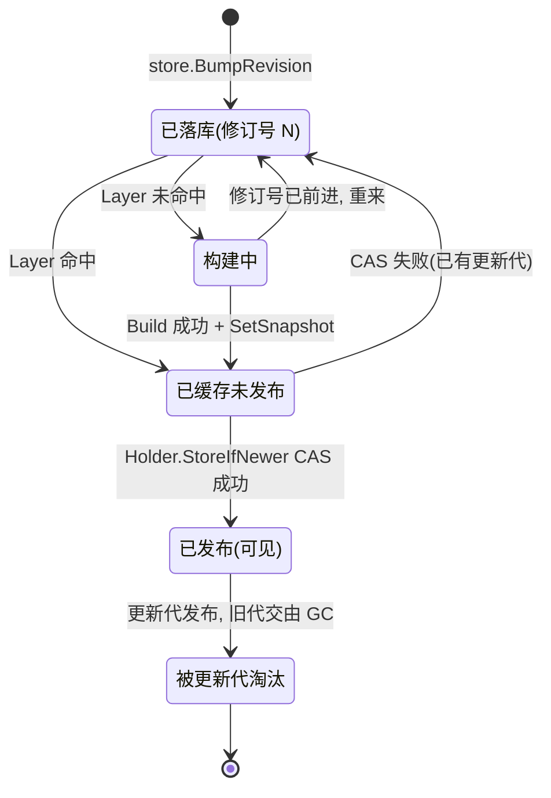
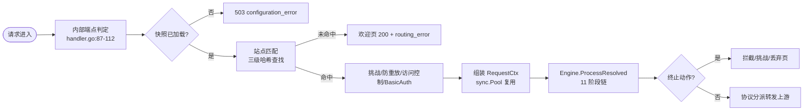
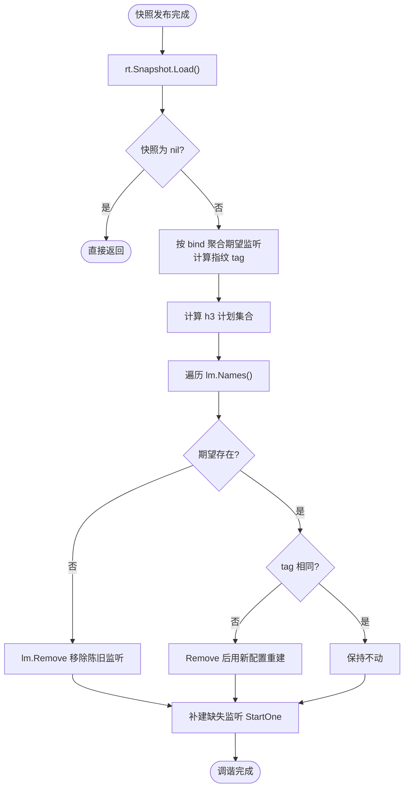
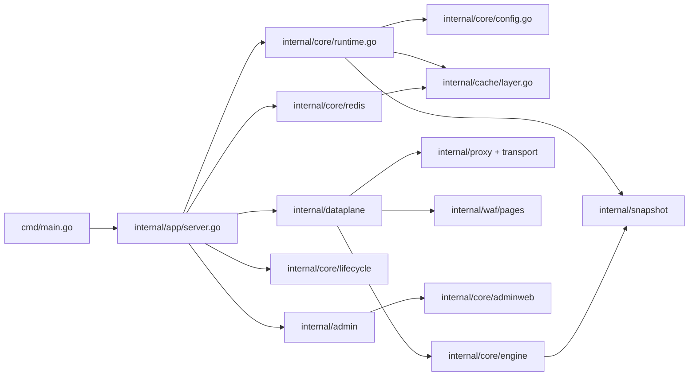
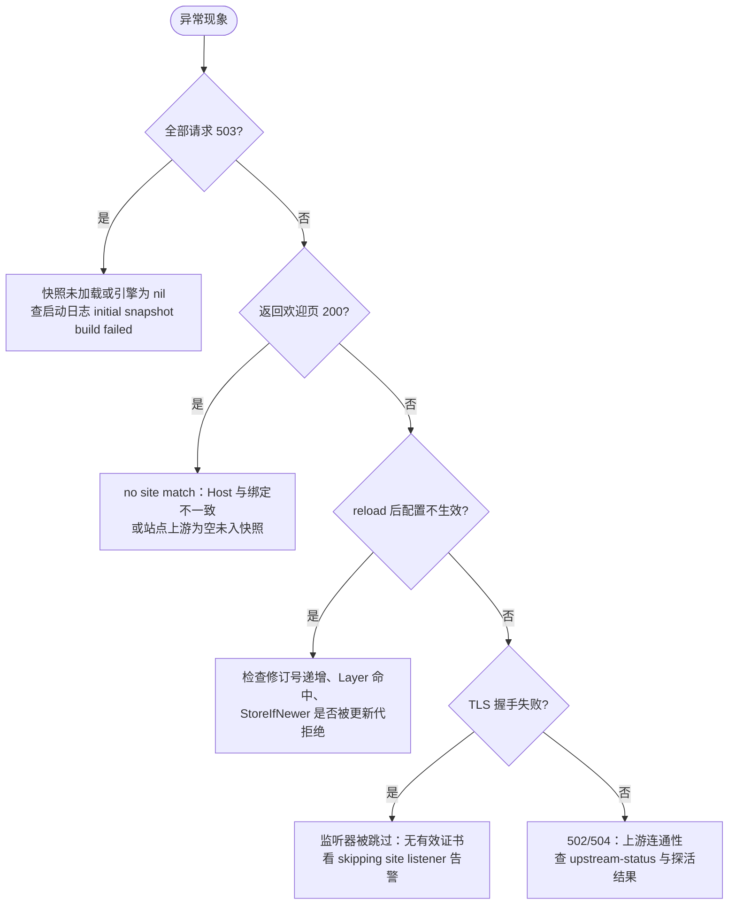

# 系统架构设计

本模块系统性阐述 My-OpenWaf 的系统架构设计，涵盖控制面与数据面的分离理念、双服务器架构、快照模式、热重载机制以及各核心组件的协作关系。文档按子系统划分为**架构总览**、**控制面**、**数据面**与**核心机制**四大主题，帮助读者从整体到局部理解系统的数据流、组件交互与性能设计。

<cite>
**本文档引用的文件**
- [cmd/main.go](file://cmd/main.go)
- [internal/app/server.go](file://internal/app/server.go)
- [internal/app/http3.go](file://internal/app/http3.go)
- [internal/core/runtime.go](file://internal/core/runtime.go)
- [internal/core/config.go](file://internal/core/config.go)
- [internal/core/engine/engine.go](file://internal/core/engine/engine.go)
- [internal/core/pipeline/pipeline.go](file://internal/core/pipeline/pipeline.go)
- [internal/core/pipeline/pool.go](file://internal/core/pipeline/pool.go)
- [internal/core/action/action.go](file://internal/core/action/action.go)
- [internal/core/lifecycle/lifecycle.go](file://internal/core/lifecycle/lifecycle.go)
- [internal/core/health/health.go](file://internal/core/health/health.go)
- [internal/core/redis/pubsub.go](file://internal/core/redis/pubsub.go)
- [internal/core/sites/resolver.go](file://internal/core/sites/resolver.go)
- [internal/snapshot/snapshot.go](file://internal/snapshot/snapshot.go)
- [internal/snapshot/build.go](file://internal/snapshot/build.go)
- [internal/dataplane/handler.go](file://internal/dataplane/handler.go)
- [internal/admin/router.go](file://internal/admin/router.go)
- [internal/cache/layer.go](file://internal/cache/layer.go)
- [internal/proxy/transport/transport.go](file://internal/proxy/transport/transport.go)
- [internal/store/migrate.go](file://internal/store/migrate.go)
- [docs/WAF 引擎系统/引擎核心架构/快照系统.md](file://docs/WAF 引擎系统/引擎核心架构/快照系统.md)
- [docs/配置管理系统/配置快照机制.md](file://docs/配置管理系统/配置快照机制.md)
</cite>

**子页面分类索引**

| 主题 | 子文档 | 视角 |
|---|---|---|
| 架构总览 | [组件关系图](组件关系图.md) | 节点与依赖边（拓扑本身） |
| 架构总览 | [数据流分析](数据流分析.md) | 请求路径上的数据转换与状态迁移 |
| 控制面 | [控制面设计](控制面设计.md) | 管理端口、路由装配、中间件与探针 |
| 核心机制 | [快照机制](快照机制.md) | 快照在双平面之间的角色与发布可见性 |
| 核心机制 | [缓存与性能优化](缓存与性能优化.md) | 缓存层级、失效策略与池化 |
| 数据面 | [数据平面处理](../数据平面处理/数据平面处理.md) | 监听器、请求处理流程、上游与协议桥 |
| 数据面 | [WAF 引擎系统](../WAF 引擎系统/WAF 引擎系统.md) | 阶段链、规则编译与动作决策 |

## 目录

1. [简介](#简介)
2. [项目结构](#项目结构)
3. [核心组件](#核心组件)
4. [架构总览](#架构总览)
5. [详细组件分析](#详细组件分析)
6. [依赖关系分析](#依赖关系分析)
7. [性能考虑](#性能考虑)
8. [故障排查指南](#故障排查指南)
9. [结论](#结论)
10. [附录](#附录)

## 简介
本文件系统性阐述 My-OpenWaf 的系统架构设计，重点围绕控制面与数据面的分离理念、双服务器架构的工作原理与优势、快照模式的不可变性与热重载机制展开。通过对核心组件（运行时、快照、引擎、数据平面处理器、生命周期管理、Redis 配置同步）的深入分析，解释数据流向与组件交互关系，并提供架构决策的技术考量、性能权衡与可扩展性设计建议。

**本域文档划界**：本文只回答「系统分成哪几层、为什么这样分、层之间靠什么契约」；组件级拓扑与依赖边集中在 [组件关系图](组件关系图.md)，请求路径上的数据转换集中在 [数据流分析](数据流分析.md)。快照主题同样按视角三分——本文只写快照在双平面间的角色与发布时机，引擎内部如何消费快照见 [快照系统](../WAF 引擎系统/引擎核心架构/快照系统.md)，配置层快照与热重载落地见 [配置快照机制](../配置管理系统/配置快照机制.md)。

## 项目结构
My-OpenWaf 是单进程双平面应用：`cmd/main.go` 只做子命令分派与 pprof 开关（`MY_OPENWAF_PPROF_BIND`），其余全部交给 `internal/app.Run()`；`Run()` 按固定顺序装配运行时、持久层、缓存、引擎、数据面与生命周期管理器，最后 `lm.Start()` 一次性拉起全部监听器并在 `WaitForSignal()` 上阻塞。

| 顶层目录 | 平面归属 | 职责 | 关键入口 |
|---|---|---|---|
| `cmd/` | 引导 | 子命令分派、pprof 开关 | `main()` 调 `app.Run()`（cmd/main.go:48） |
| `internal/app/` | 装配 | 启动链、监听器调谐、HTTP/3 服务 | `Run`（server.go:234）、`reconcileListeners`（server.go:722）、`buildHTTP3ServerPlans`（http3.go:1555） |
| `internal/core/` | 数据面为主 | 运行时、配置、引擎、流水线、生命周期、健康、Redis 同步 | `NewRuntime`（runtime.go:36）、`Engine.Process`（engine.go:551） |
| `internal/snapshot/` | 双平面共享 | 不可变配置视图与构建 | `Snapshot`（snapshot.go:213）、`Build`（build.go:34 起） |
| `internal/dataplane/` | 数据面 | 请求接入、动作落地、协议转发 | `Handler`（handler.go:39） |
| `internal/proxy/` | 数据面 | 上游连接池与转发 | `internal/proxy/transport/transport.go` |
| `internal/admin/` | 控制面 | 管理 API 装配与领域 handler | `RegisterRoutes`（router.go:89） |
| `internal/store/` | 持久层 | 双库模型、迁移、仓储 | `BumpRevision`（migrate.go:141） |
| `internal/cache/` | 数据面 | 快照缓存、响应缓存、分布式 KV | `NewLayer`（layer.go:29） |
| `internal/observability/` | 双平面 | 指标与批量写入 | `UnifiedWriter` |

**图表来源**
- [cmd/main.go:28-48](file://cmd/main.go#L28-L48)
- [internal/app/server.go:234-395](file://internal/app/server.go#L234-L395)
- [internal/app/http3.go:1555-1555](file://internal/app/http3.go#L1555-L1555)
- [internal/dataplane/handler.go:39-120](file://internal/dataplane/handler.go#L39-L120)
- [internal/core/engine/engine.go:551-562](file://internal/core/engine/engine.go#L551-L562)
- [internal/snapshot/snapshot.go:213-287](file://internal/snapshot/snapshot.go#L213-L287)
- [internal/cache/layer.go:29-51](file://internal/cache/layer.go#L29-L51)

**章节来源**
- [cmd/main.go:13-49](file://cmd/main.go#L13-L49)
- [internal/app/server.go:234-234](file://internal/app/server.go#L234-L234)
- [internal/core/runtime.go:23-34](file://internal/core/runtime.go#L23-L34)

## 核心组件

| 组件 | 载体 | 单一职责 | 关键符号 | 读/写并发模型 |
|---|---|---|---|---|
| 运行时环境 | `internal/core/runtime.go` | 打开双库与可选 Redis，装配缓存层与快照持有者 | `Runtime`、`NewRuntime`（runtime.go:36） | `reloadMu` 串行化重载（runtime.go:212） |
| 快照 | `internal/snapshot/snapshot.go` | 承载一次配置的全部只读视图 | `Snapshot`（:213）、`SiteRuntime`（:44） | 构建后不再改写任何字段 |
| 快照持有者 | `internal/snapshot/snapshot.go` | 以原子指针发布/读取当前代 | `Holder.StoreIfNewer`（:474） | CAS 循环，读侧无锁 |
| 站点解析器 | `internal/core/sites/resolver.go` | 把 `(bind, host)` 映射到站点运行时 | `Resolver.Match`（:26）、`MatchPtr`（:34） | 单次 `holder.Load()` |
| 引擎 | `internal/core/engine/engine.go` | 组装阶段链并执行判定 | `Process`（:551）、`getOrBuildPhases`（:441） | `atomic.Pointer` 读 + 写时复制 |
| 数据面处理器 | `internal/dataplane/handler.go` | 接入、门禁、动作落地、协议转发 | `Handler`（:39） | 每请求一协程，无共享可变态 |
| 控制面装配 | `internal/admin/router.go` | 注册管理端点并注入依赖 | `RegisterRoutes`（:89）、`Dependencies`（:60） | 无状态 handler |
| 生命周期管理 | `internal/core/lifecycle/lifecycle.go` | 多服务器的注册、启停与漂移重启 | `Manager.AddHertzWithTag`（:94）、`Remove`（:144） | `sync.Mutex` 保护 entries |
| 配置同步 | `internal/core/redis/pubsub.go` | 跨节点广播重载事件 | `ConfigSync.PublishReload`（:65）、`Subscribe`（:86） | sourceID 抑制回环 |
| 快照缓存 | `internal/cache/layer.go` | 按代次缓存已构建快照对象 | `Layer.GetSnapshot`（:54） | ristretto 内部并发安全 |

**图表来源**
- [internal/core/runtime.go:23-34](file://internal/core/runtime.go#L23-L34)
- [internal/snapshot/snapshot.go:213-213](file://internal/snapshot/snapshot.go#L213-L213)
- [internal/snapshot/snapshot.go:452-489](file://internal/snapshot/snapshot.go#L452-L489)
- [internal/core/sites/resolver.go:12-44](file://internal/core/sites/resolver.go#L12-L44)
- [internal/core/engine/engine.go:551-562](file://internal/core/engine/engine.go#L551-L562)
- [internal/core/lifecycle/lifecycle.go:66-112](file://internal/core/lifecycle/lifecycle.go#L66-L112)
- [internal/cache/layer.go:24-70](file://internal/cache/layer.go#L24-L70)

**章节来源**
- [internal/core/runtime.go:17-142](file://internal/core/runtime.go#L17-L142)
- [internal/snapshot/snapshot.go:44-287](file://internal/snapshot/snapshot.go#L44-L287)
- [internal/core/engine/engine.go:441-562](file://internal/core/engine/engine.go#L441-L562)
- [internal/dataplane/handler.go:39-168](file://internal/dataplane/handler.go#L39-L168)
- [internal/core/lifecycle/lifecycle.go:66-298](file://internal/core/lifecycle/lifecycle.go#L66-L298)
- [internal/core/redis/pubsub.go:29-121](file://internal/core/redis/pubsub.go#L29-L121)
- [internal/cache/layer.go:19-70](file://internal/cache/layer.go#L19-L70)

## 架构总览
My-OpenWaf 将控制平面与数据平面解耦到同一进程的两个端口组：控制面监听 `AdminBind`，只承担配置写入、可观测性与生命周期编排；数据面按**监听地址**（不是按站点行）创建 Hertz 服务器，共享同一个快照持有者与引擎实例。两平面之间唯一的契约是「修订号 + 不可变快照」：控制面写库并 `BumpRevision`，数据面只读 `Holder.Load()` 的结果。

| 层 | 承载 | 平面 | 职责 | 层间契约 |
|---|---|---|---|---|
| L0 引导 | `cmd/main.go` | — | 子命令与 pprof 开关 | 调用 `app.Run()` |
| L1 装配 | `internal/app` | 跨平面 | 16 阶段启动链、监听器调谐、HTTP/3 计划 | 向下游注入依赖，不被下游依赖 |
| L2 控制面 | `internal/admin` | 控制面 | 217 个管理端点、认证鉴权、SPA 回退 | 写库 + `Reload()` 回调 |
| L3 数据面接入 | `internal/dataplane` | 数据面 | 门禁、动作落地、协议分派 | 只读快照，不写配置库 |
| L4 决策 | `internal/core/engine`、`pipeline`、`rules` | 数据面 | 阶段链组装与执行 | 输入 `RequestCtx`，输出 `ProcessResult` |
| L5 配置视图 | `internal/snapshot`、`internal/cache` | 双平面 | 不可变视图与按代次缓存 | `Holder` 原子发布 |
| L6 转发 | `internal/proxy`、`internal/upstream` | 数据面 | 连接池复用、探活、响应回写 | 按站点 TLS 键复用 transport |
| L7 持久 | `internal/store`、`repository` | 控制面写 | 主库（配置）与日志库分离 | `BumpRevision` 单调递增 |
| L8 观测 | `internal/observability`、`dataplane/metrics` | 双平面 | 指标导出与批量落库 | 异步通道，不阻塞请求路径 |

| 外部实体 | 类型 | 交互 | 通道/端口 | 证据 |
|---|---|---|---|---|
| 浏览器 / API 客户端 | 用户 | 访问被保护站点 | 数据面监听地址 | handler.go:54 起 |
| 系统管理员 | 用户 | 配置站点、规则、证书 | 控制面 `AdminBind` + `/api/v1/*` | router.go:89-140 |
| 上游源站 | 系统 | 承接放行流量 | HTTP/1.1、h2c、HTTP/3、WebSocket、SSE | handler.go:1116-1211 |
| Redis | 系统 | 配置广播、分布式限流、挑战会话 | `openwaf:config:reload` | pubsub.go:16 |
| ACME 签发方 | 系统 | 证书申请与续期 | `RenewLoop` 12 小时 | server.go:1057-1059 |
| Prometheus | 系统 | 抓取指标 | 控制面 `GET /metrics` | server.go:1056 |
| 操作系统 | 系统 | 优雅停机 | SIGINT / SIGTERM | lifecycle.go:290-298 |

**图表来源**
- [internal/app/server.go:1052-1093](file://internal/app/server.go#L1052-L1093)
- [internal/app/server.go:1131-1132](file://internal/app/server.go#L1131-L1132)
- [internal/admin/router.go:89-140](file://internal/admin/router.go#L89-L140)
- [internal/dataplane/handler.go:54-163](file://internal/dataplane/handler.go#L54-L163)
- [internal/snapshot/snapshot.go:452-489](file://internal/snapshot/snapshot.go#L452-L489)
- [internal/core/redis/pubsub.go:65-82](file://internal/core/redis/pubsub.go#L65-L82)
- [internal/core/lifecycle/lifecycle.go:290-298](file://internal/core/lifecycle/lifecycle.go#L290-L298)

**章节来源**
- [internal/app/server.go:703-718](file://internal/app/server.go#L703-L718)
- [internal/app/server.go:1052-1131](file://internal/app/server.go#L1052-L1131)
- [internal/snapshot/snapshot.go:207-213](file://internal/snapshot/snapshot.go#L207-L213)
- [internal/core/redis/pubsub.go:16-16](file://internal/core/redis/pubsub.go#L16-L16)

## 详细组件分析

### 启动链路：16 个装配阶段
`Run()` 的阶段顺序不是随意的：快照构建必须在写队列之前完成（否则 `applyProtectionRuntimeConfig` 拿不到 `Protection`），而挑战栈与限流器又依赖快照里的保护参数，监听器调谐最后执行。任一前置阶段失败即 `os.Exit(1)`，不留半启动态。

| 序 | 阶段 | 位置 | 产出 |
|:--:|---|---|---|
| 1 | 日志器与根上下文 | server.go:236-240 | `logger.New("app")`、ACME 子上下文 |
| 2 | 运行时装配 | server.go:242 | 双库、可选 Redis、缓存层、Holder |
| 3 | 主库迁移 | server.go:249 | `store.AutoMigrate` |
| 4 | 内置目录对账 | server.go:253、257 | OWASP / CVE 目录 |
| 5 | 日志库迁移 | server.go:261 | `AutoMigrateLogs` |
| 6 | 默认账户播种 | server.go:267 | `internal/store/auth/seed.go:26` |
| 7 | 进程密钥解析 | server.go:284 | 持久 JWT 密钥 |
| 8 | 首个快照构建 | server.go:293 | `ReloadSnapshot()` |
| 9 | 仓储装配 | server.go:301 | `NewWithLogDB` |
| 10 | 缓存与写队列 | server.go:304-364 | RedisKV、QueryCache、HotCache、WriteQueue、UnifiedWriter、ResponseCache |
| 11 | 数据面基础件 | server.go:368-391 | 指标、上游池、限流器、IP 信誉 |
| 12 | 引擎构建 | server.go:395 | `engine.New(rt.Snapshot, reqRL, errRL, ipRep)` |
| 13 | 指标/健康/生命周期 | server.go:481、595、596 | `promMetrics`、`hc`、`lm` |
| 14 | 挑战栈 | server.go:603-689 | CAPTCHA、5 秒盾、链式、防重放、升级 |
| 15 | 数据面选项与重载链 | server.go:703、722-1040 | `dpOpts`、`reconcileListeners`、`applySnapshotReload`、`reloadRuntime` |
| 16 | 双平面装配并启动 | server.go:1063、1100、1131 | `RegisterRoutes`、站点监听器、`lm.Start()` |

**图表来源**
- [cmd/main.go:48-48](file://cmd/main.go#L48-L48)
- [internal/app/server.go:234-301](file://internal/app/server.go#L234-L301)
- [internal/core/runtime.go:211-274](file://internal/core/runtime.go#L211-L274)
- [internal/snapshot/build.go:34-40](file://internal/snapshot/build.go#L34-L40)
- [internal/app/server.go:1063-1131](file://internal/app/server.go#L1063-L1131)
- [internal/core/lifecycle/lifecycle.go:185-203](file://internal/core/lifecycle/lifecycle.go#L185-L203)

**章节来源**
- [internal/app/server.go:234-395](file://internal/app/server.go#L234-L395)
- [internal/app/server.go:595-718](file://internal/app/server.go#L595-L718)
- [internal/app/server.go:1052-1131](file://internal/app/server.go#L1052-L1131)

### 配置发布与可见性状态机
一版配置从落库到对请求可见，会经历「修订号已递增但尚未发布」的中间窗口。`ReloadSnapshotWithPrePublish` 用代次 CAS 二次核对把该窗口关闭：每次构建或缓存命中前后都重读修订号，不一致就整体重来，避免用旧代覆盖新代。

**图表来源**
- [internal/store/migrate.go:141-158](file://internal/store/migrate.go#L141-L158)
- [internal/core/runtime.go:211-274](file://internal/core/runtime.go#L211-L274)
- [internal/cache/layer.go:44-62](file://internal/cache/layer.go#L44-L62)
- [internal/snapshot/snapshot.go:464-487](file://internal/snapshot/snapshot.go#L464-L487)

**章节来源**
- [internal/core/runtime.go:201-274](file://internal/core/runtime.go#L201-L274)
- [internal/snapshot/snapshot.go:452-489](file://internal/snapshot/snapshot.go#L452-L489)
- [internal/store/migrate.go:141-158](file://internal/store/migrate.go#L141-L158)

### 站点解析：哈希键加至多三级查找
旧文档曾把这里描述成「Trie 树加速」，这是错误的：全库没有任何 trie 实现，`internal/dataplane` 下也不存在 `trie.go`。真实机制是把 `(bind, host)` 拼成单一哈希键 `bind + "\x00" + host`，然后在一个 `map[string]*SiteRuntime` 上做**至多三次**查表。

| 序 | 候选键 | 触发条件 | 代码位置 |
|:--:|---|---|---|
| 1 | `bind + NUL + 精确 host` | 始终先试 | snapshot.go:343-346 |
| 2 | `bind + NUL + "*." + 单级父域` | host 不是 IP 且含 `.` | snapshot.go:348-355 |
| 3 | `bind + NUL + "*"` | catch-all 站点 | snapshot.go:357-359 |

Host 在查表前统一经 `NormalizeMatchHost` 处理：小写化、去首尾空白、剥离端口；若已是规范形式则原样返回、零分配（snapshot.go:409-439）。写入侧 `registerSiteKeys` 不做 first-come 抢占：同一键若属于另一站点，直接返回 `duplicate site route` 错误使本次 reload 失败；同站点重复键则幂等跳过（build.go:787-804）。未命中站点不会返回 404，而是记 `no site match` 告警、写出欢迎页 200 并以 `routing_error` 落审计行（handler.go:151-162）。

**章节来源**
- [internal/snapshot/snapshot.go:289-296](file://internal/snapshot/snapshot.go#L289-L296)
- [internal/snapshot/snapshot.go:337-398](file://internal/snapshot/snapshot.go#L337-L398)
- [internal/snapshot/snapshot.go:409-450](file://internal/snapshot/snapshot.go#L409-L450)
- [internal/snapshot/build.go:787-804](file://internal/snapshot/build.go#L787-L804)
- [internal/dataplane/handler.go:136-163](file://internal/dataplane/handler.go#L136-L163)
- [internal/core/sites/resolver.go:18-44](file://internal/core/sites/resolver.go#L18-L44)

### 数据平面处理器主链路
`Handler` 返回一个 Hertz 中间件，顺序为：内部端点（WASM 资产、ACME、挑战校验、访问控制、静态资源）→ 快照读取与代次校验 → 站点匹配 → 客户端 IP 解析 → 挑战提交核验与防重放 → 访问控制与 Basic Auth → 内联 OWASP 守卫 → 组装 `RequestCtx` → JS 请求阶段 → 引擎判定 → 动作落地 → 协议分派转发。快照为空时直接 503 `configuration snapshot not loaded`（handler.go:119-127）。转发分派是一个四路 switch：RFC 8441 扩展 CONNECT、WebSocket 升级、SSE、缓冲/流式 HTTP（handler.go:1116-1211）。

**图表来源**
- [internal/dataplane/handler.go:87-163](file://internal/dataplane/handler.go#L87-L163)
- [internal/dataplane/handler.go:340-387](file://internal/dataplane/handler.go#L340-L387)
- [internal/dataplane/handler.go:514-530](file://internal/dataplane/handler.go#L514-L530)
- [internal/dataplane/handler.go:1116-1211](file://internal/dataplane/handler.go#L1116-L1211)
- [internal/core/engine/engine.go:551-562](file://internal/core/engine/engine.go#L551-L562)

**章节来源**
- [internal/dataplane/handler.go:39-168](file://internal/dataplane/handler.go#L39-L168)
- [internal/dataplane/handler.go:274-400](file://internal/dataplane/handler.go#L274-L400)
- [internal/dataplane/handler.go:514-660](file://internal/dataplane/handler.go#L514-L660)
- [internal/dataplane/handler.go:1116-1215](file://internal/dataplane/handler.go#L1116-L1215)

### 控制平面（Admin Server）设计
- 职责
  - 健康检查与状态查询：`/healthz`、`/readyz`、`/status`、`/metrics` 四个探针在 `server.go:1053-1056` 直接注册在管理服务器上，早于 `RegisterRoutes`。
  - 管理 API：`/api/v1/*` 按只读（admin/operator/readonly 三角色）与运维、管理员分组注册。
  - 前端静态资源托管与 SPA 回退。
  - 所有更新/删除操作采用 POST + 特定后缀语义，简化反向代理与 CORS 配置。
- 关键点
  - 通过 `Dependencies` 结构体一次性注入仓储、重载回调、静态目录、JWT 密钥、指标、RedisKV、上游池等 20 余项依赖（router.go:60-87），handler 包不反向依赖 `internal/app`。
  - `SecurityHeaders` 与 `AccessLog` 为全局中间件，`AuthMiddleware` 只挂在 `/api/v1` 组上，`/healthz`、`/api/v1/health` 与 `/api/v1/auth/{login,refresh,logout}` 在白名单内。

**章节来源**
- [internal/app/server.go:1052-1093](file://internal/app/server.go#L1052-L1093)
- [internal/admin/router.go:60-140](file://internal/admin/router.go#L60-L140)
- [internal/core/health/health.go:46-105](file://internal/core/health/health.go#L46-L105)

### 监听器调谐与配置漂移检测
`reconcileListeners` 以「监听地址」而非站点行为粒度：先按 `listenerRuntimesByBind` 聚合出期望集合，用 `siteListenerFingerprint` 生成指纹标签，再与 `lm.Tag(name)` 比较。名称前缀区分两类服务器——`site:` 为 Hertz/TCP（TLS），`h3:` 为 HTTP/3 QUIC UDP。标签不一致即 `lm.Remove` + 重新 `AddHertzWithTag` + `StartOne`；缺少有效 TLS 配置的绑定会被跳过并记告警而不是让整次重载失败（server.go:785-801）。

**图表来源**
- [internal/app/server.go:722-825](file://internal/app/server.go#L722-L825)
- [internal/app/server.go:1095-1123](file://internal/app/server.go#L1095-L1123)
- [internal/app/http3.go:1555-1555](file://internal/app/http3.go#L1555-L1555)
- [internal/core/lifecycle/lifecycle.go:115-166](file://internal/core/lifecycle/lifecycle.go#L115-L166)

**章节来源**
- [internal/app/server.go:722-825](file://internal/app/server.go#L722-L825)
- [internal/app/server.go:1095-1123](file://internal/app/server.go#L1095-L1123)
- [internal/core/lifecycle/lifecycle.go:66-227](file://internal/core/lifecycle/lifecycle.go#L66-L227)

## 依赖关系分析

| 上游 | 下游 | 依赖形式 | 是否可缺省 | 证据 |
|---|---|---|---|---|
| `dataplane` | `snapshot` | 只读 `Holder.Load()` | 否（空即 503） | handler.go:119-127 |
| `engine` | `snapshot` | `Resolver.Snapshot()` + `MatchSitePtr` | 否 | engine.go:552-557 |
| `engine` | `cache.Layer` | 间接（经 `Runtime`） | 否 | layer.go:29-39 |
| `app` | `redis.ConfigSync` | `PublishReload` / `Subscribe` | 是（无 Redis 时单节点） | pubsub.go:38-54 |
| `admin` | `app` 的重载回调 | 函数注入 `Reload` | 否 | router.go:62 |
| `proxy` | `dataplane` 响应运行时 | 查找函数注入，避免反向 import | 是 | handler.go:45-47 |
| `snapshot` | `store` 模型 | 构建期读取 | 否 | build.go:13-31 |

**图表来源**
- [cmd/main.go:11-12](file://cmd/main.go#L11-L12)
- [internal/app/server.go:234-395](file://internal/app/server.go#L234-L395)
- [internal/core/runtime.go:11-21](file://internal/core/runtime.go#L11-L21)
- [internal/dataplane/handler.go:16-36](file://internal/dataplane/handler.go#L16-L36)
- [internal/core/engine/engine.go:551-562](file://internal/core/engine/engine.go#L551-L562)
- [internal/admin/router.go:12-57](file://internal/admin/router.go#L12-L57)

**章节来源**
- [internal/app/server.go:234-395](file://internal/app/server.go#L234-L395)
- [internal/dataplane/handler.go:16-36](file://internal/dataplane/handler.go#L16-L36)
- [internal/core/runtime.go:11-21](file://internal/core/runtime.go#L11-L21)
- [internal/admin/router.go:60-87](file://internal/admin/router.go#L60-L87)

## 性能考虑
- 快照不可变与原子切换：读路径只有一次 `atomic.Pointer.Load()`，无锁竞争；旧代由 GC 回收。
- 阶段链与规则编译缓存：`getOrBuildPhases` 以 `{policyID, siteID, antiReplayEnabled}` 为键，加上 `prot`/`lua`/`luaRevision`/`deps` 四判据，热路径走无锁快路径（engine.go:446-464）。
- 请求上下文池化：`pipeline.AcquireCtx/ReleaseCtx` 复用 `RequestCtx`，池对象超过容量上限时在 Release 侧重建，避免峰值后 RSS 不回落（pool.go:11-28）。
- 上游连接复用：主 transport 为 `MaxIdleConns 256 / MaxIdleConnsPerHost 32 / IdleConnTimeout 30s`，`MaxConnsPerHost 256`，16KiB 读写缓冲（transport.go:157-164、172）。
- 观测性异步化：`UnifiedWriter` 用四条通道加单 goroutine 批量事务落库，容量与批大小由 `rt.Config.Queue` 注入（server.go:340-350）。
- 按监听地址拆分服务器：负载与 TLS 配置隔离到不同 bind，便于灰度与故障隔离，但站点数不等于监听数。

**章节来源**
- [internal/snapshot/snapshot.go:452-489](file://internal/snapshot/snapshot.go#L452-L489)
- [internal/core/engine/engine.go:441-548](file://internal/core/engine/engine.go#L441-L548)
- [internal/core/pipeline/pool.go:11-38](file://internal/core/pipeline/pool.go#L11-L38)
- [internal/proxy/transport/transport.go:154-178](file://internal/proxy/transport/transport.go#L154-L178)
- [internal/app/server.go:340-360](file://internal/app/server.go#L340-L360)

## 故障排查指南

| 症状 | 直接原因 | 排查动作 | 判据来源 |
|---|---|---|---|
| 503 `configuration snapshot not loaded` | 首次 `ReloadSnapshot` 失败或未执行 | 看启动日志 `initial snapshot build failed` | handler.go:123-126、server.go:293-296 |
| 503 `waf engine unavailable` | `dpOpts.Engine` 未注入 | 核对 `engine.New` 调用点 | handler.go:164-167 |
| 200 欢迎页且日志 `no site match` | Host 未命中三级查找 | 比对站点 `host` 字段与监听 `bind` | handler.go:151-162、snapshot.go:337-362 |
| reload 报 `duplicate site route` | 两站点争用同一 `bind+host` 键 | 调整其一的通配或精确 Host | build.go:795-799 |
| 监听器反复重启 | 指纹 tag 每次计算不同 | 核对绑定、TLS 开关、证书内容是否抖动 | server.go:733-778 |
| `/readyz` 持续 503 | 数据库 Ping 失败、快照为 nil 或某监听未就绪 | 检查 `Ready()` 三重条件 | health.go:32-44 |
| 多节点配置不一致 | Redis 不可用导致订阅链断裂 | 确认频道 `openwaf:config:reload` 与 sourceID 回环抑制 | pubsub.go:16-121 |

**图表来源**
- [internal/dataplane/handler.go:123-167](file://internal/dataplane/handler.go#L123-L167)
- [internal/snapshot/build.go:795-799](file://internal/snapshot/build.go#L795-L799)
- [internal/app/server.go:722-801](file://internal/app/server.go#L722-L801)
- [internal/core/health/health.go:32-44](file://internal/core/health/health.go#L32-L44)

**章节来源**
- [internal/dataplane/handler.go:119-167](file://internal/dataplane/handler.go#L119-L167)
- [internal/app/server.go:293-296](file://internal/app/server.go#L293-L296)
- [internal/snapshot/build.go:787-804](file://internal/snapshot/build.go#L787-L804)
- [internal/core/health/health.go:26-66](file://internal/core/health/health.go#L26-L66)
- [internal/core/redis/pubsub.go:65-121](file://internal/core/redis/pubsub.go#L65-L121)

## 结论
My-OpenWaf 的双服务器架构通过控制平面与数据平面的清晰分离，实现了管理与防护的高内聚低耦合。控制平面专注配置与可观测性，数据平面专注高性能实时处理；两平面之间以「单调递增修订号 + 不可变快照 + 原子指针发布」这一条契约贯通，避免了共享可配态带来的锁竞争。快照驱动的热重载与按监听地址的漂移检测保证了零停机变更，Redis 发布订阅只传「该重载了」这一件事而不搬运序列化后的快照，把跨节点同步成本压到最低。

需要澄清的一处历史误述：站点解析不含 Trie，实现是哈希键加至多三级查找；这一事实已在「详细组件分析」中按代码重写。

## 附录

### 子文档与本域的引用关系

| 若你关心 | 应读 | 本文对应节 |
|---|---|---|
| 谁依赖谁、依赖边是否成环 | [组件关系图](组件关系图.md) | 依赖关系分析 |
| 请求字段在每一跳如何被改写 | [数据流分析](数据流分析.md) | 数据平面处理器主链路 |
| 管理端口、中间件与探针细节 | [控制面设计](控制面设计.md) | 控制平面（Admin Server）设计 |
| 快照为何不可变、如何发布 | [快照机制](快照机制.md) | 配置发布与可见性状态机 |
| 引擎内部如何消费快照 | [快照系统](../WAF 引擎系统/引擎核心架构/快照系统.md) | 核心组件 |
| 配置层热重载与迁移 | [配置快照机制](../配置管理系统/配置快照机制.md) | 启动链路：16 个装配阶段 |
| 缓存分层与失效 | [缓存与性能优化](缓存与性能优化.md) | 性能考虑 |

[本节为总结，无需特定文件来源]

### 术语与口径速查

| 术语 | 口径 | 反例（禁止用法） |
|---|---|---|
| 代 / 修订号 | `Snapshot.Revision`，来自 `config_revisions` 单行自增 | 「版本号」指语义化版本 |
| 发布 | `Holder.StoreIfNewer` CAS 成功 | `Store` 无条件覆盖 |
| 监听器粒度 | 一个 `bind` 一个 Hertz 实例 | 「一个站点一个端口」 |
| 站点匹配 | 哈希键至多三级查找 | 「Trie 树」 |
| 连接池 | `internal/proxy/transport` 按 TLS 键复用 | `proxy.go` 中的 transportPool（不存在） |
| 阶段链 | 实测 11 阶段，容量预分配 11 | 「8 阶段」 |

[本节为总结，无需特定文件来源]
