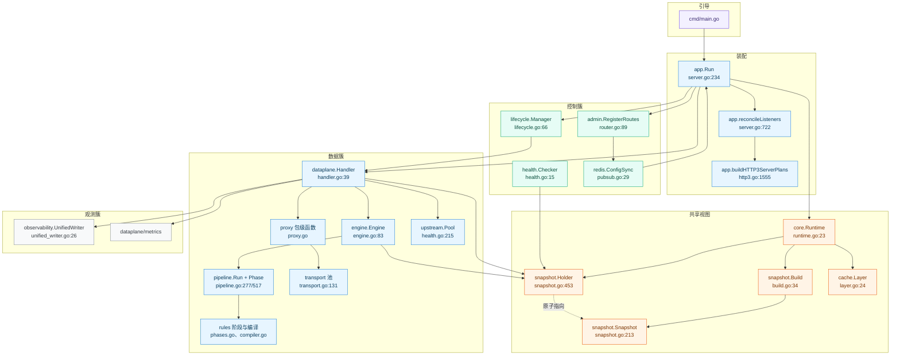
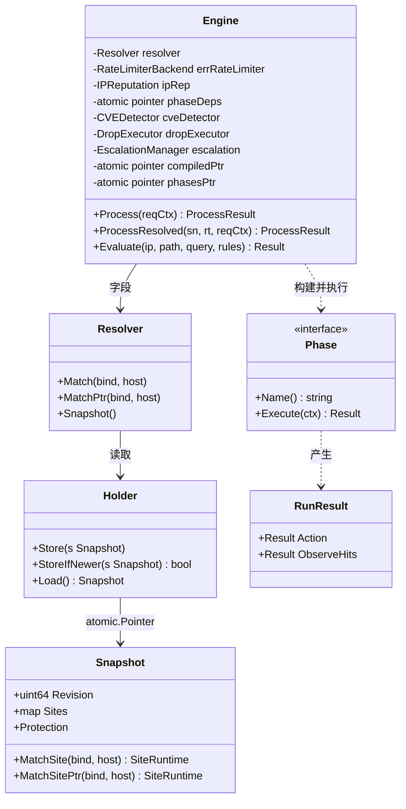
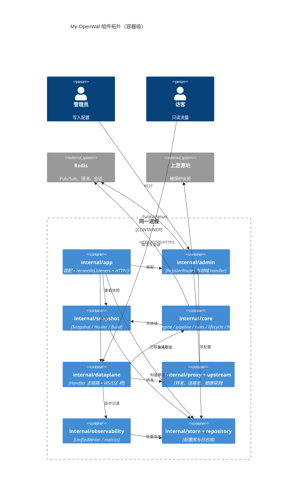
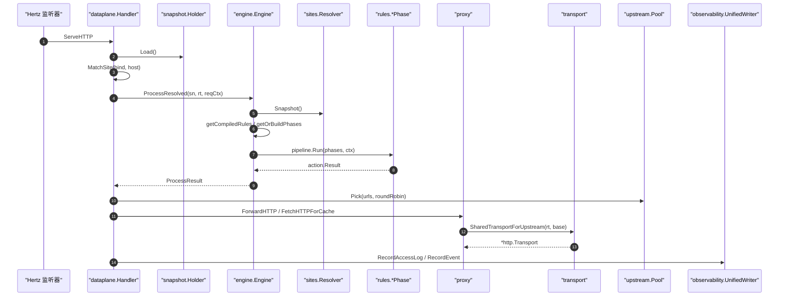
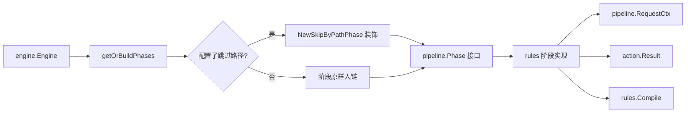
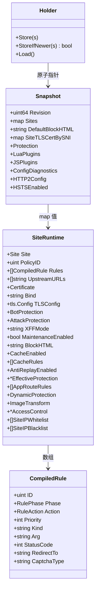
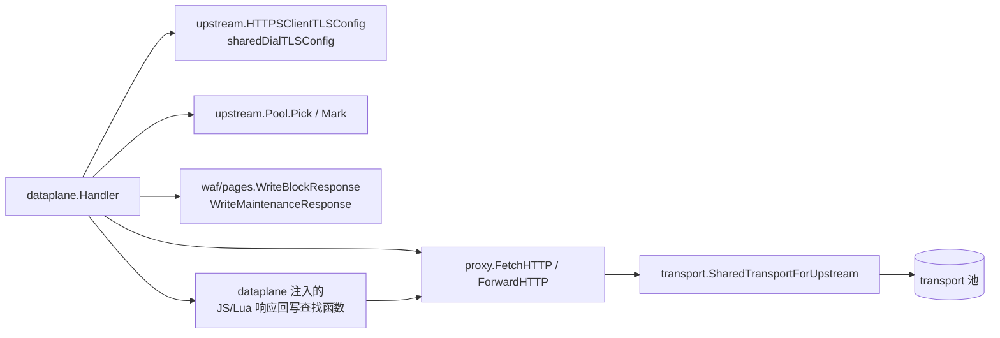
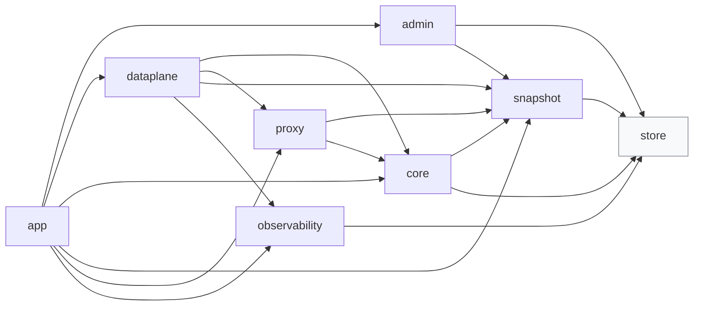

# 组件关系图

> [返回 系统架构设计](系统架构设计.md)

<cite>
**本文档引用的文件**
- [cmd/main.go](file://cmd/main.go)
- [internal/app/server.go](file://internal/app/server.go)
- [internal/app/http3.go](file://internal/app/http3.go)
- [internal/core/runtime.go](file://internal/core/runtime.go)
- [internal/core/engine/engine.go](file://internal/core/engine/engine.go)
- [internal/core/pipeline/pipeline.go](file://internal/core/pipeline/pipeline.go)
- [internal/core/pipeline/pool.go](file://internal/core/pipeline/pool.go)
- [internal/core/action/action.go](file://internal/core/action/action.go)
- [internal/core/rules/compiler.go](file://internal/core/rules/compiler.go)
- [internal/core/rules/phases.go](file://internal/core/rules/phases.go)
- [internal/core/rules/phase_skip.go](file://internal/core/rules/phase_skip.go)
- [internal/core/sites/resolver.go](file://internal/core/sites/resolver.go)
- [internal/core/lifecycle/lifecycle.go](file://internal/core/lifecycle/lifecycle.go)
- [internal/core/redis/pubsub.go](file://internal/core/redis/pubsub.go)
- [internal/snapshot/snapshot.go](file://internal/snapshot/snapshot.go)
- [internal/snapshot/build.go](file://internal/snapshot/build.go)
- [internal/dataplane/handler.go](file://internal/dataplane/handler.go)
- [internal/proxy/proxy.go](file://internal/proxy/proxy.go)
- [internal/proxy/transport/transport.go](file://internal/proxy/transport/transport.go)
- [internal/upstream/transport.go](file://internal/upstream/transport.go)
- [internal/upstream/health.go](file://internal/upstream/health.go)
- [internal/waf/pages/block.go](file://internal/waf/pages/block.go)
- [internal/observability/unified_writer.go](file://internal/observability/unified_writer.go)
- [internal/cache/layer.go](file://internal/cache/layer.go)
- [internal/admin/router.go](file://internal/admin/router.go)
</cite>

## 目录

1. [简介](#简介)
2. [项目结构](#项目结构)
3. [核心组件](#核心组件)
4. [架构总览](#架构总览)
5. [详细组件分析](#详细组件分析)
6. [依赖关系分析](#依赖关系分析)
7. [性能考虑](#性能考虑)
8. [故障排查指南](#故障排查指南)
9. [结论](#结论)
10. [附录](#附录)

## 简介
本文件只回答一个问题：**系统里到底有哪些节点，它们之间的边是谁指向谁**。因此本篇的产物是图本身——容器级拓扑、组件级依赖、类型关系与调用方向，节点名一律使用真实包路径与符号名。

**划界**：为什么这样分层、分层带来的取舍，见 [系统架构设计](系统架构设计.md)；请求在边上流动时数据形态如何变化，见 [数据流分析](数据流分析.md)；快照节点内部的构建细节，见 [快照机制](快照机制.md)。

## 项目结构
节点按「谁创建谁」划分为六个簇，簇间只允许单向边。

| 簇 | 节点 | 创建者 | 生命周期 |
|---|---|---|---|
| 引导簇 | `cmd/main.go` | Go runtime | 进程级 |
| 装配簇 | `app.Run`、`app.buildDataServerWithHTTP3Plans`、`app.reconcileListeners` | `main` | 进程级，函数无状态 |
| 共享视图簇 | `core.Runtime`、`snapshot.Holder`、`snapshot.Snapshot`、`cache.Layer` | `Run` | 进程级，快照按代次更替 |
| 控制簇 | `admin.RegisterRoutes`、`core/health.Checker`、`core/lifecycle.Manager`、`core/redis.ConfigSync` | `Run` | 进程级 |
| 数据簇 | `dataplane.Handler`、`core/engine.Engine`、`core/pipeline`、`core/rules`、`proxy`、`upstream.Pool` | `Run` + 调谐器 | 监听器级 |
| 观测簇 | `observability.UnifiedWriter`、`dataplane/metrics`、`observability/metrics` | `Run` | 进程级 |

**图表来源**
- [cmd/main.go:48](file://cmd/main.go#L48-L48)
- [internal/app/server.go:234-395](file://internal/app/server.go#L234-L395)
- [internal/app/server.go:722-825](file://internal/app/server.go#L722-L825)
- [internal/app/http3.go:1555-1555](file://internal/app/http3.go#L1555-L1555)
- [internal/core/runtime.go:23-142](file://internal/core/runtime.go#L23-L142)
- [internal/snapshot/snapshot.go:213-489](file://internal/snapshot/snapshot.go#L213-L489)
- [internal/snapshot/build.go:34-40](file://internal/snapshot/build.go#L34-L40)
- [internal/cache/layer.go:24-51](file://internal/cache/layer.go#L24-L51)
- [internal/dataplane/handler.go:39-120](file://internal/dataplane/handler.go#L39-L120)
- [internal/core/engine/engine.go:83-127](file://internal/core/engine/engine.go#L83-L127)
- [internal/core/pipeline/pipeline.go:277-517](file://internal/core/pipeline/pipeline.go#L277-L517)
- [internal/proxy/transport/transport.go:131-131](file://internal/proxy/transport/transport.go#L131-L131)
- [internal/upstream/health.go:215-219](file://internal/upstream/health.go#L215-L219)
- [internal/observability/unified_writer.go:26-26](file://internal/observability/unified_writer.go#L26-L26)
- [internal/admin/router.go:89-89](file://internal/admin/router.go#L89-L89)
- [internal/core/redis/pubsub.go:29-66](file://internal/core/redis/pubsub.go#L29-L66)

**章节来源**
- [internal/app/server.go:234-395](file://internal/app/server.go#L234-L395)
- [internal/core/runtime.go:23-142](file://internal/core/runtime.go#L23-L142)

## 核心组件

| 节点 | 包路径 | 符号 | 出边 | 入边 |
|---|---|---|---|---|
| 应用装配 | `internal/app` | `Run`（server.go:234） | 创建全部节点 | `cmd/main` |
| 运行时 | `internal/core` | `Runtime`（runtime.go:23） | DB、Redis、Layer、Holder | `Run` |
| 快照持有者 | `internal/snapshot` | `Holder`（snapshot.go:453） | Snapshot | `Runtime`、`Handler`、`Resolver`、`health` |
| 快照 | `internal/snapshot` | `Snapshot`（snapshot.go:213） | SiteRuntime | `Holder` |
| 构建器 | `internal/snapshot` | `Build`（build.go:34 起） | store 模型 | `Runtime` |
| 解析器 | `internal/core/sites` | `Resolver`（resolver.go:11） | Holder | `Engine` |
| 引擎 | `internal/core/engine` | `Engine`（engine.go:83） | Resolver、rules、action | `Handler`、`Run` |
| 流水线 | `internal/core/pipeline` | `Phase`（:277）、`Run`（:517） | action | `Engine` |
| 阶段实现 | `internal/core/rules` | `New*Phase`、`Compile` | pipeline | `Engine` |
| 接入处理器 | `internal/dataplane` | `Handler`（handler.go:39） | Engine、proxy、upstream、writer | 由 `app` 挂到 Hertz |
| 代理 | `internal/proxy` | 包级函数 `FetchHTTP`（:1056）等 | transport | `Handler` |
| 传输池 | `internal/proxy/transport` | `SharedTransportForUpstream`（:131） | net/TLS | `proxy` |
| 上游池 | `internal/upstream` | `Pool`（health.go:215） | 探活 transport | `Handler`、`admin` |
| 生命周期 | `internal/core/lifecycle` | `Manager`（lifecycle.go:66） | Server 接口 | `Run`、调谐器 |
| 配置同步 | `internal/core/redis` | `ConfigSync`（pubsub.go:29） | rueidis | `admin`、`Run` |
| 统一写入器 | `internal/observability` | `UnifiedWriter`（:26） | gorm、redis | `Handler`、`admin` |
| 管理装配 | `internal/admin` | `RegisterRoutes`（router.go:89） | Repos、Reload | `Run` |

**图表来源**
- [internal/snapshot/snapshot.go:213-287](file://internal/snapshot/snapshot.go#L213-L287)
- [internal/snapshot/snapshot.go:452-489](file://internal/snapshot/snapshot.go#L452-L489)
- [internal/core/sites/resolver.go:11-44](file://internal/core/sites/resolver.go#L11-L44)
- [internal/core/engine/engine.go:83-127](file://internal/core/engine/engine.go#L83-L127)
- [internal/core/engine/engine.go:551-590](file://internal/core/engine/engine.go#L551-L590)
- [internal/core/pipeline/pipeline.go:277-280](file://internal/core/pipeline/pipeline.go#L277-L280)

**章节来源**
- [internal/core/engine/engine.go:83-127](file://internal/core/engine/engine.go#L83-L127)
- [internal/snapshot/snapshot.go:213-489](file://internal/snapshot/snapshot.go#L213-L489)
- [internal/core/pipeline/pipeline.go:277-280](file://internal/core/pipeline/pipeline.go#L277-L280)

## 架构总览
下面这张容器级拓扑是本篇的主图：节点名对应真实文件，边对应真实调用方向。**没有画入任何不存在的模块**——例如 `internal/waf/block.go` 并不存在，阻断页渲染实际在 `internal/waf/pages/block.go`；站点解析也没有独立的 trie 文件。

| 上下文节点 | 真实载体 | 依赖性质 | 说明 |
|---|---|---|---|
| 管理员 | `admin` 路由 | 强 | 唯一写入者 |
| 站点访客 | `dataplane` 监听器 | 强 | 只读快照 |
| 上游源站 | `proxy` + `transport` | 强 | 放行目标 |
| Redis | `core/redis` + `cache.RedisKV` | 弱 | 不可用时降级 |
| 主库/日志库 | `store` + `repository` | 强 | 配置与日志分库 |
| Hertz | 监听器宿主 | 强 | `lifecycle` 管理 |
| QuickJS / Lua | `snapshot.JSPlugins`、`LuaPlugins` | 弱 | 脚本随快照编译 |

**图表来源**
- [internal/app/server.go:234-395](file://internal/app/server.go#L234-L395)
- [internal/app/server.go:722-825](file://internal/app/server.go#L722-L825)
- [internal/admin/router.go:89-140](file://internal/admin/router.go#L89-L140)
- [internal/snapshot/build.go:34-40](file://internal/snapshot/build.go#L34-L40)
- [internal/core/engine/engine.go:551-575](file://internal/core/engine/engine.go#L551-L575)
- [internal/dataplane/handler.go:39-120](file://internal/dataplane/handler.go#L39-L120)
- [internal/proxy/proxy.go:1056-1112](file://internal/proxy/proxy.go#L1056-L1112)
- [internal/observability/unified_writer.go:26-52](file://internal/observability/unified_writer.go#L26-L52)

**章节来源**
- [internal/app/server.go:234-1131](file://internal/app/server.go#L234-L1131)
- [internal/dataplane/handler.go:39-120](file://internal/dataplane/handler.go#L39-L120)

## 详细组件分析

### 运行期调用拓扑
一次放行请求经过的节点与边，方向即调用方向。

**图表来源**
- [internal/dataplane/handler.go:119-141](file://internal/dataplane/handler.go#L119-L141)
- [internal/dataplane/handler.go:514-530](file://internal/dataplane/handler.go#L514-L530)
- [internal/dataplane/handler.go:1100-1145](file://internal/dataplane/handler.go#L1100-L1145)
- [internal/core/engine/engine.go:441-575](file://internal/core/engine/engine.go#L441-L575)
- [internal/core/sites/resolver.go:41-44](file://internal/core/sites/resolver.go#L41-L44)
- [internal/proxy/transport/transport.go:131-178](file://internal/proxy/transport/transport.go#L131-L178)
- [internal/upstream/health.go:219-219](file://internal/upstream/health.go#L219-L219)

**章节来源**
- [internal/dataplane/handler.go:119-530](file://internal/dataplane/handler.go#L119-L530)
- [internal/core/engine/engine.go:441-575](file://internal/core/engine/engine.go#L441-L575)

### 阶段节点的组装与装饰关系
`Engine` 不直接持有阶段实例，而是每次构建一条 `[]pipeline.Phase`。阶段实现全部来自 `internal/core/rules`，构造函数统一返回接口类型（phases.go:142、469、603 等），因此阶段之间无相互依赖，只依赖 `pipeline.RequestCtx` 与 `action.Result` 两个契约。

| 阶段节点 | 构造符号 | 附加依赖 |
|---|---|---|
| `ip_reputation` | `NewIPReputationPhase` | `iprep.IPReputation` + 站点名单 |
| `anti_replay` | `NewAntiReplayPhase` | `antireplay.AntiReplayManager` |
| `acl` | `NewACLPhasePrecompiled`（phases.go:142） | 预编译规则 |
| `lua_pre` | `NewLuaPhase` | `luaplugin.Engine` |
| `owasp_default` | `NewOWASPPhase`（phases.go:603） | `ProtectionConfig` |
| `cve` | `NewCVEPhase` | `cve.CVEDetector` |
| `bot` | `NewBotPhaseWithGeoAndLimiter`（phases.go:469） | geoip + 限流后端 |
| `browser_sign` | `NewBrowserSignPhase` | `ProtectionConfig` |
| `rate_limit` | `NewReqRateLimitPhase` | 限流后端 |
| `signature` | `NewSignaturePhasePrecompiled` | 预编译规则 |
| `custom` | `NewCustomPhasePrecompiled` | 预编译规则 |

`signature` 与 `custom` 不走 `addPhase`，因此不会被 `NewSkipByPathPhase`（phase_skip.go:31）包裹——这是二者与其余阶段在依赖图上唯一的差异。

**图表来源**
- [internal/core/engine/engine.go:466-548](file://internal/core/engine/engine.go#L466-L548)
- [internal/core/rules/phases.go:142-603](file://internal/core/rules/phases.go#L142-L603)
- [internal/core/rules/phase_skip.go:31-31](file://internal/core/rules/phase_skip.go#L31-L31)
- [internal/core/rules/compiler.go:40-40](file://internal/core/rules/compiler.go#L40-L40)

**章节来源**
- [internal/core/engine/engine.go:441-548](file://internal/core/engine/engine.go#L441-L548)
- [internal/core/rules/phases.go:142-603](file://internal/core/rules/phases.go#L142-L603)
- [internal/core/rules/phase_skip.go:31-31](file://internal/core/rules/phase_skip.go#L31-L31)

### 快照与站点运行时
快照节点簇是本图唯一被两个平面同时指向的簇，因此它处于依赖图的汇聚位置：上游有 `Build`、`Layer`、`Runtime`，下游有 `Resolver`、`Engine`、`dataplane.Handler`、`health.Checker`、`reconcileListeners`。

**图表来源**
- [internal/snapshot/snapshot.go:24-36](file://internal/snapshot/snapshot.go#L24-L36)
- [internal/snapshot/snapshot.go:44-134](file://internal/snapshot/snapshot.go#L44-L134)
- [internal/snapshot/snapshot.go:213-287](file://internal/snapshot/snapshot.go#L213-L287)
- [internal/snapshot/snapshot.go:452-489](file://internal/snapshot/snapshot.go#L452-L489)

**章节来源**
- [internal/snapshot/snapshot.go:19-287](file://internal/snapshot/snapshot.go#L19-L287)
- [internal/snapshot/snapshot.go:452-489](file://internal/snapshot/snapshot.go#L452-L489)

### 数据面与转发侧的真实符号
旧文档在这里写的是 `Proxy.SharedTransport(rt)`、`Transport.HTTPTransport(rt)`，两者都不存在。实际形态是：**`proxy` 与 `transport` 都是包级函数集合，没有 Proxy 类型**。

| 文档中的旧名 | 实际符号 | 位置 |
|---|---|---|
| `Proxy.SharedTransport` | `transport.SharedTransportForUpstream(rt, base)` | transport.go:131 |
| `Transport.HTTPTransport` | 不存在，合并进上面的工厂函数 | transport.go:154-178 |
| `Proxy.FetchHTTP` | `proxy.FetchHTTP`（包级函数） | proxy.go:1056 |
| `Proxy.ForwardHTTP` | `proxy.ForwardHTTP` | proxy.go:1998 |
| `Proxy.WriteCachedResponse` | `proxy.WriteCachedResponseForSiteWithClientIP` | proxy.go:1379 |
| `Proxy.SiteCacheEligible` | `proxy.SiteCacheEligibleWithStale`（主链路用带 stale 的版本） | proxy.go:1862 |
| `internal/upstream/transport.go` 提供 transport 池 | 该文件只提供上游 TLS 配置与 mTLS 证书载入 | upstream/transport.go:16-42 |
| `internal/waf/block.go` | `internal/waf/pages/block.go` | pages/block.go:20 |

**图表来源**
- [internal/dataplane/handler.go:45-47](file://internal/dataplane/handler.go#L45-L47)
- [internal/dataplane/handler.go:1141-1211](file://internal/dataplane/handler.go#L1141-L1211)
- [internal/proxy/proxy.go:1056-1112](file://internal/proxy/proxy.go#L1056-L1112)
- [internal/proxy/proxy.go:1375-1379](file://internal/proxy/proxy.go#L1375-L1379)
- [internal/proxy/transport/transport.go:131-178](file://internal/proxy/transport/transport.go#L131-L178)
- [internal/upstream/transport.go:16-42](file://internal/upstream/transport.go#L16-L42)
- [internal/upstream/health.go:219-470](file://internal/upstream/health.go#L219-L470)
- [internal/waf/pages/block.go:20-56](file://internal/waf/pages/block.go#L20-L56)

**章节来源**
- [internal/proxy/proxy.go:1056-1112](file://internal/proxy/proxy.go#L1056-L1112)
- [internal/proxy/transport/transport.go:131-178](file://internal/proxy/transport/transport.go#L131-L178)
- [internal/upstream/transport.go:16-42](file://internal/upstream/transport.go#L16-L42)

### 生命周期与服务器接口
`lifecycle.Manager` 只依赖两个接口：`Server{Spin, Shutdown}` 与可选的 `Readiness{Ready, Err}`。Hertz 通过内部适配器 `hertzServer` 实现两者，HTTP/3 服务器 `app.HTTP3Server` 自己实现同一组方法（http3.go:686/1122/1146/1191）。因此新增一类服务器不需要改管理器，只需实现接口——这是本图中唯一一处显式的依赖倒置。

**章节来源**
- [internal/core/lifecycle/lifecycle.go:25-59](file://internal/core/lifecycle/lifecycle.go#L25-L59)
- [internal/core/lifecycle/lifecycle.go:185-227](file://internal/core/lifecycle/lifecycle.go#L185-L227)
- [internal/app/http3.go:1122-1191](file://internal/app/http3.go#L1122-L1191)

## 依赖关系分析

| 依赖矩阵 | app | admin | core | dataplane | proxy | snapshot | store | observability |
|---|:-:|:-:|:-:|:-:|:-:|:-:|:-:|:-:|
| **app** | — | 调用 | 调用 | 调用 | 调用 | 调用 | 调用 | 调用 |
| **admin** | 无 | — | 调用 | 调用 | 无 | 只读 | 调用 | 调用 |
| **core** | 无 | 无 | — | 无 | 无 | 调用 | 调用 | 无 |
| **dataplane** | 无 | 无 | 调用 | — | 调用 | 只读 | 只读 | 调用 |
| **proxy** | 无 | 无 | 调用 | 无 | — | 只读 | 只读 | 无 |
| **snapshot** | 无 | 无 | 无 | 无 | 无 | — | 调用 | 无 |
| **store** | 无 | 无 | 无 | 无 | 无 | 无 | — | 无 |
| **observability** | 无 | 无 | 无 | 无 | 无 | 无 | 调用 | — |

矩阵中没有一条从 `store`、`snapshot` 指向外层的边，也没有 `core → dataplane` 或 `admin → app` 的边：控制面对数据面的全部影响都通过注入的 `Reload` 函数完成，因而**依赖图是有向无环的**。唯一看似成环的是「`app` 创建 `dataplane.Handler`，而 Handler 在请求里调用 `Engine`，`Engine` 又由 `app` 创建」——三条边的方向都是创建期单向，运行期不产生新的包依赖。

**图表来源**
- [internal/app/server.go:12-50](file://internal/app/server.go#L12-L50)
- [internal/admin/router.go:12-57](file://internal/admin/router.go#L12-L57)
- [internal/dataplane/handler.go:16-36](file://internal/dataplane/handler.go#L16-L36)
- [internal/core/engine/engine.go:4-30](file://internal/core/engine/engine.go#L4-L30)
- [internal/snapshot/build.go:3-31](file://internal/snapshot/build.go#L3-L31)

**章节来源**
- [internal/app/server.go:12-50](file://internal/app/server.go#L12-L50)
- [internal/dataplane/handler.go:16-36](file://internal/dataplane/handler.go#L16-L36)
- [internal/admin/router.go:12-57](file://internal/admin/router.go#L12-L57)

## 性能考虑
- **汇聚节点的读放大**：`Snapshot` 是最热的节点，但每次读取只有一次 `atomic.Pointer.Load()` 加至多三次 map 探底，因此边数多不等于成本高。
- **接口边界带来的构造成本**：阶段以接口入链，链本身被缓存，构建只发生在代次切换后的首个请求。
- **无锁快路径是显式设计**：`compiledPtr`/`phasesPtr` 用 `atomic.Pointer` 读、`*WriteMu` 串行化写并整体替换不可变 map（engine.go:96-103、532-545），并非 `RWMutex`。
- **对象池切断分配边**：`RequestCtx` 由 `sync.Pool` 复用，池对象超限时在 Release 侧重建（pool.go:11-28）。
- **异步边**：`Handler → UnifiedWriter` 只有通道入队，落库边由单 goroutine 承担（unified_writer.go:26-52、381）。
- **接口化服务器**：`lifecycle` 与具体服务器类型解耦，新增 QUIC 监听不引入新依赖边。

**章节来源**
- [internal/core/engine/engine.go:96-127](file://internal/core/engine/engine.go#L96-L127)
- [internal/core/engine/engine.go:532-545](file://internal/core/engine/engine.go#L532-L545)
- [internal/core/pipeline/pool.go:11-28](file://internal/core/pipeline/pool.go#L11-L28)
- [internal/observability/unified_writer.go:26-52](file://internal/observability/unified_writer.go#L26-L52)

## 故障排查指南

| 图上症状 | 断在哪条边 | 验证方法 |
|---|---|---|
| 全部 503 | `Runtime → Holder` 未发布 | 看启动日志 `initial snapshot build failed`（server.go:293-296） |
| 命中站点却 503 | `app → Engine` 未注入 | `dpOpts.Engine` 为空（handler.go:164-167） |
| 改配置后行为不变 | `admin → Reload → Holder` 链断 | 确认修订号递增与 `StoreIfNewer` 返回 |
| 多节点不同步 | `admin → Redis → ConfigSync` 断 | 检查 `NewConfigSync` 是否为 nil、发布告警 |
| 监听器不增建 | `调谐器 → lifecycle` 边 | 看 `skipping site listener without valid TLS config`（server.go:787） |
| 上游全 502 | `Handler → upstream.Pool` | `Pool.Pick` 返回 false 即全部标记不健康 |
| 图中出现不存在的节点 | 文档陈旧 | 以本篇「数据面与转发侧的真实符号」对照表为准 |

**章节来源**
- [internal/app/server.go:293-296](file://internal/app/server.go#L293-L296)
- [internal/app/server.go:722-825](file://internal/app/server.go#L722-L825)
- [internal/dataplane/handler.go:119-167](file://internal/dataplane/handler.go#L119-L167)
- [internal/core/redis/pubsub.go:38-82](file://internal/core/redis/pubsub.go#L38-L82)
- [internal/upstream/health.go:219-219](file://internal/upstream/health.go#L219-L219)

## 结论
本篇把系统画成六簇、约二十个真实节点、一条有向无环的依赖图。三处最容易画错的地方已在对照表中固定下来：阻断页在 `internal/waf/pages/block.go` 而非 `internal/waf/block.go`；传输池在 `internal/proxy/transport` 以包级函数暴露而非 `Proxy` 方法；站点解析是哈希查找而非树结构。节点的汇聚点是 `snapshot.Snapshot`——它同时被控制面写入路径与数据面读取路径指向，正因如此它必须不可变。

## 附录

### 节点索引（按符号）

| 符号 | 文件 | 行 |
|---|---|---|
| `app.Run` | `internal/app/server.go` | 234 |
| `app.reconcileListeners` | `internal/app/server.go` | 722 |
| `app.applySnapshotReload` | `internal/app/server.go` | 868 |
| `app.reloadRuntime` | `internal/app/server.go` | 1002 |
| `app.buildDataServerWithHTTP3Plans` | `internal/app/server.go` | 1513 |
| `app.buildHTTP3ServerPlans` | `internal/app/http3.go` | 1555 |
| `core.NewRuntime` | `internal/core/runtime.go` | 36 |
| `Runtime.ReloadSnapshotWithPrePublish` | `internal/core/runtime.go` | 211 |
| `engine.Engine` | `internal/core/engine/engine.go` | 83 |
| `engine.New` | `internal/core/engine/engine.go` | 116 |
| `Engine.getOrBuildPhases` | `internal/core/engine/engine.go` | 441 |
| `Engine.Process` | `internal/core/engine/engine.go` | 551 |
| `pipeline.Phase` | `internal/core/pipeline/pipeline.go` | 277 |
| `pipeline.Run` | `internal/core/pipeline/pipeline.go` | 517 |
| `rules.Compile` | `internal/core/rules/compiler.go` | 40 |
| `rules.NewSkipByPathPhase` | `internal/core/rules/phase_skip.go` | 31 |
| `sites.Resolver` | `internal/core/sites/resolver.go` | 11 |
| `snapshot.Snapshot` | `internal/snapshot/snapshot.go` | 213 |
| `Snapshot.MatchSite` | `internal/snapshot/snapshot.go` | 337 |
| `snapshot.Holder` | `internal/snapshot/snapshot.go` | 453 |
| `Holder.StoreIfNewer` | `internal/snapshot/snapshot.go` | 474 |
| `snapshot.ParsePattern` | `internal/snapshot/build.go` | 1197 |
| `dataplane.Handler` | `internal/dataplane/handler.go` | 39 |
| `proxy.FetchHTTP` | `internal/proxy/proxy.go` | 1056 |
| `proxy.ForwardHTTP` | `internal/proxy/proxy.go` | 1998 |
| `transport.SharedTransportForUpstream` | `internal/proxy/transport/transport.go` | 131 |
| `upstream.Pool` | `internal/upstream/health.go` | 215 |
| `upstream.HTTPSClientTLSConfig` | `internal/upstream/transport.go` | 17 |
| `UnifiedWriter` | `internal/observability/unified_writer.go` | 26 |
| `admin.RegisterRoutes` | `internal/admin/router.go` | 89 |
| `lifecycle.Manager` | `internal/core/lifecycle/lifecycle.go` | 66 |
| `redis.ConfigSync` | `internal/core/redis/pubsub.go` | 29 |
| `cache.Layer` | `internal/cache/layer.go` | 24 |

**章节来源**
- [internal/app/server.go:234-1513](file://internal/app/server.go#L234-L1513)
- [internal/core/engine/engine.go:83-551](file://internal/core/engine/engine.go#L83-L551)
- [internal/snapshot/snapshot.go:213-474](file://internal/snapshot/snapshot.go#L213-L474)
- [internal/dataplane/handler.go:39-39](file://internal/dataplane/handler.go#L39-L39)
- [internal/proxy/proxy.go:1056-1998](file://internal/proxy/proxy.go#L1056-L1998)
- [internal/observability/unified_writer.go:26-381](file://internal/observability/unified_writer.go#L26-L381)

### 与其它视角文档的分工

| 需要回答 | 去读 |
|---|---|
| 为什么这么分层 | [系统架构设计](系统架构设计.md) |
| 边上流动的数据怎么变 | [数据流分析](数据流分析.md) |
| 快照节点内部 | [快照机制](快照机制.md)、[快照系统](../WAF 引擎系统/引擎核心架构/快照系统.md) |
| 缓存节点内部 | [缓存与性能优化](缓存与性能优化.md) |
| 控制面节点内部 | [控制面设计](控制面设计.md) |

[本节为总结，无需特定文件来源]
