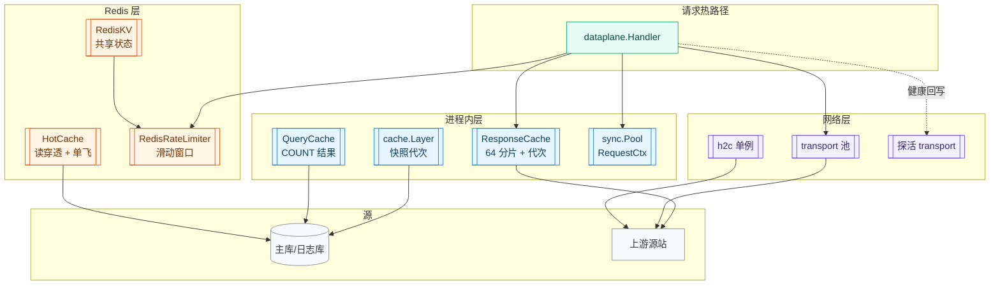
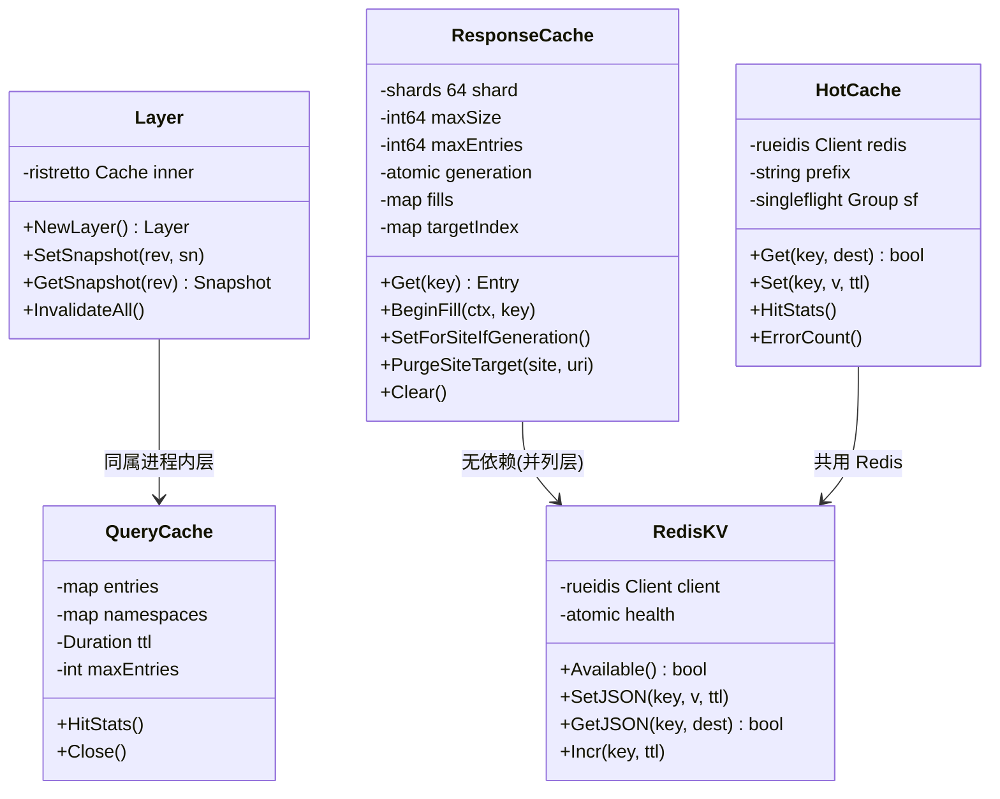
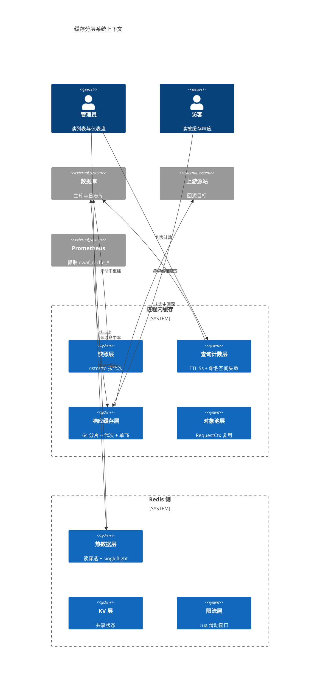
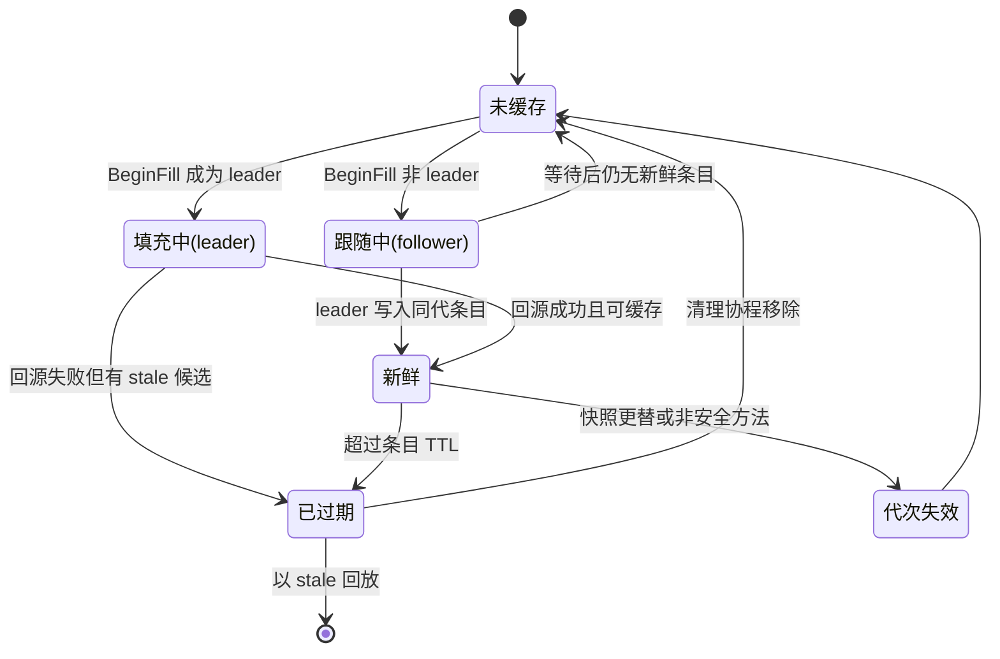
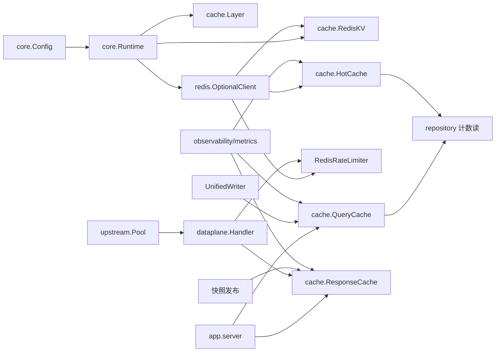

# 缓存与性能优化

> [返回 系统架构设计](系统架构设计.md)

<cite>
**本文档引用的文件**
- [internal/cache/layer.go](file://internal/cache/layer.go)
- [internal/cache/response_cache.go](file://internal/cache/response_cache.go)
- [internal/cache/query_cache.go](file://internal/cache/query_cache.go)
- [internal/cache/hot_cache.go](file://internal/cache/hot_cache.go)
- [internal/cache/redis_kv.go](file://internal/cache/redis_kv.go)
- [internal/core/redis/redis.go](file://internal/core/redis/redis.go)
- [internal/core/redis/pubsub.go](file://internal/core/redis/pubsub.go)
- [internal/core/runtime.go](file://internal/core/runtime.go)
- [internal/core/pipeline/pool.go](file://internal/core/pipeline/pool.go)
- [internal/core/engine/engine.go](file://internal/core/engine/engine.go)
- [internal/waf/ratelimit/redis.go](file://internal/waf/ratelimit/redis.go)
- [internal/waf/ratelimit/dynamic.go](file://internal/waf/ratelimit/dynamic.go)
- [internal/app/server.go](file://internal/app/server.go)
- [internal/dataplane/handler.go](file://internal/dataplane/handler.go)
- [internal/observability/metrics.go](file://internal/observability/metrics.go)
- [internal/proxy/transport/transport.go](file://internal/proxy/transport/transport.go)
- [internal/upstream/health.go](file://internal/upstream/health.go)
- [internal/pkg/memreclaim/memreclaim.go](file://internal/pkg/memreclaim/memreclaim.go)
</cite>

## 目录

1. [简介](#简介)
2. [项目结构](#项目结构)
3. [核心组件](#核心组件)
4. [架构总览](#架构总览)
5. [详细组件分析](#详细组件分析)
6. [依赖关系分析](#依赖关系分析)
7. [性能考虑](#性能考虑)
8. [故障排查指南](#故障排查指南)
9. [结论](#结论)
10. [附录](#附录)

## 简介
本文件系统性阐述 My-OpenWaf 的缓存与性能优化实践。系统的缓存不是一个统一层，而是**五个各自独立、失效条件完全不同的层**：进程内快照层、查询计数层、Redis 热数据层、边缘响应缓存层、上游连接池层。本篇按层给出取值、键设计、失效策略与可观测口径。

**划界**：快照本身的构建时机与发布语义见 [快照机制](快照机制.md)；引擎内部两级（规则编译 / 阶段链）缓存的判据见 [快照系统](../WAF 引擎系统/引擎核心架构/快照系统.md)；响应缓存在请求链路上的分支位置见 [数据流分析](数据流分析.md)。

## 项目结构
`internal/cache` 共 1885 行，按层切分为五个文件，加上装配点与观测出口。

| 层 | 文件 | 行数 | 存储位置 | 键 |
|---|---|---:|---|---|
| 快照层 | `cache/layer.go` | 70 | 进程内 ristretto | `snapshot:{rev}` |
| 查询计数层 | `cache/query_cache.go` | 265 | 进程内 map + TTL | 查询条件拼接 |
| 热数据层 | `cache/hot_cache.go` | 367 | Redis | `openwaf:hot:{key}` |
| 响应缓存层 | `cache/response_cache.go` | 782 | 进程内 64 分片 | SHA-256 摘要 |
| 分布式 KV 层 | `cache/redis_kv.go` | 401 | Redis | `openwaf:{key}` |
| 装配点 | `app/server.go` | — | — | `server.go:317-364` |
| 观测出口 | `observability/metrics.go` | — | — | `owaf_cache_*{cache}` |

**图表来源**
- [internal/cache/layer.go:24-62](file://internal/cache/layer.go#L24-L62)
- [internal/cache/query_cache.go:11-55](file://internal/cache/query_cache.go#L11-L55)
- [internal/cache/response_cache.go:49-122](file://internal/cache/response_cache.go#L49-L122)
- [internal/cache/hot_cache.go:16-51](file://internal/cache/hot_cache.go#L16-L51)
- [internal/cache/redis_kv.go:14-40](file://internal/cache/redis_kv.go#L14-L40)
- [internal/waf/ratelimit/redis.go:22-134](file://internal/waf/ratelimit/redis.go#L22-L134)
- [internal/core/pipeline/pool.go:11-38](file://internal/core/pipeline/pool.go#L11-L38)
- [internal/proxy/transport/transport.go:154-178](file://internal/proxy/transport/transport.go#L154-L178)
- [internal/app/server.go:317-364](file://internal/app/server.go#L317-L364)

**章节来源**
- [internal/app/server.go:317-364](file://internal/app/server.go#L317-L364)
- [internal/cache/layer.go:1-70](file://internal/cache/layer.go#L1-L70)

## 核心组件

| 组件 | 类型 | 容量口径 | 并发模型 | 缺省可用性 |
|---|---|---|---|---|
| `cache.Layer` | ristretto 封装 | `MaxCost 1 MiB`、`NumCounters 1e4`、`BufferItems 64` | 库内并发安全 | 始终存在 |
| `QueryCache` | map + TTL | 上限 8192 条、键 ≤64 KiB | `sync.RWMutex` | 始终存在 |
| `HotCache` | Redis 读穿透 | 无本地容量 | 读写锁 + 熔断时间戳 | Redis 为 nil 时空操作 |
| `ResponseCache` | 64 分片 map | 默认 64 MiB、条目上限 `容量/1024`、单条 ≤ 容量/10 | 分片 `RWMutex` + 代次 | 始终存在，可开关 |
| `RedisKV` | Redis 封装 | 单次操作 1 秒超时 | 读写锁 + 健康位 | Redis 为 nil 时不可用 |
| `RedisRateLimiter` | Lua 滑动窗口 | 窗口与阈值由 `Protection` 注入 | Lua 原子执行 | 无 Redis 时回落本地 |
| `transport` 池 | `*http.Transport` 复用 | 按上游 TLS 键缓存 | 读写锁 | 始终存在 |

**图表来源**
- [internal/cache/layer.go:24-70](file://internal/cache/layer.go#L24-L70)
- [internal/cache/query_cache.go:25-55](file://internal/cache/query_cache.go#L25-L55)
- [internal/cache/hot_cache.go:16-51](file://internal/cache/hot_cache.go#L16-L51)
- [internal/cache/response_cache.go:49-122](file://internal/cache/response_cache.go#L49-L122)
- [internal/cache/redis_kv.go:28-40](file://internal/cache/redis_kv.go#L28-L40)

**章节来源**
- [internal/cache/layer.go:19-70](file://internal/cache/layer.go#L19-L70)
- [internal/cache/response_cache.go:49-122](file://internal/cache/response_cache.go#L49-L122)
- [internal/cache/hot_cache.go:16-51](file://internal/cache/hot_cache.go#L16-L51)

## 架构总览
分层的依据不是「快与慢」，而是**失效触发者是谁**：快照层由配置写入失效，查询层由日志落库失效，响应层由快照发布与非安全方法失效，连接池由端点集合变化失效。把失效触发者不同的东西放进同一个缓存，是这类系统最常见的正确性问题来源。

| 层 | 架构位置 | 失效触发者 | 一致性口径 |
|---|---|---|---|
| 快照层 | 装配层 | `Runtime.ReloadSnapshotWithPrePublish` | 按代次强一致 |
| 查询计数层 | 控制面读路径 | `UnifiedWriter` 落库后 | 弱（5 秒窗口） |
| 热数据层 | 控制面读路径 | TTL + Redis 故障熔断 | 弱 |
| 响应缓存层 | 数据面出口 | 快照更替、非安全方法、TTL | 代次 + 目标索引 |
| 连接池层 | 转发层 | 上游端点集合变化、空闲超时 | 尽力复用 |

| 外部实体 | 参与哪些层 | 交互 |
|---|---|---|
| Redis | 热数据、KV、限流 | 1 秒/次操作超时，故障 5 秒退避 |
| 主库 | 快照、查询计数、热数据回源 | 事务批量读 |
| 日志库 | 查询计数失效 | 写入方触发失效 |
| 上游源站 | 响应缓存回源、连接池 | 探活与标记 |
| Prometheus | 全部层的命中率 | `/metrics` 三族指标 |
| 管理端 | 查询计数、热数据 | 仪表盘与列表页 |

**图表来源**
- [internal/cache/layer.go:29-51](file://internal/cache/layer.go#L29-L51)
- [internal/cache/query_cache.go:11-55](file://internal/cache/query_cache.go#L11-L55)
- [internal/cache/response_cache.go:49-122](file://internal/cache/response_cache.go#L49-L122)
- [internal/cache/hot_cache.go:16-51](file://internal/cache/hot_cache.go#L16-L51)
- [internal/app/server.go:550-561](file://internal/app/server.go#L550-L561)

**章节来源**
- [internal/app/server.go:317-364](file://internal/app/server.go#L317-L364)
- [internal/observability/metrics.go:532-550](file://internal/observability/metrics.go#L532-L550)

## 详细组件分析

### 缓存层级与失效策略
本表是本文档的验收核心：**每一层的失效都必须能指到具体代码**。

| 层 | 键 | TTL/容量 | 失效动作 | 触发点 |
|---|---|---|---|---|
| 快照层 | `snapshot:{rev}` | 1 MiB MaxCost | 不主动失效，靠代次自然过期淘汰 | `Layer.InvalidateAll` 供手工清空 |
| 查询计数层 | 查询条件拼接（含命名空间前缀） | 5 秒、8192 条 | 按命名空间批量失效 | `UnifiedWriter.SetCountCacheInvalidator` |
| 热数据层 | `openwaf:hot:{key}` | 调用方给定 | TTL 到期；Redis 故障时 5 秒熔断 | `HotCache` 熔断时间戳 |
| 响应缓存层 | SHA-256(method/host/path/query 或含 bind+siteID) | 条目 TTL；60 秒后台清理 | 快照更替整体 `Clear`；非安全方法按「站点+路径」精准清 | `server.go:881`、`handler.go:1219-1220` |
| 响应缓存层（代次） | — | `generation` 计数 | 写回时校验代次，不符即丢弃 | `SetForSiteIfGeneration` |
| 限流层 | `{prefix}:{key}` sorted set | 窗口秒数 | Lua 内裁剪过期成员 | 每次 `Allow` |
| KV 层 | `openwaf:{key}` | 调用方给定 | TTL；故障 5 秒退避 | `RedisKV` |
| 连接池层 | 上游 TLS 键 | `MaxConnsPerHost 256` | 端点集合变化时修剪与关闭空闲 | `Prune/Close…UpstreamTransports` |
| 对象池层 | — | 头 map ≤128、键切片 ≤64 | 超上限的对象在归还时丢弃 | `ReleaseCtx` |

**章节来源**
- [internal/cache/layer.go:29-51](file://internal/cache/layer.go#L29-L51)
- [internal/cache/query_cache.go:15-70](file://internal/cache/query_cache.go#L15-L70)
- [internal/cache/hot_cache.go:36-38](file://internal/cache/hot_cache.go#L36-L38)
- [internal/cache/response_cache.go:87-130](file://internal/cache/response_cache.go#L87-L130)
- [internal/cache/redis_kv.go:14-25](file://internal/cache/redis_kv.go#L14-L25)
- [internal/waf/ratelimit/redis.go:77-134](file://internal/waf/ratelimit/redis.go#L77-L134)
- [internal/proxy/transport/transport.go:157-172](file://internal/proxy/transport/transport.go#L157-L172)
- [internal/core/pipeline/pool.go:11-45](file://internal/core/pipeline/pool.go#L11-L45)
- [internal/app/server.go:349-349](file://internal/app/server.go#L349-L349)
- [internal/app/server.go:879-895](file://internal/app/server.go#L879-L895)
- [internal/dataplane/handler.go:1219-1220](file://internal/dataplane/handler.go#L1219-L1220)

### 快照层：ristretto 参数属于这里
`cache.Layer` 是全系统唯一使用 ristretto 的地方，参数固定为 `NumCounters 1e4 / MaxCost 1<<20 / BufferItems 64`（layer.go:30-34）。写入固定 `cost=1` 并在 `Set` 后调用 `Wait()`，确保同一次 reload 内后续读取可见（layer.go:44-51）。

该层的语义边界值得强调：**它缓存的是内存对象指针，不是序列化结果**。包注释明确写了这个判断——把 `Snapshot` 序列化到 Redis 纯属浪费，跨节点同步走 Pub/Sub 触发各自的数据库重载（layer.go:1-8）。

**章节来源**
- [internal/cache/layer.go:1-70](file://internal/cache/layer.go#L1-L70)

### 响应缓存：分片、代次与单飞
`ResponseCache` 用三个机制同时解决三个不同问题：

| 机制 | 解决的问题 | 实现 |
|---|---|---|
| 64 分片 `RWMutex` | 热点键锁竞争 | `shards [64]shard`（response_cache.go:55、82-85） |
| `generation` 计数 | 并发失效后回放旧内容 | 读取时记录代次，写回/回退时重查（:360、409、304） |
| `fills` 单飞表 | 同 key 并发回源放大 | `BeginFill` 返回 leader 与 `release`（:578） |
| `targetIndex` | 非安全方法只需精准失效 | 「站点+路径」→ 键集合（:75-77、617） |

容量口径：默认 64 MiB、默认 TTL 60 秒（response_cache.go:87-88、96-101），条目上限 `maxSize/1024`，单条响应体上限 `maxSize/10`（:104-106、125-130）。后台清理周期 60 秒（:740-741）。构造函数对零值/负值参数按文档默认值兜底，避免建出容量为 0 的缓存（:92-101）。

**图表来源**
- [internal/cache/response_cache.go:304-409](file://internal/cache/response_cache.go#L304-L409)
- [internal/cache/response_cache.go:578-620](file://internal/cache/response_cache.go#L578-L620)
- [internal/cache/response_cache.go:699-745](file://internal/cache/response_cache.go#L699-L745)
- [internal/dataplane/handler.go:1152-1211](file://internal/dataplane/handler.go#L1152-L1211)

**章节来源**
- [internal/cache/response_cache.go:49-130](file://internal/cache/response_cache.go#L49-L130)
- [internal/cache/response_cache.go:304-620](file://internal/cache/response_cache.go#L304-L620)
- [internal/dataplane/handler.go:1141-1222](file://internal/dataplane/handler.go#L1141-L1222)

### 查询计数层：容量上限是被动的安全边界
`QueryCache` 的键由查询过滤条件拼成，其中包含 Host、Path、QueryString、TLS 指纹等**用户可控字段**，基数可被外部请求放大。因此该层强制三项约束：TTL 5 秒、条目上限 8192、单键 ≤64 KiB（query_cache.go:15-17）。写入时若已达上限先内联清理过期项，仍满则**跳过写入**，降级为直查数据库（query_cache.go:57-62）。清理协程周期是 `ttl*2`（:244）。

失效走命名空间：从键中按冒号或竖线提取前缀作为命名空间，落库后按命名空间批量失效，避免全表扫描（query_cache.go:63-70）。装配点见 `queryCache := cache.NewQueryCache(5 * time.Second)`（server.go:317）与 `unifiedWriter.SetCountCacheInvalidator(queryCache)`（server.go:349）。

**章节来源**
- [internal/cache/query_cache.go:11-70](file://internal/cache/query_cache.go#L11-L70)
- [internal/cache/query_cache.go:244-244](file://internal/cache/query_cache.go#L244-L244)
- [internal/app/server.go:317-349](file://internal/app/server.go#L317-L349)

### 热数据层：把「未命中」和「依赖不可用」分开计
`HotCache` 是 Redis 支撑的读穿透缓存，`singleflight` 合并同键并发回源以防击穿（hot_cache.go:22-23）。它最值得注意的设计是**三套计数器**：hits、misses、errs 分开，因为若把 Redis 故障也计入 misses，整体故障时命中率会显示为 0%，看起来像缓存未生效而非依赖不可用，排障方向会被引偏（:24-33）。

`unavailableUntil` 提供 5 秒软熔断：故障后短暂不再等待 Redis 超时，直接回源（:34-38、64-73）。Redis 客户端可在运行时被替换（`SetRedis`），替换同时清零熔断与限频标志（:64-73）。

**章节来源**
- [internal/cache/hot_cache.go:16-100](file://internal/cache/hot_cache.go#L16-L100)
- [internal/app/server.go:323-325](file://internal/app/server.go#L323-L325)

### Redis 装配与降级
`OptionalClient` 在地址为空时直接返回 nil（redis.go:17-20），拨号超时 5 秒、写超时 3 秒、`DisableCache: true`（:21-28）。`NewRuntime` 随后 `Ping`，失败时关闭客户端并把 `rcli` 置 nil，仅当配置了地址才告警（runtime.go:99-116）。这意味着**所有 Redis 层都必须能在 nil 客户端下工作**：`RedisKV.Available()`、`HotCache.Available()`、`NewConfigSync` 返回 nil 都属该约定。

`RedisKV` 每个操作独立 1 秒超时（redis_kv.go:100-215），自增用 Lua 保证「INCR + 首次设 EXPIRE」原子（:19-25、182-196）。

**章节来源**
- [internal/core/redis/redis.go:12-40](file://internal/core/redis/redis.go#L12-L40)
- [internal/core/runtime.go:99-131](file://internal/core/runtime.go#L99-L131)
- [internal/cache/redis_kv.go:14-40](file://internal/cache/redis_kv.go#L14-L40)
- [internal/cache/redis_kv.go:100-196](file://internal/cache/redis_kv.go#L100-L196)

### 限流层：滑动窗口与重配置
`RedisRateLimiter` 用 sorted set + Lua 实现窗口内计数（redis.go:77-113），`Allow` 以 `now/window/limit` 三参执行（:115-134）。上层 `DynamicRateLimiter` 每次调用读取当前后端，使 reload 期间的重配置立即生效而无需替换对象（dynamic.go:12-51）。请求限流与错误率限流是两个独立实例，前缀分别为 `openwaf:request`、`openwaf:error`（server.go:383-384），并在 `applyProtectionRuntimeConfig` 中按快照参数重配（server.go:638-639）。

**章节来源**
- [internal/waf/ratelimit/redis.go:22-134](file://internal/waf/ratelimit/redis.go#L22-L134)
- [internal/waf/ratelimit/dynamic.go:12-51](file://internal/waf/ratelimit/dynamic.go#L12-L51)
- [internal/app/server.go:383-384](file://internal/app/server.go#L383-L384)
- [internal/app/server.go:637-642](file://internal/app/server.go#L637-L642)

### 对象池与内存回收
`RequestCtx` 池预分配 32 容量的头 map、24 容量的键切片与 4 容量的 observe 缓冲（pool.go:19-27）。归还时按上限判定：**超过** `maxPooledHeaderMapLen 128` / `maxPooledHeaderKeysCap 64` / `maxPooledObserveHitsCap 32` 的对象不回到池里，避免高并发偶发大请求把常驻内存永久抬高、峰值后 RSS 不回落（pool.go:11-17）。

进程级另有 `memreclaim.Start`，在峰值后周期性把空闲 heap 归还操作系统（server.go:363-365）。

**章节来源**
- [internal/core/pipeline/pool.go:11-45](file://internal/core/pipeline/pool.go#L11-L45)
- [internal/app/server.go:363-365](file://internal/app/server.go#L363-L365)

### 连接池层：三类互不相同的取值
连接池常被当作「一个参数」，实际是三类，取值互不相同，混用会导致误判。

| 用途 | MaxIdleConns | PerHost | IdleConnTimeout | 其它 | 位置 |
|---|---:|---:|---:|---|---|
| 主上游 transport | 256 | 32 | 30 秒 | `MaxConnsPerHost 256`、读写缓冲各 16 KiB、`ExpectContinue 1s` | transport.go:157-164、172 |
| h2c 单例 | 512 | 128 | 90 秒 | 明文 HTTP/2 | transport.go:872-874 |
| 探活 transport | 128 | 32 | 探活专用常量 | `MaxConnsPerHost` 取探活常量 | health.go:666-676 |

reload 时若上游端点集合变化，会显式关闭空闲连接并修剪不再活跃的池对象（server.go:890-895）。

**章节来源**
- [internal/proxy/transport/transport.go:154-178](file://internal/proxy/transport/transport.go#L154-L178)
- [internal/proxy/transport/transport.go:863-882](file://internal/proxy/transport/transport.go#L863-L882)
- [internal/upstream/health.go:662-677](file://internal/upstream/health.go#L662-L677)
- [internal/app/server.go:888-896](file://internal/app/server.go#L888-L896)

### 指标与调参
命中率通过 `owaf_cache_{hits,misses,errors}_total{cache="..."}` 三族暴露，标签取值固定为 `query`、`hot`、`response` 三层（server.go:550-561、metrics.go:532-550）。`hot` 层额外带 `errors`，用于区分「未命中」与「依赖不可用导致穿透」（server.go:556-558）。

注意两处旧文档的误述需要纠正：`openwaf_requests_total`、`blocks_total`、`observes_total`、`upstream_errors_total` 这些指标名已不存在；而「规则缓存有 LRU/MaxCost」也不成立——规则编译与阶段链缓存是整体替换的不可变 map，没有淘汰策略（engine.go:96-127、532-545），ristretto 参数只属于快照层。

**章节来源**
- [internal/observability/metrics.go:532-550](file://internal/observability/metrics.go#L532-L550)
- [internal/app/server.go:549-561](file://internal/app/server.go#L549-L561)
- [internal/core/engine/engine.go:96-127](file://internal/core/engine/engine.go#L96-L127)

## 依赖关系分析

| 依赖 | 方向 | 若缺失 |
|---|---|---|
| `repository → QueryCache` | 控制面读 | 每次直查数据库，`COUNT` 放大 |
| `repository → HotCache` | 控制面读 | 无 Redis 时空操作，功能不变 |
| `UnifiedWriter → QueryCache` | 失效通知 | 计数在 TTL 内偏旧 |
| `Handler → ResponseCache` | 数据面 | 缓存键为空，全量回源 |
| `快照发布 → ResponseCache.Clear` | 一致性 | 新配置下仍回放旧响应 |
| `metrics → 三层 HitStats` | 观测 | 命中率不可见 |

**图表来源**
- [internal/app/server.go:317-364](file://internal/app/server.go#L317-L364)
- [internal/app/server.go:549-561](file://internal/app/server.go#L549-L561)
- [internal/core/runtime.go:118-141](file://internal/core/runtime.go#L118-L141)
- [internal/dataplane/handler.go:1141-1160](file://internal/dataplane/handler.go#L1141-L1160)

**章节来源**
- [internal/app/server.go:317-364](file://internal/app/server.go#L317-L364)
- [internal/core/runtime.go:118-141](file://internal/core/runtime.go#L118-L141)

## 性能考虑
- 读路径分配集中在池化与快路径：`NormalizeMatchHost` 对规范 Host 零分配，`CacheKey` 用 512 字节栈缓冲避免拼接分配（response_cache.go:133-151）。
- 锁竞争按层收敛：响应缓存靠分片、快照层靠原子指针、查询层用读写锁并保证读多写少的短临界区。
- 内存上界可算：响应缓存受 `maxSize` 与 `maxEntries` 双限；查询缓存受 8192 上限；对象池受三项容量阈值；快照层受 1 MiB MaxCost。
- 网络复用优先于新建：主 transport 的空闲连接数与每主机上限按「省内存」取向定为 256/32（transport.go:155-161 的注释记录了这一取舍）。
- 调参顺序建议：先看 `owaf_cache_*` 判断哪层在漏，再看该层的失效触发者是否符合预期，最后才调容量与 TTL。

**章节来源**
- [internal/cache/response_cache.go:132-151](file://internal/cache/response_cache.go#L132-L151)
- [internal/proxy/transport/transport.go:154-178](file://internal/proxy/transport/transport.go#L154-L178)
- [internal/observability/metrics.go:532-550](file://internal/observability/metrics.go#L532-L550)

## 故障排查指南

| 症状 | 可能原因 | 验证 | 位置 |
|---|---|---|---|
| `owaf_cache_{cache="hot"}` 的 errors 增长 | Redis 不可达或超时 | 看是否伴随 5 秒熔断窗口内的直接回源 | hot_cache.go:34-38 |
| 命中率长期为 0 | 键不稳定（Host/Query 每次都变） | 抽样打印键构成 | response_cache.go:132-151 |
| 响应内容回退到旧版本 | 快照更替后未清缓存 | 确认指针比较分支执行 | server.go:879-882 |
| 新配置下仍返回旧页 | 命中了 stale 条目 | 检查 `IsStaleWithin` 与 `stale_if_error` | response_cache.go:42-48 |
| 计数长期偏旧 | 写入器未挂失效器 | 检查 `SetCountCacheInvalidator` | server.go:349 |
| 计数缓存频繁为 0 | 键基数被外部放大触发上限 | 观察是否常态跳过写入 | query_cache.go:11-17、57-62 |
| RSS 峰值后不回落 | 池对象或空闲连接驻留 | 确认 memreclaim 与 transport 修剪日志 | pool.go:11-17、server.go:890-895 |
| 限流突然全放行 | Redis 异常时按宽松策略处理 | 核对后端类型与 errors 计数 | redis.go:115-134 |
| 上游连接打满 | `MaxConnsPerHost 256` 触顶 | 看临时端口与 504 分布 | transport.go:172 |

**章节来源**
- [internal/cache/hot_cache.go:16-100](file://internal/cache/hot_cache.go#L16-L100)
- [internal/cache/query_cache.go:11-62](file://internal/cache/query_cache.go#L11-L62)
- [internal/cache/response_cache.go:42-151](file://internal/cache/response_cache.go#L42-L151)
- [internal/app/server.go:349-349](file://internal/app/server.go#L349-L349)
- [internal/app/server.go:879-895](file://internal/app/server.go#L879-L895)

## 结论
系统的缓存设计有一条贯穿原则：**按失效触发者分层，而不是按数据类型分层**。快照层按代次、查询层按落库、响应层按快照更替与非安全方法、连接池按端点集合——每层都只对自己的失效者负责，跨层一致性靠「代次」与「指针比较」这两个廉价手段衔接。所有层都能在 Redis 缺席时降级，因此单机部署不丢功能，只丢跨节点共享状态。

## 附录

### 参数速查

| 参数 | 默认值 | 位置 |
|---|---|---|
| ristretto NumCounters | 10000 | layer.go:31 |
| ristretto MaxCost | 1 MiB | layer.go:32 |
| ristretto BufferItems | 64 | layer.go:33 |
| 响应缓存容量 | 64 MiB | response_cache.go:87 |
| 响应缓存默认 TTL | 60 秒 | response_cache.go:88 |
| 响应缓存条目上限 | `容量/1024` | response_cache.go:104-106 |
| 响应缓存单条上限 | `容量/10` | response_cache.go:125-130 |
| 响应缓存清理周期 | 60 秒 | response_cache.go:740-741 |
| 查询缓存 TTL | 5 秒 | query_cache.go:16、server.go:317 |
| 查询缓存条目上限 | 8192 | query_cache.go:15 |
| 查询缓存键上限 | 64 KiB | query_cache.go:17 |
| 热缓存前缀 | `openwaf:hot:` | hot_cache.go:37 |
| 缓存故障退避 | 5 秒 | hot_cache.go:38、redis_kv.go:16 |
| RedisKV 单次操作超时 | 1 秒 | redis_kv.go:101 |
| Redis 拨号/写超时 | 5 秒 / 3 秒 | redis.go:25-26 |
| 主 transport 空闲参数 | 256 / 32 / 30s | transport.go:157-161 |
| h2c transport 参数 | 512 / 128 / 90s | transport.go:872-874 |
| 请求体扫描上限 | 48 KiB | handler.go:377 |

**章节来源**
- [internal/cache/layer.go:29-34](file://internal/cache/layer.go#L29-L34)
- [internal/cache/response_cache.go:87-130](file://internal/cache/response_cache.go#L87-L130)
- [internal/cache/query_cache.go:15-17](file://internal/cache/query_cache.go#L15-L17)
- [internal/cache/hot_cache.go:36-38](file://internal/cache/hot_cache.go#L36-L38)
- [internal/cache/redis_kv.go:14-17](file://internal/cache/redis_kv.go#L14-L17)
- [internal/core/redis/redis.go:21-28](file://internal/core/redis/redis.go#L21-L28)
- [internal/proxy/transport/transport.go:154-178](file://internal/proxy/transport/transport.go#L154-L178)
- [internal/dataplane/handler.go:377-377](file://internal/dataplane/handler.go#L377-L377)

### 不属于缓存但常被误认为缓存的两处

| 对象 | 实际形态 | 为何不算缓存 |
|---|---|---|
| 规则编译 / 阶段链 | 按代次整体替换的不可变 map | 无淘汰、无 TTL、无命中率统计 |
| `upstream.Pool` 健康态 | 进程内实时状态 | 它是探测结果而非可回源数据，不随配置失效 |

引擎两级缓存的判据细节见 [快照系统](../WAF 引擎系统/引擎核心架构/快照系统.md)。

**章节来源**
- [internal/core/engine/engine.go:96-127](file://internal/core/engine/engine.go#L96-L127)
- [internal/core/engine/engine.go:441-545](file://internal/core/engine/engine.go#L441-L545)
- [internal/upstream/health.go:215-219](file://internal/upstream/health.go#L215-L219)
