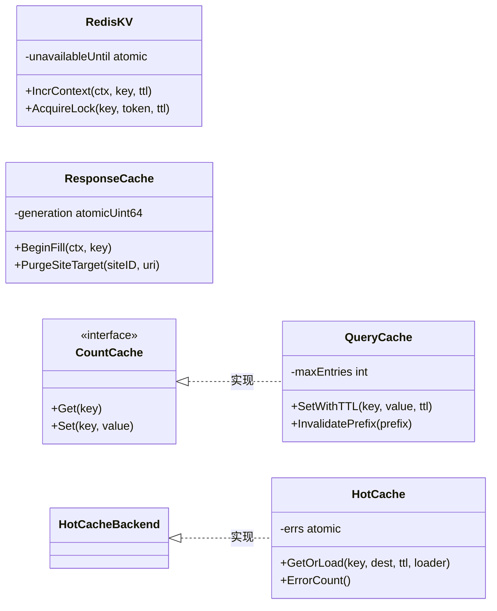
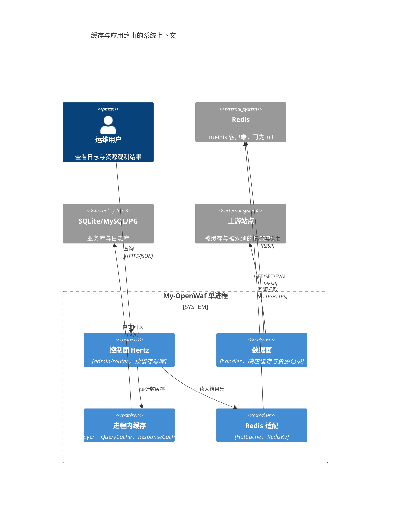
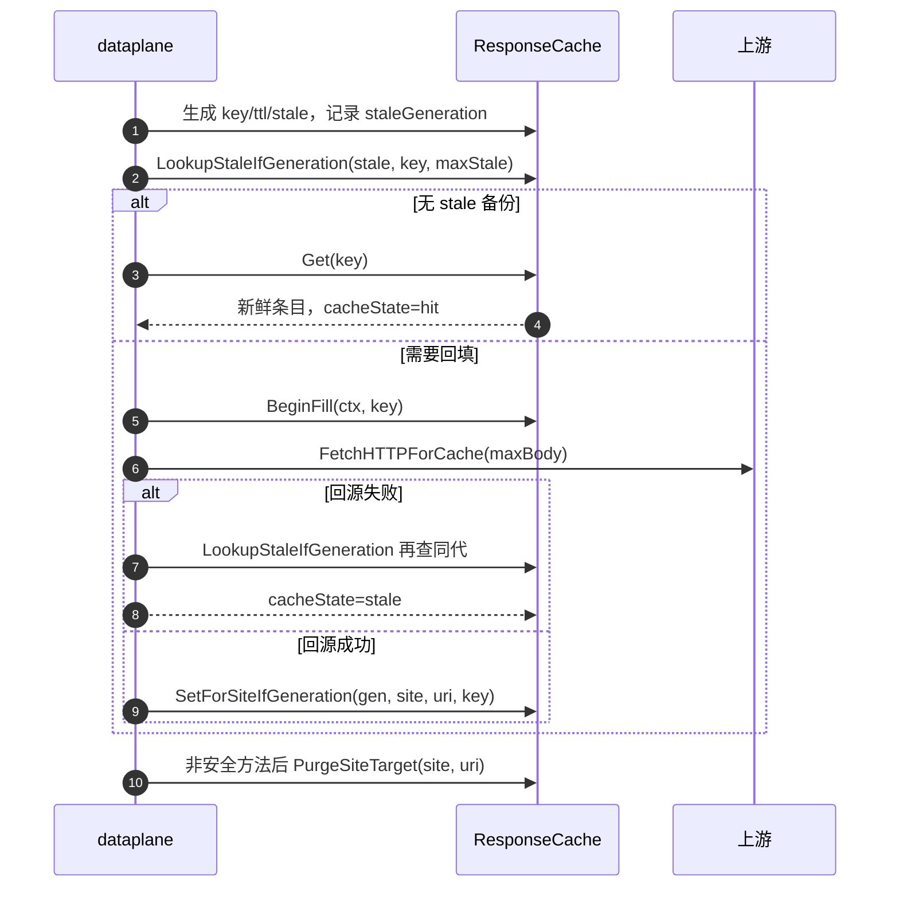
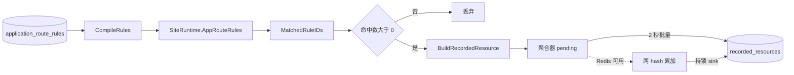
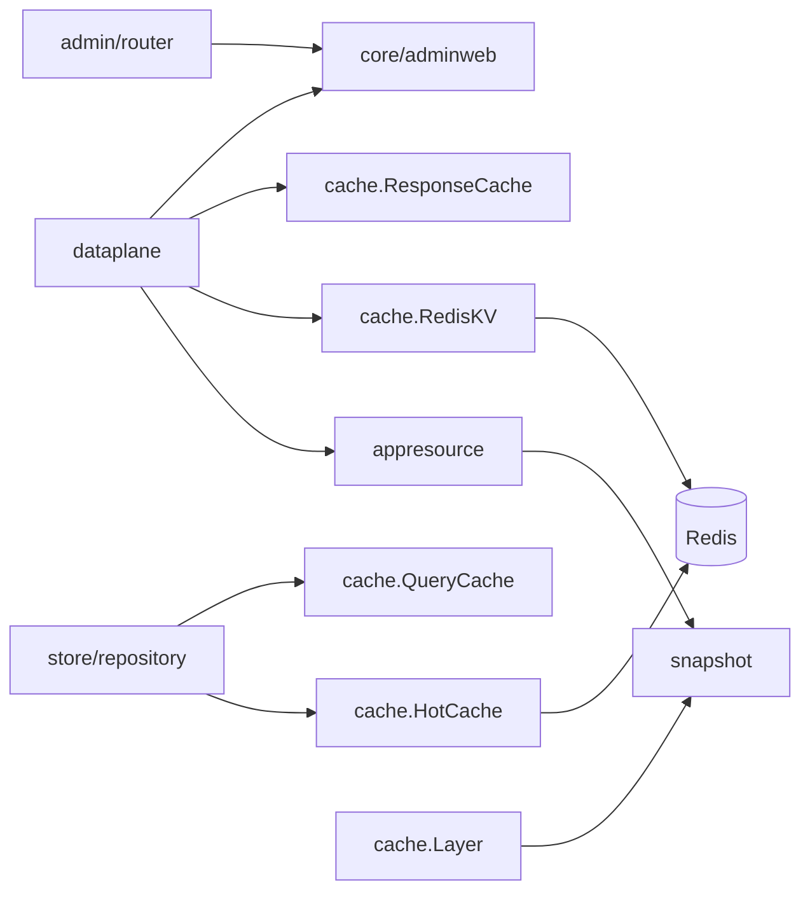
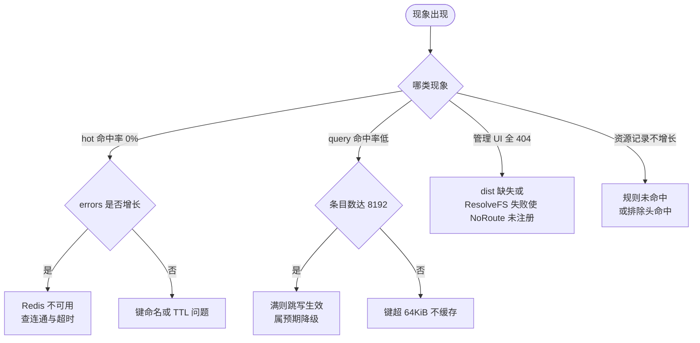

# 缓存与应用路由

> [返回 运行时与内置资源](运行时与内置资源.md) · [返回 系统架构设计](../系统架构设计.md)

<cite>
**本文档引用的文件**
- [internal/cache/layer.go](file://internal/cache/layer.go)
- [internal/cache/query_cache.go](file://internal/cache/query_cache.go)
- [internal/cache/hot_cache.go](file://internal/cache/hot_cache.go)
- [internal/cache/response_cache.go](file://internal/cache/response_cache.go)
- [internal/cache/redis_kv.go](file://internal/cache/redis_kv.go)
- [internal/appresource/compile.go](file://internal/appresource/compile.go)
- [internal/appresource/match.go](file://internal/appresource/match.go)
- [internal/appresource/material.go](file://internal/appresource/material.go)
- [internal/appresource/record.go](file://internal/appresource/record.go)
- [internal/appresource/sanitize.go](file://internal/appresource/sanitize.go)
- [internal/core/adminweb/embed.go](file://internal/core/adminweb/embed.go)
- [internal/core/adminweb/static.go](file://internal/core/adminweb/static.go)
- [internal/store/approute/app_route.go](file://internal/store/approute/app_route.go)
- [internal/store/repository/count_cache.go](file://internal/store/repository/count_cache.go)
- [internal/store/repository/repository.go](file://internal/store/repository/repository.go)
- [internal/observability/unified_writer.go](file://internal/observability/unified_writer.go)
- [internal/observability/metrics.go](file://internal/observability/metrics.go)
- [internal/snapshot/snapshot.go](file://internal/snapshot/snapshot.go)
- [internal/snapshot/build.go](file://internal/snapshot/build.go)
- [internal/core/runtime.go](file://internal/core/runtime.go)
- [internal/core/redis/pubsub.go](file://internal/core/redis/pubsub.go)
- [internal/core/config.go](file://internal/core/config.go)
- [internal/app/server.go](file://internal/app/server.go)
- [internal/admin/router.go](file://internal/admin/router.go)
- [internal/dataplane/handler.go](file://internal/dataplane/handler.go)
- [internal/dataplane/handler_support.go](file://internal/dataplane/handler_support.go)
- [internal/dataplane/resource_aggregator.go](file://internal/dataplane/resource_aggregator.go)
- [internal/dataplane/endpoints.go](file://internal/dataplane/endpoints.go)
- [internal/waf/antireplay/antireplay.go](file://internal/waf/antireplay/antireplay.go)
- [internal/waf/luaplugin/api.go](file://internal/waf/luaplugin/api.go)
- [internal/waf/pages/block.go](file://internal/waf/pages/block.go)
- [.gitignore](file://.gitignore)
- [.dockerignore](file://.dockerignore)
- [README.md](file://README.md)
</cite>

## 目录

1. [简介](#简介)
2. [项目结构](#项目结构)
3. [核心组件](#核心组件)
4. [架构总览](#架构总览)
5. [详细组件分析](#详细组件分析)
6. [依赖关系分析](#依赖关系分析)
7. [性能考虑](#性能考虑)
8. [故障排查指南](#故障排查指南)
9. [结论](#结论)
10. [附录](#附录)

## 简介

本篇是「运行时与内置资源」子域的**三级实现文档**，逐个展开三个代码集合：`internal/cache`
（1885 行，五套缓存实现）、`internal/appresource`（734 行，应用路由观测）、
`internal/core/adminweb`（173 行，内嵌管理端资源）。子域整体定位与选型结论见
[运行时与内置资源](运行时与内置资源.md)，本篇只讲接口、装配点与真实取值。

### 三者同篇的理由与划界

三者共同回答同一个问题：**一次 HTTP 交换里哪些数据可以复用、哪些必须现算**。
`cache` 覆盖「进程内不可变快照 / 进程内有界 TTL / 进程内分片响应体 / Redis 读穿透 /
Redis 分布式 KV」五种形态；`appresource` 把观测规则编译进快照并在数据面聚合落库；
`adminweb` 把 Next.js 导出产物内嵌进单二进制。三者互不依赖：`appresource` 不引用 `cache`，
`adminweb` 不引用任何缓存实现，只共享「有界、降级、不阻塞主链路」这一套约束。

快照重载与引擎阶段链在此只作为调用位置出现：主流程见 [数据流分析](../数据流分析.md)，
发布语义见 [快照机制](../快照机制.md)，跨层性能综述见 [缓存与性能优化](../缓存与性能优化.md)。
**章节来源**
- [internal/cache/layer.go:1-8](file://internal/cache/layer.go#L1-L8)
- [internal/appresource/compile.go:1-12](file://internal/appresource/compile.go#L1-L12)
- [internal/core/adminweb/embed.go:1-13](file://internal/core/adminweb/embed.go#L1-L13)

## 项目结构

### 目录与文件分布

```text
internal/
├── cache/                    五套缓存实现，1885 行
│   ├── layer.go              进程内快照缓存（ristretto）
│   ├── query_cache.go        进程内有界 TTL（COUNT / 列表投影）
│   ├── hot_cache.go          Redis 读穿透 + singleflight
│   ├── redis_kv.go           Redis 分布式 KV + Lua 脚本
│   └── response_cache.go     分片响应体缓存 + 陈旧兜底
├── appresource/              应用路由观测，734 行
│   ├── compile.go / match.go 规则编译排序、目标求值与命中集合
│   ├── material.go / record.go 字段提取与落库记录构造
│   └── sanitize.go           脱敏与截断
└── core/adminweb/            内嵌管理端资源，173 行
    ├── embed.go              //go:embed all:dist 与 SubFS
    └── static.go             FS 解析、路由候选、Content-Type
```

按「状态放在哪里、失效由谁触发」划分，五套实现分属三种形态：进程内（`Layer` 靠代次覆盖、
`QueryCache` 靠 TTL 与命名空间、`ResponseCache` 靠 TTL 与 `generation`）、
Redis（`HotCache` 靠 TTL 与显式失效、`RedisKV` 靠 `PX` 与原子 `Drain`）、
编译期只读（`adminweb.Dist`，只能靠磁盘覆盖目录绕过）。

**章节来源**
- [internal/cache/layer.go:24-39](file://internal/cache/layer.go#L24-L39)
- [internal/appresource/compile.go:14-26](file://internal/appresource/compile.go#L14-L26)
- [internal/core/adminweb/embed.go:10-18](file://internal/core/adminweb/embed.go#L10-L18)

### 模块清单

| 包 | 文件 | 行数 | 核心符号 | 主要消费方 |
|---|---|---:|---|---|
| `cache` | `layer.go` | 70 | `Layer`、`NewLayer`、`SetSnapshot` | `internal/core` 运行时 |
| `cache` | `query_cache.go` | 265 | `QueryCache`、`storeLocked`、`InvalidatePrefix` | `store/repository`、`observability` |
| `cache` | `hot_cache.go` | 367 | `HotCache`、`GetOrLoad`、`GetListRaw`、`ErrorCount` | `store/repository` |
| `cache` | `redis_kv.go` | 401 | `RedisKV`、`Incr`、`HAgregateFlush`、`AcquireLock` | 限流、挑战、聚合器 |
| `cache` | `response_cache.go` | 782 | `ResponseCache`、`BeginFill`、`PurgeSiteTarget` | `internal/dataplane` |
| `appresource` | `compile.go`、`match.go` | 199 | `CompileRules`、`Subject`、`MatchedRuleIDs` | `snapshot`、`dataplane` |
| `appresource` | `material.go`、`record.go`、`sanitize.go` | 465 | `Material`、`BuildRecordedResource`、`sanitizeRecordedText` | `dataplane` |
| `adminweb` | `embed.go`、`static.go` | 173 | `Dist`、`ResolveFS`、`ReadRouteFile`、`ContentType` | `admin/router`、`dataplane`、`waf/pages` |

**章节来源**
- [internal/cache/query_cache.go:24-57](file://internal/cache/query_cache.go#L24-L57)
- [internal/core/adminweb/static.go:10-52](file://internal/core/adminweb/static.go#L10-L52)

## 核心组件

### 组件职责与装配

七个组件中只有 `Layer` 与 `adminweb` 不可缺省：前者是快照读取的唯一内存路径，
后者在编译期被 `embed` 固定。其余五个都可传 nil 或被关闭——`QueryCache` 抑制大表
`COUNT(*)`，`HotCache` 做大结果集跨进程共享，`RedisKV` 承载跨进程计数器与锁，
`ResponseCache` 复用上游 GET 响应，`appresource` 提供编译与观测能力（规则集为空时整条链路自然静默）。
`HotCache` 与 `QueryCache` 以**消费方侧小接口**注入仓储层（`HotCacheBackend`、`CountCache`），
因此 `store/repository` 不依赖 `internal/cache` 的具体类型；`NewHotCache(nil, log)` 与
`NewRedisKV(nil)` 都返回可用的空操作实例，调用方无需判空。

四个实例在 `app.Run` 第 11 步集中创建，`Layer` 例外，它在 `core.NewRuntime` 内创建：
`RedisKV`（`server.go:304-305`）→ `queryCache`（`:316-320`，注入三个日志仓储的 `SetCountCache`）
→ `hotCache`（`:322-324`，`repos.SetHotCache`）→ `responseCache`（`:361-362`，注入
`dataplane.Options`）；`unifiedWriter.SetCountCacheInvalidator(queryCache)` 在 `:349` 挂接失效器。

**章节来源**
- [internal/store/repository/repository.go:16-18](file://internal/store/repository/repository.go#L16-L18)
- [internal/app/server.go:301-362](file://internal/app/server.go#L301-L362)
- [internal/core/runtime.go:118-118](file://internal/core/runtime.go#L118-L118)

### 类型体系



**图表来源**
- [internal/cache/query_cache.go:24-41](file://internal/cache/query_cache.go#L24-L41)
- [internal/cache/hot_cache.go:16-53](file://internal/cache/hot_cache.go#L16-L53)
- [internal/cache/response_cache.go:57-85](file://internal/cache/response_cache.go#L57-L85)

**章节来源**
- [internal/cache/redis_kv.go:28-39](file://internal/cache/redis_kv.go#L28-L39)
- [internal/store/repository/repository.go:16-18](file://internal/store/repository/repository.go#L16-L18)

## 架构总览

### 系统上下文



**图表来源**
- [internal/app/server.go:301-362](file://internal/app/server.go#L301-L362)
- [internal/dataplane/handler.go:1140-1222](file://internal/dataplane/handler.go#L1140-L1222)

**章节来源**
- [internal/cache/redis_kv.go:234-401](file://internal/cache/redis_kv.go#L234-L401)

### 架构分层

自上而下分四层：**消费层**（`admin/router`、`dataplane`、`store/repository`）决定读哪一层、
失败怎么降级，禁止触碰缓存内部字段；**缓存层**（`cache` 五实现）负责有界存储、TTL、熔断与命中率，
只允许依赖 `rueidis`、`ristretto`、`singleflight`，禁止反向依赖 `store`、`admin`、`dataplane`；
**观测层**（`appresource`）编译规则、提取字段、脱敏记录，只依赖 `store/approute` 与 `snapshot`，
禁止依赖 `cache`；**资源层**（`core/adminweb`）解析内嵌与磁盘前端资源，只依赖 `io/fs` 与 `embed`。
缓存层对项目内包的依赖**只有一处**：`layer.go` 的读写签名引用 `snapshot.Snapshot`。

**章节来源**
- [internal/cache/layer.go:10-16](file://internal/cache/layer.go#L10-L16)
- [internal/store/repository/count_cache.go:4-12](file://internal/store/repository/count_cache.go#L4-L12)

## 详细组件分析

### Layer：进程内快照缓存

#### 接口与写入守卫

`Layer` 是 `ristretto.Cache` 的薄封装，参数固定为 `NumCounters: 1e4`、`MaxCost: 1 << 20`、
`BufferItems: 64`（`layer.go:30-34`），键形态 `snapshot:<rev>`，每条成本固定为 `1`。
`SetSnapshot` 有守卫：`sn.Revision != rev` 时直接返回，因此不会出现「代次 7 的键装着代次 6 的对象」；
写入后调用 `inner.Wait()` 等 ristretto 的异步 admission 收敛，保证随后 `GetSnapshot` 可见。

#### 容量语义边界

**ristretto 参数只属于快照这一层**。引擎的规则缓存与阶段链缓存不使用 `Layer`，也没有 LRU 或
`MaxCost`：它们是 `atomic.Pointer` 无锁读 + 写时复制的单代次替换结构，同一时刻只保留一份有效值。
把 `layer.go:30-34` 解释成「全站缓存的 LRU 配置」是错误的。

**章节来源**
- [internal/cache/layer.go:18-62](file://internal/cache/layer.go#L18-L62)
- [internal/core/runtime.go:223-269](file://internal/core/runtime.go#L223-L269)

### QueryCache：有界 TTL 计数缓存

#### 接口与构造

`QueryCache` 的构造与默认值集中在三个常量上：默认 TTL 5 秒（`query_cache.go:15`）、
条目上限 8192（`:14`）、键长上限 `64 << 10` 字节（`:16`），清理周期取 `ttl * 2`（`:244`），
指标只累计 `hits`/`misses`（`:34-35`）。`NewQueryCache` 立即 `go qc.cleanup()`，
实例必须成对 `Close()`；`Close` 由 `sync.Once` 保护。

#### 满则跳写而非淘汰

`storeLocked` 是唯一写入口，`Set` 与 `SetWithTTL` 都走它。跳写而非淘汰的理由是缓存键由用户可控
字段（Host/Path/QueryString/TLS 指纹）拼成、基数可被外部请求放大：与 LRU 相比，跳写的代价只是
「这次查询没缓存」，正确性不受影响，而内存上限恒定。四步判定依次是：键已存在则覆盖且基数不变；
新键且条目数小于 8192 则写入并建命名空间索引；已达上限则先遍历清过期项；清理后仍达上限则
**跳写**，本次查询直查数据库。`Get` 发现过期条目时先取写锁、再比对指针身份后删除，
避免删掉被并发覆盖的新条目；超长键（>64 KiB）在 `Get` 侧计一次 `misses`、在 `Set` 侧静默丢弃。

**章节来源**
- [internal/cache/query_cache.go:10-16](file://internal/cache/query_cache.go#L10-L16)
- [internal/cache/query_cache.go:97-140](file://internal/cache/query_cache.go#L97-L140)
- [internal/cache/query_cache.go:152-184](file://internal/cache/query_cache.go#L152-L184)

#### 失效与命名空间

`indexKeyLocked` 按第一个 `:` 或 `|` 之前的**完整前缀**建二级索引；`InvalidatePrefix` 优先命中索引，
未知前缀回退全表 `HasPrefix` 扫描以兼容旧调用方。生效命名空间来自仓储常量
`al_count:v2`、`al_list:v1`、`se_count:v2`、`de_count`；统一写入器只在事务确实提交记录后
按这批前缀失效，失败批次不动缓存。

**章节来源**
- [internal/cache/query_cache.go:59-96](file://internal/cache/query_cache.go#L59-L96)
- [internal/store/repository/count_cache.go:16-33](file://internal/store/repository/count_cache.go#L16-L33)
- [internal/observability/unified_writer.go:1001-1004](file://internal/observability/unified_writer.go#L1001-L1004)

### HotCache：Redis 支撑的读穿透缓存

#### errs 与 misses 分离

`HotCache` 只操作 `openwaf:hot:` 前缀（`hot_cache.go:39`），命令超时统一 1 秒，
`InvalidatePattern` 例外（5 秒超时 + 客户端 `SCAN` 游标循环 + 批量 `DEL`）。
`recordReadErr` 是全包唯一错误分诊入口，被 `Get`/`Set`/`SetBytes`/`GetBytes` 共用：

| 情形 | 判定 | 计数 | 副作用 |
|---|---|---|---|
| 键不存在 | `errors.Is(err, rueidis.Nil)` | `misses + 1` | 无 |
| 连接失败/超时 | 其余错误 | `errs + 1` | 置 `unavailableUntil`，首错一条 Warn |
| 反序列化失败 | `json.Unmarshal` 出错 | `misses + 1` | Warn 一条 |
| 命令成功 | — | `hits + 1` | 复位 `unavailableUntil` 与 `errLogging` |

把 Redis 故障计入 `misses` 会让命中率在依赖不可用时显示为 0%，把排障方向引偏到「缓存策略失效」，
而真实原因是「依赖不可用导致穿透」；因此 `ErrorCount()` 单独暴露，
`owaf_cache_errors_total` 也只有 `hot` 层带 `Errors` 值。
**章节来源**
- [internal/cache/hot_cache.go:16-53](file://internal/cache/hot_cache.go#L16-L53)
- [internal/cache/hot_cache.go:76-169](file://internal/cache/hot_cache.go#L76-L169)

#### 熔断、singleflight 与列表载荷

`Available()` 在 `unavailableUntil` 未到期时直接返回假，形成 5 秒熔断（`hotCacheFailureBackoff`）；
`errLogging` 用 `CompareAndSwap(false, true)` 做单次告警，且告警与复位都只在 `h.redis == client`
时生效，避免 `SetRedis` 换客户端后旧连接的迟到错误污染新状态。`GetOrLoad` 未命中时进
`singleflight.Do`，抢到执行权后**再做一次缓存双重检查**，仍无才调 `loader()`；loader 报错不写缓存，
因此错误不会被固化，其余 goroutine 共享同一份 JSON 字节再各自反序列化。列表统一载荷是
`ListCacheEntry{Items, Total}`，`GetListRaw` 以原始字节加总数返回，满足
`repository.HotCacheBackend` 而不引入跨包类型。

**章节来源**
- [internal/cache/hot_cache.go:235-316](file://internal/cache/hot_cache.go#L235-L316)
- [internal/cache/hot_cache.go:323-367](file://internal/cache/hot_cache.go#L323-L367)

### RedisKV：分布式 KV、Lua 与选主锁

#### 三套键前缀并存

`RedisKV` 自身只加 `openwaf:` 一层（`redisPrefix`，`redis_kv.go:16`），但全库存在三套前缀体系，
业务键通常再带自己的短前缀，于是出现双层嵌套：

| 前缀 | 使用者 | 完整键形态 | 出处 |
|---|---|---|---|
| `openwaf:` | `RedisKV` 全部方法 | `openwaf:<业务键>` | `redis_kv.go:16` |
| `openwaf:hot:` | `HotCache` | `openwaf:hot:<业务键>` | `hot_cache.go:39` |
| `openwaf:owaf:lua:` | Lua 插件 KV | `owaf:lua:` 经 `RedisKV` 再加外层 | `api.go:18` + `redis_kv.go:16` |
| `owaf:` | 挑战与访问态 | `owaf:captcha:`、`owaf:access:session:` | 各包自管 |
| `waf:` | 防重放 nonce | `waf:nonce:spent:`、`waf:nonce:idem:` | `antireplay.go:142-143` |

结论：前缀体系是历史叠加结果，**未统一到一个命名空间**。`owaf:` 与 `waf:` 类键多由各包
直接用 `rueidis` 客户端读写，不经过 `RedisKV`，因此不受其统一超时与熔断保护。
另有频道名 `openwaf:config:reload`（`pubsub.go:16`），属 pub/sub 而非键。

**章节来源**
- [internal/cache/redis_kv.go:15-18](file://internal/cache/redis_kv.go#L15-L18)
- [internal/waf/luaplugin/api.go:18-18](file://internal/waf/luaplugin/api.go#L18-L18)
- [internal/waf/antireplay/antireplay.go:142-143](file://internal/waf/antireplay/antireplay.go#L142-L143)
- [internal/core/redis/pubsub.go:16-16](file://internal/core/redis/pubsub.go#L16-L16)

#### Incr 走 Lua 脚本

`incrFixedWindowScript` 定义于 `redis_kv.go:20-26`，`Incr`/`IncrContext`（188-204 行）不在客户端
做「先读再写」，而是 `rueidis.NewLuaScript` 一次 `EVALSHA`：脚本体只有三行逻辑——
`INCR KEYS[1]`，**仅当返回值等于 1 时** `PEXPIRE KEYS[1] ARGV[1]`，返回新值。
固定窗口的「首次计数才设过期」因此在 Redis 单线程内原子完成，不存在
「INCR 成功但 PEXPIRE 丢失导致键永不过期」的中间态；TTL 以毫秒字符串传入 `ARGV[1]`，
键名已带 `openwaf:` 外层前缀。`ReleaseLock` 与 `DrainAggregated` 同样走 Lua；
`HAgregateFlush` 是唯一用 `DoMulti` 批量 pipeline 的路径（`HINCRBY` 累加计数、`HSET` 覆盖元数据、
两个 `EXPIRE` 刷新存活期）。

**章节来源**
- [internal/cache/redis_kv.go:181-217](file://internal/cache/redis_kv.go#L181-L217)
- [internal/cache/redis_kv.go:219-289](file://internal/cache/redis_kv.go#L219-L289)

#### AcquireLock 与 sink 选主

`AcquireLock`（`redis_kv.go:367`）用 `SET key token NX PX ttl` 争锁；
`ReleaseLock`（`:392`）用 Lua 比较 token 后才 `DEL`，避免误删他人锁。
唯一生产调用点是资源聚合器的 sink 循环（`resource_aggregator.go:286-291`）：

| 步骤 | 动作 | 参数 |
|:---:|---|---|
| 1 | 每 5 秒触发 `sinkOnce`，`Available()` 为假则空转 | `aggregatorSinkInterval`，5 秒熔断窗口 |
| 2 | `AcquireLock("recorded_res:sink_lock", sinkToken, 30s)` | 锁 TTL 30 秒 |
| 3 | `DrainAggregated` 原子取出并清空两 hash | hash TTL 10 分钟 |
| 4 | 以 Redis 累计值覆盖 `HitCount` 后 `Upsert` | 单节点回写 |

状态迁移等价描述：无 Redis → `SetClient` 后可用；可用遇非 `Nil` 错误 → 熔断 5 秒；
熔断到期后首次成功 → 可用；可用状态下未抢到锁 → 非 sink 节点（下个周期再争），抢到 → sink 持锁，
`ReleaseLock` 后回到可用。

**章节来源**
- [internal/cache/redis_kv.go:365-401](file://internal/cache/redis_kv.go#L365-L401)
- [internal/dataplane/resource_aggregator.go:17-40](file://internal/dataplane/resource_aggregator.go#L17-L40)

### ResponseCache：分片响应缓存与陈旧兜底

#### 键生成与条目准入

四个键函数都用 512 字节栈数组拼输入、超限才退堆分配，最终 `SHA-256` 十六进制作键；数据面实际
使用带 `bind|siteID|host` 的版本，把监听绑定与站点纳入哈希，避免跨站点串内容。
条目准入（`setIfGenerationLocked`）：响应体为空拒绝；体长度或估算尺寸超过 `maxSize/10` 拒绝；
`ttl <= 0` 取 `defaultTTL`；`generation` 与传入代次不符拒绝。默认容量 `maxSizeMB <= 0` 时取
64 MiB，条目上限 `maxSize/1024`。单条上限取总量十分之一，是为了防止一条大响应把整个缓存驱逐干净。

#### 命中、回填与陈旧兜底



**图表来源**
- [internal/dataplane/handler.go:1140-1222](file://internal/dataplane/handler.go#L1140-L1222)
- [internal/cache/response_cache.go:238-344](file://internal/cache/response_cache.go#L238-L344)

三个关键点：`Get` 会删除它发现的过期条目，因此已捕获 stale 备份时**不能**调 `Get`，
否则 leader 的 `stale-if-error` 回退失效——这是四个 `Lookup*IfGeneration` 变体存在的原因；
`BeginFill` 用 `fills map[string]chan struct{}` 做领导者选举，跟随者等待后只查新鲜条目；
任何已发出的非安全方法都会触发 `PurgeSiteTarget`，即使上游返回 4xx/5xx。

**章节来源**
- [internal/cache/response_cache.go:133-222](file://internal/cache/response_cache.go#L133-L222)
- [internal/cache/response_cache.go:422-478](file://internal/cache/response_cache.go#L422-L478)
- [internal/cache/response_cache.go:578-609](file://internal/cache/response_cache.go#L578-L609)

#### 驱逐与清理

| 阶段 | 触发 | 动作 |
|:---:|---|---|
| 写入 | `setIfGenerationLocked` 末尾 | 累加尺寸与基数，建目标索引 |
| 第一轮 | 超出 `maxSize` 或 `maxEntries` | 逐分片删除已过期条目 |
| 第二轮 | 仍超限 | 收集全部候选按 `lastAccess` 升序批量删 |
| 后台 | 每 60 秒 | `cleanExpiredEntries` 清理并重建空分片 map |
| 开关 | `SetEnabled(false)` | 立即 `Clear()`，不复用停用期间旧条目 |

第二轮用 `sync.Pool` 复用候选切片，排序后批量删除取代「每删一条重扫全部分片」，
把最坏情况从 O(n²) 降到 O(n log n)。`PurgeSiteTarget` 依赖 `targetIndex`
（`siteID + \x00 + path`）定位键，无需扫描 64 个分片，同路径全部查询串变体一并删除。

**章节来源**
- [internal/cache/response_cache.go:17-50](file://internal/cache/response_cache.go#L17-L50)
- [internal/cache/response_cache.go:507-570](file://internal/cache/response_cache.go#L507-L570)
- [internal/cache/response_cache.go:617-728](file://internal/cache/response_cache.go#L617-L728)

### appresource：应用路由的编译与观测

#### 编译期

`CompileRules` 在快照构建期被调用（`build.go:156`，结果装配进
`SiteRuntime.AppRouteRules`，`build.go:460`），把 `application_route_rules` 行转为 `CompiledRule`：
先过滤 `!Enabled`、空 `Target`、空 `Op`；`regex` 算子额外要求模式长度不超过
`MaxRegexPattern = 512` 且能被 `regexp.Compile` 接受，**非法正则的行静默跳过**而非报错。
结果按 `Priority` 降序、同优先级按 `ID` 升序排序，因此匹配顺序确定。

| 维度 | 取值 | 备注 |
|---|---|---|
| `Target` 9 种 | `request_header`、`request_body`、`response_body`、`request_headers_full`、`response_headers_full`、`full_http_request`、`full_http_response`、`request_method`、`fingerprint` | `app_route.go:14-22` |
| `Op` 8 种 | `eq`、`ne`、`contains`、`not_contains`、`prefix`、`suffix`、`regex`、`fuzzy` | `fuzzy` 忽略大小写 |
| 需响应期求值 | `response_body`、`response_headers_full`、`full_http_response` | `TargetNeedsResponse` |

**章节来源**
- [internal/appresource/compile.go:11-90](file://internal/appresource/compile.go#L11-L90)
- [internal/store/approute/app_route.go:12-35](file://internal/store/approute/app_route.go#L12-L35)
- [internal/snapshot/build.go:150-160](file://internal/snapshot/build.go#L150-L160)

#### 运行期匹配与记录路径

`Subject` 按 `Target` 从 `Material` 取值：`request_header` 优先用小写头名查，
`full_http_request`/`full_http_response` 惰性拼接并缓存回结构体，`fingerprint` 是
`JA3Hash + \t + UserAgent` 的截断串（上限 1024）。`MatchedRuleIDs` 对全部规则求值并返回命中
ID 列表，**没有短路**——观测语义要求记录全部命中。`BuildMaterialFromRequestBody` 的
`captureResponse` 是热路径开关：为假时跳过完整响应体与响应头文本，只保留最多 4096 字节的片段。

数据面的 `cache_approute` 记录路径：`tryRecordAppRouteResource` 构造 material →
`MatchedRuleIDs` 求命中 → **仅当命中非空**才复制一份 material 交给聚合器 →
`BuildRecordedResource` 截断落字段。未命中请求不代表任何被管理资源，记录它们只会稀释数据；
交给聚合器前 `QueryString` 还会用 `logredact.SanitizeQueryString` 再洗一遍。



**图表来源**
- [internal/dataplane/handler_support.go:154-201](file://internal/dataplane/handler_support.go#L154-L201)
- [internal/dataplane/resource_aggregator.go:130-255](file://internal/dataplane/resource_aggregator.go#L130-L255)
- [internal/appresource/record.go:33-67](file://internal/appresource/record.go#L33-L67)

**章节来源**
- [internal/appresource/match.go:12-109](file://internal/appresource/match.go#L12-L109)
- [internal/appresource/material.go:11-199](file://internal/appresource/material.go#L11-L199)

#### 落库上限与脱敏

落库上限与库表尺寸对齐：查询串 2048、Content-Type 256、TLS 版本 16、SNI 255、ALPN 128、
JA3 64、JA4 255、UA 512、`MatchedRuleIDs` 512（逗号分隔），首个命中 ID 另存为 `PrimaryRuleID`
便于归因；去重由 `DedupKey`（五字段 SHA-256）唯一索引承担，`BeforeSave` 钩子兜底填充。
脱敏由 `sanitize.go` 统一处理：`authorization`、`set-cookie`、`cookie`、`proxy-authorization`
整行替换为 `[redacted]`，JSON 与表单体按敏感键名递归替换，头值单值上限 2048、同名最多 32 值，
整体 JSON 再截断到 8192。`isSensitiveRecordedKey` 用**子串包含**判定，
因此包含 `key` 的无害键也会被脱敏——宁误杀不漏放。

**章节来源**
- [internal/appresource/record.go:10-67](file://internal/appresource/record.go#L10-L67)
- [internal/appresource/sanitize.go:14-269](file://internal/appresource/sanitize.go#L14-L269)
- [internal/store/approute/app_route.go:57-141](file://internal/store/approute/app_route.go#L57-L141)

### adminweb：内嵌管理端资源

#### 内嵌、磁盘回退与路由候选

`embed.go:12` 的 `//go:embed all:dist` 把 `internal/core/adminweb/dist/` 整棵树
（含以 `.` 或 `_` 开头的文件，`all:` 前缀是必需的）编进二进制，`SubFS` 再用
`fs.Sub(Dist, "dist")` 剥掉顶层目录名。`ResolveFS(diskDir)` 的优先级是**磁盘覆盖目录优先、
内嵌回落**：去空白后非空即返回 `osDir(diskDir)`。`osDir.Open` 委托 `http.Dir(...).Open(name)`
而非 `os.DirFS`，因此自带路径净化，但错误类型与标准 `io/fs` 不完全一致。

| 请求形态 | 候选顺序 | 依据 |
|---|---|---|
| `/` 或空 | `index.html` | `static.go:56-58` |
| `/dashboard/` | `dashboard/index.html` → `dashboard` → `dashboard.html` | 尾斜杠优先目录索引 |
| `/sites/detail` | 原路径 → 目录式 `index.html` → 扁平 `.html` → 根 `index.html` | 无扩展名时追加回落 |
| `__next.<seg>.<page>.txt` | 目录化变体 + `__PAGE__.txt` 变体 | `nextRSCVariants` |
| 动态段 | 把对应段替换为 `_` 的兄弟路径 | `dynamicRouteVariants` |

**章节来源**
- [internal/core/adminweb/embed.go:10-31](file://internal/core/adminweb/embed.go#L10-L31)
- [internal/core/adminweb/static.go:10-120](file://internal/core/adminweb/static.go#L10-L120)

#### NoRoute 注册条件与干净检出问题

`mountStaticHandler` 在 `ResolveFS` 返回错误时**直接 return**，因此 `h.NoRoute(...)`
只在 FS 解析成功时注册（`router.go:441-455`）。运行期取值链：
`MY_OPENWAF_ADMIN_STATIC_DIR` → `Config.AdminStaticDir`（`config.go:517`）→
`admin.Deps.StaticFS`（`server.go:1073`）→ `router.go:439`。

同时 `dist/` 被 `.gitignore:12` 与 `.dockerignore:33` 双双排除：干净检出若先执行 `go build`，
`//go:embed all:dist` 会因找不到匹配文件而**构建失败**，必须先由构建脚本落地前端产物。
控制面 API 本身不依赖 `dist/`，故典型故障形态是「API 正常、UI 全 404」。
同一棵资源树另有两处消费方：`dataplane/endpoints.go:102` 服务 `/__owaf/_next/*`，
`waf/pages/block.go:239-245` 读取阻断页模板，因此 `dist` 缺失会同时影响管理 UI 与阻断页样式。

**章节来源**
- [internal/admin/router.go:439-465](file://internal/admin/router.go#L439-L465)
- [internal/core/config.go:517-517](file://internal/core/config.go#L517-L517)
- [.gitignore:11-12](file://.gitignore#L11-L12)
- [.dockerignore:33-33](file://.dockerignore#L33-L33)
- [internal/dataplane/endpoints.go:100-108](file://internal/dataplane/endpoints.go#L100-L108)

## 依赖关系分析

### 内部依赖图



**图表来源**
- [internal/app/server.go:301-362](file://internal/app/server.go#L301-L362)
- [internal/dataplane/handler_support.go:13-27](file://internal/dataplane/handler_support.go#L13-L27)

**章节来源**
- [internal/snapshot/build.go:150-160](file://internal/snapshot/build.go#L150-L160)

### 依赖方向与外部服务

`cache.Layer` 只被 `internal/core` 以具体类型持有；`QueryCache` 与 `HotCache` 分别以接口
`CountCache`、`HotCacheBackend` 被 `store/repository` 与 `observability` 依赖；
`RedisKV`、`ResponseCache` 以具体类型被 `dataplane`、`proxy`、`app` 依赖；
`appresource` 被 `snapshot`（编译期）与 `dataplane`（运行期）共用，自身不依赖任何缓存实现，
因此「资源记录」与「响应缓存」可独立关闭；`core/adminweb` 是三个消费方共享的包级函数集合。

| 外部实体 | 类型 | 方向 | 协议 | 失败影响 | 容错处理 |
|---|---|:---:|---|---|---|
| Redis | 存储 | 出向 | RESP，`rueidis` | `HotCache`/`RedisKV` 全降级 | 5 秒熔断 + 回源数据库 |
| SQLite/MySQL/PG | 存储 | 出向 | SQL | 查询变慢 | `QueryCache` 跳写，直查 |
| 上游站点 | 业务服务 | 出向 | HTTP/HTTPS | 无法回填 | `stale-if-error` 回放旧条目 |
| Next.js 导出产物 | 构建产物 | 编译期 | `embed` | UI 与阻断页样式缺失 | 磁盘目录回落 |

**章节来源**
- [internal/store/repository/repository.go:16-18](file://internal/store/repository/repository.go#L16-L18)
- [internal/snapshot/snapshot.go:96-99](file://internal/snapshot/snapshot.go#L96-L99)
- [internal/dataplane/resource_aggregator.go:94-103](file://internal/dataplane/resource_aggregator.go#L94-L103)

## 性能考虑

### 问题、手段与效果

1. 缓存键基数由用户可控字段决定，无界 map 会在短 TTL 窗口内堆积到 OOM。
2. Redis 故障时若每请求都先等 1 秒超时再回源，尾延迟呈台阶式放大。
3. 「读到过期条目就删」与「过期条目要留给 stale 兜底」天然冲突。
4. 观测需要响应体，而物化响应体意味着放弃流式转发。
5. 驱逐若「每删一条重扫全部分片」，会在容量边缘退化为 O(n²)。

| 问题 | 手段 | 实现位置 |
|---|---|---|
| 键基数放大 | 条目上限 + 满则跳写 | `query_cache.go:97-111` |
| 键基数放大 | 聚合内存键上限 2048，溢出降级同步 `Upsert` | `resource_aggregator.go:18-21` |
| 单条过大 | 上限为总量 1/10 | `response_cache.go:125-130` |
| Redis 超时放大 | 5 秒熔断 + `Available()` 前置短路 | `hot_cache.go:275-281` |
| 缓存击穿 | `singleflight` + 双重检查 | `hot_cache.go:290-316` |
| 重复回填 | `BeginFill` 领导者选举 | `response_cache.go:578-609` |
| stale 与删除冲突 | 四个 `Lookup*IfGeneration` 变体 | `response_cache.go:238-310` |
| 观测拖慢热路径 | `captureResponse` 开关 + 4096 截断 | `material.go:126-199` |
| 驱逐退化 | 两轮驱逐 + `sync.Pool` 复用候选 | `response_cache.go:507-570` |

效果：容量上限均为编译期常量或配置推导值，与流量无关；熔断把「每请求 1 秒」收敛为「每 5 秒一次探测」；
干净流量（未命中规则）完全不进入聚合器。`owaf_cache_*` 由 `HitStats()` 聚合而来，与数据面
`openwaf_dataplane_*` 是两套体系，`errors` 序列只有 `hot` 层有非零值。

**章节来源**
- [internal/cache/query_cache.go:97-111](file://internal/cache/query_cache.go#L97-L111)
- [internal/app/server.go:549-560](file://internal/app/server.go#L549-L560)

## 故障排查指南

### 排查决策



**图表来源**
- [internal/cache/hot_cache.go:115-134](file://internal/cache/hot_cache.go#L115-L134)
- [internal/admin/router.go:439-465](file://internal/admin/router.go#L439-L465)
- [internal/dataplane/handler_support.go:154-201](file://internal/dataplane/handler_support.go#L154-L201)

**章节来源**
- [internal/cache/query_cache.go:14-111](file://internal/cache/query_cache.go#L14-L111)

### 症状、处置与现场命令

| 症状 | 原因 | 依据 | 处置 |
|---|---|---|---|
| `misses{cache="hot"}` 与 `errors` 同步上涨 | Redis 故障被正确计入 `errs` | `hot_cache.go:115-134` | 查 Redis 侧，不改缓存配置 |
| 命中率 0% 且 `errors` 为 0 | 熔断期内跳过 Redis | `hot_cache.go:275-281` | 等 5 秒窗口或换客户端 |
| 列表统计长时间不变 | 5 秒 TTL 且事务尚未提交 | `count_cache.go:9-12` | 确认写入器已提交并触发前缀失效 |
| 一次大响应后缓存变空 | 单条超 `maxSize/10` 拒写而非驱逐 | `response_cache.go:429-441` | 调大容量环境变量 |
| 记录字段被截断 | 命中 ID 串超 512 字节 | `record.go:20` | 收紧规则集 |
| 阻断页无样式 | `dist` 缺失使 `SubFS` 读取失败 | `block.go:239-245` | 重建前端或设磁盘目录 |

```bash
# 期望：errors 长期为 0；持续增长说明 Redis 不可用而非缓存失效
curl -s "http://127.0.0.1:8000/metrics" | grep '^owaf_cache_'

# 期望：目录存在且非空；为空说明前端产物未落地
ls -la internal/core/adminweb/dist | head
```

**章节来源**
- [internal/store/repository/count_cache.go:9-12](file://internal/store/repository/count_cache.go#L9-L12)
- [internal/observability/metrics.go:530-556](file://internal/observability/metrics.go#L530-L556)
- [internal/waf/pages/block.go:239-245](file://internal/waf/pages/block.go#L239-L245)

## 结论

### 成果、优势与遗留问题

本篇把缓存、应用路由与内嵌资源三块的实现面钉死：五个缓存的容量常量、失效路径与指标出口；
`appresource` 从编译到落库的完整链路；`adminweb` 从 `embed` 到 `NoRoute` 的注册条件。
所有取值均来自实际读取的代码行。关键实测结论：

- `QueryCache` **满则跳写而非淘汰**，这正是它没有任何 `evict` 分支的原因。
- `HotCache` 把 `errs` 与 `misses` 分离，`owaf_cache_errors_total` 只有 `hot` 层有非零值。
- ristretto 参数只属于快照层（`layer.go:30-34`），规则缓存无 LRU/`MaxCost`。
- Redis 键是三套前缀并存，Lua 键呈 `openwaf:owaf:lua:` 双层形态；`Incr` 走 Lua；
  `AcquireLock`/`ReleaseLock` 的唯一生产用途是 sink 选主。
- `NoRoute` 仅在 `ResolveFS` 成功时注册；`dist` 被两个 ignore 文件排除，干净检出直接
  `go build` 会失败。
- 应用路由只在**命中规则**时才记录，未命中流量不进入聚合器。

遗留问题：前缀体系未收敛，`owaf:`/`waf:` 类键不受统一超时与熔断保护；`InvalidatePattern` 在大
keyspace 上是 `SCAN` + 批量 `DEL`，调用方需自控频率；`QueryCache` 无法区分「跳写」与「真未命中」；
`adminweb.osDir` 的错误语义与 `io/fs` 不完全一致。

**章节来源**
- [internal/appresource/match.go:100-109](file://internal/appresource/match.go#L100-L109)
- [internal/cache/hot_cache.go:245-272](file://internal/cache/hot_cache.go#L245-L272)

## 附录

### 配置项与常量速查

| 环境变量 | 默认值 | 作用 | 生效方式 |
|---|---|---|---|
| `MY_OPENWAF_RESPONSE_CACHE_MB` | `64` | 响应缓存容量 | 重启 |
| `MY_OPENWAF_RESPONSE_CACHE_TTL_SEC` | `60` | 默认 TTL，规则未指定时生效 | 重启 |
| `MY_OPENWAF_ADMIN_STATIC_DIR` | 空 | 磁盘前端产物覆盖内嵌 | 重启 |

| 常量 | 取值 | 位置 |
|---|---|---|
| `defaultQueryCacheMaxEntries` / `TTL` / `MaxKeyBytes` | 8192 / 5 秒 / 64 KiB | `query_cache.go:14-16` |
| `hotCacheFailureBackoff` / `redisKVFailureBackoff` | 5 秒 | `hot_cache.go:40` / `redis_kv.go:17` |
| `defaultResponseCacheMB` / `TTLSec` | 64 / 60 | `response_cache.go:88-89` |
| `aggregatorFlushInterval` / `SinkLockTTL` | 2 秒 / 30 秒 | `resource_aggregator.go:24-36` |

**章节来源**
- [README.md:342-343](file://README.md#L342-L343)
- [internal/core/config.go:300-303](file://internal/core/config.go#L300-L303)
- [internal/core/config.go:430-436](file://internal/core/config.go#L430-L436)

### 指标与易混概念

| 指标 | 标签 | 来源 |
|---|---|---|
| `owaf_cache_hits_total` | `cache=query\|hot\|response` | `HitStats()` |
| `owaf_cache_misses_total` | 同上 | `HitStats()` |
| `owaf_cache_errors_total` | 同上 | 仅 `hot` 有非零值 |

三族计数器在 `server.go:550-560` 由 `SetCacheStatsProvider` 汇总；`Layer` 与 `RedisKV`
不在暴露范围内——前者与快照代次相关，后者由调用方各自计数。另需分清两个易混概念：
`QueryCache` 的「命名空间」是键中首个 `:` 或 `\|` 之前的**完整前缀**而非 glob 前缀；
`ResponseCache` 的「代次」是 `generation`（`Clear`/`Purge` 时递增），与快照 `Revision` 无关。

**章节来源**
- [internal/app/server.go:549-560](file://internal/app/server.go#L549-L560)
- [internal/cache/query_cache.go:62-69](file://internal/cache/query_cache.go#L62-L69)
