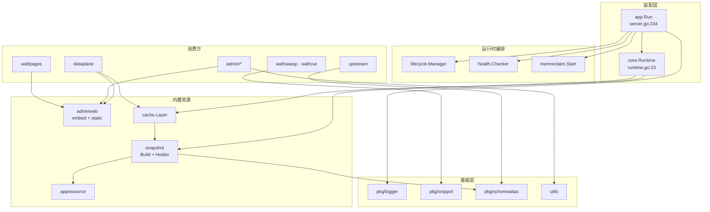
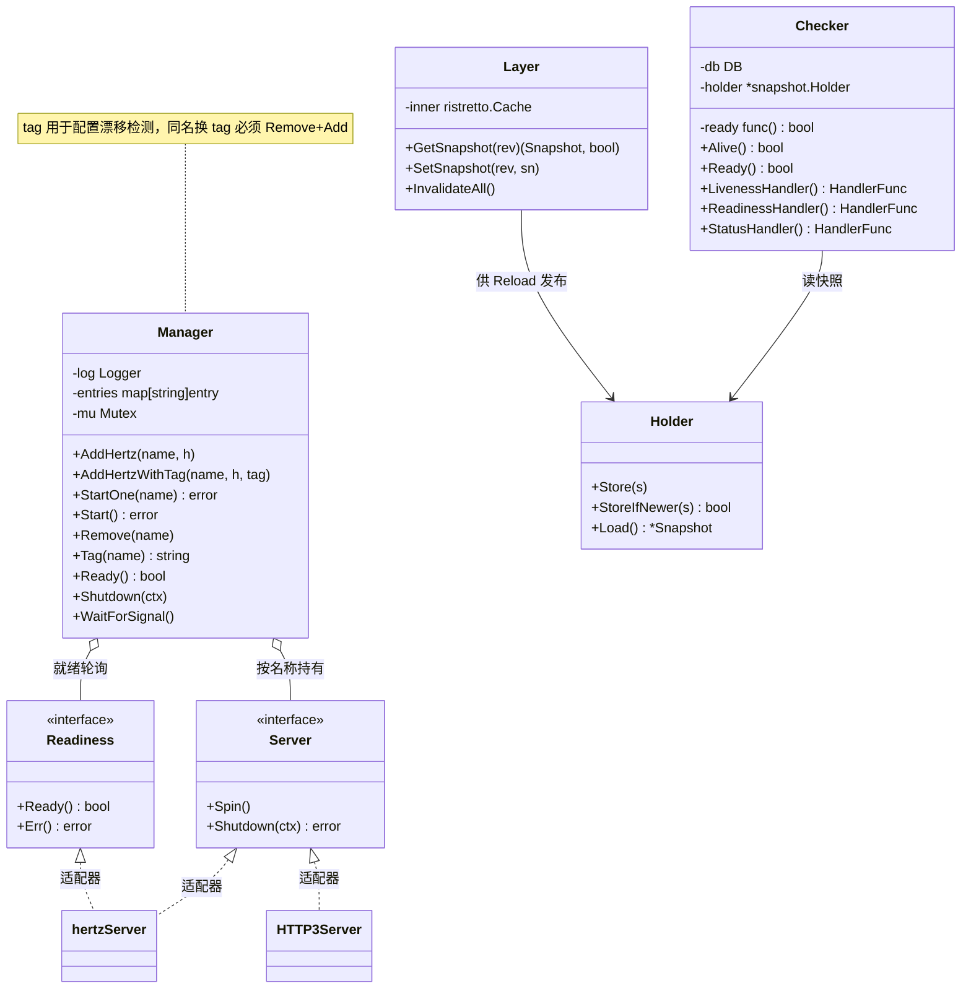
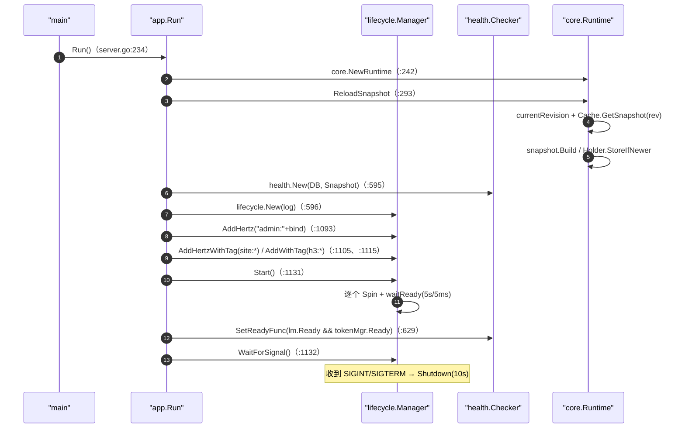
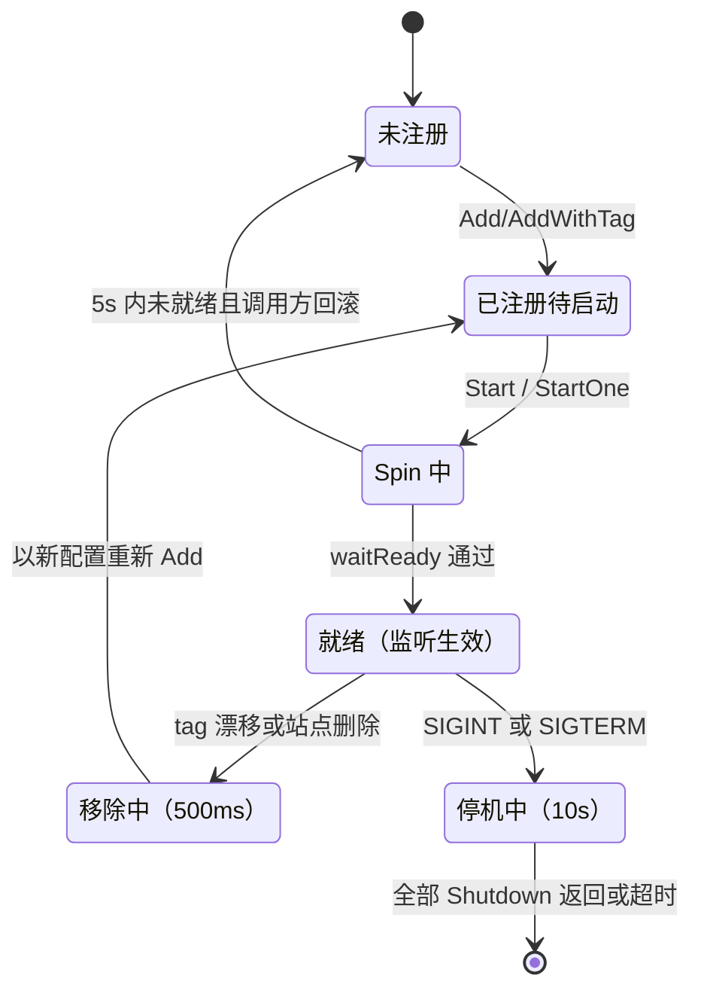
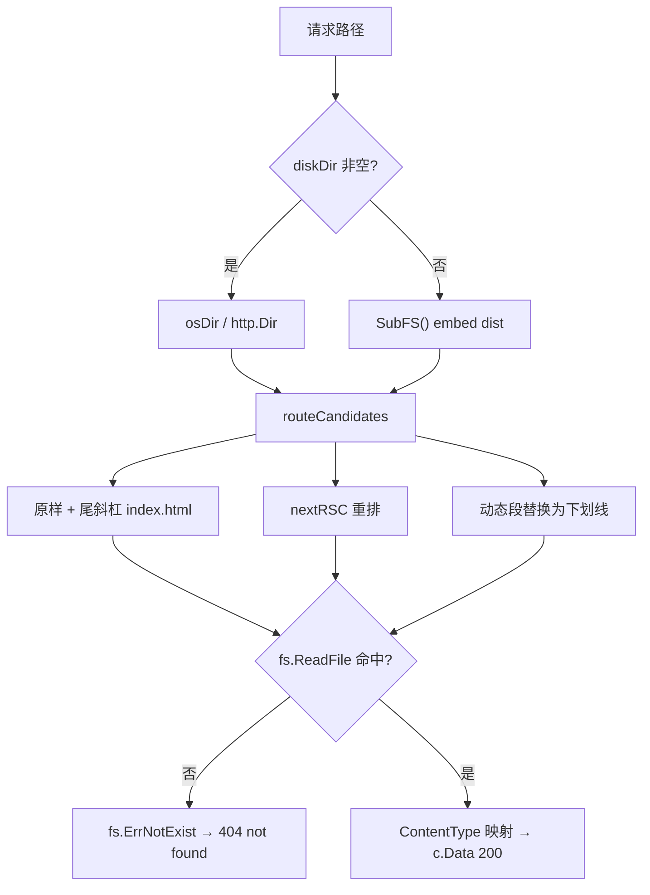
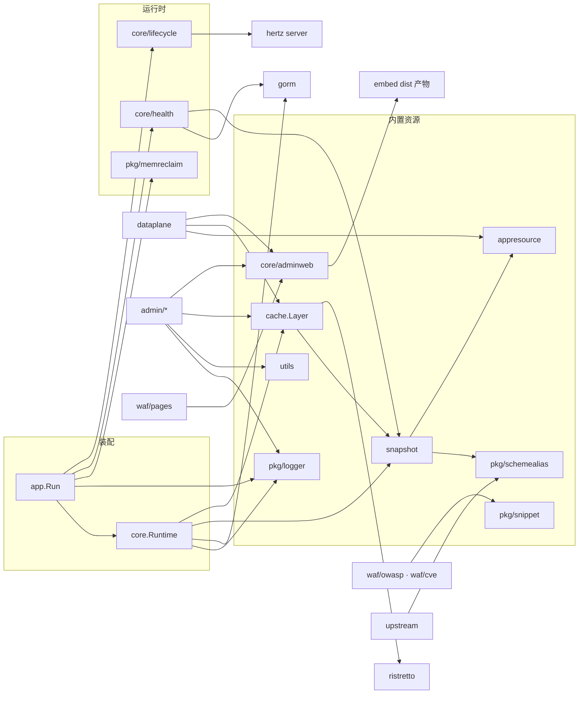
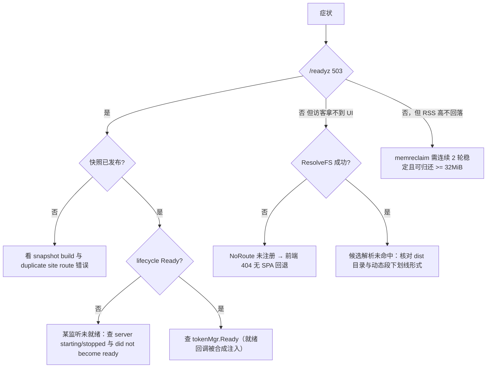

# 运行时与内置资源

<cite>
**本文档引用的文件**
- [lifecycle.go](file://internal/core/lifecycle/lifecycle.go)
- [health.go](file://internal/core/health/health.go)
- [memreclaim.go](file://internal/pkg/memreclaim/memreclaim.go)
- [embed.go](file://internal/core/adminweb/embed.go)
- [static.go](file://internal/core/adminweb/static.go)
- [runtime.go](file://internal/core/runtime.go)
- [snapshot.go](file://internal/snapshot/snapshot.go)
- [build.go](file://internal/snapshot/build.go)
- [layer.go](file://internal/cache/layer.go)
- [logger.go](file://internal/pkg/logger/logger.go)
- [schemealias.go](file://internal/pkg/schemealias/schemealias.go)
- [snippet.go](file://internal/pkg/snippet/snippet.go)
- [utils.go](file://internal/utils/utils.go)
- [compile.go](file://internal/appresource/compile.go)
- [match.go](file://internal/appresource/match.go)
- [material.go](file://internal/appresource/material.go)
- [record.go](file://internal/appresource/record.go)
- [sanitize.go](file://internal/appresource/sanitize.go)
- [server.go](file://internal/app/server.go)
- [handler.go](file://internal/dataplane/handler.go)
- [endpoints.go](file://internal/dataplane/endpoints.go)
- [block.go](file://internal/waf/pages/block.go)
- [router.go](file://internal/admin/router.go)
- [network.go](file://internal/admin/system/network.go)
- [config.go](file://internal/core/config.go)
- [registry.go](file://internal/core/configoverride/registry.go)
- [scheme_alias.go](file://internal/upstream/scheme_alias.go)
- [build.sh](file://scripts/build.sh)
- [build.ps1](file://scripts/build.ps1)
</cite>

## 目录
1. [简介](#简介)
2. [项目结构](#项目结构)
3. [核心组件](#核心组件)
4. [架构总览](#架构总览)
5. [详细组件分析](#详细组件分析)
6. [依赖关系分析](#依赖关系分析)
7. [性能考虑](#性能考虑)
8. [故障排查指南](#故障排查指南)
9. [结论](#结论)
10. [附录](#附录)

## 简介

「运行时与内置资源」是系统架构设计下的新子域，负责**进程本身的生命周期**与**随二进制发布的内置资产**两件事：多监听器的启动、就绪判定、热重载期间的逐个重启与优雅停机；空闲堆归还；内嵌 Next.js 静态导出产物的解析与投放；配置快照的构建、缓存与原子发布；以及日志、片段提取、scheme 别名、分页钳制这类被全仓库共享的基座小件。

本篇是子域**总览（形态 A）**：给全景、给切面级结论、给索引。缓存体系与应用路由的接口细节由同子域另一篇实现文档承载，本篇不复制其表格。

| 项 | 内容 |
|----|------|
| 所属业务域 | 系统架构设计 / 运行时与内置资源 |
| 本篇形态 | A 总览（子域同名索引） |
| 覆盖范围 | `core/{lifecycle,health,adminweb,runtime}`、`pkg/{logger,memreclaim,schemealias,snippet}`、`utils`、`snapshot` 的发布与解析侧全景；`cache`、`appresource` 只给切面级结论并链接 |
| 不覆盖 | 缓存四层、匹配算子与内嵌资产投放的参数细节（均见 [缓存与应用路由](./缓存与应用路由.md)）、快照构建期字段合并规则（见 [快照机制](../快照机制.md)）、监听器编排的控制面视角（见 [控制面设计](../控制面设计.md)） |
| 上级与下级 | [系统架构设计](../系统架构设计.md)（域总览）、[缓存与应用路由](./缓存与应用路由.md)（实现篇） |

**章节来源**
- [lifecycle.go:1-298](file://internal/core/lifecycle/lifecycle.go#L1-L298)
- [runtime.go:23-34](file://internal/core/runtime.go#L23-L34)
- [embed.go:10-31](file://internal/core/adminweb/embed.go#L10-L31)

## 项目结构

子域的代码分布有明显的「薄壳 + 厚基座」形态：编排类包都很小（health 105 行、memreclaim 98 行、adminweb 173 行），而内置资源与快照体量集中在 `snapshot`（3071 行）与 `cache`（1885 行）。

```text
internal/
├── core/
│   ├── lifecycle/    # 298 行：Manager 多服务器编排、就绪等待、信号停机
│   ├── health/       # 105 行：/healthz /readyz /status 三探针与状态聚合
│   ├── adminweb/     # 173 行：embed.go 内嵌 dist + static.go 路由候选解析
│   │   └── dist/     # Next.js 静态导出产物（约 8.1 MB，由构建脚本拷入）
│   └── runtime.go    # Runtime 装配：DB/LogDB/Redis/Holder/cache.Layer
├── pkg/
│   ├── logger/       # 483 行：全局 slog handler、彩色格式化、文件输出
│   ├── memreclaim/   #  98 行：空闲堆周期性归还 OS
│   ├── schemealias/  #  56 行：RPC scheme 别名归一
│   └── snippet/      #  76 行：命中片段截断与 UTF-8 清洗
├── snapshot/         # 3071 行：不可变配置快照的构建与发布
├── cache/            # 1885 行：Layer/Query/Hot/Response/RedisKV 五套缓存
├── appresource/      #  734 行：应用路由编译、匹配、脱敏、记录
└── utils/            # 103 行：分页钳制与指针辅助
```

| 路径 | 职责 | 主要语言 | 规模(行) | 代表文件 | 对外暴露 |
|------|------|----------|:--------:|----------|:--------:|
| `internal/core/lifecycle` | 服务器注册、启停、漂移重启、信号处理 | Go | 298 | `lifecycle.go` | 是 |
| `internal/core/health` | 存活/就绪判定与运行时状态聚合 | Go | 105 | `health.go` | 是 |
| `internal/core/adminweb` | 内嵌产物访问与路由候选解析 | Go | 173 | `embed.go`、`static.go` | 是 |
| `internal/core`（根） | `Runtime` 装配与快照重载 | Go | — | `runtime.go` | 是 |
| `internal/snapshot` | 快照模型、构建、站点匹配、发布 | Go | 3071 | `build.go`、`snapshot.go` | 是 |
| `internal/cache` | 进程内与跨节点缓存 | Go | 1885 | `layer.go`、`response_cache.go` | 是 |
| `internal/appresource` | 应用路由内置资源与匹配 | Go | 734 | `compile.go`、`match.go` | 是 |
| `internal/pkg/*` | 日志、内存归还、scheme 别名、片段 | Go | 713 | 见上表 | 是 |
| `internal/utils` | 分页与指针辅助 | Go | 103 | `utils.go` | 是 |



**图表来源**
- [server.go:364-365](file://internal/app/server.go#L364-L365)
- [server.go:595-597](file://internal/app/server.go#L595-L597)
- [runtime.go:23-34](file://internal/core/runtime.go#L23-L34)
- [layer.go:24-51](file://internal/cache/layer.go#L24-L51)
- [snapshot.go:3-17](file://internal/snapshot/snapshot.go#L3-L17)
- [endpoints.go:85-109](file://internal/dataplane/endpoints.go#L85-L109)
- [block.go:3-16](file://internal/waf/pages/block.go#L3-L16)
- [scheme_alias.go:25-56](file://internal/upstream/scheme_alias.go#L25-L56)
- [router.go:21-42](file://internal/admin/router.go#L21-L42)

**章节来源**
- [lifecycle.go:17-21](file://internal/core/lifecycle/lifecycle.go#L17-L21)
- [embed.go:10-18](file://internal/core/adminweb/embed.go#L10-L18)
- [snapshot.go:213-273](file://internal/snapshot/snapshot.go#L213-L273)
- [build.sh:7-8](file://scripts/build.sh#L7-L8)

## 核心组件

| 模块 | 路径 | 职责 | 核心接口/符号 | 依赖模块 | 被依赖 | 规模(行) | 测试 |
|------|------|------|---------------|----------|--------|:--------:|:----:|
| 生命周期管理 | `internal/core/lifecycle` | 多服务器注册、启动、就绪等待、漂移重启、优雅停机 | `Manager`、`Server`、`Readiness` | hertz、标准库 | `app` | 298 | 有 |
| 健康探针 | `internal/core/health` | `/healthz`、`/readyz`、`/status` 三处理器 | `Checker`、`StatusSnapshot` | `gorm`、`snapshot` | `app`、`admin/system/realtime` | 105 | 有 |
| 内嵌 Web 资源 | `internal/core/adminweb` | 提供 dist 产物 FS 与 Next.js 导出路由候选 | `ResolveFS`、`ReadRouteFile`、`ContentType`、`SubFS` | `io/fs`、`embed` | `admin`、`dataplane`、`waf/pages` | 173 | 有 |
| 快照发布 | `internal/snapshot` | 不可变配置视图与修订单调发布 | `Snapshot`、`Holder.StoreIfNewer`、`MatchSitePtr`、`Build` | `store`、`appresource`、`waf/*` | `core`、`dataplane`、`engine` | 3071 | 有 |
| 快照缓存 | `internal/cache`（Layer） | 按修订号缓存已构建快照，避免重复 Build | `Layer.GetSnapshot`、`Layer.SetSnapshot` | ristretto、`snapshot` | `core/runtime` | 70 | 有 |
| 应用路由资源 | `internal/appresource` | 路由规则编译、匹配、脱敏、记录构建 | `CompileRules`、`MatchedRuleIDs`、`BuildMaterial` | `store/approute`、hertz | `snapshot`、`dataplane`、`admin/rule` | 734 | 有 |
| 内存归还 | `internal/pkg/memreclaim` | 稳定期把空闲堆归还 OS | `Start(Config) func()` | `runtime/debug` | `app` | 98 | 有 |
| 日志基座 | `internal/pkg/logger` | 全局 handler、级别热调、文件与彩色输出 | `New`、`Configure`、`SetLevel`、`Banner` | `log/slog` | 全仓库 | 483 | 有 |
| 片段提取 | `internal/pkg/snippet` | 命中片段截断与 UTF-8 合法性清洗 | `Around`、`Extract`、`MaxLen` | `regexp` | `waf/owasp`、`waf/cve` | 76 | 有 |
| scheme 别名 | `internal/pkg/schemealias` | RPC scheme 前缀归一为传输 scheme | `Scheme`、`AliasForURL`、`NormalizeURLPrefix` | `strings` | `upstream`、`snapshot` | 56 | 无独立测试文件 |
| 分页辅助 | `internal/utils` | OFFSET/LIMIT 与内存切片的双向钳制 | `Paginate`、`SlicePage`、`MaxPageSize` | 标准库 | `admin/*` 全域 | 103 | 有 |

`schemealias` 的「无独立测试文件」是实测结论：`internal/pkg/schemealias/` 目录只有 56 行的 `schemealias.go`，其行为由 `internal/upstream/scheme_alias.go` 的适配层与 `internal/snapshot/build.go:836、849` 的调用点间接覆盖。



**图表来源**
- [lifecycle.go:25-59](file://internal/core/lifecycle/lifecycle.go#L25-L59)
- [lifecycle.go:66-112](file://internal/core/lifecycle/lifecycle.go#L66-L112)
- [health.go:15-44](file://internal/core/health/health.go#L15-L44)
- [layer.go:24-51](file://internal/cache/layer.go#L24-L51)
- [snapshot.go:453-489](file://internal/snapshot/snapshot.go#L453-L489)

### 重点组件展开

**职责**：`lifecycle.Manager` 是全仓库唯一「谁在监听、怎么起、怎么换、怎么停」的收敛点；`adminweb` 是全仓库唯一「内置前端产物如何被读到」的收敛点。**关键文件**：`internal/core/lifecycle/lifecycle.go`、`internal/core/adminweb/static.go`。**核心接口**：

```go
// internal/core/lifecycle/lifecycle.go:26-35、94-98
type Server interface {
    Spin()
    Shutdown(ctx context.Context) error
}
type Readiness interface {
    Ready() bool
    Err() error
}
func (m *Manager) AddHertzWithTag(name string, h *server.Hertz, tag string)

// internal/core/adminweb/static.go:11-28
func ResolveFS(diskDir string) (fs.FS, error)
func ReadRouteFile(webFS fs.FS, requestPath string) ([]byte, string, error)
```

`entry.tag` 是「不透明配置指纹」，调谐时同名服务器 tag 变化即视为漂移，调用方必须执行 Remove+Add（[lifecycle.go:72-78](file://internal/core/lifecycle/lifecycle.go#L72-L78)）；管理器自身不做比较，比较发生在 `reconcileListeners`（[server.go:756-762、781-789](file://internal/app/server.go#L756-L789)）。`ResolveFS` 的入参是磁盘覆盖目录，空串回落到 `SubFS()`（[static.go:11-17](file://internal/core/adminweb/static.go#L11-L17)）。

**章节来源**
- [lifecycle.go:17-122](file://internal/core/lifecycle/lifecycle.go#L17-L122)
- [static.go:10-52](file://internal/core/adminweb/static.go#L10-L52)
- [server.go:722-824](file://internal/app/server.go#L722-L824)

## 架构总览

一次冷启动与一次热重载的运行时协作如下。启动侧的关键契约是「先注册全部、再统一 Start、最后 WaitForSignal」，重载侧的关键契约是「先摘漂移、再补新增，且新增必须 `StartOne` 等到就绪」。



**图表来源**
- [server.go:364-365](file://internal/app/server.go#L364-L365)
- [server.go:595-629](file://internal/app/server.go#L595-L629)
- [server.go:1093-1132](file://internal/app/server.go#L1093-L1132)
- [runtime.go:211-274](file://internal/core/runtime.go#L211-L274)
- [lifecycle.go:169-227](file://internal/core/lifecycle/lifecycle.go#L169-L227)

### 架构分层

| 层 | 成员 | 职责边界 | 触发源 | 状态持有 | 证据 |
|----|------|----------|--------|----------|------|
| 装配层 | `app.Run`、`core.Runtime` | 依赖创建与顺序编排，16 步引导 | 进程启动 | `Runtime` 结构体 | [server.go:234-596](file://internal/app/server.go#L234-L596) |
| 编排层 | `lifecycle.Manager` | 监听器增删启停与就绪聚合 | 启动 + reload 调谐 | `entries map[string]entry` | [lifecycle.go:66-298](file://internal/core/lifecycle/lifecycle.go#L66-L298) |
| 发布层 | `snapshot.Holder`、`cache.Layer` | 修订单调发布与按版本复用 | `BumpRevision` → reload | `atomic.Pointer`、ristretto | [snapshot.go:474-487](file://internal/snapshot/snapshot.go#L474-L487)、[runtime.go:223-270](file://internal/core/runtime.go#L223-L270) |
| 内置资源层 | `adminweb`、`appresource`、`pkg/snippet` | 二进制内资产的读取与匹配 | 请求期只读 | 无（纯函数 + `embed.FS`） | [embed.go:12-18](file://internal/core/adminweb/embed.go#L12-L18)、[compile.go:48-90](file://internal/appresource/compile.go#L48-L90) |
| 基座层 | `pkg/logger`、`memreclaim`、`utils`、`schemealias` | 横切能力，无业务语义 | 进程级 | 全局 handler、后台协程 | [logger.go:52-70](file://internal/pkg/logger/logger.go#L52-L70)、[memreclaim.go:26-98](file://internal/pkg/memreclaim/memreclaim.go#L26-L98) |

分层规则：编排层**不由请求驱动**，只由启动与 reload 驱动；内置资源层**不写状态**，请求期只做读取与匹配；基座层允许持有进程级单例（日志 handler、归还协程），但不得反向依赖业务包。

**章节来源**
- [server.go:234-596](file://internal/app/server.go#L234-L596)
- [lifecycle.go:66-298](file://internal/core/lifecycle/lifecycle.go#L66-L298)
- [runtime.go:23-34](file://internal/core/runtime.go#L23-L34)
- [embed.go:10-31](file://internal/core/adminweb/embed.go#L10-L31)

## 详细组件分析

本节按切面组织，每节只给切面级结论；涉及参数与算子细节处一律链接到实现篇。

### 监听器编排与优雅停机（lifecycle）

**职责**：把「站点监听、HTTP/3 监听、管理监听」三类异构服务器统一到同一张按名称索引的表里，并提供冷启动、热调谐、信号停机三条路径。要点：

- **两种服务器抽象**：`Server{Spin,Shutdown}` 与 `Readiness{Ready,Err}` 分离，适配器 `hertzServer` 同时实现两者（[lifecycle.go:26-59](file://internal/core/lifecycle/lifecycle.go#L26-L59)）；非 Hertz 的 `HTTP3Server` 只需实现 `Server`。
- **就绪等待有硬上界**：`waitReady` 用 5 秒截止 + 5 毫秒轮询（[lifecycle.go:205-227](file://internal/core/lifecycle/lifecycle.go#L205-L227)）；未实现 `Readiness` 的服务器直接视为就绪返回 nil（206-209），因此 `Add` 与 `AddWithTag` 的启动不做监听确证。
- **两段超时不同源**：热重载移除用 500ms（`defaultRemoveShutdownTimeout`），进程停机用 10s（`defaultShutdownTimeout`），避免调谐被单个监听器拖成长阻塞（[lifecycle.go:17-21](file://internal/core/lifecycle/lifecycle.go#L17-L21)）。
- **重复移除不误报**：`engine is not running` 字符串按「已完成」处理（[lifecycle.go:61-63、157-165](file://internal/core/lifecycle/lifecycle.go#L61-L65)）。
- **Ready 的保守语义**：空表返回 false；任一服务器未实现 `Readiness` 或未就绪即 false（[lifecycle.go:230-243](file://internal/core/lifecycle/lifecycle.go#L230-L243)）。
- **`Start` 的部分失败**：逐个 `waitReady`，第一个失败就返回错误，但**已启动的其余服务器不会回滚**（[lifecycle.go:185-203](file://internal/core/lifecycle/lifecycle.go#L185-L203)）。
- **停机只等一轮**：`Shutdown` 并行下发，超过 10 秒只记 `shutdown deadline exceeded` 告警而不阻塞退出（[lifecycle.go:246-287](file://internal/core/lifecycle/lifecycle.go#L246-L287)）；`WaitForSignal` 的 signal 通道缓冲为 1，进入停机后不再处理第二次信号（290-298）。

| 步 | 动作 | 执行位置 | 输入 | 输出 | 失败分支 | 可观测点 |
|:--:|------|----------|------|------|----------|----------|
| 1 | 注册管理监听 | [server.go:1093](file://internal/app/server.go#L1093) | `AdminBind` | `admin:{bind}` 入表 | 无 tag | 日志 `server starting` |
| 2 | 注册站点监听 | [server.go:1105](file://internal/app/server.go#L1105) | 快照 + tag 指纹 | `site:{bind}` 入表 | TLS 配置无效则跳过并 warn | `skipping site listener without valid TLS config` |
| 3 | 注册 HTTP/3 监听 | [server.go:1115](file://internal/app/server.go#L1115) | `plan.Tag` | `h3:*` 入表 | 同上 | `HTTP/3 QUIC listener registered` |
| 4 | 统一启动 | [server.go:1131](file://internal/app/server.go#L1131)、[lifecycle.go:185-203](file://internal/core/lifecycle/lifecycle.go#L185-L203) | 全表 | 全部 Spin | `did not become ready` 直接中断 | 启动日志 |
| 5 | 调谐移除 | [server.go:749-777](file://internal/app/server.go#L749-L777) | stale 或 tag 漂移 | `Remove`（500ms） | 已停则按完成 | `restarting ... due to config change` |
| 6 | 调谐新增 | [server.go:783-824](file://internal/app/server.go#L783-L824) | desired 未存在 | `Add*` + `StartOne` | 启动失败即 `Remove` 回滚该条 | `hot-started site listener` |
| 7 | 信号停机 | [lifecycle.go:289-298](file://internal/core/lifecycle/lifecycle.go#L289-L298) | SIGINT/SIGTERM | 并行 Shutdown | 超时仅告警 | `shutdown deadline exceeded` |



**图表来源**
- [lifecycle.go:86-166](file://internal/core/lifecycle/lifecycle.go#L86-L166)
- [lifecycle.go:169-227](file://internal/core/lifecycle/lifecycle.go#L169-L227)
- [lifecycle.go:246-298](file://internal/core/lifecycle/lifecycle.go#L246-L298)
- [server.go:740-824](file://internal/app/server.go#L740-L824)

**章节来源**
- [lifecycle.go:17-298](file://internal/core/lifecycle/lifecycle.go#L17-L298)
- [server.go:722-824](file://internal/app/server.go#L722-L824)
- [server.go:1093-1133](file://internal/app/server.go#L1093-L1133)

### 就绪与存活探针（health）

**职责**：把「进程活着」与「进程能服务」判成两件事，并向管理端口暴露。`Alive()` 是常量真（[health.go:29](file://internal/core/health/health.go#L29)），因此 `/healthz` 只证明进程未被卡死、其 503 分支在现有实现下不可达；`Ready()` 才聚合三条件——快照非 nil、注入的 `ready()` 为真、`sqlDB.Ping()` 成功（[health.go:32-44](file://internal/core/health/health.go#L32-L44)）。

| 符号 | 位置 | 签名 | 上游调用者 | 契约与副作用 |
|------|------|------|------------|--------------|
| `New` | [health.go:22-24](file://internal/core/health/health.go#L22-L24) | `(db, holder) *Checker` | `app.Run`（[server.go:595](file://internal/app/server.go#L595)） | 无 `ready` 回调时第二条件视为通过 |
| `SetReadyFunc` | [health.go:26-28](file://internal/core/health/health.go#L26-L28) | `(func() bool)` | `app.Run` 两次（597、629） | 后写覆盖前写，最终为 `lm.Ready() && tokenMgr.Ready()` |
| `LivenessHandler` | [health.go:47-55](file://internal/core/health/health.go#L47-L55) | `→ 200/503 JSON` | `adminSrv.GET("/healthz")` | 只读常量 |
| `ReadinessHandler` | [health.go:58-66](file://internal/core/health/health.go#L58-L66) | `→ 200/503 JSON` | `adminSrv.GET("/readyz")` | 每次触发一次 DB Ping |
| `StatusHandler` | [health.go:69-73](file://internal/core/health/health.go#L69-L73) | `→ 200 JSON` | `adminSrv.GET("/status")` | 调 `runtime.ReadMemStats` |
| `StatusSnapshot` | [health.go:75-105](file://internal/core/health/health.go#L75-L105) | `→ map[string]any` | `StatusHandler`、实时推送 | 遍历 `sn.Sites` 去重 `siteID` 与 `bind` |

探针注册在管理端口而非数据面（[server.go:1053-1056](file://internal/app/server.go#L1053-L1056)，与 `/metrics` 同侧），因此访客无法探测内部状态。`sites` 与 `listeners` 是**当前快照的去重计数**，不是全量数据库指标，口径与此前登记的「前端统计卡必须来自真实聚合」一致。

**章节来源**
- [health.go:15-105](file://internal/core/health/health.go#L15-L105)
- [server.go:595-629](file://internal/app/server.go#L595-L629)
- [server.go:1051-1056](file://internal/app/server.go#L1051-L1056)

### 内嵌产物与静态路由解析（adminweb）

**职责**：让单个二进制同时服务管理端 UI、访客阻断页与数据面资产。资产入口是 `//go:embed all:dist`（[embed.go:12-13](file://internal/core/adminweb/embed.go#L12-L13)），`SubFS` 把 `dist/` 提为 Web 根（16-18）。产物由构建脚本从 `frontend/out` 拷入：`scripts/build.sh:7-8` 先 `rm -rf` 再 `cp -r`，`scripts/build.ps1:11-13` 为 Windows 等价逻辑。

解析侧是纯函数集合，`routeCandidates` 为一次请求路径生成至多四族候选并按序探测（[static.go:54-84](file://internal/core/adminweb/static.go#L54-L84)）；候选族参数与资产投放清单以 [缓存与应用路由](./缓存与应用路由.md) 为实现侧唯一细账，本篇只留机制级结论：原样路径、`variant/index.html`、`variant.html`、以及无扩展名时的 `index.html` 兜底。另有两族变体专门适配 Next.js 静态导出：`nextRSCVariants` 把 `__next.a.b.txt` 重排为目录形式（86-102），`dynamicRouteVariants` 把任意一段替换成 `_` 以命中动态段的导出目录（104-120）。



**图表来源**
- [static.go:11-28](file://internal/core/adminweb/static.go#L11-L28)
- [static.go:54-120](file://internal/core/adminweb/static.go#L54-L120)
- [embed.go:12-18](file://internal/core/adminweb/embed.go#L12-L18)

三个消费方与两种覆盖方式必须分清：

- **管理端**：`adminweb.ResolveFS(diskDir)` 成功时才注册 `NoRoute`（[router.go:443-464](file://internal/admin/router.go#L443-L464)），`diskDir` 来自 `rt.Config.AdminStaticDir`（[server.go:1073](file://internal/app/server.go#L1073)），环境变量 `MY_OPENWAF_ADMIN_STATIC_DIR`、覆盖键 `admin_static_dir`（[config.go:281-282、517](file://internal/core/config.go#L281-L282)、[registry.go:330](file://internal/core/configoverride/registry.go#L330)）。
- **数据面**：`staticFS, _ := adminweb.ResolveFS("")` 在构造处理器时一次性取得内嵌 FS（[handler.go:51](file://internal/dataplane/handler.go#L51)），由 `/__owaf` 前缀的资产路由消费（[endpoints.go:85-109](file://internal/dataplane/endpoints.go#L85-L109)）。
- **阻断页**：`loadEmbeddedPage` 直接取 `SubFS()` 读 `block/index.html` 等页面，并把 `/_next/` 改写为 `/__owaf/_next/`（[block.go:221-246](file://internal/waf/pages/block.go#L221-L246)）。
- `FileServer(diskDir)` 虽已实现（[embed.go:21-31](file://internal/core/adminweb/embed.go#L21-L31)），但**生产代码无调用点**，实际投放一律走 `ResolveFS` + `ReadRouteFile` 的候选解析路径。

**章节来源**
- [static.go:11-142](file://internal/core/adminweb/static.go#L11-L142)
- [embed.go:10-31](file://internal/core/adminweb/embed.go#L10-L31)
- [router.go:443-464](file://internal/admin/router.go#L443-L464)
- [endpoints.go:85-109](file://internal/dataplane/endpoints.go#L85-L109)
- [build.sh:7-8](file://scripts/build.sh#L7-L8)
- [build.ps1:11-13](file://scripts/build.ps1#L11-L13)

### 配置快照的构建、缓存与发布（snapshot 与 cache.Layer）

**职责**：把数据库里的全部配置压成一个不可变对象，并保证「旧代次不会覆盖新代次」。`Snapshot` 持有 `Revision`、`Sites`、默认页与页面配置、SNI 证书表、`Protection`、Lua/JS 插件及其编译错误、`ConfigDiagnostics`、HTTP/2 与安全响应头字段（[snapshot.go:213-273](file://internal/snapshot/snapshot.go#L213-L273)）；站点侧的运行时视图 `SiteRuntime` 含 `AppRouteRules []appresource.CompiledRule`（[snapshot.go:98](file://internal/snapshot/snapshot.go#L98)），即应用路由随快照编译。

发布只有一条单调路径：`Holder.StoreIfNewer` 用 CAS 循环拒绝 `Revision <= current`（[snapshot.go:474-487](file://internal/snapshot/snapshot.go#L474-L487)），`Store` 保留给无并发压力的初始化并显式警告勿用于 reload（456-464）。

| 符号 | 位置 | 签名 | 上游调用者 | 契约与副作用 |
|------|------|------|------------|--------------|
| `Build` | [build.go:47](file://internal/snapshot/build.go#L47) | `(db, rev, dynamicKeyBase) → (*Snapshot, error)` | `core.Runtime`（[runtime.go:246](file://internal/core/runtime.go#L246)） | 构建期编译规则与插件，不回写数据库 |
| `registerSiteKeys` | [build.go:787](file://internal/snapshot/build.go#L787) | `(map, *SiteRuntime) → error` | `Build` | 不同站点争同一键返回 `duplicate site route`，同站点幂等 continue |
| `SiteMapKey` | [snapshot.go:289-296](file://internal/snapshot/snapshot.go#L289-L296) | `(bind, host) → string` | 路由与匹配 | 键为 `bind + NUL + host`，非可读前缀树 |
| `MatchSitePtr` | [snapshot.go:373](file://internal/snapshot/snapshot.go#L373) | `(bind, hostHeader) → (*SiteRuntime, bool)` | `dataplane` | 零拷贝，至多三级：精确 → `*.` 单级父域 → `*` |
| `isIPAddress` | [snapshot.go:442](file://internal/snapshot/snapshot.go#L442) | `(host) → bool` | `MatchSite*` | IP 形态 Host 跳过通配匹配 |
| `Layer.GetSnapshot` | [layer.go:54-62](file://internal/cache/layer.go#L54-L62) | `(rev) → (*Snapshot, bool)` | `ReloadSnapshotWithPrePublish` | 命中后仍二次核对 revision |
| `Layer.SetSnapshot` | [layer.go:44-51](file://internal/cache/layer.go#L44-L51) | `(rev, sn)` | 同上 | 校验 `sn.Revision == rev`，`Wait()` 保证可见性 |

`ReloadSnapshotWithPrePublish` 的完整语义（代次 CAS 二次核对、`prePublish` 回调失败即放弃发布）与站点三态合并规则见 [快照机制](../快照机制.md)；`cache.Layer` 的参数是 ristretto `NumCounters 1e4 / MaxCost 1<<20 / BufferItems 64`、键形如 `snapshot:{rev}`（[layer.go:29-51](file://internal/cache/layer.go#L29-L51)），这组参数**只属于快照复用层**，与限流、响应缓存无关——后者见 [缓存与应用路由](./缓存与应用路由.md)。

**章节来源**
- [snapshot.go:98-296](file://internal/snapshot/snapshot.go#L98-L296)
- [snapshot.go:373-489](file://internal/snapshot/snapshot.go#L373-L489)
- [build.go:47-47](file://internal/snapshot/build.go#L47-L47)
- [build.go:787-799](file://internal/snapshot/build.go#L787-L799)
- [runtime.go:211-289](file://internal/core/runtime.go#L211-L289)
- [layer.go:24-70](file://internal/cache/layer.go#L24-L70)

### 空闲内存归还与日志基座（memreclaim 与 pkg/logger）

**职责**：前者抑制「峰值后 RSS 不回落」，后者统一全仓库唯一日志流。`memreclaim.Start` 的判定链是：首轮只采样不判定 → `HeapInuse` 增长超过 1 MiB 抖动带即清零稳定计数 → 连续 `IdleRounds` 轮稳定 → `HeapIdle - HeapReleased >= MinHeapReleased` 才调 `debug.FreeOSMemory()` 并复读一次统计写日志（[memreclaim.go:46-93](file://internal/pkg/memreclaim/memreclaim.go#L46-L93)）。三个阈值全部有内置缺省：2 分钟、2 轮、32 MiB（[memreclaim.go:27-38](file://internal/pkg/memreclaim/memreclaim.go#L27-L38)），调用点只传 logger 不传阈值（[server.go:364-365](file://internal/app/server.go#L364-L365)），因此**当前生产形态下这三档不可通过配置调整**；返回的 `stop` 用 `sync.Once` 保证幂等（95-97）。

日志基座的三个设计点值得注意：

- **单 handler 共享**：`init` 里建一次 `globalHandler` 与 `levelVar`，`logger.New(section)` 只是 `With(section)` 属性，不新建 writer（[logger.go:44-70](file://internal/pkg/logger/logger.go#L44-L70)），故全仓库只有一个输出流。
- **级别与着色可热调**：`Configure` 支持 `Level/FilePath/AlsoStdout/Color`（[logger.go:93-126](file://internal/pkg/logger/logger.go#L93-L126)），管理端 `network.go:278-293` 在保存日志配置时原地重建 handler 并回读 `GetLevel()`；着色判定优先取覆盖表注入值，其次 `MY_OPENWAF_LOG_COLOR`，最后按 stdout 是否终端自动判定（199-238）。
- **文件输出为追加而非轮转**：`buildConfiguredOutput` 以 `O_CREATE|O_WRONLY|O_APPEND` 打开并在切换前关闭旧句柄（[logger.go:155-185](file://internal/pkg/logger/logger.go#L155-L185)），因此没有大小轮转，长期运行需外部 logrotate。

**章节来源**
- [memreclaim.go:12-98](file://internal/pkg/memreclaim/memreclaim.go#L12-L98)
- [server.go:364-365](file://internal/app/server.go#L364-L365)
- [logger.go:44-185](file://internal/pkg/logger/logger.go#L44-L185)
- [logger.go:199-260](file://internal/pkg/logger/logger.go#L199-L260)
- [network.go:278-293](file://internal/admin/system/network.go#L278-L293)

### 共享小件与内置匹配资源（utils、schemealias、snippet、appresource）

**职责**：把「每个管理端点都要做、做错的代价是溢出或越界」的三件小事收敛到一处。

| 符号 | 位置 | 契约 | 关键约束 |
|------|------|------|----------|
| `utils.Paginate` | [utils.go:28-45](file://internal/utils/utils.go#L28-L45) | `(page,pageSize) → (offset,limit)` | `pageSize` 钳到 1..`MaxPageSize`=200，缺省 20；再钳 `page` 保证 `offset` 与 `offset+limit` 均不溢出 |
| `utils.SlicePage[T]` | [utils.go:61-90](file://internal/utils/utils.go#L61-L90) | 内存切片分页 | 页长先收敛到 1..`cap`，`def` 或 `cap` 非正时返回空切片而非 panic |
| `schemealias.Scheme` | [schemealias.go:18-24](file://internal/pkg/schemealias/schemealias.go#L18-L24) | 别名→传输 scheme | `tls/grpcs/grpc+tls/grpc+https→https`、`grpc→h2c`；其余原样小写 |
| `schemealias.AliasForURL` | [schemealias.go:37-46](file://internal/pkg/schemealias/schemealias.go#L37-L46) | 前缀替换 | 别名键含 `://`，避免 `grpcs` 与 `grpc` 前缀歧义 |
| `snippet.Around` | [snippet.go:32-52](file://internal/pkg/snippet/snippet.go#L32-L52) | 命中区间 ±48 字节 | 总长截断 256 字节并 `ToValidUTF8`；目标串超过 `2*16384+1` 直接返空 |
| `appresource.CompileRules` | [compile.go:48-90](file://internal/appresource/compile.go#L48-L90) | DB 行→运行时规则 | 跳过停用行与非法正则；`Priority` 降序、同优先级 `ID` 升序 |
| `appresource.MatchedRuleIDs` | [match.go:100-109](file://internal/appresource/match.go#L100-L109) | material→命中 ID | 单阶段求值，需要响应字段的规则由调用方保证提供 |

`snippet` 的上限口径与检测层严格对齐：`MaxTargetLen = 2*16384+1` 正是 OWASP 超长目标串首尾下采样的最大搜索长度（[snippet.go:15-21](file://internal/pkg/snippet/snippet.go#L15-L21)）；`MatchSnippet` 的截断契约在事件模型注释中被再次引用（[store/events.go:36](file://internal/store/events.go#L36)、[dataplane/access_log.go:176](file://internal/dataplane/access_log.go#L176)）。`schemealias` 的消费面有两个真实入口——`internal/upstream/scheme_alias.go:35-56` 的适配层与快照构建期的上游 URL 归一（[build.go:836、849](file://internal/snapshot/build.go#L836-L849)）。`appresource` 的 8 种算子、10 种 target 与三条脱敏正则不在本篇展开，见 [缓存与应用路由](./缓存与应用路由.md)。

**章节来源**
- [utils.go:8-103](file://internal/utils/utils.go#L8-L103)
- [schemealias.go:5-56](file://internal/pkg/schemealias/schemealias.go#L5-L56)
- [snippet.go:8-76](file://internal/pkg/snippet/snippet.go#L8-L76)
- [compile.go:12-90](file://internal/appresource/compile.go#L12-L90)
- [match.go:12-109](file://internal/appresource/match.go#L12-L109)
- [scheme_alias.go:25-56](file://internal/upstream/scheme_alias.go#L25-L56)
- [build.go:836-849](file://internal/snapshot/build.go#L836-L849)

## 依赖关系分析



**图表来源**
- [runtime.go:23-34](file://internal/core/runtime.go#L23-L34)
- [layer.go:10-16](file://internal/cache/layer.go#L10-L16)
- [snapshot.go:3-17](file://internal/snapshot/snapshot.go#L3-L17)
- [lifecycle.go:3-15](file://internal/core/lifecycle/lifecycle.go#L3-L15)
- [embed.go:3-8](file://internal/core/adminweb/embed.go#L3-L8)
- [endpoints.go:14-20](file://internal/dataplane/endpoints.go#L14-L20)
- [router.go:21-42](file://internal/admin/router.go#L21-L42)

| 调用方 ↓ / 被调方 → | lifecycle | health | adminweb | snapshot | cache | appresource | pkg/logger | pkg/schemealias | pkg/snippet | utils |
|---------------------|:---------:|:------:|:--------:|:--------:|:-----:|:-----------:|:----------:|:---------------:|:-----------:|:-----:|
| `app.Run` | ✓ | ✓ | — | ✓ | ✓ | — | ✓ | — | — | — |
| `core.Runtime` | — | — | — | ✓ | ✓ | — | ✓ | — | — | — |
| `dataplane` | — | — | ✓ | ✓ | ✓ | ✓ | — | — | — | — |
| `admin/*` | — | ✓ | ✓ | ✓ | ✓ | ✓ | ✓ | — | — | ✓ |
| `waf/pages` | — | — | ✓ | ✓ | — | — | — | — | — | — |
| `snapshot` | — | — | — | — | — | ✓ | — | ✓ | — | — |
| `waf/{owasp,cve}` | — | — | — | — | — | — | — | — | ✓ | — |
| `upstream` | — | — | — | ✓ | — | — | — | ✓ | — | — |
| `appresource` | — | — | — | — | — | — | — | — | — | — |

`app.Run` 不导入 `adminweb`：它只把 `AdminStaticDir` 字符串交给控制面（[server.go:1073](file://internal/app/server.go#L1073)），实际解析由 `admin/router.go` 与 `dataplane` 各自完成。外部实体五处：hertz `server.Hertz`（被 `hertzServer` 适配）、`HTTP3Server`（同接口另一实现）、`dgraph-io/ristretto`（Layer 底层）、`gorm`（health 与 Runtime）、`embed` 内嵌产物目录。两条健康性质值得保留：`lifecycle` 只依赖两个抽象接口而非具体类型，新增监听器种类无需改动它（OCP）；`utils`、`pkg/schemealias`、`pkg/snippet` 三个基座包零内部依赖（实测 import 块内无任何 `My-OpenWaf/...`），可整体替换。反例是 `appresource` 只依赖 `store/approute`，却对外暴露 hertz 上下文相关的构建函数（`BuildMaterial`），使内置资源层与框架耦合。

**章节来源**
- [runtime.go:23-34](file://internal/core/runtime.go#L23-L34)
- [lifecycle.go:25-59](file://internal/core/lifecycle/lifecycle.go#L25-L59)
- [health.go:3-12](file://internal/core/health/health.go#L3-L12)
- [layer.go:10-16](file://internal/cache/layer.go#L10-L16)
- [snapshot.go:3-17](file://internal/snapshot/snapshot.go#L3-L17)
- [utils.go:3-6](file://internal/utils/utils.go#L3-L6)
- [material.go:3-9](file://internal/appresource/material.go#L3-L9)
- [router.go:42-42](file://internal/admin/router.go#L42-L42)

## 性能考虑

- **问题**：`runtime.ReadMemStats` 会短暂 stop-the-world，被 `/status` 与实时推送高频调用时开销可见。**优化**：归还协程把它限制在 2 分钟一次的采样节奏里，并在未达稳定轮数时提前 `continue`（[memreclaim.go:56-78](file://internal/pkg/memreclaim/memreclaim.go#L56-L78)）。**效果**：常态下每条采样路径最多两轮读数。**残留风险**：`/status` 与 `StatusSnapshot` 每次请求都调一次（[health.go:76](file://internal/core/health/health.go#L76)），无缓存。
- **问题**：热重载若沿用 10 秒停机会把一次调谐拖成长阻塞。**优化**：移除路径单列 500ms 超时（[lifecycle.go:20-21、155-157](file://internal/core/lifecycle/lifecycle.go#L20-L21)）。**效果**：监听器换配置接近瞬时，代价是在途长请求可能被强拆。
- **问题**：每次配置变更都重建整份快照，代价随站点与规则数线性增长。**优化**：按修订号在 `cache.Layer` 复用已构建快照，并在命中与发布前后各做一次 revision 复查（[runtime.go:223-270](file://internal/core/runtime.go#L223-L270)）。**效果**：并发 reload 收敛为一次构建；`MaxCost 1<<20` 决定实际能留几代（[layer.go:30-34](file://internal/cache/layer.go#L30-L34)）。
- **问题**：请求期解包与字符串拼接抬高热路径成本。**优化**：站点匹配用 `bind+NUL+host` 哈希键 + 至多三级查找并区分拷贝/零拷贝两个入口（[snapshot.go:289-296、337、373](file://internal/snapshot/snapshot.go#L289-L373)）；日志用 `logger.New(section)` 复用同一 handler（[logger.go:68-70](file://internal/pkg/logger/logger.go#L68-L70)）。**效果**：路由判定与日志构造都不引入额外分配。
- **问题**：管理端分页参数可被构造到溢出。**优化**：`Paginate`/`SlicePage` 双向钳制并给 `offset+limit` 预留余量（[utils.go:28-90](file://internal/utils/utils.go#L28-L90)）。**效果**：负 OFFSET 与负切片边界被源头堵死。
- **需要注意**：`Layer` 不参与 `owaf_cache_*` 指标族（该族只覆盖 query/hot/response 三类，见 [缓存与应用路由](./缓存与应用路由.md)），因此快照复用的命中率当前**无对外可观测面**，只能靠日志与压测推断。

[本节为总结，无需特定文件来源]

## 故障排查指南



**图表来源**
- [health.go:32-44](file://internal/core/health/health.go#L32-L44)
- [lifecycle.go:205-243](file://internal/core/lifecycle/lifecycle.go#L205-L243)
- [server.go:629-629](file://internal/app/server.go#L629-L629)
- [static.go:11-28](file://internal/core/adminweb/static.go#L11-L28)
- [memreclaim.go:56-78](file://internal/pkg/memreclaim/memreclaim.go#L56-L78)

| 症状 | 原因 | 排查动作 | 方案 |
|------|------|----------|------|
| `/readyz` 一直 503，`/healthz` 正常 | `Alive()` 恒真、`Ready()` 聚合三条件，任一不满足即 503 | 先看 `/status` 的 `ready` 与 `revision` 字段 | 确认快照发布与令牌管理器就绪，再看数据库可达性 |
| 前端页面 404 且不回退到 SPA | `adminweb.ResolveFS` 失败导致 `NoRoute` 未注册 | `ls internal/core/adminweb/dist`；或临时设 `MY_OPENWAF_ADMIN_STATIC_DIR=/srv/out` | 重跑构建脚本同步产物，或用磁盘覆盖排障 |
| 阻断页样式缺失 | 页面内 `/_next/` 未改写为 `/__owaf/_next/` | 直接请求 `/__owaf/_next/static/...` 看是否 200 | 确认 `loadEmbeddedPage` 路径与 `serveOWAFStatic` 前缀 |
| reload 后某站点仍在旧配置上 | 该监听 tag 未变化，调谐器判定无漂移 | 比对 `lm.Tag(name)` 与 `siteListenerFingerprint` 输出 | 把影响监听的字段纳入指纹计算 |
| 停机卡在退出 | 单个服务器 Shutdown 超 10 秒 | 查 `shutdown deadline exceeded` 与 `engine is not running` | 上游连接 draining 过长时先断流量再停进程 |
| RSS 峰值后不回落 | 未满足「连续 2 轮稳定 + 可归还 ≥32 MiB」 | 看日志 `idle heap reclaimed to OS` 是否出现 | 确认没有被其他分配持续抬高 `HeapInuse` |
| 分页大页码返回空或异常 | 绕过 `utils.Paginate` 自行算 OFFSET | 检查端点是否走 `utils.Paginate`/`SlicePage` | 统一走 `utils`，不要在处理器内手算 |

诊断命令（管理端口）：

```bash
curl -s "$ADMIN/healthz"        # 期望 {"status":"ok"}
curl -s "$ADMIN/readyz"         # 期望 {"status":"ready"}，503 表示三条件之一未满足
curl -s "$ADMIN/status"         # revision、sites、listeners、goroutines、heap_alloc
curl -s "$ADMIN/metrics" | grep -E 'owaf_cache_|openwaf_(uptime_seconds|memory_)'
```

**章节来源**
- [health.go:29-105](file://internal/core/health/health.go#L29-L105)
- [lifecycle.go:143-287](file://internal/core/lifecycle/lifecycle.go#L143-L287)
- [static.go:11-84](file://internal/core/adminweb/static.go#L11-L84)
- [router.go:443-464](file://internal/admin/router.go#L443-L464)
- [endpoints.go:85-109](file://internal/dataplane/endpoints.go#L85-L109)
- [memreclaim.go:46-93](file://internal/pkg/memreclaim/memreclaim.go#L46-L93)
- [utils.go:28-90](file://internal/utils/utils.go#L28-L90)

## 结论

- **成果**：把散落的运行时件与内置资产收敛成一张可核对的全景——编排层 298 行、探针 105 行、内嵌资源 173 行、基座 713 行、发布层 3071+70 行；并明确三处易被误写的口径：探针只在管理端口、`/healthz` 无诊断价值而 `/readyz` 才是聚合、dist 产物由构建脚本而非前端框架注入。
- **切面级结论**：快照发布的正确性来自「修订单调 + 双重核对」，不在并发锁上；内置资源的正确性来自「候选解析 + 前缀改写」，不在文件服务器配置上；两者的失败表现都是「404 / 旧配置」，因此排障顺序应先查发布与产物、再查路由。
- **遇到的问题与解决**：`cache.Layer` 曾被怀疑为无消费方的死代码，实测 `runtime.go:118、223、269` 三处调用确认其参与重载路径，据此保留并在索引中标注；`adminweb.FileServer` 反向核实为无生产调用点，按实测登记为未使用出口。
- **原则回顾**：KISS 体现在 `Server`/`Readiness` 两个最小接口上；SRP 体现在探针不写编排、编排不读数据库、基座不含业务；DRY 的正例是 `utils.Paginate` 与 `snippet` 上限的单一来源，反例风险是日志级别口径同时存在于 `env`、覆盖表与管理端点三处（已按优先级明确唯一裁决链）；YAGNI 体现在 `memreclaim.Config` 三档参数尚未接入配置系统——当前不可调，但不预先造键。
- **下一步**：为 `cache.Layer` 增补可观测面；把 `memreclaim` 三阈值接入 `configoverride`；`/status` 的 `ReadMemStats` 结果可加短 TTL 缓存。

[本节为总结，无需特定文件来源]

## 附录

### 子域文档索引

| 文档 | 覆盖包 | 本篇关系 |
|------|--------|----------|
| [运行时与内置资源](./运行时与内置资源.md) | 全部运行时与内置资源包 | 本篇（子域同名总览） |
| [缓存与应用路由](./缓存与应用路由.md) | `internal/cache`（5 文件 1885 行）、`internal/appresource`（5 文件 734 行）、`internal/core/adminweb`（2 文件 173 行） | 实现细节：四层缓存参数、8 种算子与 10 种 target、脱敏正则、记录字段与静态候选解析参数 |
| [系统架构设计](../系统架构设计.md) | 全域装配与分层 | 上级域总览，启动 16 步与三层分工 |
| [快照机制](../快照机制.md) | `internal/snapshot` 构建期 | 字段合并、三态继承与站点键实现细节 |
| [控制面设计](../控制面设计.md) | `lifecycle` 的控制面视角 | 监听器编排与 reload 链的时序 |
| [缓存与性能优化](../缓存与性能优化.md) | 性能视角的缓存策略 | 与本点子域互为横切参照 |
| [组件关系图](../组件关系图.md) | 组件簇划分 | 控制簇与运行时簇的图化视图 |

**章节来源**
- [runtime.go:118、223-270](file://internal/core/runtime.go#L223-L270)
- [layer.go:29-51](file://internal/cache/layer.go#L29-L51)
- [compile.go:48-90](file://internal/appresource/compile.go#L48-L90)
- [registry.go:330-330](file://internal/core/configoverride/registry.go#L330-L330)

### 关键符号速查

| 符号 | 位置 | 一句话 |
|------|------|--------|
| `Manager.StartOne` | [lifecycle.go:169-182](file://internal/core/lifecycle/lifecycle.go#L169-L182) | 后台 Spin 单个具名服务器并等就绪 |
| `waitReady` | [lifecycle.go:205-227](file://internal/core/lifecycle/lifecycle.go#L205-L227) | 5s 截止、5ms 轮询的就绪确证 |
| `Manager.Ready` | [lifecycle.go:230-243](file://internal/core/lifecycle/lifecycle.go#L230-L243) | 全部就绪才真，空表即假 |
| `Checker.Ready` | [health.go:32-44](file://internal/core/health/health.go#L32-L44) | 快照 ∧ 注入回调 ∧ DB Ping |
| `ResolveFS` | [static.go:11-17](file://internal/core/adminweb/static.go#L11-L17) | 磁盘覆盖优先，回落内嵌 dist |
| `routeCandidates` | [static.go:54-84](file://internal/core/adminweb/static.go#L54-L84) | Next.js 导出路由候选族 |
| `Holder.StoreIfNewer` | [snapshot.go:474-487](file://internal/snapshot/snapshot.go#L474-L487) | CAS 循环保证修订单调发布 |
| `Layer.SetSnapshot` | [layer.go:44-51](file://internal/cache/layer.go#L44-L51) | 按修订号缓存快照并 `Wait()` |
| `memreclaim.Start` | [memreclaim.go:26-98](file://internal/pkg/memreclaim/memreclaim.go#L26-L98) | 稳定期归还空闲堆，返回幂等 stop |
| `logger.New` | [logger.go:68-70](file://internal/pkg/logger/logger.go#L68-L70) | 全仓库共享单 handler 的分段 logger |
| `utils.Paginate` | [utils.go:28-45](file://internal/utils/utils.go#L28-L45) | 双向钳制且 `offset+limit` 不溢出 |

[本节为总结，无需特定文件来源]

### 环境变量与内置资产速查

| 变量 / 键 | 归属 | 默认 | 作用 | 证据 |
|-----------|:----:|------|------|------|
| `MY_OPENWAF_LOG_LEVEL` | `pkg/logger` | INFO | 初始级别；DEBUG/WARN/ERROR 之外的值一律按 INFO | [logger.go:187-198](file://internal/pkg/logger/logger.go#L187-L198)、[registry.go:429](file://internal/core/configoverride/registry.go#L429) |
| `MY_OPENWAF_LOG_FILE` | `pkg/logger` | 空（stdout） | 追加写文件；目录自动创建，失败回落 stdout | [logger.go:149-185](file://internal/pkg/logger/logger.go#L149-L185)、[registry.go:437](file://internal/core/configoverride/registry.go#L437) |
| `MY_OPENWAF_LOG_ALSO_STDOUT` | `pkg/logger` | 关 | 值为 `1` 时文件与 stdout 双写 | [logger.go:150-152](file://internal/pkg/logger/logger.go#L150-L152)、[registry.go:443](file://internal/core/configoverride/registry.go#L443) |
| `MY_OPENWAF_LOG_COLOR` | `pkg/logger` | 自动 | `1`/`true` 着色；覆盖表注入值优先级更高 | [logger.go:205-229](file://internal/pkg/logger/logger.go#L208-L238)、[registry.go:449](file://internal/core/configoverride/registry.go#L449) |
| `MY_OPENWAF_ADMIN_STATIC_DIR` | `adminweb` | 空（用内嵌） | 开发期磁盘覆盖管理端产物 | [config.go:281-282、517](file://internal/core/config.go#L281-L282)、[registry.go:330](file://internal/core/configoverride/registry.go#L330) |
| `dist/`（约 8.1 MB） | `embed.FS` | — | Next.js 静态导出产物，同时供管理端、阻断页与 `/__owaf` 资产 | [embed.go:10-18](file://internal/core/adminweb/embed.go#L10-L18)、[build.sh:7-8](file://scripts/build.sh#L7-L8) |
| `snapshot:{rev}` | `cache.Layer` | — | 按修订号复用已构建快照 | [layer.go:41-51](file://internal/cache/layer.go#L41-L51) |

**章节来源**
- [logger.go:149-238](file://internal/pkg/logger/logger.go#L149-L238)
- [config.go:281-282、517-519](file://internal/core/config.go#L281-L282)
- [registry.go:330-330、429-449](file://internal/core/configoverride/registry.go#L330-L330)
- [embed.go:10-18](file://internal/core/adminweb/embed.go#L10-L18)
- [layer.go:41-51](file://internal/cache/layer.go#L41-L51)

### 术语与约定

- **调谐（reconcile）**：reload 后以「desired − current」的差集驱动 `Remove`/`Add`+`StartOne`，不是全量重启（[server.go:722-824](file://internal/app/server.go#L722-L824)）。
- **漂移**：同名服务器 tag 变化即视为漂移，判定权在调用方，管理器只提供 `Tag(name)`（[lifecycle.go:114-122](file://internal/core/lifecycle/lifecycle.go#L114-L122)）。
- **检测相位**：与动态处置子域同义，仅 `owasp_default` 与 `cve_detection`，参照 [分级升级与丢弃执行](../../WAF%20引擎系统/动态处置/分级升级与丢弃执行.md)。
- **内嵌优先**：所有内置资产默认从 `embed.FS` 读取，磁盘目录仅作为开发期覆盖手段，两者不同时生效（[static.go:11-17](file://internal/core/adminweb/static.go#L11-L17)）。

[本节为总结，无需特定文件来源]
