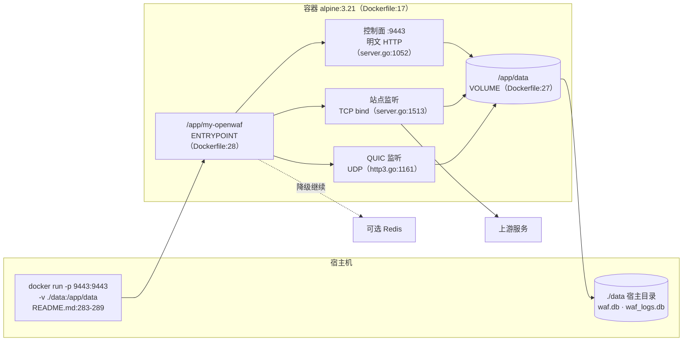
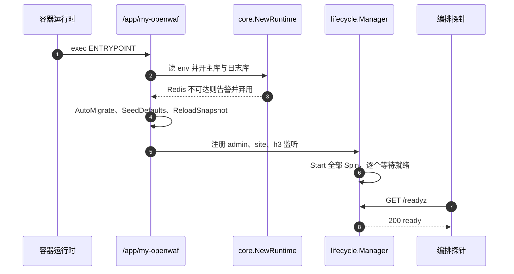
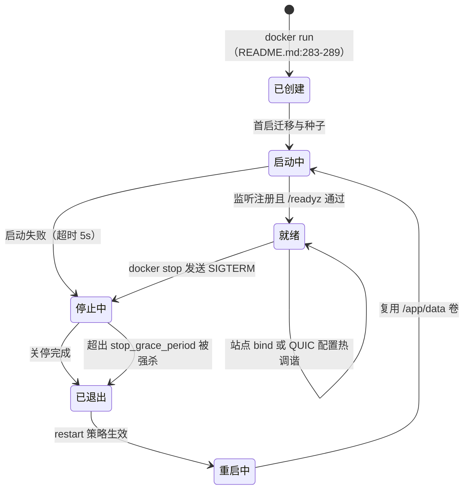
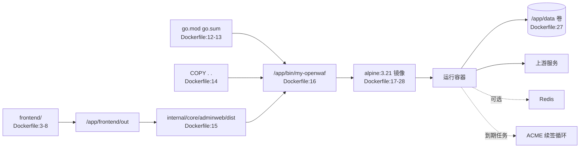

# 容器化部署

> [返回 部署运维](部署运维.md)

<cite>
**本文档引用的文件**
- [README.md](file://README.md)
- [Dockerfile](file://Dockerfile)
- [.dockerignore](file://.dockerignore)
- [.gitignore](file://.gitignore)
- [cmd/main.go](file://cmd/main.go)
- [scripts/build.sh](file://scripts/build.sh)
- [internal/app/server.go](file://internal/app/server.go)
- [internal/app/http3.go](file://internal/app/http3.go)
- [internal/core/config.go](file://internal/core/config.go)
- [internal/core/config_override.go](file://internal/core/config_override.go)
- [internal/core/configoverride/registry.go](file://internal/core/configoverride/registry.go)
- [internal/core/database/gorm.go](file://internal/core/database/gorm.go)
- [internal/core/health/health.go](file://internal/core/health/health.go)
- [internal/core/lifecycle/lifecycle.go](file://internal/core/lifecycle/lifecycle.go)
- [internal/core/runtime.go](file://internal/core/runtime.go)
- [internal/pkg/logger/logger.go](file://internal/pkg/logger/logger.go)
- [internal/pkg/memreclaim/memreclaim.go](file://internal/pkg/memreclaim/memreclaim.go)
- [internal/proxy/transport/transport.go](file://internal/proxy/transport/transport.go)
- [internal/store/auth/seed.go](file://internal/store/auth/seed.go)
- [internal/upstream/health.go](file://internal/upstream/health.go)
- [internal/waf/ratelimit/ratelimit.go](file://internal/waf/ratelimit/ratelimit.go)
- [internal/waf/ratelimit/redis.go](file://internal/waf/ratelimit/redis.go)
- [.github/dependabot.yml](file://.github/dependabot.yml)
- [.github/workflows/ci.yml](file://.github/workflows/ci.yml)
- [.github/workflows/release.yml](file://.github/workflows/release.yml)
</cite>

## 目录

1. [简介](#简介)
2. [项目结构](#项目结构)
3. [核心组件](#核心组件)
4. [架构总览](#架构总览)
5. [详细组件分析](#详细组件分析)
6. [依赖关系分析](#依赖关系分析)
7. [性能考虑](#性能考虑)
8. [故障排查指南](#故障排查指南)
9. [结论](#结论)
10. [附录](#附录)

## 简介

本篇只讲容器：镜像如何产出、运行期需要哪些注入与挂载、端口与协议如何映射、容器生命周期与应用优雅停机如何对接，以及容器场景特有的故障与处置。

边界固定：环境变量权威表在 [README 配置说明](../../README.md)，本篇只给「变量 → 生效位置 → 次序」映射；构建细节归 [构建脚本与工具链](构建脚本与工具链.md)；流水线归 [CI与发布流水线](CI与发布流水线.md)；备份恢复归 [数据目录与备份恢复](数据目录与备份恢复.md)；深度处置归 [故障排除](../故障排除/故障排除.md)。口令、令牌与密钥一律 `{占位}`。

**关键事实前置**：仓库有 `Dockerfile` 但没有编排清单，也没有镜像发布作业——`my-openwaf:latest` 需由本地 `docker build` 产出。

**章节来源**
- [Dockerfile:1-28](file://Dockerfile#L1-L28)
- [README.md:280-291](file://README.md#L280-L291)
- [README.md:311-349](file://README.md#L311-L349)
- [.github/workflows/release.yml:96-191](file://.github/workflows/release.yml#L96-L191)

## 项目结构

容器视角的目录按「构建输入 → 构建产物 → 运行载体」三段组织。

```text
My-OpenWaf/
├── Dockerfile                  三阶段：frontend → backend → alpine 运行时
├── .dockerignore               构建上下文裁剪（data/ 与产物不入上下文）
├── frontend/                   阶段一输入，产出 frontend/out
├── internal/core/adminweb/dist 阶段二嵌入目录（由 out 复制而来）
├── cmd/ internal/              阶段二源码，产出 /app/bin/my-openwaf
├── data/                       宿主运行数据，不进上下文
└── .github/workflows/          只产出二进制归档，不产出镜像
```

| 路径 | 容器内职责 | 阶段 | 证据 |
|------|------------|:----:|------|
| `frontend/` | `bun install` 与 `bun run build` | 一 | [Dockerfile:2-8](file://Dockerfile#L2-L8) |
| `internal/core/adminweb/dist` | 前端产物落位供 `go:embed` | 二 | [Dockerfile:15](file://Dockerfile#L15) |
| `go.mod` / `go.sum` | 依赖预取，构成缓存层 | 二 | [Dockerfile:12-13](file://Dockerfile#L12-L13) |
| `cmd/` / `internal/` | `CGO_ENABLED=1 go build -tags=quickjs` | 二 | [Dockerfile:16](file://Dockerfile#L16) |
| `/app/data` | 卷挂载点与默认数据目录 | 三 | [Dockerfile:21-27](file://Dockerfile#L21-L27) |
| `/app/my-openwaf` | 容器入口可执行文件 | 三 | [Dockerfile:20](file://Dockerfile#L20)、[Dockerfile:28](file://Dockerfile#L28) |

**章节来源**
- [Dockerfile:2-28](file://Dockerfile#L2-L28)
- [.dockerignore:12-36](file://.dockerignore#L12-L36)
- [.github/workflows/release.yml:165-191](file://.github/workflows/release.yml#L165-L191)

### 交付物构成

| 交付物 | 内容 | 产出方式 | 是否签名 | 发布通道 | 证据 |
|--------|------|----------|:--------:|----------|------|
| 容器镜像 | 单一可执行 + Alpine 运行时 + `/app/data` 卷 | 本地 `docker build` | 否 | 无发布作业 | [Dockerfile:17-28](file://Dockerfile#L17-L28)、[README.md:288](file://README.md#L288) |
| 二进制归档 | `my-openwaf` + `README.md` + `LICENSE` | CI 六平台矩阵 | `.sha256` 校验文件 | GitHub Release | [release.yml:165-212](file://.github/workflows/release.yml#L165-L212) |
| 源码构建产物 | `bin/my-openwaf` | `./scripts/build.sh` | 否 | 无 | [scripts/build.sh:13](file://scripts/build.sh#L13) |

> 镜像内后端一律以 `-tags=quickjs` 构建，与宿主构建和 CI 口径一致（[Dockerfile:16](file://Dockerfile#L16)、[README.md:305](file://README.md#L305)、[scripts/build.sh:13](file://scripts/build.sh#L13)、[ci.yml:191-194](file://.github/workflows/ci.yml#L191-L194)），JS 策略插件走原生 QuickJS 而非桩实现。

**章节来源**
- [Dockerfile:16-28](file://Dockerfile#L16-L28)
- [README.md:288-309](file://README.md#L288-L309)
- [scripts/build.sh:1-13](file://scripts/build.sh#L1-L13)
- [.github/workflows/ci.yml:191-194](file://.github/workflows/ci.yml#L191-L194)
- [.github/workflows/release.yml:165-212](file://.github/workflows/release.yml#L165-L212)

## 核心组件

| 组件 | 位置 | 职责 | 对外接口 | 依赖 | 被依赖 |
|------|------|------|----------|------|--------|
| 前端阶段 | [Dockerfile:2-8](file://Dockerfile#L2-L8) | `oven/bun:1.4.2-alpine` 内静态导出 | `/app/frontend/out` | `package.json`、`bun.lock` | 后端阶段 |
| 后端阶段 | [Dockerfile:9-16](file://Dockerfile#L9-L16) | `golang:1.27-alpine` + `gcc`/`musl-dev` 编译 CGO | `/app/bin/my-openwaf` | `go.mod`、前端产物 | 运行阶段 |
| 运行阶段 | [Dockerfile:17-28](file://Dockerfile#L17-L28) | `alpine:3.21` 最小运行时 | `ENTRYPOINT /app/my-openwaf` | CA、tzdata、字体、libwebp | 容器实例 |
| 上下文裁剪 | [.dockerignore:1-43](file://.dockerignore#L1-L43) | 排除 `data/`、产物与本地文档 | 构建上下文 | — | 后端阶段 |
| 环境注入 | [Dockerfile:22-25](file://Dockerfile#L22-L25) | 四条默认 env | 进程配置 | `LoadConfigFromEnv` | `app.Run` |
| 生命周期 | [internal/core/lifecycle/lifecycle.go:290-298](file://internal/core/lifecycle/lifecycle.go#L290-L298) | 信号处理与关停 | `WaitForSignal` | SIGTERM/SIGINT | 编排器 |

**章节来源**
- [Dockerfile:2-28](file://Dockerfile#L2-L28)
- [.dockerignore:1-43](file://.dockerignore#L1-L43)
- [internal/core/lifecycle/lifecycle.go:290-298](file://internal/core/lifecycle/lifecycle.go#L290-L298)

## 架构总览



**图表来源**
- [README.md:283-289](file://README.md#L283-289)
- [Dockerfile:17-28](file://Dockerfile#L17-L28)
- [internal/app/server.go:1052-1093](file://internal/app/server.go#L1052-L1093)
- [internal/app/server.go:1513-1523](file://internal/app/server.go#L1513-L1523)
- [internal/app/http3.go:1161](file://internal/app/http3.go#L1161)
- [internal/core/runtime.go:99-116](file://internal/core/runtime.go#L99-L116)

README 给出的运行命令只映射 `9443`（[README.md:286](file://README.md#L286)），而数据面监听器由快照按站点 bind 动态创建（[server.go:1513-1523](file://internal/app/server.go#L1513-L1523)）。要让容器承载业务流量，必须把站点 bind 对应的 TCP/UDP 端口一并映射——`Dockerfile:26` 只 `EXPOSE 9443`。

**章节来源**
- [README.md:283-291](file://README.md#L283-L291)
- [Dockerfile:26-28](file://Dockerfile#L26-L28)
- [internal/app/server.go:1052-1093](file://internal/app/server.go#L1052-L1093)
- [internal/app/server.go:1513-1523](file://internal/app/server.go#L1513-L1523)
- [internal/app/http3.go:1161](file://internal/app/http3.go#L1161)
- [internal/core/runtime.go:99-116](file://internal/core/runtime.go#L99-L116)

### 端口映射矩阵

| 宿主端口 | 容器端口 | 协议 | 用途 | 是否默认映射 | 证据 |
|----------|----------|:----:|------|:------------:|------|
| `9443` | `9443` | TCP | 控制面 API、面板、探针、指标 | 是 | [README.md:286](file://README.md#L286)、[Dockerfile:25-26](file://Dockerfile#L25-L26) |
| `80` | `80` | TCP | 站点明文监听 | 否，需 `-p` | [server.go:1513-1523](file://internal/app/server.go#L1513-L1523)、[README.md:457](file://README.md#L457) |
| `443` | `443` | TCP | 站点 TLS 监听 | 否，需 `-p` | [server.go:1538-1600](file://internal/app/server.go#L1538-L1600) |
| `443` | `443` | UDP | HTTP/3 QUIC | 否，需 `-p .../udp` | [http3.go:1161](file://internal/app/http3.go#L1161)、[http3.go:1905-1916](file://internal/app/http3.go#L1905-L1916) |
| `127.0.0.1:6060` | `6060` | TCP | pprof（可选） | 否 | [cmd/main.go:29-49](file://cmd/main.go#L29-L49) |

**章节来源**
- [README.md:286-289](file://README.md#L286-L289)
- [Dockerfile:25-26](file://Dockerfile#L25-L26)
- [internal/app/server.go:1513-1600](file://internal/app/server.go#L1513-L1600)
- [internal/app/http3.go:1905-1916](file://internal/app/http3.go#L1905-L1916)
- [cmd/main.go:29-49](file://cmd/main.go#L29-L49)

### 容器启动与就绪时序

`docker run` 之后容器内只有一次进程引导：入口直接执行 `/app/my-openwaf`，无 shell 包装（[Dockerfile:28](file://Dockerfile#L28)），`main()` 读取 pprof 环境变量后调用 `app.Run()`（[cmd/main.go:29-51](file://cmd/main.go#L29-L51)）。



**图表来源**
- [Dockerfile:28](file://Dockerfile#L28)
- [cmd/main.go:29-51](file://cmd/main.go#L29-L51)
- [internal/core/runtime.go:36-116](file://internal/core/runtime.go#L36-L116)
- [internal/app/server.go:249-293](file://internal/app/server.go#L249-L293)
- [internal/app/server.go:1093-1131](file://internal/app/server.go#L1093-L1131)
- [internal/core/health/health.go:32-44](file://internal/core/health/health.go#L32-L44)

**章节来源**
- [Dockerfile:28](file://Dockerfile#L28)
- [cmd/main.go:29-51](file://cmd/main.go#L29-L51)
- [internal/core/runtime.go:36-116](file://internal/core/runtime.go#L36-L116)
- [internal/app/server.go:249-293](file://internal/app/server.go#L249-L293)
- [internal/app/server.go:1093-1131](file://internal/app/server.go#L1093-L1131)
- [internal/core/health/health.go:32-44](file://internal/core/health/health.go#L32-L44)

## 详细组件分析

### 镜像构建阶段

`Dockerfile` 为三阶段：`oven/bun:1.4.2-alpine` 产出静态站点，`golang:1.27-alpine` 编译 CGO 后端，`alpine:3.21` 承载运行期。

```dockerfile
# Dockerfile:9-16（后端阶段实测原文）
FROM golang:1.27-alpine AS backend
RUN apk add --no-cache gcc musl-dev
WORKDIR /app
COPY go.mod go.sum ./
RUN go mod download
COPY . .
COPY --from=frontend /app/frontend/out ./internal/core/adminweb/dist
RUN CGO_ENABLED=1 go build -tags=quickjs -ldflags="-s -w" -o /app/bin/my-openwaf ./cmd/...
```

| 阶段 | 基础镜像 | 关键动作 | 产物 | 证据 |
|------|----------|----------|------|------|
| frontend | `oven/bun:1.4.2-alpine` | `bun install --frozen-lockfile`、`bun run build` | `frontend/out` | [Dockerfile:2-8](file://Dockerfile#L2-L8) |
| backend | `golang:1.27-alpine` | `apk add gcc musl-dev`、`go mod download`、CGO 构建 | `/app/bin/my-openwaf` | [Dockerfile:9-16](file://Dockerfile#L9-L16) |
| runtime | `alpine:3.21` | `apk add ca-certificates tzdata font-dejavu libwebp-dev` | 最终镜像 | [Dockerfile:17-28](file://Dockerfile#L17-L28) |

前端阶段之所以先 `mkdir -p /app/internal/core/adminweb/dist`（[Dockerfile:7](file://Dockerfile#L7)），是因为 `bun run build` 会把静态导出复制进该目录，而该目录不在 `COPY frontend/ ./` 范围内。`.dockerignore` 排除了宿主侧的 `internal/core/adminweb/dist/`、`frontend/out/` 与 `wasm-pow-solver/target/`（[.dockerignore:28-36](file://.dockerignore#L28-L36)），镜像构建不会复用宿主产物，前端产物一律由阶段一现场生成；宿主侧构建链见 [构建脚本与工具链](构建脚本与工具链.md)。

**章节来源**
- [Dockerfile:2-16](file://Dockerfile#L2-L16)
- [.dockerignore:28-36](file://.dockerignore#L28-L36)
- [README.md:293-309](file://README.md#L293-L309)

### 上下文裁剪

| 排除项 | 来源 | 原因 |
|--------|------|------|
| `data/`、`*.db`、`*.log` | [.dockerignore:12-17](file://.dockerignore#L12-L17) | 运行数据不入镜像 |
| `bin/`、`*.exe`、`blazehttp` | [.dockerignore:13-21](file://.dockerignore#L13-L21) | 宿主产物不入镜像 |
| `frontend/node_modules/`、`frontend/out/` | [.dockerignore:28-30](file://.dockerignore#L28-L30) | 由阶段一现场生成 |
| `internal/core/adminweb/dist/` | [.dockerignore:33](file://.dockerignore#L33) | 由 `COPY --from=frontend` 注入 |
| `CLAUDE.md`、`AGENTS.md`、`devlog.md` | [.dockerignore:39-42](file://.dockerignore#L39-L42) | 本地文档不入镜像 |

`COPY . .`（[Dockerfile:14](file://Dockerfile#L14)）之后的构建只依赖被保留的源码树。宿主侧 `data/` 同样被 `.gitignore:8-10` 排除（[.gitignore:7-10](file://.gitignore#L7-L10)），因此数据库不会进版本库，也不会进镜像。

**章节来源**
- [.dockerignore:12-42](file://.dockerignore#L12-L42)
- [.gitignore:7-12](file://.gitignore#L7-L12)
- [Dockerfile:14](file://Dockerfile#L14)

### 运行期配置注入

镜像内置四条 env（[Dockerfile:22-25](file://Dockerfile#L22-L25)）：`MY_OPENWAF_DB_DRIVER=sqlite`、`MY_OPENWAF_DSN=/app/data/waf.db`、`MY_OPENWAF_DATA=/app/data`、`MY_OPENWAF_ADMIN_BIND=:9443`。读取位置在 `core.LoadConfigFromEnv`（[internal/core/config.go:334-365](file://internal/core/config.go#L334-L365)），引导校验与应用库内覆盖在 `core.NewRuntime`（[internal/core/runtime.go:36-87](file://internal/core/runtime.go#L36-L87)），次序为：镜像 ENV → env 读取 → 引导校验（Redis 三项暂置空）→ 开主库 → 库内 `redis_config` → 逐键覆盖表 → 再校验 → 开日志库 → Redis 可选接入。完整变量清单的权威表在 [README 配置说明](../../README.md)，此处不复制。

```bash
# 以环境变量覆盖镜像内置值；机密一律 {占位}（README.md:315-346）
docker run -d --name my-openwaf --restart always \
  -p 9443:9443 -p 80:80 -p 443:443 -p 443:443/udp \
  -e MY_OPENWAF_JWT_SECRET='{占位}' \
  -e MY_OPENWAF_REDIS_ADDR='redis:6379' \
  -e MY_OPENWAF_LOG_ALSO_STDOUT=1 \
  -v ./data:/app/data \
  my-openwaf:latest

# 引导变量只在启动读取一次（internal/core/config.go:334-365），改 env 必须重建容器
docker rm -f my-openwaf && docker run -d --name my-openwaf ... my-openwaf:latest
```

**章节来源**
- [Dockerfile:22-25](file://Dockerfile#L22-L25)
- [README.md:311-349](file://README.md#L311-L349)
- [internal/core/config.go:334-365](file://internal/core/config.go#L334-L365)
- [internal/core/runtime.go:36-87](file://internal/core/runtime.go#L36-L87)

### 卷与数据持久化

| 项 | 取值 | 运维含义 | 证据 |
|----|------|----------|------|
| `VOLUME` | `/app/data` | 匿名卷会在容器重建时残留，建议显式绑定挂载 | [Dockerfile:27](file://Dockerfile#L27) |
| 默认 DSN | `/app/data/waf.db` | 与 `-v ./data:/app/data` 对应 | [Dockerfile:23](file://Dockerfile#L23)、[README.md:318](file://README.md#L318) |
| 日志库 DSN | `/app/data/waf_logs.db` | 实测 `data/` 只有两库；WAL 伴生文件运行期出现 | [internal/core/config.go:347-353](file://internal/core/config.go#L347-L353) |
| SQLite pragma | WAL、`busy_timeout=10000`、主库 checkpoint 1000 页 | 禁止网络文件系统挂载 | [internal/core/database/gorm.go:83-94](file://internal/core/database/gorm.go#L83-L94) |
| 连接上限 | 8 连接、`ConnMaxLifetime=0` | 容器 CPU 限额不影响连接数 | [internal/core/database/gorm.go:103-113](file://internal/core/database/gorm.go#L103-L113) |

备份与恢复的操作步骤归 [数据目录与备份恢复](数据目录与备份恢复.md)，本篇只核对挂载点：容器内路径是 `/app/data`，宿主路径任意，`MY_OPENWAF_DATA` 与两个 DSN 必须指向同一目录，否则日志库会落在容器可写层，重建即丢。

**章节来源**
- [Dockerfile:21-27](file://Dockerfile#L21-L27)
- [README.md:317-320](file://README.md#L317-L320)
- [internal/core/config.go:339-353](file://internal/core/config.go#L339-L353)
- [internal/core/database/gorm.go:74-113](file://internal/core/database/gorm.go#L74-L113)
- [.gitignore:7-10](file://.gitignore#L7-L10)

### 编排示例

仓库未提供 compose 文件（仅有 `Dockerfile` 与 `.dockerignore`），以下字段全部取自 [Dockerfile:22-28](file://Dockerfile#L22-L28) 与 [README.md:283-289](file://README.md#L283-L289)，密钥值写 `{占位}`。

```yaml
# compose 示例：键与取值逐条对应 Dockerfile:22-28 与 README.md:283-289
services:
  my-openwaf:
    build:
      context: .
    image: my-openwaf:latest          # README.md:288
    container_name: my-openwaf        # README.md:284
    restart: always                   # README.md:285
    ports:
      - "9443:9443"                   # Dockerfile:25-26
      - "80:80"                       # 站点明文监听
      - "443:443"                     # 站点 TLS 监听
      - "443:443/udp"                 # HTTP/3 QUIC（http3.go:1161）
    volumes:
      - ./data:/app/data              # README.md:287 / Dockerfile:27
    environment:
      MY_OPENWAF_JWT_SECRET: "{占位}" # README.md:323，机密项只写名称
      MY_OPENWAF_REDIS_ADDR: "redis:6379"
      MY_OPENWAF_LOG_ALSO_STDOUT: "1"
    stop_grace_period: 15s            # 大于进程内 10s 停机上限
    healthcheck:                      # Dockerfile 未内置，需编排侧补
      test: ["CMD", "wget", "-qO-", "http://127.0.0.1:9443/healthz"]
      interval: 30s
      timeout: 3s
      start_period: 15s
```

**章节来源**
- [Dockerfile:22-28](file://Dockerfile#L22-L28)
- [README.md:283-289](file://README.md#L283-L289)
- [internal/app/http3.go:1161](file://internal/app/http3.go#L1161)
- [internal/core/lifecycle/lifecycle.go:18-21](file://internal/core/lifecycle/lifecycle.go#L18-L21)
- [internal/core/health/health.go:47-66](file://internal/core/health/health.go#L47-L66)

### 优雅停机与容器生命周期

`ENTRYPOINT` 直接是可执行文件（[Dockerfile:28](file://Dockerfile#L28)），无 shell 包装，因此 `docker stop` 的 `SIGTERM` 直达 PID 1，由 `Manager.WaitForSignal` 接收（[lifecycle.go:290-298](file://internal/core/lifecycle/lifecycle.go#L290-L298)），随后并发关停全部监听，`defaultShutdownTimeout = 10 * time.Second`（[lifecycle.go:18](file://internal/core/lifecycle/lifecycle.go#L18)）；超时只记 `shutdown deadline exceeded` 并继续收尾（[lifecycle.go:282-286](file://internal/core/lifecycle/lifecycle.go#L282-L286)），最后 `stopBackground()` 取消 context（[server.go:1133](file://internal/app/server.go#L1133)）。



**图表来源**
- [Dockerfile:28](file://Dockerfile#L28)
- [README.md:283-289](file://README.md#L283-L289)
- [internal/core/lifecycle/lifecycle.go:18-21](file://internal/core/lifecycle/lifecycle.go#L18-L21)
- [internal/core/lifecycle/lifecycle.go:185-298](file://internal/core/lifecycle/lifecycle.go#L185-L298)
- [internal/app/server.go:720-825](file://internal/app/server.go#L720-L825)

| 信号 | 容器行为 | 应用行为 | 证据 |
|------|----------|----------|------|
| `SIGTERM`（`docker stop`） | 进入停止状态 | `WaitForSignal` → `Shutdown`，上限 10s | [lifecycle.go:290-298](file://internal/core/lifecycle/lifecycle.go#L290-L298) |
| `SIGINT`（`docker kill -s INT`） | 同上 | 同上 | [lifecycle.go:292](file://internal/core/lifecycle/lifecycle.go#L292) |
| `SIGKILL`（超时后强杀） | 容器退出 | 不执行，SQLite 由 WAL 恢复 | [lifecycle.go:250](file://internal/core/lifecycle/lifecycle.go#L250)、[gorm.go:89](file://internal/core/database/gorm.go#L89) |
| `SIGHUP` | 不退出 | **不处理**，无日志轮转语义 | [lifecycle.go:292](file://internal/core/lifecycle/lifecycle.go#L292) |

**章节来源**
- [Dockerfile:28](file://Dockerfile#L28)
- [internal/core/lifecycle/lifecycle.go:18-21](file://internal/core/lifecycle/lifecycle.go#L18-L21)
- [internal/core/lifecycle/lifecycle.go:144-166](file://internal/core/lifecycle/lifecycle.go#L144-L166)
- [internal/core/lifecycle/lifecycle.go:246-298](file://internal/core/lifecycle/lifecycle.go#L246-L298)
- [internal/core/database/gorm.go:89-94](file://internal/core/database/gorm.go#L89-L94)
- [internal/app/server.go:1131-1133](file://internal/app/server.go#L1131-L1133)

### 探针与就绪判定

存活探针恒真，就绪探针要求快照已加载、全部注册监听就绪且主库 `Ping` 通过（[health.go:29-44](file://internal/core/health/health.go#L29-L44)）；`SetReadyFunc` 在令牌管理器就绪后被替换为 `lm.Ready() && tokenMgr.Ready()`（[server.go:597-629](file://internal/app/server.go#L597-L629)）。四个端点注册在控制面监听（[server.go:1053-1056](file://internal/app/server.go#L1053-L1056)）。`Dockerfile` 未声明 `HEALTHCHECK`，需编排侧按上一节 compose 片段补齐。

```bash
# 就绪探针（health.go:32-44、server.go:1054）：期望 {"status":"ready"}
docker exec my-openwaf wget -qO- http://127.0.0.1:9443/readyz
# 运行态自证：监听数、站点数、revision（health.go:75-104、server.go:1055）
docker exec my-openwaf wget -qO- http://127.0.0.1:9443/status
```

| 探针 | 路径 | 判据 | 用途 |
|------|------|------|------|
| 存活 | `/healthz` | `Alive()` 恒 true | 只检进程假死 |
| 就绪 | `/readyz` | 快照 ∧ `lm.Ready()` ∧ 令牌 ∧ DB Ping | 编排流量开关 |
| 状态 | `/status` | `revision`、`sites`、`listeners`、`goroutines` | 变更与泄漏观察 |
| 指标 | `/metrics` | Prometheus 文本 | 容量与退化观察 |

**章节来源**
- [internal/core/health/health.go:29-104](file://internal/core/health/health.go#L29-L104)
- [internal/app/server.go:595-629](file://internal/app/server.go#L595-L629)
- [internal/app/server.go:1053-1056](file://internal/app/server.go#L1053-L1056)
- [Dockerfile:1-28](file://Dockerfile#L1-L28)

### 首启凭据与镜像内子命令

首次启动在 stdout 打印 `FIRST RUN` 横幅，含用户名 `admin` 与一次性随机口令（[server.go:267-279](file://internal/app/server.go#L267-L279)、[seed.go:26-56](file://internal/store/auth/seed.go#L26-L56)）。`Dockerfile:28` 的 `ENTRYPOINT` 为数组形式，子命令可透传：

```bash
# 口令重置（cmd/main.go:16-21、server.go:193-231；口令写占位）
docker exec -it my-openwaf /app/my-openwaf reset-admin-password {新口令}
docker exec -it my-openwaf /app/my-openwaf help
```

`reset-admin-password` 会新开一次运行时并执行 `AutoMigrate`（[server.go:204-212](file://internal/app/server.go#L204-L212)），要求容器可写 `/app/data`；主服务同时运行时不建议并行执行。

**章节来源**
- [internal/app/server.go:193-279](file://internal/app/server.go#L193-L279)
- [internal/store/auth/seed.go:26-56](file://internal/store/auth/seed.go#L26-L56)
- [cmd/main.go:13-28](file://cmd/main.go#L13-L28)
- [Dockerfile:28](file://Dockerfile#L28)

## 依赖关系分析

### 构建与运行依赖



**图表来源**
- [Dockerfile:3-28](file://Dockerfile#L3-L28)
- [internal/app/server.go:1057-1059](file://internal/app/server.go#L1057-L1059)
- [internal/core/runtime.go:99-116](file://internal/core/runtime.go#L99-L116)

**章节来源**
- [Dockerfile:3-28](file://Dockerfile#L3-L28)
- [internal/app/server.go:1057-1059](file://internal/app/server.go#L1057-L1059)
- [internal/core/runtime.go:99-116](file://internal/core/runtime.go#L99-L116)
- [internal/app/http3.go:894-896](file://internal/app/http3.go#L894-L896)

### 外部服务依赖

| 依赖 | 用途 | 接入方式 | 配置来源 | 超时 | 重试 | 降级 | 可用性影响 |
|------|------|----------|----------|:----:|:----:|------|------------|
| `oven/bun:1.4.2-alpine` | 前端构建 | 镜像拉取 | `Dockerfile:2` | 未设置（风险） | 未设置（风险） | 无 | 无法构建 |
| `golang:1.27-alpine` + `gcc`/`musl-dev` | CGO 后端构建 | 镜像拉取 + `apk` | `Dockerfile:9-10` | 未设置（风险） | 未设置（风险） | 无 | 无法构建 |
| `alpine:3.21` + `ca-certificates`/`tzdata`/`font-dejavu`/`libwebp-dev` | 运行期库 | 镜像拉取 + `apk` | `Dockerfile:17-18` | 未设置（风险） | 未设置（风险） | 无 | 运行期缺字符集或图片支持 |
| SQLite 主库与日志库 | 配置与日志 | 文件 | `Dockerfile:23-24`、`MY_OPENWAF_DATA` | 打开失败即退出 | 无 | 无 | 进程退出 |
| Redis | 分布式限流与 KV | rueidis | `MY_OPENWAF_REDIS_ADDR` | 限流单命令 50ms | 本地清理周期 30s | 启动不可达则弃用 | 多实例限流退化为本地 |
| 上游服务 | 反代目标 | HTTP/h2/h3/WS | 站点转发配置 | 探活 2s、周期 10s | 周期重探 | 标记不健康 | 502 |
| ACME CA | 证书签发续期 | HTTP-01 | 证书配置 | 未设置（风险） | 12h 循环 | 沿用旧证书 | 到期风险 |

**章节来源**
- [Dockerfile:2-24](file://Dockerfile#L2-L24)
- [internal/core/runtime.go:99-116](file://internal/core/runtime.go#L99-L116)
- [internal/waf/ratelimit/redis.go:127](file://internal/waf/ratelimit/redis.go#L127)
- [internal/waf/ratelimit/ratelimit.go:226](file://internal/waf/ratelimit/ratelimit.go#L226)
- [internal/app/server.go:370-375](file://internal/app/server.go#L370-L375)
- [internal/app/server.go:1057-1059](file://internal/app/server.go#L1057-L1059)

基础镜像由 dependabot 周期检查（`package-ecosystem: "docker"`，每周），运行时依赖更新走该通道（[.github/dependabot.yml:18-21](file://.github/dependabot.yml#L18-L21)）；CI 与发布口径归 [CI与发布流水线](CI与发布流水线.md)。

**章节来源**
- [.github/dependabot.yml:18-21](file://.github/dependabot.yml#L18-L21)

## 性能考虑

- **问题**：容器网络命名空间下的 UDP 路径开销明显，QUIC 需要额外端口映射与更大缓冲。
  **优化**：HTTP/3 服务在应用侧将流初始接收窗口设为 2 MiB（[http3.go:894-896](file://internal/app/http3.go#L894-L896)），监听为 `net.ListenPacket("udp", bind)` 单 socket 复用（[http3.go:1161](file://internal/app/http3.go#L1161)）。
  **效果**：`/metrics` 与 `/status` 观察 `listeners` 与 h3 目标数，避免每站点重复绑定。
- **问题**：出站连接池与探活池独立，容器 CPU limit 过低会放大尾延迟。
  **优化**：主 transport 空闲连接 256、每主机 32、30s 回收（[transport.go:157-161](file://internal/proxy/transport/transport.go#L157-L161)）；探活池 128/32 与独立超时常量（[upstream/health.go:667-673](file://internal/upstream/health.go#L667-L673)）；健康检查周期 10s、探测超时 2s（[server.go:370-375](file://internal/app/server.go#L370-L375)）。
  **效果**：fd 占用与探活抖动可预测，便于设定 `ulimit -n`。
- **问题**：Go 运行时在容器中 RSS 粘滞，容易被误判为内存泄漏。
  **优化**：`memreclaim` 周期 2 分钟、连续 2 轮 `HeapInuse` 增量小于 1 MiB 且可释放超过 32 MiB 时调用 `FreeOSMemory`（[memreclaim.go:26-98](file://internal/pkg/memreclaim/memreclaim.go#L26-L98)）。
  **效果**：内存 limit 建议留出 1–2 个回收周期的余量，避免被 OOMKill 误杀。

[本节为总结，无需特定文件来源]

## 故障排查指南

### 问题1：按 README 用 HTTPS 访问 9443 失败

**症状**：`https://localhost:9443` 报 TLS 握手错误；`docker ps` 显示容器正常。

**可能原因**：`adminSrv := server.Default(server.WithHostPorts(rt.Config.AdminBind))` **未挂 `WithTLS`**（[server.go:1052](file://internal/app/server.go#L1052)），`WithTLS` 只用于数据面 TLS 站点（[server.go:1596](file://internal/app/server.go#L1596)）；而 README 写的是 HTTPS（[README.md:21](file://README.md#L21)、[README.md:291](file://README.md#L291)）。

**排查步骤**：先用明文探针确认监听可用。

```bash
docker exec my-openwaf wget -qO- http://127.0.0.1:9443/healthz   # 期望 {"status":"ok"}
```

**解决方案**：容器与宿主访问统一改为 `http://`；需要 HTTPS 时由前置反代终止 TLS，或把 `9443` 限制在管理网段与 `127.0.0.1`。

**章节来源**
- [internal/app/server.go:1052-1063](file://internal/app/server.go#L1052-L1063)
- [README.md:21](file://README.md#L21)、[README.md:291](file://README.md#L291)
- [internal/core/health/health.go:47-55](file://internal/core/health/health.go#L47-L55)

### 问题2：容器反复重启且无 HTTP 响应

**症状**：`docker ps` 显示 `Restarting`，`docker logs` 尾部为 `auto migrate failed` 或 `log auto migrate failed`（[server.go:249-264](file://internal/app/server.go#L249-L264)）。

**可能原因**：`/app/data` 挂到只读卷或权限不符的宿主目录；`MY_OPENWAF_DATA` 与 DSN 指向不一致。

**排查步骤**：确认卷可写与两库路径同源，再检查镜像 ENV 与 `-e` 覆盖。

**解决方案**：改为绑定挂载并放开写权限；SQLite 目录必须为本地磁盘，WAL pragma 在网络文件系统上会显著放大锁等待（[gorm.go:83-94](file://internal/core/database/gorm.go#L83-L94)）。

```bash
docker run -d --name my-openwaf --restart always \
  -p 9443:9443 -v ./data:/app/data my-openwaf:latest   # README.md:283-289 原样
```

**章节来源**
- [internal/app/server.go:249-264](file://internal/app/server.go#L249-L264)
- [internal/core/database/gorm.go:74-97](file://internal/core/database/gorm.go#L74-L97)
- [Dockerfile:21-27](file://Dockerfile#L21-L27)
- [README.md:283-289](file://README.md#L283-L289)

### 问题3：站点不通但面板可用

**症状**：`/status` 里 `listeners` 大于 0，宿主却连不上 `80`/`443`。

**可能原因**：README 的运行命令只映射 `9443`（[README.md:286](file://README.md#L286)），`Dockerfile:26` 也只 `EXPOSE 9443`；QUIC 需要 UDP 映射。

**排查步骤**：核对站点监听 bind 与容器端口映射是否一一对应；HTTP/3 另需确认 `AltSvc` 通告端口（[server.go:1626-1644](file://internal/app/server.go#L1626-L1644)）。

**解决方案**：补齐 `-p 80:80 -p 443:443 -p 443:443/udp`；`--network host` 可让 bind 直接生效。

**章节来源**
- [README.md:283-289](file://README.md#L283-L289)
- [Dockerfile:26](file://Dockerfile#L26)
- [internal/app/server.go:1513-1523](file://internal/app/server.go#L1513-L1523)
- [internal/app/server.go:1626-1644](file://internal/app/server.go#L1626-L1644)
- [internal/app/http3.go:1161](file://internal/app/http3.go#L1161)

### 问题4：更新镜像后行为异常或口令不可用

**症状**：新镜像起来后面板登录失败，或 `/readyz` 长期 503。

**可能原因**：卷复用了旧 `data/`，`jwt_secret` 与管理员口令来自主库；`SeedDefaults` 只在 `admin` 账号不存在时生成口令（[seed.go:26-53](file://internal/store/auth/seed.go#L26-L53)），非首启不再打印。

**排查步骤**：确认容器入口是 `/app/my-openwaf`，并检查 `docker logs` 是否出现 `My-OpenWaf ready`（[server.go:1124-1131](file://internal/app/server.go#L1124-L1131)）；确认 `ENTRYPOINT` 未被 shell 包装导致信号不达 PID 1。

**解决方案**：口令遗失走 `reset-admin-password` 子命令；需要完全重来时先停容器、整体归档 `data/` 再清空，恢复口径见 [数据目录与备份恢复](数据目录与备份恢复.md)。

**章节来源**
- [internal/store/auth/seed.go:26-53](file://internal/store/auth/seed.go#L26-L53)
- [internal/app/server.go:193-231](file://internal/app/server.go#L193-L231)
- [internal/app/server.go:1124-1133](file://internal/app/server.go#L1124-L1133)
- [Dockerfile:28](file://Dockerfile#L28)

### 容器特有问题汇总

| 症状 | 首要定位 | 关键证据 |
|------|----------|----------|
| `https://:9443` 失败 | 控制面无 TLS | [server.go:1052](file://internal/app/server.go#L1052) |
| 面板可用但站点不通 | 端口未映射 | [Dockerfile:26](file://Dockerfile#L26)、[README.md:286](file://README.md#L286) |
| HTTP/3 不通 | 未映射 UDP | [http3.go:1161](file://internal/app/http3.go#L1161) |
| 重启后登录失败 | 卷指向新目录 | [seed.go:31-53](file://internal/store/auth/seed.go#L31-L53) |
| `docker stop` 超时被强杀 | 优雅停机 >10s | [lifecycle.go:18-21](file://internal/core/lifecycle/lifecycle.go#L18-L21) |
| 镜像构建失败缺 `gcc` | 后端阶段 apk | [Dockerfile:10](file://Dockerfile#L10) |
| JS 插件不可用 | 未带 quickjs tag | [Dockerfile:16](file://Dockerfile#L16)、[ci.yml:194](file://.github/workflows/ci.yml#L194) |
| 日志无限增长 | 单文件追加无轮转 | [README.md:339](file://README.md#L339)、[logger.go:83-90](file://internal/pkg/logger/logger.go#L83-L90) |

**章节来源**
- [Dockerfile:10-26](file://Dockerfile#L10-L26)
- [README.md:286-339](file://README.md#L286-L339)
- [internal/pkg/logger/logger.go:83-90](file://internal/pkg/logger/logger.go#L83-L90)
- [internal/app/server.go:1052](file://internal/app/server.go#L1052)
- [internal/app/http3.go:1161](file://internal/app/http3.go#L1161)
- [internal/core/lifecycle/lifecycle.go:18-21](file://internal/core/lifecycle/lifecycle.go#L18-L21)
- [internal/store/auth/seed.go:31-53](file://internal/store/auth/seed.go#L31-L53)
- [.github/workflows/ci.yml:191-194](file://.github/workflows/ci.yml#L191-L194)

## 结论

容器化路径是「三阶段构建 → 单入口进程 → 绑定挂载 `/app/data` → 信号驱动优雅停机」，运行层的全部复杂度都收敛在一个 PID 里：监听热调谐、Redis 可选降级、内存周期归还与四探针端点。

- **优势**：一次构建即含面板；`ENTRYPOINT` 数组形式让 `SIGTERM` 直达 PID 1，10s 停机上限与 `stop_grace_period` 可直接对齐；`/app/data` 单一卷即承载全部持久状态。
- **待确认与风险**：仓库未提供 compose 或 systemd 清单，也没有镜像发布作业，`my-openwaf:latest` 只能本地构建（[release.yml:96-191](file://.github/workflows/release.yml#L96-L191)）；`EXPOSE` 不含数据面端口；README 的 HTTPS 与首启打印 API Token 两处表述与代码不符（[README.md:21](file://README.md#L21)、[README.md:291](file://README.md#L291)、[server.go:1052](file://internal/app/server.go#L1052)、[seed.go:14-25](file://internal/store/auth/seed.go#L14-L25)），已在 [部署运维](部署运维.md) 与问题检测报告登记。

[本节为总结，无需特定文件来源]

## 附录

### 配置项表（部署者必填子集）

只列容器场景需要显式决策的项，完整变量清单以 [README.md:313-349](file://README.md#L313-L349) 为唯一权威，本篇不制造第二配置源。

| 配置项 | 类型 | 默认值 | 必填 | 作用域 | 生效方式 | 安全等级 | 说明 |
|--------|------|--------|:----:|--------|----------|----------|------|
| `MY_OPENWAF_DATA` | string | `/app/data`（镜像内置） | 是 | 进程 | 重启 | 普通 | 必须与卷挂载点一致 |
| `MY_OPENWAF_DSN` | string | `/app/data/waf.db`（镜像内置） | 否 | 数据层 | 重启 | 敏感 | 与 `MY_OPENWAF_DATA` 同目录 |
| `MY_OPENWAF_LOG_DSN` | string | `./data/waf_logs.db` | 否 | 数据层 | 重启 | 敏感 | 需指向卷内路径 |
| `MY_OPENWAF_ADMIN_BIND` | string | `:9443`（镜像内置） | 否 | 控制面 | 重启 | 普通 | 改值需同步 `-p` |
| `MY_OPENWAF_JWT_SECRET` | string | 无 | 是 | 进程 | 重启 | **机密** | 建议外部密钥注入 |
| `MY_OPENWAF_REDIS_ADDR` | string | 空 | 否 | 限流层 | 重启 | 普通 | 不可达时自动降级 |
| `MY_OPENWAF_NVD_API_KEY` | string | 空 | 否 | 检测 | 重启 | **机密** | CVE 订阅配额 |
| `MY_OPENWAF_PPROF_BIND` | string | 空 | 否 | 进程 | 重启 | 敏感 | 仅调试，禁止公网 |
| `MY_OPENWAF_H2WS_PEEKER_OFF` | string | 空 | 否 | 数据面 | 重启 | 敏感 | 测试逃生门，生产勿设 |

**章节来源**
- [README.md:313-346](file://README.md#L313-L346)
- [Dockerfile:22-25](file://Dockerfile#L22-L25)
- [internal/core/config.go:334-365](file://internal/core/config.go#L334-L365)
- [internal/core/runtime.go:38-43](file://internal/core/runtime.go#L38-L43)
- [internal/core/configoverride/registry.go:273-305](file://internal/core/configoverride/registry.go#L273-L305)
- [internal/core/config_override.go:14-36](file://internal/core/config_override.go#L14-L36)

### 容器与裸机差异

| 维度 | 裸机二进制 | 容器 | 证据 |
|------|------------|------|------|
| 数据目录 | `./data` 相对工作目录 | `/app/data` 卷 | [internal/core/config.go:339-341](file://internal/core/config.go#L339-L341)、[Dockerfile:21-24](file://Dockerfile#L21-L24) |
| 端口暴露 | 进程直接 bind | 需 `-p` 显式映射 | [Dockerfile:26](file://Dockerfile#L26)、[README.md:286](file://README.md#L286) |
| 日志 | stdout 或 `MY_OPENWAF_LOG_FILE` | stdout 交 Docker 驱动 | [README.md:338-340](file://README.md#L338-L340) |
| 升级 | 换二进制 | 换镜像并复用卷 | [Dockerfile:17-28](file://Dockerfile#L17-L28) |
| 特权端口 | 需 root 或 capability | 运行阶段未声明 `USER`，默认 root | [Dockerfile:17-20](file://Dockerfile#L17-L20) |
| pprof | 可选启用 | 启用后须经宿主地址限制 | [cmd/main.go:29-49](file://cmd/main.go#L29-L49) |
| 内存回收 | 相同 | 相同，但需为 limit 留余量 | [internal/pkg/memreclaim/memreclaim.go:26-38](file://internal/pkg/memreclaim/memreclaim.go#L26-L38) |

**章节来源**
- [Dockerfile:17-28](file://Dockerfile#L17-L28)
- [README.md:286-340](file://README.md#L286-L340)
- [cmd/main.go:29-49](file://cmd/main.go#L29-L49)
- [internal/core/config.go:339-341](file://internal/core/config.go#L339-L341)
- [internal/pkg/memreclaim/memreclaim.go:26-38](file://internal/pkg/memreclaim/memreclaim.go#L26-L38)

### 命令速查

```bash
# 构建镜像（本地构建上下文，产物见 Dockerfile:2-28）
docker build -t my-openwaf:{标签占位} .

# 启动（README.md:283-289 基础命令）
docker run -d --name my-openwaf --restart always -p 9443:9443 -v ./data:/app/data my-openwaf:latest

# 探针与状态
docker exec my-openwaf wget -qO- http://127.0.0.1:9443/healthz
docker exec my-openwaf wget -qO- http://127.0.0.1:9443/readyz

# 口令重置（cmd/main.go:16-21、server.go:193-231）
docker exec -it my-openwaf /app/my-openwaf reset-admin-password {新口令}

# 升级：先备份卷，再换镜像重启（备份口径见 数据目录与备份恢复.md）
docker pull {镜像地址占位}/my-openwaf:{新标签}
docker rm -f my-openwaf && docker run -d --name my-openwaf --restart always \
  -p 9443:9443 -v ./data:/app/data {镜像地址占位}/my-openwaf:{新标签}
```

**章节来源**
- [Dockerfile:2-28](file://Dockerfile#L2-L28)
- [README.md:283-289](file://README.md#L283-L289)
- [cmd/main.go:16-21](file://cmd/main.go#L16-L21)
- [internal/app/server.go:193-231](file://internal/app/server.go#L193-L231)
- [internal/core/health/health.go:47-66](file://internal/core/health/health.go#L47-L66)

### 术语与命名

| 术语 | 口径 | 依据 |
|------|------|------|
| 引导组 | `ScopeBootstrap`，仅环境变量可设，覆盖表只读 | [registry.go:26-34](file://internal/core/configoverride/registry.go#L26-L34)、[registry.go:273-305](file://internal/core/configoverride/registry.go#L273-L305) |
| 专用端点 | `ScopeDelegated`，避免第二配置源 | [registry.go:26-34](file://internal/core/configoverride/registry.go#L26-L34) |
| 站点监听名 | `site:{bind}` | [server.go:1152-1154](file://internal/app/server.go#L1152-L1154) |
| QUIC 监听名 | `h3:{udp_bind}` | [http3.go:1918-1920](file://internal/app/http3.go#L1918-L1920) |
| 控制面监听名 | `admin:{AdminBind}` | [server.go:1093](file://internal/app/server.go#L1093) |

**章节来源**
- [internal/core/configoverride/registry.go:26-34](file://internal/core/configoverride/registry.go#L26-L34)
- [internal/core/configoverride/registry.go:273-305](file://internal/core/configoverride/registry.go#L273-L305)
- [internal/app/server.go:1093-1154](file://internal/app/server.go#L1093-L1154)
- [internal/app/http3.go:1918-1920](file://internal/app/http3.go#L1918-L1920)

### 交付前自检

| 项 | 要求 | 实际 | 达标 |
|----|:----:|:----:|:----:|
| 表格块数 | ≥2 | 15 | 是 |
| 图类型数 | ≥3 | 4（flowchart、sequenceDiagram、stateDiagram-v2、graph LR） | 是 |
| `bash` 与 `yaml` 围栏数 | ≥3 与 ≥1 | 6 与 1 | 是 |
| 章节骨架与目录项 | 10 与 10 | 10 与 10 | 是 |
| 篇幅 | 290–760 行 | 721 | 是 |
| 机密脱敏 | 无真实值 | 是 | 是 |

[本节为总结，无需特定文件来源]
