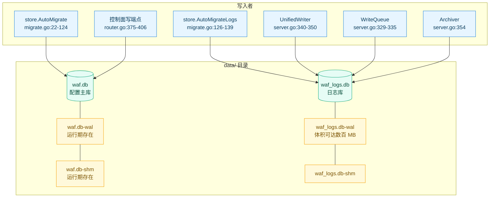
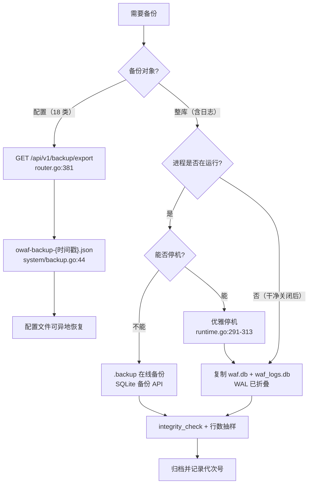
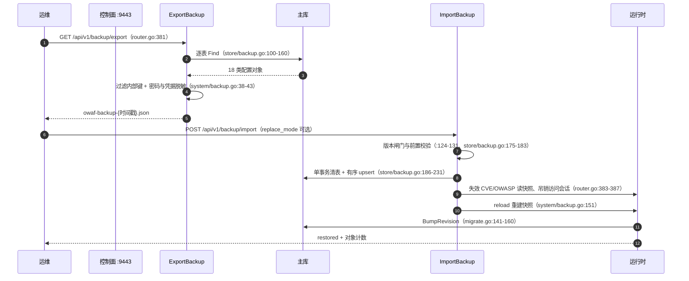
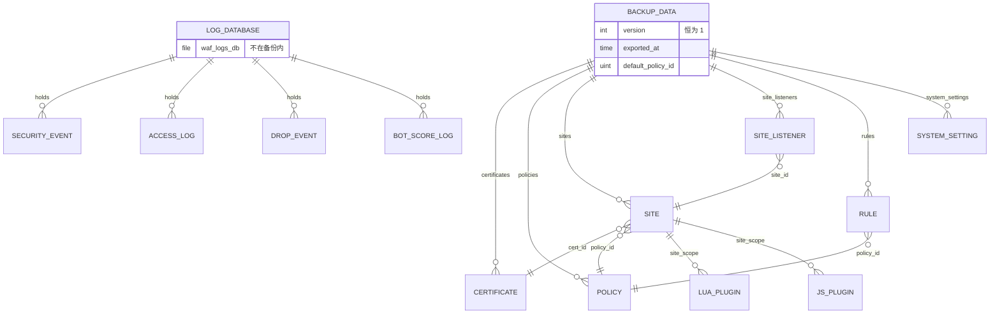

# 数据目录与备份恢复

> [返回部署运维总览](部署运维.md) · 镜像与卷的编排细节见 [容器化部署](容器化部署.md) · 变量取值语义见 [环境变量与运行参数](环境变量与运行参数.md)

<cite>
**本文档引用的文件**
- [README.md](file://README.md)
- [Dockerfile](file://Dockerfile)
- [.gitignore](file://.gitignore)
- [internal/admin/router.go](file://internal/admin/router.go)
- [internal/admin/system/backup.go](file://internal/admin/system/backup.go)
- [internal/admin/system/settings.go](file://internal/admin/system/settings.go)
- [internal/app/server.go](file://internal/app/server.go)
- [internal/core/database/gorm.go](file://internal/core/database/gorm.go)
- [internal/core/runtime.go](file://internal/core/runtime.go)
- [internal/observability/archiver.go](file://internal/observability/archiver.go)
- [internal/observability/archiver_test.go](file://internal/observability/archiver_test.go)
- [internal/observability/unified_writer.go](file://internal/observability/unified_writer.go)
- [internal/security/clientip.go](file://internal/security/clientip.go)
- [internal/store/backup.go](file://internal/store/backup.go)
- [internal/store/migrate.go](file://internal/store/migrate.go)
- [internal/store/migrations/access_log_fingerprint_key.go](file://internal/store/migrations/access_log_fingerprint_key.go)
- [internal/store/migrations/default_policy.go](file://internal/store/migrations/default_policy.go)
- [internal/store/migrations/security_event_rule_info.go](file://internal/store/migrations/security_event_rule_info.go)
- [internal/store/migrations/single_site.go](file://internal/store/migrations/single_site.go)
- [internal/store/site.go](file://internal/store/site.go)
- [internal/store/system.go](file://internal/store/system.go)
</cite>

## 目录

1. [简介](#简介)
2. [项目结构](#项目结构)
3. [核心组件](#核心组件)
4. [架构总览](#架构总览)
5. [详细组件分析](#详细组件分析)
6. [依赖关系分析](#依赖关系分析)
7. [性能考虑](#性能考虑)
8. [故障排查指南](#故障排查指南)
9. [结论](#结论)
10. [附录](#附录)

## 简介

本域只讲两件事：**`data/` 里到底有什么、它们由谁写**，以及**配置备份能带走什么、必须人工补什么**。运行变量清单归 [环境变量与运行参数](环境变量与运行参数.md)，容器编排归 [容器化部署](容器化部署.md)，迁移框架细节归 [数据存储层/数据迁移管理](../数据存储层/数据迁移管理.md)。

实测基线（本次读取时的工作区状态）：`data/` 目录内只有 `waf.db` 与 `waf_logs.db` 两个文件，没有 `-wal` / `-shm` 伴随文件。这与代码语义一致——进程是干净关闭的，SQLite 在最后一个连接关闭时把 WAL 折叠回主库文件。运行期这两个伴随文件必然存在，备份口径因此完全不同。

| 项 | 主库 | 日志库 |
|----|------|--------|
| 缺省路径 | `./data/waf.db`（[README.md:318](file://README.md#L318)） | `./data/waf_logs.db`（[README.md:319](file://README.md#L319)） |
| 载体变量 | `MY_OPENWAF_DSN`（[runtime.go:63-67](file://internal/core/runtime.go#L63-L67)） | `MY_OPENWAF_LOG_DSN`（[runtime.go:88-93](file://internal/core/runtime.go#L88-L93)） |
| 模型数 | 31（[migrate.go:52-89](file://internal/store/migrate.go#L52-L89)） | 4（[migrate.go:126-139](file://internal/store/migrate.go#L126-L139)） |
| 外键约束 | `foreign_keys(ON)`（[gorm.go:89](file://internal/core/database/gorm.go#L89)） | `foreign_keys(OFF)`（[gorm.go:94](file://internal/core/database/gorm.go#L94)） |
| 是否进入配置备份 | 是，18 类对象 | 否 |

**章节来源**
- [README.md:318-320](file://README.md#L318-L320)
- [internal/core/runtime.go:63-93](file://internal/core/runtime.go#L63-L93)
- [internal/core/database/gorm.go:82-95](file://internal/core/database/gorm.go#L82-L95)
- [internal/store/migrate.go:22-139](file://internal/store/migrate.go#L22-L139)

## 项目结构

数据目录里没有第三种文件：GeoIP 库、验证码资源、磁盘前端产物、日志文件都由各自的变量决定，**不随 `MY_OPENWAF_DATA` 收敛**（这一点常被误认为「换数据目录就全搬走了」）。



**图表来源**
- [internal/store/migrate.go:22-139](file://internal/store/migrate.go#L22-L139)
- [internal/app/server.go:329-354](file://internal/app/server.go#L329-L354)
- [internal/admin/router.go:375-406](file://internal/admin/router.go#L375-L406)
- [internal/core/database/gorm.go:82-95](file://internal/core/database/gorm.go#L82-L95)

### 数据目录清单

| 路径 | 产生者 | 存在条件 | 是否必须持久化 | 忽略规则 |
|------|--------|----------|:--------------:|----------|
| `data/waf.db` | `database.Open`（[runtime.go:63-67](file://internal/core/runtime.go#L63-L67)） | 恒有 | 是 | [.gitignore:8-9](file://.gitignore#L8-L9) |
| `data/waf.db-wal` | SQLite WAL 模式（[gorm.go:89](file://internal/core/database/gorm.go#L89)） | 进程运行期间 | 否（可由主库重建，但丢了会丢最近提交） | 未显式列出 |
| `data/waf.db-shm` | WAL 共享内存索引 | 进程运行期间 | 否 | 未显式列出 |
| `data/waf_logs.db` | `Options{LogDB: true}`（[runtime.go:88-93](file://internal/core/runtime.go#L88-L93)） | 恒有 | 视审计要求 | [.gitignore:9](file://.gitignore#L9) |
| `data/waf_logs.db-wal` | `wal_autocheckpoint(2000)`（[gorm.go:94](file://internal/core/database/gorm.go#L94)） | 进程运行期间 | 否 | 未显式列出 |
| `data/waf_logs.db-shm` | 同上 | 进程运行期间 | 否 | 未显式列出 |
| 容器内 `/app/data` | `mkdir -p`（[Dockerfile:21](file://Dockerfile#L21)）、`VOLUME`（[:27](file://Dockerfile#L27)） | 镜像构建期 | 是（必须外挂） | — |
| 日志文件 | `MY_OPENWAF_LOG_FILE`（见[环境变量与运行参数](环境变量与运行参数.md)） | 显式设置后 | 视审计要求 | [.gitignore:10](file://.gitignore#L10) |

`*.db` 与 `data/` 都在忽略清单里（[.gitignore:8-10](file://.gitignore#L8-L10)），意味着仓库里不可能存在「用 git 恢复数据库」这条路径；容器如果没有外挂 `-v ./data:/app/data`（[README.md:283-288](file://README.md#L283-L288)），命名卷会成为唯一落点，`docker rm` 之后数据即失联。

**章节来源**
- [internal/core/database/gorm.go:82-95](file://internal/core/database/gorm.go#L82-L95)
- [internal/core/runtime.go:63-93](file://internal/core/runtime.go#L63-L93)
- [.gitignore:7-10](file://.gitignore#L7-L10)
- [Dockerfile:21-27](file://Dockerfile#L21-L27)
- [README.md:283-288](file://README.md#L283-L288)

## 核心组件

| 组件 | 位置 | 职责 | 不做的事 |
|------|------|------|----------|
| 备份数据容器 | [store/backup.go:33-56](file://internal/store/backup.go#L33-L56) | 承载 18 类配置对象与 `version`/`exported_at` | 不含日志、会话、管理员凭证 |
| 导出器 | [store/backup.go:93-163](file://internal/store/backup.go#L93-L163) | 逐表 `Find`，任一失败整体失败；识别默认策略 | 不做脱敏（脱敏在 handler） |
| 导入器 | [store/backup.go:174-267](file://internal/store/backup.go#L174-L267) | 事务内校验 → 可选清表 → 有序 upsert → 修复默认策略 | 不重建快照（由 handler 的 reload 负责） |
| 导出端点 | [system/backup.go:30-48](file://internal/admin/system/backup.go#L30-L48) | 过滤内部键、Redis 密码脱敏、威胁情报与 OAuth 凭据掩码、加下载头 | 不导出日志库 |
| 导入端点 | [system/backup.go:117-166](file://internal/admin/system/backup.go#L117-L166) | 版本闸门、内部键过滤、失效回调、触发 reload | 不改引导参数 |
| 归档器 | [observability/archiver.go:332-511](file://internal/observability/archiver.go#L332-L511) | 按保留期删除 + 每轮做 WAL checkpoint 与统计信息维护 | 不清 `bot_score_logs`、不消费 `stats_retention_days` |
| 迁移编排 | [store/migrate.go:22-139](file://internal/store/migrate.go#L22-L139) | 数据迁移 → `AutoMigrate` 31 模型 → 补列迁移 | 不回滚已成功的数据迁移 |
| 代次推进 | [store/migrate.go:141-160](file://internal/store/migrate.go#L141-L160) | `BumpRevision` 让快照缓存失效 | 不感知备份内容 |

**章节来源**
- [internal/store/backup.go:33-267](file://internal/store/backup.go#L33-L267)
- [internal/admin/system/backup.go:30-166](file://internal/admin/system/backup.go#L30-L166)
- [internal/observability/archiver.go:332-511](file://internal/observability/archiver.go#L332-L511)
- [internal/store/migrate.go:22-160](file://internal/store/migrate.go#L22-L160)

## 架构总览

备份与恢复是**配置面**的能力，数据面完全不参与：日志库从不出现在备份里，Redis 只做热态镜像。

| 层 | 载体 | 一致性保障 | 恢复入口 |
|----|------|------------|----------|
| 配置层 | 主库 18 类表 | 单个事务 + upsert | `POST /api/v1/backup/import` |
| 快照层 | 内存 `snapshot.Holder` | 代次 CAS | 导入后由 handler 调 `reload` |
| 日志层 | 日志库 4 张表 | WAL + 批量事务 | 无，只能整库替换 |
| 热态层 | Redis 列表与 KV | `LTRIM` + TTL | 无，重启后由写入器重建 |

**章节来源**
- [internal/admin/router.go:381-388](file://internal/admin/router.go#L381-L388)
- [internal/store/backup.go:174-267](file://internal/store/backup.go#L174-L267)
- [internal/observability/unified_writer.go:1094-1162](file://internal/observability/unified_writer.go#L1094-L1162)

## 详细组件分析

### 备份对象清单表

`BackupData` 的字段与导出顺序一一对应，`BackupModels` 用同一份清单守住测试库（[store/backup.go:78-85](file://internal/store/backup.go#L78-L85)）。

| 对象 | JSON 键 | 主键策略 | 备注 |
|------|---------|----------|------|
| 证书 | `certificates` | 保留原 ID | PEM 随备份走（[backup.go:38](file://internal/store/backup.go#L38)） |
| 策略 | `policies` | 保留原 ID | 导入时先清空 `DefaultSlot`（[:195-203](file://internal/store/backup.go#L195-L203)） |
| 策略级 OWASP 规则配置 | `policy_owasp_rule_configs` | 保留原 ID | — |
| 规则 | `rules` | 保留原 ID | `priority` 为零值时会被显式写回（[:492-535](file://internal/store/backup.go#L492-L535)） |
| 站点 | `sites` | 保留原 ID | XFF 口径先归一（[:184](file://internal/store/backup.go#L184)） |
| 站点监听 | `site_listeners` | 保留原 ID | — |
| IP 名单 | `ip_list_entries` | 保留原 ID | — |
| 威胁情报订阅 | `threat_intel_feeds` | 保留原 ID | `auth_header_value` 被掩码（[system/backup.go:56-60](file://internal/admin/system/backup.go#L56-L60)） |
| CVE 规则记录 | `cve_rule_records` | 保留原 ID | — |
| CVE 站点级覆盖 | `cve_rule_scope_overrides` | 保留原 ID | — |
| 应用路由 | `application_routes` | 保留原 ID | — |
| 站点访问控制配置 | `site_access_configs` | 保留原 ID | 导入后吊销全部访问会话 |
| OAuth/OIDC 提供方 | `access_providers` | 保留原 ID | `client_secret` 掩码（[system/backup.go:71-87](file://internal/admin/system/backup.go#L71-L87)） |
| 访问用户 | `access_users` | 保留原 ID | — |
| 访问路径规则 | `access_path_rules` | 保留原 ID | — |
| Lua 插件 | `lua_plugins` | 保留原 ID | 排在 `sites` 之后（[store/backup.go:223-225](file://internal/store/backup.go#L223-L225)） |
| JS 插件 | `js_plugins` | 保留原 ID | `stage`/`failure_mode`/`timeout_ms` 导入前校验（[:270-284](file://internal/store/backup.go#L270-L284)） |
| 系统设置 | `system_settings` | 按 `key` upsert（`key` 唯一索引，[system.go:4-8](file://internal/store/system.go#L4-L8)） | 内部键被过滤、Redis 密码脱敏 |

不在备份清单内的主库对象共 13 类：管理员账号、刷新令牌、令牌黑名单、活跃会话、登录尝试、API Key、访问会话、已记录资源、OWASP 目录、误报上报、CVE 同步日志、威胁情报同步日志、`config_revisions`。这个清单是**特性而非缺陷**——凭据与运行态历史不该随配置文件流转。

**章节来源**
- [internal/store/backup.go:33-85](file://internal/store/backup.go#L33-L85)
- [internal/store/backup.go:174-284](file://internal/store/backup.go#L174-L284)
- [internal/store/system.go:4-8](file://internal/store/system.go#L4-L8)
- [internal/admin/system/backup.go:30-87](file://internal/admin/system/backup.go#L30-L87)
- [internal/store/migrate.go:52-89](file://internal/store/migrate.go#L52-L89)

### 恢复流程步骤表

| 序 | 步骤 | 代码位置 | 失败后果 |
|:--:|------|----------|----------|
| 1 | 请求体绑定为 `ImportBackupReq` | [system/backup.go:119-123](file://internal/admin/system/backup.go#L119-L123) | 400 `invalid backup json` |
| 2 | 版本闸门：`version` 必填且不大于 `BackupVersion` | [:124-131](file://internal/admin/system/backup.go#L124-L131)、[store/backup.go:59](file://internal/store/backup.go#L59) | 400 并回显支持上限 |
| 3 | 过滤内部设置键 | [:133](file://internal/admin/system/backup.go#L133)、[settings.go:13-16](file://internal/admin/system/settings.go#L13-L16) | 静默丢弃 `jwt_secret` 等 |
| 4 | 导入前校验 protection / JS 插件 / 规则验证码 | [store/backup.go:175-183](file://internal/store/backup.go#L175-L183) | 400 携带具体哨兵错误 |
| 5 | `replace_mode` 为真时按外键逆序清表 | [:186-191](file://internal/store/backup.go#L186-L191)、[:541-570](file://internal/store/backup.go#L541-L570) | 事务回滚，库不变 |
| 6 | 按依赖顺序 upsert 17 类对象 | [:205-231](file://internal/store/backup.go#L205-L231) | 事务回滚 |
| 7 | 回写「带 default 且备份中为零值」的列 | [:492-535](file://internal/store/backup.go#L492-L535) | 不回写则停用的站点被重启、`priority` 0 变 100 |
| 8 | `system_settings` 按 `key` 单列更新 | [:249-258](file://internal/store/backup.go#L249-L258) | 只改 `value`，不改键名 |
| 9 | 事务内复用 V9 修复默认策略引用 | [:260-264](file://internal/store/backup.go#L260-L264)、[default_policy.go:23](file://internal/store/migrations/default_policy.go#L23) | 失败即整体回滚 |
| 10 | 失效回调：CVE 与 OWASP 读快照 + 吊销访问会话 | [router.go:382-388](file://internal/admin/router.go#L382-L388) | 记 ERROR 但不阻断 |
| 11 | `reload` 重建快照并推进代次 | [system/backup.go:151-155](file://internal/admin/system/backup.go#L151-L155) | 500 且提示「已导入但重载失败」 |
| 12 | 回显恢复计数 | [:157-164](file://internal/admin/system/backup.go#L157-L164) | — |

第 11 步失败是最危险的状态：库里已经是新配置，内存快照还是旧代次。此时 `GET /api/v1/runtime-config` 显示的站点集合与 `sites` 表不一致，运维必须再触发一次重载——`POST /api/v1/reload`（[router.go:313](file://internal/admin/router.go#L313) 接线，处理器为 [settings.go:202-210](file://internal/admin/system/settings.go#L202-L210) 的 `ReloadSnapshot`），而不是回滚库。

**章节来源**
- [internal/admin/system/backup.go:117-166](file://internal/admin/system/backup.go#L117-L166)
- [internal/store/backup.go:174-267](file://internal/store/backup.go#L174-L267)
- [internal/admin/router.go:381-388](file://internal/admin/router.go#L381-L388)
- [internal/admin/system/settings.go:13-16](file://internal/admin/system/settings.go#L13-L16)
- [internal/admin/system/settings.go:202-210](file://internal/admin/system/settings.go#L202-L210)

### 保留策略表

归档器以 24 小时为默认间隔，且**启动时不预跑一次清理**：`loop` 先建 timer 再 `select`（[archiver.go:219-242](file://internal/observability/archiver.go#L219-L242)），首个动作落在一个完整间隔之后。

| 对象 | 策略与行号 | 是否有消费方 |
|------|-----------|:------------:|
| `security_events` | `SecurityEventDays`，默认 30 天（[archiver.go:54](file://internal/observability/archiver.go#L54)、[:146-155](file://internal/observability/archiver.go#L146-L155)）；删除分支 [:341-357](file://internal/observability/archiver.go#L341-L357) | 有 |
| `access_logs` | `AccessLogDays`，默认 30 天；删除分支 [:359-371](file://internal/observability/archiver.go#L359-L371) | 有 |
| `drop_events` | `DropEventDays`，默认 30 天；删除分支 [:373-385](file://internal/observability/archiver.go#L373-L385) | 有 |
| 威胁情报同步日志 | 复用 `DropEventDays`（[:387-399](file://internal/observability/archiver.go#L387-L399)、注入点 [:186-193](file://internal/observability/archiver.go#L186-L193)） | 有 |
| `bot_score_logs` | 无删除分支；仅出现在 MySQL/PG 维护清单（[:479](file://internal/observability/archiver.go#L479)、[:502](file://internal/observability/archiver.go#L502)） | 无 |
| `stats_retention_days` | 字段存在且默认 7 天（[:29](file://internal/observability/archiver.go#L29)、[:55](file://internal/observability/archiver.go#L55)），`cleanup` 内无引用 | 无 |
| `retention_config`（设置键） | 每轮刷新读取（[:255-272](file://internal/observability/archiver.go#L255-L272)） | 有 |
| `security_event_retention_days` | 独立键，只覆盖对应字段（[:306-308](file://internal/observability/archiver.go#L306-L308)） | 有 |
| `access_log_retention_days` | 独立键（[:309-311](file://internal/observability/archiver.go#L309-L311)） | 有 |
| `drop_event_retention_days` | 无独立键分支，只能整块写 `retention_config` | 部分 |
| `db_optimize_interval_hours` | 刷新清理间隔（[:314-329](file://internal/observability/archiver.go#L314-L329)） | 有 |
| `SetRetention` | [:196-205](file://internal/observability/archiver.go#L196-L205) | 生产无调用方，仅测试（[archiver_test.go:74](file://internal/observability/archiver_test.go#L74)） |

保留值为 0 表示**永不清理**（[archiver.go:22-24](file://internal/observability/archiver.go#L22-L24) 的注释口径），因此 `drop_event_retention_days: 0` 是合法配置而不是「未设置」。

**章节来源**
- [internal/observability/archiver.go:20-60](file://internal/observability/archiver.go#L20-L60)
- [internal/observability/archiver.go:146-205](file://internal/observability/archiver.go#L146-L205)
- [internal/observability/archiver.go:219-330](file://internal/observability/archiver.go#L219-L330)
- [internal/observability/archiver.go:332-399](file://internal/observability/archiver.go#L332-L399)
- [internal/observability/archiver.go:479-509](file://internal/observability/archiver.go#L479-L509)
- [internal/app/server.go:352-357](file://internal/app/server.go#L352-L357)
- [internal/observability/archiver_test.go:74-74](file://internal/observability/archiver_test.go#L74-L74)

### WAL 的运行期含义与检查点

两个库的 WAL 参数刻意不同，这是备份口径的根据。

| 参数 | 主库取值 | 日志库取值 | 位置 |
|------|----------|------------|------|
| `journal_mode` | `WAL` | `WAL` | [gorm.go:89](file://internal/core/database/gorm.go#L89)、[:94](file://internal/core/database/gorm.go#L94) |
| `wal_autocheckpoint` | 1000 页 | 2000 页（约 8 MB） | 同上 |
| `synchronous` | `NORMAL` | `NORMAL` | 同上 |
| `busy_timeout` | 10000 ms | 10000 ms | 同上 |
| `cache_size` | `-64000` | `-65536` | 同上 |
| `foreign_keys` | `ON` | `OFF` | 同上 |
| 连接上限 | 8 | 8 | [gorm.go:103-105](file://internal/core/database/gorm.go#L103-L105)、[:113](file://internal/core/database/gorm.go#L113) |

三条结论：

1. 日志库由归档器每轮执行 `PRAGMA optimize`、`wal_checkpoint(PASSIVE)`、`wal_checkpoint(TRUNCATE)`（[archiver.go:453-470](file://internal/observability/archiver.go#L453-L470)），而归档器的句柄是 `rt.LogDB`（[server.go:354](file://internal/app/server.go#L354)）——**主库没有任何应用侧检查点路径**，只靠 SQLite 自身的 1000 页自动检查点。
2. 8 条连接同时活跃（[gorm.go:113](file://internal/core/database/gorm.go#L113)），直接 `cp waf.db` 拿到的是「某一时刻的主文件」，其中最近提交可能仍在 `-wal` 里。
3. 干净关闭会把 WAL 折叠回主库：`rt.Close` 对两个句柄都执行 `sqlDB.Close()`（[runtime.go:291-313](file://internal/core/runtime.go#L291-L313)），这解释了本次实测目录里没有 `-wal`/`-shm`。



**图表来源**
- [internal/admin/router.go:381-388](file://internal/admin/router.go#L381-L388)
- [internal/admin/system/backup.go:30-48](file://internal/admin/system/backup.go#L30-L48)
- [internal/core/runtime.go:291-313](file://internal/core/runtime.go#L291-L313)
- [internal/core/database/gorm.go:82-113](file://internal/core/database/gorm.go#L82-L113)

**章节来源**
- [internal/core/database/gorm.go:82-113](file://internal/core/database/gorm.go#L82-L113)
- [internal/observability/archiver.go:446-472](file://internal/observability/archiver.go#L446-L472)
- [internal/core/runtime.go:291-313](file://internal/core/runtime.go#L291-L313)
- [internal/app/server.go:352-357](file://internal/app/server.go#L352-L357)

### 三库备份差异

| 驱动 | 备份单位 | 应用侧维护语句 | 恢复后必做 | 依据 |
|------|----------|----------------|------------|------|
| `sqlite` | 文件（含 `-wal`）或在线 `.backup` | `PRAGMA optimize`、`wal_checkpoint(PASSIVE)`、`wal_checkpoint(TRUNCATE)` | 核对 DSN 指向、重启或重载 | [archiver.go:446-470](file://internal/observability/archiver.go#L446-L470) |
| `mysql` | 库级逻辑导出 | `OPTIMIZE TABLE` + `ANALYZE TABLE`（4 张日志表） | 保证 DSN 含 `parseTime=True` | [archiver.go:474-495](file://internal/observability/archiver.go#L474-L495)、[gorm.go:123-125](file://internal/core/database/gorm.go#L123-L125) |
| `postgres` | 库级逻辑导出 | `VACUUM ANALYZE`（4 张日志表） | 经 PgBouncer 时 DSN 加 `pgbouncer=true` | [archiver.go:497-511](file://internal/observability/archiver.go#L497-L511)、[gorm.go:151-159](file://internal/core/database/gorm.go#L151-L159) |

仓库不提供任何数据库侧备份脚本：`scripts/` 下只有前端与构建相关脚本，`.github/workflows/` 里也没有数据库备份作业。因此 MySQL/PostgreSQL 的导出工具选择属于部署方职责，本域只登记**应用会主动执行的维护语句**（下表 `sql` 围栏逐字取自代码），不推荐具体转储命令。

```sql
-- 逐字来自归档器的 SQLite 维护路径（archiver.go:453-470）
PRAGMA optimize;
PRAGMA wal_checkpoint(PASSIVE);
PRAGMA wal_checkpoint(TRUNCATE);

-- 逐字来自归档器的 MySQL 维护路径（archiver.go:479-493）
OPTIMIZE TABLE `security_events`;
ANALYZE TABLE `access_logs`;

-- 逐字来自归档器的 PostgreSQL 维护路径（archiver.go:502-509）
VACUUM ANALYZE drop_events;
```

```sql
-- 逐字来自 V2 数据迁移（migrations/single_site.go:69 与 :150-154 的参数化模板）
ALTER TABLE sites ADD COLUMN trusted_cidr TEXT;
UPDATE sites SET xff_mode = ?, trusted_cidr = ?, preserve_original_host = ? WHERE id = ?;
-- 迁移成功后旧表改名保留，时间戳格式 20060102_150405（single_site.go:34-39）
ALTER TABLE listeners RENAME TO listeners_backup_{时间戳};
```

**章节来源**
- [internal/observability/archiver.go:446-511](file://internal/observability/archiver.go#L446-L511)
- [internal/core/database/gorm.go:115-159](file://internal/core/database/gorm.go#L115-L159)
- [internal/store/migrations/single_site.go:34-76](file://internal/store/migrations/single_site.go#L34-L76)
- [internal/store/migrations/single_site.go:150-154](file://internal/store/migrations/single_site.go#L150-L154)

### 备份与恢复时序



**图表来源**
- [internal/admin/router.go:381-388](file://internal/admin/router.go#L381-L388)
- [internal/admin/system/backup.go:30-166](file://internal/admin/system/backup.go#L30-L166)
- [internal/store/backup.go:93-267](file://internal/store/backup.go#L93-L267)
- [internal/store/migrate.go:141-160](file://internal/store/migrate.go#L141-L160)

**章节来源**
- [internal/admin/router.go:381-388](file://internal/admin/router.go#L381-L388)
- [internal/admin/system/backup.go:30-166](file://internal/admin/system/backup.go#L30-L166)
- [internal/store/backup.go:93-267](file://internal/store/backup.go#L93-L267)

## 依赖关系分析



**图表来源**
- [internal/store/backup.go:33-56](file://internal/store/backup.go#L33-L56)
- [internal/store/backup.go:205-231](file://internal/store/backup.go#L205-L231)
- [internal/store/migrate.go:52-89](file://internal/store/migrate.go#L52-L89)
- [internal/store/migrate.go:126-139](file://internal/store/migrate.go#L126-L139)

### 外部服务依赖表

| 外部实体 | 依赖形态 | 载体 | 恢复期注意事项 |
|----------|----------|------|----------------|
| SQLite 文件 | 本库文件 | `MY_OPENWAF_DSN` / `MY_OPENWAF_LOG_DSN` | 换目录必须同时改两个变量并重启 |
| MySQL | 网络服务 | `MY_OPENWAF_DSN` | 目标库需已存在且账号可 DDL（`AutoMigrate` 启动即建表） |
| PostgreSQL | 网络服务 | `MY_OPENWAF_DSN` | 经 PgBouncer 时须加 `pgbouncer=true`（[gorm.go:151-159](file://internal/core/database/gorm.go#L151-L159)） |
| Redis | 可选热态 | `redis_config` 设置行 | 备份里的密码是 `[redacted]`，导入后必须重设 |
| 磁盘前端目录 | `MY_OPENWAF_ADMIN_STATIC_DIR` | 非备份对象 | 换机后需重新放置或改回内嵌 |
| MaxMind 库 | `MY_OPENWAF_GEOIP_DB` | 非备份对象 | 路径不存在时地理维度降级 |

**章节来源**
- [internal/core/database/gorm.go:115-159](file://internal/core/database/gorm.go#L115-L159)
- [internal/core/runtime.go:63-93](file://internal/core/runtime.go#L63-L93)
- [internal/admin/system/settings.go:60-76](file://internal/admin/system/settings.go#L60-L76)

## 性能考虑

问题：日志库体积随写入单调增长，本次实测 `data/waf_logs.db` 约 301 MB、`data/waf.db` 约 692 KB。优化：日志库把 `wal_autocheckpoint` 收到 2000 页（[gorm.go:90-95](file://internal/core/database/gorm.go#L90-L95)），归档器每轮再 `wal_checkpoint(TRUNCATE)` 把 WAL 归零（[archiver.go:464-470](file://internal/observability/archiver.go#L464-L470)）。效果：WAL 不会长期膨胀到放大只读查询与崩溃恢复耗时。

问题：删除大量过期行会产生空闲页但不会缩小文件。口径：代码明确放弃「每天无条件 VACUUM」，改为依赖页复用（[archiver.go:457-459](file://internal/observability/archiver.go#L457-L459) 的注释）。因此**文件缩小需要人工安排维护窗口**，`PRAGMA shrink_memory` 类操作不在应用路径内。

问题：备份导出逐表全量 `Find`（[store/backup.go:100-160](file://internal/store/backup.go#L100-L160)），在大规则集上会占用主库连接。建议：导出走管理端口低频执行，避免与重载链争 8 条连接池（[gorm.go:103-106](file://internal/core/database/gorm.go#L103-L106)）。

**章节来源**
- [internal/core/database/gorm.go:90-106](file://internal/core/database/gorm.go#L90-L106)
- [internal/observability/archiver.go:453-472](file://internal/observability/archiver.go#L453-L472)
- [internal/store/backup.go:100-160](file://internal/store/backup.go#L100-L160)

## 故障排查指南

### 症状与处置

| 症状 | 根因 | 判据 | 处置 |
|------|------|------|------|
| 启动即退出并打印 `auto migrate failed` | V2 旧库迁移读取 `forwarding_profiles.trusted_c_id_r` 失败 | 库里存在 `listeners` 表（[single_site.go:12](file://internal/store/migrations/single_site.go#L12)）且该列名为 `trusted_cidr` | 见下节「列名不一致」，先补列再启动 |
| 恢复后所有管理端与 API 令牌失效 | `jwt_secret` 属内部键不入备份，换机后重新生成 | `system_settings` 中 `jwt_secret` 值为新随机串 | 固定 `MY_OPENWAF_JWT_SECRET='{占位}'`，或用原库 |
| 恢复后 Redis 连接报鉴权失败 | 备份中密码被替换为 `[redacted]` | `redis-config` 响应 `password_set=true` 但连不上 | `POST /api/v1/redis-config` 重填密码 |
| 导入返回 400 `unsupported backup version` | 备份来自更高版本 | `BackupVersion` 恒为 1（[store/backup.go:59](file://internal/store/backup.go#L59)） | 换用同版本或更高版本程序恢复 |
| 导入成功但站点仍按旧配置服务 | 第 11 步 reload 失败 | 响应含 `backup imported but reload failed` | 再触发一次重载，勿回滚库 |
| 停用的站点在恢复后重新对外服务 | 零值列被 GORM 默认值顶替 | 未走 `restoreZeroValuedDefaults`（[store/backup.go:475-491](file://internal/store/backup.go#L475-L491)） | 用当前版本程序恢复，不要手工插库 |
| 拷贝的 `waf.db` 恢复后丢最近数据 | 直接 `cp` 而未含 `-wal` | 备份时进程在跑（8 连接活跃，[gorm.go:113](file://internal/core/database/gorm.go#L113)） | 停机备份或用在线 `.backup` |
| 日志库文件不缩小 | 归档器有意不做 VACUUM | `PRAGMA freelist_count` 高 | 维护窗口手工处理，非缺陷 |

**章节来源**
- [internal/store/migrations/single_site.go:10-76](file://internal/store/migrations/single_site.go#L10-L76)
- [internal/store/backup.go:59-59](file://internal/store/backup.go#L59-L59)
- [internal/store/backup.go:475-491](file://internal/store/backup.go#L475-L491)
- [internal/admin/system/backup.go:117-166](file://internal/admin/system/backup.go#L117-L166)
- [internal/admin/system/settings.go:13-16](file://internal/admin/system/settings.go#L13-L16)
- [internal/core/database/gorm.go:103-113](file://internal/core/database/gorm.go#L103-L113)

### 列名不一致对老库恢复的影响（实测风险）

`V2MigrateSingleSite` 在检测到旧 `listeners` 表存在时执行迁移，从 `forwarding_profiles` 读取的列名是 `fp.trusted_c_id_r`（[single_site.go:129](file://internal/store/migrations/single_site.go#L129)），而写入目标与站点模型使用的列名是 `trusted_cidr`（[:63](file://internal/store/migrations/single_site.go#L63)、[site.go:93](file://internal/store/site.go#L93)）。两处不是笔误级冗余：读取侧带下划线分隔的 `c_id_r` 是历史建表形态，写入侧是现行命名。

风险链条是确定的：该 `SELECT` 在事务内执行（[:17](file://internal/store/migrations/single_site.go#L17)），列不存在即报错并向上传播到 [migrate.go:24-26](file://internal/store/migrate.go#L24-L26)，再由 [server.go:249-252](file://internal/app/server.go#L249-L252) 记 `auto migrate failed` 并 `os.Exit(1)`。**用老库文件恢复（整库替换）时，进程会在建表之前就退出**，连日志都看不到站点解析错误。

判定与规避：恢复前用下节命令确认老库该列的真实名称；若老库用的是 `trusted_cidr`，先在停库状态下补一个同义列再启动，让迁移按代码期望的列名读取。迁移成功后旧表会被改名保留（`listeners_backup_{时间戳}`、`forwarding_profiles_backup_{时间戳}`，[:34-40](file://internal/store/migrations/single_site.go#L34-L40)），这是可回退的唯一依据——原表名不复存在，回退只能靠库文件备份本身。

**章节来源**
- [internal/store/migrations/single_site.go:10-76](file://internal/store/migrations/single_site.go#L10-L76)
- [internal/store/migrations/single_site.go:123-160](file://internal/store/migrations/single_site.go#L123-L160)
- [internal/store/migrate.go:22-26](file://internal/store/migrate.go#L22-L26)
- [internal/app/server.go:249-252](file://internal/app/server.go#L249-L252)
- [internal/store/site.go:92-94](file://internal/store/site.go#L92-L94)

### 备份与校验命令

以下 `PRAGMA` 与 `UPDATE` 语句逐字来自代码；`.backup`、`.tables`、`.schema` 是 sqlite3 CLI 的内建点命令。所有口令与令牌一律脱敏。

```bash
# 1) 确认当前目录实况（干净关闭时不应出现 -wal/-shm）
ls -l ./data

# 2) 停机备份：先优雅停机（Ctrl+C / SIGTERM），再整对复制
cp ./data/waf.db      /backup/$(date +%Y%m%d-%H%M%S)/waf.db
cp ./data/waf_logs.db /backup/$(date +%Y%m%d-%H%M%S)/waf_logs.db

# 3) 在线备份：无法停机时用 SQLite 备份 API，主库与日志库分别执行
sqlite3 ./data/waf.db      ".backup '/backup/live/waf.db'"
sqlite3 ./data/waf_logs.db ".backup '/backup/live/waf_logs.db'"

# 4) 校验：完整性、WAL 模式与连接上限口径（参数值来自 gorm.go:89 与 :94）
sqlite3 /backup/live/waf.db      "PRAGMA integrity_check; PRAGMA journal_mode; PRAGMA foreign_keys;"
sqlite3 /backup/live/waf_logs.db "PRAGMA integrity_check; PRAGMA journal_mode; PRAGMA foreign_keys;"

# 5) 主动做一次检查点（语句逐字来自 archiver.go:460 与 :467）
sqlite3 /backup/live/waf_logs.db "PRAGMA wal_checkpoint(PASSIVE); PRAGMA wal_checkpoint(TRUNCATE);"

# 6) 代次与设置基线核对（恢复前后各跑一次，比对是否只推进了预期次数）
sqlite3 /backup/live/waf.db "SELECT id, revision FROM config_revisions;"
sqlite3 /backup/live/waf.db "SELECT key FROM system_settings ORDER BY key;"

# 7) 老库列名判定：恢复前必须先跑这一句
sqlite3 ./data-legacy/waf.db ".schema forwarding_profiles" | grep -E "trusted_c_id_r|trusted_cidr"

# 8) 配置文件备份（管理端口，凭据走交互输入而非命令行）
curl -fsS -H "Authorization: Bearer {占位访问令牌}" \
  -o owaf-backup-manual.json "http://127.0.0.1:9443/api/v1/backup/export"
head -c 200 owaf-backup-manual.json; echo
```

```sql
-- 老库缺列时的补列（写法对齐 single_site.go:69 生成的语句）
ALTER TABLE forwarding_profiles ADD COLUMN trusted_c_id_r TEXT;
UPDATE forwarding_profiles SET trusted_c_id_r = trusted_cidr WHERE trusted_c_id_r IS NULL;
-- 站点可信代理列的取值语法由运行期校验器约束（security/clientip.go:197-215）
SELECT id, host, xff_mode, trusted_cidr FROM sites WHERE trusted_cidr <> '';
```

**章节来源**
- [internal/core/database/gorm.go:82-113](file://internal/core/database/gorm.go#L82-L113)
- [internal/observability/archiver.go:446-472](file://internal/observability/archiver.go#L446-L472)
- [internal/store/migrations/single_site.go:63-76](file://internal/store/migrations/single_site.go#L63-L76)
- [internal/store/migrate.go:141-160](file://internal/store/migrate.go#L141-L160)
- [internal/security/clientip.go:197-215](file://internal/security/clientip.go#L197-L215)
- [internal/admin/system/backup.go:30-48](file://internal/admin/system/backup.go#L30-L48)

## 结论

- 数据目录只有两个逻辑对象：配置主库与日志库。`MY_OPENWAF_DATA` 不收敛 GeoIP、验证码与日志文件路径，这一点直接决定了备份范围。
- 备份是**配置面**能力：18 类对象、单事务、可选整体替换、结尾强制 `reload`；日志库、会话、管理员凭据、JWT 主密钥都不在其中。
- WAL 决定了备份口径：主库没有应用侧检查点路径，日志库每轮检查点并截断。因此停机或在线 `.backup` 二选一，`cp` 不算备份。
- 恢复后是否要重载有确定答案：**必须**。端点已内置 `reload`，失败时表现为「已导入但未生效」，处置是再触发重载而非回滚。
- 登记两项实测风险：`trusted_c_id_r` 与 `trusted_cidr` 的列名不一致会让老库恢复在迁移期直接退出；备份内 `redis_config` 的密码以 `[redacted]` 形态落库，导入后需人工重设。两项均只登记、不改代码，汇总口径由问题检测类文档承接（该文档尚未建立，当前以本节记录为准）。

**章节来源**
- [internal/store/backup.go:33-267](file://internal/store/backup.go#L33-L267)
- [internal/admin/system/backup.go:30-166](file://internal/admin/system/backup.go#L30-L166)
- [internal/core/database/gorm.go:82-113](file://internal/core/database/gorm.go#L82-L113)
- [internal/observability/archiver.go:446-472](file://internal/observability/archiver.go#L446-L472)
- [internal/store/migrations/single_site.go:123-160](file://internal/store/migrations/single_site.go#L123-L160)

## 附录

### 恢复后必做检查清单

| 项 | 判据 | 依据 |
|----|------|------|
| 引导参数与新库匹配 | `/readyz` 返回 200 | [环境变量与运行参数](环境变量与运行参数.md) |
| 站点全部重建 | 重载日志出现新代次 | [migrate.go:141-160](file://internal/store/migrate.go#L141-L160) |
| 默认策略引用可用 | `policies.default_slot` 唯一 | [store/backup.go:232-247](file://internal/store/backup.go#L232-L247)、[default_policy.go:23](file://internal/store/migrations/default_policy.go#L23) |
| Redis 密码重设 | `redis-config` 连通且限流为分布式 | [system/backup.go:38-41](file://internal/admin/system/backup.go#L38-L41) |
| OAuth 密钥重录 | 掩码值不可解密 | [system/backup.go:71-87](file://internal/admin/system/backup.go#L71-L87) |
| 威胁情报凭据重录 | `auth_header_value` 为掩码 | [system/backup.go:56-60](file://internal/admin/system/backup.go#L56-L60) |
| 访问会话已重置 | 旧 token 全部无效 | [router.go:385-387](file://internal/admin/router.go#L385-L387) |
| 站点可信代理仍合法 | `ValidateTrustedCIDR` 通过 | [clientip.go:197-215](file://internal/security/clientip.go#L197-L215) |

**章节来源**
- [internal/store/backup.go:232-247](file://internal/store/backup.go#L232-L247)
- [internal/admin/system/backup.go:38-87](file://internal/admin/system/backup.go#L38-L87)
- [internal/admin/router.go:382-388](file://internal/admin/router.go#L382-L388)
- [internal/security/clientip.go:197-215](file://internal/security/clientip.go#L197-L215)

### 兼容矩阵表

| 维度 | 现行形态 | 兼容对象 | 判定 |
|------|----------|----------|------|
| 备份格式版本 | `BackupVersion = 1`（[store/backup.go:59](file://internal/store/backup.go#L59)） | `version` 为 0 或空 | 拒绝（[system/backup.go:124-127](file://internal/admin/system/backup.go#L124-L127)） |
| 备份格式版本 | 同上 | 高于当前支持上限 | 拒绝并回显上限（[:128-131](file://internal/admin/system/backup.go#L128-L131)） |
| 主键 | 保留原始 ID 做 upsert | 目标库同 ID 不同内容 | 覆盖更新（[store/backup.go:467-471](file://internal/store/backup.go#L467-L471)） |
| 恢复模式 | `replace_mode=true` 清 17 类配置表 | 日志/会话/凭据表 | 不触及（[:541-570](file://internal/store/backup.go#L541-L570)） |
| 迁移序列 | V2–V15 共 15 函数 / 14 文件 | 老库缺任意列 | `AutoMigrate` 幂等补列（[migrate.go:22-124](file://internal/store/migrate.go#L22-L124)） |
| V13 | 主库与日志库两个函数（[security_event_rule_info.go:34-76](file://internal/store/migrations/security_event_rule_info.go#L34-L76)） | 只恢复单库 | 另一函数按 `HasTable` 跳过 |
| 日志库 DDL | 4 模型 + V12 回填指纹摘要 + V13 日志部分（[migrate.go:126-139](file://internal/store/migrate.go#L126-L139)、[access_log_fingerprint_key.go:41-55](file://internal/store/migrations/access_log_fingerprint_key.go#L41-L55)） | 整库替换 | 兼容，无需配置备份 |
| Redis 键 | 列表长度 `LTRIM` 99999 / 49999，TTL 7 天（[unified_writer.go:1103-1151](file://internal/observability/unified_writer.go#L1103-L1151)） | 换实例或清库 | 兼容，热态可再生 |
| 前端静态目录 | 内嵌产物优先 | `MY_OPENWAF_ADMIN_STATIC_DIR` 指向不存在目录 | 不属备份对象，需人工放置 |

**章节来源**
- [internal/store/backup.go:59-59](file://internal/store/backup.go#L59-L59)
- [internal/store/backup.go:460-570](file://internal/store/backup.go#L460-L570)
- [internal/admin/system/backup.go:124-131](file://internal/admin/system/backup.go#L124-L131)
- [internal/store/migrate.go:22-139](file://internal/store/migrate.go#L22-L139)
- [internal/store/migrations/access_log_fingerprint_key.go:41-55](file://internal/store/migrations/access_log_fingerprint_key.go#L41-L55)
- [internal/store/migrations/security_event_rule_info.go:34-76](file://internal/store/migrations/security_event_rule_info.go#L34-L76)
- [internal/observability/unified_writer.go:1101-1151](file://internal/observability/unified_writer.go#L1101-L1151)

### 相关文档索引

- 变量与重载：[环境变量与运行参数](环境变量与运行参数.md)
- 卷与生命周期：[容器化部署](容器化部署.md)
- 构建与产物：[构建脚本与工具链](构建脚本与工具链.md)
- 发布通道：[CI与发布流水线](CI与发布流水线.md)
- 域索引：[部署运维](部署运维.md)
- 存储层细节：[数据存储层](../数据存储层/数据存储层.md)、[数据迁移管理](../数据存储层/数据迁移管理.md)、[GORM 配置与使用](../数据存储层/GORM%20配置与使用.md)
- 归档与清理：[监控与可观测性/事件归档系统](../监控与可观测性/事件归档系统.md)

[本节为总结，无需特定文件来源]
