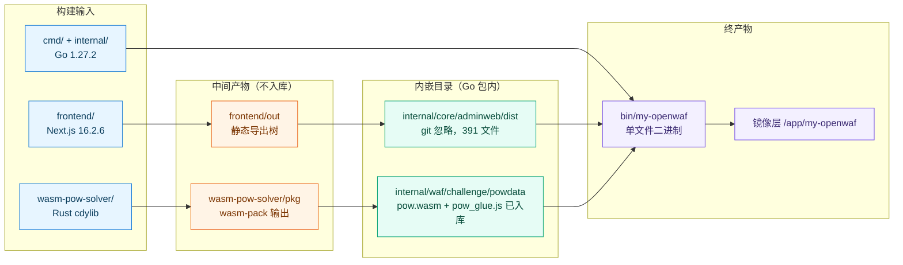
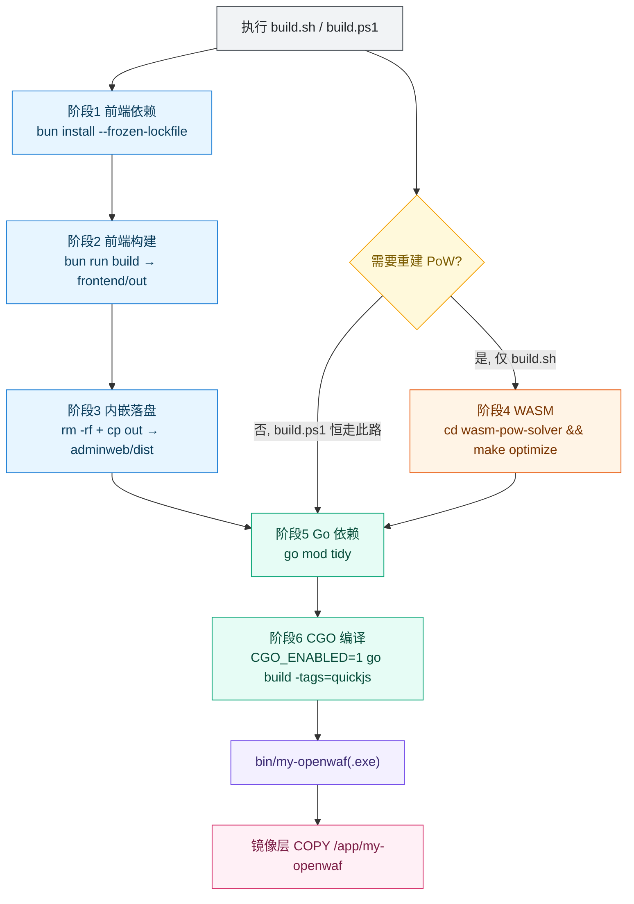
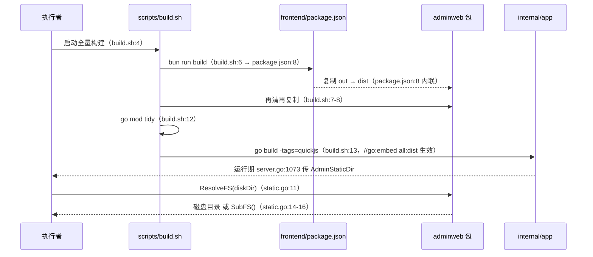
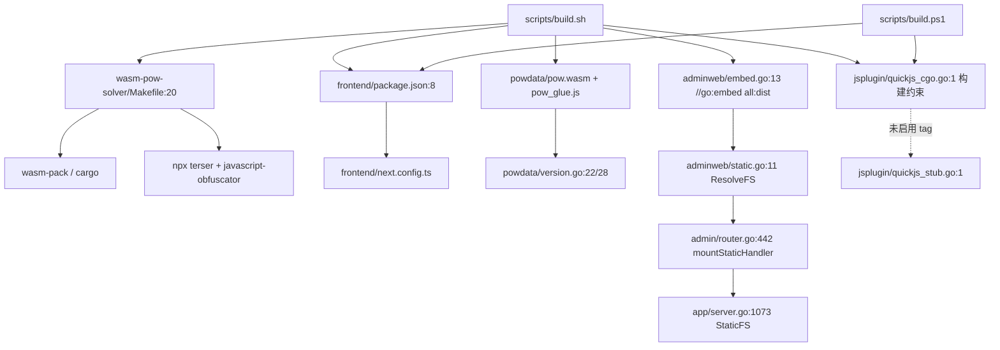
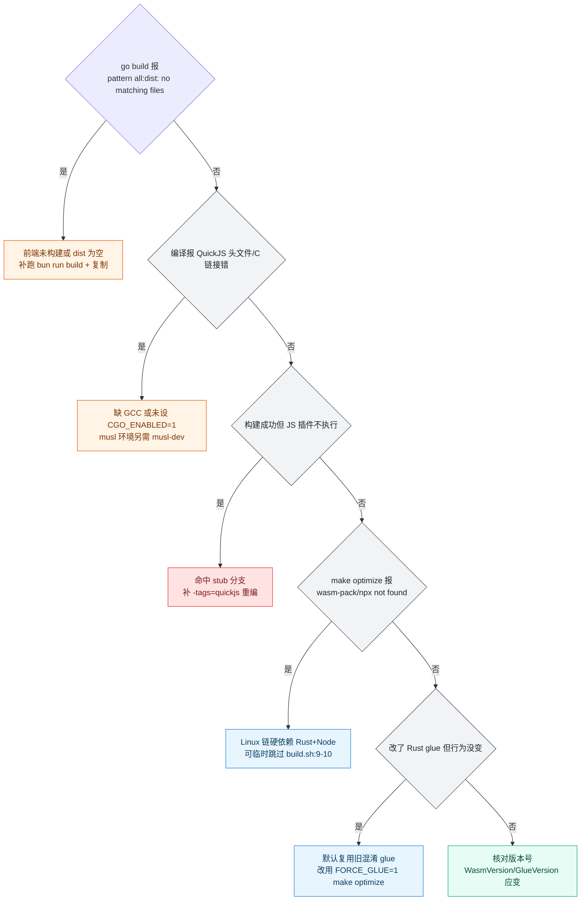

# 构建脚本与工具链

> 参见：[开发者指南](../项目概述/开发者指南.md)（开发流程与代码规范）· [快速开始](../项目概述/快速开始.md)（首次上手）· 容器运行与镜像部署细节见同域[部署运维](部署运维.md)与[容器化部署](容器化部署.md)

<cite>
**本文档引用的文件**
- [scripts/build.sh](file://scripts/build.sh)
- [scripts/build.ps1](file://scripts/build.ps1)
- [scripts/qps-diagnose.ps1](file://scripts/qps-diagnose.ps1)
- [scripts/start-test-upstream.ps1](file://scripts/start-test-upstream.ps1)
- [wasm-pow-solver/Makefile](file://wasm-pow-solver/Makefile)
- [wasm-pow-solver/Cargo.toml](file://wasm-pow-solver/Cargo.toml)
- [wasm-pow-solver/src/lib.rs](file://wasm-pow-solver/src/lib.rs)
- [frontend/package.json](file://frontend/package.json)
- [frontend/next.config.ts](file://frontend/next.config.ts)
- [go.mod](file://go.mod)
- [Dockerfile](file://Dockerfile)
- [.dockerignore](file://.dockerignore)
- [.gitignore](file://.gitignore)
- [README.md](file://README.md)
- [internal/core/adminweb/embed.go](file://internal/core/adminweb/embed.go)
- [internal/core/adminweb/static.go](file://internal/core/adminweb/static.go)
- [internal/admin/router.go](file://internal/admin/router.go)
- [internal/app/server.go](file://internal/app/server.go)
- [internal/core/config.go](file://internal/core/config.go)
- [internal/waf/challenge/powdata/embed.go](file://internal/waf/challenge/powdata/embed.go)
- [internal/waf/challenge/powdata/version.go](file://internal/waf/challenge/powdata/version.go)
- [internal/waf/jsplugin/quickjs_cgo.go](file://internal/waf/jsplugin/quickjs_cgo.go)
- [internal/waf/jsplugin/quickjs_stub.go](file://internal/waf/jsplugin/quickjs_stub.go)
- [.github/workflows/ci.yml](file://.github/workflows/ci.yml)
- [.github/workflows/release.yml](file://.github/workflows/release.yml)
</cite>

## 目录

1. [简介](#简介)
2. [项目结构](#项目结构)
3. [核心组件](#核心组件)
4. [架构总览](#架构总览)
5. [详细组件分析](#详细组件分析)
6. [依赖关系分析](#依赖关系分析)
7. [性能考虑](#性能考虑)
8. [故障排查指南](#故障排查指南)
9. [结论](#结论)
10. [附录](#附录)

## 简介

本篇只覆盖**构建与交付链的脚本层与工具链**：`scripts/` 四个脚本的职责边界与真实执行顺序、`wasm-pow-solver` 的 Rust→WASM 编译链、前端静态导出如何被 `go:embed` 打进单一二进制、以及诊断类脚本（压测与假上游）的用法。

划界说明，避免同一事实两处维护：

- 容器编排、镜像运行参数、系统服务化与端口暴露策略 → 同域 `部署运维.md`、`容器化部署.md`。本篇只到「镜像里执行了哪条构建命令」为止。
- 开发流程、代码规范、评审与提交约定 → [开发者指南](../项目概述/开发者指南.md)。
- CI 作业编排、发布闸门与产物签名 → 同域 [CI 与发布流水线](CI与发布流水线.md)。本篇只在需要佐证构建命令时引用其片段。

一句话概括构建模型：**前端与 WASM 是两个「产物必须落盘到 Go 包目录」的前置阶段，Go 编译是唯一的终点合并点**。这决定了任何构建失败都必须先定位「产物是否落盘」，而不是先看 Go 代码。

**章节来源**
- [README.md:293-309](file://README.md#L293-L309)
- [scripts/build.sh:1-13](file://scripts/build.sh#L1-L13)

## 项目结构

### 构建输入与产物落位

交付链横跨三套工具栈，但产物只有两个终点：`internal/core/adminweb/dist`（前端树）与 `internal/waf/challenge/powdata`（WASM + 混淆 glue）。



**图表来源**
- [frontend/next.config.ts:3-5](file://frontend/next.config.ts#L3-L5)
- [scripts/build.sh:6-13](file://scripts/build.sh#L6-L13)
- [wasm-pow-solver/Makefile:1-10](file://wasm-pow-solver/Makefile#L1-L10)
- [internal/core/adminweb/embed.go:12-13](file://internal/core/adminweb/embed.go#L12-L13)
- [internal/waf/challenge/powdata/embed.go:5-9](file://internal/waf/challenge/powdata/embed.go#L5-L9)
- [Dockerfile:15-16](file://Dockerfile#L15-L16)

关键点：`internal/core/adminweb/dist` 被 `.gitignore` 排除（同时 `.dockerignore:19` 也排除），因此**干净工作区直接 `go build` 一定失败**——`//go:embed all:dist` 找不到目录。CI 侧靠 `actions/download-artifact` 把 `frontend/out` 落到该路径（`ci.yml:69-73`、`ci.yml:185-189`、`release.yml:139-143`）来解决。反观 `powdata` 两个产物是入库的，所以 WASM 阶段不参与 CI，也不参与镜像构建。

| 对象 | 路径 | 是否入库 | 由谁产生 | 证据 |
|---|---|:---:|---|---|
| 前端导出树 | `frontend/out` | 否 | `next build` | `frontend/next.config.ts:4`（`distDir: "out"`） |
| 前端内嵌树 | `internal/core/adminweb/dist` | 否（`.gitignore`） | 复制自 `out` | `scripts/build.sh:7-8`、`.dockerignore:19` |
| wasm-pack 输出 | `wasm-pow-solver/pkg` | 否 | `wasm-pack build` | `wasm-pow-solver/Makefile:9` |
| WASM 二进制 | `internal/waf/challenge/powdata/pow.wasm` | 是 | `cp pkg/pow_bg.wasm` | `wasm-pow-solver/Makefile:10` |
| 混淆 glue | `internal/waf/challenge/powdata/pow_glue.js` | 是 | terser + javascript-obfuscator | `wasm-pow-solver/Makefile:31-41` |
| Linux 二进制 | `bin/my-openwaf` | 否 | `go build` | `scripts/build.sh:13` |
| Windows 二进制 | `bin\my-openwaf.exe` | 否 | `go build` | `scripts/build.ps1:18` |

**章节来源**
- [.dockerignore:15-19](file://.dockerignore#L15-L19)
- [scripts/build.sh:7-13](file://scripts/build.sh#L7-L13)
- [scripts/build.ps1:11-18](file://scripts/build.ps1#L11-L18)
- [wasm-pow-solver/Makefile:9-10](file://wasm-pow-solver/Makefile#L9-L10)
- [frontend/next.config.ts:3-5](file://frontend/next.config.ts#L3-L5)
- [.github/workflows/ci.yml:69-73](file://.github/workflows/ci.yml#L69-L73)

### 脚本清单

`scripts/` 目录实测仅 4 个文件，无 `bash` 版诊断脚本。

| 脚本 | 位置:行 | 作用 | 前置依赖 | 产物 | 平台差异 |
|---|---|---|---|---|---|
| `scripts/build.sh` | `:4-13` | 全量构建：前端 → WASM → Go 二进制 | Bun、make、wasm-pack、cargo、Node/npx、GCC | `bin/my-openwaf` | Unix 专用；含 `make optimize` |
| `scripts/build.ps1` | `:5-19` | 全量构建：前端 → Go 二进制 | Bun、GCC（mingw）、PowerShell | `bin\my-openwaf.exe` | Windows 专用；**无 `make optimize`** |
| `scripts/qps-diagnose.ps1` | `:468-605` | 读 `/metrics` 前后差值 + 内置 Go 压测器 | PowerShell、Go 工具链 | `temp/qps-diagnose-loader.exe` | 仅 Windows；无 Unix 对应版 |
| `scripts/start-test-upstream.ps1` | `:145-283` | 生成并启动假上游回显服务 | PowerShell、Go 工具链 | `temp/test-upstream-server.exe` | 仅 Windows；`-Background` 才后台化 |

失败语义也不同：`build.sh:2` 用 `set -euo pipefail` 一处兜底；`build.ps1` 靠 `$ErrorActionPreference = "Stop"`（`:1`）与每条命令后的 `$LASTEXITCODE` 显式判断（`:7`、`:9`、`:16`、`:19`）。

**章节来源**
- [scripts/build.sh:1-13](file://scripts/build.sh#L1-L13)
- [scripts/build.ps1:1-20](file://scripts/build.ps1#L1-L20)
- [scripts/qps-diagnose.ps1:468-605](file://scripts/qps-diagnose.ps1#L468-L605)
- [scripts/start-test-upstream.ps1:145-283](file://scripts/start-test-upstream.ps1#L145-L283)

## 核心组件

### 组件清单

| 组件 | 位置 | 职责 | 关键接口/变量 |
|---|---|---|---|
| 构建编排 | `scripts/build.sh` | Unix 一键链 | `$ROOT`（`:3`） |
| 构建编排 | `scripts/build.ps1` | Windows 一键链 | `$root`（`:3`）、`$dest`（`:11`） |
| 前端构建契约 | `frontend/package.json` | `build` 脚本自带 dist 复制 | `scripts.build`（`:8`） |
| 静态导出配置 | `frontend/next.config.ts` | `output: "export"` | `distDir`（`:4`）、`trailingSlash`（`:5`） |
| WASM 编译链 | `wasm-pow-solver/Makefile` | `build`/`optimize`/`clean` | `WASM_OUT`（`:1`）、`GLUE_PKG`（`:4`） |
| Rust 依赖与体积策略 | `wasm-pow-solver/Cargo.toml` | `cdylib`、`opt-level = "z"` | `[profile.release]`（`:42-47`） |
| 内嵌 FS | `internal/core/adminweb/embed.go` | `//go:embed all:dist` | `Dist`（`:13`）、`SubFS`（`:16`） |
| 静态解析 | `internal/core/adminweb/static.go` | 磁盘覆盖优先、路由候选 | `ResolveFS`（`:11`）、`routeCandidates`（`:54`） |
| 路由挂载 | `internal/admin/router.go` | `NoRoute` 兜底 | `mountStaticHandler`（`:442`） |
| PoW 资产版本 | `internal/waf/challenge/powdata/version.go` | 内容派生版本号 | `WasmVersion`（`:22`）、`GlueVersion`（`:28`） |
| QuickJS 后端选择 | `internal/waf/jsplugin/quickjs_cgo.go` / `quickjs_stub.go` | 构建标签双实现 | `:1` 构建约束行 |

**章节来源**
- [scripts/build.sh:1-13](file://scripts/build.sh#L1-L13)
- [scripts/build.ps1:3-18](file://scripts/build.ps1#L3-L18)
- [frontend/package.json:7-22](file://frontend/package.json#L7-L22)
- [frontend/next.config.ts:3-5](file://frontend/next.config.ts#L3-L5)
- [wasm-pow-solver/Makefile:1-20](file://wasm-pow-solver/Makefile#L1-L20)
- [internal/core/adminweb/embed.go:12-17](file://internal/core/adminweb/embed.go#L12-L17)
- [internal/waf/challenge/powdata/version.go:22-28](file://internal/waf/challenge/powdata/version.go#L22-L28)

## 架构总览

构建模型可归纳为一条严格串行的 DAG：前端导出必须先于 dist 复制，dist 必须先于 Go 编译；WASM 阶段独立于前端，但同样必须先于 Go 编译。



**图表来源**
- [scripts/build.sh:4-13](file://scripts/build.sh#L4-L13)
- [scripts/build.ps1:5-19](file://scripts/build.ps1#L5-L19)
- [wasm-pow-solver/Makefile:8-46](file://wasm-pow-solver/Makefile#L8-L46)
- [Dockerfile:16](file://Dockerfile#L16)
- [Dockerfile:20](file://Dockerfile#L20)

### 构建阶段顺序

| 序 | 阶段 | 命令 | 来源行 | build.sh | build.ps1 | Dockerfile |
|:--:|---|---|---|:---:|:---:|:---:|
| 1 | 定位仓库根 | `ROOT="$(cd "$(dirname "$0")/.." && pwd)"` | `build.sh:3` / `build.ps1:3-4` | 有 | 有 | 不适用 |
| 2 | 前端装依赖 | `bun install --frozen-lockfile` | `build.sh:5` / `build.ps1:6` | 有 | 有 | 有（`:5`） |
| 3 | 前端静态导出 | `bun run build` | `build.sh:6` / `build.ps1:8` | 有 | 有 | 有（`:8`） |
| 4 | 清内嵌目录 | `rm -rf .../adminweb/dist` | `build.sh:7` / `build.ps1:12` | 有 | 有（`-ErrorAction SilentlyContinue`） | 有（`:7` 预建空目录） |
| 5 | 复制导出树 | `cp -r frontend/out → dist` | `build.sh:8` / `build.ps1:13` | 有 | 有 | 有（`:15` 跨阶段 COPY） |
| 6 | WASM 优化 | `make optimize` | `build.sh:9-10` | **有** | **无** | **无** |
| 7 | Go 依赖整理 | `go mod tidy` | `build.sh:12` / `build.ps1:15` | 有 | 有 | 无（改用 `go mod download`，`:13`） |
| 8 | CGO 编译 | `CGO_ENABLED=1 go build -tags=quickjs` | `build.sh:13` / `build.ps1:17-18` | 有 | 有 | 有（`:16`，多 `-ldflags="-s -w"`） |

`build.ps1:17` 用 `$env:CGO_ENABLED = "1"` 设置进程级环境变量，与 `build.sh:13` 的行内前缀等效，但会残留到后续命令；两者都没有传 `-ldflags="-s -w"`，只有 `Dockerfile:16` 与 `release.yml:174` 传了。

**章节来源**
- [scripts/build.sh:3-13](file://scripts/build.sh#L3-L13)
- [scripts/build.ps1:3-18](file://scripts/build.ps1#L3-L18)
- [Dockerfile:5-16](file://Dockerfile#L5-L16)

## 详细组件分析

### build.sh：Unix 全量链

`set -euo pipefail`（`:2`）意味着任一命令非零即终止，且未定义变量会直接报错——因此脚本内所有路径都显式基于 `$ROOT`（`:3`），不依赖调用时的当前目录。

```bash
# 与 scripts/build.sh:4-13 等价的逐条展开
cd "$ROOT/frontend"                                            # build.sh:4
bun install --frozen-lockfile                                  # build.sh:5
bun run build                                                  # build.sh:6
rm -rf "$ROOT/internal/core/adminweb/dist"                     # build.sh:7
cp -r "$ROOT/frontend/out" "$ROOT/internal/core/adminweb/dist" # build.sh:8
cd "$ROOT/wasm-pow-solver"                                     # build.sh:9
make optimize                                                  # build.sh:10
cd "$ROOT"                                                     # build.sh:11
go mod tidy                                                    # build.sh:12
CGO_ENABLED=1 go build -tags=quickjs -o bin/my-openwaf ./cmd/... # build.sh:13
```

注意 `build.sh:7-8` 与 `frontend/package.json:8` 存在**双重复制**：`bun run build` 本身定义为 `next build && rm -rf ../internal/core/adminweb/dist && cp -R out ../internal/core/adminweb/dist`，脚本再复制一次。结果是幂等而非冲突，但排查 dist 内容时必须先看 `package.json:8`，否则会出现「我删了 dist，为什么文件还在」。

`build.sh:10` 的 `make optimize` 无条件执行，因此 Linux 侧的**事实前置依赖**包含 Rust 工具链、`wasm-pack`、`make` 与 `npx`（`Makefile:31`、`Makefile:35` 两处 `npx -y`）。这与 `README.md:295` 声称的「Rust 工具链可选（仅重建 WASM PoW 时需要）」直接矛盾，见故障排查一节。

**章节来源**
- [scripts/build.sh:2-13](file://scripts/build.sh#L2-L13)
- [frontend/package.json:8](file://frontend/package.json#L8)
- [wasm-pow-solver/Makefile:31-35](file://wasm-pow-solver/Makefile#L31-L35)
- [README.md:295](file://README.md#L295)

### build.ps1：Windows 链与实测差异

`build.ps1` 不使用 `set -e` 语义，而是每条外部命令后手工判断退出码（`:7`、`:9`、`:16`、`:19`），并用 `Push-Location`/`Pop-Location`（`:5`、`:10`、`:14`、`:20`）替代 `cd`，保证异常路径不污染调用者目录。

```powershell
# 与 scripts/build.ps1:5-18 等价的逐条展开
Push-Location "$root\frontend"                    # build.ps1:5
bun install --frozen-lockfile                     # build.ps1:6
if ($LASTEXITCODE -ne 0) { exit $LASTEXITCODE }   # build.ps1:7
bun run build                                     # build.ps1:8
if ($LASTEXITCODE -ne 0) { exit $LASTEXITCODE }   # build.ps1:9
Pop-Location                                      # build.ps1:10
$dest = "$root\internal\core\adminweb\dist"       # build.ps1:11
Remove-Item -Recurse -Force $dest -ErrorAction SilentlyContinue  # build.ps1:12
Copy-Item -Recurse "$root\frontend\out" $dest     # build.ps1:13
Push-Location $root                               # build.ps1:14
go mod tidy                                       # build.ps1:15
$env:CGO_ENABLED = "1"                            # build.ps1:17
go build -tags=quickjs -o bin\my-openwaf.exe ./cmd/... # build.ps1:18
```

| 差异项 | `build.sh` | `build.ps1` | 后果 |
|---|---|---|---|
| WASM 重编译 | 有（`:9-10`） | **无** | Windows 无法重建 `pow.wasm`，只能沿用入库产物 |
| 目录切换 | `cd`（`:4`、`:9`、`:11`） | `Push-Location`/`Pop-Location` | 行为等价，异常安全性更高 |
| dist 清理 | `rm -rf`（`:7`）目录不存在即报错由 `set -e` 兜住 | `Remove-Item ... -ErrorAction SilentlyContinue`（`:12`） | 首次构建 Windows 更宽容 |
| 输出文件名 | `bin/my-openwaf`（`:13`） | `bin\my-openwaf.exe`（`:18`） | 平台后缀 |
| CGO 传递 | 行内 `CGO_ENABLED=1`（`:13`） | `$env:CGO_ENABLED`（`:17`） | Windows 侧该变量对后续命令持续有效 |
| 错误处理 | `set -euo pipefail`（`:2`） | 逐条 `$LASTEXITCODE` 判断 | 报错粒度不同，构建阶段总数相同 |

**章节来源**
- [scripts/build.ps1:1-20](file://scripts/build.ps1#L1-L20)

### wasm-pow-solver：Rust 到 WASM 的工具链

`make optimize` 的实际语义与名字有偏差：它**不做 wasm 层优化**。

| 目标 | 位置:行 | 实际动作 | 依赖工具 |
|---|---|---|---|
| `build` | `Makefile:8-17` | `wasm-pack build --target no-modules --release --out-dir pkg --out-name pow`；`cp pkg/pow_bg.wasm → pow.wasm` | wasm-pack、cargo |
| `optimize` | `Makefile:20-46` | 依赖 `build`；按条件刷新 glue，再 terser + javascript-obfuscator；末行打印两产物字节数 | make、bash、npx、terser、javascript-obfuscator、`wc` |
| `clean` | `Makefile:48-50` | `cargo clean` + `rm -rf pkg` | cargo |

`Cargo.toml:7-8` 显式设置 `[package.metadata.wasm-pack.profile.release] wasm-opt = false`，即禁用 wasm-pack 自带的 `wasm-opt`；体积压缩完全交给 `Cargo.toml:42-47` 的 `opt-level = "z"`、`lto = true`、`codegen-units = 1`、`strip = true`、`panic = "abort"`。所以「optimize」优化的是 **JS glue 的可读性**，不是 wasm 字节码。

glue 混淆走双闸门判定：`Makefile:11` 与 `Makefile:24` 都用 `grep -q "function _0x"` 检测 `pow_glue.js` 是否已混淆；若已混淆则默认**复用现状不覆盖**（`Makefile:28-29`），必须 `FORCE_GLUE=1 make optimize` 才从 `pkg/pow.js` 重新生成（`Makefile:21-23`、`Makefile:18-19` 的注释说明）。因此 Rust 侧改了 glue 却看不到效果，是这条默认分支导致的。

混淆参数固定为两步：`Makefile:31-34` 的 terser（`passes=3`、`unsafe=true`、`mangle toplevel=true` 且保留 `wasm_bindgen`），`Makefile:35-41` 的 javascript-obfuscator（`control-flow-flattening`、`dead-code-injection`、`string-array-encoding rc4`、`self-defending true`）。`self-defending` 开启后若再手工格式化该文件，运行时会自毁——这是 `pow_glue.js` 不可二次编辑的原因。

Rust 侧模块共 9 个：`crypto`、`env`、`fingerprint`、`gm`、`isa`、`label`、`obfuscate`、`sm3`、`vmp`（`src/lib.rs:5-13`），依赖 `wasm-bindgen 0.2.127`、`js-sys 0.3.104`、`sha2 0.11.0`、`aes-gcm 0.11`、`smcrypto 0.3.1`（国密）等，锁定于 `Cargo.lock`（lockfile 版本 4）。

Go 侧只通过 `//go:embed` 读两文件：`powdata/embed.go:5`（`pow.wasm`）与 `:8`（`pow_glue.js`）；`version.go:16-19` 用 sha256 前 4 字节 hex 生成内容派生版本号，由 `WasmVersion`（`:22`）与 `GlueVersion`（`:28`）暴露，`sync.Once` 保证进程内只算一次。也就是说**换 wasm 或换混淆参数都会自动改变版本号**，无需手工维护版本字段。

**章节来源**
- [wasm-pow-solver/Makefile:1-50](file://wasm-pow-solver/Makefile#L1-L50)
- [wasm-pow-solver/Cargo.toml:1-47](file://wasm-pow-solver/Cargo.toml#L1-L47)
- [wasm-pow-solver/src/lib.rs:5-13](file://wasm-pow-solver/src/lib.rs#L5-L13)
- [internal/waf/challenge/powdata/embed.go:5-9](file://internal/waf/challenge/powdata/embed.go#L5-L9)
- [internal/waf/challenge/powdata/version.go:16-36](file://internal/waf/challenge/powdata/version.go#L16-L36)

### 前端构建与契约脚本家族

`frontend/package.json` 的 `scripts` 共 16 条：6 条常规（`dev`、`build`、`start`、`lint`、`format`、`typecheck`，`:7-12`）+ 10 条 `check:*`（`:13-22`），但 `check:*` 只对应 `frontend/scripts/` 下 **9 个文件**，因为 `check:i18n`（`:13`）与 `check:skip-path-contract`（`:14`）指向同一个 `scripts/check-skip-path-by-phase.ts`。

```bash
# 常规链（frontend/package.json:7-12）
cd frontend
bun run dev        # package.json:7  → next dev
bun run build      # package.json:8  → next build + 复制 dist
bun run typecheck  # package.json:12 → tsc --noEmit
bun run lint       # package.json:10 → eslint（非 next lint）
bun run format     # package.json:11 → prettier --write "**/*.{ts,tsx}"

# 契约检查家族（frontend/package.json:13-22，共 10 条 / 9 个文件）
bun run check:skip-path-contract        # package.json:14
bun run check:i18n                      # package.json:13（与 :14 同脚本）
bun run check:auth-refresh-contract     # package.json:15
bun run check:login-form-contract       # package.json:16
bun run check:rule-pattern-roundtrip    # package.json:17
bun run check:site-cache-contract       # package.json:18
bun run check:site-challenge-contract   # package.json:19
bun run check:site-protection-contract  # package.json:20
bun run check:api-route-contract        # package.json:21
bun run check:env-override-contract     # package.json:22
```

| 脚本 | package.json 行 | 目标文件 | 备注 |
|---|:--:|---|---|
| `lint` | `:10` | `eslint` 直调 | Next 16 已移除 `next lint`，故走 flat config |
| `format` | `:11` | prettier ^3.8.3（`:60`） | 仅覆盖 ts/tsx |
| `check:i18n` | `:13` | `check-skip-path-by-phase.ts` | 名称与内容不符，待登记 |
| `check:env-override-contract` | `:22` | `check-env-override-contract.ts` | `README.md:443-451` 未列出 |

`frontend/next.config.ts` 决定交付物形态：`output: "export"`（`:3`）、`distDir: "out"`（`:4`）、`trailingSlash: true`（`:5`）。后两项共同决定 `internal/core/adminweb/static.go` 的路由候选算法必须以 `/index.html` 结尾做兜底匹配（`static.go:71-77`）。

**章节来源**
- [frontend/package.json:7-22](file://frontend/package.json#L7-L22)
- [frontend/package.json:58-63](file://frontend/package.json#L58-L63)
- [frontend/next.config.ts:3-5](file://frontend/next.config.ts#L3-L5)
- [README.md:437-452](file://README.md#L437-L452)

### dist 内嵌与磁盘回退

`internal/core/adminweb` 两文件合计 173 行（`embed.go` 31 + `static.go` 142），构成前端交付物的消费端。



**图表来源**
- [scripts/build.sh:6-13](file://scripts/build.sh#L6-L13)
- [frontend/package.json:8](file://frontend/package.json#L8)
- [internal/core/adminweb/embed.go:12-18](file://internal/core/adminweb/embed.go#L12-L18)
- [internal/core/adminweb/static.go:11-17](file://internal/core/adminweb/static.go#L11-L17)
- [internal/app/server.go:1073](file://internal/app/server.go#L1073)

运行期取值链：`MY_OPENWAF_ADMIN_STATIC_DIR` → `internal/core/config.go:517`（`TrimSpace(os.Getenv(...))`，字段声明与注释在 `:281-282`）→ `internal/app/server.go:1073` 的 `StaticFS` → `internal/admin/router.go:439` 调 `mountStaticHandler`。该函数在 `router.go:443-446` 先 `adminweb.ResolveFS(diskDir)`，**出错即 return**，`NoRoute`（`:448`）不会被注册；`ResolveFS` 在 `diskDir` 为空时回落到 `SubFS()`（`static.go:12-16`）。因此空目录配 `MY_OPENWAF_ADMIN_STATIC_DIR` 指向不存在路径时，管理端 UI 会退化成「只有 API、没有兜底路由」。

配置项口径如下（默认值均取自代码或 README 表）。

| 配置项 | 来源:行 | 默认值 | 作用 | 构建期还是运行期 |
|---|---|---|---|---|
| `CGO_ENABLED` | `build.sh:13`、`build.ps1:17`、`Dockerfile:16` | 脚本显式设 `1` | 启用 QuickJS CGO 后端 | 构建期 |
| `go build -tags` | `build.sh:13`、`release.yml:174` | `quickjs` | 选择 `quickjs_cgo.go` 而非 stub | 构建期 |
| `go build -ldflags` | `Dockerfile:16`、`release.yml:174` | `-s -w` | 仅镜像与发布构建传，本地脚本不传 | 构建期 |
| `GOOS` / `GOARCH` | `release.yml:167-168` | 矩阵注入 | 交叉出 6 个平台 | 构建期 |
| `BUN 版本` | `Dockerfile:2` | `oven/bun:1.4.2-alpine` | 镜像内前端工具链 | 构建期 |
| `FORCE_GLUE` | `Makefile:21` | 未设 | 强制重生成混淆 glue | 构建期 |
| `MY_OPENWAF_ADMIN_STATIC_DIR` | `config.go:517`、`README.md:331` | 空（用内嵌） | 开发期磁盘覆盖内嵌前端 | 运行期 |
| `MY_OPENWAF_DB_DRIVER` | `README.md:317`、`Dockerfile:22` | `sqlite` | 与构建无关，仅镜像内置默认 | 运行期 |

**章节来源**
- [internal/core/config.go:517](file://internal/core/config.go#L517)
- [internal/app/server.go:1073](file://internal/app/server.go#L1073)
- [internal/admin/router.go:439-456](file://internal/admin/router.go#L439-L456)
- [internal/core/adminweb/static.go:11-17](file://internal/core/adminweb/static.go#L11-L17)
- [README.md:331](file://README.md#L331)

### 诊断脚本链

两个 `ps1` 诊断脚本采用同一模式：**PowerShell 脚本内嵌一段 Go 源码字符串，写盘后 `go build` 再执行**，因此它们既不需要仓库内有独立工具，也硬依赖 Go 工具链在 PATH。

| 脚本 | 参数（默认值） | 位置:行 | 说明 |
|---|---|---|---|
| `qps-diagnose.ps1` | `TargetUrl`（`http://127.0.0.1/`） | `:2` | 压测目标 |
| | `MetricsUrl`（`http://127.0.0.1:9443/metrics`） | `:3` | 管理端指标口 |
| | `Requests`（1000）/ `Concurrency`（40） | `:4-5` | 负载规模 |
| | `TimeoutSec`（30） | `:10` | 单请求超时 |
| | `SkipLoad` / `CompileOnly` / `SelfTest` | `:11-13` | 三个开关分支 |
| `start-test-upstream.ps1` | `Bind`（`127.0.0.1:8800`） | `:2` | 监听地址 |
| | `Status`（200）/ `Body`（`OK`） | `:3-4` | 回显响应 |
| | `ContentType` / `DelayMs` | `:5-6` | 注入延迟用于限流验证 |
| | `Background` | `:7` | 后台化 + 就绪轮询 |

`qps-diagnose.ps1` 的采集面固定为 27 项指标白名单（`:377-403`），覆盖 `openwaf_dataplane_*`、`openwaf_writer_*`、`openwaf_upstream_*` 三族，前后各取一次快照并算差值（`:529`、`:581`、`:587`），中间固定 `Start-Sleep -Milliseconds 500`（`:579`）。诊断建议由 `Get-DiagnosticHints`（`:422-466`）按 5 条阈值规则产生：请求错误率 > 1%、四类 `writer_dropped_*` 增量为正、`writer_flush_errors_total` 增量为正、存在不健康上游、上游平均时延 > 1000ms。`-SelfTest`（`:470-507`）用内置两段假 Prometheus 文本自校验差值算法，无需真实服务，适合在 CI 之外先验证脚本本身。

`start-test-upstream.ps1` 会先探测端口是否已被同名进程占用并**直接复用**（`:145-160`，判定条件是 HTTP 可达或 TCP 可达且进程名为 `test-upstream-server`），`-Background` 时以 5 秒截止时间轮询就绪（`:259-271`）。内嵌 Go 服务固定 `ReadHeaderTimeout: 5s`、`ReadTimeout`/`WriteTimeout: 30s`、`IdleTimeout: 120s`（`:210-213`），并总是回 `X-Test-Upstream: my-openwaf`（`:199`），便于在访问日志里区分真假上游。

**章节来源**
- [scripts/qps-diagnose.ps1:2-13](file://scripts/qps-diagnose.ps1#L2-L13)
- [scripts/qps-diagnose.ps1:377-507](file://scripts/qps-diagnose.ps1#L377-L507)
- [scripts/qps-diagnose.ps1:529-587](file://scripts/qps-diagnose.ps1#L529-L587)
- [scripts/start-test-upstream.ps1:2-7](file://scripts/start-test-upstream.ps1#L2-L7)
- [scripts/start-test-upstream.ps1:145-213](file://scripts/start-test-upstream.ps1#L145-L213)
- [scripts/start-test-upstream.ps1:259-271](file://scripts/start-test-upstream.ps1#L259-L271)

### Dockerfile：第三条构建路径

镜像构建是独立于两个脚本的第三条链，差异集中在四点：不跑 `make optimize`、不跑 `go mod tidy`、传 `-ldflags="-s -w"`、用 `go mod download` 预取依赖层。

```dockerfile
# Dockerfile:2-16（多阶段，前端层与后端层）
FROM oven/bun:1.4.2-alpine AS frontend
WORKDIR /app/frontend
COPY frontend/package.json frontend/bun.lock ./
RUN bun install --frozen-lockfile
COPY frontend/ ./
RUN mkdir -p /app/internal/core/adminweb/dist
RUN bun run build
FROM golang:1.27-alpine AS backend
RUN apk add --no-cache gcc musl-dev
WORKDIR /app
COPY go.mod go.sum ./
RUN go mod download
COPY . .
COPY --from=frontend /app/frontend/out ./internal/core/adminweb/dist
RUN CGO_ENABLED=1 go build -tags=quickjs -ldflags="-s -w" -o /app/bin/my-openwaf ./cmd/...
```

`Dockerfile:7` 的 `mkdir -p /app/internal/core/adminweb/dist` 是必要补丁：`.dockerignore:19` 已把宿主 dist 排除出构建上下文，而 `bun run build`（`:8`）内部会执行 `cp -R out ../internal/core/adminweb/dist`（`package.json:8`）——父目录不存在时该 `cp` 直接失败。预建之后 `dist` 已作为空目录存在，`cp` 才会把 `out` 的内容落进 `dist` 而不是改名成 `adminweb`。随后 `:15` 再跨阶段用真正的 `out` 覆盖一次，保证后端阶段的 `//go:embed all:dist` 有目录可嵌。musl 环境要 `gcc musl-dev`（`:10`）才能编译 QuickJS CGO；运行层是 `alpine:3.21`（`:17`）并额外装 `font-dejavu`、`libwebp-dev`（`:18`），这两项服务于图形验证码与图片水印，属于运行时库而非构建库。运行与镜像的后续细节见同域容器化文档。

**章节来源**
- [Dockerfile:2-18](file://Dockerfile#L2-L18)
- [.dockerignore:15-19](file://.dockerignore#L15-L19)

## 依赖关系分析

### 内部依赖



**图表来源**
- [scripts/build.sh:4-13](file://scripts/build.sh#L4-L13)
- [scripts/build.ps1:5-18](file://scripts/build.ps1#L5-L18)
- [wasm-pow-solver/Makefile:20](file://wasm-pow-solver/Makefile#L20)
- [internal/core/adminweb/embed.go:12-13](file://internal/core/adminweb/embed.go#L12-L13)
- [internal/core/adminweb/static.go:11](file://internal/core/adminweb/static.go#L11)
- [internal/app/server.go:1073](file://internal/app/server.go#L1073)
- [internal/waf/jsplugin/quickjs_cgo.go:1](file://internal/waf/jsplugin/quickjs_cgo.go#L1)
- [internal/waf/jsplugin/quickjs_stub.go:1](file://internal/waf/jsplugin/quickjs_stub.go#L1)

QuickJS 是构建链上唯一「静默降级」的依赖：`quickjs_cgo.go:1` 声明 `//go:build cgo && quickjs`，`quickjs_stub.go:1` 声明 `//go:build !cgo || !quickjs`。两者互斥且并集覆盖全宇宙，因此**忘设 `CGO_ENABLED=1` 或缺 `-tags=quickjs` 不会报错**，只会把 JS 插件后端替换成 stub，编译照常通过。这正是 `ci.yml:41-67` 用一整段契约校验去守 `release.yml` 的根本原因，详见 [CI 与发布流水线](CI与发布流水线.md)。

**章节来源**
- [internal/waf/jsplugin/quickjs_cgo.go:1](file://internal/waf/jsplugin/quickjs_cgo.go#L1)
- [internal/waf/jsplugin/quickjs_stub.go:1](file://internal/waf/jsplugin/quickjs_stub.go#L1)
- [.github/workflows/ci.yml:41-67](file://.github/workflows/ci.yml#L41-L67)

### 外部服务与工具链依赖

| 依赖 | 类型 | 用途 | 必需性 | 声明位置 |
|---|---|---|---|---|
| Bun | 运行时工具 | 前端装包与构建 | 三条链均需 | `build.sh:5`、`build.ps1:6`、`Dockerfile:2` |
| `frontend/bun.lock` | 锁文件 | `--frozen-lockfile` 前提 | 必需 | `Dockerfile:4` |
| GCC / musl-dev | C 编译器 | QuickJS CGO 链接 | 必需 | `README.md:295`、`Dockerfile:10` |
| Go | 工具链 | `go mod tidy` / `go build` | 必需 | `go.mod:3`（`go 1.27.2`）、`build.sh:12-13` |
| cargo / wasm-pack | Rust 工具链 | `make optimize` | 仅 `build.sh` | `Makefile:9`、`build.sh:10` |
| Node + npx | JS 工具宿主 | terser、javascript-obfuscator | 仅 `make optimize` | `Makefile:31`、`Makefile:35` |
| make | 构建器 | 执行 `optimize` | 仅 `build.sh` | `build.sh:10` |
| GitHub Actions runners | CI 环境 | 作业执行 | 交付链 | `ci.yml:20`、`release.yml:97` |
| actions artifact 仓库 | 产物中转 | `frontend-out` 跨作业传递 | CI 必需 | `ci.yml:164-169`、`ci.yml:185-189` |
| MySQL 8.0 / PostgreSQL 16 | 服务容器 | 方言迁移测试 | 仅 CI | `ci.yml:92`、`ci.yml:104` |

Go 侧 `go.mod` 中与构建直接相关的条目：模块名 `My-OpenWaf`（`:1`）、`go 1.27.2`（`:3`）、`github.com/buke/quickjs-go v0.7.7`（`:8`）；SQLite 走纯 Go 实现 `github.com/glebarez/sqlite v1.11.0`（`:14`），故 CGO 只服务于 QuickJS，而非数据库驱动。

**章节来源**
- [README.md:295](file://README.md#L295)
- [Dockerfile:4-10](file://Dockerfile#L4-L10)
- [go.mod:1-8](file://go.mod#L1-L8)
- [wasm-pow-solver/Makefile:9-35](file://wasm-pow-solver/Makefile#L9-L35)
- [.github/workflows/ci.yml:92-104](file://.github/workflows/ci.yml#L92-L104)
- [.github/workflows/ci.yml:164-169](file://.github/workflows/ci.yml#L164-L169)

### CI 侧对构建命令的复现

CI 不执行 `scripts/build.sh`，而是用等价步骤重放，其中 `full-build` 作业与脚本第 12-13 行一一对应：

```yaml
# .github/workflows/ci.yml:171-194（节选，无敏感值）
  full-build:
    name: Full application build
    runs-on: ubuntu-latest
    needs: [backend-test, frontend-test]
    steps:
      - name: Download frontend export
        uses: actions/download-artifact@v4
        with:
          name: frontend-out
          path: internal/core/adminweb/dist
      - name: Build application
        run: |
          go mod tidy
          CGO_ENABLED=1 go build -tags=quickjs -o bin/my-openwaf ./cmd/...
```

发布链的对应步骤额外传了压缩参数（`release.yml:171-174`）：

```yaml
# .github/workflows/release.yml:165-175（节选）
      - name: Build binary
        env:
          GOOS: ${{ matrix.goos }}
          GOARCH: ${{ matrix.goarch }}
          CGO_ENABLED: '1'
        shell: bash
        run: |
          mkdir -p dist/package
          output="my-openwaf-${{ matrix.goos }}-${{ matrix.goarch }}${{ matrix.ext }}"
          go build -tags=quickjs -trimpath -ldflags="-s -w" -o "dist/package/$output" ./cmd
```

两者入口包不同也非笔误：脚本用 `./cmd/...`（`build.sh:13`），发布用 `./cmd`（`release.yml:174`），前者会构建 `cmd` 下全部包。

**章节来源**
- [.github/workflows/ci.yml:171-194](file://.github/workflows/ci.yml#L171-L194)
- [.github/workflows/release.yml:165-175](file://.github/workflows/release.yml#L165-L175)
- [scripts/build.sh:13](file://scripts/build.sh#L13)

## 性能考虑

- **症状**：`build.sh` 每次执行都会重跑 `wasm-pack build --release`（`Makefile:9`），即使 Rust 源码未变。**原因**：`optimize` 依赖 `build`（`Makefile:20`），无增量判定。**优化**：不涉 PoW 改动时跳过 `build.sh:9-10`，直接按 `README.md:303-305` 的手动两步走。**效果**：省掉一次 Rust release 编译与两次 `npx` 冷启动。
- **症状**：glue 混淆看似「没生效」。**原因**：默认分支复用已混淆文件（`Makefile:27-30`）， terser 的 `passes=3`（`Makefile:32`）与 obfuscator 的 `control-flow-flattening`、`dead-code-injection`（`Makefile:37-38`）在未 `FORCE_GLUE=1` 时只作用于旧 glue。**优化**：仅在 Rust 侧 glue 变更后使用 `FORCE_GLUE=1 make optimize`。**效果**：避免对已混淆代码二次混淆导致的体积膨胀与运行时自毁风险（`self-defending true`，`Makefile:41`）。
- **症状**：产物体积。**优化**：`Cargo.toml:43-46` 用 `opt-level = "z"` + `lto = true` + `codegen-units = 1` + `strip = true` 换体积，实测 `pow.wasm` 228,615 字节、`pow_glue.js` 132,989 字节；Go 侧发布链再加 `-ldflags="-s -w"` + `-trimpath`（`release.yml:174`）。**效果**：`Makefile:45-46` 每次构建后打印两字节数，可直接比对是否异常膨胀。
- **症状**：`qps-diagnose.ps1` 压测自身成为瓶颈。**原因**：其生成的加载器把 `MaxIdleConns` 设为 `concurrency * 4`（`qps-diagnose.ps1:156-157`）且 `DisableCompression: true`（`:158`），是刻意绕开压缩开销。**注意**：测得 RPS（`:237-240`）只反映服务端，脚本自身单进程 40 并发上限（`:5`）会先饱和。

**章节来源**
- [wasm-pow-solver/Makefile:20-46](file://wasm-pow-solver/Makefile#L20-L46)
- [wasm-pow-solver/Cargo.toml:42-47](file://wasm-pow-solver/Cargo.toml#L42-L47)
- [.github/workflows/release.yml:174](file://.github/workflows/release.yml#L174)
- [scripts/qps-diagnose.ps1:155-158](file://scripts/qps-diagnose.ps1#L155-L158)
- [README.md:303-305](file://README.md#L303-L305)

## 故障排查指南



**图表来源**
- [internal/core/adminweb/embed.go:12-13](file://internal/core/adminweb/embed.go#L12-L13)
- [scripts/build.sh:9-13](file://scripts/build.sh#L9-L13)
- [Dockerfile:10](file://Dockerfile#L10)
- [internal/waf/jsplugin/quickjs_stub.go:1](file://internal/waf/jsplugin/quickjs_stub.go#L1)
- [wasm-pow-solver/Makefile:20-30](file://wasm-pow-solver/Makefile#L20-L30)
- [internal/waf/challenge/powdata/version.go:22-31](file://internal/waf/challenge/powdata/version.go#L22-L31)

### 症状与处置

| 症状 | 根因 | 排查命令 | 处置 |
|---|---|---|---|
| `no matching files found for all:dist` | `dist` 被 `.gitignore`/`.dockerignore` 排除，干净工作区没有该目录 | `ls internal/core/adminweb/dist` | 先跑前端构建并复制（`build.sh:6-8`） |
| Windows 构建报找不到 `make` | `build.ps1` 本就不含 WASM 阶段，是手工补跑导致 | 读 `build.ps1:14-18` | 在 WSL 或 Linux 上跑 `build.sh:9-10` |
| 二进制能跑但 JS 插件静默失效 | tag/CGO 缺失时回落 stub，无编译错误 | `go list -tags=quickjs -f '{{join .GoFiles " "}}' ./internal/waf/jsplugin` | 确认输出含 `quickjs_cgo.go`；CI 用同一命令守门（`release.yml:155-162`） |
| `README.md:295` 说 Rust 可选，实际装不上 | `build.sh:10` 无条件 `make optimize` | 读 `build.sh:9-10` | 文档口径与脚本不一致，按脚本为准（见下节） |
| 管理端 UI 全 404 但 API 正常 | `ResolveFS` 失败使 `NoRoute` 未注册 | 检查 `MY_OPENWAF_ADMIN_STATIC_DIR` 指向 | 清空该变量回落到内嵌 `SubFS()`（`static.go:16`） |
| glue 二次混淆后运行异常 | `self-defending true`（`Makefile:41`）检测到格式化即自毁 | 比对 `GlueVersion()` | 从 `pkg/pow.js` 重新生成，勿手改产物 |
| 端口 8800 冲突 | `start-test-upstream.ps1:145-160` 判定已有同名进程则复用 | `Get-NetTCPConnection -LocalPort 8800 -State Listen` | 换 `-Bind` 或结束旧进程 |

**章节来源**
- [.dockerignore:19](file://.dockerignore#L19)
- [internal/core/adminweb/embed.go:12-13](file://internal/core/adminweb/embed.go#L12-L13)
- [scripts/build.sh:6-10](file://scripts/build.sh#L6-L10)
- [README.md:295](file://README.md#L295)
- [.github/workflows/release.yml:155-162](file://.github/workflows/release.yml#L155-L162)
- [wasm-pow-solver/Makefile:41](file://wasm-pow-solver/Makefile#L41)
- [scripts/start-test-upstream.ps1:145-160](file://scripts/start-test-upstream.ps1#L145-L160)

### 已登记的构建链不一致

以下均为脚本/配置/文档三方实测比对结果，本篇只登记不修改代码：

| 项 | 三方取值 | 判定 |
|---|---|---|
| Bun 版本 | `Dockerfile:2` = `1.4.2`；`ci.yml:150`、`release.yml:78` = `1.3.14`；`README.md:295` = `1.3.14+` | 镜像与 CI 不是同一版本，最低版本口径靠 README 兜 |
| Go 版本 | `go.mod:3` = `1.27.2`；`Dockerfile:9` = `1.27-alpine`；`README.md:397` 写「Go 1.27.1（`go.mod`）」 | README 表述与 go.mod 差一个修订号 |
| Rust 工具链必需性 | `README.md:295` 称可选；`build.sh:10` 无条件执行 | Linux 侧实际必需，README 只对 Windows 成立 |
| dist 复制次数 | `package.json:8` 已复制一次；`build.sh:7-8`、`build.ps1:12-13` 再复制一次 | 冗余但幂等 |
| `-ldflags` | `Dockerfile:16`、`release.yml:174` 传；两个脚本不传 | 本地二进制比发布产物大 |
| WASM 重建覆盖面 | 仅 `build.sh`；`build.ps1`、`Dockerfile`、三条 workflow 均不涉及 | WASM 产物按入库快照交付 |

**章节来源**
- [Dockerfile:2](file://Dockerfile#L2)
- [Dockerfile:9](file://Dockerfile#L9)
- [Dockerfile:16](file://Dockerfile#L16)
- [go.mod:3](file://go.mod#L3)
- [README.md:295](file://README.md#L295)
- [README.md:397](file://README.md#L397)
- [.github/workflows/ci.yml:150](file://.github/workflows/ci.yml#L150)
- [scripts/build.sh:7-10](file://scripts/build.sh#L7-L10)

## 结论

三条构建路径（`build.sh`、`build.ps1`、`Dockerfile`）共享同一收敛点：`CGO_ENABLED=1 go build -tags=quickjs`。差别只在是否重建 WASM、是否传压缩 ldflags、以及 `go mod tidy` 与 `go mod download` 的取舍。

成果与判断：

- 构建链的**唯一致命陷阱是 dist 缺目录**，因为它由忽略规则导致且报错信息离根因较远。
- **次致命陷阱是 QuickJS 静默降级**，因为 stub 分支让缺 tag 的构建「看起来成功」，只能靠 CI 契约校验兜住。
- **`optimize` 名称与行为不符**（只优化 JS glue，不优化 wasm 字节码），阅读 `Cargo.toml:8` 是确认这一点的唯一途径。
- KISS 视角下脚本已足够薄（13/20 行），未引入 Makefile 顶层编排是合理取舍；YAGNI 视角下 `build.sh:7-8` 的重复复制与 `check:i18n` 的错名脚本是两处可删冗余，但因不影响正确性，本篇不做改动，仅登记。

后续建议：把「Windows 无 `make optimize`」这一事实固化为 `wasm-pow-solver/README` 级别的显式声明，或将 `build.sh` 的 WASM 阶段改为条件执行，使 Linux 与 Windows 两条链的步骤集合对齐。

**章节来源**
- [scripts/build.sh:1-13](file://scripts/build.sh#L1-L13)
- [Dockerfile:1-28](file://Dockerfile#L1-L28)

## 附录

### 命令速查

```bash
# Unix 全量构建（scripts/build.sh:4-13）
./scripts/build.sh
# Windows 全量构建（scripts/build.ps1:5-18，README.md:300）
./scripts/build.ps1
# 手动两步（README.md:303-305），跳过 WASM 阶段
cd frontend && bun install --frozen-lockfile && bun run build
cd .. && CGO_ENABLED=1 go build -tags=quickjs -ldflags="-s -w" -o bin/my-openwaf ./cmd/...
# 仅验证 QuickJS 后端是否被选中（release.yml:155 同款命令）
go list -tags=quickjs -f '{{join .GoFiles " "}}' ./internal/waf/jsplugin
# 仅重建 PoW 资产（Makefile:20，需 make + cargo + wasm-pack + npx）
cd wasm-pow-solver && make optimize
cd wasm-pow-solver && FORCE_GLUE=1 make optimize   # Makefile:21 分支
cd wasm-pow-solver && make clean                    # Makefile:48-50
# 质量门禁（README.md:431-435）
gofmt -l .
CGO_ENABLED=1 go vet -tags=quickjs ./...
CGO_ENABLED=1 go test -tags=quickjs -v -timeout=30m ./...
go test -p 1 -count=1 -timeout=30m ./...
# 镜像构建（Dockerfile 全链，无 make optimize）
docker build -t my-openwaf:latest .
```

```powershell
# 假上游（start-test-upstream.ps1:2-7 参数）
./scripts/start-test-upstream.ps1 -Bind 127.0.0.1:8800 -Status 200 -DelayMs 0 -Background
# QPS 诊断三模式（qps-diagnose.ps1:11-13 开关）
./scripts/qps-diagnose.ps1 -SelfTest        # 不依赖服务，校验差值算法
./scripts/qps-diagnose.ps1 -CompileOnly     # 只生成 temp/qps-diagnose-loader.exe
./scripts/qps-diagnose.ps1 -SkipLoad        # 只取指标差值不打负载
```

**章节来源**
- [README.md:298-308](file://README.md#L298-L308)
- [README.md:431-435](file://README.md#L431-L435)
- [wasm-pow-solver/Makefile:20-50](file://wasm-pow-solver/Makefile#L20-L50)

### 测试资产口径

| 类别 | 实测数量 | 命名约定 | 说明 |
|---|:--:|---|---|
| Go 测试文件 | 532 | `*_test.go` | `git ls-files '*_test.go'` 计数 |
| 进程级用例 | 5 | `*_process_test.go` | 全在 `internal/app/`：`server`、`grpc_compat`、`grpc_web_h3`、`quic_session`、`tls_fingerprint_h2_assert` |
| 端到端用例 | 2 | `*_e2e_test.go` | `internal/app/grpc_cache_e2e_test.go`、`internal/proxy/grpc_e2e_test.go` |
| 独立 e2e 目录 | 0 | — | 仓库无 `e2e/` 目录，端到端与单元同包存放 |
| 前端契约脚本 | 10 条 / 9 文件 | `check:*` | `frontend/package.json:13-22` |
| 前端构建产物文件数 | 391 | `internal/core/adminweb/dist` | 实测磁盘计数，不入库 |

`README.md:434` 记录「58 个包全部通过」，这是 `go test -p 1 -count=1` 串行口径下的包级计数，与文件级 532 不是同一维度，不可互推。

**章节来源**
- [README.md:434-435](file://README.md#L434-L435)
- [frontend/package.json:13-22](file://frontend/package.json#L13-L22)

### 术语与缩写

| 术语 | 含义 |
|---|---|
| 内嵌目录 | `go:embed` 指向的包内目录，本仓库有两处：`adminweb/dist`、`powdata` |
| glue | wasm-pack 生成的 JS 绑定层，本仓库为混淆后的 `pow_glue.js` |
| stub 后端 | `quickjs_stub.go` 在无 CGO 或无 tag 时提供的不执行 JS 的占位实现 |

**章节来源**
- [本节为总结，无需特定文件来源]
