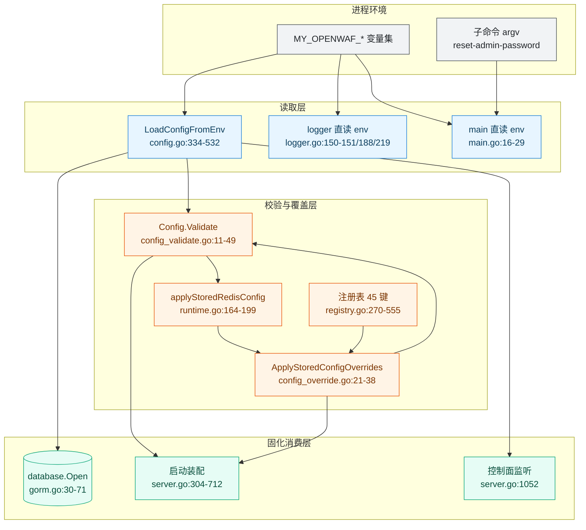
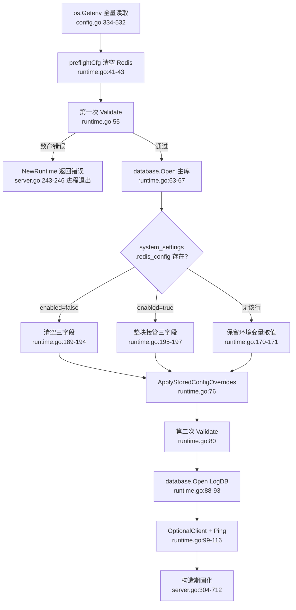
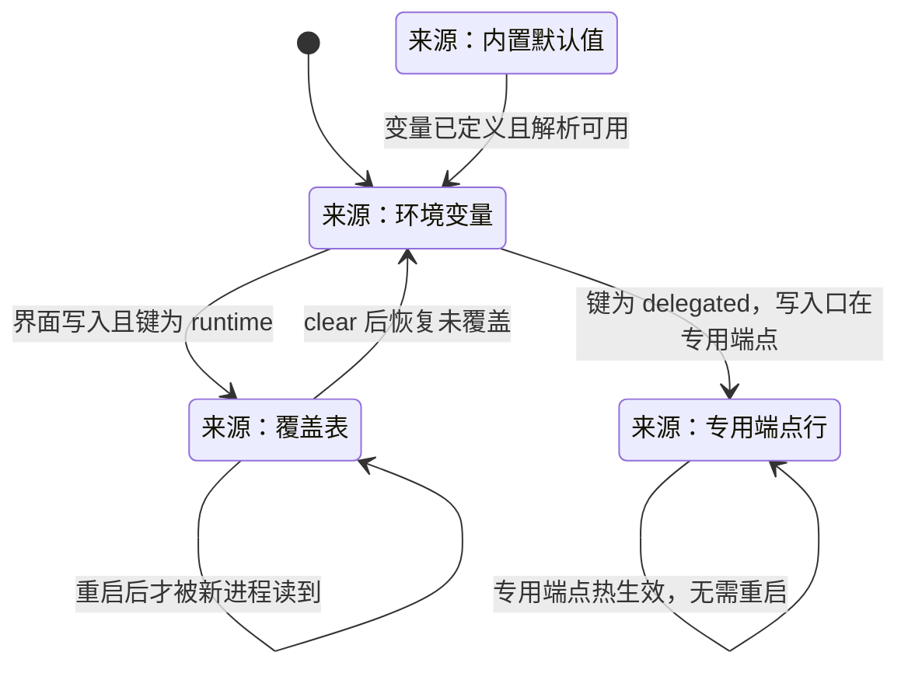
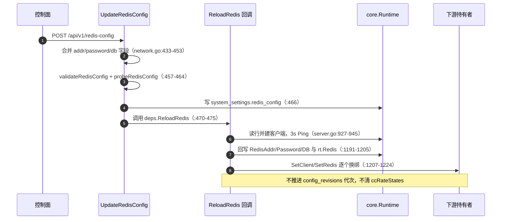

# 环境变量与运行参数

> [返回部署运维总览](部署运维.md) · 变量清单权威在 [README 配置说明](../../README.md)，本篇不重复其表格

<cite>
**本文档引用的文件**
- [README.md](file://README.md)
- [Dockerfile](file://Dockerfile)
- [cmd/main.go](file://cmd/main.go)
- [internal/app/server.go](file://internal/app/server.go)
- [internal/app/tls_fingerprint_policy.go](file://internal/app/tls_fingerprint_policy.go)
- [internal/admin/router.go](file://internal/admin/router.go)
- [internal/admin/system/acme.go](file://internal/admin/system/acme.go)
- [internal/admin/system/network.go](file://internal/admin/system/network.go)
- [internal/admin/system/runtime.go](file://internal/admin/system/runtime.go)
- [internal/admin/system/runtime_override_shadow.go](file://internal/admin/system/runtime_override_shadow.go)
- [internal/admin/system/runtime_overrides.go](file://internal/admin/system/runtime_overrides.go)
- [internal/admin/system/settings.go](file://internal/admin/system/settings.go)
- [internal/core/config.go](file://internal/core/config.go)
- [internal/core/config_override.go](file://internal/core/config_override.go)
- [internal/core/config_validate.go](file://internal/core/config_validate.go)
- [internal/core/configoverride/registry.go](file://internal/core/configoverride/registry.go)
- [internal/core/configoverride/resolve.go](file://internal/core/configoverride/resolve.go)
- [internal/core/database/gorm.go](file://internal/core/database/gorm.go)
- [internal/core/rules/matcher.go](file://internal/core/rules/matcher.go)
- [internal/core/runtime.go](file://internal/core/runtime.go)
- [internal/dataplane/access_log.go](file://internal/dataplane/access_log.go)
- [internal/pkg/logger/logger.go](file://internal/pkg/logger/logger.go)
- [internal/snapshot/build.go](file://internal/snapshot/build.go)
- [internal/snapshot/tls.go](file://internal/snapshot/tls.go)
- [internal/store/protection.go](file://internal/store/protection.go)
- [internal/store/site.go](file://internal/store/site.go)
- [internal/store/system.go](file://internal/store/system.go)
</cite>

## 目录

1. [简介](#简介)
2. [项目结构](#项目结构)
3. [核心组件](#核心组件)
4. [架构总览](#架构总览)
5. [详细组件分析](#详细组件分析)
6. [依赖关系分析](#依赖关系分析)
7. [性能考虑](#性能考虑)
8. [故障排查指南](#故障排查指南)
9. [结论](#结论)
10. [附录](#附录)

## 简介

[README.md:311-340](file://README.md#L311-L340) 是环境变量的**唯一权威清单**：变量名、默认值、一句话说明都以它为准。本篇不复制那张表，也不设立第二配置源，只做运维需要而 README 不覆盖的四件事——把每个变量钉到代码读取位置、给出多来源之间的生效顺序、判定它是否触发了运行期重载、说明站点级能否覆盖它。

这样分工的根因是实测结论：一个变量的最终取值可能同时来自环境变量、`system_settings` 设置行、逐键覆盖表和站点列四类载体，而它们的优先级与生效时机各不相同。只看 README 的「默认值」列会得出错误判断。

| 主题 | 归属文档 | 本篇是否展开 |
|------|----------|:------------:|
| 变量清单与默认值 | [README.md:311-340](file://README.md#L311-L340) | 否，仅引用 |
| 变量 → 读取位置 → 生效顺序 → 重载 → 站点覆盖 | 本篇 | 是 |
| 覆盖表端点契约与前端表单 | [管理 API 系统/系统设置 API](../管理%20API%20系统/系统设置%20API.md) | 否，仅引用 |
| 快照重建与代次推进 | [配置管理系统/热重载系统](../配置管理系统/热重载系统.md) | 否，仅引用 |
| 容器内 ENV 与卷 | [容器化部署](容器化部署.md) | 否，仅引用 |

**章节来源**
- [README.md:311-340](file://README.md#L311-L340)

### 三类变量与一条硬边界

按「能否在运行期被改变」把变量分为三类，这条边界决定了排障时该重启还是该改库：

| 类别 | 判定依据 | 改变方式 | 典型变量 |
|------|----------|----------|----------|
| 引导类 | `ScopeBootstrap`（[registry.go:272-308](file://internal/core/configoverride/registry.go#L272-L308)） | 只能改环境变量并重启进程 | `MY_OPENWAF_DSN`、`MY_OPENWAF_ADMIN_BIND` |
| 构造期固化类 | `ScopeRuntime` 且 `RestartRequired: true`（[registry.go:330-533](file://internal/core/configoverride/registry.go#L330-L533)） | 覆盖表可写，但要等重启 | `MY_OPENWAF_QUEUE_BATCH_SIZE`、`MY_OPENWAF_RESPONSE_CACHE_MB` |
| 委托类 | `ScopeDelegated` + 专用端点（[registry.go:311-328](file://internal/core/configoverride/registry.go#L311-L328)、[:428-447](file://internal/core/configoverride/registry.go#L428-L447)） | 只走专用端点，覆盖表仅展示 | `MY_OPENWAF_REDIS_ADDR`、`MY_OPENWAF_LOG_LEVEL` |

硬边界是：**重载链不会重新执行 `LoadConfigFromEnv`**。运行期唯一会被回写的 `core.Config` 字段是那三个 Redis 字段（[server.go:1193-1204](file://internal/app/server.go#L1193-L1204)），其余字段一旦写入 `rt.Config` 就不再变化。

**章节来源**
- [internal/core/configoverride/registry.go:272-533](file://internal/core/configoverride/registry.go#L272-L533)
- [internal/app/server.go:1193-1204](file://internal/app/server.go#L1193-L1204)

## 项目结构

配置子系统的文件分布遵循「读取—校验—覆盖—消费」四段分离，没有集中的 settings 对象。



**图表来源**
- [internal/core/config.go:334-532](file://internal/core/config.go#L334-L532)
- [internal/core/config_validate.go:11-49](file://internal/core/config_validate.go#L11-L49)
- [internal/core/config_override.go:21-38](file://internal/core/config_override.go#L21-L38)
- [internal/core/runtime.go:164-199](file://internal/core/runtime.go#L164-L199)
- [internal/core/configoverride/registry.go:270-555](file://internal/core/configoverride/registry.go#L270-L555)
- [cmd/main.go:16-29](file://cmd/main.go#L16-L29)
- [internal/pkg/logger/logger.go:150-228](file://internal/pkg/logger/logger.go#L150-L228)
- [internal/app/server.go:1052-1052](file://internal/app/server.go#L1052-L1052)

### 配置载体与文件职责

| 文件 | 关键符号:行 | 承担职责 | 不承担职责 |
|------|-------------|----------|------------|
| [internal/core/config.go](file://internal/core/config.go) | `Config` [:262-317](file://internal/core/config.go#L262-L317)、`LoadConfigFromEnv` [:334-532](file://internal/core/config.go#L334-L532) | 读环境变量、别名回落、默认值、钳制告警 | 不读库、不知站点 |
| [internal/core/config_validate.go](file://internal/core/config_validate.go) | `Validate` [:11-49](file://internal/core/config_validate.go#L11-L49) | 驱动白名单、DSN 非空、监听与 Redis 地址形制、两条告警 | 不校验业务取值区间 |
| [internal/core/config_override.go](file://internal/core/config_override.go) | `ApplyStoredConfigOverrides` [:21-38](file://internal/core/config_override.go#L21-L38) | 把覆盖表按键回写到 `Config` 的 8 组字段 | 不写 Redis 字段、不改引导字段 |
| [internal/core/configoverride/registry.go](file://internal/core/configoverride/registry.go) | `registry` [:270-555](file://internal/core/configoverride/registry.go#L270-L555) | 45 个键的 `Env`/`Group`/`Kind`/`Scope`/边界/`Secret`/`RestartRequired` | 不做取值决策 |
| [internal/core/configoverride/resolve.go](file://internal/core/configoverride/resolve.go) | `ParseStoredOverrides` [:55-91](file://internal/core/configoverride/resolve.go#L55-L91) | 存储形态解析、未知键与不可写键丢弃 | 不访问数据库 |
| [internal/core/runtime.go](file://internal/core/runtime.go) | `NewRuntime` [:36-142](file://internal/core/runtime.go#L36-L142)、`applyStoredRedisConfig` [:164-199](file://internal/core/runtime.go#L164-L199) | 两次 `Validate`、库行覆盖、开主库与日志库、Redis 降级 | 不读站点配置 |
| [internal/app/server.go](file://internal/app/server.go) | `Run` [:234-1133](file://internal/app/server.go#L234-L1133) | 把 `rt.Config` 注入各构造器、解析 JWT 密钥、装配重载链 | 不解析环境变量原文 |
| [internal/store/system.go](file://internal/store/system.go) | 设置键常量 [:12-27](file://internal/store/system.go#L12-L27) | `redis_config`/`jwt_secret`/`runtime_config_overrides` 等键名 | 不含取值语义 |

**章节来源**
- [internal/core/config.go:262-532](file://internal/core/config.go#L262-L532)
- [internal/core/config_validate.go:11-49](file://internal/core/config_validate.go#L11-L49)
- [internal/core/config_override.go:21-38](file://internal/core/config_override.go#L21-L38)
- [internal/core/configoverride/registry.go:270-555](file://internal/core/configoverride/registry.go#L270-L555)
- [internal/core/configoverride/resolve.go:55-91](file://internal/core/configoverride/resolve.go#L55-L91)
- [internal/core/runtime.go:36-199](file://internal/core/runtime.go#L36-L199)
- [internal/store/system.go:12-27](file://internal/store/system.go#L12-L27)

## 核心组件

| 组件 | 位置 | 输入 | 输出 | 失败语义 |
|------|------|------|------|----------|
| 环境变量加载器 | [config.go:334-532](file://internal/core/config.go#L334-L532) | `os.Getenv` | `Config` + `QueueWarnings` | 解析失败保留默认并告警，不中断启动 |
| 配置校验器 | [config_validate.go:11-49](file://internal/core/config_validate.go#L11-L49) | `Config` | 告警列表 + 致命错误 | 返回错误则 `NewRuntime` 失败、进程退出 |
| Redis 行覆盖器 | [runtime.go:164-199](file://internal/core/runtime.go#L164-L199) | `system_settings.redis_config` | 改写三字段或清空 | 行内 JSON 坏、`db<0`、启用无地址 → 启动失败 |
| 逐键覆盖器 | [config_override.go:41-169](file://internal/core/config_override.go#L41-L169) | `system_settings.runtime_config_overrides` | 8 组 `Config` 字段 | 表缺失按「没有覆盖」处理，回落环境变量 |
| JWT 密钥解析器 | [server.go:1454-1477](file://internal/app/server.go#L1454-L1477) | env → `jwt_secret` 行 → 随机数 | 32 字节随机密钥的十六进制文本 | 无法读写库则退出 |
| 日志装配器 | [server.go:146-175](file://internal/app/server.go#L146-L175)、[logger.go:149-228](file://internal/pkg/logger/logger.go#L149-L228) | `log_config` 行 + 三个 `LOG_*` | 全局 slog 级别/落盘/着色 | 文件打开失败回落 stdout |
| 覆盖表端点 | [runtime_overrides.go:105-109](file://internal/admin/system/runtime_overrides.go#L105-L109)、[:255-299](file://internal/admin/system/runtime_overrides.go#L255-L299) | JSON `overrides`/`clear` | 写后回读的三态清单 | 未知键/不可写键返 400 |

**章节来源**
- [internal/core/config.go:334-532](file://internal/core/config.go#L334-L532)
- [internal/core/config_validate.go:11-49](file://internal/core/config_validate.go#L11-L49)
- [internal/core/runtime.go:164-199](file://internal/core/runtime.go#L164-L199)
- [internal/core/config_override.go:41-169](file://internal/core/config_override.go#L41-L169)
- [internal/app/server.go:146-175](file://internal/app/server.go#L146-L175)
- [internal/app/server.go:1454-1477](file://internal/app/server.go#L1454-L1477)
- [internal/pkg/logger/logger.go:149-228](file://internal/pkg/logger/logger.go#L149-L228)
- [internal/admin/system/runtime_overrides.go:105-299](file://internal/admin/system/runtime_overrides.go#L105-L299)

## 架构总览

一句话概括：**环境变量只在进程启动的一瞬间被读一次，之后一切变化都来自库里的行。** 覆盖链的汇合点全部在 `NewRuntime` 内，`Run` 之后不再有配置解析入口。

| 层 | 载体 | 时机 | 可否运行期回退 |
|----|------|------|:--------------:|
| 环境层 | `MY_OPENWAF_*` | 进程启动前 | 否（进程 env 不可变） |
| 别名层 | `MY_OPENWAF_DB`、`MY_OPENWAF_LOG_DB` | 同一次加载内 | 否 |
| 库行层 | `redis_config`、`log_config`、`drop_policy`、`bot_settings`、`protection` | 开库之后 | 是，经端点重写 |
| 覆盖表层 | `runtime_config_overrides` | 开库之后 | 是，经 `/runtime-config/env-overrides` |
| 站点层 | `sites` 表三态列 | 快照构建期 | 是，经站点端点 |

**章节来源**
- [internal/core/runtime.go:63-93](file://internal/core/runtime.go#L63-L93)
- [internal/core/config.go:335-353](file://internal/core/config.go#L335-L353)

## 详细组件分析

### 变量生效顺序表

顺序由代码调用行号决定，不存在例外。`Validate` 实测被调用两次（[runtime.go:55](file://internal/core/runtime.go#L55) 与 [runtime.go:80](file://internal/core/runtime.go#L80)），第一次前先清空 Redis 字段（[runtime.go:41-43](file://internal/core/runtime.go#L41-L43)）。

| 序 | 阶段 | 代码位置 | 此阶段结束时的确定项 |
|:--:|------|----------|----------------------|
| 1 | 子命令与 pprof 判定 | [cmd/main.go:14-49](file://cmd/main.go#L14-L49) | `MY_OPENWAF_PPROF_BIND` 已生效或关闭 |
| 2 | 环境变量加载 | [config.go:334-532](file://internal/core/config.go#L334-L532) | 全部 `Config` 字段初值；`MY_OPENWAF_JWT_SECRET` 尚未参与 |
| 3 | 队列与遥测告警 | [runtime.go:48-54](file://internal/core/runtime.go#L48-L54) | `QueueWarnings`/`HTTPTrace.Warnings` 已输出一次 |
| 4 | 引导期校验 | [runtime.go:55-61](file://internal/core/runtime.go#L55-L61) | 驱动/DSN/`AdminBind` 合法性；**Redis 三字段被人为清空** |
| 5 | 打开主库 | [runtime.go:63-67](file://internal/core/runtime.go#L63-L67) | 主库句柄与方言确定，`MY_OPENWAF_DATA` 使命结束 |
| 6 | Redis 行覆盖 | [runtime.go:71](file://internal/core/runtime.go#L71)、[:164-199](file://internal/core/runtime.go#L164-L199) | 环境变量里的 Redis 取值被整块接管或清空 |
| 7 | 逐键覆盖表应用 | [runtime.go:76](file://internal/core/runtime.go#L76)、[config_override.go:21-38](file://internal/core/config_override.go#L21-L38) | `ScopeRuntime` 键的最终取值 |
| 8 | 二次校验 | [runtime.go:80-87](file://internal/core/runtime.go#L80-L87) | 覆盖后的 Redis 地址才做形制校验 |
| 9 | 打开日志库 | [runtime.go:88-93](file://internal/core/runtime.go#L88-L93) | `Options{LogDB: true}` 的独立 PRAGMA 组合 |
| 10 | Redis 客户端与降级 | [runtime.go:99-116](file://internal/core/runtime.go#L99-L116) | 连通性结论（失败仅告警） |
| 11 | JWT 密钥解析 | [server.go:284](file://internal/app/server.go#L284)、[:1454-1477](file://internal/app/server.go#L1454-L1477) | env > `jwt_secret` 行 > 新生成并持久化 |
| 12 | 首次快照构建 | [server.go:293](file://internal/app/server.go#L293) | 站点级三态与 `protection` 行合流 |
| 13 | 构造期固化 | [server.go:304-712](file://internal/app/server.go#L304-L712) | 队列、缓存、采样率、Tracer、监听器参数全部冻结 |



**图表来源**
- [internal/core/runtime.go:36-116](file://internal/core/runtime.go#L36-L116)
- [internal/core/config.go:334-532](file://internal/core/config.go#L334-L532)
- [internal/core/config_override.go:21-38](file://internal/core/config_override.go#L21-L38)
- [internal/app/server.go:243-246](file://internal/app/server.go#L243-L246)

**章节来源**
- [internal/core/runtime.go:36-116](file://internal/core/runtime.go#L36-L116)
- [internal/app/server.go:243-293](file://internal/app/server.go#L243-L293)

### 引导组变量映射

| 环境变量 | 读取位置 | 落入字段 | 固化消费位置 | 重启必需 | 站点级能否覆盖 |
|----------|----------|----------|--------------|:--------:|:--------------:|
| `MY_OPENWAF_DSN` | [config.go:335-345](file://internal/core/config.go#L335-L345) | `Config.DBDSN` | [runtime.go:63-67](file://internal/core/runtime.go#L63-L67) → [gorm.go:97](file://internal/core/database/gorm.go#L97) | 是 | 否 |
| `MY_OPENWAF_DB` | [config.go:337](file://internal/core/config.go#L337)（别名，优先级低于 `DSN`） | `Config.DBDSN` | 同上 | 是 | 否 |
| `MY_OPENWAF_LOG_DSN` | [config.go:347-353](file://internal/core/config.go#L347-L353) | `Config.LogDBDSN` | [runtime.go:88-93](file://internal/core/runtime.go#L88-L93) | 是 | 否 |
| `MY_OPENWAF_LOG_DB` | [config.go:349](file://internal/core/config.go#L349)（别名） | `Config.LogDBDSN` | 同上 | 是 | 否 |
| `MY_OPENWAF_DATA` | [config.go:339-342](file://internal/core/config.go#L339-L342) | `Config.DataDir` | 仅 DSN 缺目录时使用（[gorm.go:74-77](file://internal/core/database/gorm.go#L74-L77)） | 是 | 否 |
| `MY_OPENWAF_DB_DRIVER` | [config.go:355-358](file://internal/core/config.go#L355-L358) | `Config.DBDriver` | [gorm.go:45-54](file://internal/core/database/gorm.go#L45-L54) | 是 | 否 |
| `MY_OPENWAF_ADMIN_BIND` | [config.go:362-365](file://internal/core/config.go#L362-L365) | `Config.AdminBind` | 种子 [server.go:267](file://internal/app/server.go#L267)、监听 [:1052](file://internal/app/server.go#L1052) | 是 | 否 |
| `MY_OPENWAF_JWT_SECRET` | **不经 `Config`**：[server.go:1455](file://internal/app/server.go#L1455) | 局部 `jwtSecret` | 动态防护密钥基 [:1490-1497](file://internal/app/server.go#L1490-L1497)、挑战密钥 [:299](file://internal/app/server.go#L299) | 是 | 否 |
| `MY_OPENWAF_PPROF_BIND` | [cmd/main.go:29](file://cmd/main.go#L29) | 无 | pprof mux [:30-48](file://cmd/main.go#L30-L48) | 是 | 否 |
| `MY_OPENWAF_ADMIN_STATIC_DIR` | [config.go:517](file://internal/core/config.go#L517) | `Config.AdminStaticDir` | [server.go:1073](file://internal/app/server.go#L1073) | 是 | 否 |
| `MY_OPENWAF_CAPTCHA_DIR` | [config.go:518](file://internal/core/config.go#L518) | `Config.CaptchaDir` | 仅非空时覆盖 [server.go:609](file://internal/app/server.go#L609) | 是 | 否 |

两个易踩点：`MY_OPENWAF_DATA` 只影响 SQLite 缺省路径，**不会**把 GeoIP 库、验证码目录或日志文件收拢到数据目录；`MY_OPENWAF_JWT_SECRET` 一旦被设置就永久压制库里的 `jwt_secret` 行（[server.go:1455-1457](file://internal/app/server.go#L1455-L1457)），移除该变量后才会回到持久化值。

**章节来源**
- [internal/core/config.go:335-365](file://internal/core/config.go#L335-L365)
- [internal/core/config.go:517-518](file://internal/core/config.go#L517-L518)
- [internal/core/runtime.go:63-93](file://internal/core/runtime.go#L63-L93)
- [internal/core/database/gorm.go:45-97](file://internal/core/database/gorm.go#L45-L97)
- [internal/app/server.go:267-299](file://internal/app/server.go#L267-L299)
- [internal/app/server.go:1052-1073](file://internal/app/server.go#L1052-L1073)
- [internal/app/server.go:1454-1497](file://internal/app/server.go#L1454-L1497)
- [cmd/main.go:29-48](file://cmd/main.go#L29-L48)

### 网络与 Redis 组映射

| 环境变量 | 读取位置 | 接管者 | 重载路径 | 重启必需 | 站点级能否覆盖 |
|----------|----------|--------|----------|:--------:|:--------------:|
| `MY_OPENWAF_REDIS_ADDR` | [config.go:513](file://internal/core/config.go#L513) | `redis_config` 行（[runtime.go:195-197](file://internal/core/runtime.go#L195-L197)） | `POST /api/v1/redis-config` | 否 | 否 |
| `MY_OPENWAF_REDIS_PASSWORD` | [config.go:514](file://internal/core/config.go#L514) | 同上 | 同上；响应不回显真值（[network.go:66-77](file://internal/admin/system/network.go#L66-L77)） | 否 | 否 |
| `MY_OPENWAF_REDIS_DB` | [config.go:360](file://internal/core/config.go#L360)（`Atoi` 错误被忽略，按 0） | 同上 | 同上 | 否 | 否 |
| `MY_OPENWAF_LOG_LEVEL` | [logger.go:188](file://internal/pkg/logger/logger.go#L188)、[server.go:162](file://internal/app/server.go#L162) | `log_config` 行（[server.go:146-175](file://internal/app/server.go#L146-L175)） | `POST /api/v1/log-config` 直接改全局 logger | 否 | 否 |
| `MY_OPENWAF_LOG_FILE` | [logger.go:150](file://internal/pkg/logger/logger.go#L150) | 同上 | 同上 | 否 | 否 |
| `MY_OPENWAF_LOG_ALSO_STDOUT` | [logger.go:151](file://internal/pkg/logger/logger.go#L151)（仅 `== "1"`） | 同上 | 同上 | 否 | 否 |
| `MY_OPENWAF_LOG_COLOR` | [config.go:519](file://internal/core/config.go#L519) → `logColorMode` [:544-552](file://internal/core/config.go#L544-L552) | 覆盖表 `log_color` | 每次保存日志配置时透传（[network.go:291](file://internal/admin/system/network.go#L291)） | 是 | 否 |
| `MY_OPENWAF_H3_ALLOW_0RTT` | 常量 [snapshot/tls.go:281](file://internal/snapshot/tls.go#L281)，判定 [:296-300](file://internal/snapshot/tls.go#L296-L300)；数据面每次判定直读 `os.Getenv`（[server.go:1145-1149](file://internal/app/server.go#L1145-L1149)），Admin 运行态自检同源（[runtime.go:626](file://internal/admin/system/runtime.go#L626)、[:648](file://internal/admin/system/runtime.go#L648)） | `tls_default_config` 行的三态 `allow_0rtt` | `POST /api/v1/tls-config` | 否 | 否，取全局 TLS 默认配置 |
| `MY_OPENWAF_H2WS_PEEKER_OFF` | [server 侧 tls_fingerprint_policy.go:27](file://internal/app/tls_fingerprint_policy.go#L27) | 无（`ScopeTestOnly`，[registry.go:545-549](file://internal/core/configoverride/registry.go#L545-L549)） | 不可覆盖 | 是 | 否 |

`redis_config` 行的 `enabled: false` 会**清空**三个字段（[runtime.go:189-194](file://internal/core/runtime.go#L189-L194)），而不是「不覆盖」。在 compose 里同时设置 `MY_OPENWAF_REDIS_ADDR` 又曾在界面关闭 Redis 开关，结果是没有 Redis——这与直觉相反，是引导期最常见的误判来源。

**章节来源**
- [internal/core/config.go:360-360](file://internal/core/config.go#L360-L360)
- [internal/core/config.go:513-519](file://internal/core/config.go#L513-L519)
- [internal/core/runtime.go:189-197](file://internal/core/runtime.go#L189-L197)
- [internal/core/config_override.go:156-169](file://internal/core/config_override.go#L156-L169)
- [internal/admin/system/network.go:66-77](file://internal/admin/system/network.go#L66-L77)
- [internal/admin/system/network.go:287-292](file://internal/admin/system/network.go#L287-L292)
- [internal/admin/system/runtime.go:625-652](file://internal/admin/system/runtime.go#L625-L652)
- [internal/snapshot/tls.go:277-300](file://internal/snapshot/tls.go#L277-L300)
- [internal/app/tls_fingerprint_policy.go:15-29](file://internal/app/tls_fingerprint_policy.go#L15-L29)
- [internal/app/server.go:146-175](file://internal/app/server.go#L146-L175)
- [internal/pkg/logger/logger.go:149-228](file://internal/pkg/logger/logger.go#L149-L228)

### 检测组映射

检测组的特点是「环境变量只给启动期兜底，真正的权威是设置行」。

| 环境变量 | 读取位置 | 兜底对象 | 运行期权威来源 | 站点级能否覆盖 |
|----------|----------|----------|----------------|:--------------:|
| `MY_OPENWAF_CVE_ENABLED` | [config.go:397](file://internal/core/config.go#L397)（仅字面 `true`） | `Config.CVE.Enabled` | 覆盖表 `cve_enabled`，可被 `protection` 行顶掉（[runtime_override_shadow.go:26-35](file://internal/admin/system/runtime_override_shadow.go#L26-L35)） | 是，`cve_enabled` 三态（[site.go:79](file://internal/store/site.go#L79)、[build.go:736-746](file://internal/snapshot/build.go#L736-L746)） |
| `MY_OPENWAF_CVE_FEED_ENABLED` | [config.go:398](file://internal/core/config.go#L398) | 同步管理器构造参数 | 无（启动期固化，[server.go:452](file://internal/app/server.go#L452)） | 否 |
| `MY_OPENWAF_CVE_FEED_INTERVAL` | [config.go:399-405](file://internal/core/config.go#L399-L405)（缺省 `6h`） | ticker 周期 | 无 | 否 |
| `MY_OPENWAF_NVD_API_KEY` | [config.go:400](file://internal/core/config.go#L400) | 构造参数 | 无 | 否 |
| `MY_OPENWAF_CVE_AUTO_APPROVE` | [config.go:401](file://internal/core/config.go#L401) | 构造参数 | 无 | 否 |
| `MY_OPENWAF_GEOIP_DB` | [config.go:387-389](file://internal/core/config.go#L387-L389) | resolver 打开路径（[server.go:466-473](file://internal/app/server.go#L466-L473)） | `bot_settings` 行；路径变化时 `Reload` 换库（[server.go:665-672](file://internal/app/server.go#L665-L672)） | 否，站点仅有 `bot_protection_enabled`（[site.go:60](file://internal/store/site.go#L60)） |
| `MY_OPENWAF_BOT_THRESHOLD` | [config.go:390-394](file://internal/core/config.go#L390-L394)（仅 `>0`） | `eng.SetGeoResolver` 阈值 | **reload 时被 `drop_policy.bot_score_threshold` 取代**（[server.go:659-661](file://internal/app/server.go#L659-L661)） | 否 |
| `MY_OPENWAF_DROP_ENABLED` | [config.go:420-422](file://internal/core/config.go#L420-L422)（仅字面 `false` 关闭） | `DropExecutor` 初值 | `drop_policy.enabled`（[server.go:1416-1446](file://internal/app/server.go#L1416-L1446)） | 否 |
| `MY_OPENWAF_DROP_BOT_THRESHOLD` | [config.go:423-427](file://internal/core/config.go#L423-L427) | `loadDropPolicy` 兜底 | `drop_policy.bot_score_threshold` | 否 |

陷阱集中在两处：其一，`bot_enabled` 没有环境变量载体（[registry.go:408-413](file://internal/core/configoverride/registry.go#L408-L413)），值为真才会创建 GeoIP resolver，因此 `MY_OPENWAF_GEOIP_DB` 在未显式覆盖 `bot_enabled` 的首启实例上依赖内置默认为真这一事实；其二，`MY_OPENWAF_BOT_THRESHOLD` 与 `MY_OPENWAF_DROP_BOT_THRESHOLD` 在启动期分属两个结构体字段，但只要发生过一次重载，实际生效的阈值只剩 `drop_policy` 行那一路，两个变量的差异被抹平。

**章节来源**
- [internal/core/config.go:387-427](file://internal/core/config.go#L387-L427)
- [internal/core/config_override.go:41-91](file://internal/core/config_override.go#L41-L91)
- [internal/core/configoverride/registry.go:344-413](file://internal/core/configoverride/registry.go#L344-L413)
- [internal/app/server.go:448-474](file://internal/app/server.go#L448-L474)
- [internal/app/server.go:655-673](file://internal/app/server.go#L655-L673)
- [internal/app/server.go:1416-1446](file://internal/app/server.go#L1416-L1446)
- [internal/store/site.go:60-84](file://internal/store/site.go#L60-L84)
- [internal/snapshot/build.go:707-760](file://internal/snapshot/build.go#L707-L760)
- [internal/admin/system/runtime_override_shadow.go:26-35](file://internal/admin/system/runtime_override_shadow.go#L26-L35)

### 可观测性与队列组映射

这一组的共同点是把值直接当作 `make(chan T, N)` 的容量或 ticker 周期，因此**任何覆盖都必须重启**，`RestartRequired: true` 在注册表里逐个声明。

| 环境变量 | 读取位置 | 默认值 | 钳制/告警 | 消费位置 |
|----------|----------|:------:|-----------|----------|
| `MY_OPENWAF_ACCESSLOG_SAMPLING` | [config.go:369-378](file://internal/core/config.go#L369-L378) | 1 | `<1` 或非法即保留 1 并告警 | [server.go:699](file://internal/app/server.go#L699) → [access_log.go:513](file://internal/dataplane/access_log.go#L513) |
| `MY_OPENWAF_TRACE_ENABLED` | [config.go:407](file://internal/core/config.go#L407) | false | 仅字面 `true` | [server.go:482-487](file://internal/app/server.go#L482-L487) |
| `MY_OPENWAF_TRACE_LEVEL` | [config.go:409-417](file://internal/core/config.go#L409-L417) | detailed | 非 `base`/`detailed` 告警并保留 | 同上 |
| `MY_OPENWAF_RESPONSE_CACHE_MB` | [config.go:429-434](file://internal/core/config.go#L429-L434) | 64 | 仅 `>0` | [server.go:359](file://internal/app/server.go#L359) |
| `MY_OPENWAF_RESPONSE_CACHE_TTL_SEC` | [config.go:435-440](file://internal/core/config.go#L435-L440) | 60 | 仅 `>0` | 同上 |
| `MY_OPENWAF_REQUEST_DECOMPRESS_LIMIT_BYTES` | [config.go:383](file://internal/core/config.go#L383) → [:147-158](file://internal/core/config.go#L147-L158) | 0（由 proxy 兜底） | 非法值告警并回落方向默认 | [server.go:361](file://internal/app/server.go#L361) |
| `MY_OPENWAF_RESPONSE_DECOMPRESS_LIMIT_BYTES` | [config.go:384](file://internal/core/config.go#L384) | 0 | 同上 | [server.go:362](file://internal/app/server.go#L362) |
| `MY_OPENWAF_QUEUE_EVENT_BUFFER_SIZE` | [config.go:448-454](file://internal/core/config.go#L448-L454) | 16384 | 上限 1M（[:97-106](file://internal/core/config.go#L97-L106)、[:222-227](file://internal/core/config.go#L222-L227)） | [server.go:341](file://internal/app/server.go#L341) |
| `MY_OPENWAF_QUEUE_DROP_BUFFER_SIZE` | [config.go:455-461](file://internal/core/config.go#L455-L461) | 8192 | 上限 1M | [server.go:342](file://internal/app/server.go#L342) |
| `MY_OPENWAF_QUEUE_BATCH_SIZE` | [config.go:462-468](file://internal/core/config.go#L462-L468) | 256 | 上限 10000，`<=0` 回落默认 | [server.go:343](file://internal/app/server.go#L343) |
| `MY_OPENWAF_QUEUE_FLUSH_INTERVAL` | [config.go:469-475](file://internal/core/config.go#L469-L475) | 3s | 上限 60s | [server.go:344](file://internal/app/server.go#L344) |
| `MY_OPENWAF_QUEUE_WRITE_BATCH_SIZE` | [config.go:476-482](file://internal/core/config.go#L476-L482) | 64 | 上限 10000 | [server.go:331](file://internal/app/server.go#L331) |
| `MY_OPENWAF_QUEUE_WRITE_CAPACITY` | [config.go:483-489](file://internal/core/config.go#L483-L489) | 256 | 上限 1M | [server.go:330](file://internal/app/server.go#L330) |
| `MY_OPENWAF_QUEUE_WRITE_INTERVAL` | [config.go:490-496](file://internal/core/config.go#L490-L496) | 50ms | 不设上界（[:240-244](file://internal/core/config.go#L240-L244)） | [server.go:332](file://internal/app/server.go#L332) |
| `MY_OPENWAF_QUEUE_SLOW_LOG_GRACE` | [config.go:497-504](file://internal/core/config.go#L497-L504) | 30s（未设时不触发） | 上限 5 分钟（[:101-105](file://internal/core/config.go#L101-L105)、[:245-256](file://internal/core/config.go#L245-L256)） | [server.go:345-346](file://internal/app/server.go#L345-L346) |

钳制的告警只在加载时输出一次（[runtime.go:48-50](file://internal/core/runtime.go#L48-L50)），进程起来后 `/runtime-config` 显示的是已被钳制的结果，不再显示原始非法取值——这意味着「告警只在启动日志里出现一次」，事后取证必须翻启动日志。

**章节来源**
- [internal/core/config.go:97-106](file://internal/core/config.go#L97-L106)
- [internal/core/config.go:147-158](file://internal/core/config.go#L147-L158)
- [internal/core/config.go:218-259](file://internal/core/config.go#L218-L259)
- [internal/core/config.go:369-504](file://internal/core/config.go#L369-L504)
- [internal/app/server.go:329-362](file://internal/app/server.go#L329-L362)
- [internal/app/server.go:482-488](file://internal/app/server.go#L482-L488)
- [internal/app/server.go:699-709](file://internal/app/server.go#L699-L709)
- [internal/core/runtime.go:48-54](file://internal/core/runtime.go#L48-L54)
- [internal/dataplane/access_log.go:507-520](file://internal/dataplane/access_log.go#L507-L520)

### 重载触发矩阵

「调用了 reload」与「改动真的生效」是两件事，必须分开判定。

| 端点 | 路由接线 | 回调 | 推进代次 | 实际效果 |
|------|----------|------|:--------:|----------|
| `POST /api/v1/network-config` | [router.go:390](file://internal/admin/router.go#L390) | `reload` | 是 | 快照重建 + 监听器 reconcile（[server.go:884-889](file://internal/app/server.go#L884-L889)） |
| `POST /api/v1/tls-config` | [router.go:396](file://internal/admin/router.go#L396) | `reload` | 是 | 同上；`allow_0rtt` 三态可传 `null` 清除 |
| `POST /api/v1/runtime-config/env-overrides` | [router.go:391](file://internal/admin/router.go#L391) | `reload` | 是 | 快照重建；**`RestartRequired` 键仍等重启**（[registry.go:330-533](file://internal/core/configoverride/registry.go#L330-L533)） |
| `POST /api/v1/redis-config` | [router.go:394](file://internal/admin/router.go#L394) | `ReloadRedis` | **否** | 仅交换 Redis 后端（[server.go:926-979](file://internal/app/server.go#L926-L979)） |
| `POST /api/v1/log-config` | [router.go:395](file://internal/admin/router.go#L395) | 无 | 否 | handler 内直接 `logger.Configure`（[network.go:287-292](file://internal/admin/system/network.go#L287-L292)） |
| `POST /api/v1/certificates/acme/config` | [router.go:397](file://internal/admin/router.go#L397) | `reload` | 是 | `acme_config` 不在 `Build` 的读取集内，只多递增一次代次（[acme.go:521-527](file://internal/admin/system/acme.go#L521-L527)） |
| `POST /api/v1/settings/:key` | [router.go:376](file://internal/admin/router.go#L376) | `reload` | 是 | 受保护键被拒 400（[settings.go:18-58](file://internal/admin/system/settings.go#L18-L58)） |
| `POST /api/v1/settings/:key/delete` | [router.go:378](file://internal/admin/router.go#L378) | `reload` | 是 | 删除后该键回落默认或环境变量 |

`ReloadRedis` 不推进代次这条差异有具体后果：`ccRateStates` 声明在 [matcher.go:62](file://internal/core/rules/matcher.go#L62)，只在规则编译期由 `storeCCRateState` 注册（[:94-103](file://internal/core/rules/matcher.go#L94-L103) 的 `LoadOrStore`），条目超过 `ccRateStateMaxEntries` 2048 时才由 `evictCCRateStates` 整体换表（[:60](file://internal/core/rules/matcher.go#L60)、[:112-124](file://internal/core/rules/matcher.go#L112-L124)）。切 Redis 后端不重建快照、不重编译规则，因此既不走这条换表路径也不清空计数；限流窗口/配额后端同样是进程级单例，只在全局保护设置变化时被 `Reconfigure`（[server.go:637-641](file://internal/app/server.go#L637-L641)、[:884](file://internal/app/server.go#L884)）。



**图表来源**
- [internal/core/configoverride/registry.go:24-36](file://internal/core/configoverride/registry.go#L24-L36)
- [internal/core/configoverride/resolve.go:16-23](file://internal/core/configoverride/resolve.go#L16-L23)
- [internal/core/config_override.go:237-243](file://internal/core/config_override.go#L237-L243)
- [internal/admin/system/runtime_overrides.go:274-285](file://internal/admin/system/runtime_overrides.go#L274-L285)

**章节来源**
- [internal/admin/router.go:375-397](file://internal/admin/router.go#L375-L397)
- [internal/admin/system/settings.go:18-58](file://internal/admin/system/settings.go#L18-L58)
- [internal/admin/system/acme.go:521-527](file://internal/admin/system/acme.go#L521-L527)
- [internal/app/server.go:637-641](file://internal/app/server.go#L637-L641)
- [internal/app/server.go:884-889](file://internal/app/server.go#L884-L889)
- [internal/app/server.go:926-979](file://internal/app/server.go#L926-L979)
- [internal/core/rules/matcher.go:60-124](file://internal/core/rules/matcher.go#L60-L124)

### 站点级覆盖能力

站点覆盖不参与 `Config`，只在快照构建期与全局保护设置合并，因此它永远不会改变「重启必需」类变量的结论。

| 变量族 | 站点列 | 三态语义 | 合并位置 |
|--------|--------|----------|----------|
| OWASP | `owasp_enabled`（[site.go:76](file://internal/store/site.go#L76)） | `*bool`，nil = 继承 | [build.go:725-734](file://internal/snapshot/build.go#L725-L734) |
| CVE | `cve_enabled`（[site.go:79](file://internal/store/site.go#L79)） | `*bool`，nil = 继承 | [build.go:736-746](file://internal/snapshot/build.go#L736-L746) |
| 请求限流 | `rate_limit_enabled`/`window`/`max`（[site.go:81-83](file://internal/store/site.go#L81-L83)） | 指针三态 + 数值 `>0` 才覆盖 | [build.go:748-759](file://internal/snapshot/build.go#L748-L759) |
| Bot | `bot_protection_enabled`（[site.go:60](file://internal/store/site.go#L60)） | `*bool`，nil = 继承 | [build.go:711-712](file://internal/snapshot/build.go#L711-L712) |
| 防重放 | `anti_replay_enabled`/`cookie_mode`（[site.go:64-68](file://internal/store/site.go#L64-L68)） | `*bool` / `*string` | [build.go:720-723](file://internal/snapshot/build.go#L720-L723) |
| Bot/Drop 阈值 | 无站点列 | — | 阈值不在 `mergeProtection` 覆盖集内 |
| 队列与缓存 | 无站点列 | — | 构造期已固化 |

**章节来源**
- [internal/store/site.go:60-84](file://internal/store/site.go#L60-L84)
- [internal/snapshot/build.go:707-760](file://internal/snapshot/build.go#L707-L760)
- [internal/store/protection.go:159-176](file://internal/store/protection.go#L159-L176)
- [internal/store/protection.go:468-476](file://internal/store/protection.go#L468-L476)

## 依赖关系分析

### 外部服务依赖表

| 外部实体 | 载体变量 | 判定位置 | 不可用时的行为 |
|----------|----------|----------|----------------|
| Redis | `MY_OPENWAF_REDIS_ADDR` | [runtime.go:99-116](file://internal/core/runtime.go#L99-L116) | Ping 失败仅告警并置 nil，进程继续 |
| Redis（热重载） | `redis_config` 行 | [server.go:938-945](file://internal/app/server.go#L938-L945) | 3 秒 Ping 超时即返错，保留旧后端 |
| MySQL | `MY_OPENWAF_DB_DRIVER=mysql` | [gorm.go:115-131](file://internal/core/database/gorm.go#L115-L131) | DSN 缺 `parseTime=True` 启动即失败 |
| PostgreSQL | `MY_OPENWAF_DB_DRIVER=postgres` | [gorm.go:134-149](file://internal/core/database/gorm.go#L134-L149) | 含 `pgbouncer=true` 时切简单协议（[:157-159](file://internal/core/database/gorm.go#L157-L159)） |
| MaxMind GeoLite2 | `MY_OPENWAF_GEOIP_DB` | [server.go:466-473](file://internal/app/server.go#L466-L473) | 库文件缺失时地理维度降级，评分继续 |
| NVD / GHSA 情报源 | `MY_OPENWAF_NVD_API_KEY` | [server.go:448-454](file://internal/app/server.go#L448-L454) | `cve_feed_enabled` 为假则不启动同步 |
| ACME CA | `acme_config` 行（非环境变量） | [server.go:1057-1059](file://internal/app/server.go#L1057-L1059) | 与变量层无关，12 小时续期循环独立 |

**章节来源**
- [internal/core/runtime.go:99-116](file://internal/core/runtime.go#L99-L116)
- [internal/core/database/gorm.go:115-159](file://internal/core/database/gorm.go#L115-L159)
- [internal/app/server.go:448-473](file://internal/app/server.go#L448-L473)
- [internal/app/server.go:938-945](file://internal/app/server.go#L938-L945)
- [internal/app/server.go:1057-1059](file://internal/app/server.go#L1057-L1059)

### Redis 后端交换时序



**图表来源**
- [internal/admin/system/network.go:433-476](file://internal/admin/system/network.go#L433-L476)
- [internal/app/server.go:926-979](file://internal/app/server.go#L926-L979)
- [internal/app/server.go:1191-1224](file://internal/app/server.go#L1191-L1224)

**章节来源**
- [internal/admin/system/network.go:400-478](file://internal/admin/system/network.go#L400-L478)
- [internal/app/server.go:926-979](file://internal/app/server.go#L926-L979)
- [internal/app/server.go:1191-1224](file://internal/app/server.go#L1191-L1224)

## 性能考虑

问题：队列容量类变量决定的是通道长度与批阈值，取值直接换算成常驻内存与单次事务体积。优化：保留 `clampQueueConfig` 的硬上限（[config.go:218-259](file://internal/core/config.go#L218-L259)）而不在运行期放大，超界时截断并告警。效果：不存在「一个拼错的 `MY_OPENWAF_QUEUE_BATCH_SIZE` 把写路径拖成逐条事务」的路径，因为 `<=0` 会回落到默认值（[:174-182](file://internal/core/config.go#L174-L182)）。

问题：`MY_OPENWAF_RESPONSE_CACHE_MB` 与 `MY_OPENWAF_ACCESSLOG_SAMPLING` 都在构造期固化，改错只能重启纠正，重启成本高。优化：先用 `GET /api/v1/runtime-config` 核对回显值（[runtime.go:85-197](file://internal/admin/system/runtime.go#L85-L197)），再决定重启窗口。效果：避免为确认一个变量值而盲目重启。

问题：`MY_OPENWAF_LOG_ALSO_STDOUT` 与日志文件双写会放大 IO。口径：仅 `== "1"` 才开镜像（[logger.go:151](file://internal/pkg/logger/logger.go#L151)），其它写法静默关闭。

**章节来源**
- [internal/core/config.go:174-259](file://internal/core/config.go#L174-L259)
- [internal/pkg/logger/logger.go:149-185](file://internal/pkg/logger/logger.go#L149-L185)
- [internal/admin/system/runtime.go:85-197](file://internal/admin/system/runtime.go#L85-L197)

## 故障排查指南

### 症状到读取位置

| 症状 | 首查位置 | 判据 | 处置 |
|------|----------|------|------|
| 设了 `MY_OPENWAF_REDIS_ADDR` 却没有分布式限流 | [runtime.go:189-194](file://internal/core/runtime.go#L189-L194) | `redis_config` 行 `enabled=false` | 用 `POST /api/v1/redis-config` 显式启用 |
| 覆盖表写了却不生效 | [registry.go:330-533](file://internal/core/configoverride/registry.go#L330-L533) | 响应 `restart_required=true` | 重启进程 |
| `source` 一直是 `default` | [resolve.go:55-91](file://internal/core/configoverride/resolve.go#L55-L91) | 变量未定义或解析不可用 | 修正取值写法（布尔类只认字面 `true`/`false`） |
| 启动即退出并打印 `config:` 前缀 | [config_validate.go:15-37](file://internal/core/config_validate.go#L15-L37) | 驱动白名单/DSN 空/监听地址非法 | 按 `README.md:317-321` 口径改环境变量 |
| 重启后管理口令与令牌全部失效 | [server.go:1455-1476](file://internal/app/server.go#L1455-L1476) | 库里 `jwt_secret` 行缺失且未设变量 | 固定 `MY_OPENWAF_JWT_SECRET='{占位}'` 或确认数据目录挂载 |
| CVE 同步周期与预期不符 | [config.go:399-405](file://internal/core/config.go#L399-L405) | 未设 `MY_OPENWAF_CVE_FEED_INTERVAL` 时为 `6h` | 覆盖表 `cve_feed_interval` 需重启 |
| 访问日志明显少于请求量 | [config.go:369-378](file://internal/core/config.go#L369-L378) | `ACCESSLOG_SAMPLING>1` | 只影响正常成功请求；带动作与 4xx/5xx 恒全量（[access_log.go:513](file://internal/dataplane/access_log.go#L513)） |

**章节来源**
- [internal/core/config.go:369-405](file://internal/core/config.go#L369-L405)
- [internal/core/config_validate.go:15-37](file://internal/core/config_validate.go#L15-L37)
- [internal/core/configoverride/resolve.go:55-91](file://internal/core/configoverride/resolve.go#L55-L91)
- [internal/core/runtime.go:189-194](file://internal/core/runtime.go#L189-L194)
- [internal/app/server.go:1455-1476](file://internal/app/server.go#L1455-L1476)
- [internal/dataplane/access_log.go:507-520](file://internal/dataplane/access_log.go#L507-L520)

### 设置与校验命令

以下命令对应 README 权威表所列变量，取值一律脱敏为 `{占位}`；密钥类真值不得出现在 shell 历史、`ps` 输出或备份文件里。

```bash
# 1) 一次性导出变量（示例：sqlite 单机 + 可选 Redis + pprof 关闭）
export MY_OPENWAF_DB_DRIVER="sqlite"
export MY_OPENWAF_DATA="/srv/my-openwaf/data"
export MY_OPENWAF_DSN="${MY_OPENWAF_DATA}/waf.db"
export MY_OPENWAF_LOG_DSN="${MY_OPENWAF_DATA}/waf_logs.db"
export MY_OPENWAF_ADMIN_BIND=":9443"
export MY_OPENWAF_REDIS_ADDR=""            # 留空即不创建客户端
export MY_OPENWAF_REDIS_PASSWORD='{占位}'
export MY_OPENWAF_REDIS_DB="0"
export MY_OPENWAF_JWT_SECRET='{占位：32 字节随机数的十六进制文本}'
export MY_OPENWAF_GEOIP_DB="${MY_OPENWAF_DATA}/GeoLite2-City.mmdb"
export MY_OPENWAF_BOT_THRESHOLD="80"
export MY_OPENWAF_DROP_ENABLED="true"
export MY_OPENWAF_DROP_BOT_THRESHOLD="80"
export MY_OPENWAF_ACCESSLOG_SAMPLING="1"
export MY_OPENWAF_NVD_API_KEY='{占位}'
export MY_OPENWAF_PPROF_BIND=""            # 生产关闭

# 2) 校验形制：驱动、DSN 非空、监听地址 host:port 可解析
test -n "${MY_OPENWAF_DSN}" && echo "dsn ok"
test -n "${MY_OPENWAF_LOG_DSN}" && echo "log dsn ok"
printf '%s\n' "${MY_OPENWAF_ADMIN_BIND}" | grep -Eq '^:?[0-9]+|^[0-9.]+:[0-9]+$' && echo "bind ok"

# 3) 只读校验：不启动完整数据面即可确认数据目录可写
install -d "${MY_OPENWAF_DATA}" && test -w "${MY_OPENWAF_DATA}" && echo "data dir writable"

# 4) 引导参数自检：子命令同样走 NewRuntime，可用来验证环境变量组合
./bin/my-openwaf reset-admin-password '{用户名}' '{占位新口令}'

# 5) 运行期核对回显值（需管理员凭据，凭据走交互输入而非命令行）
curl -fsS -H "Authorization: Bearer {占位访问令牌}" \
  "http://127.0.0.1:9443/api/v1/runtime-config" | head -c 400
curl -fsS -H "Authorization: Bearer {占位访问令牌}" \
  "http://127.0.0.1:9443/api/v1/runtime-config/env-overrides" | head -c 400

# 6) 就绪与指标（管理端口，见 server.go:1053-1056）
curl -fsS "http://127.0.0.1:9443/healthz"
curl -fsS "http://127.0.0.1:9443/readyz"
```

三条使用约束：第 4 步的 `reset-admin-password` 会把新口令带在 argv 上，同机任何用户可通过 `ps` 看到，执行后应立即轮换；`/runtime-config` 与 `/runtime-config/env-overrides` 都是只读端点（[router.go:246-247](file://internal/admin/router.go#L246-L247)），排查时不要期望它们改状态；`MY_OPENWAF_PPROF_BIND` 一旦设值即在该地址暴露 `/debug/pprof/*` 全量处理器（[cmd/main.go:31-43](file://cmd/main.go#L31-L43)），必须只绑回环或防火墙内网段。

**章节来源**
- [cmd/main.go:16-49](file://cmd/main.go#L16-L49)
- [internal/app/server.go:193-232](file://internal/app/server.go#L193-L232)
- [internal/app/server.go:1052-1056](file://internal/app/server.go#L1052-L1056)
- [internal/admin/router.go:246-247](file://internal/admin/router.go#L246-L247)
- [README.md:315-340](file://README.md#L315-L340)

## 结论

本篇把「变量清单」翻译成「变量行为」：读取位置、生效顺序、重载结论、站点覆盖能力四项逐键给出代码依据。三条结论值得单独强调。

- `Validate` 被调用两次且第一次前 Redis 字段被人为清空，这是引导期校验与库行优先级共同作用的必然设计（[runtime.go:41-61](file://internal/core/runtime.go#L41-L61)、[:80-87](file://internal/core/runtime.go#L80-L87)），不是重复代码。
- 覆盖表不会制造第二配置源：`ScopeBootstrap` 只读展示、`ScopeDelegated` 指向专用端点、`ScopeTestOnly` 不可写（[registry.go:24-36](file://internal/core/configoverride/registry.go#L24-L36)、[settings.go:41-58](file://internal/admin/system/settings.go#L41-L58)）。
- 重载只覆盖两类真相：快照类改动经 `reload` 生效，Redis 后端经 `ReloadRedis` 生效；`RestartRequired` 键的改动必须重启，`log-config` 反而不走 reload 链。

未做也不该做的事：不在本篇维护默认值副本。README 变更后，本篇只需复核行号与新增变量是否已进入 `registry`。

**章节来源**
- [internal/core/runtime.go:41-87](file://internal/core/runtime.go#L41-L87)
- [internal/core/configoverride/registry.go:24-36](file://internal/core/configoverride/registry.go#L24-L36)
- [internal/admin/system/settings.go:41-58](file://internal/admin/system/settings.go#L41-L58)

## 附录

### 兼容矩阵表

| 项 | 现行口径 | 历史别名或变体写法 | 兼容判定 |
|----|----------|--------------------|----------|
| 主库连接串 | `MY_OPENWAF_DSN`（[config.go:335](file://internal/core/config.go#L335)） | `MY_OPENWAF_DB` | 兼容，`DSN` 优先（[:336-338](file://internal/core/config.go#L336-L338)） |
| 日志库连接串 | `MY_OPENWAF_LOG_DSN`（[:347](file://internal/core/config.go#L347)） | `MY_OPENWAF_LOG_DB` | 兼容，`LOG_DSN` 优先（[:348-351](file://internal/core/config.go#L348-L351)） |
| 数据库驱动 | `sqlite`/`mysql`/`postgres`（[:355-358](file://internal/core/config.go#L355-L358)） | `postgresql`、空串、大写 | 兼容：别名在校验与打开两处都认（[config_validate.go:15-20](file://internal/core/config_validate.go#L15-L20)、[gorm.go:50](file://internal/core/database/gorm.go#L50)） |
| 布尔开关 | 字面 `true` 开（CVE 系列、`TRACE_ENABLED`） | `1`、`yes` | **不兼容**：非字面 `true` 一律视为假（[registry.go:344-420](file://internal/core/configoverride/registry.go#L344-L420)） |
| `DROP_ENABLED` | 仅字面 `false` 关 | `0`、`off` | **不兼容**：其它写法保持默认开（[config.go:420-422](file://internal/core/config.go#L420-L422)） |
| `LOG_ALSO_STDOUT` | 仅 `1` 为真 | `true` | **不兼容**（[logger.go:151](file://internal/pkg/logger/logger.go#L151)） |
| `LOG_COLOR` | `1`/`true` 开，空值 auto | `on`/`off` 字面量 | 归一为 `on`/`off`/`auto`（[config.go:544-552](file://internal/core/config.go#L544-L552)） |
| 数值阈值 | 仅 `>0` 生效 | `0`、负数 | **静默忽略**，不告警（[config.go:390-394](file://internal/core/config.go#L390-L394)、[:423-427](file://internal/core/config.go#L423-L427)） |
| Redis 库号 | `Atoi` 失败按 0 | `abc`、`1.5` | **静默忽略**（[config.go:360](file://internal/core/config.go#L360)） |
| MySQL DSN | 必须含 `parseTime=True` | 缺失 | 不兼容：启动即失败（[gorm.go:123-125](file://internal/core/database/gorm.go#L123-L125)） |
| PgBouncer | DSN 含 `pgbouncer=true` 切简单协议 | 未加 | 兼容，但服务端 prepared statement 会报错（[gorm.go:151-159](file://internal/core/database/gorm.go#L151-L159)） |
| 容器默认值 | 镜像内 `ENV` 四项（[Dockerfile:22-25](file://Dockerfile#L22-L25)） | 宿主 `-e` 覆盖 | 兼容：`docker run -e` 覆盖镜像 ENV |

**章节来源**
- [internal/core/config.go:335-427](file://internal/core/config.go#L335-L427)
- [internal/core/config_validate.go:15-20](file://internal/core/config_validate.go#L15-L20)
- [internal/core/configoverride/registry.go:344-447](file://internal/core/configoverride/registry.go#L344-L447)
- [internal/core/database/gorm.go:115-159](file://internal/core/database/gorm.go#L115-L159)
- [internal/pkg/logger/logger.go:149-151](file://internal/pkg/logger/logger.go#L149-L151)
- [Dockerfile:22-25](file://Dockerfile#L22-L25)

### 密钥与脱敏规范

| 载体 | 键名 | 脱敏机制 | 位置 |
|------|------|----------|------|
| Redis 密码 | `redis_config` | 读取端点把 `password` 替换为 `[redacted]` | [settings.go:60-76](file://internal/admin/system/settings.go#L60-L76) |
| JWT 密钥 | `jwt_secret` | 内部键，列表与单键读取都不出现 | [settings.go:13-16](file://internal/admin/system/settings.go#L13-L16)、[:83-92](file://internal/admin/system/settings.go#L83-L92) |
| API Key 初始化标记 | `seed.api_key_initialized` | 内部键，同上过滤 | [system.go:14](file://internal/store/system.go#L14) |
| NVD 密钥 | 覆盖表 `nvd_api_key` | `Secret: true`，端点只回报是否已设置 | [registry.go:360-365](file://internal/core/configoverride/registry.go#L360-L365)、[runtime_overrides.go:44-67](file://internal/admin/system/runtime_overrides.go#L44-L67) |
| DSN | 运行态回显 | `maskDSN` 遮蔽口令 | [runtime.go:819-857](file://internal/admin/system/runtime.go#L819-L857)、[gorm.go:162-199](file://internal/core/database/gorm.go#L162-L199) |

**章节来源**
- [internal/admin/system/settings.go:13-92](file://internal/admin/system/settings.go#L13-L92)
- [internal/admin/system/runtime_overrides.go:44-67](file://internal/admin/system/runtime_overrides.go#L44-L67)
- [internal/admin/system/runtime.go:819-867](file://internal/admin/system/runtime.go#L819-L867)
- [internal/core/configoverride/registry.go:360-365](file://internal/core/configoverride/registry.go#L360-L365)
- [internal/core/database/gorm.go:162-199](file://internal/core/database/gorm.go#L162-L199)
- [internal/store/system.go:12-14](file://internal/store/system.go#L12-L14)

### 速查索引

- 45 个注册键的定义（`Env`/`Group`/`Kind`/`Scope`/`Min`/`Max`/`Secret`/`RestartRequired`）：[registry.go:270-555](file://internal/core/configoverride/registry.go#L270-L555)
- 存储形态 `{"<key>":{"value":…,"set":true}}` 与 `set` 标记的必要性：[resolve.go:45-91](file://internal/core/configoverride/resolve.go#L45-L91)
- 覆盖必须判 `Overridden`，否则会把规范化写法回写成另一种文本：[config_override.go:224-243](file://internal/core/config_override.go#L224-L243)
- 影子诊断只对 `cve_enabled`、`cve_auto_drop_critical`、`cve_auto_drop_high` 三键有意义：[runtime_override_shadow.go:26-35](file://internal/admin/system/runtime_override_shadow.go#L26-L35)
- 同域相邻文档：[部署运维](部署运维.md)、[容器化部署](容器化部署.md)、[构建脚本与工具链](构建脚本与工具链.md)、[CI与发布流水线](CI与发布流水线.md)、[数据目录与备份恢复](数据目录与备份恢复.md)

**章节来源**
- [internal/core/configoverride/registry.go:270-555](file://internal/core/configoverride/registry.go#L270-L555)
- [internal/core/configoverride/resolve.go:45-91](file://internal/core/configoverride/resolve.go#L45-L91)
- [internal/core/config_override.go:224-243](file://internal/core/config_override.go#L224-L243)
- [internal/admin/system/runtime_override_shadow.go:26-35](file://internal/admin/system/runtime_override_shadow.go#L26-L35)
