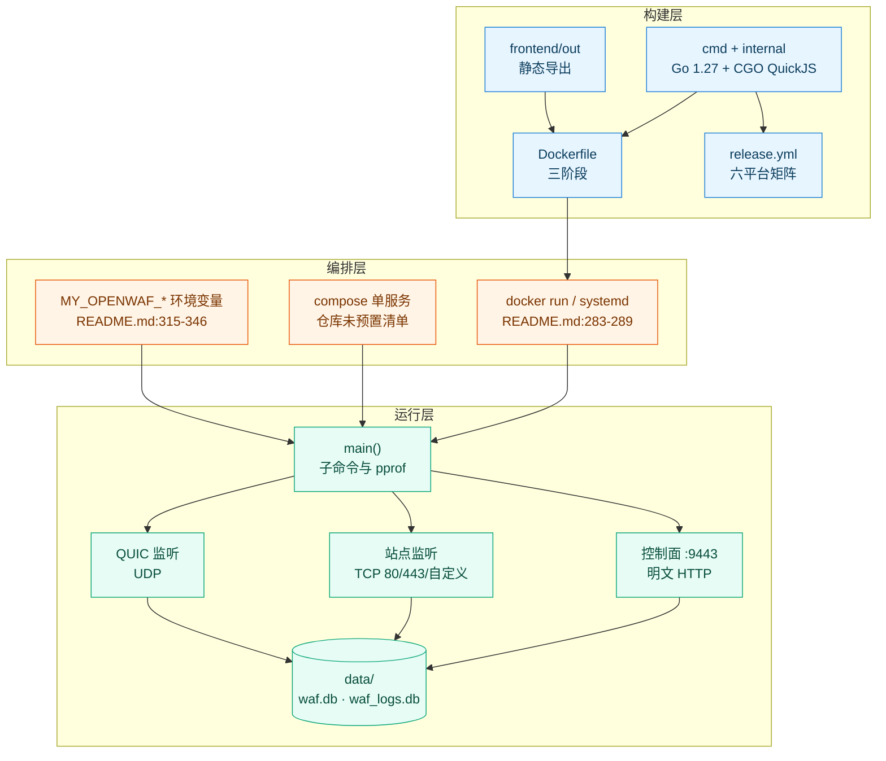
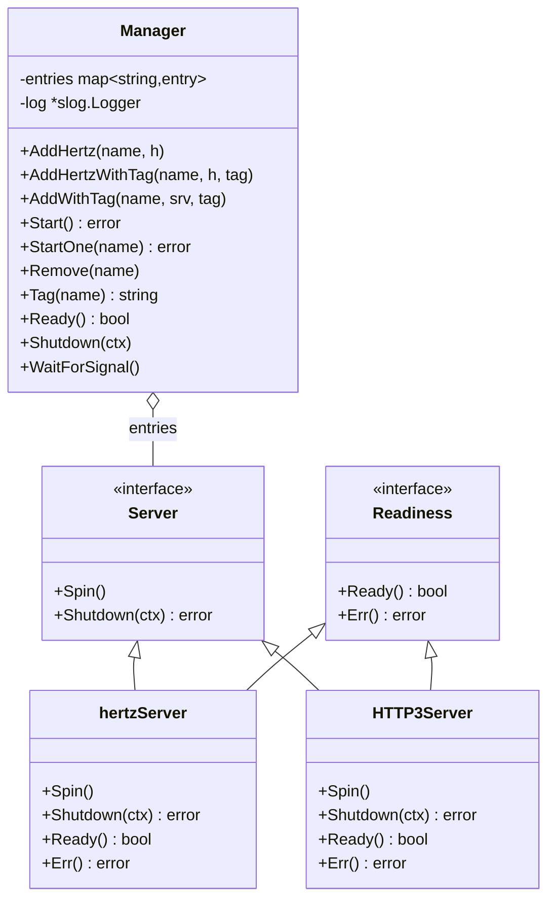
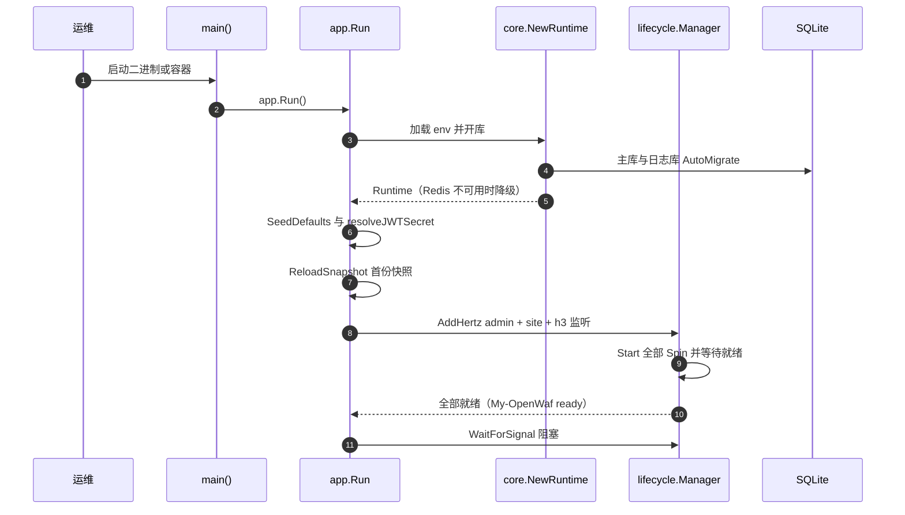
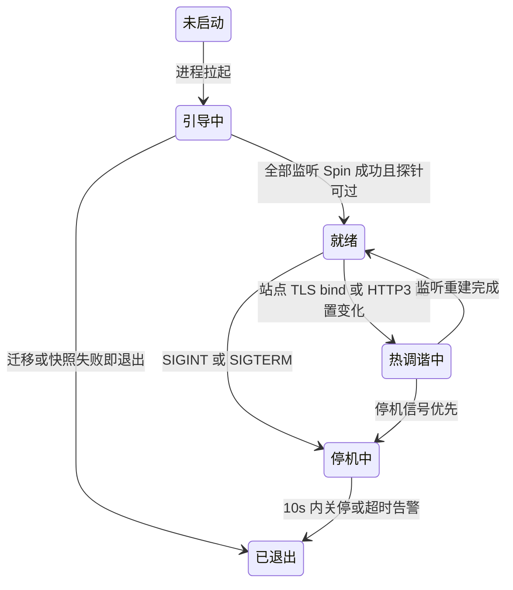
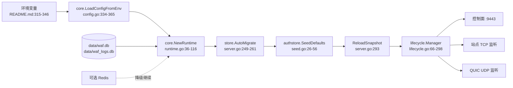

# 部署运维

> [返回文档总索引](../index.md) · [容器化部署](容器化部署.md)

<cite>
**本文档引用的文件**
- [README.md](file://README.md)
- [Dockerfile](file://Dockerfile)
- [.dockerignore](file://.dockerignore)
- [.gitignore](file://.gitignore)
- [cmd/main.go](file://cmd/main.go)
- [scripts/build.sh](file://scripts/build.sh)
- [internal/app/server.go](file://internal/app/server.go)
- [internal/app/http3.go](file://internal/app/http3.go)
- [internal/admin/router.go](file://internal/admin/router.go)
- [internal/core/config.go](file://internal/core/config.go)
- [internal/core/config_override.go](file://internal/core/config_override.go)
- [internal/core/configoverride/registry.go](file://internal/core/configoverride/registry.go)
- [internal/core/database/gorm.go](file://internal/core/database/gorm.go)
- [internal/core/health/health.go](file://internal/core/health/health.go)
- [internal/core/lifecycle/lifecycle.go](file://internal/core/lifecycle/lifecycle.go)
- [internal/core/runtime.go](file://internal/core/runtime.go)
- [internal/pkg/memreclaim/memreclaim.go](file://internal/pkg/memreclaim/memreclaim.go)
- [internal/proxy/transport/transport.go](file://internal/proxy/transport/transport.go)
- [internal/store/auth/seed.go](file://internal/store/auth/seed.go)
- [internal/upstream/health.go](file://internal/upstream/health.go)
- [internal/waf/ratelimit/ratelimit.go](file://internal/waf/ratelimit/ratelimit.go)
- [internal/waf/ratelimit/redis.go](file://internal/waf/ratelimit/redis.go)
- [.github/workflows/ci.yml](file://.github/workflows/ci.yml)
- [.github/workflows/release.yml](file://.github/workflows/release.yml)
</cite>

## 目录

1. [简介](#简介)
2. [项目结构](#项目结构)
3. [核心组件](#核心组件)
4. [架构总览](#架构总览)
5. [详细组件分析](#详细组件分析)
6. [依赖关系分析](#依赖关系分析)
7. [性能考虑](#性能考虑)
8. [故障排查指南](#故障排查指南)
9. [结论](#结论)
10. [附录](#附录)

## 简介

「部署运维」域覆盖 My-OpenWaf 从制品产出到进程运行、监听暴露、优雅停机与观测接入的运行期行为。README 负责「怎么装」与「变量清单」，本域负责「装好后如何长期跑、出问题先看哪里」，两者不重复。

本域文档与相邻主题的分工固定：构建细节归 [构建脚本与工具链](构建脚本与工具链.md)，镜像与编排归 [容器化部署](容器化部署.md)，流水线归 [CI与发布流水线](CI与发布流水线.md)，数据目录与备份归 [数据目录与备份恢复](数据目录与备份恢复.md)，深度处置归 [故障排除](../故障排除/故障排除.md)。

### 运维范围与验收口径

| 交付形态 | 制品 | 产出方式 | 发布通道 | 运行载体 | 证据来源 |
|----------|------|----------|----------|----------|----------|
| 官方发行包 | `my-openwaf-{版本}-{os}-{arch}.tar.gz` / `.zip` + `.sha256` | 六平台矩阵构建，`-trimpath -ldflags="-s -w"` | GitHub Release | 裸进程 | [release.yml:102-126](file://.github/workflows/release.yml#L102-L126)、[release.yml:165-191](file://.github/workflows/release.yml#L165-L191) |
| 容器镜像 | `my-openwaf:latest` | 仓库内 `Dockerfile` 三阶段本地构建 | 无镜像发布作业 | Docker / Compose | [Dockerfile:2-28](file://Dockerfile#L2-L28)、[README.md:280-289](file://README.md#L280-L289) |
| 源码产物 | `bin/my-openwaf` | `./scripts/build.sh` 或手动 `CGO_ENABLED=1 go build -tags=quickjs` | 无 | 裸进程 | [scripts/build.sh:1-13](file://scripts/build.sh#L1-L13)、[README.md:293-309](file://README.md#L293-L309) |

- **就绪判据**：`GET /readyz` 返回 200 需同时满足快照非 nil、全部注册监听就绪、令牌管理器就绪、主库 `Ping` 通过（[internal/core/health/health.go:32-44](file://internal/core/health/health.go#L32-L44)）。
- **发布触发**：本域不涉及发布触发口径；流水线细节见 [CI与发布流水线](CI与发布流水线.md)。

**章节来源**
- [README.md:280-309](file://README.md#L280-L309)
- [Dockerfile:1-28](file://Dockerfile#L1-L28)
- [scripts/build.sh:1-13](file://scripts/build.sh#L1-L13)
- [internal/core/health/health.go:29-44](file://internal/core/health/health.go#L29-L44)
- [internal/app/server.go:595-629](file://internal/app/server.go#L595-L629)
- [.github/workflows/release.yml:96-191](file://.github/workflows/release.yml#L96-L191)

## 项目结构

部署视角的目录按「构建输入 → 运行装配 → 持久载体」三段组织，目录树只表达层级，职责与暴露面由结构表承载。

```text
My-OpenWaf/
├── cmd/main.go                      进程入口：子命令、可选 pprof、app.Run()
├── internal/app/                    启动编排：Run、监听构建、热调谐、停机
├── internal/core/                   配置加载、运行时、生命周期、探针、数据库
├── internal/dataplane/ internal/waf/ 流量处理与检测（数据面）
├── internal/admin/                  控制面 API、静态面板挂载、实时推送
├── internal/store/ internal/observability/ 持久化与异步落库
├── frontend/                        管理面板源码（构建后嵌入二进制）
├── data/                            运行数据目录：waf.db、waf_logs.db
├── Dockerfile  .dockerignore        三阶段镜像构建与构建上下文裁剪
├── scripts/                         构建脚本（细节归 构建脚本与工具链.md）
└── .github/workflows/               CI 与发布（细节归 CI与发布流水线.md）
```

| 路径 | 运行期职责 | 主要语言 | 代表文件 | 对外暴露 |
|------|------------|----------|----------|----------|
| `cmd/` | 子命令分派与进程启动 | Go | [cmd/main.go:13-51](file://cmd/main.go#L13-L51) | 无（入口） |
| `internal/app/` | 启动 16 步编排、监听注册与热调谐 | Go | [internal/app/server.go:234-1133](file://internal/app/server.go#L234-L1133) | 站点监听 TCP/UDP |
| `internal/core/` | 配置、运行时、探针、生命周期、SQLite 参数 | Go | [internal/core/lifecycle/lifecycle.go:66-298](file://internal/core/lifecycle/lifecycle.go#L66-L298) | 探针与 `/metrics` |
| `internal/admin/` | 控制面路由与静态资源装配 | Go | [internal/admin/router.go:94-391](file://internal/admin/router.go#L94-L391) | `:9443` HTTP |
| `internal/store/` | 模型、迁移、默认种子 | Go | [internal/store/auth/seed.go:26-56](file://internal/store/auth/seed.go#L26-L56) | 无 |
| `data/` | 主库与日志库落盘目录 | 数据 | `waf.db`、`waf_logs.db` | 无（文件） |
| 仓库根 `Dockerfile` | 三阶段镜像构建 | Dockerfile | [Dockerfile:2-28](file://Dockerfile#L2-L28) | 镜像 `EXPOSE 9443` |

**章节来源**
- [README.md:351-391](file://README.md#L351-L391)
- [Dockerfile:1-28](file://Dockerfile#L1-L28)
- [.gitignore:7-12](file://.gitignore#L7-L12)
- [internal/app/server.go:234-301](file://internal/app/server.go#L234-L301)

### 部署单元分层图



**图表来源**
- [Dockerfile:2-28](file://Dockerfile#L2-L28)
- [README.md:283-289](file://README.md#L283-L289)
- [cmd/main.go:13-51](file://cmd/main.go#L13-L51)
- [internal/app/server.go:1093-1131](file://internal/app/server.go#L1093-L1131)
- [internal/app/http3.go:1146-1161](file://internal/app/http3.go#L1146-L1161)

**章节来源**
- [Dockerfile:2-28](file://Dockerfile#L2-L28)
- [README.md:283-289](file://README.md#L283-L289)
- [cmd/main.go:13-51](file://cmd/main.go#L13-L51)
- [internal/app/server.go:1093-1131](file://internal/app/server.go#L1093-L1131)
- [internal/app/http3.go:1146-1161](file://internal/app/http3.go#L1146-L1161)
- [.github/workflows/release.yml:96-126](file://.github/workflows/release.yml#L96-L126)

### 模块清单（部署视角）

| 模块 | 位置 | 部署期职责 | 启停归属 | 可独立重启 |
|------|------|------------|----------|:----------:|
| 进程入口 | [cmd/main.go:13-51](file://cmd/main.go#L13-L51) | 子命令分派、pprof 协程、调用 `app.Run()` | 进程 | 否 |
| 启动编排 | [internal/app/server.go:234-1133](file://internal/app/server.go#L234-L1133) | 迁移、种子、快照、监听注册、停机收尾 | 进程 | 否 |
| 配置加载 | [internal/core/config.go:334-365](file://internal/core/config.go#L334-L365) | 读取环境变量与别名回落、默认值 | 进程 | 否 |
| 运行时装配 | [internal/core/runtime.go:36-116](file://internal/core/runtime.go#L36-L116) | 开库、应用库内覆盖、Redis 可选降级 | 进程 | 否 |
| 生命周期管理 | [internal/core/lifecycle/lifecycle.go:66-298](file://internal/core/lifecycle/lifecycle.go#L66-L298) | 多服务器启停、就绪等待、信号处理 | 进程 | 是（按名） |
| 控制面监听 | [internal/app/server.go:1052-1093](file://internal/app/server.go#L1052-L1093) | `:9443` 明文 HTTP 监听 + 探针与指标 | 进程常驻 | 否 |
| 数据面监听 | [internal/app/server.go:1513-1600](file://internal/app/server.go#L1513-L1600) | 按站点 bind 建 Hertz 服务器与 TLS | 热调谐 | 是 |
| QUIC 监听 | [internal/app/http3.go:1146-1220](file://internal/app/http3.go#L1146-L1220) | UDP 监听、路由表、优雅关闭 | 热调谐 | 是 |
| 存储层 | [internal/core/database/gorm.go:74-113](file://internal/core/database/gorm.go#L74-L113) | SQLite WAL pragma 与连接池 | 进程 | 否 |
| 内存回收 | [internal/pkg/memreclaim/memreclaim.go:26-98](file://internal/pkg/memreclaim/memreclaim.go#L26-L98) | 周期归还空闲 heap | 后台协程 | 是（stop） |
| 前端面板 | [Dockerfile:15](file://Dockerfile#L15) | 静态产物嵌入二进制 | 编译期 | 否 |
| 数据目录 | [README.md:320](file://README.md#L320) | `MY_OPENWAF_DATA` 指向的持久载体 | 卷 / 磁盘 | 否 |

**章节来源**
- [cmd/main.go:13-51](file://cmd/main.go#L13-L51)
- [internal/app/server.go:234-1133](file://internal/app/server.go#L234-L1133)
- [internal/app/http3.go:1146-1220](file://internal/app/http3.go#L1146-L1220)
- [internal/core/runtime.go:36-116](file://internal/core/runtime.go#L36-L116)
- [internal/core/config.go:334-365](file://internal/core/config.go#L334-L365)
- [internal/core/lifecycle/lifecycle.go:66-298](file://internal/core/lifecycle/lifecycle.go#L66-L298)
- [internal/core/database/gorm.go:74-113](file://internal/core/database/gorm.go#L74-L113)
- [internal/pkg/memreclaim/memreclaim.go:26-98](file://internal/pkg/memreclaim/memreclaim.go#L26-L98)
- [Dockerfile:15-24](file://Dockerfile#L15-L24)

## 核心组件

| 组件 | 位置 | 职责 | 对外接口 | 依赖 | 被依赖 |
|------|------|------|----------|------|--------|
| `Manager` | [lifecycle.go:66-78](file://internal/core/lifecycle/lifecycle.go#L66-L78) | 注册、启动、调谐、停止全部服务器 | `AddHertz`、`AddWithTag`、`Start`、`Remove`、`Shutdown`、`WaitForSignal` | `Server`、`Readiness` | `app.Run` |
| `hertzServer` | [lifecycle.go:38-59](file://internal/core/lifecycle/lifecycle.go#L38-L59) | 把 Hertz 适配为可停止服务器 | `Spin`、`Shutdown`、`Ready`、`Err` | `*server.Hertz` | `Manager` |
| `HTTP3Server` | [http3.go:1146-1220](file://internal/app/http3.go#L1146-L1220) | UDP 监听与 QUIC 关闭 | `Spin`、`Shutdown`、`Ready` | quic-go、`net.ListenPacket` | `Manager` |
| `Checker` | [health.go:15-44](file://internal/core/health/health.go#L15-L44) | 存活与就绪判定 | `/healthz`、`/readyz` | 快照、DB、就绪回调 | 编排层探针 |
| `memreclaim` | [memreclaim.go:26-98](file://internal/pkg/memreclaim/memreclaim.go#L26-L98) | 空闲 heap 归还 OS | `Start(cfg) stop func()` | `runtime.ReadMemStats` | `app.Run` |
| 配置覆盖解析 | [config_override.go:21-36](file://internal/core/config_override.go#L21-L36) | 把库内三态覆盖应用到 env 配置 | `ApplyStoredConfigOverrides` | `configoverride.Spec` | `NewRuntime` |

**章节来源**
- [internal/core/lifecycle/lifecycle.go:18-59](file://internal/core/lifecycle/lifecycle.go#L18-L59)
- [internal/app/http3.go:1146-1220](file://internal/app/http3.go#L1146-L1220)
- [internal/core/health/health.go:15-44](file://internal/core/health/health.go#L15-L44)
- [internal/pkg/memreclaim/memreclaim.go:12-38](file://internal/pkg/memreclaim/memreclaim.go#L12-L38)
- [internal/core/config_override.go:14-36](file://internal/core/config_override.go#L14-L36)

### 生命周期管理器与监听适配

`Manager` 是运行层唯一的启停入口：站点监听以 `site:{bind}` 命名、QUIC 以 `h3:{udp_bind}` 命名、控制面以 `admin:{AdminBind}` 命名（[lifecycle.go:86-98](file://internal/core/lifecycle/lifecycle.go#L86-L98)、[server.go:1152-1154](file://internal/app/server.go#L1152-L1154)、[http3.go:1918-1920](file://internal/app/http3.go#L1918-L1920)）。带标签注册用于配置漂移检测，调谐时标签变化即 `Remove` + 重新 `Add`。



**图表来源**
- [internal/core/lifecycle/lifecycle.go:26-59](file://internal/core/lifecycle/lifecycle.go#L26-L59)
- [internal/core/lifecycle/lifecycle.go:86-121](file://internal/core/lifecycle/lifecycle.go#L86-L121)
- [internal/app/http3.go:1122-1146](file://internal/app/http3.go#L1122-L1146)

**章节来源**
- [internal/core/lifecycle/lifecycle.go:66-121](file://internal/core/lifecycle/lifecycle.go#L66-L121)
- [internal/app/server.go:1152-1154](file://internal/app/server.go#L1152-L1154)
- [internal/app/http3.go:1122-1146](file://internal/app/http3.go#L1122-L1146)

## 架构总览

一个进程同时承载控制面与数据面：`app.Run` 完成 16 步引导后调用 `lm.Start()` 拉起全部监听，随后 `lm.WaitForSignal()` 阻塞在信号上（[server.go:1131-1133](file://internal/app/server.go#L1131-L1133)）。配置变更不重启进程，由热调谐替换监听；进程级变更（驱动、DSN、`AdminBind`）必须重启。



**图表来源**
- [cmd/main.go:13-51](file://cmd/main.go#L13-L51)
- [internal/app/server.go:234-293](file://internal/app/server.go#L234-L293)
- [internal/app/server.go:1093-1133](file://internal/app/server.go#L1093-L1133)
- [internal/core/runtime.go:36-116](file://internal/core/runtime.go#L36-L116)

### 端口与协议矩阵

| 端口 | 用途 | 协议 | TLS 要求 | 暴露面 | 注册位置 |
|------|------|------|----------|--------|----------|
| `:9443` | 控制面 API、面板、探针、`/metrics` | HTTP/1.1 | **无 TLS**（明文，见下方事实） | 运维网段 | [server.go:1052-1093](file://internal/app/server.go#L1052-L1093) |
| `:80` | 站点明文监听（验收用例） | TCP HTTP/1.1、h2c | 无 | 公网 | [server.go:1513-1523](file://internal/app/server.go#L1513-L1523) |
| `:443` 等站点 bind | 站点 TLS 监听 | TCP HTTP/1.1、h2 | 站点证书，SNI 分派 | 公网 | [server.go:1538-1600](file://internal/app/server.go#L1538-L1600) |
| 站点 bind 同口或 `HTTP3Bind` | HTTP/3 QUIC | UDP | QUIC TLS；0-RTT 三态 | 公网 | [http3.go:1905-1916](file://internal/app/http3.go#L1905-L1916)、[server.go:1107-1120](file://internal/app/server.go#L1107-L1120) |
| `MY_OPENWAF_PPROF_BIND` | pprof 调试 | HTTP | 无 | 仅本机 | [cmd/main.go:29-49](file://cmd/main.go#L29-L49) |
| 上游目标端口 | 反代转发 | TCP/UDP | 由上游决定 | 出网 | [transport.go:157-161](file://internal/proxy/transport/transport.go#L157-L161) |

**关于 TLS 的实测事实**：控制面监听由 `server.Default(server.WithHostPorts(rt.Config.AdminBind))` 构造，**未附加 `server.WithTLS(...)`**（[server.go:1052](file://internal/app/server.go#L1052)），`WithTLS` 只出现在数据面 TLS 站点分支（[server.go:1596](file://internal/app/server.go#L1596)）。因此 README 的「默认管理端口 `:9443`（HTTPS）」与「启动后访问 `https://localhost:9443`」（[README.md:21](file://README.md#L21)、[README.md:291](file://README.md#L291)）与代码不一致，正确访问方式是 `http://localhost:9443`。本文只标注事实与处置口径，不改代码；需要 HTTPS 时应由反向代理或内网隔离承担传输层保护。

**章节来源**
- [internal/app/server.go:1052-1120](file://internal/app/server.go#L1052-L1120)
- [internal/app/server.go:1513-1600](file://internal/app/server.go#L1513-L1600)
- [internal/app/http3.go:1905-1916](file://internal/app/http3.go#L1905-L1916)
- [internal/proxy/transport/transport.go:155-163](file://internal/proxy/transport/transport.go#L155-L163)
- [cmd/main.go:29-49](file://cmd/main.go#L29-L49)
- [README.md:16-23](file://README.md#L16-L23)

## 详细组件分析

### 配置生效次序与变量映射

变量清单的权威表在 [README.md:313-349](file://README.md#L313-L349)，本域不复制第二配置源，只给「变量 → 生效位置 → 作用顺序」的映射。取值优先级为：**专用设置行 > 库内覆盖表 > 环境变量 > 内置默认值**（[internal/core/config_override.go:14-36](file://internal/core/config_override.go#L14-L36)）。

```bash
# 引导变量只在进程启动时读取一次（internal/core/config.go:334-365）
MY_OPENWAF_DATA=/var/lib/my-openwaf \
MY_OPENWAF_ADMIN_BIND=127.0.0.1:9443 \
MY_OPENWAF_DSN=/var/lib/my-openwaf/waf.db \
./bin/my-openwaf

# 三态来源核查：当前生效配置与库内覆盖（internal/admin/router.go:246、router.go:391）
curl -s http://127.0.0.1:9443/api/v1/runtime-config
curl -s http://127.0.0.1:9443/api/v1/runtime-config/env-overrides
```

次序上的三个坑：

1. `core.NewRuntime` 的引导校验会先把 Redis 三项置空，避免库内 `redis_config` 尚未读取时误判配置非法（[runtime.go:38-61](file://internal/core/runtime.go#L38-L61)）。
2. 之后应用库内 Redis 与通用覆盖，再校验一次（[runtime.go:71-87](file://internal/core/runtime.go#L71-L87)）。
3. 覆盖表绝大多数键标注 `RestartRequired: true`——结构体在启动期已固化，界面写入不等于即时生效（[configoverride/registry.go:107-108](file://internal/core/configoverride/registry.go#L107-L108)）。

**章节来源**
- [internal/core/config.go:334-365](file://internal/core/config.go#L334-L365)
- [internal/core/runtime.go:36-87](file://internal/core/runtime.go#L36-L87)
- [internal/core/config_override.go:14-36](file://internal/core/config_override.go#L14-L36)
- [internal/core/configoverride/registry.go:19-34](file://internal/core/configoverride/registry.go#L19-L34)
- [internal/admin/router.go:246-391](file://internal/admin/router.go#L246-L391)

### 优雅停机与信号处理

| 触发 | 入口 | 超时 | 行为 | 证据 |
|------|------|:----:|------|------|
| `SIGINT` / `SIGTERM` | `Manager.WaitForSignal` | 10s | 并发对所有注册服务器 `Shutdown` | [lifecycle.go:290-298](file://internal/core/lifecycle/lifecycle.go#L290-L298) |
| 单个监听退出编排 | `Run` 尾部 `stopBackground()` | — | 取消 context，回收队列、归档器、内存回收、ACME | [server.go:1131-1133](file://internal/app/server.go#L1131-L1133) |
| 热调谐删除监听 | `Manager.Remove` | 500ms | 快归还调用方，日志 `server removed` | [lifecycle.go:21](file://internal/core/lifecycle/lifecycle.go#L21)、[lifecycle.go:144-166](file://internal/core/lifecycle/lifecycle.go#L144-L166) |
| Hertz 已停又收到关闭 | `serverAlreadyStopped` | — | 视为完成，不记错误 | [lifecycle.go:23](file://internal/core/lifecycle/lifecycle.go#L23)、[lifecycle.go:61-63](file://internal/core/lifecycle/lifecycle.go#L61-L63) |
| QUIC 关闭 | `HTTP3Server.Shutdown` | 沿用调用方 | 取消回环请求、关空闲连接、`Serve` 退出、关 UDP | [http3.go:1191-1220](file://internal/app/http3.go#L1191-L1220) |
| 超出截止时间 | `Shutdown` 汇总 | 10s | 记 `shutdown deadline exceeded`，进程继续收尾 | [lifecycle.go:282-286](file://internal/core/lifecycle/lifecycle.go#L282-L286) |

`SIGHUP` 不在 `signal.Notify` 名单内，日志轮转不能靠挂断信号触发，需走 `MY_OPENWAF_LOG_FILE` 外部轮转工具。

**章节来源**
- [internal/core/lifecycle/lifecycle.go:18-63](file://internal/core/lifecycle/lifecycle.go#L18-L63)
- [internal/core/lifecycle/lifecycle.go:144-166](file://internal/core/lifecycle/lifecycle.go#L144-L166)
- [internal/core/lifecycle/lifecycle.go:246-298](file://internal/core/lifecycle/lifecycle.go#L246-L298)
- [internal/app/http3.go:1191-1220](file://internal/app/http3.go#L1191-L1220)
- [internal/app/server.go:1131-1133](file://internal/app/server.go#L1131-L1133)

### 监听热调谐与配置漂移

站点监听与 QUIC 监听的名称固定为 `site:{bind}` 与 `h3:{udp_bind}`，调谐函数按「先删漂移、再补缺失」两段执行：

1. 快照变更后重算期望集，`h3:` 前缀中消失或标签变化的先 `Remove`（[server.go:740-760](file://internal/app/server.go#L740-L760)）。
2. `site:` 前缀同样处理，标签由 bind 与站点集合指纹算得（[server.go:761-779](file://internal/app/server.go#L761-L779)、[server.go:2012-2022](file://internal/app/server.go#L2012-L2022)）。
3. 缺失的监听用新配置构建并 `StartOne` 热启动，失败即回退 `Remove`，不影响其余监听（[server.go:781-824](file://internal/app/server.go#L781-L824)）。

运维含义：改站点 bind、证书或 TLS 参数会重建对应监听（TCP 或 UDP 重新绑定），已有长连接会被切断；不改站点 bind 的纯策略变更不动监听。`Remove` 的 500ms 上限意味着调谐期间的端口释放很快，同端口重建通常不会撞 `bind` 错误。

**章节来源**
- [internal/app/server.go:720-825](file://internal/app/server.go#L720-L825)
- [internal/app/server.go:2012-2022](file://internal/app/server.go#L2012-L2022)
- [internal/core/lifecycle/lifecycle.go:21](file://internal/core/lifecycle/lifecycle.go#L21)

### 进程与容器生命周期状态



**图表来源**
- [internal/core/lifecycle/lifecycle.go:18-22](file://internal/core/lifecycle/lifecycle.go#L18-L22)
- [internal/core/lifecycle/lifecycle.go:185-203](file://internal/core/lifecycle/lifecycle.go#L185-L203)
- [internal/core/lifecycle/lifecycle.go:246-298](file://internal/core/lifecycle/lifecycle.go#L246-L298)
- [internal/app/server.go:720-825](file://internal/app/server.go#L720-L825)
- [internal/app/server.go:1131-1133](file://internal/app/server.go#L1131-L1133)

**章节来源**
- [internal/core/lifecycle/lifecycle.go:185-298](file://internal/core/lifecycle/lifecycle.go#L185-L298)
- [internal/app/server.go:720-825](file://internal/app/server.go#L720-L825)

### 容器与裸机差异

| 维度 | 裸机二进制 | 容器 | 证据 |
|------|------------|------|------|
| 数据目录 | `./data`（相对工作目录） | `/app/data`，需 `-v` 持久化 | [README.md:320](file://README.md#L320)、[Dockerfile:21-27](file://Dockerfile#L21-L27) |
| 镜像内 `EXPOSE` | 无此概念 | 仅 `9443`，数据面与 UDP 需自行映射 | [Dockerfile:26](file://Dockerfile#L26)、[README.md:286](file://README.md#L286) |
| 构建依赖 | Go 1.27.1+、Bun 1.3.14+、GCC | 镜像内自带多阶段，宿主只需 Docker | [README.md:295](file://README.md#L295)、[Dockerfile:9-16](file://Dockerfile#L9-L16) |
| 日志采集 | stdout 或 `MY_OPENWAF_LOG_FILE` | stdout 为主，文件需挂卷 | [README.md:338-340](file://README.md#L338-L340) |
| 运行镜像 | 无内置 | `Dockerfile:1-28` 未声明 `USER` 与 `HEALTHCHECK` | [Dockerfile:17-28](file://Dockerfile#L17-L28) |
| 特权端口 | 需 root 或 capability | 默认 root 可绑 `:80`/`:443` | [Dockerfile:17-28](file://Dockerfile#L17-L28)、[README.md:457](file://README.md#L457) |

细节见 [容器化部署](容器化部署.md)。

**章节来源**
- [Dockerfile:1-28](file://Dockerfile#L1-L28)
- [README.md:286-340](file://README.md#L286-L340)
- [.dockerignore:12-17](file://.dockerignore#L12-L17)

### 部署方式选择

| 方式 | 适用场景 | 前置条件 | 数据目录 | 控制面 TLS | 端口暴露 |
|------|----------|----------|----------|------------|----------|
| 容器（推荐） | 单机自托管、快速升级 | Docker；镜像需本地 `docker build` | 绑定挂载 `./data` | 需外部反代 | 手工 `-p` |
| 裸机二进制 | 已有 systemd 与内核调优 | `scripts/build.sh` 产物 | `./data` 或自定义 | 需外部反代 | 站点 bind |
| 外部数据库 | 多站点高并发写入 | `MY_OPENWAF_DB_DRIVER` 与 DSN 参数 | 仅剩日志与缓存 | 需外部反代 | 同上 |

编排清单仓库未预置，最小服务定义与镜像内置 env 一一对应（完整编排与探针见 [容器化部署](容器化部署.md)）：

```yaml
# 键与取值来源：Dockerfile:22-28、README.md:283-289（机密只写名称）
services:
  my-openwaf:
    image: my-openwaf:latest        # README.md:288
    restart: always                 # README.md:285
    ports: ["9443:9443"]            # Dockerfile:25-26 / README.md:286
    volumes: ["./data:/app/data"]   # README.md:287 / Dockerfile:27
    environment:
      MY_OPENWAF_JWT_SECRET: "{占位}" # README.md:323，机密项
```

**章节来源**
- [README.md:280-309](file://README.md#L280-L309)
- [Dockerfile:17-28](file://Dockerfile#L17-L28)
- [internal/core/database/gorm.go:74-113](file://internal/core/database/gorm.go#L74-L113)

### 首启凭据与密钥初始化

首次运行只会打印管理员口令：`SeedDefaults` 在 `admin` 账号不存在时生成随机口令并 bcrypt 落库，**不预置任何 API 令牌**（[seed.go:14-56](file://internal/store/auth/seed.go#L14-L56)）。因此 [README.md:291](file://README.md#L291) 「首次启动会打印初始管理凭据与 API Token」与实现不符，横幅内容只有用户名与口令两行（[server.go:272-279](file://internal/app/server.go#L272-L279)）。API 令牌需登录后自建。

`MY_OPENWAF_JWT_SECRET` 未设置时从主库 `jwt_secret` 设置行读取，都没有则生成 32 字节随机值并持久化——**换数据目录等于换密钥**，挑战 Cookie 与动态防护会全部失效（[server.go:1454-1477](file://internal/app/server.go#L1454-L1477)）。

```bash
# 忘记管理员口令（对应 cmd/main.go:16-21、server.go:193-231）
./bin/my-openwaf reset-admin-password {用户名} {新口令}
docker exec -it my-openwaf /app/my-openwaf reset-admin-password {新口令}
```

**章节来源**
- [internal/store/auth/seed.go:14-56](file://internal/store/auth/seed.go#L14-L56)
- [internal/app/server.go:266-279](file://internal/app/server.go#L266-L279)
- [internal/app/server.go:193-231](file://internal/app/server.go#L193-L231)
- [internal/app/server.go:1454-1477](file://internal/app/server.go#L1454-L1477)
- [cmd/main.go:13-28](file://cmd/main.go#L13-L28)
- [README.md:291](file://README.md#L291)

## 依赖关系分析



**图表来源**
- [internal/core/config.go:334-365](file://internal/core/config.go#L334-L365)
- [internal/core/runtime.go:36-116](file://internal/core/runtime.go#L36-L116)
- [internal/app/server.go:249-293](file://internal/app/server.go#L249-L293)
- [internal/store/auth/seed.go:26-56](file://internal/store/auth/seed.go#L26-L56)
- [internal/core/lifecycle/lifecycle.go:66-298](file://internal/core/lifecycle/lifecycle.go#L66-L298)

### 外部服务依赖

| 依赖 | 用途 | 接入方式 | 配置来源 | 超时 | 重试 | 降级 | 可用性影响 |
|------|------|----------|----------|:----:|:----:|------|------------|
| SQLite 主库 | 配置与账号 | DSN 文件 | `MY_OPENWAF_DSN`、`MY_OPENWAF_DATA` | 未设置（风险） | 未设置（风险） | 无 | 启动 `os.Exit(1)` |
| SQLite 日志库 | 访问/安全/drop 日志 | 独立 DSN | `MY_OPENWAF_LOG_DSN` | 未设置（风险） | 未设置（风险） | 无 | 启动失败退出 |
| MySQL / PostgreSQL | 外部替代主库 | GORM 驱动 | `MY_OPENWAF_DB_DRIVER`、DSN | 连接池 30m 生命周期 | 池内复用 | 无 | 不就绪（`/readyz` 503） |
| Redis | 分布式限流、KV、配置扇出 | rueidis | `MY_OPENWAF_REDIS_ADDR` | 限流单命令 50ms | 空实例 5s 熔断 | 启动不可用则弃用；限流 fail-open | 限流退化为本地窗口 |
| 上游服务 | 被保护应用 | HTTP/1.1、h2、h3、SSE、WS | 站点转发配置 | 探活 2s / 周期 10s | 周期重探 | 标记不健康 | 502 或站点不可用 |
| NVD / GitHub Advisory | CVE 目录同步 | HTTPS | `MY_OPENWAF_CVE_FEED_*`、`MY_OPENWAF_NVD_API_KEY` | 未设置（风险） | 6h 周期 | 保留本地目录 | CVE 规则滞后 |
| ACME CA | 证书签发与续期 | HTTP-01 | 证书配置 | 未设置（风险） | 续期循环 12h | 沿用现有证书 | 到期风险 |
| MaxMind GeoIP 库 | Bot 地理评分 | 本地文件 | `MY_OPENWAF_GEOIP_DB` | 不适用 | 不适用 | 跳过地理判据 | 评分维度减少 |

**章节来源**
- [internal/core/runtime.go:63-116](file://internal/core/runtime.go#L63-L116)
- [internal/core/database/gorm.go:59-113](file://internal/core/database/gorm.go#L59-L113)
- [internal/app/server.go:243-264](file://internal/app/server.go#L243-L264)
- [internal/core/config.go:334-365](file://internal/core/config.go#L334-L365)
- [README.md:317-347](file://README.md#L317-L347)

### 代码内固定常量与运维配置的关系

| 项 | 取值 | 是否可配 | 位置 | 运维含义 |
|----|:----:|:--------:|------|----------|
| 单服务器停机超时 | 10s | 否 | [lifecycle.go:18](file://internal/core/lifecycle/lifecycle.go#L18) | 编排侧 `stop_grace_period` 必须 ≥10s |
| 监听移除停机超时 | 500ms | 否 | [lifecycle.go:21](file://internal/core/lifecycle/lifecycle.go#L21) | 端口释放窗口 |
| 启动就绪等待 | 5s | 否 | [lifecycle.go:210-227](file://internal/core/lifecycle/lifecycle.go#L210-L227) | 探针 initial delay 可小于它 |
| QUIC 流初始窗口 | 2 MiB | 否 | [http3.go:894-896](file://internal/app/http3.go#L894-L896) | 容器网络需保证 MTU 与缓冲 |
| 上游 transport 池 | 256 / 每主机 32 / 空闲 30s | 否 | [transport.go:157-161](file://internal/proxy/transport/transport.go#L157-L161) | 出站 fd 上限估算依据 |
| 探活 transport 池 | 128 / 32 / 常量组 | 否 | [upstream/health.go:666-673](file://internal/upstream/health.go#L666-L673) | 探活流量与业务分离 |
| 限流单命令超时 | 50ms | 否 | [redis.go:127](file://internal/waf/ratelimit/redis.go#L127) | Redis 需与本机同机房 |
| 本地窗口清理周期 | 30s | 否 | [ratelimit.go:226](file://internal/waf/ratelimit/ratelimit.go#L226) | 内存增长上界 |
| heap 归还阈值 | 2 分钟 / 2 轮 / 32 MiB | 否 | [memreclaim.go:26-38](file://internal/pkg/memreclaim/memreclaim.go#L26-L38) | RSS 下降延迟 |

**章节来源**
- [internal/core/lifecycle/lifecycle.go:18-21](file://internal/core/lifecycle/lifecycle.go#L18-L21)
- [internal/core/lifecycle/lifecycle.go:210-227](file://internal/core/lifecycle/lifecycle.go#L210-L227)
- [internal/app/http3.go:894-896](file://internal/app/http3.go#L894-L896)
- [internal/proxy/transport/transport.go:155-163](file://internal/proxy/transport/transport.go#L155-L163)
- [internal/upstream/health.go:666-673](file://internal/upstream/health.go#L666-L673)
- [internal/waf/ratelimit/redis.go:127](file://internal/waf/ratelimit/redis.go#L127)
- [internal/waf/ratelimit/ratelimit.go:225-226](file://internal/waf/ratelimit/ratelimit.go#L225-L226)
- [internal/pkg/memreclaim/memreclaim.go:26-38](file://internal/pkg/memreclaim/memreclaim.go#L26-L38)

## 性能考虑

### 启动阻塞点

- **问题**：`AutoMigrate` 与两份 `ReconcileBuiltinCatalog` 串行执行且失败即退出，迁移期间进程不监听，冷启动时间随规则目录长度增长（[server.go:249-261](file://internal/app/server.go#L249-L261)）。
- **优化**：保持 `data/` 本地 SSD 或容器卷在本地磁盘；外部数据库时确认迁移已在 CI 覆盖（[ci.yml:81-135](file://.github/workflows/ci.yml#L81-L135)）。
- **效果**：`/readyz` 就绪时间缩短，编排层可把 `start_period` 收紧到 10s 内。

**章节来源**
- [internal/app/server.go:249-261](file://internal/app/server.go#L249-L261)
- [internal/core/database/gorm.go:74-97](file://internal/core/database/gorm.go#L74-L97)
- [.github/workflows/ci.yml:81-135](file://.github/workflows/ci.yml#L81-L135)

### 出站连接与内存

- **问题**：主 transport 256 空闲连接、每主机 32、空闲 30s 回收；峰值后 RSS 偏高（[transport.go:155-161](file://internal/proxy/transport/transport.go#L155-L161)）。
- **优化**：内存回收循环连续 2 轮 `HeapInuse` 增量小于 1 MiB 且可释放量 ≥32 MiB 时调用 `FreeOSMemory`（[memreclaim.go:26-98](file://internal/pkg/memreclaim/memreclaim.go#L26-L98)），容器内存 limit 应留出突发余量而非贴近稳态 RSS。
- **效果**：`/metrics` 的 `openwaf_memory_*` 与 `/status` 的 `heap_alloc` 回落可观测（[health.go:75-104](file://internal/core/health/health.go#L75-L104)）。

**章节来源**
- [internal/proxy/transport/transport.go:155-163](file://internal/proxy/transport/transport.go#L155-L163)
- [internal/pkg/memreclaim/memreclaim.go:26-98](file://internal/pkg/memreclaim/memreclaim.go#L26-L98)
- [internal/core/health/health.go:75-104](file://internal/core/health/health.go#L75-L104)

### SQLite 参数与写队列

日志库以 `journal_mode=WAL`、`busy_timeout=10000`、`synchronous=NORMAL`、`wal_autocheckpoint=2000` 页打开，主库为 1000 页；连接上限 8（[gorm.go:74-113](file://internal/core/database/gorm.go#L74-L113)）。`data/` 网络挂载会直接放大 WAL fsync 成本，必须使用本地卷。缓冲与批量由 `MY_OPENWAF_QUEUE_*` 决定，权威默认值见 [README.md:328-347](file://README.md#L328-L347)，本域不重复。

**章节来源**
- [internal/core/database/gorm.go:74-113](file://internal/core/database/gorm.go#L74-L113)
- [README.md:328-347](file://README.md#L328-L347)

## 故障排查指南

### 问题1：按 README 用 HTTPS 访问 `:9443` 失败

**症状**：`curl https://localhost:9443` 报 TLS 握手或协议错误；容器状态却是 `Up`。

**可能原因**：控制面监听未挂 TLS（[server.go:1052](file://internal/app/server.go#L1052)）；README 的 HTTPS 表述来自文档而非代码（[README.md:21](file://README.md#L21)、[README.md:291](file://README.md#L291)）。

**排查步骤**：先用明文探针确认端口可用，再核对监听构造点是否出现 `WithTLS`。

```bash
curl -s http://127.0.0.1:9443/api/v1/health   # 期望 200 且 alive 为真（router.go:94）
```

**解决方案**：运维访问统一改走 `http://`；需要 TLS 时由外部反代终止，或把 `:9443` 限制在本机与受信网段。

**章节来源**
- [internal/app/server.go:1052-1063](file://internal/app/server.go#L1052-L1063)
- [internal/admin/router.go:94](file://internal/admin/router.go#L94)
- [README.md:16-23](file://README.md#L16-L23)

### 问题2：容器起来但业务流量进不来

**症状**：面板可访问、站点无流量；宿主抓包看不到入站。

**可能原因**：`Dockerfile:26` 只 `EXPOSE 9443`，README 的 `docker run` 也只 `-p 9443:9443`（[README.md:286](file://README.md#L286)）；HTTP/3 还需 UDP。

**排查步骤**：核对站点监听器 bind 与宿主映射、`/status` 的 `listeners` 计数、容器内是否有 UDP 监听（[health.go:75-104](file://internal/core/health/health.go#L75-L104)、[http3.go:1146-1161](file://internal/app/http3.go#L1146-L1161)）。

```bash
curl -s http://127.0.0.1:9443/status | head -20
docker run -d --name my-openwaf --restart always \
  -p 9443:9443 -p 80:80 -p 443:443 -p 443:443/udp \
  -v ./data:/app/data my-openwaf:latest    # 在 README.md:283-289 基础上补齐数据面
```

**解决方案**：按站点 bind 补齐 `-p`；`host` 网络可让 QUIC 端口直接生效。

**章节来源**
- [Dockerfile:26-27](file://Dockerfile#L26-L27)
- [README.md:283-289](file://README.md#L283-L289)
- [internal/app/http3.go:1146-1161](file://internal/app/http3.go#L1146-L1161)
- [internal/core/health/health.go:75-104](file://internal/core/health/health.go#L75-L104)

### 问题3：日志文件持续增长

**症状**：`MY_OPENWAF_LOG_FILE` 指向的文件无上限。

**可能原因**：实现是 `O_CREATE|O_WRONLY|O_APPEND` 单文件追加，进程不轮转；`SIGHUP` 也不在信号名单（[lifecycle.go:290-298](file://internal/core/lifecycle/lifecycle.go#L290-L298)）。

**排查步骤**：确认轮转工具是否覆盖该路径；容器场景优先用 stdout 采集。

**解决方案**：外部 `logrotate` + `copytruncate`，或改回 stdout 由 Docker 日志驱动轮转。

**章节来源**
- [internal/core/lifecycle/lifecycle.go:290-298](file://internal/core/lifecycle/lifecycle.go#L290-L298)
- [README.md:338-340](file://README.md#L338-L340)

### 常见处置汇总

| 症状 | 首要定位 | 关键证据 | 处置 |
|------|----------|----------|------|
| 首启口令丢失 | `reset-admin-password` | [server.go:193-231](file://internal/app/server.go#L193-L231) | 子命令重置后重启服务 |
| 重启后挑战全失效 | JWT 密钥来源 | [server.go:1454-1477](file://internal/app/server.go#L1454-L1477) | 固定数据目录或显式注入 env |
| 面板可开站点不通 | 监听未注册 | [server.go:720-825](file://internal/app/server.go#L720-L825) | 检查 bind 占用与热启动失败日志 |
| `shutdown deadline exceeded` | 10s 超时 | [lifecycle.go:246-287](file://internal/core/lifecycle/lifecycle.go#L246-L287) | 编排侧放宽 `stop_grace_period` |

**章节来源**
- [internal/app/server.go:193-231](file://internal/app/server.go#L193-L231)
- [internal/app/server.go:1454-1477](file://internal/app/server.go#L1454-L1477)
- [internal/core/lifecycle/lifecycle.go:246-287](file://internal/core/lifecycle/lifecycle.go#L246-L287)

## 结论

My-OpenWaf 的运行单元是单进程多监听：`lifecycle.Manager` 统一启停，控制面走 `:9443` 明文 HTTP，数据面按站点 bind 走 TCP/UDP，停机由 `SIGINT`/`SIGTERM` 触发 10 秒优雅关停（[lifecycle.go:18-298](file://internal/core/lifecycle/lifecycle.go#L18-L298)）。

- **优势**：策略变更无需重启（监听名与标签驱动重建）；SQLite 本地卷 + 独立日志库使单机部署成本极低；内置存活、就绪、状态与指标四个探针端点。
- **待改进与后续动作**：控制面 TLS 缺失与 README 的 HTTPS 表述冲突（[server.go:1052](file://internal/app/server.go#L1052)、[README.md:291](file://README.md#L291)）；首启横幅不含 API Token（[seed.go:14-25](file://internal/store/auth/seed.go#L14-L25)）；`Dockerfile` 未声明 `USER`、`HEALTHCHECK`，数据面端口不 `EXPOSE`（[Dockerfile:17-28](file://Dockerfile#L17-L28)）；日志文件无内置轮转。上述四项均登记到 [问题检测报告](../问题检测报告.md)，不改代码。

[本节为总结，无需特定文件来源]

## 附录

### 运维命令速查

```bash
# 存活 / 就绪 / 状态 / 指标（internal/app/server.go:1053-1056）
curl -s http://127.0.0.1:9443/healthz
curl -s http://127.0.0.1:9443/readyz
curl -s http://127.0.0.1:9443/status
curl -s http://127.0.0.1:9443/metrics

# 优雅停机：先发 TERM，观察 10s 内是否完成（internal/core/lifecycle/lifecycle.go:290-298）
kill -TERM "$(pidof my-openwaf)"

# 验收压测（README.md:457-459，数据面监听 :80）
./bin/my-openwaf
./blazehttp -t http://127.0.0.1:80 -c 40
```

**章节来源**
- [internal/app/server.go:1053-1056](file://internal/app/server.go#L1053-L1056)
- [internal/core/lifecycle/lifecycle.go:290-298](file://internal/core/lifecycle/lifecycle.go#L290-L298)
- [README.md:454-461](file://README.md#L454-L461)

### 域内文档索引

| 主题 | 文档 | 边界 |
|------|------|------|
| 容器镜像与编排 | [容器化部署](容器化部署.md) | 三阶段构建、端口映射、卷、生命周期 |
| 构建脚本与工具链 | [构建脚本与工具链](构建脚本与工具链.md) | `build.sh` / `build.ps1`、CGO 与 QuickJS tag |
| 持续集成与发布 | [CI与发布流水线](CI与发布流水线.md) | 作业矩阵、制品与签名 |
| 数据目录与备份恢复 | [数据目录与备份恢复](数据目录与备份恢复.md) | `data/` 内容、WAL、备份与恢复演练 |
| 故障处置 | [故障排除](../故障排除/故障排除.md) | 症状到根因的完整决策树 |
| 运行变量清单 | [README 配置说明](../../README.md) | 环境变量权威表（`README.md:311-349`） |

[本节为总结，无需特定文件来源]

### 配置项速查（部署必需子集）

| 配置项 | 类型 | 默认值 | 必填 | 作用域 | 生效方式 | 安全等级 | 说明 |
|--------|------|--------|:----:|--------|----------|----------|------|
| `MY_OPENWAF_DATA` | string | `./data`（镜像 `/app/data`） | 否 | 进程 | 重启 | 普通 | SQLite 兜底目录与卷挂载点 |
| `MY_OPENWAF_ADMIN_BIND` | string | `:9443` | 否 | 进程 | 重启 | 敏感 | 绑定知名端口会触发校验告警 |
| `MY_OPENWAF_JWT_SECRET` | string | 无 | 否 | 会话 | 重启 | **机密** | 缺省则生成并持久化到主库 |
| `MY_OPENWAF_DSN` | string | `{数据目录}/waf.db` | 否 | 数据层 | 重启 | 敏感 | 外部 DSN 须带 `parseTime=True` |
| `MY_OPENWAF_LOG_DSN` | string | `{数据目录}/waf_logs.db` | 否 | 数据层 | 重启 | 敏感 | 独立日志库 |
| `MY_OPENWAF_REDIS_ADDR` | string | 空 | 否 | 限流层 | 重启 | 敏感 | 启动不可达会告警并继续 |
| `MY_OPENWAF_PPROF_BIND` | string | 空 | 否 | 进程 | 重启 | 敏感 | 仅供调试，限本机 |
| `MY_OPENWAF_LOG_FILE` | string | 空（仅 stdout） | 否 | 进程 | 重启 | 普通 | 单文件追加，需外部轮转 |

**章节来源**
- [README.md:313-349](file://README.md#L313-L349)
- [internal/core/config.go:334-365](file://internal/core/config.go#L334-L365)
- [internal/core/configoverride/registry.go:273-305](file://internal/core/configoverride/registry.go#L273-L305)
- [internal/app/server.go:1454-1477](file://internal/app/server.go#L1454-L1477)

### 交付前自检

| 项 | 要求 | 实际 | 达标 |
|----|:----:|:----:|:----:|
| 表格块数 | ≥2 | 15 | 是 |
| 图类型数 | ≥3 | 5（flowchart、classDiagram、sequenceDiagram、stateDiagram-v2、graph LR） | 是 |
| `bash` 与 `yaml` 围栏数 | ≥3 与 ≥1 | 5 与 1 | 是 |
| 章节骨架与目录项 | 10 与 10 | 10 与 10 | 是 |
| 篇幅 | 290–760 行 | 746 | 是 |
| 机密脱敏 | 无真实值 | 是 | 是 |

[本节为总结，无需特定文件来源]

### 术语速查

| 术语 | 口径 | 依据 |
|------|------|------|
| 监听名 | `admin:{bind}`、`site:{bind}`、`h3:{udp_bind}` | [server.go:1093](file://internal/app/server.go#L1093)、[server.go:1152-1154](file://internal/app/server.go#L1152-L1154)、[http3.go:1918-1920](file://internal/app/http3.go#L1918-L1920) |
| 标签漂移 | 同名服务器 `tag` 变化即 Remove + Add | [lifecycle.go:73-78](file://internal/core/lifecycle/lifecycle.go#L73-L78) |
| 引导参数 | `ScopeBootstrap`，覆盖机制只读展示 | [registry.go:26-34](file://internal/core/configoverride/registry.go#L26-L34) |
| 降级继续 | Redis 不可用时弃用客户端并告警 | [runtime.go:104-116](file://internal/core/runtime.go#L104-L116) |

**章节来源**
- [internal/app/server.go:1093-1154](file://internal/app/server.go#L1093-L1154)
- [internal/app/http3.go:1918-1920](file://internal/app/http3.go#L1918-L1920)
- [internal/core/lifecycle/lifecycle.go:73-78](file://internal/core/lifecycle/lifecycle.go#L73-L78)
- [internal/core/configoverride/registry.go:26-34](file://internal/core/configoverride/registry.go#L26-L34)
- [internal/core/runtime.go:104-116](file://internal/core/runtime.go#L104-L116)
