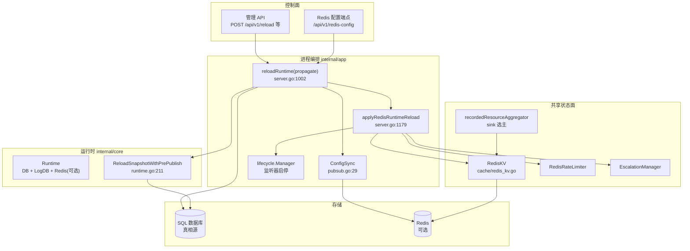
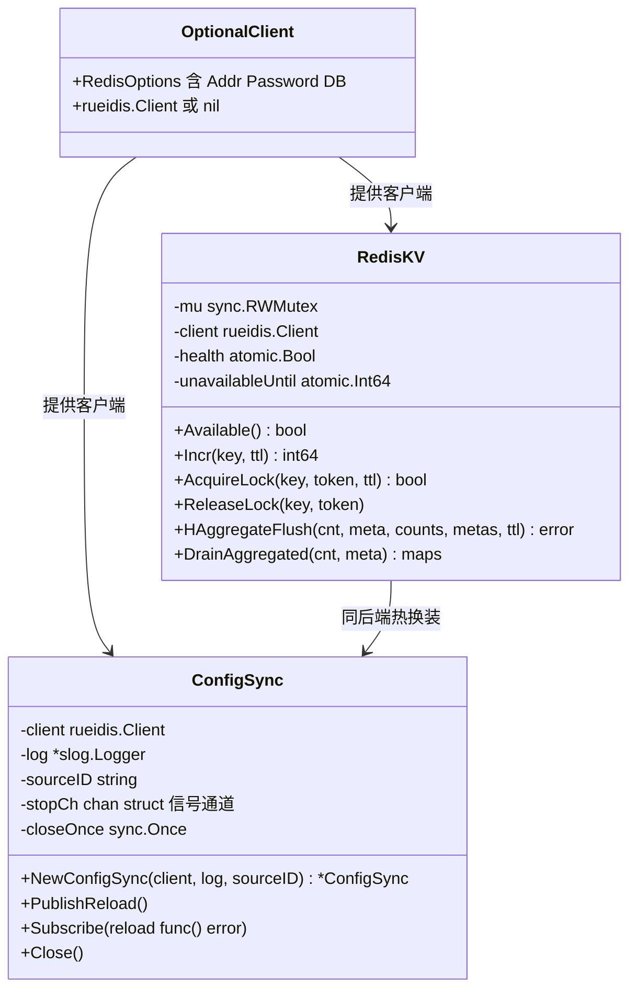
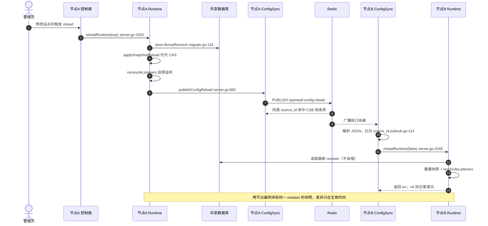
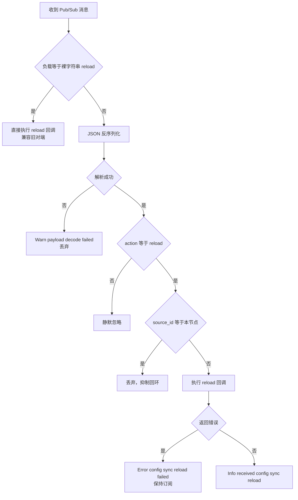
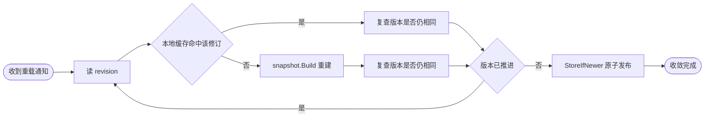
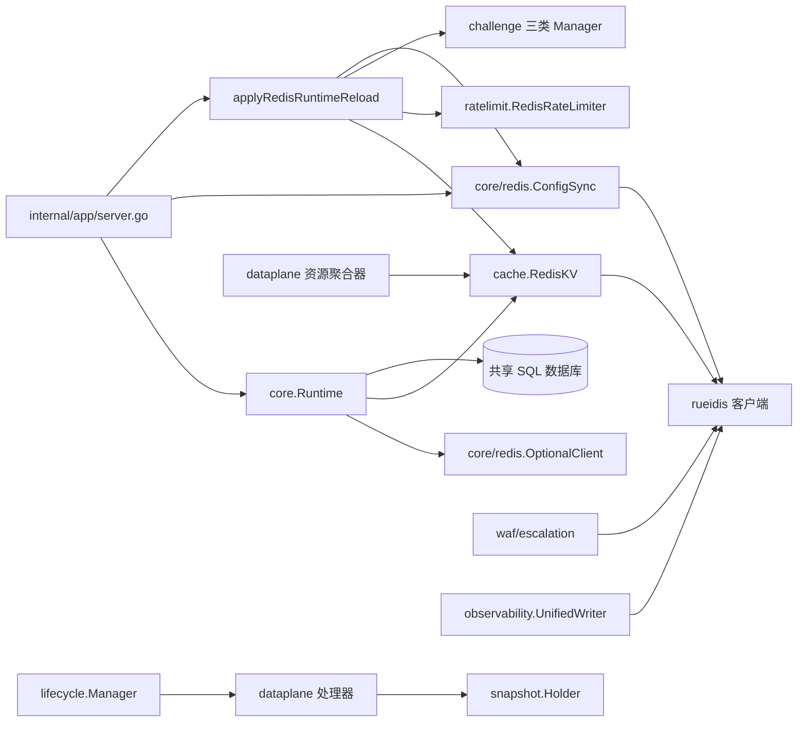
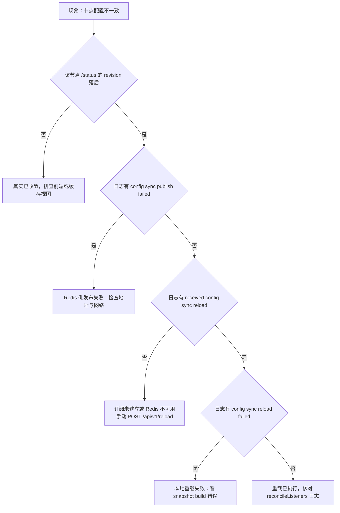

# 分布式同步机制

> [返回 配置管理系统](配置管理系统.md)

<cite>
**本文档引用的文件**
- [redis.go](file://internal/core/redis/redis.go)
- [pubsub.go](file://internal/core/redis/pubsub.go)
- [runtime.go](file://internal/core/runtime.go)
- [config.go](file://internal/core/config.go)
- [server.go](file://internal/app/server.go)
- [redis_kv.go](file://internal/cache/redis_kv.go)
- [resource_aggregator.go](file://internal/dataplane/resource_aggregator.go)
- [unified_writer.go](file://internal/observability/unified_writer.go)
- [write_queue.go](file://internal/observability/write_queue.go)
- [redis.go](file://internal/waf/ratelimit/redis.go)
- [escalation.go](file://internal/waf/escalation/escalation.go)
- [captcha.go](file://internal/waf/challenge/captcha.go)
- [shield.go](file://internal/waf/challenge/shield.go)
- [chain.go](file://internal/waf/challenge/chain.go)
- [antireplay.go](file://internal/waf/antireplay/antireplay.go)
- [snapshot.go](file://internal/snapshot/snapshot.go)
- [health.go](file://internal/core/health/health.go)
- [lifecycle.go](file://internal/core/lifecycle/lifecycle.go)
- [migrate.go](file://internal/store/migrate.go)
- [network.go](file://internal/admin/system/network.go)
- [settings.go](file://internal/admin/system/settings.go)
- [router.go](file://internal/admin/router.go)
</cite>

## 目录

1. [简介](#简介)
2. [项目结构](#项目结构)
3. [核心组件](#核心组件)
4. [架构总览](#架构总览)
5. [详细组件分析](#详细组件分析)
6. [依赖关系分析](#依赖关系分析)
7. [性能考虑](#性能考虑)
8. [故障排查指南](#故障排查指南)
9. [结论](#结论)
10. [附录](#附录)

## 简介

My-OpenWaf 的多实例同步回答的是一个很窄的问题：**配置真相源只有一个（共享数据库），实例之间只传"该重载了"这个事件，不传配置本身**。

这决定了整套机制的形状：

- 任何实例上的管理 API 写库后，先递增 `config_revisions.revision`，再本地重建快照，最后向 Redis 频道广播一次 `reload`；
- 其他实例收到事件后，用**同一套**代码从**同一个库**读取最新版本并重建快照，因此不存在"配置副本漂移"，只存在"生效时间差"；
- Redis 是**可选依赖**：`OptionalClient` 在地址为空、连接失败或 Ping 超时时一律返回 `nil`，进程继续启动并降级为单实例行为，不广播、不选主、计数不出进程。

因此本文同时是两份清单：有 Redis 时的同步链路，以及无 Redis 时的降级路径。把 Redis 写成必需组件的表述都是错的。

## 项目结构

同步相关代码分布在四个层次，规模以非测试 Go 文件统计：

| 层 | 路径 | 职责 | 核心符号 | 规模(行) |
|----|------|------|----------|:--------:|
| Redis 接入 | `internal/core/redis/` | 可选客户端构造 + 配置广播 | `OptionalClient`、`ConfigSync` | 174 |
| 运行时装配 | `internal/core/runtime.go` | 引导期建连、Ping 降级、代次 CAS 重载 | `NewRuntime`、`ReloadSnapshotWithPrePublish` | 310 |
| 进程编排 | `internal/app/server.go` | 订阅接入、发布时机判定、后端热换装 | `replaceConfigSync`、`reloadRuntime`、`applyRedisRuntimeReload` | 4282 |
| 共享状态面 | `internal/cache/`、`internal/dataplane/`、`internal/waf/` | KV、分布式锁与 sink 选主、跨节点计数 | `RedisKV`、`AcquireLock`、`sinkOnce` | 401 + 954 + 462 |

**图表来源**
- [internal/app/server.go:834-1042](file://internal/app/server.go#L834-L1042)
- [internal/core/runtime.go:99-274](file://internal/core/runtime.go#L99-L274)
- [internal/core/redis/pubsub.go:29-122](file://internal/core/redis/pubsub.go#L29-L122)
- [internal/cache/redis_kv.go:28-401](file://internal/cache/redis_kv.go#L28-L401)

**章节来源**
- [internal/core/runtime.go:23-142](file://internal/core/runtime.go#L23-L142)
- [internal/app/server.go:834-1042](file://internal/app/server.go#L834-L1042)
- [internal/dataplane/resource_aggregator.go:17-76](file://internal/dataplane/resource_aggregator.go#L17-L76)

## 核心组件

| 组件 | 位置 | 职责 | 无 Redis 时行为 |
|------|------|------|-----------------|
| `OptionalClient` | [internal/core/redis/redis.go:18](file://internal/core/redis/redis.go#L18) | 按地址构造 rueidis 客户端 | 地址为空或建连失败返回 `nil` |
| `Ping` | [internal/core/redis/redis.go:37](file://internal/core/redis/redis.go#L37) | 连通性检查 | `nil` 客户端直接返回 `nil`（不报错） |
| `ConfigSync` | [internal/core/redis/pubsub.go:29](file://internal/core/redis/pubsub.go#L29) | 发布/订阅重载事件 | `NewConfigSync` 返回 `nil`，方法全部 nil-safe |
| `RedisKV` | [internal/cache/redis_kv.go:28](file://internal/cache/redis_kv.go#L28) | 带健康位的 KV、Lua 计数、分布式锁 | `Available()` 恒为假，调用方走本地路径 |
| `recordedResourceAggregator` | [internal/dataplane/resource_aggregator.go:49](file://internal/dataplane/resource_aggregator.go#L49) | 资源命中聚合 + sink 选主回写 | 退化为纯内存聚合 + 本地 DB 直写 |
| `RedisRateLimiter` | [internal/waf/ratelimit/redis.go:13](file://internal/waf/ratelimit/redis.go#L13) | Lua 滑动窗口限流 | `NewRedisRateLimiter` 返回 `nil`，`Allow` 恒真（fail-open） |
| `EscalationManager` | [internal/waf/escalation/escalation.go:35](file://internal/waf/escalation/escalation.go#L35) | 连锁升级计数 | 回落 `localCache`（`sync.Map`，30s 清理） |
| `UnifiedWriter` | [internal/observability/unified_writer.go:924](file://internal/observability/unified_writer.go#L924) | 事件落库前向 Redis 列表双写 | 跳过双写，DB 事务照常执行 |
| `WriteQueue` | [internal/observability/write_queue.go:25](file://internal/observability/write_queue.go#L25) | 进程内异步合并写 | 与 Redis 无关，始终进程内 |

**图表来源**
- [internal/core/redis/redis.go:11-42](file://internal/core/redis/redis.go#L11-L42)
- [internal/core/redis/pubsub.go:29-132](file://internal/core/redis/pubsub.go#L29-L132)
- [internal/cache/redis_kv.go:28-401](file://internal/cache/redis_kv.go#L28-L401)

**章节来源**
- [internal/core/redis/redis.go:11-42](file://internal/core/redis/redis.go#L11-L42)
- [internal/core/redis/pubsub.go:29-132](file://internal/core/redis/pubsub.go#L29-L132)
- [internal/cache/redis_kv.go:28-401](file://internal/cache/redis_kv.go#L28-L401)
- [internal/dataplane/resource_aggregator.go:49-96](file://internal/dataplane/resource_aggregator.go#L49-L96)
- [internal/waf/ratelimit/redis.go:13-47](file://internal/waf/ratelimit/redis.go#L13-L47)
- [internal/observability/write_queue.go:13-60](file://internal/observability/write_queue.go#L13-L60)

## 架构总览

一次站点配置变更在集群内的完整扇出如下。注意三条抑制回路：发布方带 `source_id`，自身订阅回调会丢弃同源消息；远端驱动的 `reloadRuntime(false)` 不再递增版本号、也不再二次广播。

**图表来源**
- [internal/app/server.go:1002-1042](file://internal/app/server.go#L1002-L1042)
- [internal/core/redis/pubsub.go:64-122](file://internal/core/redis/pubsub.go#L64-L122)
- [internal/store/migrate.go:141-160](file://internal/store/migrate.go#L141-L160)

## 详细组件分析

### 重载链路与发布时机

`reloadRuntime` 是全链路唯一入口，`propagate` 参数区分「本地发起」与「远端驱动」两种语义：只有本地发起才递增版本号并广播。Redis 配置即将切换时还有一个前置发布（`prePublish`），目的是让其他节点在**本节点后端换装之前**就看到新快照，避免新旧后端交叠期间漏通知。

| 步 | 动作 | 执行位置 | 输入 | 输出 | 失败分支 | 可观测点 |
|:--:|------|----------|------|------|----------|----------|
| 1 | 串行化重载 | `server.go:1003` `runtimeReloadMu.Lock` | 任意 reload 触发源 | 单飞临界区 | 阻塞等待前一次完成 | 无独立指标 |
| 2 | 递增版本 | `store/migrate.go:141`（仅 propagate） | `config_revisions` 行 | revision+1 | 返回错误，中止本次重载 | `/status` 的 `revision` |
| 3 | 代次 CAS 重建 | `runtime.go:211-274` | 读到的 rev | 不可变快照 | 版本被并发推进则 `continue` 重试 | 日志 `snapshot build` |
| 4 | 发布快照 | `snapshot.go:474` `StoreIfNewer` | 新快照 | 原子指针替换 | 修订不更新则返回 false | `/readyz` |
| 5 | 监听器收敛 | `server.go:722-801` | 快照的 bind 指纹 | 站点监听启停 | 无有效 TLS 配置则跳过并告警 | 日志 `hot-started site listener` |
| 6 | 前置广播判定 | `server.go:1018` | propagate ∧ 运行时 Redis ∧ 需要换装 | 是否提前发布 | 判定为假则走第 8 步 | 日志 `redis runtime reloaded` |
| 7 | Redis 后端热换装 | `server.go:925-975`、`1179` | `redis_config` 行 | 九类组件换客户端 | Ping 失败即放弃并保留旧后端 | 日志 `redis unavailable` |
| 8 | 收尾广播 | `server.go:1023-1025` | propagate ∧ 未前置发布 | `PUBLISH` | 发布失败仅 `Warn`，不回滚 | 日志 `config sync publish failed` |

**章节来源**
- [internal/app/server.go:868-1042](file://internal/app/server.go#L868-L1042)
- [internal/core/runtime.go:211-274](file://internal/core/runtime.go#L211-L274)
- [internal/store/migrate.go:141-168](file://internal/store/migrate.go#L141-L168)
- [internal/snapshot/snapshot.go:460-487](file://internal/snapshot/snapshot.go#L460-L487)

### Pub/Sub 协议与回环抑制

频道名固定为 `openwaf:config:reload`，无动态频道；负载是 JSON `{"source_id":"...","action":"reload"}`。`source_id` 在构造时取 8 字节随机数的十六进制，未显式传入时自动生成。

**图表来源**
- [internal/core/redis/pubsub.go:84-122](file://internal/core/redis/pubsub.go#L84-L122)

| 消息形态 | 判定条件 | 行为 | 位置 |
|----------|----------|------|------|
| 裸 `reload` | `msg.Message == "reload"` | 立即重载（**不做**回环判定） | [pubsub.go:98](file://internal/core/redis/pubsub.go#L98) |
| JSON 且 `source_id` 相同 | `event.SourceID == cs.sourceID` | 丢弃 | [pubsub.go:114-116](file://internal/core/redis/pubsub.go#L114-L116) |
| JSON 且异源 | `action == "reload"` | 重载 | [pubsub.go:117-120](file://internal/core/redis/pubsub.go#L117-L120) |
| JSON 解析失败 | `Unmarshal` 报错 | `Warn` 后丢弃 | [pubsub.go:107-110](file://internal/core/redis/pubsub.go#L107-L110) |
| 其他 action | 不等于 `reload` | 静默忽略 | [pubsub.go:111-113](file://internal/core/redis/pubsub.go#L111-L113) |

裸 `reload` 分支是向后兼容路径：外部运维脚本可用 `redis-cli PUBLISH openwaf:config:reload reload` 强制全集群重载，但此路径**绕过了回环抑制**，发布节点会重复重载一次。重载本身幂等（代次 CAS + `StoreIfNewer`），代价是多一次快照构建。

**章节来源**
- [internal/core/redis/pubsub.go:16-132](file://internal/core/redis/pubsub.go#L16-L132)

### 一致性保证

一致性由三层叠加，**没有任何一层依赖消息可靠性**：

1. **版本号 CAS**：重建前后各读一次 `config_revisions`，任一时刻发现版本被推进就丢弃当前结果重来（runtime.go:224-268），保证「发布出去的快照一定对应当前最新修订」。
2. **单调发布**：`StoreIfNewer` 用 `CompareAndSwap` 循环，只在当前修订更旧时才替换（snapshot.go:474-487），因此并发重载不会用旧快照覆盖新快照。
3. **收敛观测**：`/status` 暴露 `revision`、`sites`、`listeners`（health.go:75-100），逐节点比对该值即可直接判定是否收敛。

未实现的部分必须说清楚：**没有消息确认、没有重传、没有版本号携带**。`PublishReload` 失败只写一条 `Warn`（pubsub.go:79-81），此后该事件永久丢失，落后节点要等到下一次变更或人工 `POST /api/v1/reload`（router.go:313）才会追平。这是一个明确的最终一致设计，冲突解决等价于「以库里当前版本为准」。

**图表来源**
- [internal/core/runtime.go:211-274](file://internal/core/runtime.go#L211-L274)
- [internal/snapshot/snapshot.go:460-487](file://internal/snapshot/snapshot.go#L460-L487)

**章节来源**
- [internal/core/runtime.go:211-289](file://internal/core/runtime.go#L211-L289)
- [internal/snapshot/snapshot.go:460-487](file://internal/snapshot/snapshot.go#L460-L487)
- [internal/core/health/health.go:28-100](file://internal/core/health/health.go#L28-L100)
- [internal/app/server.go:868-889](file://internal/app/server.go#L868-L889)

### 锁与 sink 选主

`RedisKV` 的分布式锁是**真实存在**的：`AcquireLock` 用 `SET key token NX PX ttl`（redis_kv.go:367-381），`ReleaseLock` 用 Lua 比较令牌后再 `DEL`（redis_kv.go:383-401），只有持有者能释放。唯一的生产使用者是 `RecordedResource` 聚合器的 sink 选主（resource_aggregator.go:286-289）。

| 键（含全局前缀 `openwaf:`） | 用途与位置 | TTL | 获取失败行为 |
|------------------------------|-----------|:---:|--------------|
| `openwaf:recorded_res:sink_lock` | sink 选主，唯一回写者 [resource_aggregator.go:286](file://internal/dataplane/resource_aggregator.go#L286) | 30s | 本轮直接 `return`，等下一个 5s tick |
| `openwaf:recorded_res:counts` | 跨节点命中计数 hash [resource_aggregator.go:29](file://internal/dataplane/resource_aggregator.go#L29) | 10min | 无锁则不取，堆积到下轮 |
| `openwaf:recorded_res:meta` | 跨节点最新元数据 hash [resource_aggregator.go:30](file://internal/dataplane/resource_aggregator.go#L30) | 10min | 同上 |
| `openwaf:request:rl:<key>` | 请求限流滑动窗口 zset [ratelimit/redis.go:136](file://internal/waf/ratelimit/redis.go#L136) | window+1s | 出错即放行（fail-open） |
| `openwaf:error:rl:<key>` | 错误限流滑动窗口 zset [server.go:1244](file://internal/app/server.go#L1244) | window+1s | 同上 |
| `owaf:escalation:<ip>:<siteID>` | 连锁升级计数 [escalation.go:82](file://internal/waf/escalation/escalation.go#L82) | window | 回退本地 `sync.Map` |
| `owaf:captcha:<sessionID>` | 验证码会话 [captcha.go:207](file://internal/waf/challenge/captcha.go#L207) | 会话超时（默认 120s） | 回退进程内 map |

选主语义要点：`sinkOnce` 先争锁再 `DrainAggregated`，而 Drain 的 Lua 是「读两个 hash + 立即 `DEL`」的原子操作（redis_kv.go:222-227），因此同一批计数只会被回写一次；锁 TTL（30s）大于 sink 周期（5s），持锁节点宕机后最多 30s 由其他节点接管。锁**没有续期**，若单轮 Drain+逐条 `Upsert` 超过 30s，其他节点可能并行进入——这是可接受的窗口，因为 Drain 本身原子，不会双重累加。

`Incr` 走的是 Lua（`INCR` + 首次 `PEXPIRE`，redis_kv.go:20-26、197），**不是 Pipeline**；只有 `HAggregateFlush` 用 `DoMulti` 批量管道（redis_kv.go:255）。两者的超时也不同：前者 1s，后者 2s。

**章节来源**
- [internal/cache/redis_kv.go:20-26](file://internal/cache/redis_kv.go#L20-L26)
- [internal/cache/redis_kv.go:182-204](file://internal/cache/redis_kv.go#L182-L204)
- [internal/cache/redis_kv.go:222-289](file://internal/cache/redis_kv.go#L222-L289)
- [internal/cache/redis_kv.go:365-401](file://internal/cache/redis_kv.go#L365-L401)
- [internal/dataplane/resource_aggregator.go:17-40](file://internal/dataplane/resource_aggregator.go#L17-L40)
- [internal/dataplane/resource_aggregator.go:262-318](file://internal/dataplane/resource_aggregator.go#L262-L318)
- [internal/waf/escalation/escalation.go:82-140](file://internal/waf/escalation/escalation.go#L82-L140)
- [internal/waf/challenge/captcha.go:200-238](file://internal/waf/challenge/captcha.go#L200-L238)

### Redis 有/无两态行为差异

Redis 全程可选：`OptionalClient` 地址为空即返回 `nil`（redis.go:19-21），建连失败也返回 `nil`（redis.go:30-32）；`NewRuntime` 的 Ping 失败只关客户端、置空并打印 `redis unavailable, continuing without redis`（runtime.go:104-116），**不会让启动失败**。引导期校验还会刻意清空环境变量里的 Redis 字段（runtime.go:40-43），因为库里存的 `redis_config` 才有权决定最终状态。

| 能力 | 有 Redis | 无 Redis | 备注 |
|------|:--------:|:--------:|------|
| 配置变更跨节点广播 | ✓ | ✗ | 需人工 `POST /api/v1/reload` 或裸 PUBLISH |
| 快照内容一致性 | ✓ | ✓ | 真相源是数据库，与本项无关 |
| 限流计数集群共享 | ✓ | 部分 | 退化为进程内窗口，各节点独立计数 |
| 限流不可达时 | 部分 | ✓ | 50ms 超时后 fail-open，宁可放过 |
| 验证码会话跨节点 | ✓ | ✗ | 会话存活在 `cm.sessions` 进程内 map |
| 5 秒盾 / 链式挑战会话 | ✓ | ✗ | 同上，需会话粘滞在同一节点 |
| 防重放 nonce 消费 | ✓ | ✓ | 本地 `validateAndRotateLocal`，容量封顶 20000/5000 |
| 连锁升级计数 | ✓ | 部分 | 本地 `sync.Map`，30s 清理循环兜底 |
| 资源聚合单写者回写 | ✓ | 部分 | 各节点本地直写 DB，无跨节点合并 |
| 事件列表双写 | ✓ | ✗ | 仅跳过双写，DB 落库不受影响 |
| 管理端 Redis 配置保存 | ✓ | ✓ | 保存时 3s Ping 探测，失败返回 400 |

同为「Redis 出错」，两条路径的策略是**相反**的，必须分开记：限流是 fail-open（`Allow` 在 50ms 超时或错误时返回 `true`，ratelimit/redis.go:133-137），防重放是 fail-closed（Lua 出错或应答畸形时返回 `false, true`，即当作重放拦截，antireplay.go:145-177）。把二者统称「降级放行」是错的。

`RedisKV` 自带健康位与回退窗口：任一命令出错即置 `health=false` 并记录 `unavailableUntil = now + 5s`（redis_kv.go:82-97），期间 `Available()` 直接返回假，调用方走本地路径；成功一次即恢复。这意味着 Redis 抖动表现为「5 秒一段的本地/共享交替」，而不是频繁超时重试。

后端可在运行期整体换装：`applyRedisRuntimeReload` 依次对 `RedisKV`、`HotCache`、`UnifiedWriter`、`CaptchaManager`、`ShieldManager`、`ChainChallengeManager`、`AntiReplayManager`、`EscalationManager`、访问控制存储共九处 `Set*`，再 `Swap` 两个限流后端并重建 `ConfigSync`，最后关闭旧客户端（server.go:1205-1252）。

**章节来源**
- [internal/core/redis/redis.go:18-42](file://internal/core/redis/redis.go#L18-L42)
- [internal/core/runtime.go:36-131](file://internal/core/runtime.go#L36-L131)
- [internal/core/runtime.go:164-199](file://internal/core/runtime.go#L164-L199)
- [internal/cache/redis_kv.go:62-97](file://internal/cache/redis_kv.go#L62-L97)
- [internal/app/server.go:123-128](file://internal/app/server.go#L123-L128)
- [internal/app/server.go:1179-1252](file://internal/app/server.go#L1179-L1252)
- [internal/waf/ratelimit/redis.go:22-47](file://internal/waf/ratelimit/redis.go#L22-L47)
- [internal/waf/ratelimit/redis.go:119-139](file://internal/waf/ratelimit/redis.go#L119-L139)
- [internal/admin/system/network.go:554-575](file://internal/admin/system/network.go#L554-L575)
- [internal/waf/escalation/escalation.go:105-145](file://internal/waf/escalation/escalation.go#L105-L145)
- [internal/waf/challenge/captcha.go:367-400](file://internal/waf/challenge/captcha.go#L367-L400)
- [internal/waf/challenge/chain.go:674-700](file://internal/waf/challenge/chain.go#L674-L700)
- [internal/waf/antireplay/antireplay.go:135-150](file://internal/waf/antireplay/antireplay.go#L135-L150)

### 多实例写入协调

需要明确：`WriteQueue` 与 `UnifiedWriter` **只做进程内协调**，没有任何跨节点锁。`WriteQueue` 用单通道 + 单消费 goroutine 合并批写，靠 SQLite WAL 与 `busy_timeout=10000` 承受多进程并发（write_queue.go:13-60）。真正的跨节点协调只发生在两处：资源聚合的 sink 选主，以及事件向 Redis 列表的双写。

`UnifiedWriter` 的 Redis 双写发生在 DB 事务**提交之后**，用 `LPUSH` + `LTRIM` + `EXPIRE 7d` 写四个列表：`openwaf:security_events`、`openwaf:access_logs`（裁剪到 99999）、`openwaf:drop_events`、`openwaf:bot_scores`（裁剪到 49999），单次超时 5s（unified_writer.go:1105-1220）。顺序刻意是「先提交、后推送」：先写 Redis 再写 DB 时，DB 回滚会留下永远无法回源校验的脏记录；而 DB 成功后推送失败只把本轮标记为 `failed`，读路径可回源数据库补齐，不影响已提交记录。

风险项：这四个列表在当前代码里**只有写入方，没有读取方**。实时看板走 `RealtimeHub` 轮询数据库（server.go:1054），并未消费这些列表。因此无 Redis 时实时功能不受影响，而有 Redis 时这份双写是纯开销。

**章节来源**
- [internal/observability/write_queue.go:13-60](file://internal/observability/write_queue.go#L13-L60)
- [internal/observability/unified_writer.go:429-435](file://internal/observability/unified_writer.go#L429-L435)
- [internal/observability/unified_writer.go:919-935](file://internal/observability/unified_writer.go#L919-L935)
- [internal/observability/unified_writer.go:1094-1160](file://internal/observability/unified_writer.go#L1094-L1160)
- [internal/dataplane/resource_aggregator.go:17-40](file://internal/dataplane/resource_aggregator.go#L17-L40)

### 节点发现与连接管理

没有节点注册表，也没有心跳。集群成员身份完全由「是否订阅同一频道」隐式决定，因此：

- 新实例启动即通过 `replaceConfigSync(rt.Redis, ...)`（server.go:1040）注册为订阅者，无需任何配置；
- 实例退出只 `Close()` 自身，`closeOnce` 保证重复调用安全（pubsub.go:125-132），其余节点无感知；
- `replaceConfigSync` 只关闭**被替换下来**的那个实例，最后一个必须由退出逻辑收尾（server.go:834-864），否则退出期间仍会消费 reload 通知；
- Redis 断线重连依赖 rueidis 客户端自身，订阅侧用 `context.Background()` 常驻 `Receive`（pubsub.go:97），无应用层退避。

一个已知缺口：`Subscribe` 的 goroutine 在 `<-cs.stopCh` 后调用 `cs.client.Close()`（pubsub.go:93-96），而 `ConfigSync` 与其他组件共享同一个客户端。因此热换装时**先关闭 ConfigSync 再关闭旧 client** 的顺序是必需的，`applyRedisRuntimeReload` 正是把 `replaceConfigSync` 放在最后、旧客户端关闭之前（server.go:1247-1253）。

**章节来源**
- [internal/core/redis/pubsub.go:84-132](file://internal/core/redis/pubsub.go#L84-L132)
- [internal/app/server.go:834-864](file://internal/app/server.go#L834-L864)
- [internal/app/server.go:1040-1049](file://internal/app/server.go#L1040-L1049)
- [internal/app/server.go:1179-1253](file://internal/app/server.go#L1179-L1253)

## 依赖关系分析

**图表来源**
- [internal/app/server.go:834-1253](file://internal/app/server.go#L834-L1253)
- [internal/core/runtime.go:63-142](file://internal/core/runtime.go#L63-L142)
- [internal/dataplane/resource_aggregator.go:96-120](file://internal/dataplane/resource_aggregator.go#L96-L120)

| 依赖 | 用途 | 接入方式 | 配置来源 | 超时 | 重试 | 降级 | 可用性影响 |
|------|------|----------|----------|:----:|:----:|------|------------|
| Redis 服务端 | 配置事件广播 | rueidis `PUBLISH` | `redis_config` 行 | 2s | 无 | 仅告警，不广播 | 其他节点不自动重载 |
| Redis 服务端 | sink 选主 | `SET NX PX` + Lua | 同上 | 1s | 无 | 本轮跳过 | 聚合回写延迟 |
| Redis 服务端 | 限流窗口 | Lua `ZADD/ZCARD` | 同上 | 50ms | 无 | fail-open 放行 | 限流可能放过 |
| Redis 服务端 | 会话与计数 | `SET/GET/INCR` + Lua | 同上 | 50ms / 80ms / 3s | 无 | 进程内 map | 跨节点会话不共享 |
| Redis 服务端 | 事件双写 | `LPUSH/LTRIM/EXPIRE` | 同上 | 5s | 无 | 跳过双写 | 实时缓冲缺失 |
| 共享 SQL 数据库 | 配置真相源与版本号 | GORM | `MY_OPENWAF_DB_DRIVER`/`DSN` | 未设置（风险） | 代次 CAS 重试 | 进程退出 | 集群无法收敛 |
| rueidis 客户端 | 全部 Redis 调用 | `OptionalClient` | `redis_config` 行 | 拨号 5s / 写 3s | 内置 | 返回 `nil` | 无（可选） |

**章节来源**
- [internal/core/runtime.go:63-142](file://internal/core/runtime.go#L63-L142)
- [internal/app/server.go:1040-1253](file://internal/app/server.go#L1040-L1253)
- [internal/cache/redis_kv.go:99-289](file://internal/cache/redis_kv.go#L99-L289)
- [internal/waf/ratelimit/redis.go:119-190](file://internal/waf/ratelimit/redis.go#L119-L190)
- [internal/observability/unified_writer.go:1094-1160](file://internal/observability/unified_writer.go#L1094-L1160)

## 性能考虑

- 广播是低频控制面操作，单条 `PUBLISH` 的 2s 超时上限决定了它对请求路径无影响；请求路径永远只读原子指针（`Holder.Load`）。
- 快照重建的开销由 `cache.Layer` 的按修订缓存吸收：同一修订的重复通知直接命中缓存（runtime.go:223），因此「多节点同时收到广播」不会造成 N 倍建库查询。
- 限流与计数类命令统一压到 50ms（ratelimit、escalation、challenge），且都是**请求路径上的有界等待**，最坏情况增加 50ms 尾延迟，不会级联。
- `HAggregateFlush` 用一次 `DoMulti` 承载「N 个 `HINCRBY` + M 个 `HSET` + 2 个 `EXPIRE`」，把每命中一次往返一次降为每个 flush 窗口一次。
- sink 周期（5s）刻意大于本地 flush 周期（2s），进一步合并跨节点计数、降低 DB 写频率（resource_aggregator.go:25-33）。

**章节来源**
- [internal/core/runtime.go:211-274](file://internal/core/runtime.go#L211-L274)
- [internal/cache/redis_kv.go:229-289](file://internal/cache/redis_kv.go#L229-L289)
- [internal/dataplane/resource_aggregator.go:17-40](file://internal/dataplane/resource_aggregator.go#L17-L40)
- [internal/waf/ratelimit/redis.go:119-190](file://internal/waf/ratelimit/redis.go#L119-L190)

## 故障排查指南

**图表来源**
- [internal/app/server.go:868-889](file://internal/app/server.go#L868-L889)
- [internal/core/redis/pubsub.go:64-122](file://internal/core/redis/pubsub.go#L64-L122)

| 症状 | 原因 | 排查 | 方案 |
|------|------|------|------|
| 启动无 Redis 报错但功能缺失 | Redis 从未被强制要求，属正常降级 | 查 `redis unavailable, continuing without redis` | 需要跨节点同步时配置 `redis_config` |
| 改了配置其他节点不动 | 发布侧 2s 超时失败且无重传 | 查 `config sync publish failed` | `POST /api/v1/reload` 或 `redis-cli PUBLISH openwaf:config:reload reload` |
| 同一节点重复重载两次 | 走了裸 `reload` 兼容分支，绕过回环抑制 | 查 `received config sync reload` 出现两次 | 改用带 `source_id` 的 JSON 负载 |
| 限流突然放过 | 50ms 超时后 fail-open | 查 `openwaf_dataplane_*` 与 Redis RTT | 提高 Redis 侧容量或接受放过语义 |
| 验证码在 B 节点过不去 | 无 Redis 时会话仅在 A 进程内 | 查 `RedisKV.Available()` 对应日志 | 配置 Redis 或做会话粘滞 |
| 资源统计重复累加 | sink 锁丢失或 Drain 后节点宕机 | 查 `recorded resource sink upsert failed` | 确认 Redis 可达，锁 TTL 30s 内自动接管 |
| 事件写入错误计数上涨 | Redis 双写失败连带记 failed | 查 `redis push failed` | 关闭双写（清空 redis_config）即恢复 |

**章节来源**
- [internal/core/runtime.go:104-131](file://internal/core/runtime.go#L104-L131)
- [internal/core/redis/pubsub.go:64-122](file://internal/core/redis/pubsub.go#L64-L122)
- [internal/waf/ratelimit/redis.go:119-139](file://internal/waf/ratelimit/redis.go#L119-L139)
- [internal/dataplane/resource_aggregator.go:283-318](file://internal/dataplane/resource_aggregator.go#L283-L318)
- [internal/observability/unified_writer.go:919-935](file://internal/observability/unified_writer.go#L919-L935)

## 结论

本项目的分布式同步是一条刻意做窄的链路：**共享数据库负责一致性，Redis 只负责"通知"**。版本号 + 代次 CAS + 单调发布三者叠加，使每个节点独立重建出的快照必然等价；广播丢失不会破坏正确性，只推迟生效。

- **KISS**：频道名、负载结构、回环抑制各一处，无额外协调服务。
- **YAGNI**：没有节点注册表、没有确认重传、没有配置合并算法——当前规模下这些都是负债。
- **DRY**：本地与远端共用同一个 `reloadRuntime`，仅以 `propagate` 布尔区分，避免两套重载实现。
- **SRP**：`ConfigSync` 只搬事件，`Runtime` 只管代次，`RedisKV` 只管共享状态，`applyRedisRuntimeReload` 只管换装顺序。

主要短板是发布侧无重传、以及四个事件列表只写不读。

## 附录

### 配置项表

| 配置项 | 类型 | 默认值 | 必填 | 作用域 | 生效方式 | 安全等级 | 说明 |
|--------|------|--------|:----:|--------|----------|----------|------|
| `MY_OPENWAF_REDIS_ADDR` | string | 空 | 否 | 进程 | 重启；可被 `redis_config` 覆盖 | 普通 | 空即完全禁用 Redis |
| `MY_OPENWAF_REDIS_PASSWORD` | string | 空 | 否 | 进程 | 同上 | 机密 | 文档与日志均不落真实值 |
| `MY_OPENWAF_REDIS_DB` | int | 0 | 否 | 进程 | 同上 | 普通 | 负值在覆盖阶段即报错 |
| `redis_config`（`system_settings` 键） | JSON | 无 | 否 | 集群 | 保存即 `reload()` | 敏感 | 字段 `enabled/addr/password/db` |
| `config_revisions.revision` | uint64 | 0 | 是 | 集群 | `BumpRevision` 原子自增 | 普通 | 快照代次唯一依据 |
| `MY_OPENWAF_DB_DRIVER` | string | `sqlite` | 是 | 集群共享 | 重启 | 普通 | 多实例必须指向同一库 |
| `MY_OPENWAF_DSN` | string | 空（走 `MY_OPENWAF_DATA`） | 条件 | 集群共享 | 重启 | **机密** | 非 SQLite 时必填 |
| `MY_OPENWAF_DATA` | string | `./data` | 否 | 进程 | 重启 | 普通 | SQLite 目录 |

生效方式差异的根据：环境变量在 `config.go:513-515` 读取；`applyStoredRedisConfig`（runtime.go:164-199）随后用库中值覆盖；`/api/v1/redis-config` 经 `settings.go:22` 映射到该键，保存后 3s Ping 探测（network.go:563）再触发 reload（network.go:470-475）。

**章节来源**
- [internal/core/config.go:505-521](file://internal/core/config.go#L505-L521)
- [internal/core/runtime.go:164-199](file://internal/core/runtime.go#L164-L199)
- [internal/admin/system/settings.go:18-30](file://internal/admin/system/settings.go#L18-L30)
- [internal/admin/system/network.go:430-575](file://internal/admin/system/network.go#L430-L575)
- [internal/store/migrate.go:141-168](file://internal/store/migrate.go#L141-L168)

### Redis 键空间速查

- 全局前缀：`openwaf:`（redis_kv.go:16），失败回退窗口 5s（redis_kv.go:17）
- 频道：`openwaf:config:reload`，负载动作 `reload`（pubsub.go:16-17）
- 聚合：`openwaf:recorded_res:counts`、`:meta`、`:sink_lock`（resource_aggregator.go:29-37）
- 限流：`openwaf:request:rl:*`、`openwaf:error:rl:*`（server.go:1239-1244，ratelimit/redis.go:136）
- 例外命名：绕过 `RedisKV` 直接用客户端的组件各自带独立前缀——`owaf:escalation:*`（escalation.go:82-91，50ms）、`owaf:captcha:*`（captcha.go:207，50ms）、`owaf:shield:*`（shield.go:200）、`owaf:chain:*`（chain.go:155，状态 TTL 10 分钟）、`waf:nonce:spent:*` 与 `waf:nonce:idem:*`（antireplay.go:142-143，80ms）。
- 因此库内实际并存**三套**前缀（`openwaf:`、`owaf:`、`waf:`），且超时也不统一（1s/2s/5s/80ms/50ms/3s）。这属已登记的不一致项，不影响功能，但会影响按前缀做的运维扫描与容量估算。

**章节来源**
- [internal/cache/redis_kv.go:15-18](file://internal/cache/redis_kv.go#L15-L18)
- [internal/core/redis/pubsub.go:16-17](file://internal/core/redis/pubsub.go#L16-L17)
- [internal/dataplane/resource_aggregator.go:29-37](file://internal/dataplane/resource_aggregator.go#L29-L37)
- [internal/app/server.go:1239-1244](file://internal/app/server.go#L1239-L1244)
- [internal/waf/escalation/escalation.go:82-91](file://internal/waf/escalation/escalation.go#L82-L91)
- [internal/waf/challenge/captcha.go:200-210](file://internal/waf/challenge/captcha.go#L200-L210)
- [internal/waf/challenge/shield.go:195-205](file://internal/waf/challenge/shield.go#L195-L205)
- [internal/waf/challenge/chain.go:70-160](file://internal/waf/challenge/chain.go#L70-L160)
- [internal/waf/antireplay/antireplay.go:135-150](file://internal/waf/antireplay/antireplay.go#L135-L150)

### 部署拓扑建议

- 所有实例连接**同一个** SQL 数据库，这是同步的前提；各自独立的 SQLite 文件不构成集群。
- 控制面与数据面同进程部署（单二进制双平面），管理端口暴露 `/healthz`、`/readyz`、`/status`、`/metrics`（server.go:1052-1056）。
- 收敛验证方式：逐节点 `GET /status`，比对 `revision` 是否一致；`/readyz` 要求快照非空、监听就绪、令牌管理器就绪且数据库 Ping 成功（health.go:29-39）。
- 无 Redis 的部署必须把「人工触发 `POST /api/v1/reload` 逐节点执行」写入运维流程，或改用裸 `PUBLISH`。
- 监听器按 bind 指纹增量启停（server.go:722-801），`lifecycle.Manager` 的移除路径使用 500ms 短超时（lifecycle.go:19-21），因此配置变更的重启窗口只影响对应站点。

**章节来源**
- [internal/app/server.go:1052-1056](file://internal/app/server.go#L1052-L1056)
- [internal/app/server.go:720-801](file://internal/app/server.go#L720-L801)
- [internal/core/health/health.go:28-100](file://internal/core/health/health.go#L28-L100)
- [internal/core/lifecycle/lifecycle.go:17-50](file://internal/core/lifecycle/lifecycle.go#L17-L50)

### 术语表

| 术语 | 英文 | 含义 | 同义/易混 | 出处 |
|------|------|------|-----------|------|
| 代次 CAS | generation CAS | 重建前后双读版本，不一致则丢弃重来 | 与乐观锁易混 | `runtime.go:224-268` |
| 单调发布 | monotonic publish | 只允许更新的快照替换旧的 | 与原子写易混 | `snapshot.go:474` |
| 回环抑制 | loop suppression | 丢弃自己发出的广播 | 与去重窗口无关 | `pubsub.go:114-116` |
| sink 选主 | sink leader election | 唯一回写者争锁 | 非全局锁 | `resource_aggregator.go:286` |
| fail-open | 失败放行 | 依赖不可用时放行请求 | 与降级为本地计数不同 | `ratelimit/redis.go:134` |

**章节来源**
- [internal/core/runtime.go:211-274](file://internal/core/runtime.go#L211-L274)
- [internal/snapshot/snapshot.go:460-487](file://internal/snapshot/snapshot.go#L460-L487)
- [internal/core/redis/pubsub.go:104-122](file://internal/core/redis/pubsub.go#L104-L122)
- [internal/dataplane/resource_aggregator.go:283-290](file://internal/dataplane/resource_aggregator.go#L283-L290)
- [internal/waf/ratelimit/redis.go:119-139](file://internal/waf/ratelimit/redis.go#L119-L139)
