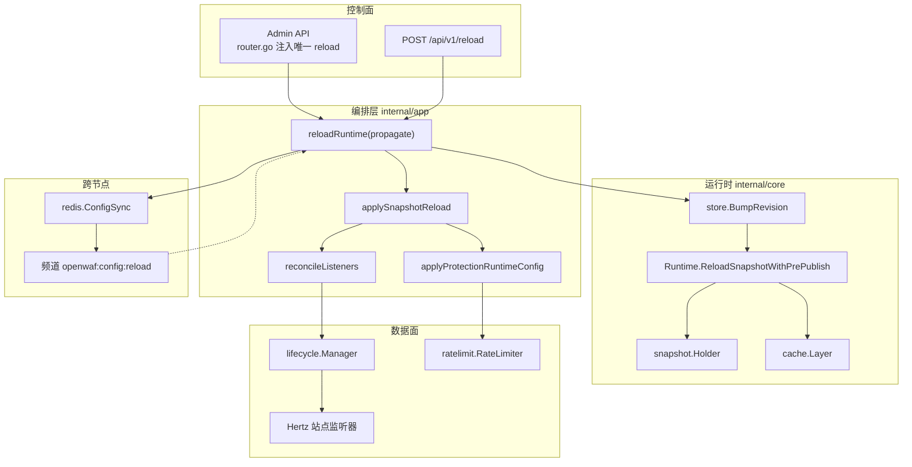
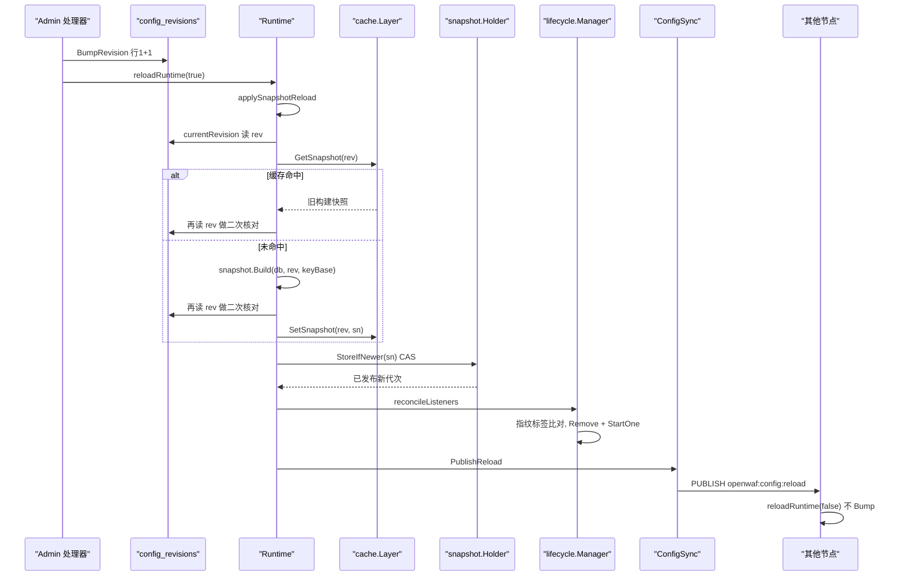
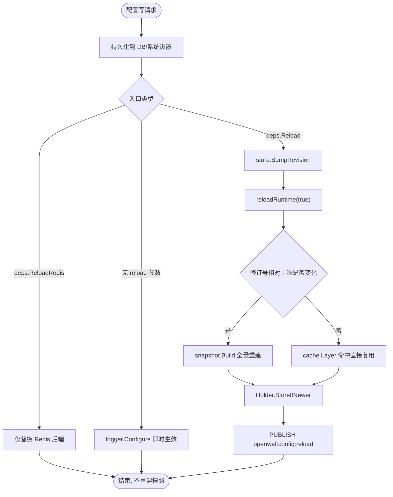
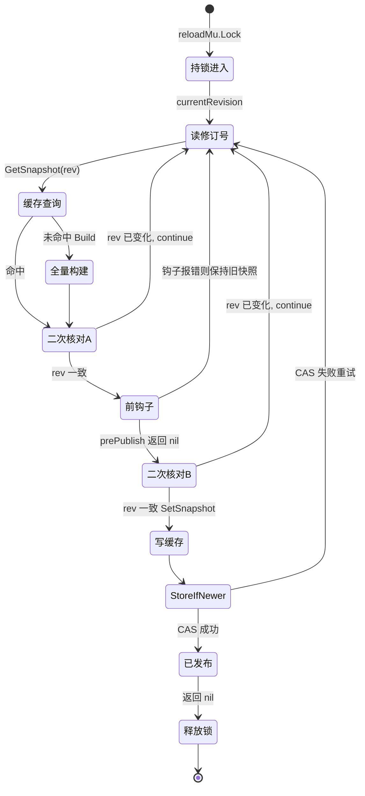
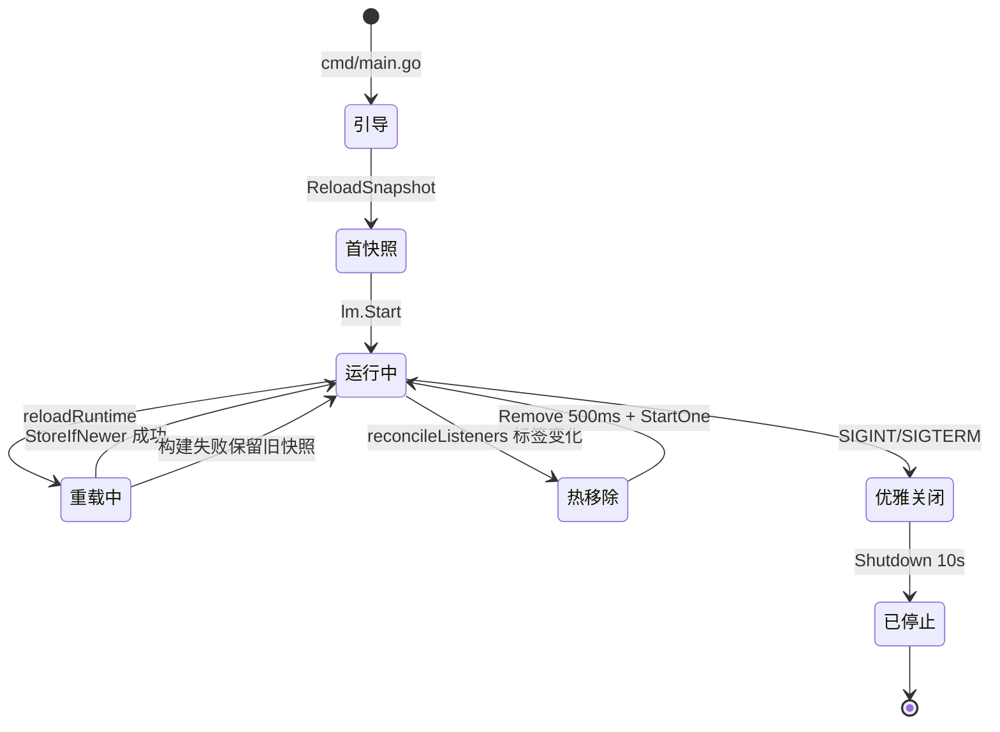
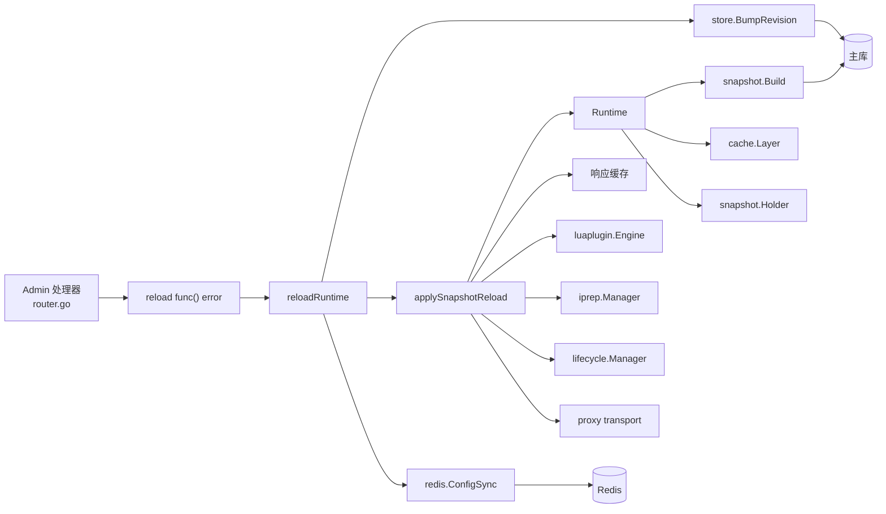

# 热重载系统

> [返回 配置管理系统](配置管理系统.md)

<cite>
**本文档引用的文件**
- [server.go](file://internal/app/server.go)
- [runtime.go](file://internal/core/runtime.go)
- [config_validate.go](file://internal/core/config_validate.go)
- [pubsub.go](file://internal/core/redis/pubsub.go)
- [lifecycle.go](file://internal/core/lifecycle/lifecycle.go)
- [snapshot.go](file://internal/snapshot/snapshot.go)
- [build.go](file://internal/snapshot/build.go)
- [resolve.go](file://internal/core/configoverride/resolve.go)
- [layer.go](file://internal/cache/layer.go)
- [migrate.go](file://internal/store/migrate.go)
- [system.go](file://internal/store/system.go)
- [ratelimit.go](file://internal/waf/ratelimit/ratelimit.go)
- [router.go](file://internal/admin/router.go)
- [settings.go](file://internal/admin/system/settings.go)
- [acme.go](file://internal/admin/system/acme.go)
- [network.go](file://internal/admin/system/network.go)
- [runtime_overrides.go](file://internal/admin/system/runtime_overrides.go)
- [rule.go](file://internal/admin/rule/rule.go)
- [protection.go](file://internal/admin/protect/protection.go)
- [docs/配置管理系统/配置管理系统.md](file://docs/配置管理系统/配置管理系统.md)
- [docs/配置管理系统/配置快照机制.md](file://docs/配置管理系统/配置快照机制.md)
- [docs/配置管理系统/分布式同步机制.md](file://docs/配置管理系统/分布式同步机制.md)
</cite>

## 目录

1. [简介](#简介)
2. [项目结构](#项目结构)
3. [核心组件](#核心组件)
4. [架构总览](#架构总览)
5. [详细组件分析](#详细组件分析)
6. [依赖关系分析](#依赖关系分析)
7. [性能考虑](#性能考虑)
8. [故障排查指南](#故障排查指南)
9. [结论](#结论)
10. [附录](#附录)

## 简介

本文件专述 My-OpenWaf 的**热重载链**本身：配置变更如何被检测、如何一路走到不可变快照重建、如何原子替换、以及一次重载到底会带动哪些运行期副作用。

覆盖范围：

- 变更检测：`config_revisions` 修订号自增、Redis Pub/Sub 事件、（不存在的）文件监控。
- 重建与发布：`Runtime.ReloadSnapshotWithPrePublish` 的代次 CAS 二次核对。
- 副作用面：监听器协调、限流器重配置、Lua/JS 脚本热替换、IP 名单重载、上游连接池回收。
- 分布式：跨节点**只传事件不传快照**的语义与回环抑制。
- 生命周期：启动顺序、优雅关闭、热移除窗口。

刻意不重复的三处内容，改为链接：

| 主题 | 归属文档 | 本篇处理 |
|------|----------|----------|
| 配置载体优先级链与全局/站点配置项清单 | [配置管理系统](配置管理系统.md) | 只引用，不复制 |
| 快照字段构成、键设计与 DB 映射 | [配置快照机制](配置快照机制.md) | 只引用 |
| 引擎如何消费快照、阶段链缓存 | [快照系统](../WAF 引擎系统/引擎核心架构/快照系统.md) | 只引用 |
| 多节点一致性与订阅细节 | [分布式同步机制](分布式同步机制.md) | 只给触发矩阵行 |

可验证目标：读完本篇能够回答「某个 Admin 端点保存后，快照是否重建、限流窗口是否重置、其他节点是否跟随」这三个问题，并且能够用一条 `curl` 与一条日志关键字复现判定。

**章节来源**
- [docs/配置管理系统/配置管理系统.md:36-48](file://docs/配置管理系统/配置管理系统.md#L36-L48)
- [internal/app/server.go:1002-1033](file://internal/app/server.go#L1002-L1033)

## 项目结构

热重载由「控制面写入口 → 运行时重建 → 数据面协调」三段构成，代码分布高度集中：整条链只有一个 `reloadRuntime` 闭包（`internal/app/server.go:1002-1029`）与一个 `Runtime` 方法（`internal/core/runtime.go:211-274`），不存在第二套重载实现。

| 层 | 文件 | 关键符号 | 行号 | 在重载链中的职责 |
|----|------|----------|:----:|------------------|
| 控制面路由 | internal/admin/router.go | `reload := deps.Reload` | 119 | 把唯一重载入口注入各写处理器 |
| 控制面处理器 | internal/admin/system/settings.go | `ReloadSnapshot` | 202-210 | 手动重载端点 |
| 编排层 | internal/app/server.go | `reloadRuntime` | 1002-1029 | 决定是否 BumpRevision、发布事件 |
| 编排层 | internal/app/server.go | `applySnapshotReload` | 868-920 | 单次重载的副作用序列 |
| 编排层 | internal/app/server.go | `reconcileListeners` | 722-825 | 监听器增删与热重启 |
| 运行时 | internal/core/runtime.go | `ReloadSnapshotWithPrePublish` | 211-274 | 代次 CAS 重建与发布 |
| 运行时 | internal/core/runtime.go | `currentRevision` | 283-289 | 读取 `config_revisions` 单行 |
| 快照层 | internal/snapshot/build.go | `Build` | 47-555 | 全量读取并编译配置 |
| 快照层 | internal/snapshot/snapshot.go | `Holder.StoreIfNewer` | 474-487 | 修订号单调发布 |
| 缓存层 | internal/cache/layer.go | `GetSnapshot`/`SetSnapshot` | 44-63 | 按修订号的进程内快照缓存 |
| 存储层 | internal/store/migrate.go | `BumpRevision` | 141-160 | 修订号自增 |
| 通信层 | internal/core/redis/pubsub.go | `PublishReload`/`Subscribe` | 65-122 | 跨节点事件 |
| 生命周期 | internal/core/lifecycle/lifecycle.go | `Remove`/`StartOne`/`Shutdown` | 144-288 | 实例增删与优雅关闭 |



**图表来源**
- [internal/app/server.go:1002-1033](file://internal/app/server.go#L1002-L1033)
- [internal/core/runtime.go:201-289](file://internal/core/runtime.go#L201-L289)
- [internal/admin/router.go:119](file://internal/admin/router.go#L119)
- [internal/core/redis/pubsub.go:16-122](file://internal/core/redis/pubsub.go#L16-L122)

**章节来源**
- [internal/app/server.go:722-825](file://internal/app/server.go#L722-L825)
- [internal/core/runtime.go:211-274](file://internal/core/runtime.go#L211-L274)
- [internal/admin/router.go:258-397](file://internal/admin/router.go#L258-L397)

## 核心组件

- 唯一重载闭包：`reloadRuntime(propagate bool)`。`propagate=true` 表示本节点是变更源，先 `store.BumpRevision` 再重建；`propagate=false` 表示由 Redis 订阅回调触发，修订号已由变更节点自增，本节点只重建。
- 代次 CAS 发布：`ReloadSnapshotWithPrePublish` 在 `reloadMu` 互斥下循环，每次构建前后各读一次修订号，任一次不一致就 `continue` 重来，最终由 `Holder.StoreIfNewer` 做第二次单调性保护。
- 快照前钩子：`prePublish` 回调在快照对请求处理器可见之前执行，当前唯一使用者是 JS 插件引擎预热（`server.go:870-877`）；钩子返回错误时**当前已发布快照保持不变**。
- 副作用编排：`applySnapshotReload` 按固定顺序做「响应缓存清理 → 运行期参数重设 → Lua 热替换 → IP 名单重载 → 监听器协调 → 上游连接池回收」。
- 监听器协调：`reconcileListeners` 用 `siteListenerFingerprint` 生成的 SHA-256 标签比对，标签变化才 `Remove` + `StartOne`，只影响受影响 bind。
- 跨节点通知：`redis.ConfigSync` 只广播 `{source_id, action:"reload"}`，不携带快照内容。

组件清单：

| 组件 | 类型 | 位置 | 职责（单一） | 可观测点 |
|------|------|------|--------------|----------|
| `Runtime` | struct | runtime.go:23-34 | 持有 DB/Redis/Holder/Cache | — |
| `ReloadSnapshotWithPrePublish` | 方法 | runtime.go:211 | 重建并发布快照 | `snapshot build` 错误前缀 |
| `Holder` | struct | snapshot.go:453 | 原子持有当前快照 | `StoreIfNewer` 返回值 |
| `Build` | 函数 | build.go:47 | 配置到快照的唯一入口 | `ConfigDiagnostics` |
| `Layer` | struct | layer.go:23 | 进程内快照缓存 | `owaf_cache_*{cache=hot}` |
| `ConfigSync` | struct | pubsub.go:29 | 发布/订阅重载事件 | `received config sync reload` |
| `Manager` | struct | lifecycle.go:66 | 服务器实例编排 | `hot-started site listener` |
| `RateLimiter` | struct | ratelimit.go:20 | 固定窗口限流 | `Reconfigure` 调用次数 |

**章节来源**
- [internal/core/runtime.go:23-34](file://internal/core/runtime.go#L23-L34)
- [internal/snapshot/snapshot.go:453-489](file://internal/snapshot/snapshot.go#L453-L489)
- [internal/app/server.go:868-920](file://internal/app/server.go#L868-L920)
- [internal/core/redis/pubsub.go:29-56](file://internal/core/redis/pubsub.go#L29-L56)

## 架构总览

一次「Admin 保存 → 全站生效」的完整时序如下。注意三个实测语义：变更源节点**先自增修订号再重建**；事件发布点在 Redis 后端是否需要切换时前置（`shouldPublishConfigReloadBeforeRedisSwitch`）；订阅侧收到事件后**不再自增修订号**。



**图表来源**
- [internal/app/server.go:1002-1029](file://internal/app/server.go#L1002-L1029)
- [internal/core/runtime.go:211-274](file://internal/core/runtime.go#L211-L274)
- [internal/store/migrate.go:141-160](file://internal/store/migrate.go#L141-L160)
- [internal/snapshot/snapshot.go:474-487](file://internal/snapshot/snapshot.go#L474-L487)
- [internal/core/redis/pubsub.go:60-122](file://internal/core/redis/pubsub.go#L60-L122)

**章节来源**
- [internal/app/server.go:722-825](file://internal/app/server.go#L722-L825)
- [internal/cache/layer.go:44-63](file://internal/cache/layer.go#L44-L63)

## 详细组件分析

### 重载触发矩阵

下表是「配置组 → 是否走重载 → 重载后副作用」的权威矩阵，全部逐条来自 `internal/admin/router.go` 的注册行与处理器实现。三列语义澄清：

- **是否 BumpRevision**：只有 `reloadRuntime(true)` 会自增修订号（`server.go:1004-1008`）。
- **是否重建快照**：`applySnapshotReload` 恒被执行，但同修订号会命中 `cache.Layer`，此时只做 CAS 重发布而非重新 `Build`。
- **是否重建限流窗口**：`RateLimiter.Reconfigure`（`ratelimit.go:80-94`）只原地改写 `windowS/maxReqs/enabled`，**不清空 `windows` map**，因此既有计数与窗口到期时间跨重载保留。

| 配置组 | 入口:行 | 是否 BumpRevision | 是否重建快照 | 是否重建限流窗口 | 影响面 |
|--------|---------|:---:|:---:|:---:|--------|
| 站点增删改/启停 | router.go:258-262 | 是 | 是 | 参数重设，计数保留 | 站点路由、上游、监听器指纹 |
| 站点监听器 | router.go:263-265 | 是 | 是 | 同上 | bind 集合、TLS |
| 证书增删改/应用到站点 | router.go:267-270 | 是 | 是 | 同上 | SNI 证书映射 |
| ACME 申请/续期 | router.go:271-272 | 是 | 是 | 同上 | 新证书落库即入快照 |
| ACME 全局配置 | router.go:397 / acme.go:523-527 | 是 | 是 | 同上 | 校验 `renew_before_days>0`、CAA 必填；但 `acme_config` 不在 `Build` 读取集合内，重载对它只多递增一次代次 |
| 策略 | router.go:274-278 | 是 | 是 | 同上 | 默认策略缺失会**直接构建失败** |
| 规则增删改/导入 | router.go:280-285 | 是 | 是 | 同上 | 阶段规则集 |
| 全局保护设置 | router.go:287 / protection.go:297-301 | 是 | 是 | 参数重设 | 限流/质询/自动封禁 |
| IP 黑白名单 | router.go:289-291 | 是 | 是 | 同上 | `loadIPLists` |
| 威胁情报订阅源 | router.go:293-295；定时链路 server.go:1036 | 是 | 是 | 同上 | 派生条目全量替换 |
| Lua 插件 | router.go:300-303 | 是 | 是 | 同上 | `luaEngine.Reload` 原子换集合 |
| JS 插件 | router.go:306-309 | 是 | 是 | 同上 | `prePublish` 内预热引擎 |
| bot / CVE / OWASP / 验证码 / 链式 / 页面模板 / 敏感度 / 升级 | router.go:315-342 | 是 | 是 | 同上 | 检测参数 |
| 应用路由规则 | router.go:345-347 | 是 | 是 | 同上 | 站点级 `AppRouteRules` |
| 站点错误页 / 站点访问控制 | router.go:350-362 | 是 | 是 | 同上 | 页面与网关配置 |
| 通用系统设置 | router.go:375-378 | 是 | 是 | 同上 | 单键写入 |
| 备份导入 | router.go:382-388 | 是 | 是 | 参数重设 | 额外失效规则快照、吊销会话 |
| network/http2/image/tls/env-overrides | router.go:390-393、396 | 是 | 是 | 同上 | 全局默认值 |
| 手动重载 | router.go:313 / settings.go:202-210 | 是 | 是 | 参数重设 | 全量 |
| 跨节点订阅回调 | pubsub.go:86-122 → server.go:1040-1042 | **否** | 是（同修订号命中缓存） | 参数重设 | 本节点跟随 |
| Redis 连接配置 | router.go:394 / network.go:413 → `deps.ReloadRedis` → server.go:926-979 | **否** | **否** | **否** | 仅 Swap Redis 后端与依赖 |
| 日志配置 | router.go:395 / network.go:266-300 | **否** | **否** | **否** | `logger.Configure` 即时生效 |

**章节来源**
- [internal/admin/router.go:258-398](file://internal/admin/router.go#L258-L398)
- [internal/admin/system/acme.go:192-215](file://internal/admin/system/acme.go#L192-L215)
- [internal/app/server.go:926-979](file://internal/app/server.go#L926-L979)
- [internal/admin/system/acme.go:523-527](file://internal/admin/system/acme.go#L523-L527)
- [internal/admin/system/network.go:266-300](file://internal/admin/system/network.go#L266-L300)
- [internal/waf/ratelimit/ratelimit.go:80-94](file://internal/waf/ratelimit/ratelimit.go#L80-L94)

> 订正说明：早期文档曾把 `UpdateACMEConfig` 归入「不触发重载」一类，实测为误——该处理器在保存成功后显式调用 `reload()`，失败返回 500 并附带 `config applied but reload failed` 前缀（`internal/admin/system/acme.go:523-527`）。真正完全不触发重载的只有 `log-config` 与 `redis-config` 两个入口。
>
> 需要同时记住的另一半事实：`acme_config` 设置键不在 `snapshot.Build` 的读取集合内（`internal/snapshot/` 非测试代码无任何 acme 引用），签发流程每次现读 `loadACMEConfig`（`acme.go:192`）。因此 ACME 配置那次 reload 对它本身没有传递效果，只是多递增一次代次。

### 配置变更检测机制

- 数据库修订号：变更信号唯一来源是 `config_revisions` 表的单行（`ID=1`）。`BumpRevision` 先以 `ON CONFLICT DO NOTHING` 播种，再 `UPDATE revision = revision + 1`，并要求 `RowsAffected == 1`，否则报错（`migrate.go:141-160`）。读取用 `FirstOrCreate`，缺行时以 `revision=0` 播种（`runtime.go:283-289`）。
- Redis 事件：发布端 `PublishReload` 发送 JSON `{source_id, action}`，订阅端 `Subscribe` 解析后按 `source_id` 抑制回环（`pubsub.go:114-116`）。
- 文件监控：**当前实现不存在任何文件系统监控**。配置的唯一真相是数据库；`MY_OPENWAF_*` 环境变量只在进程引导期读取一次，改环境变量必须重启。
- 轮询兜底：**没有修订号轮询协程**。若 Redis 未启用，跨节点一致性只能靠各节点自身的 Admin 写请求或手动 `POST /api/v1/reload`。



**图表来源**
- [internal/store/migrate.go:141-160](file://internal/store/migrate.go#L141-L160)
- [internal/core/runtime.go:218-273](file://internal/core/runtime.go#L218-L273)
- [internal/app/server.go:1002-1029](file://internal/app/server.go#L1002-L1029)
- [internal/admin/system/network.go:266-300](file://internal/admin/system/network.go#L266-L300)

**章节来源**
- [internal/store/migrate.go:141-168](file://internal/store/migrate.go#L141-L168)
- [internal/core/runtime.go:276-289](file://internal/core/runtime.go#L276-L289)
- [internal/core/redis/pubsub.go:86-122](file://internal/core/redis/pubsub.go#L86-L122)

### 代次 CAS 与并发保护

`ReloadSnapshotWithPrePublish` 的设计目标是：**任何被发布的快照，都必须与发布瞬间数据库里的修订号一致**。为此在单次循环里做了三次修订号读取（`runtime.go:219/224/236/250/262`），构成两道核对：

1. 构建（或缓存取值）后核对一次，不一致则丢弃重来；
2. `prePublish` 回调之后再核对一次，防止钩子执行期间发生新的变更；
3. 最后由 `Holder.StoreIfNewer` 做「代次不小于当前」的 CAS，`current.Revision >= s.Revision` 时直接返回 `false` 而不发布。

前置条件：动态防护密钥基必须已配置为 32 字节，否则整个方法立即返回错误（`runtime.go:215-217`）。启动链在 `server.go:289` 由 `deriveDynamicProtectionKeyBase(jwtSecret)`（`server.go:1490`）注入，因此**手动构造 Runtime 而未设置密钥基时重载必然失败**。



**图表来源**
- [internal/core/runtime.go:211-274](file://internal/core/runtime.go#L211-L274)
- [internal/snapshot/snapshot.go:464-487](file://internal/snapshot/snapshot.go#L464-L487)
- [internal/cache/layer.go:44-63](file://internal/cache/layer.go#L44-L63)

**章节来源**
- [internal/core/runtime.go:201-274](file://internal/core/runtime.go#L201-L274)
- [internal/snapshot/snapshot.go:453-489](file://internal/snapshot/snapshot.go#L453-L489)
- [internal/app/server.go:289](file://internal/app/server.go#L289)

### 单次重载的副作用序列

`applySnapshotReload`（`server.go:868-920`）在快照发布后按固定顺序执行，顺序本身有意义：

1. 调用 `ReloadSnapshotWithPrePublish`，钩子里 `ensureJSEngine(next.JSPlugins)` + `eng.SetJSPlugins(jsEngine)`；
2. 比对 `rt.Snapshot.Load()` 指针与调用前是否不同，不同则 `responseCache.Clear()`；
3. `applyProtectionRuntimeConfig(currentSnapshot.Protection)`（定义在 `server.go:637-675`，调用在 `server.go:884`）；
4. `luaEngine.Reload(currentSnapshot.LuaPlugins)`，整体换集合，在途调用继续用旧集合跑完；
5. `loadIPLists(ipRep, repos.IPList)`；
6. `reconcileListeners()`；
7. `snapshotUpstreamSetChanged` + `PruneInactiveUpstreamTransports`，端点集合变化时 `CloseIdleUpstreamTransports`；
8. 输出一条 `reconciled idle upstream transports after snapshot reload` 结构化日志。

运行期重配置项清单（全部只读**全局** `Protection`，站点覆盖不参与）：

| 被重设对象 | 调用行 | 取值来源 | 备注 |
|------------|--------|----------|------|
| `reqRL.Reconfigure` | server.go:638 | `RequestRateLimitWindow/Max/Enabled` | 窗口对象进程级单例 |
| `errRL.Reconfigure` | server.go:639 | `ErrorRateLimitWindow/Max/Enabled` | 同上 |
| `ipRep.ConfigureAutoBan` | server.go:640-641 | 阈值/窗口/时长/动作 | — |
| `captchaMgr.SetTimeout` | server.go:642 | `CaptchaTimeout` | — |
| `shieldMgr.SetConfig` | server.go:643-655 | 5 秒盾全组参数 | — |
| `chainMgr.ReconfigureWithCaptchaType` | server.go:656 | `ChainSteps`/`ShieldDifficulty`/`CaptchaType` | — |
| `bruteForce.Reconfigure` | server.go:657 | `LoginMaxAttempts`/`LoginLockoutMinutes` | — |
| `dropExec.Reconfigure` | server.go:660 | Drop 策略 `Enabled` | — |
| `eng.SetBotThreshold` | server.go:661 | `drop_policy.bot_score_threshold` | — |
| `geoResolver.Reload`/`UpdateConfig` | server.go:669-672 | bot GeoIP 配置 | 仅路径变化才重开 mmap |

**章节来源**
- [internal/app/server.go:868-920](file://internal/app/server.go#L868-L920)
- [internal/app/server.go:637-675](file://internal/app/server.go#L637-L675)

### 监听器协调与指纹

`reconcileListeners`（`server.go:722-825`）分四轮扫描：

1. `listenerRuntimesByBind(newSn)`（`server.go:1313`）得到期望集合，键为 `site:<bind>`（`siteListenerName`，`server.go:1152`）；
2. 先清 `h3:` 前缀的过期/漂移实例，再清 `site:` 前缀的；
3. 对期望中缺失的名字 `buildDataServerWithHTTP3Plans` + `AddHertzWithTag` + `StartOne`；
4. 同样处理 `h3:` 计划。

指纹由 `siteListenerFingerprint(bind, sn)`（`server.go:2012` 起）计算，输入至少包含：站点 ID、`tls_enabled`、有效网络类型与 ALPN、有效 min/max TLS、HTTP/3 开关与 bind、密码套件、曲线偏好、`prefer_server_cipher_suites`、`session_tickets_enabled`、`self_signed_on_ip`、证书材料指纹，以及整组 HTTP/2 参数。证书材料通过 `tls.X509KeyPair` 重新解析并叠加 OCSP staple。

- 构建不出合法 TLS 配置时，`buildDataServerWithHTTP3Plans` 返回 nil，协调逻辑记 `skipping site listener without valid TLS config` 并跳过，而不是让整个重载失败。
- `StartOne` 失败时立即 `lm.Remove(name)`，避免残留半启动实例。
- 站点级 `min_tls_version` 等字段为三态，继承全局时指纹取的是合并后的有效值，因此「改全局默认」同样会让所有继承站点的监听器重启。

**章节来源**
- [internal/app/server.go:722-825](file://internal/app/server.go#L722-L825)
- [internal/app/server.go:2012-2070](file://internal/app/server.go#L2012-L2070)
- [internal/app/server.go:1152](file://internal/app/server.go#L1152)
- [internal/app/server.go:1313](file://internal/app/server.go#L1313)

### 跨节点通知语义

频道、载荷与超时都在 `internal/core/redis/pubsub.go` 内固定：

- 频道名 `openwaf:config:reload`（pubsub.go:16），动作常量 `reload`（pubsub.go:17）。
- 载荷只有 `source_id` 与 `action` 两个字段（pubsub.go:19-22）。**快照内容不跨网络传输**，每个节点都独立地从自己的数据库视图重建。
- 发布超时 2 秒（pubsub.go:77），失败只记 `config sync publish failed` 告警，不影响本地已完成的 reload。
- `sourceID` 由 8 字节随机数十六进制生成（pubsub.go:56-63），节点重启会变，因此抑制只防同一次进程内自激。
- `Subscribe` 兼容裸 `reload` 字符串与 JSON 两种载荷（pubsub.go:96-116）。
- `ConfigSync` 实例随 Redis 后端替换而重建，旧实例 `Close()`；最后一个实例在 `Run` 退出时收尾（server.go:834-864、1043-1049）。

**章节来源**
- [internal/core/redis/pubsub.go:16-131](file://internal/core/redis/pubsub.go#L16-L131)
- [internal/app/server.go:834-864](file://internal/app/server.go#L834-L864)
- [internal/app/server.go:1040-1049](file://internal/app/server.go#L1040-L1049)

### 回滚机制与失败面

- **没有自动回滚到上一快照的逻辑**。重载一旦失败，`Holder` 里仍是上一个成功发布的快照，数据面继续按旧配置服务；本次失败的构建产物被直接丢弃，不回写缓存（`runtime.go:246-249` 在 `Build` 报错时立刻返回）。
- 失败传播路径统一为 500，文案 `config applied but reload failed: ...`（如 `protection.go:297-301`、`acme.go:521-526`、`rule.go:181-184`）。**这是非 fail-closed 的写法**：配置已经落库，只是没有生效，重启后同样会重载失败。
- 构建期的错误分流由 `Build` 决定：致命错误使整次重载失败（例如默认策略缺失，`build.go:71-73`）；可跳过的无效项写入 `ConfigDiagnostics` 随快照发布（`build.go:39-40`、`509-524`）。
- 单脚本编译失败不阻断整体：Lua/JS 的错误分别落到 `LuaPluginErrors`/`JSPluginErrors`（`snapshot.go:238-248`）。
- 手动干预手段：修复数据库中的非法值后 `POST /api/v1/reload`；或在无法修复时清空本地缓存并回退到上一份数据（备份恢复路径 `router.go:382-388`）。

**章节来源**
- [internal/core/runtime.go:246-249](file://internal/core/runtime.go#L246-L249)
- [internal/snapshot/build.go:34-50](file://internal/snapshot/build.go#L34-L50)
- [internal/snapshot/build.go:509-524](file://internal/snapshot/build.go#L509-L524)
- [internal/admin/protect/protection.go:297-301](file://internal/admin/protect/protection.go#L297-L301)
- [internal/admin/rule/rule.go:181-184](file://internal/admin/rule/rule.go#L181-L184)

### 生命周期与优雅关闭

`lifecycle.Manager` 是重载链唯一触碰监听器的入口：

- `Remove` 使用 500ms 上限（`lifecycle.go:21`、`144-167`），保证热重载路径尽快归还调用方；`engine is not running` 被当作已停止而吞掉（`lifecycle.go:23`、`61-63`）。
- `StartOne`（`lifecycle.go:169-183`）与 `Start`（`185-203`）都会 `waitReady` 确认监听成功。
- 进程级优雅关闭 `Shutdown` 用 10s 默认超时（`lifecycle.go:18`、`246-288`）。
- `Run` 的启动顺序中，重载链在 `ReloadSnapshot`（`server.go:293`）构建首个快照之后才装配（`server.go:722-1049`），最终 `lm.Start()`（`server.go:1131`）。
- 关闭收尾：`defer` 中依次停威胁情报管理器、`configSync.Close()`、`Runtime.Close()`（Redis 客户端与两路 SQL 连接，`runtime.go:291-303`）。



**图表来源**
- [internal/core/lifecycle/lifecycle.go:18-21](file://internal/core/lifecycle/lifecycle.go#L18-L21)
- [internal/core/lifecycle/lifecycle.go:144-203](file://internal/core/lifecycle/lifecycle.go#L144-L203)
- [internal/core/lifecycle/lifecycle.go:246-290](file://internal/core/lifecycle/lifecycle.go#L246-L290)
- [internal/app/server.go:293](file://internal/app/server.go#L293)
- [internal/app/server.go:1131](file://internal/app/server.go#L1131)

**章节来源**
- [internal/core/lifecycle/lifecycle.go:18-290](file://internal/core/lifecycle/lifecycle.go#L18-L290)
- [internal/app/server.go:1131](file://internal/app/server.go#L1131)
- [internal/core/runtime.go:291-313](file://internal/core/runtime.go#L291-L313)

### 重载链可调参数（配置项表）

链路上的可调项以代码常量为主，以下是全部实测取值；密钥类一律脱敏为 `{占位}`。

| 参数 | 位置:行 | 取值 | 生效方式 | 说明 |
|------|---------|:----:|:--------:|------|
| 重载互斥锁 | runtime.go:212 | 单把 `sync.Mutex` | 编译期 | 同节点重载串行化 |
| 编排层互斥锁 | server.go:922 | 单把 `sync.Mutex` | 编译期 | 覆盖 reload 与 Redis 切换 |
| 动态防护密钥基长度 | runtime.go:215 | 32 字节 | 引导期 | 未设置则重载失败 |
| 修订号行 ID | migrate.go:142 | 固定 `1` | 编译期 | 单行表 |
| 发布超时 | pubsub.go:77 | 2 秒 | 编译期 | 失败仅告警 |
| 订阅回环抑制 | pubsub.go:114 | `source_id` 相等即忽略 | 编译期 | 防同进程自激 |
| 快照缓存 NumCounters | layer.go:31 | `1e4` | 编译期 | Ristretto 准入 sketch |
| 快照缓存 MaxCost | layer.go:32 | `1<<20` | 编译期 | 每条成本恒为 1 |
| 快照缓存 BufferItems | layer.go:33 | `64` | 编译期 | — |
| 缓存键格式 | layer.go:41、48 | `snapshot:{rev}` | 编译期 | 修订号即版本 |
| 热移除超时 | lifecycle.go:21 | 500ms | 编译期 | 单实例 |
| 优雅关闭超时 | lifecycle.go:18 | 10s | 编译期 | 进程级 |
| 限流窗口清理周期 | ratelimit.go:176 | 30s | 编译期 | 与重载无关 |
| Redis 引导可用性 | runtime.go:39-43 | 引导期清空 Redis 配置 | 编译期 | 库里覆盖值优先 |

```go
// internal/core/runtime.go:276-289 —— 修订号的实际载体
type runtimeConfigRevision struct {
    ID       uint   `gorm:"primaryKey"`
    Revision uint64 `gorm:"not null"`
}

func (runtimeConfigRevision) TableName() string { return "config_revisions" }
```

```yaml
# 引导期环境变量（仅进程启动读取，改动必须重启；密钥一律 {占位}）
MY_OPENWAF_DB_DRIVER: sqlite
MY_OPENWAF_DSN: ./data/waf.db
MY_OPENWAF_LOG_DSN: ./data/waf_logs.db
MY_OPENWAF_ADMIN_BIND: ":9443"
MY_OPENWAF_REDIS_ADDR: 127.0.0.1:6379      # 可被库中 redis_config 行整块覆盖
MY_OPENWAF_REDIS_PASSWORD: "{占位}"
MY_OPENWAF_JWT_SECRET: "{占位}"             # 动态防护密钥基由它派生
```

**章节来源**
- [internal/core/runtime.go:212-289](file://internal/core/runtime.go#L212-L289)
- [internal/store/system.go:30-34](file://internal/store/system.go#L30-L34)
- [internal/cache/layer.go:28-63](file://internal/cache/layer.go#L28-L63)
- [internal/core/redis/pubsub.go:77-116](file://internal/core/redis/pubsub.go#L77-L116)
- [internal/core/lifecycle/lifecycle.go:18-21](file://internal/core/lifecycle/lifecycle.go#L18-L21)
- [internal/waf/ratelimit/ratelimit.go:176](file://internal/waf/ratelimit/ratelimit.go#L176)

## 依赖关系分析

- 内部耦合方向单一：控制面处理器只依赖 `func() error` 这一抽象（`router.go:119`），不感知快照、监听器或限流器；编排层依赖运行时，运行时依赖快照与缓存。
- `Holder` 只依赖标准库 `sync/atomic`，是最底层的无依赖组件。
- `applySnapshotReload` 是「胖函数」，横向触碰响应缓存、引擎、Lua、IP 信誉、监听器、连接池六处；这是当前重载语义的集中表达点，也是排查副作用的第一入口。



**图表来源**
- [internal/app/server.go:868-1029](file://internal/app/server.go#L868-L1029)
- [internal/core/runtime.go:211-274](file://internal/core/runtime.go#L211-L274)
- [internal/admin/router.go:119](file://internal/admin/router.go#L119)

外部服务依赖：

| 依赖 | 用途 | 客户端/驱动 | 缺失或失败时 | 对重载是否致命 |
|------|------|-------------|--------------|:---:|
| 主数据库 | 配置真相、修订号 | GORM，`database.Open`（runtime.go:63-70） | 重载整体失败 | 是 |
| 日志库 | 访问/安全事件 | GORM 独立句柄（runtime.go:88-97） | 与重载无关 | 否 |
| Redis | 跨节点事件、分布式限流 | rueidis（`OptionalClient`） | 无事件传播，本地重载照常 | 否 |
| Ristretto | 进程内快照缓存 | `cache.NewLayer`（runtime.go:118-126） | 引导期失败即致命 | 引导期是 |
| Hertz | 站点监听器 | `server.Default` | 单实例启动失败仅跳过该 bind | 否 |
| QuickJS | JS 插件引擎 | `ensureJSEngine`（server.go:871-873） | `prePublish` 报错，旧快照保留 | 是 |
| GopherLua 宿主 | Lua 策略脚本 | `luaEngine.Reload`（server.go:886） | 单脚本错误入 `LuaPluginErrors` | 否 |

**章节来源**
- [internal/core/runtime.go:63-126](file://internal/core/runtime.go#L63-L126)
- [internal/app/server.go:868-920](file://internal/app/server.go#L868-L920)
- [internal/admin/router.go:119](file://internal/admin/router.go#L119)

## 性能考虑

- 读路径零锁：数据面通过 `Holder.Load()` 取快照，重载只做指针级 CAS（O(1)），不会阻塞正在处理的请求。
- 重建成本随配置规模增长：`Build` 一次性读取站点、监听器、证书、规则、策略、访问控制、插件与全部系统设置，站点数与规则数是主要变量；这部分口径见 [配置快照机制](配置快照机制.md)。
- 缓存命中价值：同修订号复用已构建快照，避免重复 `Build`；但缓存 MaxCost 很小，长期只保留最近的代次。
- 监听器粒度：按 bind 重启而非全进程重启，指纹不匹配只影响该端口的在途连接。
- Redis 通知不放大延迟：发布走 2s 超时且失败只告警，重载链不会因通知而变慢。
- 建议：批量变更（规则导入、备份恢复）尽量走单端点，减少 `BumpRevision` 次数；每次重载会带一次全量 `Build` 与一次 IP 名单重载。

**章节来源**
- [internal/snapshot/snapshot.go:453-489](file://internal/snapshot/snapshot.go#L453-L489)
- [internal/core/runtime.go:218-273](file://internal/core/runtime.go#L218-L273)
- [internal/app/server.go:722-825](file://internal/app/server.go#L722-L825)

## 故障排查指南

| 症状 | 根因 | 定位手段 | 处置 |
|------|------|----------|------|
| 保存返回 500 且带 `config applied but reload failed` | 配置已落库但重建失败 | 检索 `snapshot build` 前缀日志 | 按内层错误修数据；此时不能假定配置未生效 |
| 重载恒定报 `dynamic protection key base is not configured` | 未走 `server.go:289` 注入 | `runtime.go:215-217` | 确认 JWT 密钥解析成功 |
| 报 `default policy not configured` / `multiple default policies configured` | 策略表状态非法 | `build.go:56-72` | 修正 `default_slot` 后 `POST /api/v1/reload` |
| 改了配置但行为没变 | 监听器指纹未变化 | 查 `restarting site listener due to config change` 是否出现 | 若该字段不入快照或不入指纹，属预期不重启 |
| 其他节点不跟随 | 未启用 Redis | `received config sync reload` 是否打印 | 在各节点分别调用重载端点 |
| 限流不生效但窗口已改 | 站点覆盖不入全局窗口 | `server.go:638-639` 只取全局 `Protection` | 站点级 window/max 仅影响入链判定 |
| 频繁整表重启 | 全局 TLS/HTTP2 默认值反复变 | 指纹含全局默认值（`server.go:2050` 起） | 把站点级字段显式固定 |
| Redis 改配置后限流异常 | `ReloadRedis` 不重建窗口 | `server.go:926-979` | 手动 `POST /api/v1/reload` |

**章节来源**
- [internal/core/runtime.go:211-249](file://internal/core/runtime.go#L211-L249)
- [internal/snapshot/build.go:47-72](file://internal/snapshot/build.go#L47-L72)
- [internal/app/server.go:722-825](file://internal/app/server.go#L722-L825)
- [internal/core/redis/pubsub.go:86-122](file://internal/core/redis/pubsub.go#L86-L122)

## 结论

热重载链的实质是「**一个修订号 + 一次全量重建 + 一次原子替换 + 一串固定副作用**」。三条设计取舍值得强调：

1. 用代次 CAS 而非全局锁来保证快照一致性，代价是重载可能被高并发改写打断并重来，收益是读路径完全无锁。
2. 跨节点只传事件不传快照，代价是每个节点都要能访问自己的配置真相，收益是无需快照序列化协议、无版本兼容负担。
3. 重载失败不回滚，代价是存在「已落库未生效」的中间态，收益是不会在故障时反复改动运行中配置。

建议：把 `POST /api/v1/reload` 纳入发布后检查项，以日志关键字 `hot-started site listener`、`reconciled idle upstream transports after snapshot reload`、`received config sync reload` 作为三段式验收信号。

**章节来源**
- [本节为总结，无需特定文件来源]

## 附录

### 重载兼容性矩阵

「兼容」在这里指：某类配置载体能否在不重启进程的前提下被重载链接管。

| 配置载体 | 写入口 | 是否被 `Build` 读取 | 是否需重启 | 兼容说明 |
|----------|--------|:---:|:---:|----------|
| `MY_OPENWAF_*` 环境变量 | 进程启动 | 否 | 是 | 引导期一次性读取，`configoverride` 只读展示 |
| `runtime_config_overrides` 设置键 | `POST /api/v1/runtime-config/env-overrides` | 是（`build.go:1260-1283`） | 部分键需重启（`RestartRequired`） | 布尔类键逐键指针式覆盖 |
| `protection` 设置键 | `POST /api/v1/protection-settings` | 是（`build.go:1285-1301`） | 否 | 全量 JSON 覆盖 |
| `sites` / `site_listeners` / `certificates` | 站点与证书端点 | 是 | 否 | 三态字段由快照层合并 |
| `rules` / `policies` | 规则与策略端点 | 是 | 否 | 快照编译为 `CompiledRule` |
| `lua_plugins` / `js_plugins` | 插件端点 | 是 | 否 | 单脚本失败不阻断 |
| `ip_list_entries` | IP 名单端点 | 是 | 否 | 另由 `loadIPLists` 独立加载 |
| 日志级别/输出 | `POST /api/v1/log-config` | 否 | 否 | 不走重载，即时生效 |
| Redis 连接 | `POST /api/v1/redis-config` | 否 | 否 | 走 `ReloadRedis`，只换后端 |

**章节来源**
- [internal/snapshot/build.go:1260-1301](file://internal/snapshot/build.go#L1260-L1301)
- [internal/admin/router.go:375-398](file://internal/admin/router.go#L375-L398)
- [internal/admin/system/runtime_overrides.go:255-330](file://internal/admin/system/runtime_overrides.go#L255-L330)
- [internal/core/config_validate.go:11-49](file://internal/core/config_validate.go#L11-L49)
- [internal/admin/system/network.go:266-300](file://internal/admin/system/network.go#L266-L300)
- [internal/core/configoverride/resolve.go:46-91](file://internal/core/configoverride/resolve.go#L46-L91)

### 手动触发与自检

```bash
# 1) 手动触发一次全量重载（返回 200 即快照已换代）
curl -s -X POST "http://127.0.0.1:9443/api/v1/reload" \
  -H "Authorization: Bearer {占位}"

# 2) 确认修订号确实自增（sqlite3 走主库）
sqlite3 ./data/waf.db "SELECT id, revision FROM config_revisions;"

# 3) 确认订阅侧收到事件（另节点日志）
grep -c "received config sync reload" ./data/*.log

# 4) 确认监听器是否真的被热重启
grep -E "hot-started site listener|restarting site listener due to config change" ./data/*.log
```

**章节来源**
- [internal/admin/router.go:313](file://internal/admin/router.go#L313)
- [internal/admin/system/settings.go:202-210](file://internal/admin/system/settings.go#L202-L210)
- [internal/store/migrate.go:141-168](file://internal/store/migrate.go#L141-L168)

### 相关文档索引

| 需要解决的问题 | 去处 |
|----------------|------|
| 快照里到底有什么、键怎么设计、与 DB 如何映射 | [配置快照机制](配置快照机制.md) |
| 多节点一致性、事件丢失与订阅生命周期 | [分布式同步机制](分布式同步机制.md) |
| 配置校验在哪一层发生、失败是否阻断 | [配置验证系统](配置验证系统.md) |
| 表结构与数据迁移 | [迁移管理机制](迁移管理机制.md) |
| 架构视角的快照模式与分层 | [系统架构设计/快照机制](../系统架构设计/快照机制.md) |

**章节来源**
- [本节为索引，无需特定文件来源]
