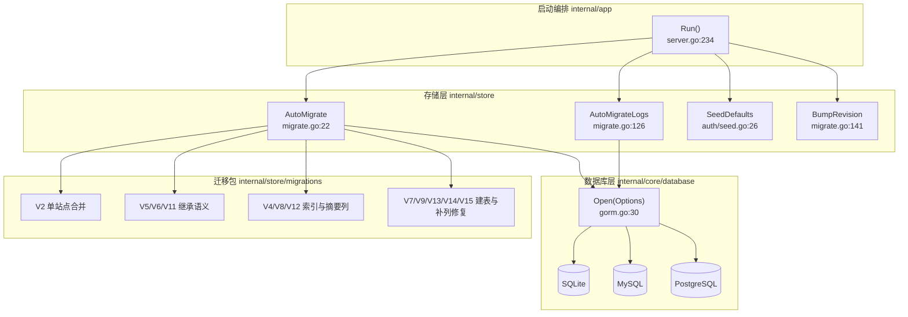
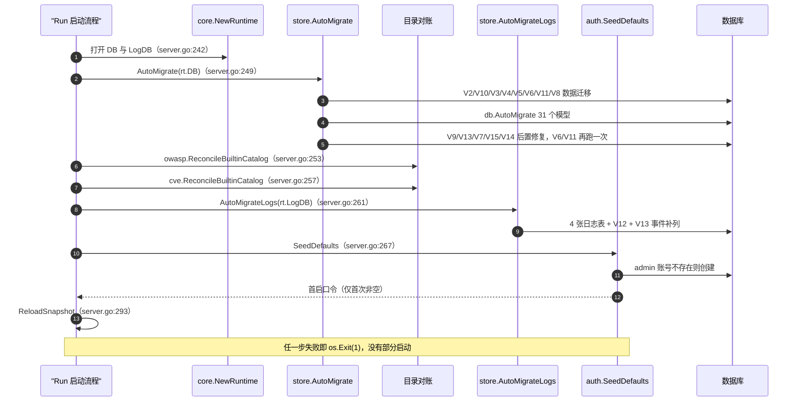
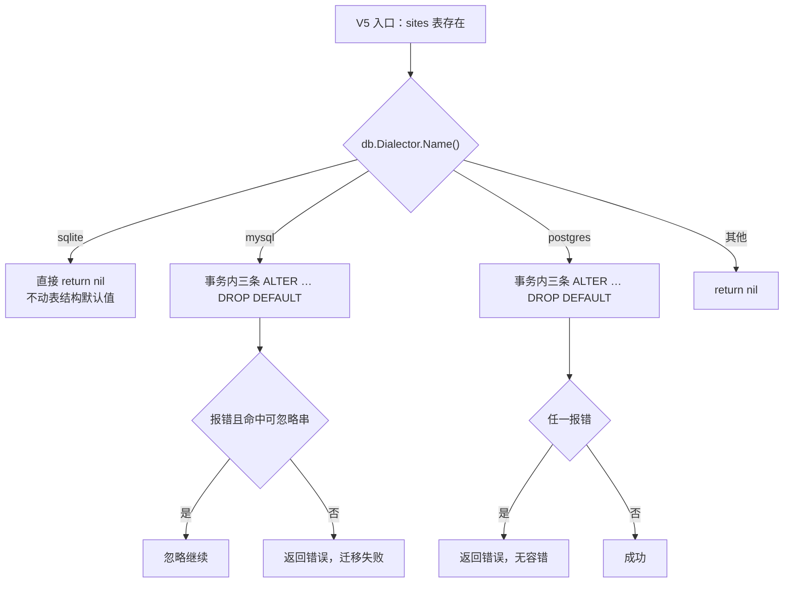
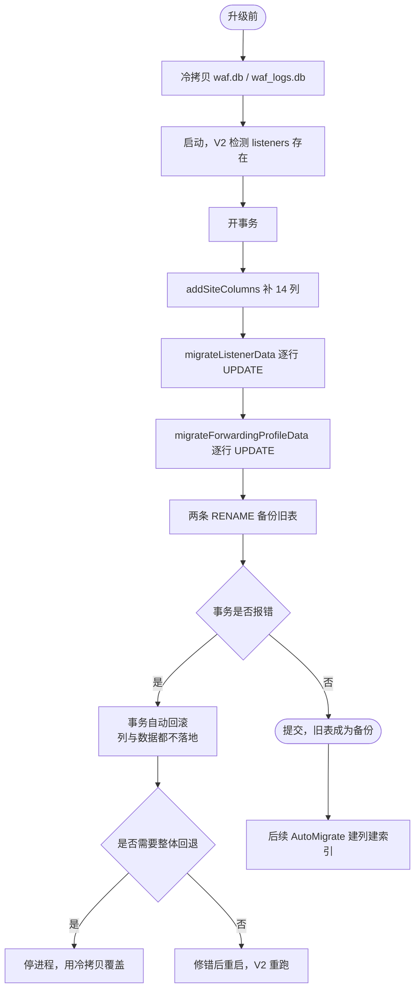
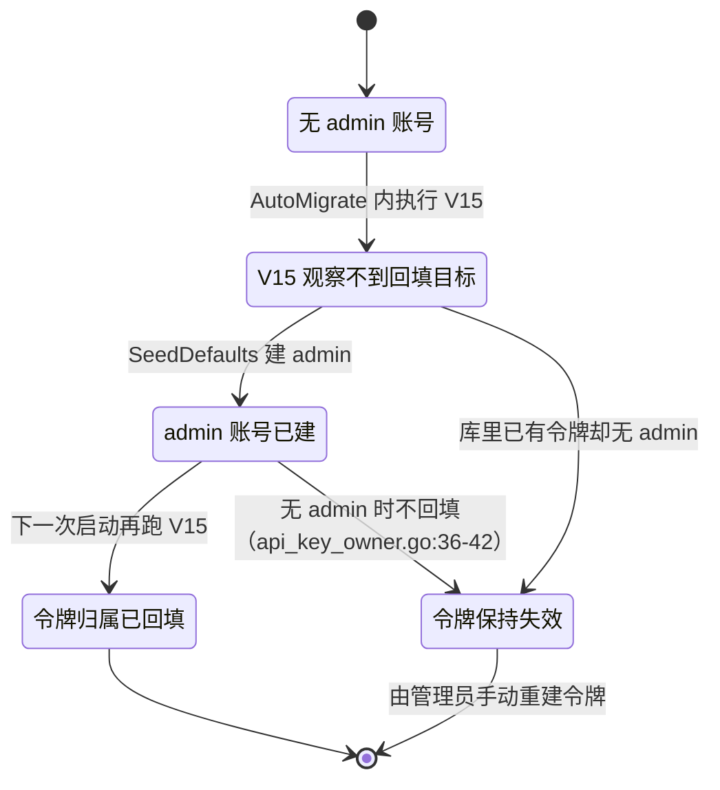
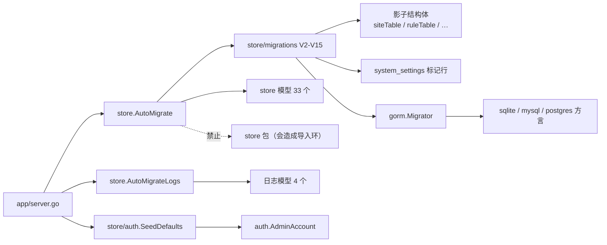
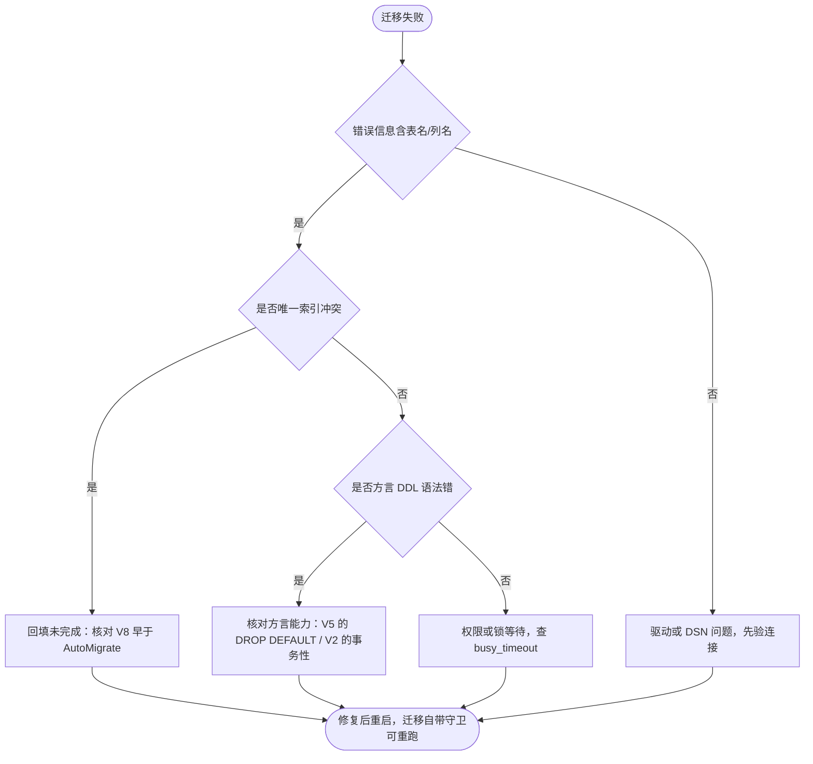

# 迁移管理机制

> [返回 配置管理系统](配置管理系统.md)

<cite>
**本文档引用的文件**
- [server.go](file://internal/app/server.go)
- [migrate.go](file://internal/store/migrate.go)
- [single_site.go](file://internal/store/migrations/single_site.go)
- [rule_phase.go](file://internal/store/migrations/rule_phase.go)
- [recorded_resource_query_string.go](file://internal/store/migrations/recorded_resource_query_string.go)
- [site_tls_inheritance_defaults.go](file://internal/store/migrations/site_tls_inheritance_defaults.go)
- [site_tls_min_version_inheritance.go](file://internal/store/migrations/site_tls_min_version_inheritance.go)
- [access_control.go](file://internal/store/migrations/access_control.go)
- [recorded_resource_dedup_key.go](file://internal/store/migrations/recorded_resource_dedup_key.go)
- [default_policy.go](file://internal/store/migrations/default_policy.go)
- [security_event_rule_info.go](file://internal/store/migrations/security_event_rule_info.go)
- [rule_execution_params.go](file://internal/store/migrations/rule_execution_params.go)
- [api_key_owner.go](file://internal/store/migrations/api_key_owner.go)
- [site_xff_mode.go](file://internal/store/migrations/site_xff_mode.go)
- [site_antireplay_inheritance.go](file://internal/store/migrations/site_antireplay_inheritance.go)
- [access_log_fingerprint_key.go](file://internal/store/migrations/access_log_fingerprint_key.go)
- [seed.go](file://internal/store/auth/seed.go)
- [site.go](file://internal/store/site.go)
- [system.go](file://internal/store/system.go)
- [gorm.go](file://internal/core/database/gorm.go)
- [runtime.go](file://internal/core/runtime.go)
- [config.go](file://internal/core/config.go)
- [数据迁移管理.md](file://docs/数据存储层/数据迁移管理.md)
- [热重载系统.md](file://docs/配置管理系统/热重载系统.md)
</cite>

## 目录

1. [简介](#简介)
2. [项目结构](#项目结构)
3. [核心组件](#核心组件)
4. [架构总览](#架构总览)
5. [详细组件分析](#详细组件分析)
6. [依赖关系分析](#依赖关系分析)
7. [性能考虑](#性能考虑)
8. [故障排查指南](#故障排查指南)
9. [结论](#结论)
10. [附录](#附录)

## 简介

本文讲的是**数据库结构如何随版本演进**，属于配置管理系统里「配置存放层」的演进机制。需要先划清两个易混概念：

- **架构版本**：`internal/store/migrations/` 里的 V2–V15 共 15 个迁移函数，只在进程启动期执行，没有版本账本表；
- **配置修订**：`config_revisions.revision` 单行计数器，运行期由 `store.BumpRevision` 递增，是快照代次的依据，与表结构无关。

两者的关系是：迁移决定「表和列在不在」，修订决定「快照该不该重建」。混淆它们会导致两个典型错误——把 `BumpRevision` 当成迁移版本号写进文档，或指望改表结构后不重启就生效。

三个结论先行，均可在后文定位到代码：

1. 迁移**没有 down 路径**，全库不存在任何回滚函数；唯一的可回退物是 V2 留下的带时间戳备份表。
2. 种子数据只创建 `admin` 账号，**不预置任何 API Key**（早期文档写的「自动生成默认 API Key」是错的）。
3. 日志库没有专用的 `OpenLogDB` 函数，它只是 `database.Open(Options{LogDB:true})` 换了 PRAGMA 参数。

表清单、字段明细与迁移前后实体关系的完整视图见 [docs/数据存储层/数据迁移管理.md](file://docs/数据存储层/数据迁移管理.md)，本文不复制其表格，只从配置管理视角补执行顺序、方言差异与风险登记。

## 项目结构

迁移相关代码只有三处，层次很浅：

| 位置 | 内容 | 规模 |
|------|------|------|
| `internal/store/migrate.go` | 编排入口 `AutoMigrate` / `AutoMigrateLogs` + 修订计数 `BumpRevision` | 168 行 |
| `internal/store/migrations/` | 14 个迁移文件、15 个 `V*` 函数（V13 拆成两个函数） | 1074 行 |
| `internal/core/database/gorm.go` | 方言选择、连接池、PRAGMA 差异 | 310 行 |

另有两处不属于 migrations 包但强相关：`internal/store/auth/seed.go`（首启种子，64 行）与 `internal/app/server.go:249-296`（调用顺序本身）。



**图表来源**
- [internal/app/server.go:234-296](file://internal/app/server.go#L234-L296)
- [internal/store/migrate.go:22-139](file://internal/store/migrate.go#L22-L139)
- [internal/core/database/gorm.go:30-71](file://internal/core/database/gorm.go#L30-L71)

**章节来源**
- [internal/app/server.go:234-296](file://internal/app/server.go#L234-L296)
- [internal/store/migrate.go:22-168](file://internal/store/migrate.go#L22-L168)
- [internal/core/database/gorm.go:21-71](file://internal/core/database/gorm.go#L21-L71)

## 核心组件

| 组件 | 位置 | 职责 | 失败后果 |
|------|------|------|----------|
| `AutoMigrate` | [internal/store/migrate.go:22](file://internal/store/migrate.go#L22) | 数据迁移 → GORM 结构迁移 → 后置修复 | 进程 `os.Exit(1)`（server.go:249-252） |
| `db.AutoMigrate(models…)` | [internal/store/migrate.go:52-91](file://internal/store/migrate.go#L52-L91) | 31 个模型的建表与补列 | 同上 |
| `AutoMigrateLogs` | [internal/store/migrate.go:126](file://internal/store/migrate.go#L126) | 日志库 4 表 + V12 + V13 | 进程退出（server.go:261-264） |
| `SeedDefaults` | [internal/store/auth/seed.go:26](file://internal/store/auth/seed.go#L26) | 首启创建 `admin` 账号 | 进程退出（server.go:267-271） |
| `BumpRevision` | [internal/store/migrate.go:141](file://internal/store/migrate.go#L141) | 配置修订原子自增 | 重载失败，快照保持上一代 |
| `CurrentRevision` | [internal/store/migrate.go:162](file://internal/store/migrate.go#L162) | 读当前修订（缺失则建行） | 快照无法构建 |
| `database.Open` | [internal/core/database/gorm.go:30](file://internal/core/database/gorm.go#L30) | 方言分派与连接池 | 数据库不可用即启动失败 |
| `migrationSystemSetting` | [internal/store/migrations/site_tls_min_version_inheritance.go:60](file://internal/store/migrations/site_tls_min_version_inheritance.go#L60) | 一次性迁移标记行 | 标记缺失会重跑洗值 |

**章节来源**
- [internal/store/migrate.go:22-168](file://internal/store/migrate.go#L22-L168)
- [internal/store/auth/seed.go:14-64](file://internal/store/auth/seed.go#L14-L64)
- [internal/core/database/gorm.go:30-113](file://internal/core/database/gorm.go#L30-L113)
- [internal/store/migrations/site_tls_min_version_inheritance.go:10-67](file://internal/store/migrations/site_tls_min_version_inheritance.go#L10-L67)

## 架构总览

启动期的真实顺序里有两个反直觉点：**OWASP/CVE 目录对账夹在两趟迁移之间**，以及 **V13 必须早于 CVE 对账**（否则对账写 `cve_rules` 时列还不存在）。



**图表来源**
- [internal/app/server.go:242-296](file://internal/app/server.go#L242-L296)
- [internal/store/migrate.go:22-139](file://internal/store/migrate.go#L22-L139)

## 详细组件分析

### 迁移编排与执行顺序

`AutoMigrate` 的顺序不是随意排的，migrate.go 里用注释显式钉死了两条因果：**V8 必须早于 `db.AutoMigrate`**（migrate.go:45-47），因为 AutoMigrate 会创建唯一索引 `ux_recorded_res_dedup`，而旧库的 `dedup_key` 尚未回填，先建索引必然因重复值失败；**V13 必须早于 CVE 对账**（migrate.go:96-98），因为 `cve_rules` 不在模型清单里，只靠 V13 补列。

| 步 | 动作 | 执行位置 | 输入 | 输出 | 失败分支 | 可观测点 |
|:--:|------|----------|------|------|----------|----------|
| 1 | 打开主库 | `runtime.go:63` | driver/DSN/DataDir | `*gorm.DB` | 返回错误，`NewRuntime` 失败 | 启动日志 `database:` |
| 2 | 应用库内 Redis 覆盖 | `runtime.go:71` | `system_settings` | 修正后的 cfg | 表不存在则原样返回 | `redis config:` 错误 |
| 3 | 打开日志库 | `runtime.go:88-93` | `Options{LogDB:true}` | 第二个 `*gorm.DB` | 失败时先关掉主库 | `log database:` |
| 4 | 数据迁移前置段 | `migrate.go:24-49` | V2/V10/V3/V4/V5/V6/V11/V8 | 列与索引可用态 | 任一错误立即返回 | 迁移错误串含表名列名 |
| 5 | 结构迁移 | `migrate.go:52-91` | 31 个模型 | 建表/补列/建索引 | 返回错误，进程退出 | GORM `Error` 级日志 |
| 6 | 后置修复段 | `migrate.go:92-123` | V9/V13/V7/V15/V14 + V6/V11 | 引用完整性 | 返回错误 | 同上 |
| 7 | 目录对账 | `server.go:253`、`257` | 内置规则集 | OWASP/CVE 目录行 | 退出 | `reconcile * catalog failed` |
| 8 | 日志库迁移 | `migrate.go:126-139` | 4 模型 + V12 + V13 | 日志表与摘要列 | 退出 | `log auto migrate failed` |
| 9 | 首启种子 | `auth/seed.go:26` | `admin` 计数 | 账号 + 一次性口令 | 退出 | `admin account created` |
| 10 | 初始快照 | `server.go:293` | 修订号 | 内存快照 | 退出 | `initial snapshot build failed` |

V6 与 V11 各被执行两次（migrate.go:39/42 与 120/123）。第二次不是冗余：两者同时依赖 legacy `sites` 表和 `system_settings` 标记表，而标记表要到结构迁移阶段才保证存在，因此「结构迁移后再跑一次」覆盖的是那些在数据段还没有 `system_settings` 的旧库（migrate.go:117-119 注释）。第一次真正生效后写入标记，第二次会被标记挡住，不会重复洗值。

**章节来源**
- [internal/store/migrate.go:22-139](file://internal/store/migrate.go#L22-L139)
- [internal/core/runtime.go:63-93](file://internal/core/runtime.go#L63-L93)
- [internal/app/server.go:242-296](file://internal/app/server.go#L242-L296)

### 迁移版本总表

| 版本 | 文件:行 | 变更对象 | 是否幂等 | 可否重跑 |
|:----:|---------|----------|:--------:|:--------:|
| V2 | [single_site.go:10](file://internal/store/migrations/single_site.go#L10) | `sites` 加 14 列；搬 `listeners`/`forwarding_profiles` 数据；旧表改名备份 | ✓（靠旧表消失判定） | ✓ 重跑即跳过 |
| V3 | [rule_phase.go:13](file://internal/store/migrations/rule_phase.go#L13) | `rules.phase` 中 `rate_limit`/`owasp_default` 改写为 `custom` | ✓ | ✓ |
| V4 | [recorded_resource_query_string.go:11](file://internal/store/migrations/recorded_resource_query_string.go#L11) | `recorded_resources.query_string` 加列回填；删 `ux_recorded_res_key` | ✓ | ✓ |
| V5 | [site_tls_inheritance_defaults.go:12](file://internal/store/migrations/site_tls_inheritance_defaults.go#L12) | 删除 `sites` 三列的表结构默认值（方言分派） | ✓ | ✓ |
| V6 | [site_tls_min_version_inheritance.go:15](file://internal/store/migrations/site_tls_min_version_inheritance.go#L15) | `min_tls_version` 的 `TLS12` 洗成空串 + 写标记行 | ✓ | **否**（一次性语义） |
| V7 | [access_control.go:77](file://internal/store/migrations/access_control.go#L77) | 新建访问控制 5 张表及索引 | ✓（AutoMigrate） | ✓ |
| V8 | [recorded_resource_dedup_key.go:60](file://internal/store/migrations/recorded_resource_dedup_key.go#L60) | `dedup_key char(64)` 加列 + 500 批回填 + 去重删行 + 删旧索引 | ✓ | ✓ |
| V9 | [default_policy.go:23](file://internal/store/migrations/default_policy.go#L23) | 释放软删行的默认槽、确立唯一默认策略、修复 `rules`/`sites` 引用 | ✓ | ✓ |
| V10 | [site_xff_mode.go:11](file://internal/store/migrations/site_xff_mode.go#L11) | 非法 `xff_mode` 归一为 `strip_all_and_set_remote` | ✓ | ✓ |
| V11 | [site_antireplay_inheritance.go:14](file://internal/store/migrations/site_antireplay_inheritance.go#L14) | `anti_replay_enabled=false` 洗成 `NULL`（继承） + 写标记行 | ✓ | **否**（一次性语义） |
| V12 | [access_log_fingerprint_key.go:41](file://internal/store/migrations/access_log_fingerprint_key.go#L41) | `access_logs.fingerprint_key char(64)` 加列 + 索引 + keyset 回填 | ✓ | ✓ |
| V13a | [security_event_rule_info.go:34](file://internal/store/migrations/security_event_rule_info.go#L34) | `security_events` 补 10 列 + `cve_rules.references` | ✓ | ✓ |
| V13b | [security_event_rule_info.go:64](file://internal/store/migrations/security_event_rule_info.go#L64) | 主库 `cve_rules.references` 单列补齐 | ✓ | ✓ |
| V14 | [rule_execution_params.go:31](file://internal/store/migrations/rule_execution_params.go#L31) | `rules` 补 `window_seconds`/`request_count`/`captcha_minutes` | ✓ | ✓ |
| V15 | [api_key_owner.go:21](file://internal/store/migrations/api_key_owner.go#L21) | 把 `user_id=0` 的令牌回填到最小 id 的 admin 账号 | ✓ | ✓（无 admin 时不动） |

标记行由 `migrationSystemSetting`（`system_settings` 的影子结构体，site_tls_min_version_inheritance.go:60-67）写入，键名固定为 `migration_v6_site_tls_min_version_inheritance` 与 `migration_v11_site_antireplay_inheritance`。这两个迁移之所以必须一次性：它们在把历史默认值洗成「继承标记」，若被重跑，用户之后显式写回的 `TLS12` 或 `false` 会再次被清空——migrate.go 的注释把这一点写成「让本次迁移之后创建的显式覆盖得以保留」（site_antireplay_inheritance.go:12-13）。

**章节来源**
- [internal/store/migrations/single_site.go:10-183](file://internal/store/migrations/single_site.go#L10-L183)
- [internal/store/migrations/rule_phase.go:9-34](file://internal/store/migrations/rule_phase.go#L9-L34)
- [internal/store/migrations/recorded_resource_query_string.go:9-53](file://internal/store/migrations/recorded_resource_query_string.go#L9-L53)
- [internal/store/migrations/site_tls_inheritance_defaults.go:10-76](file://internal/store/migrations/site_tls_inheritance_defaults.go#L10-L76)
- [internal/store/migrations/site_tls_min_version_inheritance.go:10-67](file://internal/store/migrations/site_tls_min_version_inheritance.go#L10-L67)
- [internal/store/migrations/access_control.go:75-88](file://internal/store/migrations/access_control.go#L75-L88)
- [internal/store/migrations/recorded_resource_dedup_key.go:12-139](file://internal/store/migrations/recorded_resource_dedup_key.go#L12-L139)
- [internal/store/migrations/default_policy.go:22-73](file://internal/store/migrations/default_policy.go#L22-L73)
- [internal/store/migrations/site_xff_mode.go:5-19](file://internal/store/migrations/site_xff_mode.go#L5-L19)
- [internal/store/migrations/site_antireplay_inheritance.go:10-56](file://internal/store/migrations/site_antireplay_inheritance.go#L10-L56)
- [internal/store/migrations/access_log_fingerprint_key.go:12-115](file://internal/store/migrations/access_log_fingerprint_key.go#L12-L115)
- [internal/store/migrations/security_event_rule_info.go:9-76](file://internal/store/migrations/security_event_rule_info.go#L9-L76)
- [internal/store/migrations/rule_execution_params.go:9-45](file://internal/store/migrations/rule_execution_params.go#L9-L45)
- [internal/store/migrations/api_key_owner.go:9-51](file://internal/store/migrations/api_key_owner.go#L9-L51)

### 三库迁移差异与兼容矩阵

`database.Open` 只认三种驱动：`sqlite`/空、`mysql`、`postgres`/`postgresql`，其余直接报错（gorm.go:45-54）。迁移代码对方言的处理集中在 V5。



**图表来源**
- [internal/store/migrations/site_tls_inheritance_defaults.go:12-76](file://internal/store/migrations/site_tls_inheritance_defaults.go#L12-L76)

| 能力 | sqlite | mysql | postgres | 备注 |
|------|:------:|:-----:|:--------:|------|
| `V5` 删除列默认值 | ✗ 跳过 | ✓ 容错 | ✓ 严格 | 容错串见 `isIgnorableDropDefaultError` |
| DSN 缺 `parseTime=True` | 不适用 | **启动即失败** | 不适用 | gorm.go:123-125 主动校验 |
| PgBouncer 池化 | 不适用 | 不适用 | 需 `pgbouncer=true` | 命中则改简单协议（gorm.go:157-159） |
| 复合索引键长 3072 上限 | 无此限制 | **会失败** | 无此限制 | V8 的由来（utf8mb4 下 16384 字节） |
| V2 事务内 DDL 的原子性 | ✓ | ✗ DDL 隐式提交 | ✓ | MySQL 上失败可能留半态，详见下节 |
| `ADD COLUMN … DEFAULT` | ✓ | 部分 | 部分 | SQLite 不能删默认值，MySQL/PG 可（V5 分派依据） |
| `busy_timeout` 锁等待 | ✓ 10s | — | — | 仅 SQLite 有意义 |
| 外键强制 | 主库 `ON` / 日志库 `OFF` | 由表定义 | 由表定义 | gorm.go:89 与 :94 两条 DSN |
| 最大连接数 | 8 | 25 | 25 | gorm.go:113 与 :63-66 |

V2 的两条 `ALTER TABLE … RENAME TO <name>`（single_site.go:35-39）写法本身在三库都可用，真正的方言风险不在语法而在**事务性**：整个 V2 包在 `db.Transaction` 里，SQLite 与 PostgreSQL 的 DDL 参与事务、失败可整体回滚；MySQL 的 DDL 会隐式提交，因此一旦 `migrateListenerData` 或 `migrateForwardingProfileData` 中途报错，前面的 `ADD COLUMN` 与已执行的 `RENAME` 不会回滚，留下「列已加、备份只做了一半」的半态。跨方言升级前必须先冷备份，并在失败后核对两张 `_backup_` 表是否成对存在。

另一处方言边界是 `DROP DEFAULT`：SQLite 根本不支持从表结构上移除列默认值，这正是 V5 对 `sqlite` 直接 `return nil` 的原因（site_tls_inheritance_defaults.go:17-19），而不是「SQLite 不需要」。也就是说在 SQLite 上，`min_tls_version`/`max_tls_version`/`alpn` 的表结构默认值会一直留着，继承语义只能靠 V6/V11 的取值改写来保证。

**章节来源**
- [internal/core/database/gorm.go:30-159](file://internal/core/database/gorm.go#L30-L159)
- [internal/store/migrations/site_tls_inheritance_defaults.go:12-76](file://internal/store/migrations/site_tls_inheritance_defaults.go#L12-L76)
- [internal/store/migrations/single_site.go:10-44](file://internal/store/migrations/single_site.go#L10-L44)
- [internal/store/migrations/recorded_resource_dedup_key.go:46-83](file://internal/store/migrations/recorded_resource_dedup_key.go#L46-L83)

### 备份与回滚路径

全库没有任何 down 迁移、没有版本账本、没有 `Rollback` 函数。可回退的物质证据只有两处：

```sql
-- internal/store/migrations/single_site.go:35-39 的实际语句（时间戳由 time.Now() 格式化而来）
ALTER TABLE listeners RENAME TO listeners_backup_<20060102_150405>;
ALTER TABLE forwarding_profiles RENAME TO forwarding_profiles_backup_<20060102_150405>;
```

备份表名带 `time.Now().Format("20060102_150405")` 时间戳，因此多次触发 V2 不会互相覆盖。回滚只能靠数据库工具把备份表改回原名并重放列值，属于人工流程。



**图表来源**
- [internal/store/migrations/single_site.go:10-160](file://internal/store/migrations/single_site.go#L10-L160)

需要澄清一个容易被误读的点：V2 的「备份」是**同库同实例内的表改名**，不是数据副本。它与冷拷贝不是同一层保障——事务回滚能撤销列与数据变更，但撤销不了已经完成的 `RENAME`（因为 RENAME 在同一事务内，SQLite 与 MySQL 的 DDL 事务性不同，MySQL 的 DDL 隐式提交，因此 MySQL 上的 V2 失败可能留下已改名的半态）。这是把 SQLite 作为默认部署形态的实际原因之一。

**章节来源**
- [internal/store/migrations/single_site.go:10-160](file://internal/store/migrations/single_site.go#L10-L160)
- [internal/core/database/gorm.go:73-131](file://internal/core/database/gorm.go#L73-L131)

### 列名不一致风险：trusted_cidr

这是一条必须显式登记的真实缺陷，不是文档笔误。GORM 的默认命名策略会把 `TrustedCIDR` 拆成 `trusted_c_id_r`（`CIDR` 不在其缩略词表内），而 V2 迁移里写的是裸字符串 `trusted_cidr`：

| 位置 | 写的列名 | 依据 |
|------|----------|------|
| `site.go:93` 模型字段 `TrustedCIDR` | 实际落库 `trusted_c_id_r` | `internal/store/site.go:93` 无 `column:` 标签 |
| `single_site.go:63` 加列 | 字面量 `trusted_cidr` | 裸 `ALTER TABLE sites ADD COLUMN trusted_cidr TEXT` |
| `single_site.go:152` 写值 | `trusted_cidr` | `UPDATE sites SET … trusted_cidr = ?` |
| `single_site.go:129` 读旧表 | `fp.trusted_c_id_r` | 源表列名用的正是 GORM 形态 |

现有库的结构实测印证了这一点：`PRAGMA table_info(sites)` 中 cid=37 的列名是 `trusted_c_id_r`，库中**不存在** `trusted_cidr` 列。也就是说 `forwarding_profiles` 侧用了 GORM 形态（所以 :129 读得到），而 `sites` 侧新加的列用了手工形态（所以运行时读不到）。

后果限定在「带 `listeners`/`forwarding_profiles` 的 legacy 库升级」这一条路径上：V2 把可信代理列表写进 `sites.trusted_cidr`，随后结构迁移按模型建出 `sites.trusted_c_id_r` 并保持为空，升级后站点丢失可信 CIDR，`security.ResolveClientIP` 的 `trust_outer_waf_cidr_then_take_leftmost` 模式会退回直连 IP。全新库不受影响。

建议的修复方向（未实施，属代码侧）：给模型字段补 `gorm:"column:trusted_cidr"` 并把 V2 的目标列名与之对齐，或在 V2 之后追加一次 `UPDATE sites SET trusted_c_id_r = trusted_cidr`。修复前应把「legacy 升级后需重新确认 XFF/可信代理配置」写入升级说明。

**章节来源**
- [internal/store/migrations/single_site.go:46-183](file://internal/store/migrations/single_site.go#L46-L183)
- [internal/store/site.go:90-96](file://internal/store/site.go#L90-L96)

### 种子数据与首启凭据

`SeedDefaults`（auth/seed.go:26）的当前语义只有一件事：`admin` 账号不存在则创建，口令为 `crypto/rand` 生成的 16 字节 hex，bcrypt `DefaultCost` 哈希后入库，明文仅作为返回值输出一次，由 `server.go:272-280` 打进 Banner。**不预置任何 API Key**——函数头注释写明「令牌一律由已登录的管理员在自己的账号下主动创建」（seed.go:14-19）。早期文档「首次运行自动生成默认 API Key」的表述已作废。

与之衔接的是 V15：它把历史 `admin_api_keys` 里 `user_id=0` 的令牌回填到最小 id 的 admin 账号（api_key_owner.go:21-51），否则令牌模型改造后所有既有令牌会静默失效。但顺序上有个必须知道的后果——V15 属于 `AutoMigrate`（server.go:249），跑在 `SeedDefaults`（server.go:267）**之前**：



**图表来源**
- [internal/store/migrations/api_key_owner.go:9-51](file://internal/store/migrations/api_key_owner.go#L9-L51)
- [internal/store/auth/seed.go:14-56](file://internal/store/auth/seed.go#L14-L56)
- [internal/app/server.go:249-280](file://internal/app/server.go#L249-L280)

这不是缺陷而是刻意选择：没有可登录的人时，没有任何账号值得把令牌挂上去（api_key_owner.go:18-19 注释）。但它意味着**升级后第一次启动仍可能有令牌失效**，需要重启一次或在界面重建。相关端点与角色归属见 [docs/配置管理系统/热重载系统.md](file://docs/配置管理系统/热重载系统.md) 与 `internal/admin/middleware.go`。

**章节来源**
- [internal/store/auth/seed.go:14-64](file://internal/store/auth/seed.go#L14-L64)
- [internal/store/migrations/api_key_owner.go:9-51](file://internal/store/migrations/api_key_owner.go#L9-L51)
- [internal/app/server.go:249-280](file://internal/app/server.go#L249-L280)

### 配置修订与结构迁移的分界

`config_revisions` 只有一行（`ID=1`），模型是 `ConfigRevision{ID, Revision}`（system.go:31-34）。`BumpRevision` 的实现值得注意：先用 `OnConflict DoNothing` 保证行存在，再用 `UpdateColumn("revision", gorm.Expr("revision + ?", 1))` 原子自增，并校验 `RowsAffected == 1`，否则报 `config revision row 1 was not updated`（migrate.go:141-159）。`CurrentRevision` 用 `FirstOrCreate` 读取（:162-168）。

| 维度 | 架构迁移（V2–V15） | 配置修订（revision） |
|------|--------------------|----------------------|
| 触发时机 | 仅启动期 | 每次控制面写操作 |
| 存储位置 | 表结构本身 | `config_revisions` 单行 |
| 记账方式 | 无账本，靠自身守卫 | 单调递增整数 |
| 生效方式 | 重启进程 | 重载快照，无需重启 |
| 回滚 | 人工恢复备份表 | 无需回滚（读当前值） |
| 失败影响 | 进程退出 | 重载返回错误，保留上一代快照 |

修订号唯一的下游消费者是快照：`ReloadSnapshotWithPrePublish` 在读到的修订上构建快照，并在发布前后各复查一次（runtime.go:211-274）。因此**改完表结构想让数据面看到，必须走重载**；而重载不会补列，两者不可互相替代。

**章节来源**
- [internal/store/system.go:31-34](file://internal/store/system.go#L31-L34)
- [internal/store/migrate.go:141-168](file://internal/store/migrate.go#L141-L168)
- [internal/core/runtime.go:201-289](file://internal/core/runtime.go#L201-L289)

### 日志库：没有 OpenLogDB

`internal/core/database/` 下只有 `gorm.go` 一个实现文件，**不存在 `OpenLogDB` 之类的独立入口**。日志库就是第二次调用 `database.Open`，靠 `Options.LogDB` 布尔位切 PRAGMA（runtime.go:88-93）。

```go
// internal/core/database/gorm.go:89-95（节选）
dsn := path + "?_pragma=journal_mode(WAL)&_pragma=busy_timeout(10000)&_pragma=synchronous(NORMAL)&_pragma=cache_size(-64000)&_pragma=foreign_keys(ON)&_pragma=wal_autocheckpoint(1000)"
if opt.LogDB {
	dsn = path + "?_pragma=journal_mode(WAL)&_pragma=busy_timeout(10000)&_pragma=synchronous(NORMAL)&_pragma=cache_size(-65536)&_pragma=foreign_keys(OFF)&_pragma=wal_autocheckpoint(4000)"
}
```

| 参数 | 主库 | 日志库 | 差异理由 |
|------|------|--------|----------|
| `journal_mode` | WAL | WAL | 读写并发 |
| `busy_timeout` | 10000ms | 10000ms | 一致 |
| `synchronous` | NORMAL | NORMAL | WAL 下安全折中 |
| `cache_size` | -64000（64MB） | -65536（64MB） | 基本同量 |
| `foreign_keys` | ON | **OFF** | 日志 append-only，无需约束开销 |
| `wal_autocheckpoint` | 1000 页 | **4000 页** | 实测拐点：8MB→16MB 窗口写速率 +33%，8000 页无进一步收益、16000 页回退；WAL 仍远小于 64000 页方案 |
| `MaxOpenConns` | 8 | 8 | 同一常量 `sqliteMaxOpenConns` |

`AutoMigrateLogs` 只覆盖 4 个模型：`SecurityEvent`、`AccessLog`、`DropEvent`、`BotScoreLog`（migrate.go:127-134），随后跑 V12（指纹摘要列）与 V13a（事件规则信息 10 列）。日志库的清理与归档不在迁移域，属 [docs/配置管理系统/热重载系统.md](file://docs/配置管理系统/热重载系统.md) 与观测域。

**章节来源**
- [internal/core/database/gorm.go:21-113](file://internal/core/database/gorm.go#L21-L113)
- [internal/core/runtime.go:88-93](file://internal/core/runtime.go#L88-L93)
- [internal/store/migrate.go:126-139](file://internal/store/migrate.go#L126-L139)
- [internal/store/migrations/access_log_fingerprint_key.go:12-91](file://internal/store/migrations/access_log_fingerprint_key.go#L12-L91)

## 依赖关系分析



**图表来源**
- [internal/store/migrate.go:1-139](file://internal/store/migrate.go#L1-L139)
- [internal/store/migrations/access_control.go:10-12](file://internal/store/migrations/access_control.go#L10-L12)
- [internal/store/migrations/recorded_resource_dedup_key.go:15-26](file://internal/store/migrations/recorded_resource_dedup_key.go#L15-L26)

依赖上有一条硬约束：`migrations` 包**不能 import `store`**，因为 `store` 已经依赖它（access_control.go:10-11、recorded_resource_dedup_key.go:17-19 两处注释都点明）。代价是每个迁移文件都要重复声明一份「影子结构体」只含所需列，并用注释钉住「必须与模型标签保持一致」。这是本域最大的隐性维护点：模型改了列类型而影子结构体没跟上时，迁移会按旧类型建列。

| 依赖 | 用途 | 接入方式 | 配置来源 | 超时 | 重试 | 降级 | 可用性影响 |
|------|------|----------|----------|:----:|:----:|------|------------|
| SQL 数据库（主库） | 建表、补列、种子 | GORM | `MY_OPENWAF_DB_DRIVER`/`MY_OPENWAF_DSN` | 未设置（风险） | 无 | 无 | 迁移失败即退出 |
| SQL 数据库（日志库） | 4 张日志表 | GORM | `MY_OPENWAF_LOG_DSN` | 未设置（风险） | 无 | 无 | 同上 |
| GORM Migrator | 方言无关的 DDL 判定 | `db.Migrator()` | 固定 | 随驱动 | 无 | 无 | 方言差异来源 |
| bcrypt | 首启口令哈希 | `golang.org/x/crypto/bcrypt` | 固定 `DefaultCost` | 不适用 | 无 | 失败即退出 | 无法建管理员 |
| `crypto/rand` | 口令与令牌生成 | 标准库 | 不适用 | 不适用 | 无 | 失败 `panic` | 进程终止 |
| Redis | 与本域无关 | — | — | — | — | — | 迁移不依赖 Redis |

两处「未设置（风险）」指迁移与建连没有显式超时上下文，慢库或不可达库会阻塞启动而非快速失败；`generateToken` 在随机源失败时直接 `panic`（seed.go:58-64），这是全库少见的 panic 路径。

**章节来源**
- [internal/store/migrate.go:1-19](file://internal/store/migrate.go#L1-L19)
- [internal/store/migrations/access_control.go:10-12](file://internal/store/migrations/access_control.go#L10-L12)
- [internal/store/migrations/recorded_resource_dedup_key.go:15-26](file://internal/store/migrations/recorded_resource_dedup_key.go#L15-L26)
- [internal/store/auth/seed.go:58-64](file://internal/store/auth/seed.go#L58-L64)
- [internal/core/database/gorm.go:30-71](file://internal/core/database/gorm.go#L30-L71)

## 性能考虑

- 大表回填一律分批：V8 用 `v8DedupKeyBatchSize = 500`（recorded_resource_dedup_key.go:13），V12 用 `v12AccessLogFingerprintBatchSize = 1000` 且采用 keyset 游标 `WHERE id > lastID`（access_log_fingerprint_key.go:12、57-90），内存占用有界。
- V12 的回填按摘要值分组做 `UPDATE … WHERE id IN (?)`，同指纹的多行合并成一条语句（access_log_fingerprint_key.go:72-86），把行级往返降为组级往返。
- 结构迁移的批量性来自 GORM 单次 `AutoMigrate` 调用（31 个模型一趟），而非逐模型 33 次调用。
- SQLite 侧的并发代价由 PRAGMA 吸收：`busy_timeout=10000` 让迁移期间的锁竞争等待而非立刻报 `SQLITE_BUSY`（gorm.go:82-89）。
- 迁移只在启动执行一次，运行期成本为零；代价是停机窗口，因此迁移函数数量本身是可接受性指标——目前 15 个函数、1074 行，单个函数平均不到 75 行。

**章节来源**
- [internal/store/migrations/recorded_resource_dedup_key.go:12-139](file://internal/store/migrations/recorded_resource_dedup_key.go#L12-L139)
- [internal/store/migrations/access_log_fingerprint_key.go:12-91](file://internal/store/migrations/access_log_fingerprint_key.go#L12-L91)
- [internal/core/database/gorm.go:73-113](file://internal/core/database/gorm.go#L73-L113)
- [internal/store/migrate.go:52-91](file://internal/store/migrate.go#L52-L91)

## 故障排查指南

| 症状 | 原因 | 排查 | 方案 |
|------|------|------|------|
| 启动即 `auto migrate failed` | 权限不足或 DDL 失败 | 看错误串里的表名/列名 | 授予 `ALTER/CREATE INDEX/RENAME`；先备份再重试 |
| `mysql DSN must include parseTime=True` | 驱动强校验 | `MY_OPENWAF_DSN` | 追加 `parseTime=True&loc=Local` |
| MySQL 报 Error 1071（索引过长） | 旧五列复合索引 | 是否跳过了 V8 | 确认 `dedup_key` 已回填后再建唯一索引 |
| `unsupported MY_OPENWAF_DB_DRIVER "x"` | 拼写或大小写 | 驱动值（已 `ToLower`） | 只能取 sqlite/mysql/postgres |
| `config revision row 1 was not updated` | 修订行被删或权限异常 | `config_revisions` 内容 | 让 `FirstOrCreate` 重建该行 |
| 首启 Banner 没有口令 | `admin` 已存在 | `admin_accounts` 计数 | 用现有账号登录；需重置走管理端 |
| 升级后原有 API 令牌 401 | V15 早于 `SeedDefaults` | 本次启动是否首次建 admin | 再启动一次，或界面重建令牌 |
| 站点可信 CIDR 丢失 | `trusted_cidr`/`trusted_c_id_r` 列名分叉 | `PRAGMA table_info(sites)` | 界面重填可信代理（见上文风险） |
| 显式 `TLS12` 被洗成继承 | V6/V11 标记行缺失导致重跑 | `system_settings` 是否有 `migration_v6_*` | 补标记行后重启 |



**图表来源**
- [internal/core/database/gorm.go:115-159](file://internal/core/database/gorm.go#L115-L159)
- [internal/store/migrate.go:45-49](file://internal/store/migrate.go#L45-L49)
- [internal/store/migrations/recorded_resource_dedup_key.go:54-83](file://internal/store/migrations/recorded_resource_dedup_key.go#L54-L83)

**章节来源**
- [internal/core/database/gorm.go:30-159](file://internal/core/database/gorm.go#L30-L159)
- [internal/store/migrate.go:141-168](file://internal/store/migrate.go#L141-L168)
- [internal/store/migrations/site_tls_min_version_inheritance.go:23-34](file://internal/store/migrations/site_tls_min_version_inheritance.go#L23-L34)
- [internal/store/migrations/api_key_owner.go:21-51](file://internal/store/migrations/api_key_owner.go#L21-L51)

## 结论

迁移机制的成果是「可重跑的启动期结构演进」：15 个函数全部自带守卫、全部在事务或分批中游走、全部对空库安全，配合 GORM 结构迁移兜底新增列。设计原则落点：

- **KISS**：没有引入任何迁移框架，只用 `Migrator` 的三个判定方法 + 两张影子结构体。
- **YAGNI**：不做 down 迁移、不做版本账本——当前部署形态（默认 SQLite、单写者）下这两项的收益低于复杂度。
- **DRY**：一次性语义被抽象成「标记行」这一可复用套路，V6 与 V11 共用同一 `migrationSystemSetting` 结构。
- **SRP / OCP**：新增一个版本只需新增一个函数并在 `AutoMigrate` 加一行调用，不改既有迁移。

已知的三个问题按影响排序：`trusted_cidr` 列名分叉（legacy 升级会丢配置，影响最大）、MySQL 上 V2 的 DDL 隐式提交（失败留半态）、迁移无超时（慢库阻塞启动）。

## 附录

### 配置项表

| 配置项 | 类型 | 默认值 | 必填 | 作用域 | 生效方式 | 安全等级 | 说明 |
|--------|------|--------|:----:|--------|----------|----------|------|
| `MY_OPENWAF_DB_DRIVER` | string | `sqlite` | 否 | 进程 | 仅重启 | 普通 | 只认 sqlite/mysql/postgres（config.go:355-358） |
| `MY_OPENWAF_DSN` | string | 空 | 条件 | 进程 | 仅重启 | **机密** | 空则回退 `MY_OPENWAF_DB`（config.go:335-338） |
| `MY_OPENWAF_DB` | string | 空 | 否 | 进程 | 仅重启 | **机密** | `MY_OPENWAF_DSN` 的别名回退 |
| `MY_OPENWAF_LOG_DSN` | string | 空 | 否 | 进程 | 仅重启 | **机密** | 空则回退 `MY_OPENWAF_LOG_DB`（config.go:347-350） |
| `MY_OPENWAF_LOG_DB` | string | 空 | 否 | 进程 | 仅重启 | **机密** | 日志 DSN 别名 |
| `MY_OPENWAF_DATA` | string | `./data` | 否 | 进程 | 仅重启 | 普通 | SQLite 回退目录，产出 `waf.db`/`waf_logs.db` |

SQLite 下的实际路径由 `openSQLite` 决定：DSN 为空时取 `DataDir/waf.db`（gorm.go:74-77），日志库同名规则由 `LogDBDSN` 的回退值提供（config.go:351-353）。

```properties
# 环境变量形态（项目不解析 YAML 配置文件）
MY_OPENWAF_DB_DRIVER=sqlite
MY_OPENWAF_DATA=./data
MY_OPENWAF_DSN=
MY_OPENWAF_LOG_DSN=
# 非 SQLite 示例：MySQL 必须带 parseTime=True
# MY_OPENWAF_DB_DRIVER=mysql
# MY_OPENWAF_DSN=user:{占位}@tcp(127.0.0.1:3306)/waf?charset=utf8mb4&parseTime=True&loc=Local
```

**章节来源**
- [internal/core/config.go:334-358](file://internal/core/config.go#L334-L358)
- [internal/core/database/gorm.go:73-131](file://internal/core/database/gorm.go#L73-L131)

### 新增一个迁移的步骤

| 步 | 动作 | 落点 | 要点 |
|:--:|------|------|------|
| 1 | 新建文件 | `internal/store/migrations/<主题}.go` | 一个版本一个文件，不并入既有文件 |
| 2 | 声明影子结构体 | 同上，配 `TableName()` | 只声明用到的列，注释写明与模型一致 |
| 3 | 入口守卫 | `HasTable` → `HasColumn`/`HasIndex` | 缺表即 `return nil`，不得报错 |
| 4 | 一次性判定 | 需要「只洗一次」时读标记行 | 参照 `migration_v6_*` 写法 |
| 5 | 回填分批 | keyset 游标 + 固定批次 | 参照 500/1000 两档 |
| 6 | 注册调用 | `migrate.go` 的 `AutoMigrate` 或 `AutoMigrateLogs` | 决定它跑在 `db.AutoMigrate` 前还是后 |
| 7 | 写顺序注释 | 调用点 | 说明因果，防后人调序 |
| 8 | 补测试 | `migrations_test.go` | 空库、legacy 库、重跑三种形态 |

第 6 步是最容易出错的一步：需要**先补数据再建索引**的迁移必须在 `db.AutoMigrate` 之前（V8 即是），而依赖 AutoMigrate 建出的表的修复必须在之后（V14、V15 均是）。

**章节来源**
- [internal/store/migrate.go:22-123](file://internal/store/migrate.go#L22-L123)
- [internal/store/migrations/recorded_resource_dedup_key.go:15-83](file://internal/store/migrations/recorded_resource_dedup_key.go#L15-L83)
- [internal/store/migrations/site_tls_min_version_inheritance.go:10-50](file://internal/store/migrations/site_tls_min_version_inheritance.go#L10-L50)
- [internal/store/migrations/access_log_fingerprint_key.go:57-91](file://internal/store/migrations/access_log_fingerprint_key.go#L57-L91)

### 生产升级注意事项

- **变更前冷拷贝两个库文件**，这是唯一可靠的回滚材料；备份表只覆盖 V2 涉及的两张表。
- 升级前确认库中 `listeners`/`forwarding_profiles` 是否残留：存在即会触发 V2，且 V2 会改名这两张表。
- 迁移窗口内不要并行启动两个实例：V2 的表改名与 V8 的去重删行都是非幂等安全的写操作，并发下可能互相干扰。
- 首次启动成功后必须立刻核对 Banner 里的管理员口令并保存，Banner 只打印一次（server.go:272-280）。
- 跨方言迁移（SQLite → MySQL/PostgreSQL）不支持直接搬文件，需重新导入数据后让目标库自行跑迁移。

[本节为总结，无需特定文件来源]
