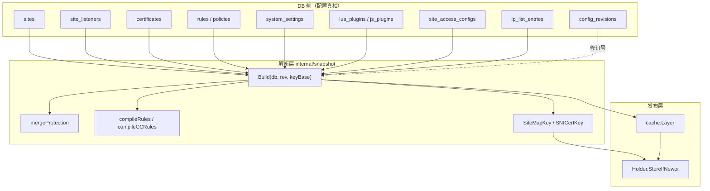
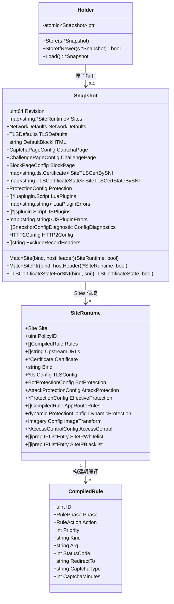
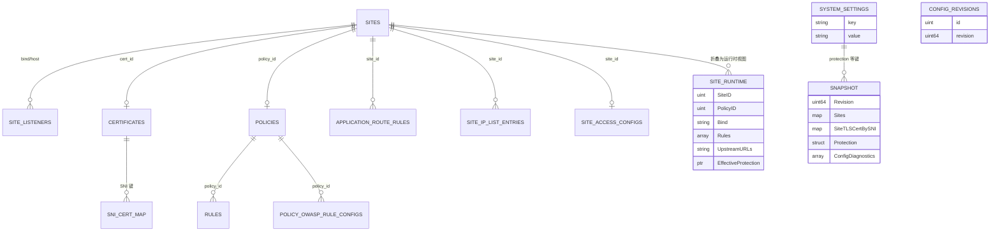
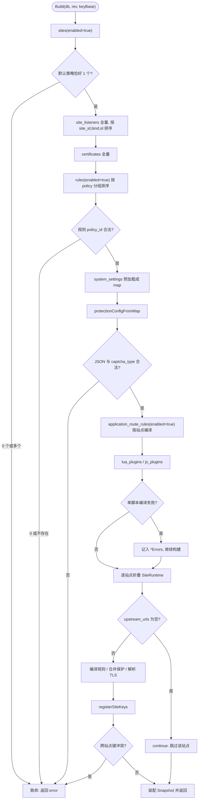
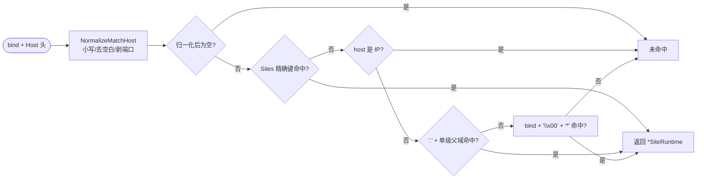
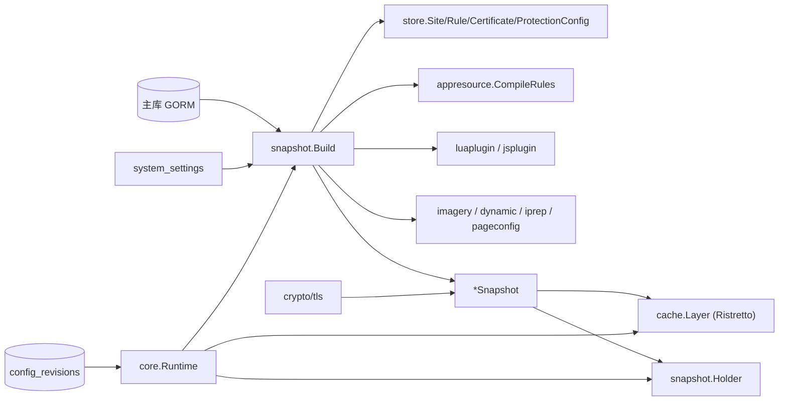

# 配置快照机制

> [返回 配置管理系统](配置管理系统.md)

<cite>
**本文档引用的文件**
- [snapshot.go](file://internal/snapshot/snapshot.go)
- [build.go](file://internal/snapshot/build.go)
- [runtime.go](file://internal/core/runtime.go)
- [layer.go](file://internal/cache/layer.go)
- [site.go](file://internal/store/site.go)
- [admin/site/site.go](file://internal/admin/site/site.go)
- [policy.go](file://internal/store/policy.go)
- [protection.go](file://internal/store/protection.go)
- [system.go](file://internal/store/system.go)
- [migrate.go](file://internal/store/migrate.go)
- [json_bind.go](file://internal/admin/shared/json_bind.go)
- [pageconfig.go](file://internal/waf/pageconfig/config.go)
- [app_route.go](file://internal/store/approute/app_route.go)
- [js_plugin.go](file://internal/store/js_plugin.go)
- [lua_plugin.go](file://internal/store/luaplugin/lua_plugin.go)
- [cve.go](file://internal/store/cve/cve.go)
- [access_control.go](file://internal/store/migrations/access_control.go)
- [docs/配置管理系统/配置管理系统.md](file://docs/配置管理系统/配置管理系统.md)
- [docs/系统架构设计/快照机制.md](file://docs/系统架构设计/快照机制.md)
- [docs/WAF 引擎系统/引擎核心架构/快照系统.md](file://docs/WAF 引擎系统/引擎核心架构/快照系统.md)
</cite>

## 目录

1. [简介](#简介)
2. [项目结构](#项目结构)
3. [核心组件](#核心组件)
4. [架构总览](#架构总览)
5. [详细组件分析](#详细组件分析)
6. [依赖关系分析](#依赖关系分析)
7. [性能考虑](#性能考虑)
8. [故障排查指南](#故障排查指南)
9. [结论](#结论)
10. [附录](#附录)

## 简介

本篇只讲快照的**配置层视角**：一份快照由哪些字段构成、每个字段是从哪张表或哪个设置键解析出来的、键是怎么拼的、DB 形态与快照形态之间如何映射、解析失败时走哪条分支。

同一个对象在三篇文档里各自负责一部分，本篇严格不复制另两篇的表格：

| 文档 | 视角 | 负责回答 | 本篇如何引用 |
|------|------|----------|--------------|
| [系统架构设计/快照机制](../系统架构设计/快照机制.md) | 架构 | 为什么快照是双平面唯一共享物、构建时机、发布牵动面 | 时机与副作用一律只给链接 |
| [WAF 引擎系统/引擎核心架构/快照系统](../WAF 引擎系统/引擎核心架构/快照系统.md) | 引擎消费 | 引擎如何读快照、两级缓存键与失效判据 | 消费路径只写「消费方」列 |
| 本篇 | 配置层 | 字段构成、解析来源、键设计、DB 映射 | — |

三个结论先行（均可逐行验证）：

1. `Build` 是配置生效的**唯一入口**，站点、监听、证书、规则、策略、访问控制、动态防护与全部保护设置都在这一个函数里读完后编译（`internal/snapshot/build.go:47-554`）。
2. 快照字段与 DB 形态不是一一对应：JSON blob 列要先被 `PeelJSONStringBlobs` 摘成字符串再入模型（`internal/admin/shared/json_bind.go:31-41`），三态指针列要在构建期折叠成终值（`build.go:707-770`）。
3. 快照对请求侧只读，可变性只存在于构建期；跨重载的可变状态不属于快照（限流窗口、连接池等）。

**章节来源**
- [internal/snapshot/build.go:34-50](file://internal/snapshot/build.go#L34-L50)
- [internal/snapshot/snapshot.go:205-287](file://internal/snapshot/snapshot.go#L205-L287)

## 项目结构

配置层的代码分布高度集中：定义与读取在 `snapshot.go`，构建与解析在 `build.go`，两者之间没有第三处赋值路径。

| 模块 | 路径 | 规模(行) | 配置层职责 | 关键符号 |
|------|------|:--------:|------------|----------|
| 快照定义 | internal/snapshot/snapshot.go | 520 | 声明不可变视图与匹配入口 | `Snapshot` / `SiteRuntime` / `Holder` |
| 快照构建 | internal/snapshot/build.go | 1644 | DB → 快照的唯一解析装配 | `Build` / `mergeProtection` / `compileRules` |
| TLS 解析 | internal/snapshot/tls.go | 446 | 站点 TLS 与证书材料装配 | `EffectiveSiteTLS` |
| HTTP/2 解析 | internal/snapshot/http2.go | 110 | HTTP/2 参数快照化 | `HTTP2Config` |
| 脚本加载 | internal/snapshot/lua.go、js.go | 172、135 | 编译期脚本装载 | `loadLuaPlugins` / `loadJSPlugins` |
| OCSP | internal/snapshot/ocsp.go | 44 | staple 解析 | `ParseOCSPStaple` |
| 进程内缓存 | internal/cache/layer.go | 1885（包）| 按修订号缓存快照 | `Layer.GetSnapshot` |
| 运行时装配 | internal/core/runtime.go | 313 | 代次核对与发布 | `ReloadSnapshotWithPrePublish` |
| 请求体绑定 | internal/admin/shared/json_bind.go | 174 | JSON blob 与三态字段的入库前处理 | `PeelJSONStringBlobs` / `bindSiteFromRaw` |



**图表来源**
- [internal/snapshot/build.go:47-200](file://internal/snapshot/build.go#L47-L200)
- [internal/snapshot/snapshot.go:289-300](file://internal/snapshot/snapshot.go#L289-L300)
- [internal/core/runtime.go:218-273](file://internal/core/runtime.go#L218-L273)
- [internal/cache/layer.go:44-63](file://internal/cache/layer.go#L44-L63)

**章节来源**
- [internal/snapshot/build.go:47-200](file://internal/snapshot/build.go#L47-L200)
- [internal/snapshot/snapshot.go:289-300](file://internal/snapshot/snapshot.go#L289-L300)

## 核心组件

- `Snapshot`：配置层的最终产物，`Revision` 之外的全部字段在 `Build` 返回后不再被写入（`snapshot.go:213-287`）。
- `SiteRuntime`：站点视角的配置终值集合，把「DB 列 + 全局默认 + 站点覆盖」折叠成一个只读结构（`snapshot.go:44-141`）。
- `Holder`：`atomic.Pointer[Snapshot]` 的极薄封装，只提供 `Store` / `StoreIfNewer` / `Load`（`snapshot.go:453-489`）。
- `Build`：读取 + 解析 + 编译 + 键注册四件事的执行者，错误分「致命返回」与「记入诊断继续」两档。
- `Layer`：进程内 Ristretto 快照缓存，键 `snapshot:<rev>`，写入前置校验 `sn.Revision == rev`（`layer.go:44-51`）。

组件间的静态关系：



**图表来源**
- [internal/snapshot/snapshot.go:16-41](file://internal/snapshot/snapshot.go#L16-L41)
- [internal/snapshot/snapshot.go:44-141](file://internal/snapshot/snapshot.go#L44-L141)
- [internal/snapshot/snapshot.go:213-287](file://internal/snapshot/snapshot.go#L213-L287)
- [internal/snapshot/snapshot.go:453-489](file://internal/snapshot/snapshot.go#L453-L489)

**章节来源**
- [internal/snapshot/snapshot.go:16-141](file://internal/snapshot/snapshot.go#L16-L141)
- [internal/snapshot/snapshot.go:213-287](file://internal/snapshot/snapshot.go#L213-L287)
- [internal/cache/layer.go:44-63](file://internal/cache/layer.go#L44-L63)

## 架构总览

配置层与持久层的关系是「多表 → 单聚合」：一次构建读取的全部表最终折叠成两个映射与一组全局字段。



**图表来源**
- [internal/snapshot/build.go:47-120](file://internal/snapshot/build.go#L47-L120)
- [internal/snapshot/build.go:186-222](file://internal/snapshot/build.go#L186-L222)
- [internal/snapshot/snapshot.go:190-194](file://internal/snapshot/snapshot.go#L190-L194)
- [internal/store/system.go:30-34](file://internal/store/system.go#L30-L34)
- [internal/store/site.go:38-90](file://internal/store/site.go#L38-L90)

数据面对这份映射的唯一入口是 `Holder.Load()`；快照换代之后所有读到的都是新对象，旧对象由 GC 回收。发布与换代语义见 [配置快照机制姊妹篇：热重载](热重载系统.md)。

**章节来源**
- [internal/snapshot/snapshot.go:337-400](file://internal/snapshot/snapshot.go#L337-L400)
- [internal/core/runtime.go:218-273](file://internal/core/runtime.go#L218-L273)

## 详细组件分析

### 快照字段构成（配置层）

「构建来源」列给出该字段在 `Build` 中的赋值点；「消费方」只写模块名，展开见引擎侧文档；「可变性」指**发布后**能否被改写。

| 字段 | 类型 | 构建来源:行 | 消费方 | 可变性 |
|------|------|-------------|--------|--------|
| `Revision` | `uint64` | 入参 `rev`，取自 `config_revisions`（runtime.go:219） | Holder 换代比较 | 只读 |
| `Sites` | `map[string]*SiteRuntime` | `siteMap`（build.go:222、475） | 站点解析 / 请求处理 | 只读 |
| `NetworkDefaults` | `NetworkDefaults` | `networkDefaultsFromMap`（build.go:1236） | 出站网络类型判定 | 只读 |
| `TLSDefaults` | `TLSDefaults` | `tlsDefaultsFromMap`（build.go:1245） | 站点 TLS 继承基线 | 只读 |
| `DefaultBlockHTML` | `string` | 恒为空串（build.go:529） | 拦截页兜底 | 只读 |
| `CaptchaPage` / `ChallengePage` / `BlockPage` | `pageconfig.*Config` | `Parse*PageConfig`（build.go:215-217） | 质询与拦截页渲染 | 只读 |
| `SiteTLSCertBySNI` | `map[string]tls.Certificate` | `sniCerts`（build.go:219、422） | TLS 握手取证书 | 只读 |
| `SiteTLSCertStateBySNI` | `map[string]TLSCertificateState` | `sniCertStates`（build.go:220、419） | 证书状态自检 | 只读 |
| `Protection` | `store.ProtectionConfig` | `protectionConfigFromMap`（build.go:1285） | 全局保护基线、运行期重配置 | 只读 |
| `LuaPlugins` / `LuaPluginErrors` | `[]*Script` / `map[string]string` | `loadLuaPlugins`（build.go:500） | Lua 阶段 | 只读 |
| `JSPlugins` / `JSPluginErrors` | `[]*Script` / `map[string]string` | `loadJSPlugins`（build.go:504） | JS 边缘脚本 | 只读 |
| `ConfigDiagnostics` | `[]SnapshotConfigDiagnostic` | 四类诊断汇总（build.go:509-517） | 管理端展示 | 只读 |
| `HTTP2Config` | `HTTP2Config` | `http2ConfigFromMap`（build.go:1423） | HTTP/2 服务器参数 | 只读 |
| `HSTSEnabled` / `XSSProtectionEnabled` / `ExpectCT*` / `HPKP*` | `bool` / `string` | `settingBool` / `settingStr`（build.go:199-206） | 安全响应头 | 只读 |
| 响应压缩 6 项 + `BrotliEnabled` | `bool` / `int` | `settingBoolDefault` / `settingInt`（build.go:209-214） | 响应压缩链 | 只读 |
| `HTMLToMarkdownEnabled` | `bool` | `parseHTMLToMarkdownEnabled`（build.go:1345） | 表示协商 | 只读 |
| `ExcludeRecordHeaders` | `[]string` | `parseExcludeRecordHeaders`（build.go:1401） | 资源记录去重 | 只读 |

`SiteRuntime` 侧与配置直接相关的字段构成：

| 字段 | 折叠来源 | 解析点:行 | 语义 |
|------|----------|-----------|------|
| `Rules` | `rules` 表按 `policy_id` 分组 + 站点 CC 规则 | build.go:275、920 | 已按 priority、ID 升序 |
| `UpstreamURLs` | `sites.upstream_urls`（数组或逗号串） | build.go:824 | 为空则**跳过该站点**（build.go:261-264） |
| `EffectiveProtection` | 全局 `protection` 与站点覆盖合并 | build.go:484、707-770 | nil 不会出现，恒指向合并终值 |
| `ChallengeAction` / `ChallengeCaptchaType` | 站点 `*string` 三态 | build.go:454-455、773 | 空串 = 继承全局 |
| `AntiReplayCookieMode` | 站点覆盖后统一 `NormalizeAntiReplayCookieMode` | build.go:494、723、780 | 恒为 `standard`/`dual` |
| `DynamicProtection` | `bot_settings` + 站点覆盖 | build.go:161、1359 | 密钥基在构建期注入 |
| `ImageTransform` | `image_transform` 设置键 | build.go:171-184 | 解析失败退回默认并记诊断 |
| `SiteIPWhitelist` / `SiteIPBlacklist` | `ip_list_entries` 站点级条目 | build.go:193、1596 | 非法条目记诊断 |
| `AccessControl` | `site_access_configs` 等 | build.go:187、1522 | nil = 未启用 |

**章节来源**
- [internal/snapshot/build.go:159-222](file://internal/snapshot/build.go#L159-L222)
- [internal/snapshot/build.go:260-300](file://internal/snapshot/build.go#L260-L300)
- [internal/snapshot/build.go:440-500](file://internal/snapshot/build.go#L440-L500)
- [internal/snapshot/snapshot.go:44-141](file://internal/snapshot/snapshot.go#L44-L141)

### 构建顺序与失败分流

`Build` 的读取顺序本身就是依赖顺序：先取全局（策略、设置、证书字典），再逐站点折叠，最后统一注册键。分流规则只有一条判据——**是否会让整份配置失去意义**。



**图表来源**
- [internal/snapshot/build.go:47-143](file://internal/snapshot/build.go#L47-L143)
- [internal/snapshot/build.go:159-222](file://internal/snapshot/build.go#L159-L222)
- [internal/snapshot/build.go:260-300](file://internal/snapshot/build.go#L260-L300)
- [internal/snapshot/build.go:475-500](file://internal/snapshot/build.go#L475-L500)
- [internal/snapshot/build.go:787-804](file://internal/snapshot/build.go#L787-L804)

分流实测清单：

| 问题 | 分支 | 位置 | 后果 |
|------|------|------|------|
| 默认策略缺失 / 多个默认策略 | 致命 | build.go:66、72 | 整次重载失败 |
| 规则 `policy_id` 为 0 或指向不存在策略 | 致命 | build.go:124-131 | 整次重载失败 |
| 站点 `policy_id` 指向不存在策略 | 致命 | build.go:268-272 | 整次重载失败 |
| `protection` JSON 非法 / `captcha_type` 非法 | 致命 | build.go:1292-1296 | 整次重载失败 |
| 键空间冲突（不同站点同 bind+host） | 致命 | build.go:795-800 | `duplicate site route` |
| 图像转换配置非法 | 记诊断 | build.go:171-183 | 退回默认并继续 |
| 上游 mTLS PEM 超限/不成对/不可解析 | 记诊断 | build.go:229-257 | 该站点跳过 mTLS |
| OWASP 策略白名单 JSON 非法 | 记诊断 | build.go:592-604 | 丢弃该项 |
| IP 名单条目非法 | 记诊断 | build.go:1596 起 | 丢弃该条目 |
| 证书或监听器 `cert_id` 非法 | 记诊断 | build.go:419 起 | 该 SNI 标记 invalid |
| 单脚本编译失败 | 记错误 | build.go:500、504 | 其余脚本照常生效 |

**章节来源**
- [internal/snapshot/build.go:47-143](file://internal/snapshot/build.go#L47-L143)
- [internal/snapshot/build.go:159-260](file://internal/snapshot/build.go#L159-L260)
- [internal/snapshot/build.go:475-524](file://internal/snapshot/build.go#L475-L524)
- [internal/snapshot/build.go:1285-1301](file://internal/snapshot/build.go#L1285-L1301)

### 键设计与唯一性约束

站点键与 SNI 键都是「bind 前缀 + `\x00` + 归一化主机名」的二段结构，因此不同监听地址下同名站点天然不冲突；`SiteMapKey` 是对外构造入口，`siteMapKeyNorm` 用于 host 已归一化的内部路径（`snapshot.go:289-300`）。

| 键 | 构造:行 | 组成 | 冲突处理:行 | 查找级数 |
|----|---------|------|-------------|:--------:|
| 站点键 | snapshot.go:293 | `bind` + `\x00` + 小写去空白 host | build.go:795-800 直接报错 | 3 |
| 多主机注册 | build.go:789、812 | `sites.host` 逗号切分逐个入键 | 同站点重复键 `continue` | — |
| SNI 证书键 | snapshot.go:298 | 固定前缀 `sni:` + `bind` + `\x00` + 归一化 SNI | 逐监听器覆盖 | 3 |
| catch-all 键 | build.go:789（`sites.host` 写成 `*`） | `bind` + `\x00` + `*` | 同站点键规则 | — |
| 快照缓存键 | layer.go:48、55 | `snapshot:<rev>` | 仅同 `Revision` 允许写入 | 1 |

查找优先级为「精确 → `*.` 单级父域 → catch-all `*`」，至多三级（`MatchSitePtr` 在 `snapshot.go:373-400`）。两条实测约束：

- **IP 型 host 跳过通配**：`isIPAddress` 为真时不做 `*.` 与 `*` 回退（`snapshot.go:441-450`），避免把 IP 请求误落到泛域名站点。
- **不做跨 bind 回退**：键里带 bind，因此 `:443` 上未注册的站点不会命中 `:8080` 的同名站点。`TLSCertificateStateForSNI` 采用同一优先级，防止「站点命中 A、证书取到 B」（`snapshot.go:312-335`）。



**图表来源**
- [internal/snapshot/snapshot.go:289-300](file://internal/snapshot/snapshot.go#L289-L300)
- [internal/snapshot/snapshot.go:312-335](file://internal/snapshot/snapshot.go#L312-L335)
- [internal/snapshot/snapshot.go:373-450](file://internal/snapshot/snapshot.go#L373-L450)
- [internal/snapshot/build.go:787-822](file://internal/snapshot/build.go#L787-L822)

**章节来源**
- [internal/snapshot/snapshot.go:289-450](file://internal/snapshot/snapshot.go#L289-L450)
- [internal/snapshot/build.go:787-822](file://internal/snapshot/build.go#L787-L822)

### 配置解析项与缺省值

全局配置全部落在 `system_settings` 表的 `key/value` 两列，`Build` 先把整张表预加载成 `map[string]string`（`loadAllSettings`，`build.go:1432-1443`），再逐键解析。三个读取助手定义了缺省口径：

- `settingBool`：只有字面 `true` 才为真，**无行即为假**（`build.go:1445-1461`）。
- `settingBoolDefault`：无行时取传入缺省值，显式 `false`/`0`/`no` 仍为假（`build.go:1463-1470`）。
- `settingStr` / `settingInt`：无行或值不可用时取缺省（`build.go:1472-1492`）。

| 设置键 | 解析函数:行 | 目标快照字段 | 缺省值 | 非法时 |
|--------|-------------|--------------|--------|--------|
| `protection` | `protectionConfigFromMap`（build.go:1285） | `Protection` | `DefaultProtectionConfig`（store/protection.go:159） | 致命，整次重载失败 |
| `runtime_config_overrides` | `applyConfigOverrideBase`（build.go:1260） | 仅 3 个 CVE 布尔键 | 不改写 | 忽略该键并告警 |
| `network_config` | `networkDefaultsFromMap`（build.go:1236） | `NetworkDefaults` | `DefaultNetworkDefaults` | 退回默认 |
| TLS 默认键组 | `tlsDefaultsFromMap`（build.go:1245） | `TLSDefaults` | 内置默认 | 退回默认 |
| HTTP/2 键组 | `http2ConfigFromMap`（build.go:1423） | `HTTP2Config` | 内置默认 | 退回默认 |
| `bot_settings` | `parseDynamicProtection`（build.go:1302） | `SiteRuntime.DynamicProtection` | 关闭 | 退回默认 |
| `bot_settings` | `parseExcludeRecordHeaders`（build.go:1401） | `ExcludeRecordHeaders` | 空 | 退回默认 |
| `bot_settings` | `parseHTMLToMarkdownEnabled`（build.go:1345） | `HTMLToMarkdownEnabled` | 假 | 退回默认 |
| 图像转换键 | `imagery.LoadConfig`（build.go:171） | `SiteRuntime.ImageTransform` | `DefaultConfig` | 记诊断，退回默认 |
| `hsts_enabled` 等 4 个安全头 | `settingBool`（build.go:199-206） | 对应布尔字段 | 假 | 视为假 |
| `expect_ct_value` / `hpkp_value` | `settingStr`（build.go:202、204） | 头取值 | `DefaultExpectCTValue`（snapshot.go:503） | 用缺省 |
| `brotli_enabled` + 4 个压缩开关 | `settingBoolDefault`（build.go:209-213） | 压缩字段 | **真**（snapshot.go:514-518） | 用缺省 |
| `response_compression_min_bytes` | `settingInt`（build.go:214） | 阈值 | `1024` | 用缺省 |
| `page_template_captcha` | `ParseCaptchaPageConfig`（pageconfig/config.go:125） | `CaptchaPage` | 内置模板 | 退回内置 |
| `page_template_challenge` | `ParseChallengePageConfig`（config.go:133） | `ChallengePage` | 内置模板 | 退回内置 |
| `page_template_block` | `ParseBlockPageConfig`（config.go:141） | `BlockPage` | 内置模板 | 退回内置 |

**章节来源**
- [internal/snapshot/build.go:1236-1301](file://internal/snapshot/build.go#L1236-L1301)
- [internal/snapshot/build.go:1432-1492](file://internal/snapshot/build.go#L1432-L1492)
- [internal/snapshot/build.go:159-222](file://internal/snapshot/build.go#L159-L222)
- [internal/snapshot/snapshot.go:491-520](file://internal/snapshot/snapshot.go#L491-L520)
- [internal/waf/pageconfig/config.go:12-14](file://internal/waf/pageconfig/config.go#L12-L14)
- [internal/store/protection.go:159-200](file://internal/store/protection.go#L159-L200)

### 与 DB 的映射

| DB 表 | 读取点:行 | 过滤条件 | 目标快照字段 | 缺失/非法行为 |
|-------|-----------|----------|--------------|----------------|
| `sites` | build.go:48 | `enabled = true` | `SiteRuntime.Site` | 站点整体不入快照 |
| `site_listeners` | build.go:77 | 全量读，按 `enabled` 聚合 | `SiteRuntime.Bind` / SNI 键 | 停用监听器不入键 |
| `certificates` | build.go:87-93 | 全量入 `certByID` | `SiteRuntime.Certificate`、`SiteTLSCertBySNI` | 记诊断，SNI 状态置 invalid |
| `rules` | build.go:96 | `enabled = true` | `SiteRuntime.Rules` | `pattern` 解析失败静默丢弃（build.go:923-926） |
| `policies` | build.go:56-74 | 全量；`default_slot` 上有唯一索引（policy.go:18） | `SiteRuntime.PolicyID` | 默认策略缺失为致命 |
| `policy_owasp_rule_configs` | build.go:556-615 | 表不存在则跳过 | `Protection.OWASPRulesConfig` 派生项 | 白名单非法记诊断 |
| `cve_rules` + 作用域覆盖 | build.go:618-640 | `approved = true` | 站点级 CVE 配置 | 表缺失返回空映射 |
| `system_settings` | build.go:1432 | 全量入 map | 全部全局字段 | 见上一节逐键口径 |
| `application_route_rules` | build.go:147 | `enabled = true` | `SiteRuntime.AppRouteRules` | 读失败致命 |
| `site_access_configs` 等 | build.go:1522 | 逐站点聚合 | `SiteRuntime.AccessControl` | 无配置为 nil |
| `ip_list_entries` | build.go:1596 | 站点级条目 | `SiteIPWhitelist`/`SiteIPBlacklist` | 非法条目记诊断 |
| `lua_plugins` | build.go:500 | 启用项 | `Snapshot.LuaPlugins` | 单脚本失败记 `LuaPluginErrors` |
| `js_plugins` | build.go:504 | 启用项 | `Snapshot.JSPlugins` | 单脚本失败记 `JSPluginErrors` |
| `config_revisions` | runtime.go:283-289 | 单行 `id=1` | `Snapshot.Revision` | `FirstOrCreate` 播种 0 |

表名依据两类硬证据：诊断源常量直接写出 `policy_owasp_rule_configs`、`ip_list_entries`、`sites`、`site_listeners`、`certificates`（`snapshot.go:190-194`）；另一类是模型上的显式 `TableName()`，例如 `js_plugins`（`internal/store/js_plugin.go:44`）、`lua_plugins`（`internal/store/luaplugin/lua_plugin.go:45`）、`application_route_rules`（`internal/store/approute/app_route.go:55`）、`cve_rules`（`internal/store/cve/cve.go:35`）、`config_revisions`（`internal/store/system.go:31-34`）、`site_access_configs`（`internal/store/migrations/access_control.go:22`）。`rules`、`policies`、`system_settings` 未覆写 `TableName()`，走 GORM 默认复数命名，构建期按模型读取（`build.go:56-96`）。

**章节来源**
- [internal/snapshot/build.go:47-200](file://internal/snapshot/build.go#L47-L200)
- [internal/snapshot/build.go:556-640](file://internal/snapshot/build.go#L556-L640)
- [internal/snapshot/build.go:1522-1644](file://internal/snapshot/build.go#L1522-L1644)
- [internal/snapshot/snapshot.go:190-194](file://internal/snapshot/snapshot.go#L190-L194)
- [internal/store/system.go:30-34](file://internal/store/system.go#L30-L34)
- [internal/store/policy.go:10-30](file://internal/store/policy.go#L10-L30)
- [internal/store/js_plugin.go:44](file://internal/store/js_plugin.go#L44)
- [internal/store/luaplugin/lua_plugin.go:45](file://internal/store/luaplugin/lua_plugin.go#L45)
- [internal/store/approute/app_route.go:55](file://internal/store/approute/app_route.go#L55)
- [internal/store/cve/cve.go:35](file://internal/store/cve/cve.go#L35)
- [internal/store/migrations/access_control.go:22](file://internal/store/migrations/access_control.go#L22)

### 三态载体与快照形态的兼容矩阵

配置层最容易出错的地方是「DB 里的形态」与「快照里的形态」不同构。下表逐类给出兼容口径，实现集中在 `internal/admin/shared/json_bind.go` 与 `build.go:707-770`。

| 载体形态 | DB 列类型 | 快照字段类型 | 继承/覆盖判据 | 兼容口径 |
|----------|-----------|--------------|---------------|----------|
| 三态布尔 | `*bool`（`default:null`） | `bool` | nil = 继承，非 nil = 覆盖（site.go:60、76、81） | 从不把 nil 存成 false |
| 三态字符串 | `*string` | `string` | nil/空串 = 继承（site.go:73-74、90） | JSON `null` 显式取消覆盖 |
| 窗口/配额整数 | `int`，缺省 0 | `int` | **> 0 才覆盖**（build.go:748-759） | 0 与负值等价于未覆盖 |
| 动作档位字符串 | `string` | `string` | 仅当父开关为覆盖态才读取（build.go:726-746） | 从属字段由 `clearInheritedProtectionOverrides` 清空（admin/site/site.go:505-522） |
| JSON blob | `text`，Go 侧 `string` | 解析后的 map/切片 | 前端可能以对象/数组下发 | `PeelJSONStringBlobs` 先字符串化再绑定（json_bind.go:31-41） |
| 按阶段跳过路径 | `*string`（三态） | `ProtectionConfig.SkipPathByPhase` | nil 继承、`{}` 覆盖为空、非空覆盖 | 整体覆盖，不做 per-phase 深合并（build.go:762-766） |
| 站点级质询 | `*string` × 2 | `SiteRuntime.ChallengeAction` 等 | 独立三态，无父开关（site.go:71-74） | 空串回退全局 |

blob 字段清单（实测）：protection 侧 8 项 `cc_rules`、`owasp_modules`、`chain_steps`、`escalation_steps`、`category_sensitivity`、`owasp_rules_config`、`cve_rules_config`、`skip_path_by_phase`（`json_bind.go:66-78`）；site 侧 8 项 `cache_rules`、`custom_error_pages`、`upstream_urls`、`cipher_suites`、`dynamic_js_paths`、`cc_rules`、`client_ip_header_order`、`skip_path_by_phase`（`json_bind.go:80-92`）。

```go
// internal/store/site.go:60-90 —— 三态载体在模型层的实际声明
BotProtectionEnabled  *bool  `gorm:"default:null" json:"bot_protection_enabled,omitempty"`
OWASPEnabled          *bool  `gorm:"default:null" json:"owasp_enabled,omitempty"`
RateLimitEnabled      *bool  `gorm:"default:null" json:"rate_limit_enabled,omitempty"`
RateLimitWindow       int    `gorm:"default:0"    json:"rate_limit_window,omitempty"`
RateLimitMax          int    `gorm:"default:0"    json:"rate_limit_max,omitempty"`
ChallengeAction       *string `gorm:"default:null" json:"challenge_action,omitempty"`
SkipPathByPhase       *string `gorm:"column:skip_path_by_phase;type:text" json:"skip_path_by_phase,omitempty"`
```

**章节来源**
- [internal/store/site.go:60-90](file://internal/store/site.go#L60-L90)
- [internal/snapshot/build.go:707-770](file://internal/snapshot/build.go#L707-L770)
- [internal/admin/shared/json_bind.go:31-170](file://internal/admin/shared/json_bind.go#L31-L170)
- [internal/admin/site/site.go:505-522](file://internal/admin/site/site.go#L505-L522)

### 规则编译与 kind 折叠

站点键之外的第二处「配置层折叠」是规则：`store.Rule.Pattern` 文本在构建期被 `ParsePattern` 拆成 `kind`/`arg`，再叠加规则级频次参数，产物是 `CompiledRule`（`snapshot.go:24-40`）。

- 折叠点：`compileRules`（`build.go:920-933`）；`kind == ""` 的条目被**静默丢弃**，不产生诊断。
- 频次包装：`applyRuleFrequencyLimit`（`build.go:955`）在 `window_seconds>0 && request_count>0` 时把原条件包成 `cc_rate` 复合节点；已是复合 JSON 时不叠加。
- 验证码参数：`CaptchaType` 经 `normalizeRuleCaptchaType`（`build.go:991`）归一，`CaptchaMinutes` 原样透传，0 表示继承全局 `captcha_pass_ttl`。
- kind 白名单在本包内**另有一份**（`build.go:1205-1215` 的 30 项前缀），与 `internal/core/rules` 的 57 项、store 侧的 9 项 phase 键共同构成三处口径，对照与自检命令见 [配置验证系统](配置验证系统.md)。

**章节来源**
- [internal/snapshot/build.go:920-1007](file://internal/snapshot/build.go#L920-L1007)
- [internal/snapshot/build.go:1189-1223](file://internal/snapshot/build.go#L1189-L1223)
- [internal/snapshot/snapshot.go:16-41](file://internal/snapshot/snapshot.go#L16-L41)

### 修订号与缓存命中语义

- 修订号是 `uint64` 单调值，由 `BumpRevision` 以 `UPDATE revision = revision + 1` 自增，并要求 `RowsAffected == 1`（`migrate.go:141-160`）。
- 缓存键只含修订号，**不含配置内容哈希**：因此「同修订号但内容变了」会命中旧快照。链路上的两道防线是 `ReloadSnapshotWithPrePublish` 的构建前后二次核对（`runtime.go:224-268`）与 `Holder.StoreIfNewer` 的代次 CAS（`snapshot.go:474-487`）。
- `SetSnapshot` 会拒绝 `sn.Revision != rev` 的写入（`layer.go:44-47`），杜绝缓存与代次错位。
- Ristretto 参数偏小（`NumCounters 1e4`、`MaxCost 1<<20`、`BufferItems 64`，`layer.go:31-33`），定位是「同一次重载链内的短时复用」，不是长期缓存。

**章节来源**
- [internal/store/migrate.go:141-168](file://internal/store/migrate.go#L141-L168)
- [internal/core/runtime.go:218-273](file://internal/core/runtime.go#L218-L273)
- [internal/cache/layer.go:28-63](file://internal/cache/layer.go#L28-L63)
- [internal/snapshot/snapshot.go:464-487](file://internal/snapshot/snapshot.go#L464-L487)

## 依赖关系分析

- 向上的依赖只有两类：`Build` 依赖 store 模型与若干子系统的解析器；`Holder` 只依赖标准库原子包。
- `Build` 是横向耦合最宽的函数，直接引用 appresource、imagery、dynamic、iprep、jsplugin、luaplugin、pageconfig、owasp、cve、upstream 十个包，这是配置层的固有职责，不宜再切分。



**图表来源**
- [internal/snapshot/build.go:1-40](file://internal/snapshot/build.go#L1-L40)
- [internal/snapshot/snapshot.go:3-17](file://internal/snapshot/snapshot.go#L3-L17)
- [internal/core/runtime.go:11-21](file://internal/core/runtime.go#L11-L21)

外部服务依赖：

| 依赖 | 在配置层的角色 | 接入点:行 | 数据形态 | 失败是否致命 |
|------|----------------|-----------|----------|:---:|
| 主数据库（GORM） | 全部配置真相 | build.go:47-96 | 行 + JSON 文本列 | 是 |
| `config_revisions` 表 | 代次来源 | runtime.go:283-289 | 单行 uint64 | 是 |
| Ristretto | 代次→快照缓存 | layer.go:28-37 | 进程内指针 | 引导期致命 |
| `crypto/tls` | 证书/私钥解析与 TLS 配置 | build.go:419-422 | PEM | 否，记诊断 |
| Lua 编译器 | 策略脚本编译期校验 | build.go:500 | 源码文本 | 否，记错误 map |
| QuickJS 宿主 | 边缘脚本编译 | build.go:504 | 源码文本 | 否，记错误 map |
| 图像转换配置器 | 全局与站点级图像参数 | build.go:171-184 | JSON | 否，退回默认 |
| 动态防护密钥基 | 加密基值 | build.go:162-165 | 32 字节 | 是，长度不符直接失败 |
| GeoIP/ASN 数据 | 不在快照内 | 由 bot 侧独立加载 | mmap 文件 | 配置层无关 |

**章节来源**
- [internal/snapshot/build.go:47-96](file://internal/snapshot/build.go#L47-L96)
- [internal/snapshot/build.go:159-200](file://internal/snapshot/build.go#L159-L200)
- [internal/core/runtime.go:118-126](file://internal/core/runtime.go#L118-L126)
- [internal/store/migrate.go:141-168](file://internal/store/migrate.go#L141-L168)

## 性能考虑

- 构建成本随配置规模线性增长：站点数、监听器数、规则数与 `system_settings` 行数共同决定一次 `Build` 的读取量；规则与应用路由规则都在构建期编译，请求期不再解析字符串。
- 设置表只读一次：`loadAllSettings` 把整表预加载成 map 后复用（`build.go:1432`），逐键解析不再触库。
- 上游 mTLS 的 PEM 解析在站点循环前一次性预计算并写回切片元素（`build.go:226-228`），主循环复用 DER/指纹。
- 键查找是 O(1) 哈希 + 至多三级回退，没有树结构；`MatchSite` 拷贝结构体、`MatchSitePtr` 零拷贝，热路径应使用后者。
- 缓存 MaxCost 很小，若把重载频率拉高，命中率会下降；批量变更请合并为一次写请求。
- 详细性能口径属架构与引擎视角，见 [缓存与性能优化](../系统架构设计/缓存与性能优化.md)。

**章节来源**
- [internal/snapshot/build.go:226-275](file://internal/snapshot/build.go#L226-L275)
- [internal/snapshot/build.go:1432-1443](file://internal/snapshot/build.go#L1432-L1443)
- [internal/snapshot/snapshot.go:337-400](file://internal/snapshot/snapshot.go#L337-L400)
- [internal/cache/layer.go:28-63](file://internal/cache/layer.go#L28-L63)

## 故障排查指南

| 症状 | 根因 | 定位 | 处置 |
|------|------|------|------|
| 站点完全不生效 | `upstream_urls` 解析为空 | build.go:261-264 | 修正数组或逗号串格式 |
| 规则不生效且无报错 | kind 不在快照侧 30 项前缀内 | build.go:923-926 | 按 [配置验证系统](配置验证系统.md) 的对照表改前缀 |
| 站点互相顶替后启动失败 | 不同站点争同一 `bind+host` 键 | `duplicate site route` | 拆站点或改 host |
| 泛域名未命中 | 请求 host 被识别为 IP | snapshot.go:441-450 | IP 访问需显式注册 |
| 重载报 `dynamic protection key base must be 32 bytes` | 密钥基未注入 | build.go:162-164 | 确认 JWT 密钥解析成功 |
| 管理端看到无效配置 | 构建期诊断 | `ConfigDiagnostics`（build.go:509-517） | 按 source/field 定位记录 |
| 改站点开关不生效 | 三态字段仍为 nil | site.go:60-90 | 显式提交 true/false |
| 站点窗口没变 | `int` 需 > 0 才覆盖 | build.go:748-759 | 0 视为继承 |

自检命令：

```bash
# 当前代次与站点键数（SQLite）
sqlite3 ./data/waf.db "SELECT revision FROM config_revisions WHERE id=1;"

# 找出跨站点争用同一 bind+host 的行（应无输出）
sqlite3 ./data/waf.db "SELECT bind, host, COUNT(DISTINCT site_id) c \
  FROM site_listeners GROUP BY bind, host HAVING c > 1;"

# 列出 protection 配置原文（含敏感项时仅本地查看）
sqlite3 ./data/waf.db "SELECT value FROM system_settings WHERE key='protection';"
```

**章节来源**
- [internal/snapshot/build.go:159-264](file://internal/snapshot/build.go#L159-L264)
- [internal/snapshot/build.go:509-517](file://internal/snapshot/build.go#L509-L517)
- [internal/snapshot/build.go:787-804](file://internal/snapshot/build.go#L787-L804)
- [internal/snapshot/snapshot.go:441-450](file://internal/snapshot/snapshot.go#L441-L450)
- [internal/store/site.go:60-90](file://internal/store/site.go#L60-L90)

## 结论

配置层的快照机制做的是「**把多表、多形态的配置压成一个只读对象**」：`Build` 负责读取与折叠，键设计负责命中与唯一性，诊断数组负责解释被丢弃的部分，`Holder` 负责把代次语义变成一次指针交换。

三条值得坚持的设计：

1. 一次读取、全程只读，让数据面无需为配置加锁。
2. 致命错误与可跳过错误显式分档，可选能力的坏配置不会拖垮整个控制面。
3. 三态字段在入库前折叠从属值、在构建期按判据合并，使「继承全局」与「显式关闭」在库里就是两种可区分状态。

一条已知代价：`rules` 的 kind 在快照侧另有一套 30 项白名单，与管理侧 57 项不等价，属于真实的口径分裂，已在验证篇登记。

**章节来源**
- [本节为总结，无需特定文件来源]

## 附录

### 符号速查

| 主题 | 位置 |
|------|------|
| 快照结构定义 | internal/snapshot/snapshot.go:213-287 |
| 站点运行时定义 | internal/snapshot/snapshot.go:44-141 |
| 键构造与匹配 | internal/snapshot/snapshot.go:289-450 |
| 构建主流程 | internal/snapshot/build.go:47-554 |
| 保护配置合并 | internal/snapshot/build.go:707-770 |
| 设置读取助手 | internal/snapshot/build.go:1432-1492 |
| 修订号自增 | internal/store/migrate.go:141-168 |
| 缓存层 | internal/cache/layer.go:28-67 |

**章节来源**
- [本节为索引，无需特定文件来源]

### 相关文档

| 想解决的问题 | 去处 |
|--------------|------|
| 重载链、代次 CAS、监听器协调 | [热重载系统](热重载系统.md) |
| 配置校验层次与 kind 白名单对照 | [配置验证系统](配置验证系统.md) |
| 跨节点只传事件的同步语义 | [分布式同步机制](分布式同步机制.md) |
| 表结构与迁移 | [迁移管理机制](迁移管理机制.md) |
| 快照在双平面间的角色 | [系统架构设计/快照机制](../系统架构设计/快照机制.md) |
| 引擎如何读快照 | [快照系统](../WAF 引擎系统/引擎核心架构/快照系统.md) |

**章节来源**
- [本节为索引，无需特定文件来源]
