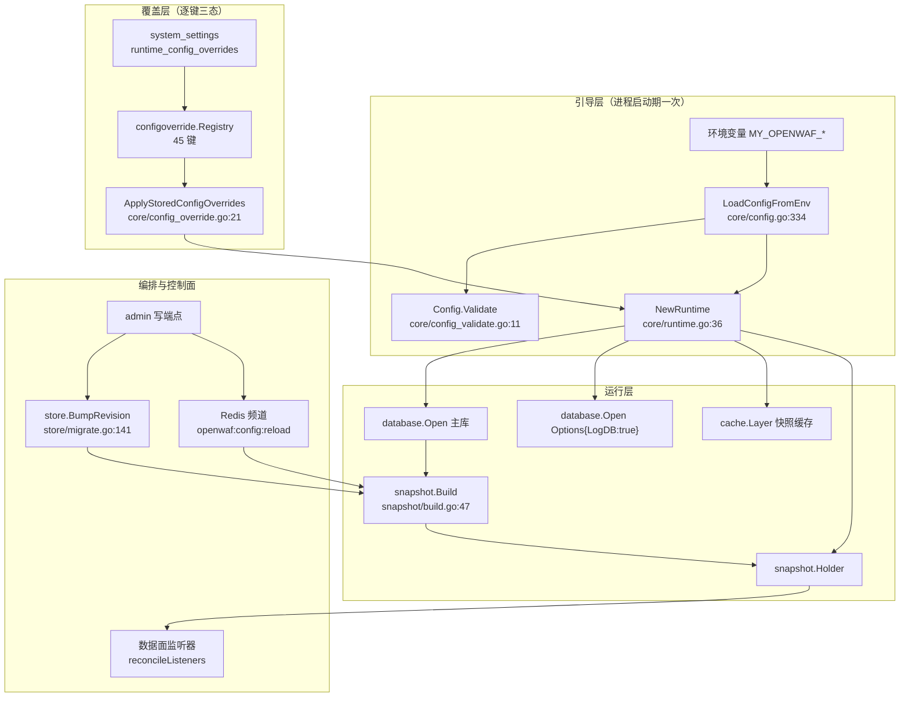
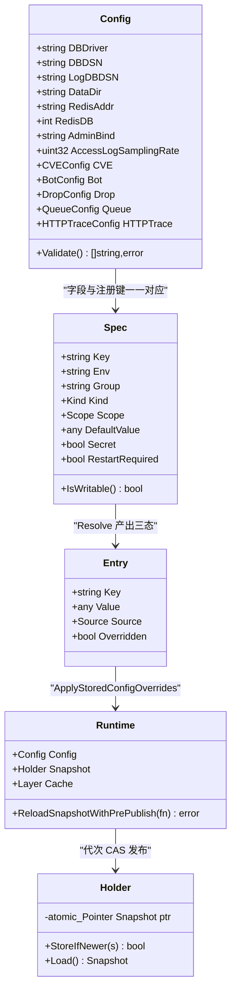
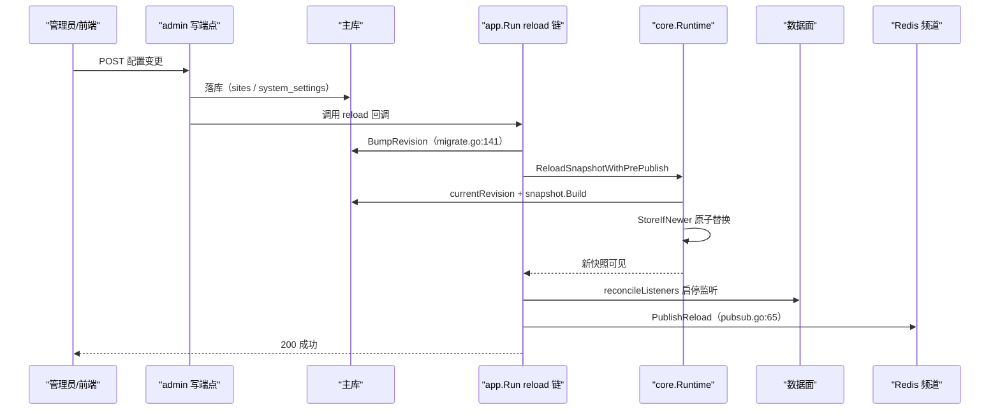
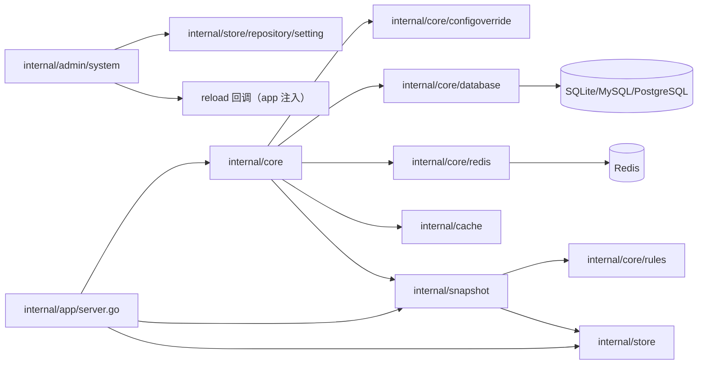
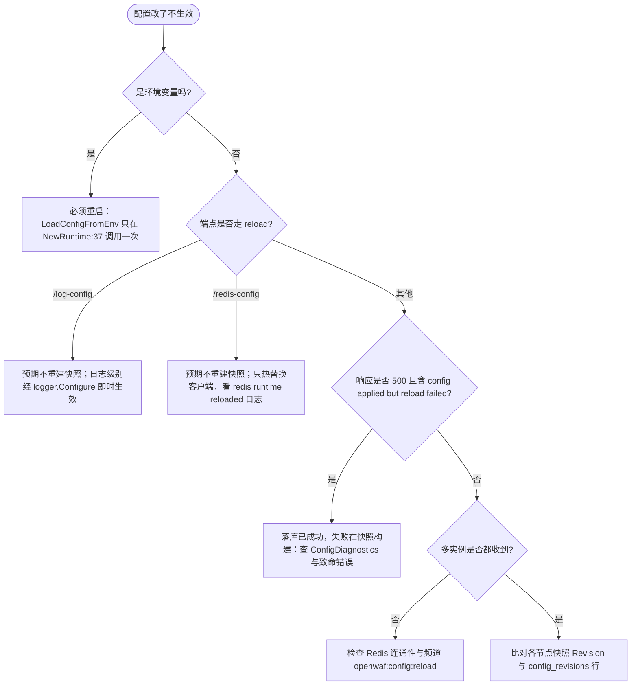

# 配置管理系统

<cite>
**本文档引用的文件**
- [README.md](file://README.md)
- [cmd/main.go](file://cmd/main.go)
- [internal/core/config.go](file://internal/core/config.go)
- [internal/core/config_validate.go](file://internal/core/config_validate.go)
- [internal/core/config_override.go](file://internal/core/config_override.go)
- [internal/core/configoverride/registry.go](file://internal/core/configoverride/registry.go)
- [internal/core/configoverride/resolve.go](file://internal/core/configoverride/resolve.go)
- [internal/core/runtime.go](file://internal/core/runtime.go)
- [internal/core/redis/pubsub.go](file://internal/core/redis/pubsub.go)
- [internal/core/database/gorm.go](file://internal/core/database/gorm.go)
- [internal/cache/layer.go](file://internal/cache/layer.go)
- [internal/snapshot/snapshot.go](file://internal/snapshot/snapshot.go)
- [internal/snapshot/tls.go](file://internal/snapshot/tls.go)
- [internal/snapshot/build.go](file://internal/snapshot/build.go)
- [internal/snapshot/tls.go](file://internal/snapshot/tls.go)
- [internal/store/system.go](file://internal/store/system.go)
- [internal/store/site.go](file://internal/store/site.go)
- [internal/store/migrate.go](file://internal/store/migrate.go)
- [internal/pkg/logger/logger.go](file://internal/pkg/logger/logger.go)
- [internal/app/server.go](file://internal/app/server.go)
- [internal/admin/router.go](file://internal/admin/router.go)
- [internal/admin/site/site.go](file://internal/admin/site/site.go)
- [internal/admin/system/settings.go](file://internal/admin/system/settings.go)
- [internal/admin/system/network.go](file://internal/admin/system/network.go)
- [internal/admin/system/runtime_overrides.go](file://internal/admin/system/runtime_overrides.go)
- [internal/admin/system/acme.go](file://internal/admin/system/acme.go)
- [docs/系统架构设计/快照机制.md](file://docs/系统架构设计/快照机制.md)
</cite>

> **子页面分类索引**
>
> **核心运行时**
>
> - [配置快照机制](配置快照机制.md) — 快照承载哪些配置、配置载体的优先级链、站点级三态合并。
> - [热重载系统](热重载系统.md) — 代次 CAS、重载副作用面、逐键 reload 语义。
>
> **验证与同步**
>
> - [配置验证系统](配置验证系统.md) — 五层校验口径与失败行为。
> - [分布式同步机制](分布式同步机制.md) — 跨节点只传事件不传快照的多实例一致性。
>
> **数据演进**
>
> - [迁移管理机制](迁移管理机制.md) — V2–V15 迁移链、幂等守卫与首启种子数据。

## 目录

1. [简介](#简介)
2. [项目结构](#项目结构)
3. [核心组件](#核心组件)
4. [架构总览](#架构总览)
5. [详细组件分析](#详细组件分析)
6. [依赖关系分析](#依赖关系分析)
7. [性能考虑](#性能考虑)
8. [故障排查指南](#故障排查指南)
9. [结论](#结论)
10. [附录](#附录)

## 简介

My-OpenWaf 是单进程双平面应用，配置管理系统要回答三个问题：**配置存在哪里、什么时候生效、多个实例如何看到同一份配置**。

答案由四类载体构成，且必须区分清楚，否则很容易造出「第二配置源」：

| 载体 | 写入方式 | 生效时机 | 真相源地位 |
|------|----------|----------|------------|
| 环境变量（`MY_OPENWAF_*`） | 部署时注入 | 仅进程启动期 | **唯一引导源**，见 [README.md:311-347](file://README.md#L311-L347) |
| `system_settings` 键值表 | 管理 API 专用端点 | 多数经 reload 生效 | **业务配置唯一源** |
| 逐键覆盖表 `runtime_config_overrides` | `/api/v1/runtime-config/env-overrides` | 视键是否 `RestartRequired` | 环境变量的**运行时补丁**，不是新配置源 |
| 领域表（sites/rules/policies/certificates…） | 管理 API CRUD | reload 后进入快照 | 数据面配置的权威存储 |

**项目不解析 YAML 配置文件**。`internal/core/config.go:14-20` 等结构体上的 `yaml:` 标签只是字段命名口径与外部工具对接预留，运行期唯一的文件型输入是环境变量（`LoadConfigFromEnv`，config.go:334）。因此本文所有配置结构均以环境变量（`env`）与 `system_settings` 的 JSON 存储形态（`json`）表达。

本文档给出全链路的索引与边界；实现细节分述于五个子页面，架构视角的快照发布语义见 [docs/系统架构设计/快照机制.md](file://docs/系统架构设计/快照机制.md)。

## 项目结构

配置管理相关代码分布在四个层次，边界清晰、互不越权：

| 层次 | 路径 | 行数量级 | 职责 |
|------|------|:--------:|------|
| 引导层 | `internal/core/config.go` | 565 | 环境变量 → `Config` 结构、默认值、队列钳制 |
| 引导层 | `internal/core/config_validate.go` | 49 | 启动前致命校验与误配告警 |
| 覆盖层 | `internal/core/configoverride/` | 900 | `Registry`（45 键）+ `Scope`/`Kind` + 逐键三态解析 |
| 覆盖层 | `internal/core/config_override.go` | 294 | 把覆盖表回写到 `Config` 的对应字段 |
| 运行层 | `internal/core/runtime.go` | 314 | `NewRuntime`、代次 CAS 重载、双库句柄 |
| 运行层 | `internal/snapshot/` | 3071 | `Build` 读全部配置、`Holder` 原子发布 |
| 运行层 | `internal/cache/layer.go` | 70 | 按修订号缓存快照（ristretto） |
| 编排层 | `internal/app/server.go` | 4282 | reload 链、`reconcileListeners`、Redis 运行时热替换 |
| 控制面 | `internal/admin/system/` | 3495 | 专用设置端点、覆盖表端点、受保护键守卫 |
| 持久层 | `internal/store/` `internal/store/migrations/` | 2347 + 1074 | 模型、`BumpRevision`、V2–V15 迁移 |



**图表来源**
- [internal/core/config.go:334-532](file://internal/core/config.go#L334-L532)
- [internal/core/config_validate.go:11-49](file://internal/core/config_validate.go#L11-L49)
- [internal/core/config_override.go:21-38](file://internal/core/config_override.go#L21-L38)
- [internal/core/runtime.go:36-142](file://internal/core/runtime.go#L36-L142)
- [internal/snapshot/build.go:47-144](file://internal/snapshot/build.go#L47-L144)
- [internal/store/migrate.go:141-150](file://internal/store/migrate.go#L141-L150)
- [internal/core/redis/pubsub.go:16-82](file://internal/core/redis/pubsub.go#L16-L82)

**章节来源**
- [internal/core/config.go:1-565](file://internal/core/config.go#L1-L565)
- [internal/core/runtime.go:23-142](file://internal/core/runtime.go#L23-L142)

## 核心组件

| 组件 | 定义位置 | 关键符号 | 单一职责 |
|------|----------|----------|----------|
| `Config` | core/config.go:262-317 | `Config`、`LoadConfigFromEnv` | 承载引导期取值，不含业务规则 |
| `QueueConfig` | core/config.go:76-93 | `DefaultQueueConfig`、`clampQueueConfig` | 队列容量/批大小的默认值与钳制 |
| `BotConfig` / `DropConfig` / `CVEConfig` | core/config.go:13-32、58-64、326-332 | `DefaultBotConfig`、`DefaultDropConfig` | 三类检测策略的启动期默认 |
| `Spec` 注册项 | configoverride/registry.go:85-116 | `Spec`、`Kind`、`Scope` | 单键的静态元数据与校验口径 |
| `Resolve` | configoverride/resolve.go:277-288 | `Resolve`、`ResolveAll` | db → env → default 三态判定 |
| `Runtime` | core/runtime.go:23-34 | `NewRuntime`、`ReloadSnapshotWithPrePublish` | 组合依赖并保证代次一致性发布 |
| `Snapshot` | snapshot/snapshot.go:150+ | `Build`、`Holder.StoreIfNewer` | 不可变配置读模型 |
| `Layer` | cache/layer.go:24-39 | `SetSnapshot`、`GetSnapshot` | 按修订号缓存快照对象 |
| `ConfigSync` | core/redis/pubsub.go:29-35 | `PublishReload`、`Subscribe` | 跨节点只传 reload 事件 |
| 受保护键守卫 | admin/system/settings.go:18-34 | `protectedSettingKeys`、`internalSettingKeys` | 阻止通用 settings 端点开第二写入口 |



**图表来源**
- [internal/core/config.go:262-317](file://internal/core/config.go#L262-L317)
- [internal/core/configoverride/registry.go:85-116](file://internal/core/configoverride/registry.go#L85-L116)
- [internal/core/configoverride/resolve.go:33-43](file://internal/core/configoverride/resolve.go#L33-L43)
- [internal/core/runtime.go:23-34](file://internal/core/runtime.go#L23-L34)
- [internal/snapshot/snapshot.go:453-489](file://internal/snapshot/snapshot.go#L453-L489)

**章节来源**
- [internal/core/config.go:12-332](file://internal/core/config.go#L12-L332)
- [internal/core/configoverride/registry.go:9-120](file://internal/core/configoverride/registry.go#L9-L120)
- [internal/core/runtime.go:23-34](file://internal/core/runtime.go#L23-L34)

## 架构总览

配置生效是一条单向链：**写入 → 递增代次 → 重建快照 → 原子替换 → 监听器协调 → 广播其他节点**。任何一步缺失都会造成「库里已改、面仍在旧值」。



**图表来源**
- [internal/app/server.go:1002-1033](file://internal/app/server.go#L1002-L1033)
- [internal/core/runtime.go:211-274](file://internal/core/runtime.go#L211-L274)
- [internal/store/migrate.go:141-150](file://internal/store/migrate.go#L141-L150)
- [internal/app/server.go:722-825](file://internal/app/server.go#L722-L825)
- [internal/core/redis/pubsub.go:65-82](file://internal/core/redis/pubsub.go#L65-L82)

架构分层与各层约束：

| 层 | 承载 | 关键约束 |
|----|------|----------|
| 引导层 | 环境变量 → `Config` | 只在 `NewRuntime` 读一次，改环境变量必须重启 |
| 覆盖层 | `runtime_config_overrides` | 仅 `ScopeRuntime` 键可写；`RestartRequired` 键写后进库等重启 |
| 存储层 | `system_settings` + 领域表 | 每个键有唯一专用写入口（`protectedSettingKeys`） |
| 读模型层 | `Snapshot` | 构建后不可变；只经 `StoreIfNewer` 发布 |
| 编排层 | `applySnapshotReload`（server.go:868-889） | 快照换代才清响应缓存、重建监听 |
| 同步层 | Redis pub/sub | 只传事件，各节点自行重建快照 |

**章节来源**
- [internal/app/server.go:722-825](file://internal/app/server.go#L722-L825)
- [internal/app/server.go:868-889](file://internal/app/server.go#L868-L889)
- [internal/core/runtime.go:211-274](file://internal/core/runtime.go#L211-L274)

## 详细组件分析

### 配置项表：环境变量 → 结构字段映射

下表是本系统的**映射与生效顺序**说明；默认值的权威清单在 [README.md:311-347](file://README.md#L311-L347)，本文不另立第二配置源。「reload」列的含义是：**运行时改这个键是否有任何效果**——引导类键全部为「否」，只能通过重启改变。

| 环境变量 | 默认值 | 对应字段:行 | 读取点 | 运行期 reload 生效 |
|----------|--------|-------------|--------|:------------------:|
| `MY_OPENWAF_DB_DRIVER` | `sqlite` | `Config.DBDriver`:264 | config.go:355-358 | 否 |
| `MY_OPENWAF_DSN` | `./data/waf.db` | `Config.DBDSN`:267 | config.go:335-345 | 否 |
| `MY_OPENWAF_LOG_DSN` | `./data/waf_logs.db` | `Config.LogDBDSN`:270 | config.go:347-353 | 否 |
| `MY_OPENWAF_DATA` | `./data` | `Config.DataDir`:272 | config.go:339-341 | 否 |
| `MY_OPENWAF_ADMIN_BIND` | `:9443` | `Config.AdminBind`:280 | config.go:362-365 | 否 |
| `MY_OPENWAF_REDIS_ADDR` | 空 | `Config.RedisAddr`:275 | config.go:513 | 否（见 redis-config） |
| `MY_OPENWAF_REDIS_PASSWORD` | 空 | `Config.RedisPassword`:276 | config.go:514 | 否（见 redis-config） |
| `MY_OPENWAF_REDIS_DB` | `0` | `Config.RedisDB`:277 | config.go:360 | 否（见 redis-config） |
| `MY_OPENWAF_JWT_SECRET` | 自动生成并持久化 | 无 `Config` 字段 | server.go:1455 | 否 |
| `MY_OPENWAF_PPROF_BIND` | 空（关闭） | 无 `Config` 字段 | cmd/main.go:29 | 否 |
| `MY_OPENWAF_LOG_LEVEL` | `INFO` | 无 `Config` 字段 | server.go:162、logger.go:188 | 否（走 log-config） |
| `MY_OPENWAF_LOG_FILE` | 空（仅 stdout） | 无 `Config` 字段 | server.go:163、logger.go:150 | 否（走 log-config） |
| `MY_OPENWAF_LOG_ALSO_STDOUT` | 空 | 无 `Config` 字段 | server.go:164、logger.go:151 | 否（走 log-config） |
| `MY_OPENWAF_LOG_COLOR` | `auto` | `Config.LogColor`:286 | config.go:519、logger.go:219 | 否 |
| `MY_OPENWAF_ACCESSLOG_SAMPLING` | `1` | `Config.AccessLogSamplingRate`:289 | config.go:369-378 | 否 |
| `MY_OPENWAF_GEOIP_DB` | 空 | `Config.Bot.GeoIPDBPath`:15 | config.go:387-389 | 否 |
| `MY_OPENWAF_BOT_THRESHOLD` | `80` | `Config.Bot.ScoreThreshold`:19 | config.go:390-394 | 部分（`drop_policy` 行优先） |
| `MY_OPENWAF_DROP_ENABLED` | `true` | `Config.Drop.Enabled`:60 | config.go:420-422 | 部分（`drop_policy` 行优先） |
| `MY_OPENWAF_DROP_BOT_THRESHOLD` | `80` | `Config.Drop.BotScoreThreshold`:61 | config.go:423-427 | 部分（`drop_policy` 行优先） |
| `MY_OPENWAF_CVE_ENABLED` | `false` | `Config.CVE.Enabled`:327 | config.go:397 | 否 |
| `MY_OPENWAF_CVE_FEED_ENABLED` | `false` | `Config.CVE.FeedEnabled`:328 | config.go:398 | 否 |
| `MY_OPENWAF_CVE_FEED_INTERVAL` | `6h` | `Config.CVE.FeedInterval`:329 | config.go:399、403-405 | 否 |
| `MY_OPENWAF_NVD_API_KEY` | 空（密钥） | `Config.CVE.NVDAPIKey`:330 | config.go:400 | 否 |
| `MY_OPENWAF_CVE_AUTO_APPROVE` | `false` | `Config.CVE.AutoApprove`:331 | config.go:401 | 否 |
| `MY_OPENWAF_RESPONSE_CACHE_MB` | `64` | `Config.ResponseCacheMB`:301 | config.go:429-434 | 否 |
| `MY_OPENWAF_RESPONSE_CACHE_TTL_SEC` | `60` | `Config.ResponseCacheTTLSec`:303 | config.go:435-440 | 否 |
| `MY_OPENWAF_REQUEST_DECOMPRESS_LIMIT_BYTES` | 0（回退 64 MiB） | `Config.RequestDecompressionMaxBytes`:307 | config.go:383 | 否 |
| `MY_OPENWAF_RESPONSE_DECOMPRESS_LIMIT_BYTES` | 0（回退 8 MiB） | `Config.ResponseDecompressionMaxBytes`:310 | config.go:384 | 否 |
| `MY_OPENWAF_QUEUE_EVENT_BUFFER_SIZE` | `16384` | `Config.Queue.EventBufferSize`:78 | config.go:448-454 | 否 |
| `MY_OPENWAF_QUEUE_DROP_BUFFER_SIZE` | `8192` | `Config.Queue.DropBufferSize`:80 | config.go:455-461 | 否 |
| `MY_OPENWAF_QUEUE_BATCH_SIZE` | `256` | `Config.Queue.BatchSize`:82 | config.go:462-468 | 否 |
| `MY_OPENWAF_QUEUE_FLUSH_INTERVAL` | `3s` | `Config.Queue.FlushInterval`:84 | config.go:469-475 | 否 |
| `MY_OPENWAF_QUEUE_WRITE_BATCH_SIZE` | `64` | `Config.Queue.WriteQueueBatchSize`:86 | config.go:476-482 | 否 |
| `MY_OPENWAF_QUEUE_WRITE_CAPACITY` | `256` | `Config.Queue.WriteQueueCapacity`:88 | config.go:483-489 | 否 |
| `MY_OPENWAF_QUEUE_WRITE_INTERVAL` | `50ms` | `Config.Queue.WriteQueueInterval`:90 | config.go:490-496 | 否 |
| `MY_OPENWAF_QUEUE_SLOW_LOG_GRACE` | 未设（0） | `Config.Queue.SlowLogGraceDuration`:91 | config.go:497-504 | 否 |
| `MY_OPENWAF_TRACE_ENABLED` | `false` | `Config.HTTPTrace.Enabled`:320 | config.go:407 | 否 |
| `MY_OPENWAF_TRACE_LEVEL` | `detailed` | `Config.HTTPTrace.Level`:321 | config.go:409-416 | 否 |
| `MY_OPENWAF_H3_ALLOW_0RTT` | 空（继承） | 无 `Config` 字段 | server.go:1149、snapshot/tls.go:281 | 否（`tls-config` 可覆盖） |

字段行号为 `Config`/子结构声明处；读取点行为解析语句。表中「否」不表示改动无效，而是表示**必须重启**——这与 `configoverride.Spec.RestartRequired`（registry.go:107-108）是同一件事的两种表达。

**章节来源**
- [internal/core/config.go:13-93](file://internal/core/config.go#L13-L93)
- [internal/core/config.go:262-532](file://internal/core/config.go#L262-L532)
- [internal/core/configoverride/registry.go:270-555](file://internal/core/configoverride/registry.go#L270-L555)
- [internal/app/server.go:162-164](file://internal/app/server.go#L162-L164)
- [internal/app/server.go:1149-1149](file://internal/app/server.go#L1149-L1149)
- [internal/app/server.go:1450-1456](file://internal/app/server.go#L1450-L1456)
- [internal/pkg/logger/logger.go:87-88](file://internal/pkg/logger/logger.go#L87-L88)
- [internal/pkg/logger/logger.go:150-151](file://internal/pkg/logger/logger.go#L150-L151)
- [internal/pkg/logger/logger.go:188-219](file://internal/pkg/logger/logger.go#L188-L219)
- [cmd/main.go:29-29](file://cmd/main.go#L29-L29)
- [README.md:311-347](file://README.md#L311-L347)

配置结构与默认值的实际形态（字段名取 `yaml:`/`json:` 标签，默认值取 `Default*Config()`，非可加载文件）：

```yaml
# 结构示意：internal/core/config.go 的子结构与默认值
# 项目不解析 YAML 配置文件；生效途径只有环境变量与 system_settings
bot:                    # DefaultBotConfig() config.go:23-56
  enabled: true
  geoip_db_path: ""
  high_risk_countries: []
  score_threshold: 80
drop:                   # DefaultDropConfig() config.go:67-74
  enabled: true
  bot_score_threshold: 80
  cve_auto_drop_critical: true
  cve_auto_drop_high: true
cve:                    # config.go:396-405
  enabled: false
  feed_enabled: false
  feed_interval: 6h
  nvd_api_key: "{占位}"
  auto_approve: false
```

### 配置生效顺序：四层优先级

同一逻辑键可能同时被多个载体赋值，生效顺序固定：


**图表来源**
- [internal/core/config_override.go:14-38](file://internal/core/config_override.go#L14-L38)
- [internal/core/configoverride/resolve.go:277-288](file://internal/core/configoverride/resolve.go#L277-L288)
- [internal/core/runtime.go:164-199](file://internal/core/runtime.go#L164-L199)
- [internal/snapshot/build.go:1260-1299](file://internal/snapshot/build.go#L1260-L1299)

| 优先级 | 载体 | 判定依据 | 位置 |
|:------:|------|----------|------|
| 1（最低） | 内置默认值 | `SourceDefault` | resolve.go:287 |
| 2 | 环境变量 | `SourceEnv`，需 `envSet` 且 `ParseEnv` 可用 | resolve.go:281-286 |
| 3 | 逐键覆盖表 | `SourceDB`，`Overridden=true` | resolve.go:278-280 |
| 4 | 专用设置行 | `applyStoredRedisConfig` 整块覆盖环境变量 | runtime.go:71、164-199 |
| 5（最高） | 站点级三态 | 非 nil 才覆盖全局 | build.go:707-746 |

`ScopeDelegated` 的存在就是为了不在第 3 层再造写入口：`redis_addr`、`log_level`、`h3_allow_0rtt` 等键在覆盖表侧**只读展示**，写入必须走专用端点（registry.go:28-33、312-328）。

**章节来源**
- [internal/core/configoverride/resolve.go:16-28](file://internal/core/configoverride/resolve.go#L16-L28)
- [internal/core/configoverride/resolve.go:277-288](file://internal/core/configoverride/resolve.go#L277-L288)
- [internal/core/config_override.go:14-38](file://internal/core/config_override.go#L14-L38)
- [internal/core/runtime.go:71-79](file://internal/core/runtime.go#L71-L79)
- [internal/snapshot/build.go:707-746](file://internal/snapshot/build.go#L707-L746)

### reload 触发矩阵：哪些键改动会重建快照

判据是**写端点是否拿到 `deps.Reload`**（router.go:119）以及**该配置是否进入 `snapshot.Build` 的读模型**。实测结论：

| 变更类别 | 端点/键 | 递增代次 | 重建快照 | 备注 |
|----------|---------|:--------:|:--------:|------|
| 站点与监听 | `/sites*`、`/sites/:id/listeners*` | 是 | 是 | router.go:258-265 |
| 证书 | `/certificates*`（含 apply-to-sites） | 是 | 是 | router.go:267-270 |
| ACME 申请/续期 | `/certificates/acme/apply`、`/:id/renew` | 是 | 是 | router.go:271-272 |
| ACME 配置 | `/certificates/acme/config` | 是 | 是 | reload 实调 acme.go:524-529 |
| 策略/规则 | `/policies*`、`/rules*`、`/owasp-rules*`、`/cve-rules*` | 是 | 是 | router.go:274-282、317-328、410-412 |
| 保护配置 | `/protection-settings`、`/bot-settings/update`、`/drop-policy/update` | 是 | 是 | router.go:287、315、408 |
| 挑战与页面 | `/captcha/config`、`/chain/config`、`/page-templates/:type` | 是 | 是 | router.go:330-334 |
| IP 与情报 | `/ip-lists*`、`/threat-intel-feeds*`、`/preset-bot-whitelist/seed` | 是 | 是 | router.go:289-295、369 |
| 插件 | `/lua-plugins*`、`/js-plugins*` | 是 | 是 | router.go:300-309 |
| 访问控制/错误页/应用路由 | `/sites/:id/access*`、`/error-pages`、`/application-route-rules*` | 是 | 是 | router.go:345-362 |
| 网络/HTTP2/TLS/图像 | `/network-config`、`/http2-config`、`/tls-config`、`/image-transform` | 是 | 是 | router.go:390-393 |
| 逐键覆盖表 | `/runtime-config/env-overrides` | 是 | 是 | router.go:391；仅 `RestartRequired=false` 键立即生效 |
| 通用设置键 | `/settings`、`/settings/:key`（受保护键被拒） | 是 | 是 | router.go:375-378 |
| 备份导入 | `/backup/import` | 是 | 是 | router.go:382 |
| 手动重载 | `POST /reload` | 是 | 是 | router.go:313 → settings.go:202 |
| **日志配置** | `POST /log-config` | **否** | **否** | 处理器签名不含 reload（router.go:395、network.go:266）；`logger.Configure` 即时热生效（network.go:287-292） |
| **Redis 配置** | `POST /redis-config` | **否** | **否** | 走 `deps.ReloadRedis`（router.go:394）→ `reloadRedisRuntimeInternal`（server.go:926-979），只热替换客户端与订阅者 |
| API Key / 管理员账号 | `/api-keys*`、`/admin-users*` | 否 | 否 | 控制面鉴权配置，不入快照（router.go:400-406） |
| 误报反馈删除 | `/false-positives/:id/delete` | 否 | 否 | 运营数据（router.go:415） |
| 环境变量任意键 | 进程外注入 | 否 | 否 | 只在 `NewRuntime` 读一次（runtime.go:37） |

两点必须澄清：

1. **ACME 配置确实调用 reload**，但 `acme_config` 不在 `snapshot.Build` 的读取集合内（build.go:102 的 `loadAllSettings` 结果只被 network/tls/protection/compression 系列消费），签发流程每次现读 `loadACMEConfig`（acme.go:192、285）。因此 reload 对 ACME 配置本身没有传递效果，只额外递增了一次代次。
2. **`/log-config` 与 `/redis-config` 是仅有的两个「配置改了但不进快照」的写端点**，这正是它们被设计成 `ScopeDelegated` 的原因：日志与 Redis 连接属于进程运行时装配，不属于请求期读模型。

**章节来源**
- [internal/admin/router.go:119-119](file://internal/admin/router.go#L119-L119)
- [internal/admin/router.go:258-412](file://internal/admin/router.go#L258-L412)
- [internal/admin/system/network.go:266-301](file://internal/admin/system/network.go#L266-L301)
- [internal/admin/system/network.go:158-166](file://internal/admin/system/network.go#L158-L166)
- [internal/admin/system/acme.go:519-529](file://internal/admin/system/acme.go#L519-L529)
- [internal/app/server.go:926-979](file://internal/app/server.go#L926-L979)
- [internal/app/server.go:1002-1033](file://internal/app/server.go#L1002-L1033)
- [internal/snapshot/build.go:102-112](file://internal/snapshot/build.go#L102-L112)

### 覆盖机制的 Scope 与 Kind 枚举

`configoverride` 包用两个小枚举把 45 个键的可写性讲清楚（registry.go:12-36）：

| 枚举 | 取值 | 语义 | 键数（实测） |
|------|------|:-----|:------------:|
| `Scope` | `runtime` | 可经覆盖表读写（`IsWritable()` 唯一判据，registry.go:580） | 29 |
| `Scope` | `delegated` | 有专用端点作唯一写入口，覆盖侧只展示三态 | 7 |
| `Scope` | `bootstrap` | 进程引导参数，必须留环境变量 | 7 |
| `Scope` | `test_only` | 仅测试/基准，不入界面 | 2 |
| `Kind` | `bool` | 只接受 JSON 布尔与 `true`/`false` 文本（resolve.go:161-171） | 9 |
| `Kind` | `int` | 需整数且落在 `Min`/`Max`（resolve.go:173-185） | 13 |
| `Kind` | `string` | 原样保留，声明 `EnumValues` 时按白名单（resolve.go:216-229） | 20 |
| `Kind` | `duration` | 必须是可解析 Go duration 文本（resolve.go:193-212） | 3 |

键按 9 个域分组（registry.go:40-71）：`bootstrap`、`network`、`detection`、`observability`、`limits`、`cache`、`queue`、`http3`、`internal`，顺序冻结。

覆盖表的存储形态必须带 `set` 标记（resolve.go:45-91）——只用「值是否存在」判会把「显式设成默认值」与「从未保存过」混为一谈：

```json
{
  "bot_threshold": { "value": 90, "set": true },
  "drop_enabled":  { "value": false, "set": true },
  "trace_enabled": { "value": false, "set": false }
}
```

`set:false` 的条目按未覆盖处理并产出告警（resolve.go:70-73）；未知键、不可写键、类型不匹配同样逐项告警后忽略（resolve.go:74-87），不整体失败。

**章节来源**
- [internal/core/configoverride/registry.go:12-71](file://internal/core/configoverride/registry.go#L12-L71)
- [internal/core/configoverride/registry.go:270-555](file://internal/core/configoverride/registry.go#L270-L555)
- [internal/core/configoverride/resolve.go:45-91](file://internal/core/configoverride/resolve.go#L45-L91)
- [internal/core/configoverride/resolve.go:145-229](file://internal/core/configoverride/resolve.go#L145-L229)

### 站点级三态与快照读模型

数据面从不读库，只读快照。快照承载的配置来源与站点级三态字段的合并规则详见 [配置快照机制](配置快照机制.md)，此处只给出边界结论：

- 站点级开关一律 `*bool`/`*string`，`nil` = 继承全局，`gorm:"default:null"`（site.go:60、64、68、73-74、76-84、90）。
- 合并只在非 nil 时读覆盖值，逐字段判空而非整体替换（build.go:707-746）。
- 父开关为 nil 时，从属字段由 `clearInheritedProtectionOverrides` 清空，避免残留脏值（admin/site/site.go:505-523）。
- 前端必须把 nullable 字段表达为「继承全局 / 覆盖启用 / 覆盖关闭」三态，不得把空值存成 `false`/`0`。

**章节来源**
- [internal/store/site.go:59-90](file://internal/store/site.go#L59-L90)
- [internal/snapshot/build.go:707-746](file://internal/snapshot/build.go#L707-L746)
- [internal/admin/site/site.go:505-523](file://internal/admin/site/site.go#L505-L523)

### 备份与恢复的配置视角

`POST /api/v1/backup/import` 是唯一批量写配置的入口，导入后除 reload 外还要显式失效三处派生缓存（router.go:382-388）：CVE 规范化快照、OWASP 读快照、数据面访问会话（`RevokeAllAccessSessions`）。恢复后若快照构建失败，配置会以旧快照继续服务，因此导入必须以 `POST /reload` 的成功响应作为验收点。

**章节来源**
- [internal/admin/router.go:380-388](file://internal/admin/router.go#L380-L388)

## 依赖关系分析



**图表来源**
- [internal/core/runtime.go:11-21](file://internal/core/runtime.go#L11-L21)
- [internal/core/config_override.go:3-12](file://internal/core/config_override.go#L3-L12)
- [internal/snapshot/build.go:1-32](file://internal/snapshot/build.go#L1-L32)
- [internal/app/server.go:1063-1092](file://internal/app/server.go#L1063-L1092)

外部服务依赖：

| 外部依赖 | 用途 | 是否必需 | 缺失后果 | 接线点 |
|----------|------|:--------:|----------|--------|
| SQLite | 主库 + 日志库默认后端 | 是 | 无法启动 | gorm.go:46-47、73-109 |
| MySQL | 可选主库方言 | 否 | DSN 缺 `parseTime=True` 直接拒绝启动 | gorm.go:115-132 |
| PostgreSQL | 可选主库方言 | 否 | 走 PgBouncer 需 `pgbouncer=true` 切简单协议 | gorm.go:134-159 |
| Redis | 分布式限流/KV + 配置重载广播 | 否 | `OptionalClient` 返回 nil，仅丢跨节点同步 | runtime.go:99-116 |
| NVD / GitHub Advisory Feed | CVE 情报同步 | 否 | 无新条目；密钥为 `{占位}` 级配置 | registry.go:361-365 |
| MaxMind GeoLite2 | Bot 地理维度打分 | 否 | 空路径则不创建解析器 | registry.go:372-375 |
| ACME CA | 证书签发/续期 | 否 | 仅影响证书，不影响配置链 | acme.go:285 |

内部依赖矩阵：

| 依赖方 | 被依赖方 | 方向 | 是否可替换 |
|--------|----------|:----:|:----------:|
| `core` | `store` | 正向 | 是（仅用模型与 `BumpRevision`） |
| `core` | `snapshot` | 正向 | 否 |
| `snapshot` | `core/configoverride` | 正向 | 否（覆盖基线） |
| `admin/system` | `core` | **不依赖** | 通过 reload 回调反向注入，避免导入环（config_override.go:187-192） |
| `app` | 以上全部 | 顶层 | 是 |

**章节来源**
- [internal/core/database/gorm.go:30-71](file://internal/core/database/gorm.go#L30-L71)
- [internal/core/database/gorm.go:115-159](file://internal/core/database/gorm.go#L115-L159)
- [internal/core/runtime.go:99-116](file://internal/core/runtime.go#L99-L116)
- [internal/core/config_override.go:187-192](file://internal/core/config_override.go#L187-L192)
- [internal/core/configoverride/registry.go:361-375](file://internal/core/configoverride/registry.go#L361-L375)

## 性能考虑

- **读路径零锁**：数据面每次请求只做一次 `atomic.Pointer.Load`（snapshot.go:489），配置读放大为零。
- **代次缓存复用**：`cache.Layer` 按 `snapshot:<rev>` 缓存已构建快照（layer.go:44-62），多节点各自 reload 时同一代次只构建一次； ristretto 参数 `NumCounters 1e4 / MaxCost 1<<20 / BufferItems 64` 属快照层，不是规则层（layer.go:30-34）。
- **CAS 二次核对的代价**：`ReloadSnapshotWithPrePublish` 每轮最多读三次修订号（runtime.go:219、236、250、262），换来的是「不会用旧代次覆盖新代次」。
- **重建监听器是主要成本**：`reconcileListeners` 用指纹 tag 比较，仅对漂移的 bind 重启（server.go:771-778），避免全量重启。
- **引导类参数不可热调**：队列容量、解压上限、响应缓存容量均在启动期固化，压测调参必须重启，不要指望 reload。

[本节为总结，无需特定文件来源]

## 故障排查指南



**图表来源**
- [internal/core/runtime.go:36-37](file://internal/core/runtime.go#L36-L37)
- [internal/admin/router.go:394-395](file://internal/admin/router.go#L394-L395)
- [internal/app/server.go:973-977](file://internal/app/server.go#L973-L977)
- [internal/core/redis/pubsub.go:16-16](file://internal/core/redis/pubsub.go#L16-L16)

| 症状 | 根因 | 处置 |
|------|------|------|
| 覆盖表里写了值但行为不变 | 该键 `RestartRequired=true` | 重启，或改走专用端点（registry.go:107-114 逐项说明） |
| 界面显示「已被 protection_row 顶掉」 | `cve_enabled` 等三键被全局 protection 行整体覆盖 | 改 `/protection-settings`，见 `ShadowedBy` 诊断（runtime_overrides.go:74-79） |
| `setting is managed by a dedicated endpoint` | 通用 settings 端点写受保护键 | 用响应里的 `endpoint` 字段指向的专用端点（settings.go:18-34、49） |
| `runtime_config_overrides contains unknown key` | 覆盖表含未注册键 | 删除该键或补注册表，解析按项忽略（resolve.go:75-77） |
| 站点级开关保存后从属字段丢失 | 父开关传 `null` 触发继承清理 | 预期行为，见 site.go:505-523 |
| 启动即失败 `database DSN is empty` | `Validate` 致命分支 | 补 `MY_OPENWAF_DSN`（config_validate.go:23-25） |

**章节来源**
- [internal/core/configoverride/registry.go:107-114](file://internal/core/configoverride/registry.go#L107-L114)
- [internal/admin/system/runtime_overrides.go:74-79](file://internal/admin/system/runtime_overrides.go#L74-L79)
- [internal/admin/system/settings.go:18-56](file://internal/admin/system/settings.go#L18-L56)
- [internal/core/configoverride/resolve.go:75-77](file://internal/core/configoverride/resolve.go#L75-L77)
- [internal/core/config_validate.go:23-25](file://internal/core/config_validate.go#L23-L25)

## 结论

配置管理系统的最小可用模型是一句话：**环境变量决定进程长成什么样，`system_settings` + 领域表决定请求怎么被处理，快照是后两者的唯一读视图，reload 是两者之间唯一的桥**。

三条设计原则的落点：

- **KISS**：只有 4 类载体、1 条优先级链、1 个发布原语（`StoreIfNewer`），没有热更新框架。
- **YAGNI**：不提供回滚、不提供配置 diff、不提供第二写入口；`ScopeDelegated`/`protectedSettingKeys` 用「拒绝写」而不是「合并写」来守住单一真相源。
- **SRP/DRY**：校验口径只有一处（`configoverride` 的 `Parse*` 家族被端点提交与库里解析共用，resolve.go:130-141），依赖注入靠回调而不是让 `admin` 直接依赖 `core`。

已知弱点（不属本轮修复范围）：引导类参数无法热调；跨节点无一致性水位可读；`/log-config` 与 `/redis-config` 的成功响应不代表集群其他节点已完成热替换。

## 附录

### 关键接口速查

| 接口/符号 | 位置 | 用途 |
|-----------|------|------|
| `core.LoadConfigFromEnv` | config.go:334 | 环境变量 → `Config` |
| `core.Config.Validate` | config_validate.go:11 | 启动前校验 |
| `configoverride.All/Lookup` | registry.go:567-577 | 45 键注册表访问 |
| `configoverride.ResolveAll` | resolve.go:304-320 | 全键三态解析 |
| `core.ApplyStoredConfigOverrides` | config_override.go:21 | 覆盖表回写 `Config` |
| `store.BumpRevision` | migrate.go:141 | 代次递增（唯一生产调用点 server.go:1006） |
| `Runtime.ReloadSnapshotWithPrePublish` | runtime.go:211 | 代次 CAS 发布 |
| `snapshot.Build` | build.go:47 | 配置读模型构建 |
| `Holder.StoreIfNewer` | snapshot.go:474 | 单调发布 |
| `redis.ConfigSync.PublishReload` | pubsub.go:65 | 跨节点事件 |

**章节来源**
- [internal/core/config.go:334-334](file://internal/core/config.go#L334-L334)
- [internal/core/config_override.go:21-21](file://internal/core/config_override.go#L21-L21)
- [internal/core/configoverride/registry.go:567-577](file://internal/core/configoverride/registry.go#L567-L577)
- [internal/core/runtime.go:211-211](file://internal/core/runtime.go#L211-L211)
- [internal/snapshot/build.go:47-47](file://internal/snapshot/build.go#L47-L47)
- [internal/snapshot/snapshot.go:474-489](file://internal/snapshot/snapshot.go#L474-L489)
- [internal/store/migrate.go:141-141](file://internal/store/migrate.go#L141-L141)
- [internal/core/redis/pubsub.go:65-65](file://internal/core/redis/pubsub.go#L65-L65)

### 兼容矩阵

| 历史形态/别名 | 现状 | 兼容策略 | 位置 |
|---------------|------|----------|------|
| `MY_OPENWAF_DB` | 仍在用 | `MY_OPENWAF_DSN` 优先，空时回落别名 | config.go:335-338、registry.go:282 |
| `MY_OPENWAF_LOG_DB` | 仍在用 | `MY_OPENWAF_LOG_DSN` 优先 | config.go:347-350、registry.go:297 |
| `db_driver = postgresql` | 合法别名 | `Validate` 与 `database.Open` 同时接受 | config_validate.go:16、gorm.go:50 |
| `Config` 无字段的环境变量 | 只读展示 | 由注册表补 `Env` 元数据，不改消费点 | registry.go:300-343 |
| `internal/store/seed.go` | **已迁走** | 现为 `internal/store/auth/seed.go:26`，且不预置 API Key | 见 [迁移管理机制](迁移管理机制.md) |
| `internal/admin/handler_*.go` 扁平布局 | **已废弃** | 现为 `admin/<域>/` 子包 | 本文 `<cite>` 已按新路径 |
| 站点级 `string` 布尔三态 | 已改指针 | `*bool`/`*string` + `default:null` | site.go:60-90 |
| YAML 配置文件 | **从未存在** | 结构体 `yaml:` 标签仅为命名口径，不解析 | config.go:14-20 |

**章节来源**
- [internal/core/config.go:335-350](file://internal/core/config.go#L335-L350)
- [internal/core/config_validate.go:15-20](file://internal/core/config_validate.go#L15-L20)
- [internal/core/database/gorm.go:45-54](file://internal/core/database/gorm.go#L45-L54)
- [internal/store/system.go:10-27](file://internal/store/system.go#L10-L27)

### 变更配置的标准操作

```bash
# 1. 读取当前三态（只读，operator 亦可）
curl -s -H "Authorization: Bearer {token}" \
  https://127.0.0.1:9443/api/v1/runtime-config/env-overrides

# 2. 写覆盖表（admin）；写后自动 reload
curl -s -X POST -H "Authorization: Bearer {token}" \
  -H "Content-Type: application/json" \
  -d '{"overrides":{"bot_threshold":90},"clear":["trace_enabled"]}' \
  https://127.0.0.1:9443/api/v1/runtime-config/env-overrides

# 3. 显式重载验收（admin）
curl -s -X POST -H "Authorization: Bearer {token}" \
  https://127.0.0.1:9443/api/v1/reload
```

`overrides` 的值是**裸 JSON 取值**（`map[string]json.RawMessage`），`{"value":..,"set":true}` 是库里的存储形态，不是请求形态（runtime_overrides.go:247-250、resolve.go:45-46）。未知键与 `Scope != runtime` 的键直接 400，不做静默忽略（runtime_overrides.go:283-305）。`{token}` 为占位，真实令牌不得出现在文档与脚本中。

**章节来源**
- [internal/admin/system/runtime_overrides.go:105-320](file://internal/admin/system/runtime_overrides.go#L105-L320)
- [internal/admin/router.go:313-391](file://internal/admin/router.go#L313-L391)
