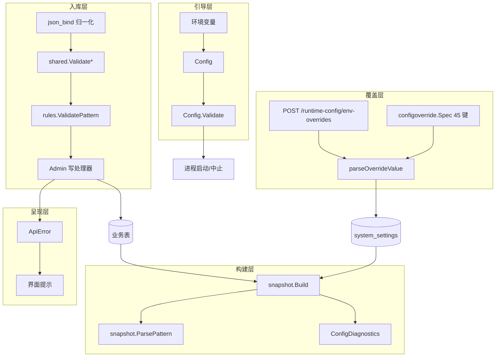
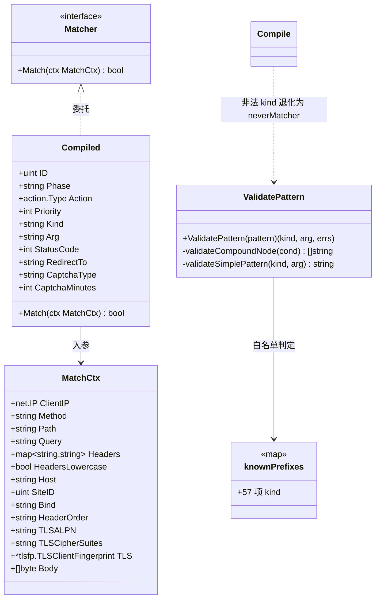
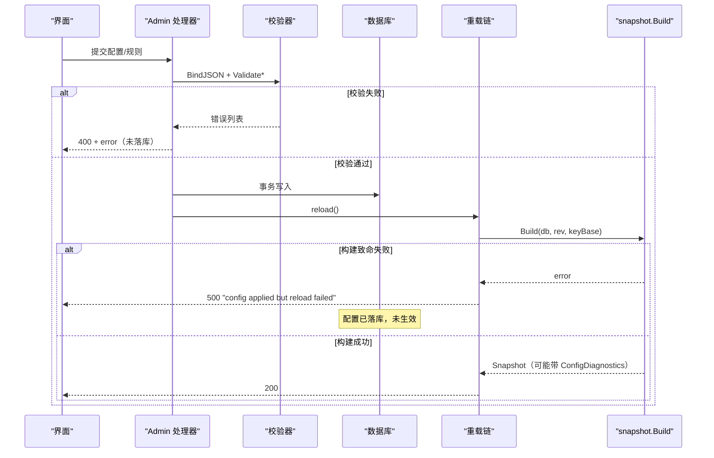
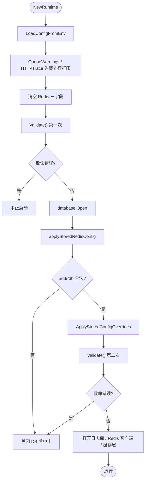
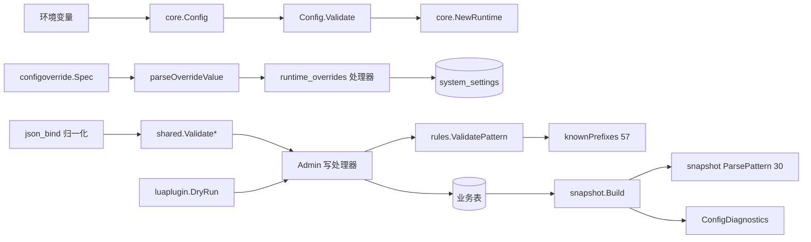
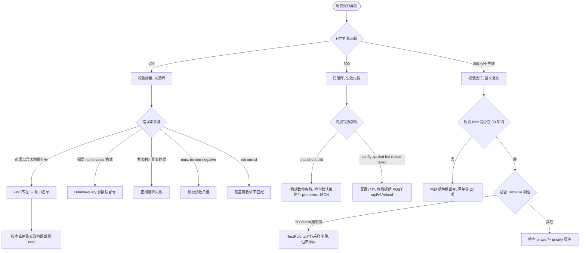

# 配置验证系统

> [返回 配置管理系统](配置管理系统.md)

<cite>
**本文档引用的文件**
- [config_validate.go](file://internal/core/config_validate.go)
- [runtime.go](file://internal/core/runtime.go)
- [registry.go](file://internal/core/configoverride/registry.go)
- [resolve.go](file://internal/core/configoverride/resolve.go)
- [validate.go](file://internal/core/rules/validate.go)
- [compiler.go](file://internal/core/rules/compiler.go)
- [phases.go](file://internal/core/rules/phases.go)
- [matcher.go](file://internal/core/rules/matcher.go)
- [build.go](file://internal/snapshot/build.go)
- [protection.go](file://internal/store/protection.go)
- [json_bind.go](file://internal/admin/shared/json_bind.go)
- [helpers.go](file://internal/admin/shared/helpers.go)
- [site_upstreams.go](file://internal/admin/shared/site_upstreams.go)
- [rule.go](file://internal/admin/rule/rule.go)
- [rule_validate.go](file://internal/admin/rule/validate.go)
- [protect_protection.go](file://internal/admin/protect/protection.go)
- [captcha.go](file://internal/admin/protect/captcha/captcha.go)
- [admin_site.go](file://internal/admin/site/site.go)
- [runtime_overrides.go](file://internal/admin/system/runtime_overrides.go)
- [network.go](file://internal/admin/system/network.go)
- [acme.go](file://internal/admin/system/acme.go)
- [lua_plugin.go](file://internal/admin/system/luaplugin/lua_plugin.go)
- [js_plugin.go](file://internal/admin/system/jsplugin/js_plugin.go)
- [dryrun.go](file://internal/waf/luaplugin/dryrun.go)
- [router.go](file://internal/admin/router.go)
- [store_migrate.go](file://internal/store/migrate.go)
- [api.ts](file://frontend/lib/api.ts)
- [rule-pattern-mapper.ts](file://frontend/app/(dashboard)/rules/components/rule-pattern-mapper.ts)
- [check-skip-path-by-phase.ts](file://frontend/scripts/check-skip-path-by-phase.ts)
- [check-rule-pattern-roundtrip.ts](file://frontend/scripts/check-rule-pattern-roundtrip.ts)
- [package.json](file://frontend/package.json)
- [README.md](file://README.md)
</cite>

## 目录

1. [简介](#简介)
2. [项目结构](#项目结构)
3. [核心组件](#核心组件)
4. [架构总览](#架构总览)
5. [详细组件分析](#详细组件分析)
6. [依赖关系分析](#依赖关系分析)
7. [性能考虑](#性能考虑)
8. [故障排查指南](#故障排查指南)
9. [结论](#结论)
10. [附录](#附录)

## 简介

本文件系统梳理 My-OpenWaf 的配置验证体系，按**校验发生的层次**而非按文件组织，覆盖五层：

1. 引导层：`Config.Validate` 在进程启动前校验数据库驱动、DSN、监听地址。
2. 覆盖层：`configoverride` 按 `Kind` / `Scope` / 枚举 / 区间校验 `runtime_config_overrides` 的每个键。
3. 入库层：Admin 处理器在写库前校验动作、phase、限流配额、验证码类型、JSON blob、站点上游与证书。
4. 构建层：`snapshot.Build` 再解析一遍规则与设置，决定「致命失败」还是「记诊断继续」。
5. 呈现层：`ApiError` 与 i18n 把后端错误串映射为界面提示。

三条实测结论，后文逐条给证据：

- 校验函数**不止一处实现**，规则的 kind 白名单实测分散在三处，且互不等价：管理侧 57 项、快照侧 30 项、路径跳过 9 项 phase。
- 多数写入口是**非 fail-closed**：配置先落库，重载失败只返回 500，不回滚。
- `TestRule` 只构造 6 个匹配字段，TLS / Host / Header 顺序类 kind 在测试接口里**恒不命中**，属真实缺陷。

边界说明：字段构成与 DB 映射见 [配置快照机制](配置快照机制.md)；重载链与代次 CAS 见 [热重载系统](热重载系统.md)；本篇不重复其表格。

**章节来源**
- [internal/core/config_validate.go:9-49](file://internal/core/config_validate.go#L9-L49)
- [internal/core/rules/compiler.go:119-142](file://internal/core/rules/compiler.go#L119-L142)
- [internal/snapshot/build.go:1197-1223](file://internal/snapshot/build.go#L1197-L1223)

## 项目结构

| 层 | 路径 | 规模(行) | 校验职责 | 关键符号 |
|----|------|:--------:|----------|----------|
| 引导 | internal/core/config_validate.go | 49 | 驱动/DSN/绑定地址 | `Config.Validate` |
| 引导 | internal/core/runtime.go | 313 | 两次校验 + 库里覆盖值 | `NewRuntime` |
| 覆盖 | internal/core/configoverride/registry.go | 580 | 45 键元数据 | `Spec` / `All` / `Lookup` |
| 覆盖 | internal/core/configoverride/resolve.go | 320 | 逐 Kind 解析与区间 | `parseOverrideValue` |
| 规则 | internal/core/rules/validate.go | 257 | pattern 语法与语义 | `ValidatePattern` |
| 规则 | internal/core/rules/compiler.go | 170 | kind 白名单与编译 | `knownPrefixes` / `Compile` |
| 入库 | internal/admin/shared/helpers.go | 879（包） | 动作/验证码/CC/阈值 | `Validate*` 家族 |
| 入库 | internal/admin/shared/json_bind.go | 174 | JSON blob 与三态 | `ValidateSkipPathByPhase` |
| 入库 | internal/admin/rule | 1046（包） | 规则持久化前校验 | `normalizePersistedRuleConfig` |
| 构建 | internal/snapshot/build.go | 1644 | 二次解析与失败分流 | `Build` / `ParsePattern` |
| 呈现 | frontend/lib/api.ts | — | 状态码与错误串 | `ApiError` |



**图表来源**
- [internal/core/runtime.go:36-87](file://internal/core/runtime.go#L36-L87)
- [internal/core/configoverride/resolve.go:136-249](file://internal/core/configoverride/resolve.go#L136-L249)
- [internal/admin/shared/json_bind.go:44-170](file://internal/admin/shared/json_bind.go#L44-L170)
- [internal/snapshot/build.go:47-143](file://internal/snapshot/build.go#L47-L143)

**章节来源**
- [internal/core/config_validate.go:9-49](file://internal/core/config_validate.go#L9-L49)
- [internal/admin/shared/helpers.go:104-310](file://internal/admin/shared/helpers.go#L104-L310)

## 核心组件

- `Config.Validate`：值接收者，返回 `(warnings []string, err error)`；错误一条即中止启动，告警只打印（`config_validate.go:11-49`）。
- `configoverride.Spec`：把「一个键能不能写、按什么类型校验、要不要重启」集中成静态元数据（`registry.go:85-118`）。
- `rules.ValidatePattern`：唯一的规则表达式语义校验器，返回 `(kind, arg, errs)`，`errs` 为可枚举的多条错误（`validate.go:28-34`）。
- `knownPrefixes`：57 项 kind 白名单，`ParsePattern` 与 `validateSimplePattern` 共用（`compiler.go:119-142`、`validate.go:124-126`）。
- `shared.Validate*` 家族：动作、验证码类型、CC 规则、质询动作、反重放模式、bot 阈值、上游地址与主机名（`helpers.go:104-310`、`site_upstreams.go:24/97`）。
- `normalizePersistedRuleConfig`：规则入库前的总闸，phase、pattern、action、redirect、captcha、频次参数逐项校验并归一（`rule.go:298-340`）。
- `snapshot.Build`：构建期二次解析，致命错误与可跳过诊断分档（`build.go:34-50`）。
- `luaplugin.DryRun` / `luaplugin.Validate`：脚本的干跑与仅编译校验（`dryrun.go:55-132`）。

组件清单：

| 组件 | 位置 | 单一职责 | 拒绝方式 |
|------|------|----------|----------|
| `Config.Validate` | config_validate.go:11 | 引导参数成形性 | 返回 error |
| `Spec.IsWritable` | registry.go:580 | 键可写性 | `Scope != runtime` 即拒 |
| `parseOverrideValue` | resolve.go:145 | 按 Kind 归一取值 | 返回 error |
| `ValidatePattern` | validate.go:28 | 规则表达式合法性 | 返回 errs 列表 |
| `ValidateSkipPathByPhase` | json_bind.go:44 | 跳过路径对象结构 | 返回 error |
| `normalizePersistedRuleConfig` | rule.go:298 | 规则入库前合并校验 | 返回错误串 |
| `validateRateLimitConfig` | protect/protection.go:305 | 限流配额不变式 | 返回 error |
| `validateEnabledLuaPlugin` | luaplugin/lua_plugin.go:110 | 启用脚本可执行性 | 返回 error |

校验对象与匹配器之间的契约如下。注意 `Matcher` 的实际签名是单参数 `Match(MatchCtx)`，早期文档里的 5 参数形式（ip/method/path/query/headers）已全部作废：



**图表来源**
- [internal/core/rules/phases.go:33-52](file://internal/core/rules/phases.go#L33-L52)
- [internal/core/rules/matcher.go:20-23](file://internal/core/rules/matcher.go#L20-L23)
- [internal/core/rules/compiler.go:13-36](file://internal/core/rules/compiler.go#L13-L36)
- [internal/core/rules/validate.go:28-134](file://internal/core/rules/validate.go#L28-L134)
- [internal/core/rules/compiler.go:119-142](file://internal/core/rules/compiler.go#L119-L142)

**章节来源**
- [internal/core/config_validate.go:11-49](file://internal/core/config_validate.go#L11-L49)
- [internal/core/configoverride/registry.go:85-118](file://internal/core/configoverride/registry.go#L85-L118)
- [internal/core/rules/validate.go:28-134](file://internal/core/rules/validate.go#L28-L134)
- [internal/admin/rule/rule.go:298-340](file://internal/admin/rule/rule.go#L298-L340)

## 架构总览

验证发生在「写」与「生效」两个时刻，中间由一次重载相连。实测的关键事实：**写入口的校验用 57 项白名单，生效端的解析用 30 项白名单**，两者不交集的部分会静默丢失。



**图表来源**
- [internal/admin/protect/protection.go:96-301](file://internal/admin/protect/protection.go#L96-L301)
- [internal/admin/rule/rule.go:298-340](file://internal/admin/rule/rule.go#L298-L340)
- [internal/snapshot/build.go:47-143](file://internal/snapshot/build.go#L47-L143)
- [internal/core/runtime.go:211-274](file://internal/core/runtime.go#L211-L274)

**章节来源**
- [internal/admin/router.go:258-398](file://internal/admin/router.go#L258-L398)
- [internal/snapshot/build.go:920-933](file://internal/snapshot/build.go#L920-L933)

## 详细组件分析

### 引导层：启动前配置校验（Config.Validate）

`Validate` 是纯函数，不触碰数据库，返回「告警数组 + 一个致命错误」。实测规则：

| 对象 | 规则:行 | 失败行为 | 是否 fail-closed |
|------|---------|----------|:---:|
| `DBDriver` | 必须 ∈ {"", sqlite, mysql, postgres, postgresql}（config_validate.go:15-20） | 返回 error，启动中止 | 是 |
| `DBDSN` | 非空（config_validate.go:23-25） | 返回 error | 是 |
| `AdminBind` | `net.SplitHostPort` 可解析（config_validate.go:28-30） | 返回 error | 是 |
| `RedisAddr` | 非空时必须可解析（config_validate.go:33-37） | 返回 error | 是 |
| 驱动与 DSN 一致性 | sqlite + `host=` 或 `@tcp(` → 告警（config_validate.go:40-42） | 仅告警 | 否 |
| 管理端口 | 绑定 `:80`/`:443` → 告警（config_validate.go:44-46） | 仅告警 | 否 |

两点容易被忽略的实测语义：

1. `postgresql` 是合法别名，与 `database.Open` 的分支保持一致；早期文档只写三值白名单是错的。
2. `NewRuntime` **两次**调用 `Validate`：引导期把 Redis 三字段清空后校验一次（`runtime.go:39-43`、`55-61`），读入库中 `redis_config` 与覆盖表之后再校验一次（`runtime.go:71-87`）。第一次刻意不因环境变量里的 Redis 值失败，因为此时库里覆盖值尚未应用。



**图表来源**
- [internal/core/runtime.go:36-142](file://internal/core/runtime.go#L36-L142)
- [internal/core/config_validate.go:11-49](file://internal/core/config_validate.go#L11-L49)

**章节来源**
- [internal/core/config_validate.go:11-49](file://internal/core/config_validate.go#L11-L49)
- [internal/core/runtime.go:36-142](file://internal/core/runtime.go#L36-L142)

### 覆盖层：Kind 与 Scope 校验（配置项表）

`runtime_config_overrides` 的校验完全由静态注册表驱动，45 个键的分布实测如下：

| 维度 | 取值 | 键数 | 校验含义 |
|------|------|:---:|----------|
| Kind | `string` | 20 | 仅当声明 `EnumValues` 才做白名单（resolve.go:216-231） |
| Kind | `int` | 13 | JSON 数字、整数性、`Min/Max` 区间、非负（resolve.go:173-190、236-249） |
| Kind | `bool` | 9 | 只接受 JSON 布尔与 `true`/`false` 文本，**不接受 0/1**（resolve.go:161-175） |
| Kind | `duration` | 3 | 必须可 `time.ParseDuration`，按纳秒区间校验（resolve.go:193-212） |
| Scope | `runtime` | 29 | 可写；`IsWritable()` 仅此值为真（registry.go:580） |
| Scope | `delegated` | 7 | 只展示，写入口在专用端点（如 `redis_addr` → `/api/v1/redis-config`） |
| Scope | `bootstrap` | 7 | 只读；引导参数不可覆盖 |
| Scope | `test_only` | 2 | 不进界面、不可覆盖 |
| 属性 | `Secret: true` | 5 | 端点不回显真值（`dsn`、`log_dsn`、`jwt_secret`、`redis_password` 等） |
| 属性 | `RestartRequired: true` | 26 | 覆盖需重启才生效，重载只改库不改结构体 |

三条失败路径：

- 未知键 → 400 `unknown key`（`runtime_overrides.go:276-280`、`291-295`）。
- 非 `runtime` 作用域 → 400 `key is not overridable`，附带 `scope`（`runtime_overrides.go:281-285`）。
- 取值不合法 → 400 并回显 `key`（`runtime_overrides.go:297-301`）。

存储侧读取则是**降级而非失败**：`ParseStoredOverrides` 对未知键、非可写键、不可解析值一律告警后跳过（`resolve.go:71-90`），因此库里脏数据不会阻塞重载。

**章节来源**
- [internal/core/configoverride/registry.go:13-34](file://internal/core/configoverride/registry.go#L13-L34)
- [internal/core/configoverride/registry.go:269-580](file://internal/core/configoverride/registry.go#L269-L580)
- [internal/core/configoverride/resolve.go:55-249](file://internal/core/configoverride/resolve.go#L55-L249)
- [internal/admin/system/runtime_overrides.go:255-330](file://internal/admin/system/runtime_overrides.go#L255-L330)

### 规则层：pattern 语法与语义校验

`ValidatePattern` 先用 `ParsePattern` 拆 kind/arg，再分派到复合或简单校验（`validate.go:28-46`）。简单 kind 的语义规则并不统一，逐组实测：

| kind 组 | 规则:行 | 失败文案 | 是否 fail-closed |
|---------|---------|----------|:---:|
| `block_path` | 需非空前缀（validate.go:129-132） | `block_path 需要非空路径前缀` | 是 |
| `allow_ip` / `block_ip` | 先试 `ParseCIDR`，再试 `ParseIP`（validate.go:140-146） | `IP/CIDR 匹配器要求合法的 IP 地址或 CIDR` | 是 |
| 正则族（`block_path_regex` 等 6 项） | 非空 + `cachedCompile` 成功（validate.go:147-153） | `规则表达式使用了非法的正则表达式` | 是 |
| Header 族 | 需 `name:value` 两段非空（validate.go:154-171） | `Header 匹配器需要 name:value 格式` | 是 |
| `query_param*` | `param:value` / `param:regex`（validate.go:172-184） | `query_param 需要非空的 param:value 格式` | 是 |
| 通配符族（5 项） | 非空 + `globToRegexSource` + 编译（validate.go:212-238） | `通配符匹配器需要非空的通配符模式` | 是 |
| `tls_version` | `tlsmeta.NormalizeRuntimeVersionToken` 非空（validate.go:239-242） | `tls_version 需要合法的 TLS 版本标识` | 是 |
| `tls_cipher_suite(s)` | 逗号切分后至少一个合法套件（validate.go:243-254） | `tls_cipher_suites 至少需要一个合法的密码套件标识` | 是 |
| 未知 kind | `knownPrefixes` 未命中（validate.go:124-126） | `复合条件叶子节点使用了不支持的 kind` | 是 |

复合条件（`kind == "compound"`）的 op 白名单实测为 6 个分支，早期文档写「op 必须为 and/or/not」是错的：

| op | 结构约束:行 | 失败文案 |
|----|-------------|----------|
| `and` / `or` | `children` 至少 1（validate.go:57-61） | `复合条件至少需要一个子条件` |
| `not` | `children` 恰好 1（validate.go:62-66） | `非条件必须且只能包含一个子条件` |
| `if` / `if_else` / `ifelse` | `if` 与 `then` 必须同时存在，`else` 可选（validate.go:67-75） | `条件必须同时提供 if 和 then 分支` |
| `cc_rate` | 恰好 1 子条件，`window>0`、`threshold>0`、`duration_unit ∈ {"", seconds, minutes}`、时长非负（validate.go:76-92） | 逐条对应文案 |
| 空 op（叶子） | `kind` 必填且过简单校验（validate.go:93-99） | `复合条件叶子节点必须定义 kind` |
| 其它 | 直接拒绝（validate.go:100-102） | `复合条件使用了不支持的操作符` |

绕过保存校验进入编译路径的非法模式不会报错，而是**退化为恒不命中的 `neverMatcher`**：`Compile` 先装配 `neverMatcher`，仅当 `validateParsedPattern` 返回空错误时才替换为真匹配器（`compiler.go:50-52`），`buildMatcher` 的 30 余条分支也各自在参数非法时回落（`matcher.go:504-507`、`1474-1926`）。这是匹配层的 fail-closed 兜底，与快照层「kind 为空直接丢弃」构成两道独立的静默失效路径——两者都不产生诊断，因此界面无从感知。

**章节来源**
- [internal/core/rules/validate.go:28-256](file://internal/core/rules/validate.go#L28-L256)
- [internal/core/rules/compiler.go:44-75](file://internal/core/rules/compiler.go#L44-L75)
- [internal/core/rules/matcher.go:504-507](file://internal/core/rules/matcher.go#L504-L507)
- [internal/snapshot/build.go:920-933](file://internal/snapshot/build.go#L920-L933)

### kind 白名单实为三处：对照与自检

这是本篇最需要固定下来的事实。三处白名单各自服务不同目的，但**互不引用**，因此会出现「一处放行、另一处静默丢弃」。

| # | 白名单 | 位置:行 | 实测项数 | 服务的对象 | 未命中时行为 |
|---|--------|---------|:---:|------------|--------------|
| 1 | 规则 kind | internal/core/rules/compiler.go:119-142 | **57** | 管理侧校验、引擎编译、`ValidateRule` | `ParsePattern` 返回空 kind → 校验报「必须以合法前缀开头」 |
| 2 | 快照构建 kind 前缀 | internal/snapshot/build.go:1205-1215 | **30** | `compileRules` 折叠成 `CompiledRule` | `kind == ""` → **静默 `continue`**，不产生诊断（build.go:923-926） |
| 3 | 路径跳过 phase 键 | internal/store/protection.go:326-336 | **9** | `skip_path_by_phase` 的合法键 | 入库前 400 拒绝（json_bind.go:48-51）；构建期未知键静默丢弃（protection.go:360 起） |

集合关系实测：**白名单 2 是白名单 1 的严格子集**，差集 27 项；白名单 3 是 phase 名而非 kind，与规则 kind 无交集，`signature`/`custom` 被有意排除（`protection.go:323-325` 的注释说明「用户自建规则直接停用即可」）。

差集 27 项（管理侧可保存、快照侧不解析）：

| 分类 | kind |
|------|------|
| Host 族 | `host_full`、`host_regex`、`host_contains`、`host_not_contains`、`host_not_exact`、`host_wildcard` |
| 完整 URL 族 | `full_url_contains`、`full_url_regex`、`full_url_not_exact`、`full_url_wildcard` |
| 路径族 | `path_contains`、`path_not_contains`、`path_not_exact`、`path_wildcard` |
| Header 族 | `block_header_exact`、`block_header_not_exact`、`block_header_prefix`、`header_wildcard` |
| Body 族 | `block_body_contains`、`block_body_regex`、`block_body_json_path`、`body_not_exact`、`body_wildcard`、`block_multipart` |
| 查询族 | `query_param_not_exact`、`query_param_regex` |
| 其它 | `geo_block` |

自检命令（已实测可运行，输出 `57 / 30 / 9` 与上面 27 项差集）：

```bash
# 1) 管理/引擎侧 kind（57 项）
sed -n '/var knownPrefixes = func/,/^}()$/p' internal/core/rules/compiler.go \
  | tr ',' '\n' | sed -n 's/.*"\([a-z0-9_]*\)".*/\1/p' | sort -u > /tmp/kind_rules.txt

# 2) 快照构建侧 kind（30 项）
sed -n '/prefixes := \[\]string{/,/^\t}$/p' internal/snapshot/build.go \
  | tr ',' '\n' | sed -n 's/.*"\([a-z0-9_]*\):".*/\1/p' | sort -u > /tmp/kind_snapshot.txt

# 3) 路径跳过 phase 键（9 项）
sed -n '/^var skipPathPhaseKeys = map/,/^}$/p' internal/store/protection.go \
  | sed -n 's/.*"\([a-z0-9_]*\)".*/\1/p' | sort -u > /tmp/phase_skip.txt

wc -l /tmp/kind_rules.txt /tmp/kind_snapshot.txt /tmp/phase_skip.txt
comm -23 /tmp/kind_rules.txt /tmp/kind_snapshot.txt   # 可保存但构建期被丢弃
comm -13 /tmp/kind_rules.txt /tmp/kind_snapshot.txt   # 应为空
```

契约脚本覆盖情况实测：`frontend/scripts/check-skip-path-by-phase.ts` 会用正则直接读取后端 `skipPathPhaseKeys` 并与前端 `SKIP_PATH_PHASES` 比对（该脚本 15-26 行），因此白名单 3 有守卫；**没有任何脚本比对白名单 1 与 2**，`check-rule-pattern-roundtrip.ts` 只验证前端映射器的可编辑回环，27 项差集因此长期无人拦截。

**章节来源**
- [internal/core/rules/compiler.go:119-142](file://internal/core/rules/compiler.go#L119-L142)
- [internal/snapshot/build.go:1197-1223](file://internal/snapshot/build.go#L1197-L1223)
- [internal/snapshot/build.go:920-933](file://internal/snapshot/build.go#L920-L933)
- [internal/store/protection.go:323-360](file://internal/store/protection.go#L323-L360)
- [internal/admin/shared/json_bind.go:44-63](file://internal/admin/shared/json_bind.go#L44-L63)
- [frontend/scripts/check-skip-path-by-phase.ts:15-26](file://frontend/scripts/check-skip-path-by-phase.ts#L15-L26)
- [frontend/scripts/check-rule-pattern-roundtrip.ts:1-45](file://frontend/scripts/check-rule-pattern-roundtrip.ts#L1-L45)

### 规则入库前的合并校验

`normalizePersistedRuleConfig` 是规则唯一的入库闸门，顺序即优先级（`rule.go:298-340`）：

| 步 | 校验 | 位置 | 拒绝文案 |
|----|------|------|----------|
| 1 | phase ∈ {acl, signature, custom} | rule.go:288-296 | `unsupported phase: only acl, signature, custom are executable custom rule phases` |
| 2 | pattern 语义 | rule.go:305（调 `ValidatePattern`） | `invalid pattern: <errs>` |
| 3 | action 归一且合法 | rule.go:270-286 | `invalid action` |
| 4 | `allow` 仅限 acl 阶段 | rule.go:282-284 | `invalid action` |
| 5 | `redirect` 必须带 `redirect_to` | rule.go:314-316 | `redirect_to required` |
| 6 | `captcha_type` 合法且动作必须是 `captcha_challenge` | rule.go:317-326 | `invalid captcha_type` / `captcha_type requires captcha_challenge action` |
| 7 | `window_seconds` / `request_count` 非负 | rule.go:329-334 | `must be non-negative` |

写入口随后调用 `reload()`，失败返回 500 且带 `config applied but reload failed`（`rule.go:181-184`、`205-208`）——**已落库未生效**是该链路的固有中间态。

**章节来源**
- [internal/admin/rule/rule.go:181-208](file://internal/admin/rule/rule.go#L181-L208)
- [internal/admin/rule/rule.go:270-340](file://internal/admin/rule/rule.go#L270-L340)

### TestRule 的采样面缺陷（如实登记）

`TestRuleRequest` 有 7 个字段（`rule.go:213-221`），但构造 `MatchCtx` 时只填 6 个（`rule.go:251-257`）：`ClientIP`、`Method`、`Path`、`Query`、`Headers`、`Body`。

`rules.MatchCtx` 实际有 15 个字段（`phases.go:33-52`），其中 `Host`、`Bind`、`SiteID`、`HeaderOrder`、`TLSALPN`、`TLSCipherSuites`、`TLS *tlsfp.TLSClientFingerprint`、`HeadersLowercase` 均未被赋值。后果按 kind 实测分类：

| kind 组 | 依赖字段 | TestRule 结果 | 说明 |
|---------|----------|---------------|------|
| `host*` | `MatchCtx.Host` | **恒不命中** | 请求体没有 host 字段可填 |
| `tls_ja3` / `tls_ja3_hash` / `tls_ja4` / `tls_version` / `tls_sni` / `tls_alpn` / `tls_cipher_suite(s)` | `MatchCtx.TLS`、`TLSALPN`、`TLSCipherSuites` | **恒不命中** | 指纹只在握手期可得 |
| `header_order_contains` / `header_order_regex` | `MatchCtx.HeaderOrder` | **恒不命中** | 顺序串未构造 |
| `cc_rate` 复合 | `Bind`、`SiteID`、`Host` | 计数键退化 | 三者皆零值 |
| `geo_block` | 由 IP 信誉侧解析 | 依赖调用点 | 不在 TestRule 内验证 |
| IP/路径/查询/头/方法/正文族 | 已覆盖的 6 字段 | 结果可信 | — |

这是接口语义与匹配器契约之间的真实缺口，不属于文档表述问题。界面若在「规则测试」里展示这类 kind 的不命中，容易被误读为规则写错。处置建议：要么在 `TestRuleRequest` 增补 `host`/`tls` 采样字段并显式标注不可得，要么对无法采样的 kind 直接返回「不适用」而非 `matched: false`。

```go
// internal/admin/rule/rule.go:251-257 —— 实际只填 6 个字段
mc := rules.MatchCtx{
    ClientIP: clientIP,
    Method:   req.Method,
    Path:     req.Path,
    Query:    req.Query,
    Headers:  req.Headers,
    Body:     []byte(req.Body),
}
matched := compiled[0].Match(mc)
```

**章节来源**
- [internal/admin/rule/rule.go:212-266](file://internal/admin/rule/rule.go#L212-L266)
- [internal/core/rules/phases.go:33-52](file://internal/core/rules/phases.go#L33-L52)
- [internal/core/rules/compiler.go:24-36](file://internal/core/rules/compiler.go#L24-L36)

### 站点与保护配置校验

- 三态字段：`*bool`/`*string` 的 nil 表示「继承全局」，`int` 类必须 > 0 才覆盖；JSON `null` 显式清除覆盖（`json_bind.go:150-170`）。从属字段（档位、动作、窗口、配额）在开关为 nil 时由 `clearInheritedProtectionOverrides` 清空（`admin/site/site.go:505-522`）。
- 动作白名单：`ValidateActionWithoutRedirectTarget`（`helpers.go:116`）、`ValidateActionWithRedirectTarget`（`helpers.go:127`）、`ValidateCCRuleAction`（`helpers.go:243`）、`ValidateChallengeAction`（`helpers.go:273`）、`ValidateGlobalChallengeAction`（`helpers.go:287`）、`ValidateAntiReplayAction`（`helpers.go:296`）。
- 限流不变式：`ProtectionConfig.ValidateRateLimits` 拒绝「已启用但窗口或配额非正」（`store/protection.go:135-143`）；`validateRateLimitConfig` 额外拦住负值，即使开关处于关闭（`protect/protection.go:305-320`）。
- 条件式校验：动作字段只在「本次提交了该字段」或「提交了启用开关且为真」时才校验（`protect/protection.go:204-232`），避免半更新把库里既有非法值牵连报错。
- 质询配置：`captcha.ValidateChallengeConfig` 按 `present` 映射逐字段校验（`captcha/captcha.go:63-100`）。
- 上游：`ValidateSiteUpstreamURLs` 与 `ValidateSiteUpstreamHost`（`site_upstreams.go:24/97`）。
- ACME：`renew_before_days > 0`，CAA 开启时 `caa_dns_server` 与 `caa_allowed_issuers` 必填（`acme.go:505-518`）；保存成功后仍会 `reload()`。

**章节来源**
- [internal/admin/shared/json_bind.go:94-170](file://internal/admin/shared/json_bind.go#L94-L170)
- [internal/admin/site/site.go:505-545](file://internal/admin/site/site.go#L505-L545)
- [internal/admin/shared/helpers.go:104-310](file://internal/admin/shared/helpers.go#L104-L310)
- [internal/admin/protect/protection.go:185-320](file://internal/admin/protect/protection.go#L185-L320)
- [internal/store/protection.go:125-152](file://internal/store/protection.go#L125-L152)
- [internal/admin/system/acme.go:505-527](file://internal/admin/system/acme.go#L505-L527)

### 脚本层：编译校验与干跑

| 校验 | 位置 | 覆盖内容 | 是否 fail-closed |
|------|------|----------|:---:|
| `luaplugin.Validate` | dryrun.go:124-132 | 仅 `Compile`，捕获语法与缺少 `handle` 之外的结构问题 | 是 |
| `luaplugin.DryRun` | dryrun.go:55-63 | 单样例真实执行，返回 `CompileError`/`RuntimeError`/`Decision`/`ElapsedMS` | 是 |
| `DryRunNContext` | dryrun.go:66-115 | 连跑上限 100 次，独立 VM 池，不污染线上状态机 | 是 |
| `validateEnabledLuaPlugin` | luaplugin/lua_plugin.go:110-134 | 仅对 `enabled=true` 生效；样例固定为 `GET /`、`validation.invalid` | 是，保存前拦截 |
| JS 干跑 | jsplugin/js_plugin.go:432-495 | 请求/响应两阶段真实执行并返回变更计划 | 是 |

干跑的固有局限：`validateEnabledLuaPlugin` 只构造 7 个字段的 `RequestView`（`lua_plugin.go:118-126`），无法覆盖依赖 KV 后端与真实请求形态的分支；`kv` 用的是内存替身 `luaValidationKV`，因此跨请求计数逻辑只能部分验证。

**章节来源**
- [internal/waf/luaplugin/dryrun.go:17-132](file://internal/waf/luaplugin/dryrun.go#L17-L132)
- [internal/admin/system/luaplugin/lua_plugin.go:110-134](file://internal/admin/system/luaplugin/lua_plugin.go#L110-L134)
- [internal/admin/system/luaplugin/lua_plugin.go:561](file://internal/admin/system/luaplugin/lua_plugin.go#L561)
- [internal/admin/system/jsplugin/js_plugin.go:421-495](file://internal/admin/system/jsplugin/js_plugin.go#L421-L495)

### 呈现层：错误对象与界面处理

后端统一用 `{"error": "<中文或英文串>"}` 返回；界面侧由 `ApiError`（`frontend/lib/api.ts:121-130`）承载 `status` 与原始 `data`：

- 401：先尝试刷新 token，多个并发 401 只触发一次 refresh（`api.ts:437`、`561-609`）。
- 204/205：视为成功且无响应体（`api.ts:611`）。
- 其它非 2xx：优先取 `data.error`，否则回落为 `请求失败: <status>`（`api.ts:624-633`）。
- 校验类 400 的文案直接来自上表逐条错误串，因此界面看到的中文与后端 `validate.go` 的文案一一对应。

**章节来源**
- [frontend/lib/api.ts:121-130](file://frontend/lib/api.ts#L121-L130)
- [frontend/lib/api.ts:561-633](file://frontend/lib/api.ts#L561-L633)

## 依赖关系分析



**图表来源**
- [internal/core/runtime.go:36-142](file://internal/core/runtime.go#L36-L142)
- [internal/core/rules/validate.go:28-46](file://internal/core/rules/validate.go#L28-L46)
- [internal/snapshot/build.go:920-1223](file://internal/snapshot/build.go#L920-L1223)
- [internal/admin/protect/protection.go:96-301](file://internal/admin/protect/protection.go#L96-L301)

外部服务依赖：

| 依赖 | 在校验链中的角色 | 接入点:行 | 数据形态 | 失败是否阻断保存 |
|------|------------------|-----------|----------|:---:|
| 主数据库 | 校验后再写入 | 各处理器 repo 调用 | 行 + JSON 文本 | 是（500） |
| `config_revisions` | 重载代次来源 | store/migrate.go:141-160 | 单行 uint64 | 是 |
| Redis（探活） | `probeRedisConfig` 保存前连通性试探 | admin/system/network.go:413-465 | host:port + 口令 `{占位}` | 是（400） |
| TLS 证书解析 | 站点/监听器保存前校验证书对 | shared/helpers.go:87 | PEM | 是 |
| TLS 版本元数据 | `tlsmeta.NormalizeRuntimeVersionToken` | rules/validate.go:239-242 | 版本标识 | 是 |
| 正则引擎 | `cachedCompile` 判定正则合法性 | rules/validate.go:147-195 | 模式串 | 是 |
| GeoIP 库 | 仅在 `geo_block` 运行期使用，入库不校验 | 见 IP 信誉模块 | mmap 文件 | 否 |
| Lua/QuickJS 运行时 | 启用态脚本的干跑校验 | lua_plugin.go:118-126 | 源码 + 样例 | 是 |

**章节来源**
- [internal/core/runtime.go:36-142](file://internal/core/runtime.go#L36-L142)
- [internal/admin/system/network.go:413-470](file://internal/admin/system/network.go#L413-L470)
- [internal/admin/shared/helpers.go:87-102](file://internal/admin/shared/helpers.go#L87-L102)
- [internal/store/migrate.go:141-168](file://internal/store/migrate.go#L141-L168)

## 性能考虑

- 正则缓存：所有正则类校验与匹配都走 `cachedCompile`，同一模式串只编译一次（`matcher.go:1791-1808`）。
- 通配符先行归一：`globToRegexSource` 在校验期就展开为正则源串，运行期不再做模式转换。
- 设置表单次读取：`loadAllSettings` 一次取全表成 map，覆盖表解析不重复查库（`build.go:1432`）。
- 干跑成本可控：`DryRunNContext` 上限 100 次迭代，单次超时由脚本自身 `TimeoutMS` 决定，且使用独立 VM 池（`dryrun.go:66-115`）。
- 校验顺序遵循「便宜的先做」：`BindJSON` → 判空 → `ParsePattern` → 语义校验 → 正则编译，避免为非法输入付出编译成本。
- 反向注意：`validateEnabledLuaPlugin` 会为每个启用脚本付出一次真实执行，批量导入脚本时应控制并发。

**章节来源**
- [internal/core/rules/matcher.go:1791-1808](file://internal/core/rules/matcher.go#L1791-L1808)
- [internal/waf/luaplugin/dryrun.go:55-115](file://internal/waf/luaplugin/dryrun.go#L55-L115)
- [internal/snapshot/build.go:1432-1443](file://internal/snapshot/build.go#L1432-L1443)

## 故障排查指南



**图表来源**
- [internal/admin/rule/validate.go:35-80](file://internal/admin/rule/validate.go#L35-L80)
- [internal/core/rules/validate.go:28-256](file://internal/core/rules/validate.go#L28-L256)
- [internal/snapshot/build.go:47-143](file://internal/snapshot/build.go#L47-L143)
- [internal/admin/rule/rule.go:212-266](file://internal/admin/rule/rule.go#L212-L266)

常见错误串与出处对照：

| 错误串 | 出处:行 | 触发条件 |
|--------|---------|----------|
| `unsupported db driver %q (want sqlite|mysql|postgres)` | config_validate.go:19 | 驱动不在别名白名单 |
| `invalid admin bind address` | config_validate.go:29 | 绑定地址缺端口 |
| `规则表达式不能为空` | validate.go:133-139 | 空 arg |
| `规则表达式格式无效` | admin/rule/validate.go:55 | `ParsePattern` 返回空 kind |
| `skip_path_by_phase must be a JSON object` | json_bind.go:47 | 提交数组或标量 |
| `skip_path_by_phase contains an unsupported phase` | json_bind.go:50 | phase 不在 9 项内 |
| `request rate limit requires a positive window and max` | store/protection.go:137 | 启用但配额非正 |
| `chain_steps contains unsupported step type or captcha_type` | protect/protection.go:198 | 链式步骤非法 |
| `config applied but reload failed: ...` | 各处理器 | 重载失败 |

**章节来源**
- [internal/core/config_validate.go:15-49](file://internal/core/config_validate.go#L15-L49)
- [internal/core/rules/validate.go:123-256](file://internal/core/rules/validate.go#L123-L256)
- [internal/admin/rule/validate.go:35-80](file://internal/admin/rule/validate.go#L35-L80)
- [internal/admin/shared/json_bind.go:44-63](file://internal/admin/shared/json_bind.go#L44-L63)
- [internal/admin/protect/protection.go:175-320](file://internal/admin/protect/protection.go#L175-L320)
- [internal/admin/protect/captcha/captcha.go:63-100](file://internal/admin/protect/captcha/captcha.go#L63-L100)
- [internal/admin/shared/site_upstreams.go:24-120](file://internal/admin/shared/site_upstreams.go#L24-L120)

## 结论

验证体系的形状是「**四层各自成立、层间不等价**」：

- 引导层与覆盖层是真正的 fail-closed：错误即中止或 400，不留中间态。
- 入库层校验最丰富，但失败后是否落库取决于错误发生在 reload 之前还是之后，因此存在「已落库未生效」的正常态。
- 构建层是最后防线，却采用「致命/可跳过」两档，可跳过项里最危险的是规则 kind 的**静默丢弃**。

三项建议（按性价比排序）：

1. 给白名单 2 与 1 的差集加一条契约脚本，口径沿用 `check-skip-path-by-phase.ts` 直接读源码的做法；短期内可先在 `compileRules` 的 `kind == ""` 分支写入 `ConfigDiagnostics`，把静默变成可见。
2. `TestRule` 对无法采样的 kind 返回「不适用」，避免把接口局限误读成规则错误。
3. 前端规则编辑器暴露的 33 个 kind 中，有 21 个落在快照侧 30 项之外，应在编辑期即标注「当前构建链路不生效」。

**章节来源**
- [internal/snapshot/build.go:920-933](file://internal/snapshot/build.go#L920-L933)
- [frontend/scripts/check-skip-path-by-phase.ts:15-26](file://frontend/scripts/check-skip-path-by-phase.ts#L15-L26)

## 附录

### 兼容矩阵表：校验口径与历史形态

| 口径项 | 历史/早期表述 | 现状（实测） | 兼容策略 | 位置 |
|--------|---------------|--------------|----------|------|
| 驱动白名单 | 仅 sqlite/mysql/postgres | 增加 `postgresql` 与空值 | 别名归一后放行 | config_validate.go:15-20 |
| 复合 op | and/or/not | and/or/not/if/if_else/ifelse/cc_rate/叶子 | 别名 `ifelse` 保留 | validate.go:57-99 |
| 布尔覆盖值 | 接受 0/1 | 仅 JSON 布尔与 true/false | 0/1 视为非法 | resolve.go:161-175 |
| 整型覆盖 | 越界钳制 | 越界拒绝写入 | 与环境变量钳制口径不同 | resolve.go:235-249 |
| 站点 `int` 覆盖 | 非零即覆盖 | 必须 > 0 | 0 与负值等价于继承 | build.go:748-759 |
| `skip_path_by_phase` | 空串当继承 | `null` = 清除、`{}` = 覆盖为空、非空 = 覆盖 | 三态显式建模 | json_bind.go:101-146 |
| 规则 kind | 单一白名单 | 三处（57/30/9） | 无跨处守卫 | 本篇对照表 |
| 动作 `tag`/`block` | 直接入库 | `tag` 拒绝、`block` 归一为 `intercept` | `action.Normalize` | rule.go:270-286 |
| 脚本校验 | 仅语法 | 语法 + 干跑（启用态） | 停用脚本只校验语法 | lua_plugin.go:110-134 |
| 错误响应 | 无统一类型 | `ApiError{status,message,data}` | 前端统一解包 | api.ts:121-130 |

**章节来源**
- [internal/core/config_validate.go:15-20](file://internal/core/config_validate.go#L15-L20)
- [internal/core/rules/validate.go:57-99](file://internal/core/rules/validate.go#L57-L99)
- [internal/core/configoverride/resolve.go:161-249](file://internal/core/configoverride/resolve.go#L161-L249)
- [internal/admin/shared/json_bind.go:101-170](file://internal/admin/shared/json_bind.go#L101-L170)

### 契约脚本清单（实测 `frontend/package.json`）

| 脚本 | 入口 | 校验对象 |
|------|------|----------|
| `check:skip-path-contract` | scripts/check-skip-path-by-phase.ts | phase 键跨语言一致 |
| `check:i18n` | scripts/check-skip-path-by-phase.ts | **与上一项指向同一脚本**（已登记的仓库不一致） |
| `check:rule-pattern-roundtrip` | scripts/check-rule-pattern-roundtrip.ts | 前端映射器回环 |
| `check:site-protection-contract` | scripts/check-site-protection-contract.ts | 站点保护字段契约 |
| `check:site-challenge-contract` | scripts/check-site-challenge-contract.ts | 质询三态契约 |
| `check:site-cache-contract` | scripts/check-site-cache-contract.ts | 缓存规则契约 |
| `check:env-override-contract` | scripts/check-env-override-contract.ts | 45 键覆盖契约 |
| `check:api-route-contract` | scripts/check-api-route-contract.ts | 路由清单契约 |
| `check:auth-refresh-contract` | scripts/check-auth-refresh-contract.ts | 刷新流程契约 |
| `check:login-form-contract` | scripts/check-login-form-contract.ts | 登录表单契约 |

调用方式来自 README 的开发测试段（`README.md:445-452`）：

```bash
cd frontend
bun run check:skip-path-contract
bun run check:rule-pattern-roundtrip
bun run check:env-override-contract
```

**章节来源**
- [frontend/package.json](file://frontend/package.json)
- [README.md:445-452](file://README.md#L445-L452)

### 相关文档

| 想解决的问题 | 去处 |
|--------------|------|
| 三态字段与 DB 映射 | [配置快照机制](配置快照机制.md) |
| reload 失败后配置处于什么状态 | [热重载系统](热重载系统.md) |
| 覆盖表键的完整清单与默认值 | [配置管理系统](配置管理系统.md) |
| 阶段链与匹配器实现 | [规则匹配器](../WAF 引擎系统/规则匹配器/规则匹配器.md) |
| 多节点上的校验一致性 | [分布式同步机制](分布式同步机制.md) |

**章节来源**
- [本节为索引，无需特定文件来源]
