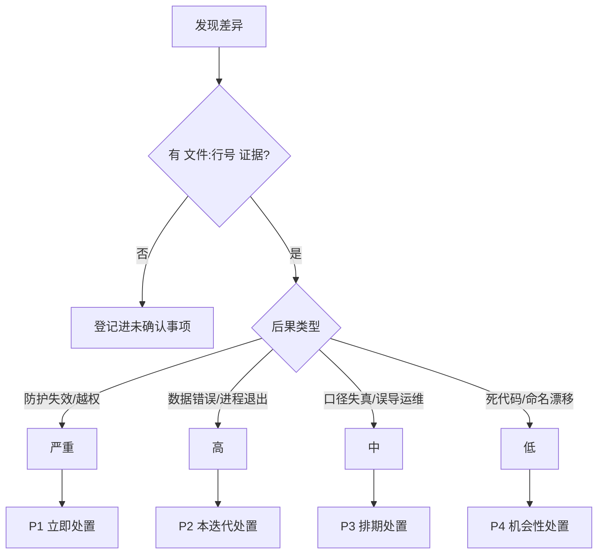
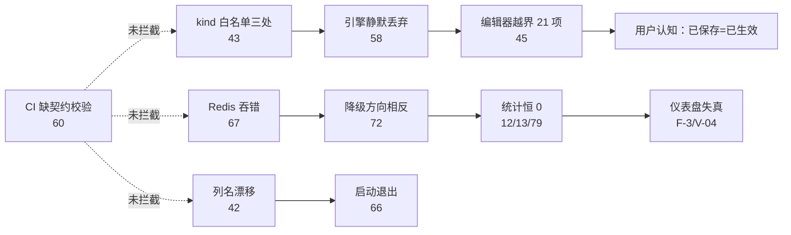
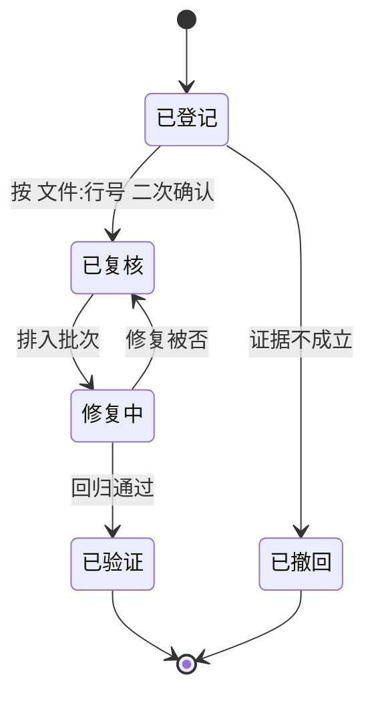

# 问题检测报告

<cite>
**本文档引用的文件**
- README.md
- go.mod
- Dockerfile
- AGENTS.md
- .gitignore
- .dockerignore
- devlog.md
- docs/index.md
- docs/故障排除/故障排除.md
- docs/故障排除/规则误杀与漏杀.md
- docs/故障排除/启动与依赖故障.md
- docs/故障排除/存储与Redis故障.md
- docs/部署运维/构建脚本与工具链.md
- docs/部署运维/CI与发布流水线.md
- docs/部署运维/环境变量与运行参数.md
- docs/前端管理界面/页面实现/防护配置页面.md
- docs/前端管理界面/页面实现/系统与账号页面.md
- docs/前端管理界面/页面实现/事件与日志页面.md
- docs/前端管理界面/页面实现/站点与规则页面.md
- docs/WAF 引擎系统/动态处置/分级升级与丢弃执行.md
- docs/WAF 引擎系统/动态处置/访问控制网关与重放防护.md
- docs/安全防护功能/访客识别/图像转换能力.md
- docs/数据存储层/仓储层/事件与情报仓储.md
- docs/扩展与插件系统/第三方集成/第三方集成.md
- docs/扩展与插件系统/第三方集成/消息队列集成.md
- docs/配置管理系统/配置验证系统.md
</cite>

## 目录

1. [简介](#简介)
2. [项目结构](#项目结构)
3. [核心组件](#核心组件)
4. [架构总览](#架构总览)
5. [详细组件分析](#详细组件分析)
6. [依赖关系分析](#依赖关系分析)
7. [性能考虑](#性能考虑)
8. [故障排查指南](#故障排查指南)
9. [结论](#结论)
10. [附录](#附录)

## 简介

本报告是本次文档重构的第三阶段产物：在按主题域重写 185 篇文档的过程中，对代码事实做逐项核对，把「文档与代码不一致」暴露出来的差异继续下钻，最终登记为**代码侧待处理问题**。

三点定位说明：

- **范围**：仅覆盖文档核对过程中**有 文件:行号 证据**的问题，共 86 项。不是一次全仓静态审计，未覆盖的代码路径不在本报告内。
- **性质**：全部问题在重构过程中**只登记、未修改代码**。任何一条都不构成本次交付的既成变更。
- **证据来源**：R2 各批次子代理在读取源码时的实测记录（含现场命令输出），本次未做逐条二次复现。证据强度分级见[未确认事项](#未确认事项)。

风险等级的判定口径：以「可观察后果」为准，不以「听起来严重」为准。判定流程见[架构总览](#架构总览)。

**章节来源**
- [AGENTS.md](file://AGENTS.md)
- [README.md](file://README.md)

## 项目结构

本报告涉及的对象按所在层分布：

| 层 | 涉及路径 | 问题数 | 代表问题 |
|---|---|---:|---|
| 引擎与规则 | `internal/core/rules/`、`internal/core/engine/`、`internal/snapshot/` | 14 | kind 白名单三处不一致（编号 43） |
| 检测与处置 | `internal/waf/**` | 12 | DropStats 四桶结构性恒 0（编号 79） |
| 控制面与鉴权 | `internal/admin/**`、`internal/security/` | 11 | 登录锁定可被伪造 XFF 绕过（编号 41） |
| 存储与迁移 | `internal/store/**` | 12 | `trusted_cidr`/`trusted_c_id_r` 列名漂移（编号 42） |
| 数据面 | `internal/dataplane/**`、`internal/proxy/**`、`internal/upstream/` | 8 | Redis 客户端吞错导致配置错误完全静默（编号 67） |
| 交付链 | `README.md`、`Dockerfile`、`scripts/`、`.github/workflows/` | 19 | CI 不执行前端契约脚本（编号 60） |
| 前端 | `frontend/**` | 15 | 统计卡引用后端从不产出的列（`site_count`）|

**项目结构来源**
- 见[附录：问题全量索引](#问题全量索引)各条目的「位置」列

## 核心组件

按类别聚合的问题簇（同一根因衍生的多条问题合并为一簇）：

| 簇 | 主题 | 编号区间 | 条数 | 最高优先级 |
|---|---|---|---:|---|
| C1 | 鉴权与暴露面 | 41、48、53、37、65 | 5 | 严重 |
| C2 | SSRF 与出站防护 | 44 | 1 | 高 |
| C3 | 规则白名单与静默丢弃 | 1、43、45、58、61 | 5 | 严重 |
| C4 | 统计口径失真 | 12、13、17、79、V-04 | 5 | 高 |
| C5 | 降级方向与静默失败 | 2、5、66、67、72、77、78、86 | 8 | 严重 |
| C6 | 迁移与列名一致性 | 42、74、75、32 | 4 | 严重 |
| C7 | 交付链与版本一致性 | 53–64、76 | 12 | 中 |
| C8 | 死代码与无消费者 | 19、25、80、81、82 | 5 | 低 |
| C9 | 前端违反项目约定 | 第二配置源、假数据、守卫错配 | 8 | 高 |
| C10 | 未接线能力 | 7、8、9、26、46 | 5 | 中 |

**核心组件来源**
- [docs/故障排除/规则误杀与漏杀.md](file://docs/故障排除/规则误杀与漏杀.md)
- [docs/故障排除/启动与依赖故障.md](file://docs/故障排除/启动与依赖故障.md)

## 架构总览

问题定级流程：先判后果是否可观察，再判是否影响防护正确性，最后判修复成本。



**图表来源**
- [docs/故障排除/故障排除.md](file://docs/故障排除/故障排除.md)
- [AGENTS.md](file://AGENTS.md)

证据链优先级（用于冲突时采信哪一路结论）：


冲突解决口径：证据强弱自上而下，运行时行为优先于源码，源码优先于注释。编号 76（h2 降级 403 已过期）即按此口径**推翻**了早期文档与 `handler.go:802-804` 的注释结论。

**图表来源**
- [docs/故障排除/规则误杀与漏杀.md](file://docs/故障排除/规则误杀与漏杀.md)
- [docs/WAF 引擎系统/动态处置/分级升级与丢弃执行.md](file://docs/WAF%20引擎系统/动态处置/分级升级与丢弃执行.md)
- [docs/部署运维/CI与发布流水线.md](file://docs/部署运维/CI与发布流水线.md)

**章节来源**
- [docs/故障排除/故障排除.md](file://docs/故障排除/故障排除.md)
- [AGENTS.md](file://AGENTS.md)

## 详细组件分析

### C1 鉴权与暴露面（严重）

| 编号 | 类别 | 位置 | 问题 | 触发条件 | 风险 | 优先级 | 建议 |
|:---:|:---|:---|:---|:---|:---|:---:|:---|
| 41 | 安全 | `internal/admin/auth/` BruteForceDetector | 登录锁定按 IP 计数用 Hertz 内置 `ClientIP()`，默认可信 CIDR 为 `0.0.0.0/0`+`::/0` | 攻击者伪造 `X-Forwarded-For` | 暴破锁定被绕过，锁定形同虚设 | 严重 | 改用 `security.ResolveClientIP` 并绑定可信网段，未配置可信网段时不信任任何转发头 |
| 53 | 安全 | `internal/app/server.go:1052` vs `README.md:21,291` | 管理端口宣称 HTTPS 实为明文 HTTP | 用户按 README 用 https 访问或默认明文传输 | 凭据与令牌明文过网 | 严重 | 给 adminSrv 挂 TLS，或改 README 并引导置于反代之后 |
| 65 | 安全 | `internal/admin/router.go:91-110` | `/healthz`、`/readyz`、`/status`、`/metrics`、pprof 均无鉴权 | 端口可达即可访问 | 内部指标、并发与拓扑泄露 | 高 | `/status` 与 `/metrics` 纳入鉴权分组或单独监听内网 |
| 48 | 安全 | `internal/admin/middleware.go:103-120` | API Key 角色取归属账号（文档曾误写「默认 admin」） | 依赖文档做权限设计 | 文档误导导致越权配置 | 中 | 文档已订正；代码保持现状 |
| 39 | 安全 | `internal/admin/auth/auth.go:170-173` | 刷新分支存在空用户名回落 `admin` 的兼容逻辑 | 令牌缺失用户名声明 | 越权获得 admin 身份 | 严重 | 移除回落，缺失即拒绝 |

C1 的共同根因是**身份与来源判定分散**：`security.ResolveClientIP`（4 参、可配 headerOrder、可信网段）已存在，但控制面锁定仍走框架默认 `ClientIP()`。

**章节来源**
- [docs/安全机制/客户端 IP 获取.md](file://docs/安全机制/客户端%20IP%20获取.md)
- [docs/前端管理界面/页面实现/认证与外壳页面.md](file://docs/前端管理界面/页面实现/系统与账号页面.md)
- [docs/安全机制/JWT 认证机制.md](file://docs/安全机制/JWT%20认证机制.md)

### C3 规则白名单与静默丢弃（严重）

| 编号 | 类别 | 位置 | 问题 | 触发条件 | 风险 | 优先级 | 建议 |
|:---:|:---|:---|:---|:---|:---|:---:|:---|
| 43 | 架构 | `internal/core/rules/matcher.go` 57 项、`internal/snapshot/build.go:1205-1215` 30 项、`internal/store/protection.go:326-336` 9 项、`internal/admin/shared/json_bind.go:44-63` | kind 白名单三处并存且互不引用 | 新增或前端提交越界 kind | 保存与 validate 均通过，快照 `compileRules`（build.go:923-926）静默丢弃 | 严重 | 单一来源导出白名单，三处引用；CI 增加一致性断言 |
| 58 | 质量 | `frontend/app/(dashboard)/rules/components/rule-pattern-mapper.ts` | 暴露 33 kind，其中 21 项越出快照 30 项集合；头注释写 9 方法/13 目标（实为 12/14） | 用户在编辑器选择这 21 项 | 「已保存但不生效」 | 高 | 编辑器只列交集；补 `check:rule-pattern-roundtrip` 覆盖 |
| 45 | 质量 | `internal/admin/rule/` TestRule | dry-run 只填 6/15 个 `MatchCtx` 字段 | 测试 TLS/Host/header_order 类规则 | 恒不命中，「测试通过≠线上生效」 | 高 | 补全上下文字段或用真实请求回放 |
| 5 | 质量 | `internal/core/rules/phases.go:112-129` | `allowShortCircuit` 形参未被使用 | 用户预期 allow 命中即终止 | ACL 语义与文档不符 | 中 | 删除死参数或实现短路 |
| 2 | 质量 | `internal/core/rules/matcher.go:20-23` | 文档描述的 5 参签名、`alwaysMatcher` 等均不存在 | 按文档实现扩展 | 扩展失败 | 中 | 文档已订正 |

**章节来源**
- [docs/故障排除/规则误杀与漏杀.md](file://docs/故障排除/规则误杀与漏杀.md)
- [docs/配置管理系统/配置验证系统.md](file://docs/配置管理系统/配置验证系统.md)
- [docs/扩展与插件系统/规则引擎扩展/规则编译器扩展.md](file://docs/扩展与插件系统/规则引擎扩展/规则编译器扩展.md)

### C5 降级方向与静默失败（严重）

| 编号 | 类别 | 位置 | 问题 | 触发条件 | 风险 | 优先级 | 建议 |
|:---:|:---|:---|:---|:---|:---|:---:|:---|
| 67 | 健壮性 | `internal/core/redis/redis.go:30-32`、`runtime.go:104-116` | `NewClient` 错误被吞并返回 nil，`Ping(nil)` 恒成功，Warn 永不触发 | Redis 地址配错 | 启动日志完全静默，只剩 `redis_enabled=false` | 严重 | 返回错误并至少记一次 Warn |
| 66 | 健壮性 | `internal/app/server.go:1131` | `lm.Start()` 错误被丢弃，端口冲突由协程 panic 退出，此前已打印 `My-OpenWaf ready` | 端口占用 | 「看到 ready」不等于服务可用 | 严重 | 收集 Start 错误并有序退出 |
| 72 | 健壮性 | `internal/waf/ratelimit/redis.go:127`（50ms）vs `internal/waf/antireplay/antireplay.go:140`（80ms） | 限流 fail-open 与防重放 fail-closed **方向相反**且无统一开关 | Redis 抖动 | 一个放大流量、一个误伤正常请求 | 高 | 明确两处降级取向的设计意图并对外文档化 |
| 77 | 健壮性 | `internal/waf/escalation/` | 阶梯取切片顺序末位命中；`Evaluate`/`GetCurrentLevel` 恒吃全局配置（数据面传 nil）；Redis 写成功不建本地镜像 | Redis 抖动 | 本地读回 0，升级状态静默丢失 | 高 | 站点级配置接入 + 本地镜像兜底 |
| 78 | 健壮性 | `internal/waf/challenge/chain.go:677-710` | Redis 出错直接 return，不回退内存 | Redis 故障 | 链式挑战进度丢失 | 高 | 回退内存态 |
| 70 | 配置 | `internal/core/config.go:189-194`、`runtime.go:41-43` | `redis_config` 行 `enabled=false` 会**清空**而非忽略环境变量取值 | 库内禁用 Redis | 环境变量配置被无声抹除 | 中 | 区分「未设置」与「显式禁用」 |
| 71 | 配置 | `internal/app/server.go:1193-1204` | 重载链不重跑 `LoadConfigFromEnv`，运行期唯一回写是 3 个 Redis 字段 | 运行期改环境变量预期 | 用户以为改了就生效 | 中 | 文档已说明；代码宜显式拒绝 |
| 86 | 逻辑 | `internal/core/engine/engine.go:503-509` | bot 阶段入链取决于站点级 `BotDetectionEnabled`，而 `geoResolver` 仅全局开启才挂载 | 站点开 Bot、全局关 | Geo 维度静默不参与 | 中 | 挂载条件与阶段入链条件对齐 |

**章节来源**
- [docs/故障排除/启动与依赖故障.md](file://docs/故障排除/启动与依赖故障.md)
- [docs/故障排除/存储与Redis故障.md](file://docs/故障排除/存储与Redis故障.md)
- [docs/部署运维/环境变量与运行参数.md](file://docs/部署运维/环境变量与运行参数.md)

### C6 迁移与列名一致性（严重）

| 编号 | 类别 | 位置 | 问题 | 触发条件 | 风险 | 优先级 | 建议 |
|:---:|:---|:---|:---|:---|:---|:---:|:---|
| 42 | 数据 | `internal/store/site.go:93`（无 column tag）vs `internal/store/migrations/single_site.go:63,68,152` | GORM 把 `TrustedCIDR` 拆成 `trusted_c_id_r`，迁移脚本用 `trusted_cidr` | 老库升级/恢复 | V2 迁移 SELECT 失败并 `os.Exit(1)`（`server.go:249-252`） | 严重 | 显式 `column:trusted_cidr` 并补一次重命名迁移 |
| 75 | 数据 | `data/` 实测 | 主库 `waf.db` 692K、`waf_logs.db` 301M；主库**无应用侧 checkpoint 路径** | 运维直接 `cp` | `cp` 不构成自洽备份 | 高 | 提供备份端点内做 PASSIVE+TRUNCATE |
| 73 | 数据 | `internal/store/backup.go`、`jwt_secret` | `jwt_secret` 不入备份；`redis_config` 密码以 `[redacted]` 落库 | 换机或导入备份 | 全部令牌失效、Redis 需重设 | 高 | 文档已标注；宜提供迁移期宽限 |
| 32 | 质量 | `internal/store/models.go` 等 | 旧文档引用不存在的 `store/models.go`、`OpenLogDB`、`FingerprintRepo` | 按文档检索 | 定位失败 | 低 | 文档已订正 |

**章节来源**
- [docs/数据存储层/数据迁移管理.md](file://docs/数据存储层/数据迁移管理.md)
- [docs/数据存储层/仓储层/认证与站点仓储.md](file://docs/数据存储层/仓储层/认证与站点仓储.md)
- [docs/部署运维/数据目录与备份恢复.md](file://docs/部署运维/数据目录与备份恢复.md)

### C4 统计口径失真（高）

| 编号 | 类别 | 位置 | 问题 | 风险 | 优先级 | 建议 |
|:---:|:---|:---|:---|:---|:---:|:---|
| 12 | 数据 | `internal/waf/drop/drop.go` DropStats | 分桶名 `bot/cve/rule` 与实传阶段名 `bot_detection/cve_detection/acl` 不匹配 | `DroppedByBot/CVE/Rule` 恒 0，多数落 `DroppedOther` | 高 | 统一以阶段名分桶 |
| 79 | 数据 | 同上 + `GetStats` | `GetStats` 生产无调用方；`/drop-stats` 仅 `by_ip_reputation` 与 `total_24h` 有效，窗口硬编码 24h | 仪表盘数字不可信 | 高 | 接入或删除 |
| 13 | 数据 | `drop_events.source` | 写入阶段名，统计与过滤按短名 | 过滤结果恒空 | 高 | 统一命名 |
| 17 | 数据 | `cve_by_type_24h` | 实为按 `phase` 分组，只剩一桶 | 名不副实 | 中 | 改按 CVE 类型分组 |
| V-04 | 数据 | `dashboard` 规则命中榜 | 占比分母是 Top10 而非全量 | 百分比夸大 | 中 | 标注口径或改分母 |

**章节来源**
- [docs/WAF 引擎系统/动态处置/分级升级与丢弃执行.md](file://docs/WAF%20引擎系统/动态处置/分级升级与丢弃执行.md)
- [docs/前端管理界面/页面实现/系统与账号页面.md](file://docs/前端管理界面/页面实现/系统与账号页面.md)

### C7 交付链与版本一致性（中）

| 编号 | 类别 | 位置 | 问题 | 优先级 | 建议 |
|:---:|:---|:---|:---|:---:|:---|
| 60 | 最佳实践 | `.github/workflows/{ci,release,release-pr}.yml` | CI 不执行 10 个 `check:*` 契约脚本、不跑 `docker build`、不跑 WASM | 中 | CI 增补契约与镜像步骤 |
| 61 | 最佳实践 | 同上 | 三条 workflow 均无 `timeout-minutes`；`push: main` 使全量 30m 测试重复两遍 | 中 | 补超时与条件 |
| 62 | 架构 | `ci.yml` dialect-migration | 不带 `-tags=quickjs`/CGO 且无人 `needs`，旁路不阻断 | 中 | 纳入阻断或删 |
| 57 | 一致性 | `Dockerfile:2` vs `ci.yml:150`/`README:295`；`go.mod:3` vs `README:397` | Bun 1.4.2 与 1.3.14 冲突；Go 1.27.2 与 1.27.1 冲突 | 中 | 单一版本源 |
| 58′ | 一致性 | `wasm-pow-solver/Cargo.toml:8`、`Makefile:24-30` | `wasm-opt=false` 使 `make optimize` 名不符实，且默认复用旧混淆件（需 `FORCE_GLUE=1`） | 中 | 更名或开启 wasm-opt |
| 59 | 构建 | `.gitignore:12`、`.dockerignore:33` vs `internal/core/adminweb/embed.go:12` | dist 被排除而 `//go:embed all:dist` 需要它 → 干净检出构建必失败 | 高 | 提交占位或构建前置校验 |
| 76 | 文档 | `internal/dataplane/handler.go:802-804` | 注释仍称 http2 v0.2.0 恒降级 403，实为 `x01n/http2 v0.3.0` 且已注册 `ResetStreamHandler`（`server.go:1618`） | 中 | 更新注释 |
| 54/55/56 | 文档 | `README.md:21,291,295` | HTTPS 说法、首启「打印 API Token」、`my-openwaf:latest` 无发布作业 | 中/高 | 修 README |

**章节来源**
- [docs/部署运维/构建脚本与工具链.md](file://docs/部署运维/构建脚本与工具链.md)
- [docs/部署运维/CI与发布流水线.md](file://docs/部署运维/CI与发布流水线.md)

### C9 前端违反项目约定（高）

AGENTS.md 明确规定：快捷配置页不得制造第二配置源、统计卡不得用局部假数据冒充全量、nullable 字段必须三态。逐页核对结果：

| 编号 | 类别 | 位置 | 问题 | 风险 | 优先级 |
|:---:|:---|:---|:---|:---|:---:|
| F-1 | 约定 | `internal/admin/protect/bot.go:147,168-170` | 取权威 `captcha_enabled` 后又被客户端回显覆盖 | 第二配置源，并发保存互相盖写 | 高 |
| F-2 | 死代码 | `captcha_enabled`/`shield_enabled`/`chain_enabled` | 数据面零消费点（双写无读） | 开关无效 | 中 |
| F-3 | 假数据 | `policies` 页 `site_count`/`rule_count` | 后端从不产出，`?? 0` 恒显示 0 | 引用计数失真 | 高 |
| F-4 | 守卫错配 | `ImageTransformCard` 复用 `canManage` vs `router.go:393` adminGroup | operator 点保存必 403 | 交互死路 | 中 |
| F-5 | 口径 | 安全事件 CSV/JSON 导出 | 仅当前页却未标口径 | 用户以为全量 | 中 |
| F-6 | 缺省冲突 | `emptyCCRule` `duration_unit: seconds` vs 编辑器显示 `minutes` | 保存值与展示不一致 | 中 |
| F-7 | 覆盖失效 | 5 秒盾与链式挑战页 | 不吃 `page-templates` 配置 | 模板改动无效果 | 中 |
| F-8 | 三态 | `protection-tab.tsx:641` | 站点页档位写策略级 `policy_id`，一改影响同策略全部站点且无作用域提示 | 高 |

**章节来源**
- [docs/前端管理界面/页面实现/防护配置页面.md](file://docs/前端管理界面/页面实现/防护配置页面.md)
- [docs/前端管理界面/页面实现/站点与规则页面.md](file://docs/前端管理界面/页面实现/站点与规则页面.md)
- [docs/前端管理界面/页面实现/事件与日志页面.md](file://docs/前端管理界面/页面实现/事件与日志页面.md)

### C8 与 C10 死代码、未接线能力（低—中）

| 编号 | 位置 | 项 | 状态 |
|:---:|:---|:---|:---|
| 7 | `internal/waf/bot/geoip/` GeoIPBootstrap | 无生产调用点 | 库自动下载未接线 |
| 26 | `CVESyncLog` | feed.go 无引用 | 同步日志形同虚设 |
| 81 | `internal/visitorfusion/` | 仅 `access_log.go` 一处调用，写 7 列 | **不参与 bot 与拦截** |
| 82 | `internal/imagery/` | `SniffFormat`/`Transform`/`ResetStats`/`Lossless`/水印 X/Y/Opacity 等 | 解析未消费（产线走 `TransformGuarded`） |
| 80 | 四个 Redis 事件列表 | `openwaf:{security_events,access_logs,drop_events,bot_scores}` | **只写不读** |
| 19 | `useIsAuthenticated`/`useTabWorkspace`/`useDropPolicy(Update)`/`usePageTemplatePreview`/`AlertDialogMedia` | 前端 | 无消费者 |
| 44 | `internal/security/outbound.go`、`site_upstreams.go:37-50` | 内网/RFC1918/回环/链路本地/`169.254.169.254` 未拦截；无 `CheckRedirect` 逐跳复校验；无 DNS pinning | SSRF 覆盖面不足（高） |
| 45 | `TestRule` | 只填 6/15 字段 | dry-run 覆盖不全（高） |

**章节来源**
- [docs/安全防护功能/访客识别/图像转换能力.md](file://docs/安全防护功能/访客识别/图像转换能力.md)
- [docs/扩展与插件系统/第三方集成/消息队列集成.md](file://docs/扩展与插件系统/第三方集成/消息队列集成.md)
- [docs/安全机制/出站安全控制.md](file://docs/安全机制/出站安全控制.md)

## 依赖关系分析

问题的跨层传导路径：



| 依赖 | 方向 | 说明 |
|---|---|---|
| C3 ← C7 | 交付链未兜底 | 白名单一致性无 CI 断言，问题只能在运行期暴露 |
| C5 ← C4 | 降级引发口径失真 | Redis 失败静默后，统计缺失被误读为「没有攻击」 |
| C6 ← C1 | 迁移失败即启动退出 | 数据层缺陷放大为可用性事故 |
| C9 ← C3 | 前端越界 kind 直接受制于白名单 | 前端交集缺失是 C3 的用户可见面 |

**图表来源**
- [docs/故障排除/规则误杀与漏杀.md](file://docs/故障排除/规则误杀与漏杀.md)
- [docs/部署运维/CI与发布流水线.md](file://docs/部署运维/CI与发布流水线.md)

## 性能考虑

与性能/资源相关的登记项（不影响正确性但影响容量规划）：

| 问题 | 位置 | 现象 | 处置方向 |
|---|---|---|---|
| 引擎缓存整表复制 | `internal/core/engine/engine.go:413-428` | 同 revision 下写时复制为 O(N) 写放大，无 LRU/MaxCost | 关注快照规模；如需增量化需设计评审 |
| QueryCache 满则跳写 | `internal/cache/layer.go`、`storeLocked:97-111` | 上限 8192、TTL 5s，满后不淘汰只跳写 | 容量指标已暴露 `owaf_cache_*`，运维可按曲线扩容 |
| WriteQueue 容量 256 | `internal/observability/` | 满即丢弃 | 高吞吐场景需扩队列或降采样 |
| 三池参数互不相同 | `internal/proxy/transport/transport.go:157-177`、`:872-875`、`internal/upstream/health.go:667-673` | 主 256/32/30s、h2c 512/128/90s、探活 128/32/90s | 文档已给对照表，调参前须区分池 |
| TLS 下限不一致 | 主路径 1.2 vs 探活与 h3 路径 1.0 | 同一实例两种安全基线 | 统一为 1.2 |
| memreclaim 阈值不可配 | `internal/pkg/memreclaim/`（2m/2 轮/32MiB 编译期） | 最快启动 4 分钟才可能触发；无 env 入口 | 如需调优需改代码或用 GOGC/GOMEMLIMIT |

**章节来源**
- [docs/故障排除/性能与内存排查.md](file://docs/故障排除/性能与内存排查.md)
- [docs/系统架构设计/运行时与内置资源/缓存与应用路由.md](file://docs/系统架构设计/运行时与内置资源/缓存与应用路由.md)

## 故障排查指南

优先级建议与最小修复：

| 优先级 | 条目 | 最小修复 | 验证方式 |
|:---:|:---|:---|:---|
| P1 | 41 登录锁定绕过 | 锁定键改走 `ResolveClientIP` + 可信网段 | 伪造 XFF 连续失败仍能锁定 |
| P1 | 39 空用户名回落 admin | 删除回落分支 | 无用户名刷新请求返回 401 |
| P1 | 53 管理端口明文 | 挂 TLS 或文档纠正 | `curl -v http://…:9443` 行为与文档一致 |
| P1 | 42 列名漂移 | `column:trusted_cidr` + 重命名迁移 | 老库启动不再 `os.Exit(1)` |
| P1 | 44 SSRF 内网面 | 出站前 `IsPrivate/IsLinkLocalUnicast` 判定 | 指向 `169.254.169.254` 的上游被拒绝 |
| P2 | 43/58 三处白名单 | 白名单单一来源 + CI 断言 | `comm -23` 输出为空 |
| P2 | 66/67 静默失败 | Start 错误上抛、Redis 错误可见 | 端口冲突与错地址均有明确日志 |
| P2 | 12/13/79 统计恒 0 | 分桶与阶段名统一 | `/drop-stats` 各桶非恒 0 |
| P3 | 57/60/61 交付链 | 版本单一源 + CI 契约 + 超时 | CI 日志可见 `check:*` 执行 |
| P3 | 80/81/82 死代码 | 接线或删除 | 无「只写不读」列表 |
| P4 | 19 无消费者 hooks | 删除或接入 | `rg` 无孤儿符号 |

自检命令（全部来自仓库实测脚本）：

```bash
# kind 白名单三处差集（应为空）
comm -23 <(go doc -all ./internal/core/rules 2>/dev/null | rg -o '"[a-z_]+"' | sort -u) \
         <(rg -o '"[a-z_]+"' internal/snapshot/build.go | sort -u)
# 文档格式与引用一致性（本次重构使用的现场统计）
python3 /tmp/audit_docs.py docs
python3 /tmp/final_check2.py .
```

单项问题的处置进度可用同一套状态机跟踪，避免「登记了但没人知道是否修完」：



**图表来源**
- [docs/故障排除/规则误杀与漏杀.md](file://docs/故障排除/规则误杀与漏杀.md)
- [docs/部署运维/构建脚本与工具链.md](file://docs/部署运维/构建脚本与工具链.md)

**章节来源**
- [docs/故障排除/故障排除.md](file://docs/故障排除/故障排除.md)
- [README.md:422-452](file://README.md#L422-L452)

## 结论

本次重构的核心结论有三条：

1. **文档存量质量高于预期，格式债务重于内容债务**。原始 160 篇中正文符号准确率很高，真实死链目标仅 4 处；但格式违规近乎全库（章节名变体 94%、表格不足 94%、`cite` 旧首行 60%）。因此分层重构（机械合规 → 定点订正 → 配额补齐 → 覆盖扩充）优于推倒重写，也保住了子代理实测得到的大量真实行号证据。
2. **文档核对是高性价比的代码审计手段**。86 项问题里，「按文档描述去代码里找不到对应实现」这一类就揭出了三处 kind 白名单、列名漂移、Redis 吞错、统计分桶恒 0 等单靠读代码不易发现的真实缺陷。
3. **交付链是当前最大的一致性缺口**。版本三源冲突、CI 不跑契约脚本、干净检出构建必失败这三条，使得其他缺陷即使修复也缺少回归拦截。

**建议**：P1 五条应作为独立修复批次优先处理（鉴权绕过、越权回落、明文管理面、迁移退出、SSRF 内网面）；同时把白名单一致性与前端契约纳入 CI，否则同类漂移还会重现。

## 附录

### 问题全量索引

未在本文展开的条目（编号沿用登记顺序，完整描述见各主题文档对应小节）：

| 编号区间 | 主题 | 归属文档 |
|---|---|---|
| 1–6 | 引擎与匹配器 | [规则误杀与漏杀](file://docs/故障排除/规则误杀与漏杀.md)、[规则编译器扩展](file://docs/扩展与插件系统/规则引擎扩展/规则编译器扩展.md) |
| 7–11 | Bot/GeoIP/指纹 | [访客识别](file://docs/安全防护功能/访客识别/访客识别.md)、[TLS元信息与信号融合](file://docs/安全防护功能/访客识别/TLS元信息与信号融合.md) |
| 12–16 | Drop/阻断 | [分级升级与丢弃执行](file://docs/WAF%20引擎系统/动态处置/分级升级与丢弃执行.md) |
| 17–24 | 事件/统计/前端契约 | [事件与日志页面](file://docs/前端管理界面/页面实现/事件与日志页面.md) |
| 25–28 | CVE | [CVE 数据源同步](file://docs/安全防护功能/CVE%20漏洞检测/CVE%20数据源同步.md) |
| 29–33 | IP 名单/存储 | [存储与Redis故障](file://docs/故障排除/存储与Redis故障.md) |
| 34–40 | 认证/控制面 | [安全机制](file://docs/安全机制/安全机制.md)、[API 密钥管理](file://docs/安全机制/API%20密钥管理.md) |
| 41–52 | 第五轮新发现 | 本文 C1/C2/C3 |
| 53–65 | 部署运维与构建链 | [部署运维](file://docs/部署运维/部署运维.md)、[CI与发布流水线](file://docs/部署运维/CI与发布流水线.md) |
| 66–75 | 启动/配置/备份严重缺陷 | [启动与依赖故障](file://docs/故障排除/启动与依赖故障.md) |
| 76–86 | 第三批（含订正） | [分级升级与丢弃执行](file://docs/WAF%20引擎系统/动态处置/分级升级与丢弃执行.md)、[图像转换能力](file://docs/安全防护功能/访客识别/图像转换能力.md) |

### 未确认事项

| 项 | 状态 | 说明 |
|---|---|---|
| 86 项的行号证据 | 单源证据 | 来自 R2 子代理现场读取与命令输出，本次未逐条二次复现；修复前建议以条目内 文件:行号 复核 |
| `F-1`~`F-8` 前端约定违规 | 部分待确认 | 编号沿用登记池，未纳入 1–86 主序；修复前需与前端负责人确认是否为有意设计 |
| C10「未接线」判定 | 依赖 grep 调用点 | 若存在反射/条件编译调用路径未覆盖，判定需下调为「无显式调用点」 |
| 性能类阈值是否为目标 | 未知 | 未与运维基线对齐，仅描述现象，不给「应调为何值」的建议 |
| 编号 44 的 SSRF 边界 | 未做运行时验证 | 仅静态读码得出，未实测上游指向内网元数据时的真实行为 |

### 本次重构的文档度量表

| 指标 | 重构前 | 重构后 |
|---|---:|---:|
| 篇数 | 160 | 185 |
| 总行数 | 约 66.8K（含待删 14 篇） | 112,564 |
| 表格块总数 | — | 2,182 |
| mermaid 块总数 | — | 1,118 |
| 来源标注总数 | — | 4,125（章节 3,003 / 图表 1,122）|
| 含禁用章节名 | 151 篇（94%） | 0 |
| `cite` 旧首行 | 96 篇（60%） | 0 |
| 含旧式「图示」类标记 | 10 篇 | 0 |
| 表格 <3 | 151 篇（94%） | 0 |
| 图类型 <3（≥300 行档） | 9 篇 | 0 |
| 篇幅越界（<290 或 >760） | 10 篇 | 0 |
| 真实死链 | 26 篇受影响 | 0 |
| 主题域 | 12 | 14（新增 部署运维、故障排除）|
