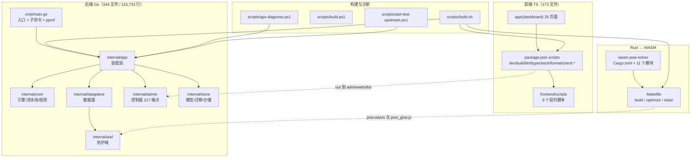
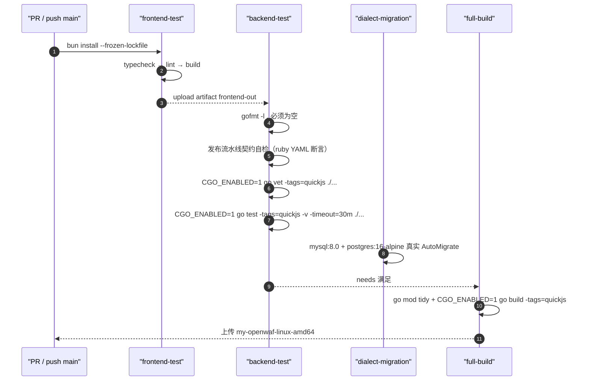
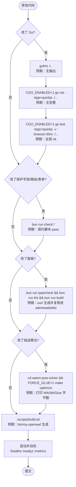
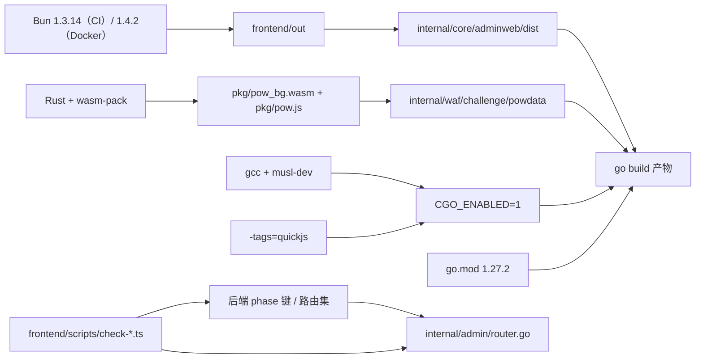

# 开发者指南

> [返回 项目概述](项目概述.md)

<cite>
**本文档引用的文件**
- [README.md](file://README.md)
- [AGENTS.md](file://AGENTS.md)
- [go.mod](file://go.mod)
- [frontend/package.json](file://frontend/package.json)
- [frontend/tsconfig.json](file://frontend/tsconfig.json)
- [frontend/eslint.config.mjs](file://frontend/eslint.config.mjs)
- [frontend/.prettierrc](file://frontend/.prettierrc)
- [frontend/next.config.ts](file://frontend/next.config.ts)
- [frontend/AGENTS.md](file://frontend/AGENTS.md)
- [Dockerfile](file://Dockerfile)
- [cmd/main.go](file://cmd/main.go)
- [scripts/build.sh](file://scripts/build.sh)
- [scripts/build.ps1](file://scripts/build.ps1)
- [scripts/qps-diagnose.ps1](file://scripts/qps-diagnose.ps1)
- [scripts/start-test-upstream.ps1](file://scripts/start-test-upstream.ps1)
- [wasm-pow-solver/Cargo.toml](file://wasm-pow-solver/Cargo.toml)
- [wasm-pow-solver/Makefile](file://wasm-pow-solver/Makefile)
- [.github/workflows/ci.yml](file://.github/workflows/ci.yml)
- [.github/workflows/release.yml](file://.github/workflows/release.yml)
- [.github/workflows/release-pr.yml](file://.github/workflows/release-pr.yml)
- [internal/waf/jsplugin/quickjs_cgo.go](file://internal/waf/jsplugin/quickjs_cgo.go)
- [internal/waf/jsplugin/quickjs_stub.go](file://internal/waf/jsplugin/quickjs_stub.go)
- [internal/app/server.go](file://internal/app/server.go)
- [internal/app/http3.go](file://internal/app/http3.go)
- [frontend/scripts/check-skip-path-by-phase.ts](file://frontend/scripts/check-skip-path-by-phase.ts)
- [frontend/scripts/check-api-route-contract.ts](file://frontend/scripts/check-api-route-contract.ts)
- [docs/项目概述/核心特性.md](file://docs/项目概述/核心特性.md)
- [docs/项目概述/技术架构.md](file://docs/项目概述/技术架构.md)
</cite>

## 目录

1. [简介](#简介)
2. [项目结构](#项目结构)
3. [核心组件](#核心组件)
4. [架构总览](#架构总览)
5. [详细组件分析](#详细组件分析)
6. [依赖关系分析](#依赖关系分析)
7. [性能考虑](#性能考虑)
8. [故障排查指南](#故障排查指南)
9. [结论](#结论)
10. [附录](#附录)

## 简介

本篇面向**开发者基础设施**：环境搭建、构建链路、质量门禁、测试资产、契约脚本、CI 与发布流水线、代码规范落地方式。它不重复功能语义——特性清单见[核心特性](核心特性.md)，分层与选型见[技术架构](技术架构.md)，首次上手操作步骤见[快速开始](快速开始.md)，插件与规则扩展开发见[扩展与插件系统](../扩展与插件系统/扩展与插件系统.md)。

项目由三个可独立构建的技术栈组成，但验收口径只有一个：**同一条命令链必须能在干净工作区上一次跑绿**。因此本篇把「命令」当作主要证据单元，每条命令都标注来源行号与预期输出。

**章节来源**
- [README.md:422-461](file://README.md#L422-L461)
- [docs/项目概述/核心特性.md](file://docs/项目概述/核心特性.md)
- [docs/项目概述/技术架构.md](file://docs/项目概述/技术架构.md)

## 项目结构

三栈一元的目录布局决定了「改哪里要跑什么」的映射关系。



**图表来源**
- [scripts/build.sh:1-14](file://scripts/build.sh#L1-L14)
- [wasm-pow-solver/Makefile:1-46](file://wasm-pow-solver/Makefile#L1-L46)
- [frontend/package.json:6-23](file://frontend/package.json#L6-L23)
- [cmd/main.go:13-51](file://cmd/main.go#L13-L51)
- [README.md:351-391](file://README.md#L351-L391)

项目元数据：

| 项 | 实测值 | 来源 |
|----|--------|------|
| Go module | `My-OpenWaf` | [go.mod:1](file://go.mod#L1) |
| Go 版本 | `go 1.27.2` | [go.mod:3](file://go.mod#L3) |
| 前端包版本 | `0.0.1`（`private: true`，`type: module`） | [frontend/package.json:2-5](file://frontend/package.json#L2-L5) |
| WASM crate | `owaf-pow-solver` 0.1.0，`edition = "2021"` | [wasm-pow-solver/Cargo.toml:1-11](file://wasm-pow-solver/Cargo.toml#L1-L11) |
| 入口 | `cmd/main.go:13` `main()` → `app.Run()`（:50） | [cmd/main.go:13-50](file://cmd/main.go#L13-L50) |
| 子命令 | `reset-admin-password [username] <new-password>` | [cmd/main.go:16-25](file://cmd/main.go#L16-L25) |
| 默认管理端口 | `:9443` | [README.md:321](file://README.md#L321) |
| 构建必需 tag | `-tags=quickjs` + `CGO_ENABLED=1` | [README.md:305](file://README.md#L305) |
| 非测试 Go 规模 | 349 文件 / 115,733 行 | `git ls-files` 实测 |
| 前端规模 | 173 个 ts/tsx | `git ls-files` 实测 |
| 测试规模 | 532 个 `_test.go` | `git ls-files` 实测 |
| 许可证 | Apache License 2.0 | [README.md:463-469](file://README.md#L463-L469) |

**章节来源**
- [go.mod:1-38](file://go.mod#L1-L38)
- [frontend/package.json:1-65](file://frontend/package.json#L1-L65)
- [wasm-pow-solver/Cargo.toml:1-47](file://wasm-pow-solver/Cargo.toml#L1-L47)
- [cmd/main.go:13-51](file://cmd/main.go#L13-L51)
- [README.md:293-408](file://README.md#L293-L408)

## 核心组件

开发者侧的「组件」是工具链与门禁，而不是运行期模块：

| 组件 | 载体 | 职责 | 何时必须执行 |
|------|------|------|--------------|
| Go 格式化 | `gofmt` | 风格一致性；CI 以 `gofmt -l` 非空即失败 | 每次 Go 代码改动 |
| Go 静态检查 | `go vet -tags=quickjs` | 类型/锁/格式化误用 | 提交前 |
| Go 测试 | `go test -tags=quickjs -timeout=30m` | 全量回归 | 提交前 + CI |
| 方言迁移测试 | `go test -run TestAutoMigrateOnExternalDialect` | MySQL/PG 真实建表 | schema 变更 |
| 前端类型 | `bun run typecheck`（`tsc --noEmit`） | 严格模式类型 | TS 改动 |
| 前端风格 | `bun run lint`（flat `eslint`）、`bun run format` | 规则与格式 | TS 改动 |
| 契约脚本 | `bun run check:*` 共 10 个 | 前后端字段/路由/阶段键一致 | 保护字段或路由变更 |
| 前端构建 | `bun run build` | 静态导出并复制进 embed 目录 | 面板改动 / 发版 |
| WASM 构建 | `make optimize` | PoW 分片产物刷新 | 挑战算法改动 |
| 一键构建 | `scripts/build.sh` / `build.ps1` | 三栈串联 | 交付前 |
| QPS 诊断 | `scripts/qps-diagnose.ps1` | 负载前后指标差值归因 | 性能改动 |
| 测试上游桩 | `scripts/start-test-upstream.ps1` | 本地最小上游 | 联调 |
| CI | `ci.yml` 4 作业 | 前端 → vet/test → 构建 | 每个 PR |
| 发布 | `release-pr.yml` + `release.yml` | 6 平台矩阵 + 原生 QuickJS 校验 | 发版 |

**章节来源**
- [README.md:422-461](file://README.md#L422-L461)
- [frontend/package.json:6-23](file://frontend/package.json#L6-L23)
- [.github/workflows/ci.yml:17-201](file://.github/workflows/ci.yml#L17-L201)
- [scripts/qps-diagnose.ps1:1-14](file://scripts/qps-diagnose.ps1#L1-L14)
- [scripts/start-test-upstream.ps1:1-8](file://scripts/start-test-upstream.ps1#L1-L8)

## 架构总览

CI 的作业编排体现了门禁的真实顺序：前端产物是后端构建的前置条件，因此后端测试必须先等前端导出完成。



**图表来源**
- [.github/workflows/ci.yml:17-79](file://.github/workflows/ci.yml#L17-L79)
- [.github/workflows/ci.yml:81-135](file://.github/workflows/ci.yml#L81-L135)
- [.github/workflows/ci.yml:137-201](file://.github/workflows/ci.yml#L137-L201)

## 详细组件分析

### 环境准备与前置依赖

| 工具 | 版本要求 | 用途 | 是否必需 | 来源 |
|------|----------|------|:--------:|------|
| Go | 1.27.2（`go.mod`），CI 用 `go-version-file: go.mod` | 后端构建与测试 | 是 | [go.mod:3](file://go.mod#L3) |
| Bun | 1.3.14（CI 固定），Docker 镜像用 `oven/bun:1.4.2-alpine` | 前端安装与构建 | 是 | [.github/workflows/ci.yml:147-153](file://.github/workflows/ci.yml#L147-L153) |
| GCC / musl-dev | Alpine `apk add gcc musl-dev` | QuickJS CGO 后端 | 是（要 `-tags=quickjs`） | [Dockerfile:9-10](file://Dockerfile#L9-L10) |
| Rust + wasm-pack | `wasm32-unknown-unknown` | 重建 PoW WASM | 仅挑战算法改动时 | [README.md:295](file://README.md#L295) |
| Node 类型链 | `typescript` ^6、`eslint` ^9、`prettier` ^3.8.3 | 前端门禁 | 是 | [frontend/package.json:53-64](file://frontend/package.json#L53-L64) |

`frontend/AGENTS.md` 明确警告「This is NOT the Next.js you know」：本项目使用 Next.js 16.2.6，涉及框架 API、约定与文件结构的改动，必须先读 `frontend/node_modules/next/dist/docs/` 下对应指南再动手，不能凭训练记忆写。

本地起服的最小环境变量组合（密钥与口令一律写作 `{占位}`，禁止把真实值写进文档、脚本或提交历史）：

```bash
export MY_OPENWAF_DB_DRIVER=sqlite
export MY_OPENWAF_DSN=./data/waf.db
export MY_OPENWAF_LOG_DSN=./data/waf_logs.db
export MY_OPENWAF_ADMIN_BIND=":9443"
export MY_OPENWAF_JWT_SECRET='{占位}'          # 不设则由首启自动生成并持久化
export MY_OPENWAF_REDIS_ADDR=''                # 留空即禁用分布式限流/挑战状态/配置同步
# 预期：首次启动日志打印初始管理凭据与 API Token（仅一次，需立即保存）
./bin/my-openwaf
```

**章节来源**
- [README.md:293-309](file://README.md#L293-L309)
- [README.md:311-324](file://README.md#L311-L324)
- [Dockerfile:1-28](file://Dockerfile#L1-L28)
- [frontend/AGENTS.md:1-6](file://frontend/AGENTS.md#L1-L6)
- [frontend/package.json:53-64](file://frontend/package.json#L53-L64)
- [.github/workflows/ci.yml:26-30](file://.github/workflows/ci.yml#L26-L30)

### 开发闭环：改码到验收



**图表来源**
- [README.md:422-452](file://README.md#L422-L452)
- [scripts/build.sh:1-14](file://scripts/build.sh#L1-L14)
- [wasm-pow-solver/Makefile:8-46](file://wasm-pow-solver/Makefile#L8-L46)

流程步骤表：

| 步 | 动作 | 命令 | 通过判据 |
|:--:|------|------|----------|
| 1 | 格式化自查 | `gofmt -l .` | 输出为空 |
| 2 | 静态检查 | `CGO_ENABLED=1 go vet -tags=quickjs ./...` | 退出码 0 |
| 3 | 全量测试 | `CGO_ENABLED=1 go test -tags=quickjs -v -timeout=30m ./...` | 无 FAIL |
| 4 | 串行本地回归 | `go test -p 1 -count=1 -timeout=30m ./...` | 无 FAIL |
| 5 | 契约脚本 | `bun run check:api-route-contract` 等 | 每个脚本 pass |
| 6 | 前端门禁 | `bun run typecheck` / `lint` / `format` | 无错误 |
| 7 | 前端导出 | `bun run build` | `frontend/out` 生成，`internal/core/adminweb/dist` 更新 |
| 8 | WASM 刷新 | `FORCE_GLUE=1 make optimize` | 打印 `WASM: <n> bytes` / `Glue: <n> bytes` |
| 9 | 一键构建 | `./scripts/build.sh` | `bin/my-openwaf` 存在 |
| 10 | 运行自检 | `./bin/my-openwaf` + 探针 | `/healthz` 200、`/readyz` 200 |

**章节来源**
- [README.md:422-452](file://README.md#L422-L452)
- [scripts/build.sh:1-14](file://scripts/build.sh#L1-L14)
- [wasm-pow-solver/Makefile:20-46](file://wasm-pow-solver/Makefile#L20-L46)
- [frontend/package.json:6-23](file://frontend/package.json#L6-L23)

### Go 侧命令与用途

```bash
# 来源：README.md:422-452
gofmt -l .                                        # 预期：无输出（有输出即 CI 失败）
CGO_ENABLED=1 go vet -tags=quickjs ./...          # 预期：无告警，退出码 0
CGO_ENABLED=1 go test -tags=quickjs -v -timeout=30m ./...   # 预期：每包 ok，无 FAIL
go test -p 1 -count=1 -timeout=30m ./...          # 本地全量回归：串行 + 关缓存，避免跨包端口争用

# 单包（internal/app 真实耗时贴近 go test 默认 600s，必须显式放宽）
go test ./internal/app/ -count=1 -timeout 25m      # 预期：ok  My-OpenWaf/internal/app

# 方言迁移（schema 变更时，需本地 MySQL/PG 或 CI services）
go test -v -timeout=10m -run TestAutoMigrateOnExternalDialect ./internal/store/
```

| 命令 | 用途 | 关键口径 | 来源 |
|------|------|----------|------|
| `gofmt -l .` | 格式门禁 | CI 里非空即 `exit 1` | [.github/workflows/ci.yml:32-39](file://.github/workflows/ci.yml#L32-L39) |
| `go vet -tags=quickjs ./...` | 静态检查 | 必须带 tag，否则检查的是 stub 分支 | [README.md:432](file://README.md#L432) |
| `go test -tags=quickjs -timeout=30m` | 全量测试 | CI 口径 30m | [README.md:433](file://README.md#L433) |
| `go test -p 1 -count=1` | 本地复现 CI | `-p 1` 串行、`-count=1` 关结果缓存 | [README.md:435](file://README.md#L435) |
| `go mod tidy` | 依赖收敛 | `full-build` 与 `build.sh` 均先执行 | [.github/workflows/ci.yml:193](file://.github/workflows/ci.yml#L193) |
| `go build -tags=quickjs -o bin/my-openwaf ./cmd/...` | 产出二进制 | `CGO_ENABLED=1` 必填 | [scripts/build.sh:13](file://scripts/build.sh#L13) |
| `go list -tags=quickjs -f '{{join .GoFiles " "}}' ./internal/waf/jsplugin` | 断言原生后端入选 | 必须含 `quickjs_cgo.go` | [.github/workflows/release.yml:155-162](file://.github/workflows/release.yml#L155-L162) |

`internal/app` 包必须显式放宽超时：该包真实耗时约 10.3–10.5 分钟，紧贴 `go test` 默认 600s 上限，默认超时下终行形如 `panic: test timed out after 10m0s`。这**不是**测试失败，也不是改动引入的回归。耗时主体是 97 个 `...InSeparateProcess` 用例（合计约 594.8s，占包墙钟 96%），它们用 `startAppProcessHarness*` 启动独立 WAF 进程来验证进程级行为（监听器热协调、TLS 默认值热重载、H2/H3 配置生效）；单个用例进程冷启动仅约 388ms，说明成本来自用例自身的业务操作而非进程启停。因此不要为提速削减等待常数，也不要在文档里把它记成「默认超时可用」。

**章节来源**
- [README.md:422-452](file://README.md#L422-L452)
- [.github/workflows/ci.yml:32-135](file://.github/workflows/ci.yml#L32-L135)
- [.github/workflows/release.yml:148-175](file://.github/workflows/release.yml#L148-L175)
- [scripts/build.sh:12-13](file://scripts/build.sh#L12-L13)

### 构建组合兼容矩阵

QuickJS 是 CGO 依赖，构建 tag 决定编译进哪套后端，两个分支文件由构建约束互斥选择：

| 组合 | 入选文件 | QuickJS 插件 | 说明 |
|------|----------|:------------:|------|
| `CGO_ENABLED=1` + `-tags=quickjs` | `quickjs_cgo.go` | 可用 | 发布与 CI 唯一受支持组合 |
| `CGO_ENABLED=1` 无 tag | `quickjs_stub.go` | 静默降级 | `//go:build !cgo \|\| !quickjs` |
| `CGO_ENABLED=0`（任意 tag） | `quickjs_stub.go` | 静默降级 | CI 契约显式禁止 `CGO_ENABLED: '0'` 出现在发布流 |

契约脚本用断言把这条规则钉在 CI 里：`ci.yml:41-67` 解析 `release.yml`，要求存在名为 `Verify native QuickJS backend` 的步骤、该步骤 `CGO_ENABLED == "1"` 且 `run` 含 `go list -tags=quickjs`、构建步骤含 `go build -tags=quickjs`，并 `grep` 两个约束文件首行。

**章节来源**
- [internal/waf/jsplugin/quickjs_cgo.go](file://internal/waf/jsplugin/quickjs_cgo.go)
- [internal/waf/jsplugin/quickjs_stub.go](file://internal/waf/jsplugin/quickjs_stub.go)
- [.github/workflows/ci.yml:41-67](file://.github/workflows/ci.yml#L41-L67)
- [.github/workflows/release.yml:148-175](file://.github/workflows/release.yml#L148-L175)

### 前端侧门禁与契约脚本家族

`frontend/package.json:6-23` 声明 10 个 `check:*` 脚本，指向 `frontend/scripts/` 下 9 个 TS 文件——`check:i18n` 与 `check:skip-path-contract` 复用同一脚本 `check-skip-path-by-phase.ts`。

```bash
cd frontend
bun install --frozen-lockfile          # 预期：无锁文件漂移
bun run typecheck                       # 预期：tsc --noEmit 无错误
bun run lint                            # 预期：eslint flat config 无 error
bun run format                          # 预期：改写 ts/tsx（semi false / printWidth 80）
bun run build                           # 预期：生成 out/ 并复制进 internal/core/adminweb/dist
bun run check:skip-path-contract        # 预期：phase 键与后端一致
bun run check:auth-refresh-contract     # 预期：刷新令牌契约通过
bun run check:login-form-contract       # 预期：登录表单字段契约通过
bun run check:rule-pattern-roundtrip    # 预期：规则 pattern 往返一致
bun run check:site-cache-contract       # 预期：站点缓存字段契约通过
bun run check:site-challenge-contract   # 预期：挑战字段契约通过
bun run check:site-protection-contract  # 预期：保护字段契约通过
bun run check:api-route-contract        # 预期：前端调用路由与 admin 注册一致
bun run check:env-override-contract     # 预期：环境变量覆盖语义一致
bun run check:i18n                      # 预期：同 check:skip-path-contract（同一脚本）
```

| 脚本 | 目标 | 何时必须跑 |
|------|------|------------|
| `check:api-route-contract` | 前端请求路径 ↔ `internal/admin/router.go` 注册集 | 新增/改名端点 |
| `check:site-protection-contract` | 保护字段 ↔ 站点表单与默认值 | 新增保护字段 |
| `check:site-challenge-contract` | 挑战类型与步骤语义 | 改验证码/5 秒盾/链式 |
| `check:site-cache-contract` | 响应缓存字段 | 改缓存规则 |
| `check:rule-pattern-roundtrip` | 规则 pattern 存取往返 | 改正则编辑 |
| `check:skip-path-by-phase`（两个别名） | phase 键一致 | 改阶段或跳过路径 |
| `check:auth-refresh-contract` | 刷新令牌流 | 改登录/会话 |
| `check:login-form-contract` | 登录表单字段 | 改登录页 |
| `check:env-override-contract` | 环境变量覆盖 | 改 `MY_OPENWAF_*` |

前端配置基线：`tsconfig.json` 开启 `strict`、`noEmit`、`moduleResolution: bundler`、`jsx: react-jsx` 与 `@/*` 路径别名；`eslint.config.mjs` 用 flat config 组合 `eslint-config-next/core-web-vitals` 与 `/typescript`，并显式 `globalIgnores` 覆盖默认忽略；`.prettierrc` 为 `semi: false`、`singleQuote: false`、`tabWidth: 2`、`trailingComma: "es5"`、`printWidth: 80`、`endOfLine: "lf"`，并挂 `prettier-plugin-tailwindcss` 与 `tailwindStylesheet: "app/globals.css"`。

**章节来源**
- [frontend/package.json:6-23](file://frontend/package.json#L6-L23)
- [frontend/tsconfig.json:1-36](file://frontend/tsconfig.json#L1-L36)
- [frontend/eslint.config.mjs:1-19](file://frontend/eslint.config.mjs#L1-L19)
- [frontend/.prettierrc:1-11](file://frontend/.prettierrc#L1-L11)
- [README.md:443-452](file://README.md#L443-L452)

### 测试资产与命名约定

仓库**没有独立的 e2e 目录**，全部测试与实现同包共存，靠文件后缀区分执行形态：

| 形态 | 命名 | 位置 | 特征 |
|------|------|------|------|
| 单元测试 | `*_test.go`（同域后缀） | 与被测文件同目录 | 无子进程，毫秒级 |
| 跨进程集成 | `*_process_test.go` | `internal/app/`（6 个） | 启动独立 WAF 进程验证进程级行为 |
| 端到端 | `*_e2e_test.go` | `internal/app/`、`internal/proxy/` | 真实转发与协议链路 |
| 等价/回归锁 | `*_equiv_test.go`、`*_gate_test.go`、`*_lock_test.go` | `internal/waf/owasp/` 等 | 掩码剪枝与旧实现等价断言 |
| 基准 | `*_bench_test.go` | 热点包 | 需 `-bench` 显式触发 |
| 契约脚本 | `check-*.ts` | `frontend/scripts/` | 由 `bun run check:*` 调用 |

实测口径：`_test.go` 共 532 个；跨进程与 e2e 命名单元的文件共 7 个，其中 6 个在 `internal/app/`。写测试时的取舍是：能在同进程断言的不要起进程，必须验证进程级行为才用 `startAppProcessHarness*`。

**章节来源**
- [README.md:434-435](file://README.md#L434-L435)
- [.github/workflows/ci.yml:77-79](file://.github/workflows/ci.yml#L77-L79)

### 本地诊断与压测

```bash
# 最小测试上游桩（Windows PowerShell）
pwsh ./scripts/start-test-upstream.ps1 -Bind 127.0.0.1:8800 -Status 200 -Body "OK"
#   预期：temp/test-upstream-server.out.log 生成，进程监听 :8800

# QPS 诊断：负载前后对 /metrics 取差值并给归因提示
pwsh ./scripts/qps-diagnose.ps1 -TargetUrl http://127.0.0.1/ -Requests 1000 -Concurrency 40
#   预期：输出 Load summary / Metric delta 表 / Diagnostic hints
pwsh ./scripts/qps-diagnose.ps1 -SelfTest
#   预期：Status = self-test passed，Rows = 27
pwsh ./scripts/qps-diagnose.ps1 -CompileOnly
#   预期：Status = compiled，产出 temp/qps-diagnose-loader.exe

# 检测引擎改动后的强制验收（README.md:454-461）
./bin/my-openwaf                        # 数据面监听 :80
./blazehttp -t http://127.0.0.1:80 -c 40  # 预期：无崩溃、无明显退化、无非预期 block/pass
```

`qps-diagnose.ps1` 的参数默认值与行为都写在脚本头部（`TargetUrl`、`MetricsUrl` 默认 `http://127.0.0.1:9443/metrics`、`Requests 1000`、`Concurrency 40`、`TimeoutSec 30`，以及 `-SkipLoad`/`-CompileOnly`/`-SelfTest` 三个开关）。它把一段内嵌 Go 压测源码写入 `temp/_qps-diagnose-loader/main.go` 后现场编译，采集 p50/p95/p99 延迟与状态码分布，并对 `writer_dropped_*`、`writer_flush_errors_total`、`upstream_unhealthy_total`、`upstream_average_latency_ms` 给出提示键。`/metrics` 本身是自实现的文本输出（不依赖 `prometheus/client_golang`），因此新增指标时要同步更新脚本第 376-404 行的指标清单。

pprof 不在默认路径上：需设 `MY_OPENWAF_PPROF_BIND` 才会以标准库 `net/http/pprof` 起独立监听（`cmd/main.go:29-49`），日志出现 `pprof listening on <bind>`。

**章节来源**
- [scripts/qps-diagnose.ps1:1-14](file://scripts/qps-diagnose.ps1#L1-L14)
- [scripts/qps-diagnose.ps1:376-404](file://scripts/qps-diagnose.ps1#L376-L404)
- [scripts/qps-diagnose.ps1:470-524](file://scripts/qps-diagnose.ps1#L470-L524)
- [scripts/start-test-upstream.ps1:1-26](file://scripts/start-test-upstream.ps1#L1-L26)
- [cmd/main.go:29-49](file://cmd/main.go#L29-L49)
- [README.md:454-461](file://README.md#L454-L461)

### 构建脚本差异与 WASM 刷新

| 脚本 | 步骤 | 含 WASM 重建 | 产物 |
|------|------|:------------:|------|
| `scripts/build.sh` | 前端 install/build → 复制 dist → `make optimize` → `go mod tidy` → `go build -tags=quickjs` | 是 | `bin/my-openwaf` |
| `scripts/build.ps1` | 前端 install/build → 复制 dist → `go mod tidy` → `go build -tags=quickjs` | **否** | `bin\my-openwaf.exe` |
| `Dockerfile` | bun 段导出 → golang 段（gcc/musl，CGO+tag）→ alpine 运行时 | 否（复用仓库内产物） | 镜像 `/app/my-openwaf` |

Windows 侧不重建 WASM 意味着：改动 Rust 后必须手工执行 `make optimize`，否则二进制里的 `powdata` 仍是旧产物。另外 `pow_glue.js` 一旦已被混淆，`make build`/`make optimize` 默认会**复用**现有混淆文件并打印跳过原因，必须 `FORCE_GLUE=1 make optimize` 才会用 `pkg/pow.js` 重新生成（判据是文件内是否含 `function _0x`）。

**章节来源**
- [scripts/build.sh:1-14](file://scripts/build.sh#L1-L14)
- [scripts/build.ps1:1-21](file://scripts/build.ps1#L1-L21)
- [Dockerfile:1-28](file://Dockerfile#L1-L28)
- [wasm-pow-solver/Makefile:8-46](file://wasm-pow-solver/Makefile#L8-L46)

### CI 与发布流水线

| 作业 | 触发 | 关键步骤 | 判据 |
|------|------|----------|------|
| `frontend-test` | push/PR to main | `bun install --frozen-lockfile` → typecheck → lint → build → 上传 `frontend-out` | `if-no-files-found: error` |
| `backend-test` | needs `frontend-test` | gofmt → 发布流契约自检 → vet → `go test -tags=quickjs -timeout=30m` | 任一失败即红 |
| `dialect-migration` | needs `frontend-test` | mysql:8.0 + postgres:16-alpine services，`-run TestAutoMigrateOnExternalDialect` | 独立作业，不阻塞主路径 |
| `full-build` | needs 前两者 | `go mod tidy` + 构建 + 上传 Linux 二进制 | 产物非空 |
| `release-pr.verify` | push main / 手动 | 与 backend 同口径 + 前端 typecheck/lint | 通过才建 PR |
| `release-pr.release-pr` | needs verify | 版本解析（无 tag 时 `0.1.0`，否则 patch+1）→ `release/vX.Y.Z` 分支 → `.release.json` → `gh pr create/edit` | tag 已存在即失败 |
| `release.release-meta` | PR 合并（head 以 `release/v` 开头）或手动 | 解析 version/tag/prerelease → 附注 tag 并推送 | 推 tag 失败即停摆 |
| `release.frontend` | needs release-meta | 按 tag checkout 再导出前端 | 产物上传 |
| `release.build` | needs frontend | 6 平台矩阵：Verify native QuickJS → build → 打包 tar.gz/zip → sha256 | CGO + tag 断言 |
| `release.publish` | needs build | `softprops/action-gh-release` 汇总产物 | 生成 release notes |

发布矩阵覆盖 `linux/amd64`、`linux/arm64`、`darwin/amd64`、`darwin/arm64`、`windows/amd64`、`windows/arm64` 六个组合，`ci.yml` 的契约自检里用 `grep -cE '^[[:space:]]+runner:'` 断言数量恰好为 6，平台增删必须同步该断言。

**章节来源**
- [.github/workflows/ci.yml:17-201](file://.github/workflows/ci.yml#L17-L201)
- [.github/workflows/release-pr.yml:21-171](file://.github/workflows/release-pr.yml#L21-L171)
- [.github/workflows/release.yml:18-239](file://.github/workflows/release.yml#L18-L239)
- [.github/workflows/ci.yml:41-45](file://.github/workflows/ci.yml#L41-L45)

### 代码规范与 WAF 配置一致性规则

`AGENTS.md` 把「配置面变更」列为强制同步项，这是本项目最容易出问题的地方：新增一个保护字段若只落模型，前端会显示但后端不生效，或反之。

| 变更类型 | 必须同步的位置 | 验证方式 |
|----------|----------------|----------|
| 新增/修改保护字段 | `internal/store` 模型、Admin handler、前端 API 类型、页面表单、默认值说明 | `bun run check:site-protection-contract` + `go test ./internal/admin/...` |
| 新增挑战语义 | 按 WAF action 建模：`captcha_challenge` 显示配置的验证码类型、`shield_challenge` 显示 5 秒盾、`chain_challenge` 显示链式步骤 | `bun run check:site-challenge-contract` |
| 日志新增审计字段 | 必须脱敏、截断、可折叠展示，避免记录 `Authorization`/`Cookie`/`Set-Cookie`/API key | 前端展示核对 + 相关包测试 |
| 站点级 nullable 字段 | 前端必须表达为「继承全局 / 覆盖启用 / 覆盖关闭」，不得把空值存成 `false`/`0`/空对象 | `check:site-protection-contract` |
| 新增端点 | `internal/admin/router.go` 注册 + 前端调用路径 | `bun run check:api-route-contract` |
| 新增环境变量 | `MY_OPENWAF_*` 读取处 + README 环境变量表 + 覆盖语义 | `bun run check:env-override-contract` |
| 快捷配置页（Bot/Drop/CC） | 不得制造第二配置源；保存时读取并合并现有 `protection` | `check:site-protection-contract` |

通用编码约定：默认中文交流与提交信息，代码/日志/标识符保持原语言；文件一律 UTF-8 无 BOM；注释采用 JSDoc（前端）与 JavaDoc 风格块注释（Go 侧 `/** ... * @param/@return */`，见 `internal/snapshot/snapshot.go`、`internal/waf/bot/bot.go`）；局部修改优先，不顺手重构无关模块。

**章节来源**
- [AGENTS.md](file://AGENTS.md)
- [frontend/package.json:13-22](file://frontend/package.json#L13-L22)
- [internal/snapshot/snapshot.go:470-474](file://internal/snapshot/snapshot.go#L470-L474)
- [README.md:463-467](file://README.md#L463-L467)

## 依赖关系分析

工具链依赖关系集中在三处：前端产物是后端 embed 的前置，WASM 产物是挑战功能的前置，CGO+tag 是 QuickJS 插件的前置。



**图表来源**
- [scripts/build.sh:4-13](file://scripts/build.sh#L4-L13)
- [wasm-pow-solver/Makefile:1-17](file://wasm-pow-solver/Makefile#L1-L17)
- [.github/workflows/ci.yml:147-194](file://.github/workflows/ci.yml#L147-L194)
- [frontend/package.json:13-22](file://frontend/package.json#L13-L22)

外部实体依赖一览（均为构建期依赖，运行期零外部服务必需）：

| 依赖 | 类型 | 用途 | 缺失后果 |
|------|------|------|----------|
| `oven/bun` | 构建镜像 | 前端安装与导出 | 后端 embed 目录为空，面板 404 |
| `golang:1.27-alpine` + gcc | 构建镜像 | CGO 编译 | QuickJS 落 stub |
| `alpine:3.21` + `libwebp-dev`/`font-dejavu` | 运行镜像 | WebP 与水印字体 | 图像转换能力受限 |
| `actions/setup-go@v5` | CI | 按 `go.mod` 取版本 | 版本漂移 |
| `oven-sh/setup-bun@v2` | CI | 固定 Bun 1.3.14 | 锁文件漂移 |
| `softprops/action-gh-release@v2` | 发布 | 汇总多平台产物 | 无 release |
| `blazehttp`（仓库内二进制） | 验收 | 引擎改动压测 | 验收缺依据 |

**章节来源**
- [Dockerfile:1-28](file://Dockerfile#L1-L28)
- [.github/workflows/ci.yml:26-30](file://.github/workflows/ci.yml#L26-L30)
- [.github/workflows/ci.yml:147-153](file://.github/workflows/ci.yml#L147-L153)
- [.github/workflows/release.yml:225-238](file://.github/workflows/release.yml#L225-L238)
- [README.md:391](file://README.md#L391)

## 性能考虑

- **测试耗时预算**：全量 `go test` 的墙钟主要由 `internal/app` 的跨进程用例决定，本地请用 `-p 1 -count=1 -timeout=30m` 复现 CI 口径，而不是并行 + 短超时后误判为回归。
- **不要削减等待常数**：等待时间是断言强度的一部分；`internal/app` 用例平均 6.13s 中进程启停仅约 6%，其余为业务操作本身。
- **基准先行**：涉及引擎热路径的改动先看 `*_bench_test.go` 与 `./blazehttp` 结果，再谈优化；掩码化后的引擎 clean 微基准为 1,346 ns/op、0 分配（README.md:276）。
- **前端构建**：Next.js 16 默认 Turbopack（脚本已无 `--turbopack`），`output: "export"` 下 `redirects`/`rewrites`/`cookies()`/Server Actions 均不可用，别把这些当作可用能力来设计。
- **指标成本**：`/metrics` 为按需拼装文本，新增高基数指标前先确认不会拖慢抓取路径。

**章节来源**
- [README.md:270-276](file://README.md#L270-L276)
- [README.md:422-452](file://README.md#L422-L452)
- [frontend/next.config.ts:1-16](file://frontend/next.config.ts#L1-L16)

## 故障排查指南

| 症状 | 原因 | 处置 |
|------|------|------|
| `panic: test timed out after 10m0s`（`internal/app`） | 默认 600s 紧贴该包真实耗时 | `go test ./internal/app/ -count=1 -timeout 25m` |
| `go vet`/`go test` 中 QuickJS 行为与发布版不一致 | 未加 `-tags=quickjs` 或 `CGO_ENABLED=0` | 统一带 tag + CGO；用 `go list -tags=quickjs` 断言入选 |
| `::error::Go files are not formatted` | `gofmt -l .` 非空 | 本地先 `gofmt -w` 再提交 |
| 面板 404 或空白 | `internal/core/adminweb/dist` 未更新 | 先 `bun run build`（脚本已内置复制）再 `go build` |
| 改 Rust 后挑战行为没变 | `build.ps1` 不跑 `make optimize`；或混淆 glue 被复用 | `FORCE_GLUE=1 make optimize` |
| 发布流报 `missing native QuickJS verification step` | `release.yml` 步骤名或矩阵数量被改 | 同步步骤名与 6 runner 断言 |
| `Tag already exists` | 版本号解析撞已有 tag | 指定新版本号或换 patch |
| `契约脚本` 报不一致 | 前端类型或路由未随 `internal/store`/`router.go` 更新 | 按一致性规则表逐项补齐 |
| JA3/JA4 为空 | 误设 `MY_OPENWAF_H2WS_PEEKER_OFF=1`（仅测试逃生门） | 取消该变量 |

**章节来源**
- [.github/workflows/ci.yml:32-67](file://.github/workflows/ci.yml#L32-L67)
- [.github/workflows/release.yml:148-175](file://.github/workflows/release.yml#L148-L175)
- [.github/workflows/release-pr.yml:121-125](file://.github/workflows/release-pr.yml#L121-L125)
- [wasm-pow-solver/Makefile:11-30](file://wasm-pow-solver/Makefile#L11-L30)
- [README.md:344-345](file://README.md#L344-L345)
- [scripts/build.ps1:5-19](file://scripts/build.ps1#L5-L19)

## 结论

本篇的成果是把开发者基础设施整理成一条可验证的命令链：12 项元数据事实、一条 10 步开发闭环、10 个契约脚本与 3 个诊断入口，全部对应到 `README.md`、`scripts/`、`.github/workflows/` 的具体行。KISS 体现在「唯一门禁即命令链」，不额外引入 Makefile 或多层封装；YAGNI 体现在不新增独立 e2e 目录与测试框架，跨进程验证沿用同包命名约定；DRY 与 SOLID 的落点在契约脚本——它们守护「前后端共享同一事实表」，而阶段链与保护字段的单一事实源仍是 `internal/store` 与 `internal/core/engine`，工具链只负责发现偏移，不复制配置。

已发现的问题：`build.ps1` 与 `build.sh` 在 WASM 步骤上不对称；`check:i18n` 与 `check:skip-path-contract` 同脚本；`optimizePackageImports` 残留 `lucide-react`；README 前置要求写 Go 1.27.1 而 `go.mod` 为 1.27.2，Docker 用 Bun 1.4.2 而 CI 固定 1.3.14。

下一步：把 kind 白名单差集（后端 57/30/9 与前端 33）纳入契约脚本比对，并考虑让 `build.ps1` 支持可选 `-WithWasm` 开关以消除平台不对称。

**章节来源**
- [AGENTS.md](file://AGENTS.md)
- [frontend/package.json:13-22](file://frontend/package.json#L13-L22)
- [frontend/next.config.ts:12](file://frontend/next.config.ts#L12)
- [README.md:293-309](file://README.md#L293-L309)

## 附录

### 术语速查

| 术语 | 含义 | 出处 |
|------|------|------|
| 契约脚本 | 校验前端类型/路由与后端事实表一致性的 TS 脚本 | `frontend/scripts/check-*.ts` |
| 跨进程用例 | 启动独立 WAF 进程验证进程级行为 | `*_process_test.go` |
| 构建 tag | `quickjs`，决定 CGO 后端或 stub | `quickjs_cgo.go`/`quickjs_stub.go` |
| glue | WASM 与页面 JS 的桥接脚本，发布前被混淆 | `Makefile:20-41` |
| `FORCE_GLUE` | 强制用 `pkg/pow.js` 重生成 glue 的开关 | `Makefile:18-30` |
| `function _0x` | 判定 glue 是否已混淆的标记串 | `Makefile:11`、`:24` |
| Alt-Svc 通告 | h1/h2 响应中告知 h3 端口 | `internal/app/http3.go` |
| 逃生门 | 仅供测试的环境变量开关，生产禁用 | `MY_OPENWAF_H2WS_PEEKER_OFF` |

**章节来源**
- [frontend/package.json:13-22](file://frontend/package.json#L13-L22)
- [scripts/qps-diagnose.ps1:502-506](file://scripts/qps-diagnose.ps1#L502-L506)
- [wasm-pow-solver/Makefile:11-41](file://wasm-pow-solver/Makefile#L11-L41)
- [internal/waf/jsplugin/quickjs_cgo.go:1-3](file://internal/waf/jsplugin/quickjs_cgo.go#L1-L3)
- [internal/app/http3.go:858](file://internal/app/http3.go#L858)
- [README.md:344-345](file://README.md#L344-L345)

### 命令与用途速查

| 命令 | 用途 | 预期输出 |
|------|------|----------|
| `./scripts/build.sh` | 三栈一键构建 | `bin/my-openwaf` |
| `./scripts/build.ps1` | Windows 构建（不含 WASM 重建） | `bin\my-openwaf.exe` |
| `gofmt -l .` | 格式自查 | 空 |
| `CGO_ENABLED=1 go vet -tags=quickjs ./...` | 静态检查 | 空 |
| `go test -p 1 -count=1 -timeout=30m ./...` | 本地全量回归 | 全部 `ok` |
| `bun run check:api-route-contract` | 端点契约 | pass |
| `make optimize` | 刷新 PoW 产物 | `WASM: n bytes` / `Glue: n bytes` |
| `pwsh ./scripts/qps-diagnose.ps1 -SelfTest` | 诊断脚本自检 | `Status = self-test passed` |
| `./blazehttp -t http://127.0.0.1:80 -c 40` | 引擎验收压测 | 无异常崩溃/退化 |
| `my-openwaf reset-admin-password <user> <new>` | 重置管理密码 | 成功即静默退出 |

**章节来源**
- [README.md:293-309](file://README.md#L293-L309)
- [README.md:422-461](file://README.md#L422-L461)
- [cmd/main.go:16-25](file://cmd/main.go#L16-L25)
- [scripts/qps-diagnose.ps1:502-506](file://scripts/qps-diagnose.ps1#L502-L506)
- [wasm-pow-solver/Makefile:8-46](file://wasm-pow-solver/Makefile#L8-L46)
