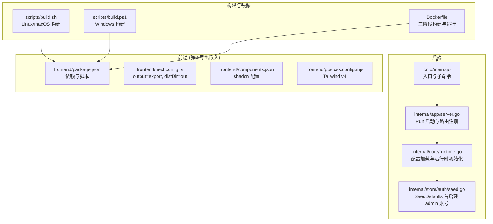
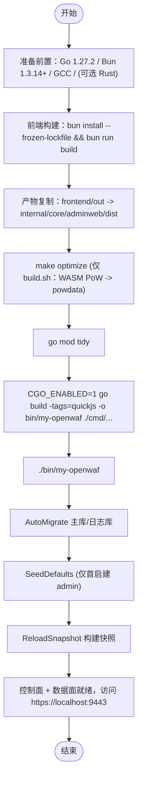
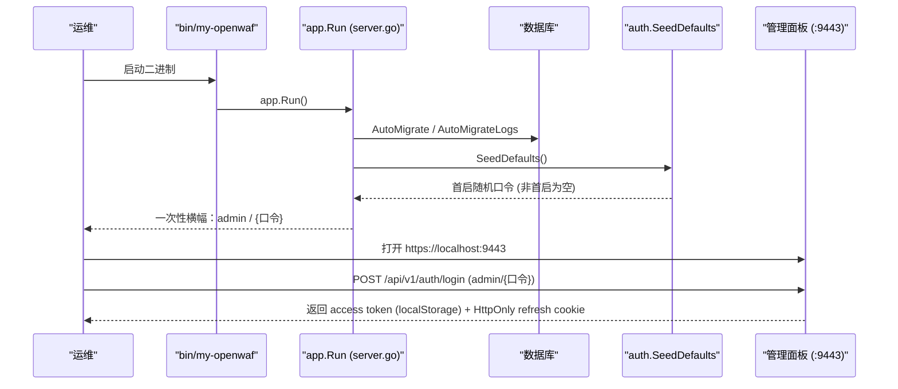
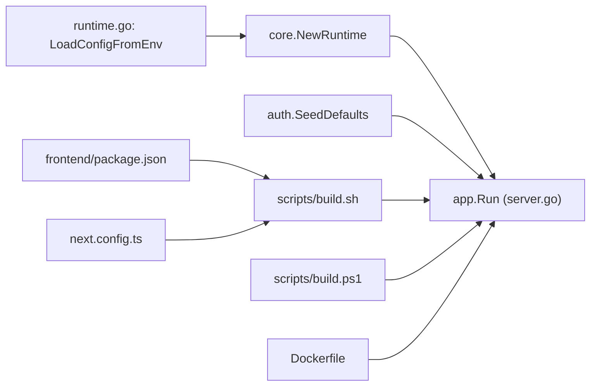

# 快速开始

> [返回 项目概述](项目概述.md)

<cite>
**本文档引用的文件**
- [README.md](file://README.md)
- [go.mod](file://go.mod)
- [Dockerfile](file://Dockerfile)
- [cmd/main.go](file://cmd/main.go)
- [internal/app/server.go](file://internal/app/server.go)
- [internal/core/runtime.go](file://internal/core/runtime.go)
- [internal/store/auth/seed.go](file://internal/store/auth/seed.go)
- [scripts/build.sh](file://scripts/build.sh)
- [scripts/build.ps1](file://scripts/build.ps1)
- [frontend/package.json](file://frontend/package.json)
- [frontend/next.config.ts](file://frontend/next.config.ts)
- [frontend/components.json](file://frontend/components.json)
- [frontend/postcss.config.mjs](file://frontend/postcss.config.mjs)
</cite>

## 目录

1. [简介](#简介)
2. [项目结构](#项目结构)
3. [核心组件](#核心组件)
4. [架构总览](#架构总览)
5. [详细组件分析](#详细组件分析)
6. [依赖关系分析](#依赖关系分析)
7. [性能考虑](#性能考虑)
8. [故障排查指南](#故障排查指南)
9. [结论](#结论)
10. [附录](#附录)

## 简介
本指南面向首次接触 My-OpenWaf 的用户，帮助你在最短时间内完成安装、构建与运行，并通过 Docker 实现一键部署。文档覆盖：环境前置、本地与脚本构建、源码手动构建、Docker 镜像构建与容器运行、基本配置项、首次启动到可登录的完整流程，以及常见排障建议。

所有命令均逐条对应仓库内的脚本或配置来源，不凭经验补全。密钥、令牌与口令一律以 `{占位}` 表达。

## 项目结构
My-OpenWaf 是前后端合一的单二进制程序：后端由 Go 编写，`internal/app.Run` 串联控制面与数据面；前端基于 Next.js 以静态导出（`output: "export"`，产物目录 `out`）构建后复制到 `internal/core/adminweb/dist`，编译期嵌入后端。



**图表来源**
- [cmd/main.go:13-50](file://cmd/main.go#L13-L50)
- [internal/app/server.go:234-301](file://internal/app/server.go#L234-L301)
- [internal/core/runtime.go:23-60](file://internal/core/runtime.go#L23-L60)
- [internal/store/auth/seed.go:14-56](file://internal/store/auth/seed.go#L14-L56)
- [frontend/package.json:6-23](file://frontend/package.json#L6-L23)
- [frontend/next.config.ts:1-16](file://frontend/next.config.ts#L1-L16)
- [scripts/build.sh:1-13](file://scripts/build.sh#L1-L13)
- [scripts/build.ps1:1-21](file://scripts/build.ps1#L1-L21)
- [Dockerfile:1-28](file://Dockerfile#L1-L28)

**章节来源**
- [README.md:351-389](file://README.md#L351-L389)
- [frontend/next.config.ts:1-16](file://frontend/next.config.ts#L1-L16)

## 核心组件
- 应用入口与启动：`main()` 先识别子命令（`reset-admin-password` / `help`），可选拉起 pprof，随后调用 `app.Run()`。参考 [cmd/main.go:13-50](file://cmd/main.go#L13-L50)。
- 运行时与配置：`NewRuntime` 调用 `LoadConfigFromEnv` 读取环境变量，校验引导配置后打开主库与日志库，可选建立 Redis，并初始化缓存与快照持有者。参考 [internal/core/runtime.go:23-60](file://internal/core/runtime.go#L23-L60)。
- 控制面健康与路由：`Run` 在管理端口注册 `/healthz`、`/readyz`、`/status`、`/metrics`，再 `admin.RegisterRoutes` 挂载业务 API 与前端静态资源。参考 [internal/app/server.go:1053-1063](file://internal/app/server.go#L1053-L1063)。
- 默认数据与凭据：`SeedDefaults` **仅** 在首次运行且无 `admin` 账号时创建管理员并返回随机口令；**不预置任何 API 令牌**（令牌须由已登录管理员主动创建）。参考 [internal/store/auth/seed.go:14-56](file://internal/store/auth/seed.go#L14-L56)。
- 前端构建与嵌入：`bun run build` 在 `next build` 后将 `out` 复制入 `internal/core/adminweb/dist`。参考 [frontend/package.json:8](file://frontend/package.json#L8)、[scripts/build.sh:4-8](file://scripts/build.sh#L4-L8)。

**章节来源**
- [cmd/main.go:13-50](file://cmd/main.go#L13-L50)
- [internal/core/runtime.go:23-60](file://internal/core/runtime.go#L23-L60)
- [internal/app/server.go:1053-1063](file://internal/app/server.go#L1053-L1063)
- [internal/store/auth/seed.go:14-56](file://internal/store/auth/seed.go#L14-L56)
- [scripts/build.sh:1-13](file://scripts/build.sh#L1-L13)

## 架构总览
先给出构建与启动的整体流程，再给出首次启动到可登录的时序。



**图表来源**
- [scripts/build.sh:4-13](file://scripts/build.sh#L4-L13)
- [README.md:295-309](file://README.md#L295-L309)
- [internal/app/server.go:234-301](file://internal/app/server.go#L234-L301)

下图为首次启动到可登录的时序：`Run` 完成迁移与种子后打印一次性凭据，运维以其登录管理面板。



**图表来源**
- [internal/app/server.go:234-301](file://internal/app/server.go#L234-L301)
- [internal/app/server.go:272-280](file://internal/app/server.go#L272-L280)
- [internal/store/auth/seed.go:14-56](file://internal/store/auth/seed.go#L14-L56)

## 详细组件分析

### 环境要求与依赖
项目为 Go + CGO（QuickJS）混合构建，前端用 Bun，容器为多阶段 Alpine。前置矩阵如下：

| 依赖 | 版本 / 要求 | 必需性 | 来源 |
|------|-------------|:------:|------|
| Go | `1.27.2`（前置要求 1.27.1+） | 必需 | [go.mod:3](file://go.mod#L3)、[README.md:295](file://README.md#L295) |
| Bun | `1.3.14+`（镜像内 `1.4.2`） | 必需（前端构建） | [README.md:295](file://README.md#L295)、[Dockerfile:2](file://Dockerfile#L2) |
| GCC | C 编译器（QuickJS CGO 后端） | 必需 | [README.md:295](file://README.md#L295)、[Dockerfile:10](file://Dockerfile#L10) |
| Rust | 工具链（重建 WASM PoW 时） | 可选 | [README.md:295](file://README.md#L295)、[scripts/build.sh:9-10](file://scripts/build.sh#L9-L10) |
| Docker | 任意近期版本 | 可选（容器部署） | [Dockerfile:1-28](file://Dockerfile#L1-L28) |
| 数据库 | 默认 SQLite（零外部依赖） | 内置 | [README.md:315-320](file://README.md#L315-L320) |
| Redis | 地址配置后启用 | 可选 | [README.md:322](file://README.md#L322) |

**章节来源**
- [README.md:293-309](file://README.md#L293-L309)
- [go.mod:3](file://go.mod#L3)
- [Dockerfile:2-18](file://Dockerfile#L2-L18)

### 安装与构建步骤
克隆仓库后，推荐使用一键构建脚本。`scripts/build.sh` 的实际步骤为：前端 `bun install --frozen-lockfile` → `bun run build` → 产物落入 `internal/core/adminweb/dist` → `wasm-pow-solver` 执行 `make optimize` → `go mod tidy` → `CGO_ENABLED=1 go build -tags=quickjs`。Windows 对应 `scripts/build.ps1`（不含 WASM 优化步骤）。

```bash
# 一键全量构建（Linux/macOS）—— 对应 scripts/build.sh:4-13
./scripts/build.sh

# Windows —— 对应 scripts/build.ps1:5-18
./scripts/build.ps1

# 手动等价（对应 README.md:302-305）
cd frontend && bun install --frozen-lockfile && bun run build
cd .. && CGO_ENABLED=1 go build -tags=quickjs -ldflags="-s -w" -o bin/my-openwaf ./cmd/...

# 运行（对应 README.md:308）
./bin/my-openwaf
```

命令与用途对照：

| 命令 | 用途 | 来源 |
|------|------|------|
| `./scripts/build.sh` | 前端 + WASM + 后端全量构建 | [scripts/build.sh:1-13](file://scripts/build.sh#L1-L13) |
| `./scripts/build.ps1` | Windows 全量构建（无 WASM 步骤） | [scripts/build.ps1:1-21](file://scripts/build.ps1#L1-L21) |
| `bun install --frozen-lockfile` | 按锁文件安装前端依赖 | [scripts/build.sh:5](file://scripts/build.sh#L5) |
| `bun run build` | Next.js 静态导出并复制产物 | [frontend/package.json:8](file://frontend/package.json#L8) |
| `make optimize` | 编译 WASM PoW 求解器 | [scripts/build.sh:10](file://scripts/build.sh#L10) |
| `go build -tags=quickjs -o bin/my-openwaf ./cmd/...` | 编译后端二进制 | [scripts/build.sh:13](file://scripts/build.sh#L13) |
| `./bin/my-openwaf` | 启动服务 | [README.md:308](file://README.md#L308) |

**章节来源**
- [scripts/build.sh:1-13](file://scripts/build.sh#L1-L13)
- [scripts/build.ps1:1-21](file://scripts/build.ps1#L1-L21)
- [frontend/package.json:6-8](file://frontend/package.json#L6-L8)
- [README.md:297-309](file://README.md#L297-L309)

### 部署方式

#### 本地运行
直接运行构建产物即可；应用会自动迁移数据库并在首次运行生成管理员口令。环境变量可覆盖驱动、DSN、数据目录与管理端口（见下节配置项表）。

```bash
# 覆盖默认配置后启动（密钥/口令一律 {占位}）
MY_OPENWAF_DB_DRIVER=sqlite \
MY_OPENWAF_DATA=./data \
MY_OPENWAF_ADMIN_BIND=:9443 \
MY_OPENWAF_JWT_SECRET={占位} \
./bin/my-openwaf
```

**章节来源**
- [internal/app/server.go:234-301](file://internal/app/server.go#L234-L301)
- [internal/core/runtime.go:23-60](file://internal/core/runtime.go#L23-L60)

#### Docker 容器部署
`Dockerfile` 为三阶段：`oven/bun:1.4.2-alpine` 构建前端 → `golang:1.27-alpine` 编译后端（带 `-ldflags="-s -w"`）→ `alpine:3.21` 运行，默认暴露 `9443` 并挂载 `/app/data` 数据卷。

```bash
# 构建镜像
docker build -t my-openwaf:latest .

# 运行容器（对应 README.md:282-289）
docker run -d \
  --name my-openwaf \
  --restart always \
  -p 9443:9443 \
  -v ./data:/app/data \
  my-openwaf:latest
```

**章节来源**
- [Dockerfile:1-28](file://Dockerfile#L1-L28)
- [README.md:282-289](file://README.md#L282-L289)

### 初始配置与启动示例
配置通过环境变量注入，`NewRuntime` 内的 `LoadConfigFromEnv` 读取。下表为基本配置项（默认值来源 `README.md` 配置说明）：

| 环境变量 | 默认值 | 说明 |
|----------|--------|------|
| `MY_OPENWAF_DB_DRIVER` | `sqlite` | 数据库驱动 `sqlite`/`mysql`/`postgres` |
| `MY_OPENWAF_DSN` | `./data/waf.db` | 主库连接串（Docker 为 `/app/data/waf.db`） |
| `MY_OPENWAF_LOG_DSN` | `./data/waf_logs.db` | 独立日志库 |
| `MY_OPENWAF_DATA` | `./data` | 数据目录 |
| `MY_OPENWAF_ADMIN_BIND` | `:9443` | 管理 API 监听地址 |
| `MY_OPENWAF_REDIS_ADDR` | 空 | 可选 Redis 地址 |
| `MY_OPENWAF_JWT_SECRET` | 自动生成并持久化 | JWT 签名密钥 |
| `MY_OPENWAF_ADMIN_STATIC_DIR` | 内嵌前端 | 开发时改用磁盘前端资源 |

> 首启仅打印管理员用户名与随机口令（一次性横幅），**不打印也不预置 API Token**；API Key 需登录后在后台创建。

**章节来源**
- [README.md:315-345](file://README.md#L315-L345)
- [internal/store/auth/seed.go:14-56](file://internal/store/auth/seed.go#L14-L56)

### 首启流程与验证
从启动到可登录的关键步骤如下：

| 步序 | 动作 | 结果 | 来源 |
|:----:|------|------|------|
| 1 | 启动二进制 | `main()` 识别子命令后 `app.Run()` | [cmd/main.go:13-50](file://cmd/main.go#L13-L50) |
| 2 | 加载配置/开库 | `NewRuntime` 读 env，开主库与日志库 | [internal/core/runtime.go:36-60](file://internal/core/runtime.go#L36-L60) |
| 3 | 自动迁移 | `AutoMigrate` / `AutoMigrateLogs` 建表 | [internal/app/server.go:249-264](file://internal/app/server.go#L249-L264) |
| 4 | 种子数据 | 仅首启建 `admin`，返回随机口令 | [internal/store/auth/seed.go:26-55](file://internal/store/auth/seed.go#L26-L55) |
| 5 | 凭据横幅 | 一次性打印 admin 用户名 + 口令 | [internal/app/server.go:272-280](file://internal/app/server.go#L272-L280) |
| 6 | 快照与路由 | `ReloadSnapshot` 后注册控制面/数据面 | [internal/app/server.go:293-301](file://internal/app/server.go#L293-L301) |
| 7 | 健康验证 | `GET /healthz` `/readyz` `/status` 可用 | [internal/app/server.go:1053-1056](file://internal/app/server.go#L1053-L1056) |
| 8 | 登录后台 | 用一次性口令登录 `https://localhost:9443` | [README.md:291](file://README.md#L291) |

```bash
# 验证安装成功
curl -s http://localhost:9443/healthz
curl -s http://localhost:9443/readyz
```

**章节来源**
- [internal/app/server.go:249-301](file://internal/app/server.go#L249-L301)
- [internal/app/server.go:1053-1063](file://internal/app/server.go#L1053-L1063)
- [README.md:291](file://README.md#L291)

## 依赖关系分析



**图表来源**
- [internal/core/runtime.go:23-60](file://internal/core/runtime.go#L23-L60)
- [internal/app/server.go:234-301](file://internal/app/server.go#L234-L301)
- [internal/store/auth/seed.go:14-56](file://internal/store/auth/seed.go#L14-L56)
- [scripts/build.sh:1-13](file://scripts/build.sh#L1-L13)
- [Dockerfile:1-28](file://Dockerfile#L1-L28)

**章节来源**
- [frontend/package.json:24-64](file://frontend/package.json#L24-L64)

## 性能考虑
- 默认 SQLite 适合小规模与本地验证；生产可切换 MySQL/PostgreSQL 并配置连接池与索引。
- 启用 Redis 可在多节点场景下共享限流窗口与配置同步。
- 按站点动态启停监听器，减少空闲资源占用；TLS/SNI 配置变更会触发受影响监听器热重启。
- 前端为静态导出并内嵌二进制，省去独立静态服务的访问开销。

[本节为总结，无需特定文件来源]

## 故障排查指南
- 前端构建失败：确认 Bun 版本满足要求且存在 `frontend/bun.lock`，用 `bun install --frozen-lockfile`。参考 [frontend/package.json:6-8](file://frontend/package.json#L6-L8)。
- Go 构建失败：Go 需 1.27.1+，并确保已安装 GCC（QuickJS CGO）；用 `CGO_ENABLED=1` 编译。参考 [README.md:295](file://README.md#L295)。
- 首启未见凭据：非首次运行时 `admin` 账号已存在，`SeedDefaults` 不再返回口令；如需重置用子命令。参考 [internal/store/auth/seed.go:14-56](file://internal/store/auth/seed.go#L14-L56)。
- 端口占用 / 容器无法访问：确认 `-p 9443:9443` 与 `MY_OPENWAF_ADMIN_BIND`。参考 [Dockerfile:25-26](file://Dockerfile#L25-L26)。

```bash
# 忘记管理员口令时重置（对应 cmd/main.go:16-25）
bin/my-openwaf reset-admin-password admin {新口令}
```

**章节来源**
- [README.md:293-295](file://README.md#L293-L295)
- [internal/store/auth/seed.go:26-55](file://internal/store/auth/seed.go#L26-L55)
- [cmd/main.go:13-27](file://cmd/main.go#L13-L27)
- [Dockerfile:22-28](file://Dockerfile#L22-L28)

## 结论
基于 Go 与 Bun 环境，可用 `scripts/build.sh` / `scripts/build.ps1` 一键完成前端、WASM 与后端构建，或直接以 Docker 部署。首次运行仅自动生成管理员口令（不含 API Token），妥善保存后用 `https://localhost:9443` 登录后台。后续可按需切换数据库与启用 Redis 以满足更高可用与性能要求。

[本节为总结，无需特定文件来源]

## 附录

### 开发与质量校验命令
| 命令 | 用途 | 来源 |
|------|------|------|
| `gofmt -l .` | Go 格式化检查 | [README.md:431](file://README.md#L431) |
| `CGO_ENABLED=1 go vet -tags=quickjs ./...` | 静态检查 | [README.md:432](file://README.md#L432) |
| `CGO_ENABLED=1 go test -tags=quickjs -v -timeout=30m ./...` | CI 全量测试 | [README.md:433](file://README.md#L433) |
| `go test -p 1 -count=1 -timeout=30m ./...` | 本地全量回归 | [README.md:435](file://README.md#L435) |
| `bun run dev / typecheck / lint / format / build` | 前端开发与检查 | [README.md:438-442](file://README.md#L438-L442) |

**章节来源**
- [README.md:422-452](file://README.md#L422-L452)
- [frontend/package.json:6-23](file://frontend/package.json#L6-L23)

### 构建产物目录说明
前端 `next build` 输出位于 `frontend/out`（`distDir: "out"`，`trailingSlash: true`），构建脚本再将其复制到 `internal/core/adminweb/dist` 供 `go:embed` 嵌入。WASM PoW 产物落 `internal/waf/challenge/powdata`。

**章节来源**
- [frontend/next.config.ts:1-16](file://frontend/next.config.ts#L1-L16)
- [scripts/build.sh:7-10](file://scripts/build.sh#L7-L10)
