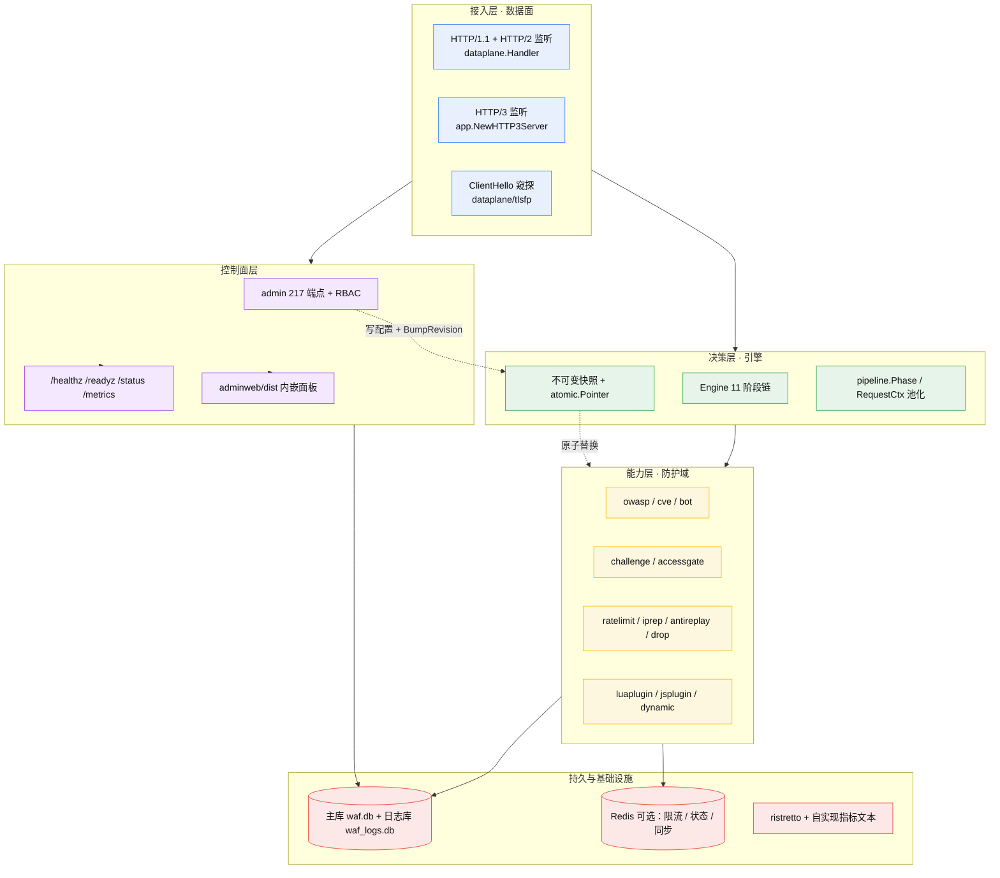
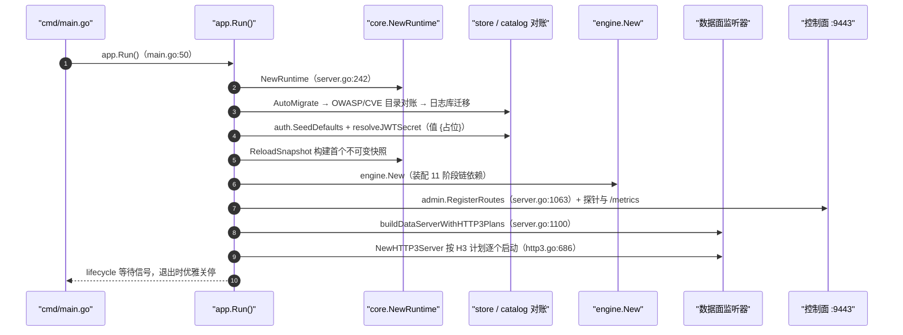
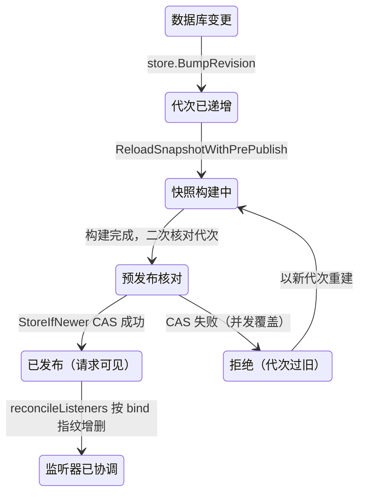
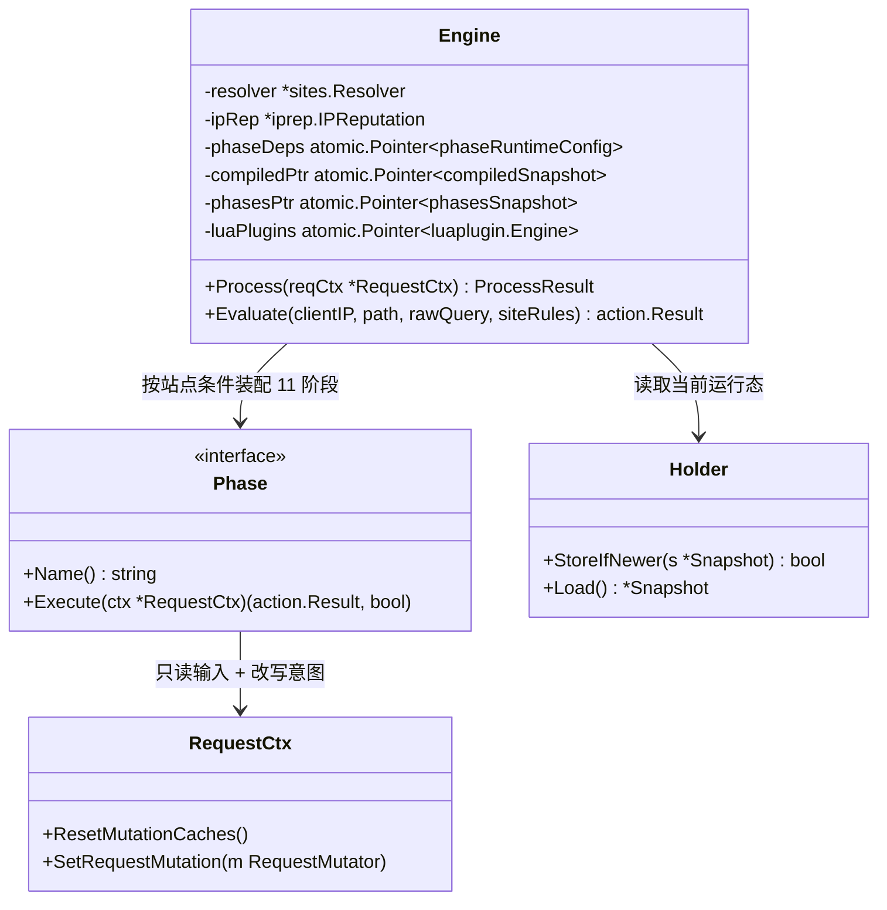
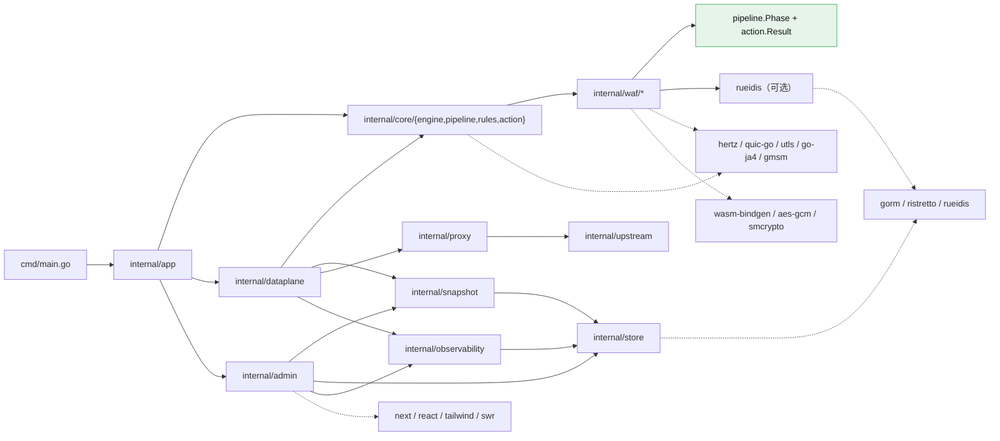

# 技术架构

> [返回 项目概述](项目概述.md)

<cite>
**本文档引用的文件**
- [go.mod](file://go.mod)
- [frontend/package.json](file://frontend/package.json)
- [frontend/next.config.ts](file://frontend/next.config.ts)
- [wasm-pow-solver/Cargo.toml](file://wasm-pow-solver/Cargo.toml)
- [wasm-pow-solver/Makefile](file://wasm-pow-solver/Makefile)
- [Dockerfile](file://Dockerfile)
- [scripts/build.sh](file://scripts/build.sh)
- [README.md](file://README.md)
- [cmd/main.go](file://cmd/main.go)
- [internal/app/server.go](file://internal/app/server.go)
- [internal/app/http3.go](file://internal/app/http3.go)
- [internal/core/config.go](file://internal/core/config.go)
- [internal/core/engine/engine.go](file://internal/core/engine/engine.go)
- [internal/core/pipeline/pipeline.go](file://internal/core/pipeline/pipeline.go)
- [internal/core/pipeline/pool.go](file://internal/core/pipeline/pool.go)
- [internal/core/action/action.go](file://internal/core/action/action.go)
- [internal/core/database/gorm.go](file://internal/core/database/gorm.go)
- [internal/core/redis/pubsub.go](file://internal/core/redis/pubsub.go)
- [internal/dataplane/handler.go](file://internal/dataplane/handler.go)
- [internal/snapshot/snapshot.go](file://internal/snapshot/snapshot.go)
- [internal/store/site.go](file://internal/store/site.go)
- [internal/store/protection.go](file://internal/store/protection.go)
- [internal/waf/owasp/owasp_registry.go](file://internal/waf/owasp/owasp_registry.go)
- [internal/waf/cve/detector.go](file://internal/waf/cve/detector.go)
- [internal/waf/bot/bot.go](file://internal/waf/bot/bot.go)
- [internal/waf/challenge/pow/pow.go](file://internal/waf/challenge/pow/pow.go)
- [internal/waf/jsplugin/quickjs_cgo.go](file://internal/waf/jsplugin/quickjs_cgo.go)
- [internal/waf/jsplugin/quickjs_stub.go](file://internal/waf/jsplugin/quickjs_stub.go)
- [internal/observability/metrics.go](file://internal/observability/metrics.go)
- [internal/proxy/transport/transport.go](file://internal/proxy/transport/transport.go)
- [.github/workflows/ci.yml](file://.github/workflows/ci.yml)
- [.github/workflows/release.yml](file://.github/workflows/release.yml)
- [docs/系统架构设计/系统架构设计.md](file://docs/系统架构设计/系统架构设计.md)
</cite>

## 目录

1. [简介](#简介)
2. [项目结构](#项目结构)
3. [核心组件](#核心组件)
4. [架构总览](#架构总览)
5. [详细组件分析](#详细组件分析)
6. [依赖关系分析](#依赖关系分析)
7. [性能考虑](#性能考虑)
8. [故障排查指南](#故障排查指南)
9. [结论](#结论)
10. [附录](#附录)

## 简介

本篇是**面向概览的技术栈与分层选型说明**，回答三个问题：系统分成哪几层、每层用什么、以及为什么这样选。组件级拓扑、依赖边、数据转换与状态迁移的权威描述在[系统架构设计](../系统架构设计/系统架构设计.md)及其 6 篇子文档中，本篇不复制其表格，只在需要处指向对应文档。

My-OpenWaf 的分层不是按技术堆叠（MVC 式），而是按**变更频率与执行位置**切分：控制面在低频写路径上，数据面在高频读路径上，二者之间用「不可变快照 + 代次号」这一条契约隔离。这条契约决定了后续几乎所有技术选型——为什么是 `atomic.Pointer` 而不是读写锁、为什么是 SQLite 单文件双库、为什么规则链要按站点缓存、为什么 PoW 要用 Rust 编译 WASM。

| 视角 | 归属文档 | 本篇是否展开 |
|------|----------|:------------:|
| 分层与选型理由 | 本篇 | 是 |
| 组件拓扑与依赖边 | [组件关系图](../系统架构设计/组件关系图.md) | 否 |
| 请求路径数据转换 | [数据流分析](../系统架构设计/数据流分析.md) | 否 |
| 阶段链与规则编译 | [WAF 引擎系统](../WAF%20引擎系统/WAF%20引擎系统.md) | 否 |
| 快照构建与热重载 | [配置管理系统](../配置管理系统/配置管理系统.md) | 否 |

**章节来源**
- [README.md:13-24](file://README.md#L13-L24)
- [docs/系统架构设计/系统架构设计.md:56-60](file://docs/系统架构设计/系统架构设计.md#L56-L60)

## 项目结构

三个可独立构建的技术栈共存于一个仓库：Go 后端（349 个非测试文件 / 115,733 行）、TypeScript-React 前端（173 个 ts/tsx）、Rust-WASM 挑战求解器（`wasm-pow-solver/` 11 个 rs 模块）。三者的产物最终合并为**单个 Go 二进制**：前端静态导出被复制进 `internal/core/adminweb/dist` 由 `embed` 打包，WASM 与 glue JS 被复制进 `internal/waf/challenge/powdata` 同样由 `embed` 打包。

架构分层结构如下：



**图表来源**
- [internal/dataplane/handler.go:39-153](file://internal/dataplane/handler.go#L39-L153)
- [internal/app/http3.go:678-858](file://internal/app/http3.go#L678-L858)
- [internal/core/engine/engine.go:467-528](file://internal/core/engine/engine.go#L467-L528)
- [internal/snapshot/snapshot.go:474-490](file://internal/snapshot/snapshot.go#L474-L490)
- [internal/app/server.go:1052-1119](file://internal/app/server.go#L1052-L1119)

架构分层表给出每层的职责边界与契约形式：

| 层 | 职责 | 代表包 | 跨层契约 | 变更频率 |
|----|------|--------|----------|:--------:|
| 接入层 | TLS 终止、协议解析、指纹采集 | `internal/dataplane`、`internal/app` | Hertz `app.HandlerFunc` | 低 |
| 决策层 | 站点解析、阶段链装配与执行 | `internal/core/engine`、`internal/core/pipeline` | `pipeline.RequestCtx` → `action.Result` | 低 |
| 能力层 | 具体检测与挑战实现 | `internal/waf/*` | 实现 `pipeline.Phase` | 中（主要演进面） |
| 控制面层 | 配置写入、鉴权、指标与面板 | `internal/admin`、`internal/core/adminweb` | REST（写操作仅 POST） | 高 |
| 运行态层 | 配置编译为不可变视图 | `internal/snapshot` | `Holder.StoreIfNewer` / `Load` | 低 |
| 持久层 | 模型、迁移、仓储、异步写库 | `internal/store`、`internal/observability` | GORM + 双 DSN | 中 |
| 基础设施 | 转发、缓存、日志、安全辅助 | `internal/proxy`、`internal/cache`、`internal/pkg` | 接口注入 | 低 |

技术栈矩阵（逐栈列行，版本全部来自清单文件实测）：

| 栈 | 版本事实 | 关键依赖 | 选型定位 | 证据 |
|----|----------|----------|----------|------|
| Go 后端 · 传输 | Go 1.27.2 | `cloudwego/hertz` v0.10.6、`quic-go` v0.63.0、`x01n/http2` v0.3.0、`gorilla/websocket` v1.5.3 | 双平面与 h1/h2/h3/WS/SSE/gRPC 统一实现 | [go.mod:3-33](file://go.mod#L3-L33) |
| Go 后端 · 数据 | 同上 | `gorm` v1.31.2 + `glebarez/sqlite` v1.11.0 / `driver/mysql` v1.6.0 / `driver/postgres` v1.6.3、`rueidis` v1.0.78、`ristretto` v0.2.0 | 三方言持久化 + 可选 Redis + 进程内缓存 | [go.mod:11-37](file://go.mod#L11-L37) |
| Go 后端 · 安全 | 同上 | `refraction-networking/utls` v1.8.2、`go-ja4` v1.0.0、`gmsm` v0.45.0、`maxminddb-golang` v1.13.1、`go-captcha/v2` v2.0.5 | JA3/JA4 指纹、国密、GeoIP、验证码 | [go.mod:6-30](file://go.mod#L6-L30) |
| Go 后端 · 扩展 | 同上 | `gopher-lua` v1.1.2、`quickjs-go` v0.7.7 | 双插件引擎（脚本策略与请求改写） | [go.mod:8-30](file://go.mod#L8-L30) |
| Go 后端 · 内容 | 同上 | `tdewolff/parse/v2` v2.8.17、`html-to-markdown/v2` v2.5.2、`gen2brain/webp` v0.6.4、`golang/freetype`、`x/image` v0.47.0 | HTML/JS 改写与图像转换 | [go.mod:6-32](file://go.mod#L6-L32) |
| Go 后端 · 观测 | 同上 | 无 `prometheus/client_golang` | `/metrics` 自行拼装文本 | [internal/observability/metrics.go:303-318](file://internal/observability/metrics.go#L303-L318) |
| TypeScript-React | `typescript` ^6、`eslint` ^9、`prettier` ^3.8.3 | `next` 16.2.6、`react` 19.2.4 / `react-dom` 19.2.7、`tailwindcss` ^4、`swr` ^2.4.2、`@tabler/icons-react` ^3.44.0、`zod` ^4.4.3、`i18next` ^26.3.3 | 管理面板静态导出（`output: "export"`） | [frontend/package.json:24-64](file://frontend/package.json#L24-L64) |
| Rust-WASM | `edition = "2021"`、`crate-type = ["cdylib"]` | `wasm-bindgen` 0.2.127、`sha2` 0.11.0、`hmac` 0.13、`aes-gcm` 0.11、`smcrypto` 0.3.1、`num-bigint` 0.5.1 | 浏览器侧 PoW 与环境指纹，`opt-level = "z"` + `lto` + `panic = "abort"` | [wasm-pow-solver/Cargo.toml:1-47](file://wasm-pow-solver/Cargo.toml#L1-L47) |

> 已知不一致：`frontend/next.config.ts:12` 的 `optimizePackageImports` 仍列 `lucide-react`，而 `package.json` 只声明 `@tabler/icons-react`。

```text
cmd/main.go                 入口：子命令 + pprof + app.Run()（:13/:29/:50）
internal/app/               装配层（4 文件 4,282 行）：server.go / http3.go / tls_fingerprint_policy.go
internal/core/              引擎与运行时（11 子包）：engine / pipeline / rules / action / health / lifecycle
internal/dataplane/         数据面（14 文件 8,836 行）+ envelope / logredact / metrics / stream / tlsfp
internal/waf/               防护域：owasp / cve / bot / challenge / accessgate / ratelimit / iprep / drop / 插件
internal/admin/             控制面：根 1,589 行 + access/auth/detect/event/protect/rule/site/system/shared
internal/store/             模型与仓储：根 2,347 行 + repository 3,206 行 + migrations 1,074 行
frontend/                   25 个页面目录 + components(69) + hooks(6) + lib(15+i18n)
wasm-pow-solver/            11 个 rs 模块 + Makefile（产物落 internal/waf/challenge/powdata）
```

**章节来源**
- [go.mod:1-38](file://go.mod#L1-L38)
- [frontend/package.json:1-65](file://frontend/package.json#L1-L65)
- [frontend/next.config.ts:1-16](file://frontend/next.config.ts#L1-L16)
- [wasm-pow-solver/Cargo.toml:1-47](file://wasm-pow-solver/Cargo.toml#L1-L47)
- [cmd/main.go:13-51](file://cmd/main.go#L13-L51)
- [README.md:351-408](file://README.md#L351-L408)

## 核心组件

模块清单以实测行数为尺度，体现「职责集中在何处」：`owasp` 与 `cve` 与 `challenge` 三个域占据最大体量，说明项目的演进重心在检测与对抗，而非框架本身。

| 模块 | 规模实测 | 职责 | 主要依赖 | 对外契约 |
|------|:--------:|------|----------|----------|
| `internal/app` | 4 文件 / 4,282 行 | 16 步启动装配、监听器协调、HTTP/3 计划 | core、dataplane、admin、snapshot | `app.Run()` |
| `internal/core/engine` | 646 行 | 阶段链装配与两级缓存 | pipeline、rules、waf/* | `Engine.Process(reqCtx)` |
| `internal/core/pipeline` | 678 行 + `pool.go` | 请求上下文与阶段执行语义 | action | `Phase` 接口、`AcquireCtx`/`ReleaseCtx` |
| `internal/core/rules` | 4,048 行 | 规则 DSL 编译与 11 个阶段实现 | snapshot、waf/* | `Compiled`、阶段构造函数 |
| `internal/dataplane` | 14 文件 / 8,836 行 | 请求处理、协议桥、日志脱敏 | engine、snapshot、proxy | `dataplane.Handler(opts)` |
| `internal/waf/owasp` | 10,751 行 | 18 类攻击面检测与归一化 | ac、store | `CheckOWASP`、注册表对账 |
| `internal/waf/cve` | 6,117 行 | 三类语言 + 通用兜底检测 | store、feed | `CVEDetector.Detect` |
| `internal/waf/challenge` | 6,110 行（含 gm/pow/powdata） | 验证码、5 秒盾、链式、浏览器签名 | rueidis、go-captcha、WASM | `CaptchaManager` 等 |
| `internal/waf/bot` | 1,511 行（+ geoip 607 / tlsfp 1,199） | 两阶段加权打分 | utls、go-ja4、maxminddb | `CheckBotTwoPhase` |
| `internal/waf/accessgate` | 1,672 行 | 密码 / OAuth / OIDC 网关 | session、rueidis | `OAuthFlow`、`AccessProvider` |
| `internal/admin` | 根 1,589 行 + 12 子域 | 217 端点、RBAC、实时 WebSocket | store、snapshot | `admin.RegisterRoutes` |
| `internal/snapshot` | 3,071 行 | 配置编译、站点路由、原子替换 | store | `Holder.StoreIfNewer` / `MatchSite` |
| `internal/store` | 根 2,347 行 + `repository` 3,206 行 | 31 模型、迁移 V2–V15、仓储 | gorm | `AutoMigrate`、`BumpRevision` |
| `internal/observability` | 4,205 行 | 统一写入、写队列、指标、归档 | store、dataplane | `UnifiedWriter`、`PrometheusHandler` |
| `internal/proxy` | 6,009 行 + `transport` 1,280 行 | h1/h2/h3/WS/SSE/gRPC 转发与回放 | transport 池 | `ResolveUpstreamBase` |
| `internal/imagery` | 2,910 行 | 图像解码/变换/编码 | webp、freetype、x/image | `Resize`/`Crop`/`Rotate` |
| `pkg/vmpasm`（`internal/pkg`） | 2,588 行 | VMP 字节码与混淆 JS 分片 | — | 与 WASM 侧 `isa.rs` 对齐 |

**章节来源**
- [internal/core/engine/engine.go:83-127](file://internal/core/engine/engine.go#L83-L127)
- [internal/core/pipeline/pipeline.go:277-280](file://internal/core/pipeline/pipeline.go#L277-L280)
- [internal/dataplane/handler.go:39-153](file://internal/dataplane/handler.go#L39-L153)
- [internal/app/server.go:1052-1119](file://internal/app/server.go#L1052-L1119)

## 架构总览

启动与请求是两条独立的行为线：启动是「一次性、有序、失败即退出」的装配过程；请求是「只读快照、无锁、每请求归还池」的高频过程。



**图表来源**
- [cmd/main.go:13-51](file://cmd/main.go#L13-L51)
- [internal/app/server.go:1040-1119](file://internal/app/server.go#L1040-L1119)
- [internal/app/http3.go:678-686](file://internal/app/http3.go#L678-L686)
- [internal/waf/owasp/owasp_registry.go:1119](file://internal/waf/owasp/owasp_registry.go#L1119)

行为侧的稳态路径是：`dataplane.Handler` 取 `RequestCtx` → `sn.MatchSite(bind, host)`（handler.go:141）→ 未匹配则记 `no site match` 回欢迎页并标注 `routing_error`（:153），匹配则交 `Engine.Process` 逐阶段执行，返回 `action.Result` 决定拦截/质询/放行，最后由代理层转发并归还上下文。站点路由键是 `bind + NUL + host` 的哈希键（snapshot.go:294），至多三级查找：精确 → `*.` 单级父域 → catch-all `*`。

**章节来源**
- [internal/dataplane/handler.go:39-153](file://internal/dataplane/handler.go#L39-L153)
- [internal/snapshot/snapshot.go:291-300](file://internal/snapshot/snapshot.go#L291-L300)
- [internal/core/pipeline/pipeline.go:15-105](file://internal/core/pipeline/pipeline.go#L15-L105)

## 详细组件分析

### 分层契约：快照与代次

层间只有一条数据契约：`Snapshot` 是不可变的，运行态通过 `Holder` 的原子指针发布新版本。`StoreIfNewer`（snapshot.go:474）用 CAS 循环保证「只有更高代次才能替换」，低代次写入直接被拒——这是热重载与跨实例同步能够安全并存的基础。请求路径只有一次 `Load()`，因此不存在读写锁争用。



**图表来源**
- [internal/snapshot/snapshot.go:474-490](file://internal/snapshot/snapshot.go#L474-L490)
- [internal/app/server.go:740-785](file://internal/app/server.go#L740-L785)
- [internal/store/protection.go:14-116](file://internal/store/protection.go#L14-L116)

跨实例同步沿用同一契约：`configSyncChannel = "openwaf:config:reload"`（pubsub.go:16），消息带 `source_id`（:20）以抑制发起方回环，发布超时 2s，且 `ConfigSync` 不做自动重连。

**章节来源**
- [internal/snapshot/snapshot.go:291-490](file://internal/snapshot/snapshot.go#L291-L490)
- [internal/core/redis/pubsub.go:10-20](file://internal/core/redis/pubsub.go#L10-L20)
- [internal/app/server.go:740-785](file://internal/app/server.go#L740-L785)

### 决策层契约：Engine / Phase / RequestCtx

类型契约只有三条，所有能力层组件都通过它们接入，因此新增检测能力不需要改动引擎：



**图表来源**
- [internal/core/pipeline/pipeline.go:15-280](file://internal/core/pipeline/pipeline.go#L15-L280)
- [internal/core/engine/engine.go:83-127](file://internal/core/engine/engine.go#L83-L127)
- [internal/core/engine/engine.go:441-575](file://internal/core/engine/engine.go#L441-L575)
- [internal/snapshot/snapshot.go:474-490](file://internal/snapshot/snapshot.go#L474-L490)

`Engine` 的字段全是原子指针或写锁保护的不可变快照（engine.go:98-103），运行时依赖以 `phaseRuntimeConfig` 整体打包替换，避免 setter 交错产生不一致视图。`RequestCtx` 由 `sync.Pool` 复用（pool.go:20-37），进出管道各自清零。

**章节来源**
- [internal/core/engine/engine.go:26-127](file://internal/core/engine/engine.go#L26-L127)
- [internal/core/pipeline/pipeline.go:277-280](file://internal/core/pipeline/pipeline.go#L277-L280)
- [internal/core/pipeline/pool.go:20-37](file://internal/core/pipeline/pool.go#L20-L37)

### 传输层选型：Hertz + quic-go + 自管连接池

| 决策点 | 选用 | 备选 | 取舍理由 | 代价 |
|--------|------|------|----------|------|
| HTTP 服务框架 | Hertz v0.10.6 | `net/http`、gin | 控制面与数据面统一生态，原始 URI 路径可控，便于与上游逐字节一致 | 需要 fork 版 http2（`x01n/http2`）实现 RFC 8441 |
| HTTP/3 | quic-go v0.63.0 自建 `HTTP3Server` | 等框架内置 | 需按站点 bind 聚合 H3 计划并通告 Alt-Svc（http3.go:858） | 0-RTT 重放风险，默认不强制开启（:884） |
| TLS 指纹 | uTLS v1.8.2 + go-ja4 v1.0.0 | 纯标准库 `crypto/tls` | 标准库不暴露 ClientHello 扩展序，无法算 JA3/JA4 | 需自建窥探监听；测试逃生门会置空指纹 |
| 上游连接池 | 自管 `transport` 三类池 | 单一 `http.Transport` | 主池 256/32/30s（transport.go:157-161）、h2c 单例 512/128/90s、探活 128/32/90s 各有不同 SLA | 池语义分散，需按入口 `ResolveUpstreamBase` 统一 |
| 持久化 | GORM + 三方言，SQLite 优先 | 单方言裸驱动 | 自托管默认可用零依赖单文件；生产可切 MySQL/PG | SQLite 需 WAL + 双库分文件规避写锁（gorm.go:89/94） |
| Redis | rueidis v1.0.78 | go-redis | 单命令 50ms 超时的轻量客户端，限流 fail-open 语义直接 | 无重连；空实例走 5s 熔断 |
| 进程内缓存 | ristretto v0.2.0 | 手写 LRU | 快照层的 TinyLFU 容量控制 | 参数属快照层，不适用于规则缓存 |
| 指标导出 | 自实现文本拼装 | `prometheus/client_golang` | 指标族完全自定义，避免引入注册表与直方图成本 | 需自证 exposition 格式正确性 |
| 前端形态 | Next.js `output: "export"` | SSR 服务 | 静态产物 embed 进单二进制，无额外运行时 | 16 下不能用 redirects/cookies/Server Actions |
| PoW 求解 | Rust → WASM | 纯 JS | 浏览器侧算力不可控，WASM 收敛执行时间并便于混淆 | 需 `make optimize` 重建；glue 混淆后须 `FORCE_GLUE=1` |
| 插件引擎 | Lua + QuickJS 双引擎 | 单一脚本引擎 | Lua 做策略短路，QuickJS 做请求改写计划 | QuickJS 依赖 CGO + tag，缺失时落 stub |
| 国密 | gmsm v0.45.0（Go）+ smcrypto（WASM） | 仅 AES-GCM | 挑战信封需支持 SM2/SM3/SM4-GCM 合规路径 | 两端需互测对齐向量 |

**章节来源**
- [go.mod:5-38](file://go.mod#L5-L38)
- [internal/proxy/transport/transport.go:157-161](file://internal/proxy/transport/transport.go#L157-L161)
- [internal/core/database/gorm.go:55-113](file://internal/core/database/gorm.go#L55-L113)
- [internal/app/http3.go:858-884](file://internal/app/http3.go#L858-L884)
- [frontend/next.config.ts:1-16](file://frontend/next.config.ts#L1-L16)
- [wasm-pow-solver/Makefile:8-41](file://wasm-pow-solver/Makefile#L8-L41)

### 持久层选型：双库分离与方言参数

主库承载配置/规则/证书，日志库承载访问日志/安全事件/drop/bot 评分，两个 DSN 由 `MY_OPENWAF_DSN` 与 `MY_OPENWAF_LOG_DSN` 独立配置（README.md:317-319）。SQLite 侧的 DSN 参数固定为 `journal_mode(WAL)`、`busy_timeout(10000)`、`synchronous(NORMAL)`、`foreign_keys(ON)`、`wal_autocheckpoint(1000)`（gorm.go:89）；日志库单独放宽为 `foreign_keys(OFF)` + `wal_autocheckpoint(2000)`（:94）以控制 WAL 膨胀。SQLite 最大连接数固定 8（`sqliteMaxOpenConns`，:113），非 SQLite 才走 25/10/30min/5min 的池调优（:63-66）。

**章节来源**
- [internal/core/database/gorm.go:55-113](file://internal/core/database/gorm.go#L55-L113)
- [README.md:311-324](file://README.md#L311-L324)

### 能力层组织：按领域而非按技术

`internal/waf` 下每个子包对应一类可独立开关的防护能力，且都以「构造阶段对象」的方式暴露给 `rules`，不反向依赖引擎。检测强度与对抗形态的实测规模：OWASP 注册表 361 条 / 目录 553 条 / 18 类别（`owasp_registry.go:1035-1136`），CVE 仅 Java / PHP / Node.js 三种语言专用检测器加 `GeneralCVEDetector` 兜底（`detector.go:790`、`1793`），Bot 权重 UA 40 / 指纹 25 / 行为 15 / GeoIP 5 / IP 声誉 15（`bot.go:85`）。

**章节来源**
- [internal/waf/owasp/owasp_registry.go:1035-1136](file://internal/waf/owasp/owasp_registry.go#L1035-L1136)
- [internal/waf/cve/detector.go:790-1793](file://internal/waf/cve/detector.go#L790-L1793)
- [internal/waf/bot/bot.go:60-85](file://internal/waf/bot/bot.go#L60-L85)

### 交付形态：单二进制与三段式镜像

`Dockerfile` 用三段构建：`oven/bun:1.4.2-alpine` 导出前端、`golang:1.27-alpine`（加 `gcc`/`musl-dev`，`CGO_ENABLED=1 -tags=quickjs`）编译后端并 `COPY --from=frontend` 进 embed 目录、`alpine:3.21` 运行时附带 `ca-certificates tzdata font-dejavu libwebp-dev`。这与 `scripts/build.sh` 的本地路径一致（前端 → dist → `make optimize` → `go mod tidy` → 构建）。

| 构建段 | 基础镜像 | 关键动作 | 产物落位 |
|--------|----------|----------|----------|
| frontend | `oven/bun:1.4.2-alpine` | `bun install --frozen-lockfile` + `bun run build` | `frontend/out` |
| backend | `golang:1.27-alpine` + gcc | `CGO_ENABLED=1 go build -tags=quickjs -ldflags="-s -w"` | `/app/bin/my-openwaf` |
| runtime | `alpine:3.21` | `EXPOSE 9443`、`VOLUME /app/data` | 单二进制 + 数据卷 |

CI 侧 `ci.yml` 的作业顺序是 `frontend-test → backend-test / dialect-migration / full-build`（`needs` 声明），`release.yml` 的六平台矩阵在构建前先执行 `Verify native QuickJS backend` 以确保 CGO + tag 生效（release.yml:148-163）。

**章节来源**
- [Dockerfile:1-28](file://Dockerfile#L1-L28)
- [scripts/build.sh:1-14](file://scripts/build.sh#L1-L14)
- [.github/workflows/ci.yml:17-80](file://.github/workflows/ci.yml#L17-L80)
- [.github/workflows/release.yml:95-175](file://.github/workflows/release.yml#L95-L175)

## 依赖关系分析

依赖方向单向向下：装配层依赖所有层，引擎依赖能力层构造的阶段对象，能力层只依赖 `pipeline` 与 `action` 两个抽象。



**图表来源**
- [internal/core/engine/engine.go:3-23](file://internal/core/engine/engine.go#L3-L23)
- [internal/app/server.go:1040-1119](file://internal/app/server.go#L1040-L1119)
- [go.mod:5-38](file://go.mod#L5-L38)

| 依赖边 | 形式 | 是否可替换 | 说明 |
|--------|------|:----------:|------|
| `dataplane → engine` | 结构体注入 | 是 | 数据面不感知阶段细节，只调 `Process` |
| `engine → snapshot` | 只读 + 代次比较 | 否 | 唯一配置视图来源 |
| `rules → waf/*` | 阶段构造函数 | 是 | 新增检测器只需实现 `Phase` |
| `waf/* → rueidis` | 接口 + nil 判定 | 是 | 无 Redis 时各模块自行降级 |
| `admin → store` | GORM 仓储 | 是 | 方言可切 |
| `observability → store` | 批量写入 | 是 | 单协程写库 |
| 前端 → admin API | REST + WS | 是 | 静态产物 embed，运行时同域 |

**章节来源**
- [internal/core/engine/engine.go:3-127](file://internal/core/engine/engine.go#L3-L127)
- [internal/app/server.go:1040-1119](file://internal/app/server.go#L1040-L1119)

## 性能考虑

- **两级无锁缓存**：规则编译缓存键 `{siteID, policyID}`（engine.go:34-37），阶段链缓存键 `{policyID, siteID, antiReplayEnabled}` 并附四项判据（:60-64、:461），读写模式统一为 `atomic.Pointer` 无锁读 + 写锁串行化后整体发布，不是 RWMutex。
- **对象池**：`RequestCtx` 走 `sync.Pool`（pool.go:20-37），进管道前 `ResetMutationCaches` 清零派生值，避免热路径分配。
- **条件入链**：阶段未启用即不入链，链容量按 11 预分配（engine.go:467）。
- **写侧收敛**：安全事件与访问日志由 `UnifiedWriter` 单协程批量落库；主库与日志库分文件避免 SQLite 写锁互扰。
- **协议成本**：h1/h2/h3 共用同一份站点路由键；WS 与 SSE 不进 `http.Transport` 连接池，避免池语义污染。
- 具体基准数值见[缓存与性能优化](../系统架构设计/缓存与性能优化.md)，本篇不重复。

**章节来源**
- [internal/core/engine/engine.go:26-127](file://internal/core/engine/engine.go#L26-L127)
- [internal/core/pipeline/pool.go:20-37](file://internal/core/pipeline/pool.go#L20-L37)
- [internal/core/database/gorm.go:83-113](file://internal/core/database/gorm.go#L83-L113)

## 故障排查指南

| 症状 | 定位层次 | 判据 | 处置 |
|------|----------|------|------|
| 所有请求都回欢迎页且带 `routing_error` | 接入层 | 日志 `no site match`（handler.go:153） | 核对站点 `bind` 与 `host`；键为 `bind+NUL+host` |
| 配置改了但行为不变 | 运行态层 | 快照代次未推进 | 确认走 `BumpRevision → StoreIfNewer`，看是否 CAS 拒绝 |
| 多实例配置漂移 | 同步层 | `openwaf:config:reload` 未见收发 | 检查 Redis 可达与 2s 超时；`ConfigSync` 无自动重连 |
| QuickJS 插件不生效 | 构建层 | `go list -tags=quickjs` 未含 `quickjs_cgo.go` | 用 `CGO_ENABLED=1 -tags=quickjs` 重新构建 |
| 指纹字段为空 | 接入层 | 设了 `MY_OPENWAF_H2WS_PEEKER_OFF=1` | 撤销该测试专用变量 |
| SQLite 写锁报错 | 持久层 | `busy_timeout` 已设 10s 仍失败 | 确认日志库独立 DSN，减少并发写源 |
| 面板资源 404 | 交付层 | `internal/core/adminweb/dist` 为空 | 先 `bun run build` 再 `go build`，或用 `MY_OPENWAF_ADMIN_STATIC_DIR` |

```bash
# 构建分支断言（来源：.github/workflows/release.yml:155-163、ci.yml:75-79）
go list -tags=quickjs -f '{{join .GoFiles " "}}' ./internal/waf/jsplugin
#   预期：文件集包含 quickjs_cgo.go（否则选中的是 quickjs_stub.go）
CGO_ENABLED=1 go vet -tags=quickjs ./...
#   预期：无告警

# 控制面探针（来源：internal/app/server.go:1052-1056）
curl -s http://127.0.0.1:9443/healthz
#   预期：2xx，仅依赖健康检查器存活
curl -s http://127.0.0.1:9443/readyz
#   预期：2xx 需同时满足 快照非 nil ∧ lm.Ready() ∧ tokenMgr.Ready() ∧ DB Ping
curl -s http://127.0.0.1:9443/metrics
#   预期：自实现的指标文本（无 prometheus/client_golang 注册表）
```

> 注意：`adminSrv` 在 `server.go:1052` 只传 `server.WithHostPorts(rt.Config.AdminBind)`，未挂 `WithTLS`，控制面实际以明文 HTTP 提供探针与 API；README 的 `https://localhost:9443` 表述与此不一致，暴露到不可信网络时应自行置于反向代理之后。

**章节来源**
- [internal/dataplane/handler.go:141-153](file://internal/dataplane/handler.go#L141-L153)
- [internal/snapshot/snapshot.go:291-490](file://internal/snapshot/snapshot.go#L291-L490)
- [internal/core/redis/pubsub.go:10-20](file://internal/core/redis/pubsub.go#L10-L20)
- [internal/core/database/gorm.go:83-94](file://internal/core/database/gorm.go#L83-L94)
- [.github/workflows/ci.yml:41-67](file://.github/workflows/ci.yml#L41-L67)

## 结论

分层的唯一目的是让「高频读」与「低频写」不互相拖累：控制面可以任意扩展端点与表单，只要它仍只产出一次代次递增；数据面可以增加检测阶段，只要它仍只实现 `Phase` 并条件入链。技术栈选型沿同一逻辑收敛——单二进制交付排除了 SSR 与外部运行时，Go 侧统一 Hertz 生态覆盖 h1/h2/h3，浏览器侧用 Rust/WASM 换取不可控环境下的稳定算力，持久化用 SQLite 默认 + 双库分离规避写锁并保持三方言可切。

代价同样明确：特性面广导致配置字段与快照契约的同步成本高（新增保护字段必须贯通模型、Admin、前端类型、表单、默认值与验证命令）；QuickJS 依赖 CGO 与构建 tag；`/metrics` 自实现意味着 exposition 正确性需自行保证。

下一步值得推进的方向是继续压缩「第二配置源」风险：让阶段链装配条件、前端表单字段与 `check:*` 契约脚本三者共用单一事实表，并补上当前无人比对的 kind 白名单差集。

**章节来源**
- [internal/core/engine/engine.go:461-545](file://internal/core/engine/engine.go#L461-L545)
- [internal/store/protection.go:14-116](file://internal/store/protection.go#L14-L116)

## 附录

### 术语速查

| 术语 | 含义 | 出处 |
|------|------|------|
| 快照（Snapshot） | 配置编译后的不可变运行态视图 | `internal/snapshot/snapshot.go` |
| 代次（Revision） | 单调递增的配置版本号，CAS 发布依据 | `StoreIfNewer`（:474） |
| 阶段链（Phases） | 按站点条件装配的 `Phase` 有序切片 | `getOrBuildPhases`（engine.go:441） |
| 终止动作 | 短路后续阶段的动作，按 `TerminalPriority` 比较 | `action.go:88-117` |
| 双库 | 主库 `waf.db` 与日志库 `waf_logs.db` | `README.md:317-319` |
| glue | WASM 与页面 JS 之间的桥接脚本 | `wasm-pow-solver/Makefile:20-41` |

**章节来源**
- [internal/snapshot/snapshot.go:474-490](file://internal/snapshot/snapshot.go#L474-L490)
- [internal/core/engine/engine.go:441-461](file://internal/core/engine/engine.go#L441-L461)
- [internal/core/action/action.go:86-123](file://internal/core/action/action.go#L86-L123)
- [README.md:311-324](file://README.md#L311-L324)
- [wasm-pow-solver/Makefile:20-41](file://wasm-pow-solver/Makefile#L20-L41)

### 端口与探针

| 端口/路径 | 归属 | 说明 |
|-----------|------|------|
| `:9443` | 控制面 | 管理 API + 面板（`config.go:364`） |
| `/healthz`、`/readyz`、`/status` | 控制面 | `server.go:1053-1055` |
| `/metrics` | 控制面 | 自实现文本，`server.go:1056` |
| `/api/v1/realtime/ws` | 控制面 | WebSocket 实时推送 |
| 站点 `bind` | 数据面 | h1/h2/h3，`Alt-Svc` 通告（`http3.go:858`） |
| `MY_OPENWAF_PPROF_BIND` | 调试 | 空则不启动（`cmd/main.go:29`） |

**章节来源**
- [internal/core/action/action.go:86-123](file://internal/core/action/action.go#L86-L123)
- [internal/app/http3.go:858](file://internal/app/http3.go#L858)
- [internal/core/config.go:360-364](file://internal/core/config.go#L360-L364)
- [cmd/main.go:29-50](file://cmd/main.go#L29-L50)
- [README.md:311-324](file://README.md#L311-L324)
