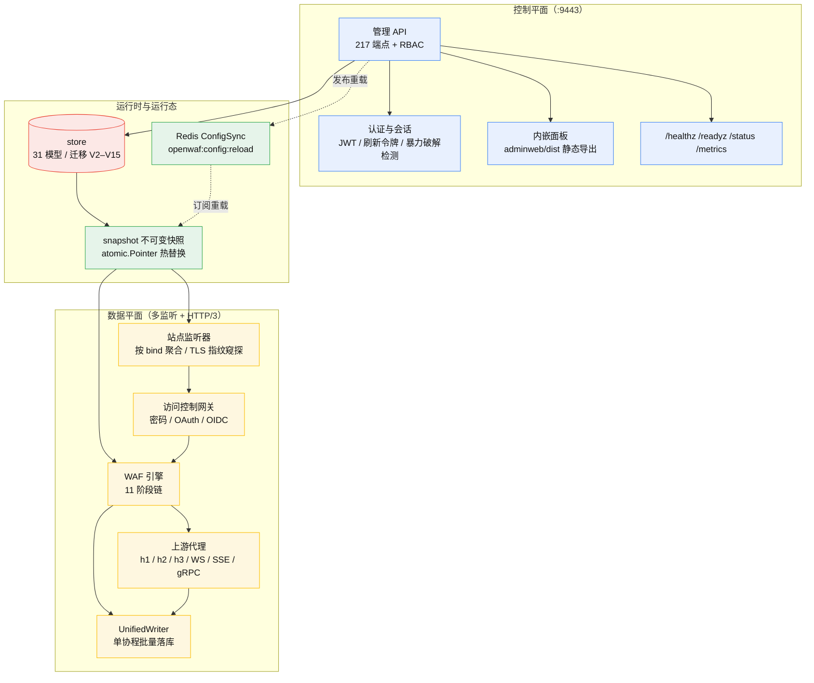
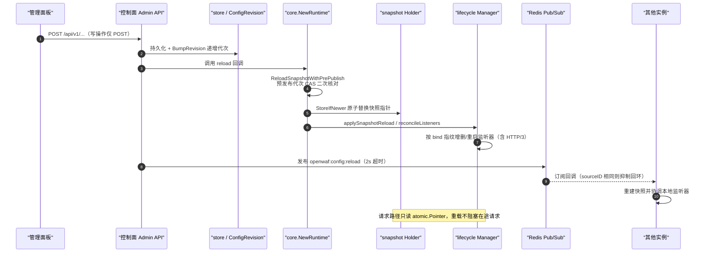
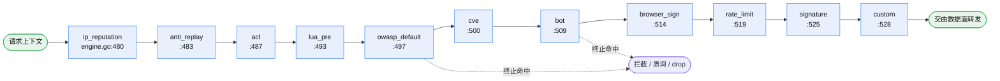
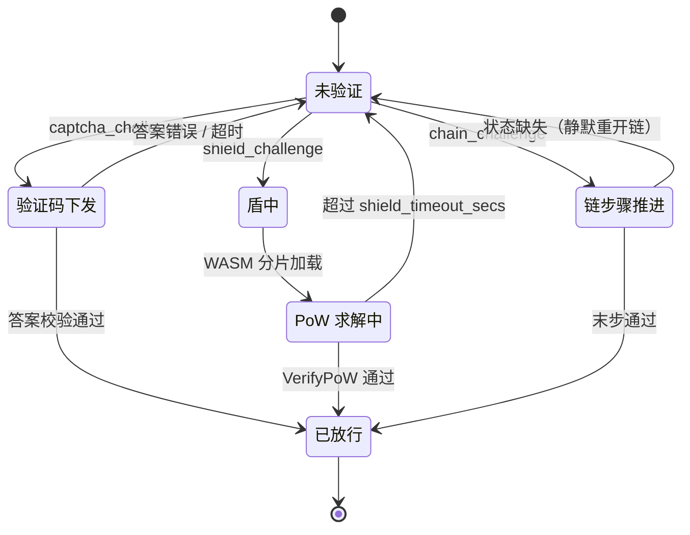
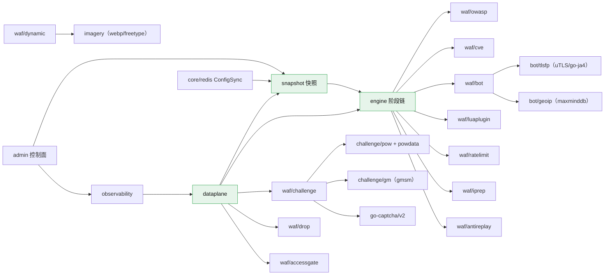

# 核心特性

> [返回 项目概述](项目概述.md)

<cite>
**本文档引用的文件**
- [go.mod](file://go.mod)
- [frontend/package.json](file://frontend/package.json)
- [frontend/next.config.ts](file://frontend/next.config.ts)
- [README.md](file://README.md)
- [internal/app/server.go](file://internal/app/server.go)
- [internal/core/config.go](file://internal/core/config.go)
- [internal/core/engine/engine.go](file://internal/core/engine/engine.go)
- [internal/core/pipeline/pipeline.go](file://internal/core/pipeline/pipeline.go)
- [internal/core/action/action.go](file://internal/core/action/action.go)
- [internal/core/rules/phases.go](file://internal/core/rules/phases.go)
- [internal/core/redis/pubsub.go](file://internal/core/redis/pubsub.go)
- [internal/snapshot/snapshot.go](file://internal/snapshot/snapshot.go)
- [internal/waf/owasp/owasp.go](file://internal/waf/owasp/owasp.go)
- [internal/waf/owasp/owasp_registry.go](file://internal/waf/owasp/owasp_registry.go)
- [internal/waf/cve/detector.go](file://internal/waf/cve/detector.go)
- [internal/waf/cve/java.go](file://internal/waf/cve/java.go)
- [internal/waf/cve/php.go](file://internal/waf/cve/php.go)
- [internal/waf/cve/node.go](file://internal/waf/cve/node.go)
- [internal/waf/cve/general.go](file://internal/waf/cve/general.go)
- [internal/waf/bot/bot.go](file://internal/waf/bot/bot.go)
- [internal/waf/bot/tlsfp/fingerprint.go](file://internal/waf/bot/tlsfp/fingerprint.go)
- [internal/waf/bot/tlsfp/cache.go](file://internal/waf/bot/tlsfp/cache.go)
- [internal/waf/challenge/captcha.go](file://internal/waf/challenge/captcha.go)
- [internal/waf/challenge/shield.go](file://internal/waf/challenge/shield.go)
- [internal/waf/challenge/chain.go](file://internal/waf/challenge/chain.go)
- [internal/waf/challenge/browsersign.go](file://internal/waf/challenge/browsersign.go)
- [internal/waf/challenge/pow_shard.go](file://internal/waf/challenge/pow_shard.go)
- [internal/waf/challenge/pow/pow.go](file://internal/waf/challenge/pow/pow.go)
- [internal/waf/challenge/gm/sealed.go](file://internal/waf/challenge/gm/sealed.go)
- [internal/waf/challenge/gm/sign.go](file://internal/waf/challenge/gm/sign.go)
- [internal/waf/drop/drop.go](file://internal/waf/drop/drop.go)
- [internal/waf/luaplugin/engine.go](file://internal/waf/luaplugin/engine.go)
- [internal/waf/jsplugin/script.go](file://internal/waf/jsplugin/script.go)
- [internal/waf/ratelimit/ratelimit.go](file://internal/waf/ratelimit/ratelimit.go)
- [internal/waf/antireplay/antireplay.go](file://internal/waf/antireplay/antireplay.go)
- [internal/waf/escalation/escalation.go](file://internal/waf/escalation/escalation.go)
- [internal/waf/iprep/iprep.go](file://internal/waf/iprep/iprep.go)
- [internal/waf/threatintel/manager.go](file://internal/waf/threatintel/manager.go)
- [internal/waf/accessgate/oauth.go](file://internal/waf/accessgate/oauth.go)
- [internal/waf/dynamic/processor.go](file://internal/waf/dynamic/processor.go)
- [internal/waf/dynamic/shards.go](file://internal/waf/dynamic/shards.go)
- [internal/imagery/ops.go](file://internal/imagery/ops.go)
- [internal/observability/metrics.go](file://internal/observability/metrics.go)
- [internal/store/protection.go](file://internal/store/protection.go)
- [internal/store/site.go](file://internal/store/site.go)
- [internal/store/access/access_control.go](file://internal/store/access/access_control.go)
- [wasm-pow-solver/Makefile](file://wasm-pow-solver/Makefile)
- [wasm-pow-solver/Cargo.toml](file://wasm-pow-solver/Cargo.toml)
- [AGENTS.md](file://AGENTS.md)
- [docs/系统架构设计/系统架构设计.md](file://docs/系统架构设计/系统架构设计.md)
- [docs/WAF 引擎系统/WAF 引擎系统.md](file://docs/WAF%20引擎系统/WAF%20引擎系统.md)
- [docs/安全防护功能/安全防护功能.md](file://docs/安全防护功能/安全防护功能.md)
</cite>

## 目录

1. [简介](#简介)
2. [项目结构](#项目结构)
3. [核心组件](#核心组件)
4. [架构总览](#架构总览)
5. [详细组件分析](#详细组件分析)
6. [依赖关系分析](#依赖关系分析)
7. [性能考虑](#性能考虑)
8. [故障排查指南](#故障排查指南)
9. [结论](#结论)
10. [附录](#附录)

## 简介

My-OpenWaf 是自托管的反向代理型 WAF，单二进制交付，核心特性可归纳为四条主线：

- **双平面架构**：控制面（管理 API + 内嵌 Next.js 面板，默认 `:9443`）与数据面（按站点 `bind` 聚合的多监听 + HTTP/3）彻底解耦，配置经不可变快照原子替换后热生效。
- **11 阶段检测引擎**：请求上下文依次穿过 `ip_reputation → anti_replay → acl → lua_pre → owasp_default → cve → bot → browser_sign → rate_limit → signature → custom`，终止动作短路后续阶段。
- **对抗纵深**：OWASP 361 条内置注册表（`owasp_rule_catalogs` 目录 553 条、18 个类别）、CVE 三类语言检测器、Bot 两阶段加权打分、JA3/JA4/ClientHello 指纹、验证码与 5 秒盾与链式挑战、浏览器签名、PoW + VMP 混淆 JS 分片、TCP drop、威胁情报、IP 信誉自动封禁、反重放。
- **可运营性**：快照原子热重载 + Redis 跨实例同步、Lua 与 QuickJS 双插件引擎、国密 SM2/SM3/SM4-GCM 挑战信封、图像转换与动态保护、自实现 `/metrics` 与统一异步写库。

本篇定位是**特性地图**：给出每个特性的实现位置、开关来源、依赖子系统与已知限制。逐子系统的设计细节属于[系统架构设计](../系统架构设计/系统架构设计.md)、[WAF 引擎系统](../WAF%20引擎系统/WAF%20引擎系统.md)与[安全防护功能](../安全防护功能/安全防护功能.md)的职责范围，本篇不复制其表格，只做索引与结论汇总。

**章节来源**
- [README.md:13-24](file://README.md#L13-L24)
- [internal/core/engine/engine.go:467-528](file://internal/core/engine/engine.go#L467-L528)

## 项目结构

仓库按「领域目录 + 分层子包」组织，后端非测试 Go 代码实测 349 文件 / 115,733 行，前端 173 个 ts/tsx 文件，测试 532 个 `_test.go`。

```text
cmd/                     入口程序（含 reset-admin-password 子命令）
internal/app/            控制面/数据面接线、HTTP/3 计划、TLS 指纹监听
internal/core/           配置、运行时、引擎、流水线、规则 DSL、阶段实现
internal/dataplane/      站点匹配、代理/质询/阻断、SSE、WebSocket、TLS 指纹窥探
internal/waf/            owasp / cve / bot / challenge / accessgate / drop / 插件等防护域
internal/admin/          管理 API（按 domain 分包，实测 217 个端点）
internal/store/          GORM 模型、迁移、仓储、种子与备份
internal/snapshot/       不可变运行态快照与原子替换
internal/observability/  UnifiedWriter、WriteQueue、指标、归档
internal/imagery/        图像解码/变换/编码（WebP、字体水印）
frontend/                Next.js 管理面板（静态导出后嵌入二进制）
wasm-pow-solver/         Rust → WASM 的 PoW 求解器
scripts/                 构建与诊断脚本
```

| 层级 | 目录 | 规模实测 | 承担的特性 | 深入文档 |
|------|------|----------|-----------|----------|
| 入口 | `cmd/` | `cmd/main.go` 单入口 | 进程启动、子命令 | [快速开始](快速开始.md) |
| 装配层 | `internal/app/` | 4 文件 4,282 行 | 双平面监听、HTTP/3、reload 链 | [系统架构设计](../系统架构设计/系统架构设计.md) |
| 引擎层 | `internal/core/` | 11 子包，`engine` 646 行 | 11 阶段管道、动作与规则编译 | [WAF 引擎系统](../WAF%20引擎系统/WAF%20引擎系统.md) |
| 数据面 | `internal/dataplane/` | 14 文件 8,836 行 | 请求处理、TLS 指纹、日志脱敏 | [数据平面处理](../数据平面处理/数据平面处理.md) |
| 防护域 | `internal/waf/` | `owasp` 10,751 / `cve` 6,117 / `challenge` 6,110 行 | OWASP、CVE、Bot、挑战栈、网关 | [安全防护功能](../安全防护功能/安全防护功能.md) |
| 控制面 | `internal/admin/` | 根 1,589 行 + 12 子域 | 217 个管理端点、RBAC、实时推送 | [管理 API 系统](../管理%20API%20系统/管理%20API%20系统.md) |
| 持久层 | `internal/store/` | 根 2,347 行 + `repository` 3,206 行 | 31 个模型、迁移 V2–V15 | [数据存储层](../数据存储层/数据存储层.md) |
| 运行态 | `internal/snapshot/` | 3,071 行 | 快照构建、站点路由、原子替换 | [配置快照机制](../配置管理系统/配置快照机制.md) |
| 观测 | `internal/observability/` | 4,205 行 | 统一写入、归档、`/metrics` | [监控与可观测性](../监控与可观测性/监控与可观测性.md) |
| 前端 | `frontend/` | 25 个页面目录 | 可视化配置与挑战/指纹查看 | [前端管理界面](../前端管理界面/前端管理界面.md) |

技术栈矩阵按栈逐列展开，版本全部取自锁定的清单文件：

| 栈 | 语言/运行时 | 关键组件与实测版本 | 承载特性 | 证据 |
|----|-------------|--------------------|----------|------|
| Go 后端 | Go 1.27.2 | `cloudwego/hertz` v0.10.6、`quic-go` v0.63.0、`gorm` v1.31.2（+ `glebarez/sqlite` v1.11.0 / `driver/mysql` v1.6.0 / `driver/postgres` v1.6.3）、`rueidis` v1.0.78、`ristretto` v0.2.0 | 双平面、检测引擎、限流、快照 | [go.mod:3-37](file://go.mod#L3-L37) |
| Go 安全扩展 | 同上 | `refraction-networking/utls` v1.8.2、`go-ja4` v1.0.0、`gmsm` v0.45.0、`maxminddb-golang` v1.13.1、`go-captcha/v2` v2.0.5 | TLS 指纹、国密、GeoIP、验证码 | [go.mod:12-30](file://go.mod#L12-L30) |
| Go 内容处理 | 同上 | `gopher-lua` v1.1.2、`quickjs-go` v0.7.7、`tdewolff/parse/v2` v2.8.17、`html-to-markdown/v2` v2.5.2、`gen2brain/webp` v0.6.4、`golang/freetype`、`x/image` v0.47.0 | 双插件引擎、HTML/JS 改写、图像转换 | [go.mod:6-32](file://go.mod#L6-L32) |
| Go 传输与压缩 | 同上 | `gorilla/websocket` v1.5.3、`klauspost/compress` v1.20.3、`andybalholm/brotli` v1.2.6、`golang-jwt/jwt/v5` v5.3.1 | WS/SSE 透传、响应压缩、控制面鉴权 | [go.mod:6-24](file://go.mod#L6-L24) |
| TypeScript 前端 | Node/Bun 工具链 | `next` 16.2.6、`react` 19.2.4 / `react-dom` 19.2.7、`typescript` ^6、`tailwindcss` ^4、`swr` ^2.4.2、`@tabler/icons-react` ^3.44.0 | 管理面板、契约校验脚本 | [frontend/package.json:24-64](file://frontend/package.json#L24-L64) |
| Rust → WASM | `wasm32-unknown-unknown` | `wasm-bindgen` 0.2.127、`sha2` 0.11.0、`hmac` 0.13、`aes-gcm` 0.11、`smcrypto` 0.3.1 | PoW 求解、环境指纹、挑战加密 | [wasm-pow-solver/Cargo.toml:13-40](file://wasm-pow-solver/Cargo.toml#L13-L40) |

> 注意：`frontend/next.config.ts:12` 的 `optimizePackageImports` 仍列有 `lucide-react`，而 `package.json` 只声明 `@tabler/icons-react`，该条目属残留配置。



**图表来源**
- [internal/app/server.go:1052-1063](file://internal/app/server.go#L1052-L1063)
- [internal/app/server.go:1096-1119](file://internal/app/server.go#L1096-L1119)
- [internal/core/engine/engine.go:467-528](file://internal/core/engine/engine.go#L467-L528)
- [internal/observability/metrics.go:303-318](file://internal/observability/metrics.go#L303-L318)
- [README.md:41-68](file://README.md#L41-L68)

**章节来源**
- [go.mod:1-38](file://go.mod#L1-L38)
- [frontend/package.json:1-65](file://frontend/package.json#L1-L65)
- [frontend/next.config.ts:1-16](file://frontend/next.config.ts#L1-L16)
- [wasm-pow-solver/Cargo.toml:1-47](file://wasm-pow-solver/Cargo.toml#L1-L47)
- [README.md:351-408](file://README.md#L351-L408)

## 核心组件

下表是特性清单的权威索引：每一行都对应可打开验证的代码位置与配置项，`限制` 列记录当前实现的已知边界。

| 特性 | 实现位置:行 | 开关/配置 | 依赖子系统 | 限制 |
|------|-------------|-----------|-----------|------|
| 双平面（控制面 + 数据面） | `internal/app/server.go:1052-1063` | `MY_OPENWAF_ADMIN_BIND`，默认 `:9443`（`internal/core/config.go:364`） | `admin`、`store`、`snapshot` | 控制面单监听地址 |
| 多监听 + HTTP/3 | `internal/app/server.go:1096-1119` | 站点 `bind`/`network`（`internal/store/site.go:48-49`） | `quic-go`、`dataplane` | H3 计划按快照聚合，非任意端口 |
| 11 阶段检测引擎 | `internal/core/engine/engine.go:467-528` | 站点 `protection`（`internal/store/protection.go:14-116`） | `pipeline`、`rules` | 阶段容量预分配 11（:467） |
| OWASP 检测 | `internal/waf/owasp/owasp_registry.go:1035-1116` | `builtin_owasp_enabled`（`protection.go:27`） | `ac` 指示器门、`normalize` | 全局默认关闭；6 档敏感度 |
| CVE 检测 | `internal/waf/cve/detector.go:790`、`:1793` | `cve_enabled`（`protection.go:48`） | NVD/GitHub feed | 无 CPE 受影响版本区间；同步 6h（`config.go:404`） |
| Bot 两阶段打分 | `internal/waf/bot/bot.go:85`、`:874` | `bot_detection_enabled`（`protection.go:35`） | `bot/tlsfp`、`bot/geoip`、`iprep`、`ratelimit` | 行为分依赖限流启用，否则恒 0 |
| JA3/JA4/ClientHello 指纹 | `internal/waf/bot/tlsfp/fingerprint.go:46`、`:92` | 站点 `tls_enabled`（`internal/store/site.go:52`） | `utls`、`go-ja4` | 指纹缓存上限 4096（`cache.go:9`） |
| 验证码挑战 | `internal/waf/challenge/captcha.go:184`、`:201` | `captcha_enabled`/`captcha_type`（`protection.go:72-75`） | `go-captcha/v2`、`rueidis` | 签发失败直接返错，不降级放行 |
| 5 秒盾 | `internal/waf/challenge/shield.go:177`、`:191` | `shield_enabled`/`shield_difficulty`（`protection.go:87-100`） | `pow`、WASM、`gm` | 需浏览器执行 JS |
| 链式挑战 | `internal/waf/challenge/chain.go:151`、`:351` | `chain_enabled`（`protection.go:100`） | `captcha`、`pow`、`rueidis` | 状态缺失时静默丢弃并重开链 |
| 浏览器签名 | `internal/waf/challenge/browsersign.go:106` | `browser_sign_enabled`（`protection.go:112-116`） | `dynamic` JS 注入 | TTL 短，客户端时钟敏感 |
| PoW + VMP 混淆分片 | `internal/waf/challenge/pow_shard.go:64`、`:281`；`pow/pow.go:139` | `shield_difficulty` | `wasm-pow-solver`、`pkg/vmpasm` | glue 混淆后需 `FORCE_GLUE=1` 才重生成 |
| TCP drop 直断 | `internal/waf/drop/drop.go:36` | `MY_OPENWAF_DROP_ENABLED`（`config.go:420`） | `dataplane/stream` | 关闭开关后丢弃统计仍累计 |
| Lua 插件引擎 | `internal/waf/luaplugin/engine.go:55`；阶段挂载 `engine.go:493` | 插件表 + `luaplugin.StagePre` | `rueidis` KV | 50ms 默认超时、256KiB 源码上限 |
| QuickJS 插件引擎 | `internal/waf/jsplugin/script.go:56` | 构建 tag `quickjs` + CGO | `quickjs-go` v0.7.7 | 无 tag 时编译进 stub 后端 |
| 国密挑战信封 | `internal/waf/challenge/gm/sealed.go:28`；`gm/sign.go:53` | 实例密钥（`MY_OPENWAF_JWT_SECRET` 派生，值 `{占位}`） | `gmsm` v0.45.0、`smcrypto` | 常量时间比较，禁止旁路短路 |
| 快照原子热重载 | `internal/snapshot/snapshot.go:474-487` | `store.BumpRevision` | 全部数据面子系统 | 代次 CAS 二次核对，失败即放弃 |
| 跨实例配置同步 | `internal/core/redis/pubsub.go:16` | `MY_OPENWAF_REDIS_ADDR` | `rueidis` | 2s 超时、无自动重连 |
| 威胁情报 | `internal/waf/threatintel/manager.go:56` | 情报源表 `threat_intel_feeds` | `iplist`、`snapshot` | 拉取失败不影响已载入名单 |
| 访问网关 OAuth/OIDC | `internal/waf/accessgate/oauth.go:136`、`:194` | `site_access_configs.enabled`、`access_providers.type` | session store、`rueidis` | 出站受整体超时约束（`oauth.go:17`） |
| 反重放 | `internal/waf/antireplay/antireplay.go:50` | `anti_replay_enabled`（`protection.go:82`） | HMAC、`rueidis` | fail-closed，Redis 错误即拦截 |
| IP 信誉与自动封禁 | `internal/waf/iprep/iprep.go:42-47` | `auto_ban_*`（`protection.go:37-40`） | `store/iplist` | 站点白名单 `Allow` 不短路 |
| 图像转换 | `internal/imagery/ops.go:60` | 站点动态保护配置 | `webp`、`freetype`、`x/image` | 仅图片响应参与 |
| 自实现 `/metrics` | `internal/observability/metrics.go:303-318`；`server.go:1056` | 无独立开关 | `UnifiedWriter`、`dataplane.Metrics` | 未引入 `prometheus/client_golang` |

**章节来源**
- [internal/app/server.go:1052-1119](file://internal/app/server.go#L1052-L1119)
- [internal/core/engine/engine.go:467-528](file://internal/core/engine/engine.go#L467-L528)
- [internal/store/protection.go:14-116](file://internal/store/protection.go#L14-L116)
- [internal/waf/bot/bot.go:59-85](file://internal/waf/bot/bot.go#L59-L85)
- [internal/waf/accessgate/oauth.go:17-216](file://internal/waf/accessgate/oauth.go#L17-L216)
- [wasm-pow-solver/Makefile:1-46](file://wasm-pow-solver/Makefile#L1-L46)

## 架构总览

特性的可达性取决于配置能否无停机地落到运行态。下图给出「面板改配置 → 落库 → 快照重建 → 本实例监听器协调 → 跨实例同步」的完整闭环，是理解其余特性的前提。



**图表来源**
- [internal/core/config.go:279-364](file://internal/core/config.go#L279-L364)
- [internal/app/server.go:1040-1119](file://internal/app/server.go#L1040-L1119)
- [internal/snapshot/snapshot.go:474-490](file://internal/snapshot/snapshot.go#L474-L490)
- [internal/core/redis/pubsub.go:16-20](file://internal/core/redis/pubsub.go#L16-L20)
- [README.md:70-91](file://README.md#L70-L91)

**章节来源**
- [internal/snapshot/snapshot.go:474-490](file://internal/snapshot/snapshot.go#L474-L490)
- [internal/core/redis/pubsub.go:16-20](file://internal/core/redis/pubsub.go#L16-L20)
- [internal/app/server.go:740-785](file://internal/app/server.go#L740-L785)

## 详细组件分析

### 检测引擎：11 阶段有序装配

阶段链由 `getOrBuildPhases` 按站点防护配置条件装配，未启用的阶段不入链，热路径不为「可能为空」付出分支成本。链缓存键是 `{policyID, siteID, antiReplayEnabled}`（engine.go:60-64），并以 `prot`/`lua`/`luaRevision`/`deps` 四项作二次判据（engine.go:461）。



**图表来源**
- [internal/core/engine/engine.go:465-548](file://internal/core/engine/engine.go#L465-L548)
- [internal/core/pipeline/pipeline.go:277-280](file://internal/core/pipeline/pipeline.go#L277-L280)

| 阶段名 | 挂载条件 | 构造点 | 动作语义 |
|--------|----------|--------|----------|
| `ip_reputation` | `ipRep != nil` | engine.go:480 | 白名单放行、黑名单终止并计次 |
| `anti_replay` | `deps.antiReplay != nil && rt.AntiReplayEnabled` | engine.go:483 | nonce 重复即拦截 |
| `acl` | `len(cr.ACL) > 0` | engine.go:487 | `allow` 短路后续阶段 |
| `lua_pre` | 存在启用的 pre 脚本 | engine.go:493 | `allow` 短路；`observe`/`tag` 仅记日志 |
| `owasp_default` | `prot.OWASPEnabled` | engine.go:497 | 命中按敏感度档位裁决 |
| `cve` | `prot.CVEEnabled && cveDetector != nil` | engine.go:500 | 动作优先级映射 |
| `bot` | `prot.BotDetectionEnabled` | engine.go:509 | 加权档位 + 危险标记终止 |
| `browser_sign` | `prot.BrowserSignEnabled` | engine.go:514 | 签名头缺失/过期按配置动作 |
| `rate_limit` | `prot.RequestRateLimitEnabled && reqRateLimiter != nil` | engine.go:519 | 超窗按 `request_ratelimit_action` |
| `signature` | `len(cr.Signature) > 0` | engine.go:525 | 用户自建，不参与按路径跳过装饰 |
| `custom` | `len(cr.Custom) > 0` | engine.go:528 | 用户自建，同上 |

**章节来源**
- [internal/core/engine/engine.go:461-548](file://internal/core/engine/engine.go#L461-L548)
- [internal/core/pipeline/pipeline.go:277-300](file://internal/core/pipeline/pipeline.go#L277-L300)
- [README.md:74-91](file://README.md#L74-L91)

### 攻击面覆盖：OWASP 与 CVE

OWASP 侧的规模事实来自注册表与元信息清单：18 个类别常量（`internal/waf/owasp/owasp.go:13-30`）、361 条稳定规则 ID（`owasp_registry.go:586` 起的合并元信息表，实测计数 361）、`BuiltinRuleDefinitions`（:1035）向 `owasp_rule_catalogs` 目录表落 553 条，`ReconcileBuiltinCatalog`（:1119）在每次启动做「更新现存 + 停用不再发出」的对账。规则 ID 必须带 `owasp:` 前缀，自定义规则无法覆盖内置命名空间。

CVE 侧只有三个语言专用检测器加一个跨语言兜底：`JavaCVEDetector`（`java.go:133`）、`PHPCVEDetector`（`php.go:128`）、`NodeCVEDetector`（`node.go:212`）、`GeneralCVEDetector`（`general.go:1002`）。`CVEDetector.Detect`（`detector.go:1793`）按「正则 pattern + target」匹配请求内容，不含 CPE/受影响版本区间模型，CVSS 仅用于推导 severity。订阅同步周期默认 6 小时（`internal/core/config.go:404`）。

| 检测面 | 规模实测 | 入口 | 配置字段 | 归一化/剪枝 |
|--------|----------|------|----------|-------------|
| OWASP 类别 | 18 类 | `owasp.go:13-30` | `builtin_owasp_sensitivity`（`protection.go:28`） | 17 步归一化，UTF-7 先于 URL 解码 |
| OWASP 规则 | 注册表 361 / 目录 553 | `owasp_registry.go:1035-1116` | `owasp_rules_config`（`protection.go:61`） | Aho-Corasick 指示器门按族剪枝 |
| OWASP 敏感度 | 6 档 off/low/mid/high/very_high/strict | `owasp.go:840-892` | 默认 `mid` + `intercept` | 档位映射 停用/7/4/3/2/1 |
| CVE 专用检测器 | Java / PHP / Node.js | `java.go:133` 等 | `cve_rules_config`（`protection.go:52`） | AC 预扫 + hint 门 |
| CVE 通用兜底 | 跨语言 | `general.go:1002` | `cve_action`（`protection.go:49`） | 快路径 base64/标点嗅探 |
| CVE 自动 drop | critical/high 可分档 | `detector.go:1793` | `cve_auto_drop_critical`/`_high`（`protection.go:50-51`） | 与站点 drop 开关联动 |

**章节来源**
- [internal/waf/owasp/owasp.go:10-30](file://internal/waf/owasp/owasp.go#L10-L30)
- [internal/waf/owasp/owasp_registry.go:586-1136](file://internal/waf/owasp/owasp_registry.go#L586-L1136)
- [internal/waf/cve/detector.go:790-1793](file://internal/waf/cve/detector.go#L790-L1793)
- [internal/waf/cve/general.go:1002](file://internal/waf/cve/general.go#L1002)
- [internal/core/config.go:400-406](file://internal/core/config.go#L400-L406)

### 流量身份：Bot 两阶段加权打分

第一阶段 `PreScreen` 用低成本特征筛掉明显正常流量，第二阶段 `CheckBotTwoPhase`（`bot.go:874`）/`CheckBotTwoPhaseWithBehavior`（:910）做模块加权。权重表 `botModuleWeights`（`bot.go:85`）是两条正交通道设计下的产物：加权总分只决定档位，危险标记决定是否终止。

| 模块 | 权重 | 取值来源 | 说明 |
|------|:----:|----------|------|
| UA | 40 | `bot.go:64-68` | 空 UA 原始分 100 → 贡献 40，独立跨过 observe 下界 |
| 请求指纹 | 25 | `bot.go:69-71`、`fingerprintScore`（`:820-847`） | 缺 Accept/Accept-Encoding、头序、TLS 一致性 |
| 行为 | 15 | `bot.go:72`、`BehaviorScoreFromCount`（`:649-660`） | ≥3 倍阈值 100 / ≥2 倍 60 / ≥1.5 倍 30 |
| GeoIP | 5 | `bot.go:73` | 机房与高风险国家只作环境概率 |
| IP 声誉 | 15 | `bot.go:74-75`、`:800` | 名单命中已由危险标记终止，权重仅叠加 |

综合分 ≥80、或 GeoIP 原始分 ≥40、或 IP 声誉原始分 ≥25 视为高风险（`bot.go:802`）。处置档位 `BotTier` 五档：`TierPass`/`TierObserve`/`TierChallenge`/`TierIntercept`/`TierDrop`（`bot.go:94-108`）。阈值默认 80，由 `MY_OPENWAF_BOT_THRESHOLD` 或站点 `bot_protection_level` 调整。

**章节来源**
- [internal/waf/bot/bot.go:55-110](file://internal/waf/bot/bot.go#L55-L110)
- [internal/waf/bot/bot.go:639-660](file://internal/waf/bot/bot.go#L639-L660)
- [internal/waf/bot/bot.go:795-926](file://internal/waf/bot/bot.go#L795-L926)
- [README.md:149-155](file://README.md#L149-L155)

### 挑战与质询体系

四类挑战共用「状态机 + 令牌 + 会话绑定」骨架，差异在验证成本与失败语义。链式挑战把多步串成一条状态机，步骤类型可继承全局配置。



**图表来源**
- [internal/waf/challenge/chain.go:308-351](file://internal/waf/challenge/chain.go#L308-L351)
- [internal/waf/challenge/pow/pow.go:139-159](file://internal/waf/challenge/pow/pow.go#L139-L159)
- [internal/store/protection.go:72-116](file://internal/store/protection.go#L72-L116)

| 挑战类型 | 管理器 | 前端呈现 | 关键字段 | 失败语义 |
|----------|--------|----------|----------|----------|
| 验证码 | `CaptchaManager`（`captcha.go:184`） | 显示配置的验证码类型 | `captcha_type`（math/click/slide/rotate）、`captcha_pass_ttl` | 签发失败返错 |
| 5 秒盾 | `ShieldManager`（`shield.go:177`） | 展示 5 秒进度流程 | `shield_difficulty`、`shield_env_strictness`、`shield_enable_devtools` | 状态过期回未验证 |
| 链式挑战 | `ChainChallengeManager`（`chain.go:151`） | 逐步展示链式步骤 | `chain_enabled`、步骤序列（`normalizeChainSteps` :213） | 状态丢失静默重开 |
| 浏览器签名 | `VerifyBrowserSignHeaders`（`browsersign.go:106`） | 无感，校验短时效签名头 | `browser_sign_ttl`、`browser_sign_action` | 缺失/过期按配置动作 |
| PoW 分片 | `GeneratePoWShardedScript`（`pow_shard.go:64`） | WASM + 混淆 JS 分片 | 由 `shield_difficulty` 派生 | 信封签名校验失败拒收 |

PoW 的浏览器侧求解器由 Rust crate 生成，产物直接落到 Go 侧 embed 目录：

```bash
cd wasm-pow-solver
make optimize      # wasm-pack build --target no-modules --out-name pow
                   # 预期输出：WASM: <bytes> / Glue: <bytes>
# 如需让 Rust 侧 glue 改动生效（现有 glue 已被混淆）：
FORCE_GLUE=1 make optimize
```

**章节来源**
- [internal/waf/challenge/captcha.go:184-201](file://internal/waf/challenge/captcha.go#L184-L201)
- [internal/waf/challenge/shield.go:177-191](file://internal/waf/challenge/shield.go#L177-L191)
- [internal/waf/challenge/chain.go:151-351](file://internal/waf/challenge/chain.go#L151-L351)
- [internal/waf/challenge/browsersign.go:106](file://internal/waf/challenge/browsersign.go#L106)
- [internal/waf/challenge/pow_shard.go:64-281](file://internal/waf/challenge/pow_shard.go#L64-L281)
- [internal/waf/challenge/pow/pow.go:139-191](file://internal/waf/challenge/pow/pow.go#L139-L191)
- [wasm-pow-solver/Makefile:1-46](file://wasm-pow-solver/Makefile#L1-L46)

### 扩展引擎：Lua、QuickJS 与国密

Lua 与 QuickJS 是两套独立插件引擎，都以 `atomic.Pointer` 挂到 Engine 上，reload 路径整体替换，请求路径无锁读取（engine.go:186-210）。Lua 有 `pre`/`post` 两级语义，`pre` 作为第 4 个阶段入链；QuickJS 走 CGO，构建 tag 未开启时编译进 stub 文件，功能降级但不报错。国密用于挑战信封与身份签名：`Seal`（`gm/sealed.go:28`）做 SM4-GCM 封装，`SignMessage`（`gm/sign.go:53`）做 SM2 签名，身份由实例密钥派生（`LoadIdentity` :25 / `DeriveIdentityPub` :110）。实例密钥本身来自 `MY_OPENWAF_JWT_SECRET`，缺省自动生成并持久化，文档与日志中一律写作 `{占位}`。

| 引擎 | 入口 | 挂载点 | 后端与依赖 | 降级路径 |
|------|------|--------|------------|----------|
| Lua | `luaplugin.NewEngine`（`engine.go:55`） | `engine.go:493`（`StagePre`） | `gopher-lua` v1.1.2 | 无 Redis 时 `ctx.kv` 降级 |
| QuickJS | `jsplugin.CompileWithMetadata`（`script.go:56`） | `Engine.jsPlugins` | `quickjs-go` v0.7.7 + CGO | 无 tag 走 `quickjs_stub.go` |
| 国密封装 | `gm.Seal`（`sealed.go:28`） | 挑战令牌/信封 | `gmsm` v0.45.0 | SM4-GCM 失败即拒签 |
| 国密签名 | `gm.SignMessage`（`sign.go:53`） | 分片信封签名 | `smcrypto` 0.3.1（WASM 侧对齐） | 跨端验签失败丢弃分片 |

**章节来源**
- [internal/waf/luaplugin/engine.go:55](file://internal/waf/luaplugin/engine.go#L55)
- [internal/waf/jsplugin/script.go:56-178](file://internal/waf/jsplugin/script.go#L56-L178)
- [internal/waf/challenge/gm/sealed.go:28](file://internal/waf/challenge/gm/sealed.go#L28)
- [internal/waf/challenge/gm/sign.go:25-144](file://internal/waf/challenge/gm/sign.go#L25-L144)
- [go.mod:8-12](file://go.mod#L8-L12)

### 访问控制与身份网关

站点访问网关在 WAF 管道之前完成身份校验，支持密码、OAuth2 与 OIDC 三类提供方。`OAuthFlow.StartAuthFlow`（`oauth.go:136`）生成授权 URL，`UsePKCE` 为真时写入 `code_verifier`（:163），回调侧 `ExchangeCode`（:194）携带 `code_verifier`（:216）换令牌。`OAuthStateStore` 有内存与 Redis 两种实现，会话 TTL 由 `site_access_configs.session_ttl`（默认 86400 秒，`store/access/access.go:27`）控制，路径级授权由 `access_path_rules.action`（默认 `require_auth`，:64）决定。

**章节来源**
- [internal/waf/accessgate/oauth.go:17-216](file://internal/waf/accessgate/oauth.go#L17-L216)
- [internal/store/access/access_control.go:21-68](file://internal/store/access/access_control.go#L21-L68)
- [README.md:135-142](file://README.md#L135-L142)

### 限速、封禁与丢弃

限流是双通道：请求速率与错误速率，键为 `bind|siteID|host|clientIP`；本地后端用 mutex 取窗 + atomic 自增、cleaner 周期 30s，Redis 后端为 `rueidis`，单命令 50ms 超时且出错 fail-open。IP 信誉默认阈值 10 次 / 窗口 60s / 封禁 3600s（`iprep.go:44-46`），自动封禁动作默认 `intercept`（:47）。步进式升级 `NewEscalationManager`（`escalation.go:44`）按窗口内命中次数抬升动作强度。TCP drop 由 `NewDropExecutor`（`drop.go:36`）执行，可用 `MY_OPENWAF_DROP_ENABLED=false`（`config.go:420`）关闭。

**章节来源**
- [internal/waf/ratelimit/ratelimit.go:49](file://internal/waf/ratelimit/ratelimit.go#L49)
- [internal/waf/iprep/iprep.go:42-50](file://internal/waf/iprep/iprep.go#L42-L50)
- [internal/waf/escalation/escalation.go:26-44](file://internal/waf/escalation/escalation.go#L26-L44)
- [internal/waf/drop/drop.go:36](file://internal/waf/drop/drop.go#L36)
- [internal/core/config.go:418-424](file://internal/core/config.go#L418-L424)

### 内容变换与可观测性

动态保护对 HTML/JS 做混淆与分片改写：`dynamic.NewProcessor`（`processor.go:142`）按 `ShouldProcessContentType`（`:341`）筛出可处理响应，`GenerateEncryptedShardedCode`（`shards.go:149`）产出加密分片信封，语法层依赖 `tdewolff/parse/v2` v2.8.17。图像侧支持缩放、裁剪、旋转、亮度/对比度与锐化（`imagery/ops.go:60-309`），WebP 编解码走 `gen2brain/webp`，水印文字用 `golang/freetype` + `x/image`。可观测性侧的 `/metrics` 是**自行实现的文本构造器**：`PrometheusHandler` 直接拼装 `prometheusUnifiedWriterStats`/`prometheusWriteQueueStats`/`prometheusDataPlaneMetrics`/`prometheusUpstreamMetrics` 的分段输出（`observability/metrics.go:303-318`），`go.mod` 中不存在 `prometheus/client_golang`。`/metrics` 注册在管理端口（`server.go:1056`），与 `/healthz`、`/readyz`、`/status` 同侧。

**章节来源**
- [internal/waf/dynamic/processor.go:142-341](file://internal/waf/dynamic/processor.go#L142-L341)
- [internal/waf/dynamic/shards.go:149](file://internal/waf/dynamic/shards.go#L149)
- [internal/imagery/ops.go:60-309](file://internal/imagery/ops.go#L60-L309)
- [internal/observability/metrics.go:303-318](file://internal/observability/metrics.go#L303-L318)
- [internal/app/server.go:1052-1056](file://internal/app/server.go#L1052-L1056)
- [go.mod:5-38](file://go.mod#L5-L38)

## 依赖关系分析

特性之间的依赖是单向的：数据面特性依赖快照，快照依赖 store 与配置，控制面只写 store 并触发代次递增。下图给出特性对子系统的真实依赖方向。



**图表来源**
- [internal/core/engine/engine.go:20-110](file://internal/core/engine/engine.go#L20-L110)
- [internal/app/server.go:1040-1119](file://internal/app/server.go#L1040-L1119)
- [go.mod:5-38](file://go.mod#L5-L38)

| 特性 | 内部依赖 | 外部库依赖 | 可选降级 |
|------|----------|------------|----------|
| Bot 打分 | `bot/tlsfp`、`bot/geoip`、`iprep`、`ratelimit` | `utls`、`go-ja4`、`maxminddb-golang` | 无 GeoIP 库 → GeoIP 分 0 |
| 挑战栈 | `challenge/pow`、`gm`、`redis` | `go-captcha/v2`、`rueidis` | 无 Redis → 内存状态 |
| 访问网关 | `store/access`、`session` | `golang-jwt/v5` | 无 Redis → 内存 state |
| 反重放 | `ratelimit` 键空间 | `rueidis` | Redis 错误 fail-closed |
| 跨实例同步 | `snapshot`、`lifecycle` | `rueidis` Pub/Sub | 未配置 Redis 仅本实例生效 |
| 插件引擎 | `engine` 原子指针 | `gopher-lua`、`quickjs-go` | 无 CGO/tag → QuickJS stub |
| 可观测性 | `UnifiedWriter`、`dataplane.Metrics` | 无（自实现文本） | 无写入器时指标缺段 |

**章节来源**
- [internal/core/engine/engine.go:20-110](file://internal/core/engine/engine.go#L20-L110)
- [internal/waf/bot/tlsfp/cache.go:9](file://internal/waf/bot/tlsfp/cache.go#L9)
- [internal/waf/accessgate/oauth.go:17-62](file://internal/waf/accessgate/oauth.go#L17-L62)
- [go.mod:5-38](file://go.mod#L5-L38)

## 性能考虑

- **先强后弱**：`ip_reputation` 与 `anti_replay` 入链首位，名单命中直接终止，昂贵正则不启动。
- **无锁读**：规则编译与阶段链缓存都用 `atomic.Pointer` 发布不可变快照，写时复制加互斥锁串行化（engine.go:98-103、441-545），热路径不出现读写锁争用。
- **按族剪枝**：OWASP 与 CVE 在正则之前做单次字节掩码扫描与 Aho-Corasick 指示器门，未置位的桶整族跳过。
- **条件入链**：未启用的阶段不入链，避免为「大概率为空」的阶段付出分支成本。
- **异步落库**：安全事件与访问日志由 `UnifiedWriter` 单协程批量写入（批阈值 256），主库与日志库分文件避免 SQLite 写锁竞争。
- **体检测边界**：请求体默认只检查前 48 KiB，抽取深度 10、单值 100、multipart 20 段 × 4096。
- 效果与压测口径见[缓存与性能优化](../系统架构设计/缓存与性能优化.md)，本篇不重复其数值表。

**章节来源**
- [internal/core/engine/engine.go:98-545](file://internal/core/engine/engine.go#L98-L545)
- [README.md:93-133](file://README.md#L93-L133)
- [internal/observability/metrics.go:303-318](file://internal/observability/metrics.go#L303-L318)

## 故障排查指南

| 症状 | 可能原因 | 排查动作 | 处置方案 |
|------|----------|----------|----------|
| 改了保护配置但流量行为未变 | 代次未递增或快照 CAS 失败 | 查 `ConfigRevision` 与 reload 日志 | 重新提交更新；确认无并发覆盖 |
| 另一实例未同步 | Redis 未配置或 Pub/Sub 2s 超时 | 查 `openwaf:config:reload` 是否可达 | 配 `MY_OPENWAF_REDIS_ADDR`，或逐实例手动重载 |
| Bot 分数长期为 0 | 行为模块依赖限流窗口 | 看 `RequestRateLimitEnabled` 是否开启 | 启用请求限速或接受纯静态分 |
| JA3/JA4 为空 | 启用了 `MY_OPENWAF_H2WS_PEEKER_OFF` 逃生门 | 确认环境变量未置 `1` | 取消该测试专用变量 |
| 挑战反复回到未验证 | 客户端禁用 JS 或 PoW 超时 | 看 `shield_timeout_secs` 与分片加载 | 降低难度或改用纯验证码 |
| QuickJS 插件不生效 | 构建未带 `-tags=quickjs` 或 CGO 关闭 | `go list -tags=quickjs` 看文件集 | 用 `scripts/build.sh` 重新构建 |
| OWASP 未拦截 | 全局 `builtin_owasp_enabled` 默认关闭 | 区分全局与站点 `owasp_enabled` 三态 | 站点级显式开启 |

**章节来源**
- [internal/core/config.go:400-424](file://internal/core/config.go#L400-L424)
- [internal/store/protection.go:27-52](file://internal/store/protection.go#L27-L52)
- [internal/store/site.go:64-84](file://internal/store/site.go#L64-L84)
- [README.md:344-345](file://README.md#L344-L345)

## 结论

特性地图的结论有三点。第一，所有防护特性都挂在同一条 11 阶段链上，阶段是否入链完全由站点保护配置决定，因此「特性开关」在实现层面就是「阶段装配条件」，不存在第二配置源。第二，控制面与数据面之间只通过不可变快照与代次号耦合，这使热重载、跨实例同步与无锁读三个特性共享同一套底层不变式。第三，对抗类特性（指纹、挑战、混淆、国密）依赖外部库但降级路径明确，缺失依赖只会削弱判定强度，不会中断转发。

优势集中在覆盖面与可运营性；短板是特性数量带来的配置面复杂度——站点级三态字段与全局默认需要成对理解，新增保护字段必须按 `internal/store` → Admin handler → 前端类型 → 页面表单 → 默认值 → 验证命令的链路同步，否则会出现前端可见但后端不生效的偏差。

**章节来源**
- [internal/core/engine/engine.go:467-528](file://internal/core/engine/engine.go#L467-L528)
- [AGENTS.md](file://AGENTS.md)

## 附录

### 动作档位速查

| 动作 | `TerminalPriority` | 是否终止 | 触发方 |
|------|:------------------:|:--------:|--------|
| `drop` | 90 | 是 | bot/drop、CVE critical |
| `intercept` | 80 | 是 | OWASP、ACL、反重放 |
| `rate` | 70 | 是 | 请求/错误限速 |
| 四类挑战（captcha/shield/chain/challenge） | 60 | 是（同档取先出现者） | bot、5 秒盾、链式、验证码 |
| `redirect` | 50 | 是 | 访问网关与站点配置 |
| `observe` | 10 | 否 | 规则与 Lua pre |
| 未知动作 | 0 | 否 | 归一化失败回落放行 |

**章节来源**
- [internal/core/action/action.go:86-123](file://internal/core/action/action.go#L86-L123)
- [internal/core/rules/phases.go:862-866](file://internal/core/rules/phases.go#L862-L866)

### 关键环境变量

| 变量 | 默认值 | 影响特性 |
|------|--------|----------|
| `MY_OPENWAF_ADMIN_BIND` | `:9443` | 控制面监听 |
| `MY_OPENWAF_REDIS_ADDR` | 空 | 分布式限流、挑战状态、配置同步 |
| `MY_OPENWAF_JWT_SECRET` | 自动生成并持久化（`{占位}`） | 控制面鉴权、国密身份派生 |
| `MY_OPENWAF_BOT_THRESHOLD` | `80` | Bot 档位边界 |
| `MY_OPENWAF_DROP_ENABLED` | `true` | TCP drop |
| `MY_OPENWAF_DROP_BOT_THRESHOLD` | `80` | drop 相关 bot 阈值 |
| `MY_OPENWAF_GEOIP_DB` | 空 | GeoIP 分档 |
| `MY_OPENWAF_H3_ALLOW_0RTT` | 空（继承） | HTTP/3 0-RTT |
| `MY_OPENWAF_ACCESSLOG_SAMPLING` | `1` | 访问日志采样 |

**章节来源**
- [internal/store/protection.go:14-116](file://internal/store/protection.go#L14-L116)
- [internal/core/config.go:360-424](file://internal/core/config.go#L360-L424)
- [README.md:311-347](file://README.md#L311-L347)
