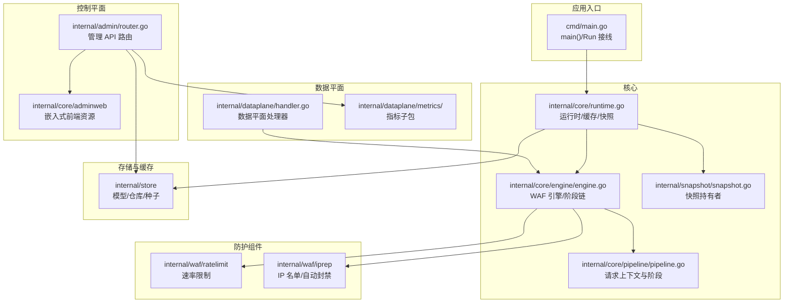
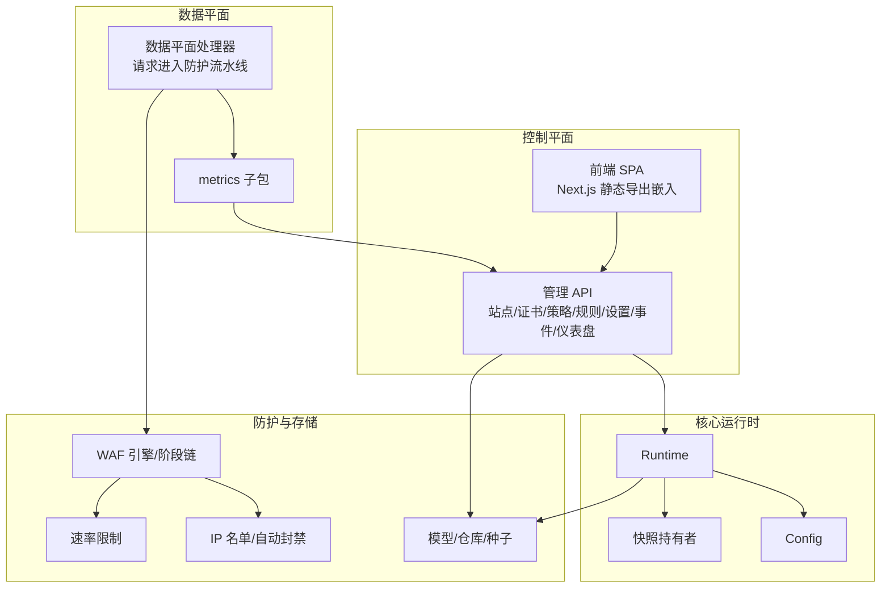
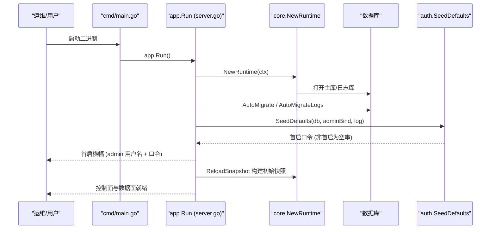
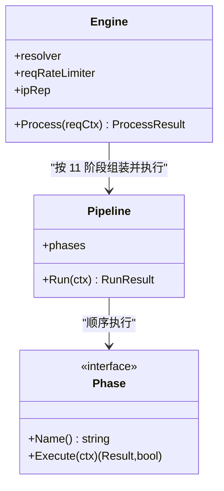
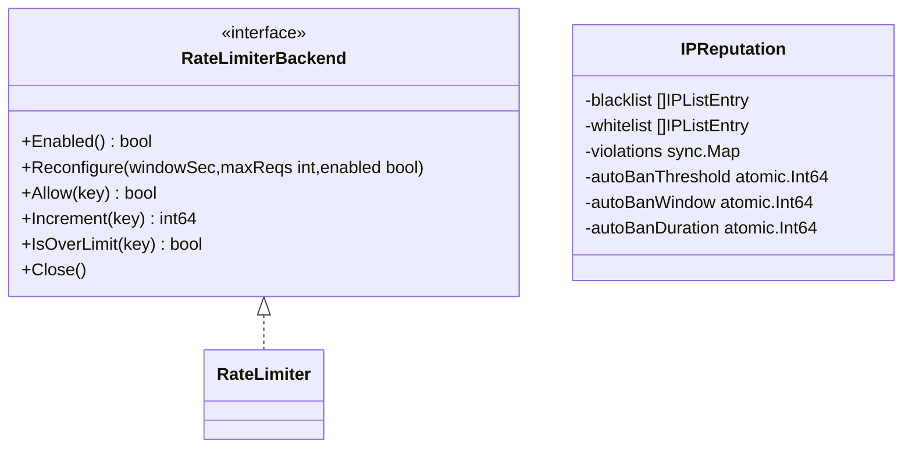
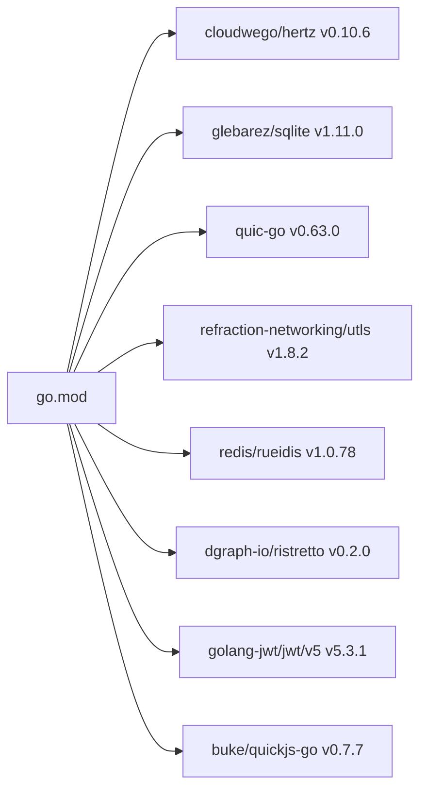

# 项目概述

<cite>
**本文档引用的文件**
- [README.md](file://README.md)
- [go.mod](file://go.mod)
- [cmd/main.go](file://cmd/main.go)
- [internal/app/server.go](file://internal/app/server.go)
- [internal/core/config.go](file://internal/core/config.go)
- [internal/core/runtime.go](file://internal/core/runtime.go)
- [internal/core/engine/engine.go](file://internal/core/engine/engine.go)
- [internal/core/pipeline/pipeline.go](file://internal/core/pipeline/pipeline.go)
- [internal/snapshot/snapshot.go](file://internal/snapshot/snapshot.go)
- [internal/admin/router.go](file://internal/admin/router.go)
- [internal/waf/ratelimit/ratelimit.go](file://internal/waf/ratelimit/ratelimit.go)
- [internal/waf/iprep/iprep.go](file://internal/waf/iprep/iprep.go)
- [internal/store/auth/seed.go](file://internal/store/auth/seed.go)
- [frontend/package.json](file://frontend/package.json)
- [scripts/build.sh](file://scripts/build.sh)
- [Dockerfile](file://Dockerfile)
</cite>

> **子页面索引**

本模块按受众与深度将子页面划分为三类：**入门与概览**、**技术深入**、**开发者资源**。

#### 入门与概览
- [快速开始](快速开始.md) — 环境准备、构建、Docker 部署与首次登录的完整上手指南

#### 技术深入
- [技术架构](技术架构.md) — 控制面与数据面的分层架构、组件关系、数据流向与关键技术选型说明
- [核心特性](核心特性.md) — 各核心特性的实现原理、使用场景、优势与配置要点

#### 开发者资源
- [开发者指南](开发者指南.md) — 环境搭建、代码贡献、测试、调试、性能分析与 WASM 挑战模块开发指南

---

> **模块架构概述**

`项目概述` 模块是了解 My-OpenWaf 的第一站，采用“由浅入深”的组织方式：从项目背景与快速上手切入，逐步深入到技术架构与核心特性，最后提供面向开发者的完整指南。子页面共享统一的“控制面 + 数据面”双服务器架构主题，形成完整的认知路径。

## 目录

1. [简介](#简介)
2. [项目结构](#项目结构)
3. [核心组件](#核心组件)
4. [架构总览](#架构总览)
5. [详细组件分析](#详细组件分析)
6. [依赖关系分析](#依赖关系分析)
7. [性能考虑](#性能考虑)
8. [故障排查指南](#故障排查指南)
9. [结论](#结论)
10. [附录](#附录)

## 简介
My-OpenWaf 是一个基于 Go 语言开发的高性能 Web 应用防火墙系统，采用双服务器架构：控制平面（管理接口）与数据平面（流量处理）。它支持多站点防护、可视化管理界面、热重载配置、分布式同步等能力，适用于需要细粒度站点级防护与集中管理的企业与云环境。

- 项目目标：提供可扩展、可观测、易运维的 Web 防火墙解决方案，兼顾初学者易用性与高级用户的深度定制需求。
- 核心能力：多站点独立监听与热启停、基于 Next.js 的可视化管理面板、快照驱动的无损热重载、可选 Redis 分布式同步、覆盖 IP 名单/速率限制/OWASP/CVE/Bot/浏览器签名/自定义规则的完整防护链。
- 架构决策：后端 Go + Hertz，数据面按站点绑定独立监听器并支持 HTTP/3；前端 Next.js 静态导出后嵌入后端二进制，实现单体部署；PoW 质询由 Rust 编译为 WASM 加速。

项目元数据如下：

| 项 | 值 | 来源 |
|------|------|------|
| 模块路径 | `My-OpenWaf` | [go.mod:1](file://go.mod#L1) |
| Go 版本 | `1.27.2` | [go.mod:3](file://go.mod#L3) |
| 程序入口 | `cmd/main.go` → `main()` | [cmd/main.go:13](file://cmd/main.go#L13) |
| 主启动流程 | `internal/app.Run()`（16 步链路） | [internal/app/server.go:234](file://internal/app/server.go#L234) |
| 默认管理端口 | `:9443` | [README.md:321](file://README.md#L315-L321) |
| 许可证 | Apache License 2.0 | [README.md:469](file://README.md#L463-L469) |

**章节来源**
- [go.mod:1-3](file://go.mod#L1-L3)
- [cmd/main.go:13-50](file://cmd/main.go#L13-L50)
- [internal/app/server.go:234](file://internal/app/server.go#L234)
- [README.md:315-321](file://README.md#L315-L321)

## 项目结构
项目采用按职责分层与功能模块化的组织方式，目录语义如下（来源 `README.md` 项目结构段与实测目录）：

| 目录 | 职责 | 来源 |
|------|------|------|
| `cmd/` | 入口程序（含 `reset-admin-password` 子命令、可选 pprof） | [README.md:354](file://README.md#L353-L354) |
| `internal/app/` | HTTP/3 服务器、TLS 指纹策略、生命周期接线 | [README.md:356](file://README.md#L355-L356) |
| `internal/core/` | 环境配置、DB/Redis 运行时、快照热重载、引擎与流水线 | [README.md:357-360](file://README.md#L357-L360) |
| `internal/dataplane/` | 站点匹配、访问控制网关、代理/质询/阻断；含 `metrics/` 指标子包 | [README.md:361](file://README.md#L361) |
| `internal/proxy/` `internal/upstream/` | 上游转发与传输层抽象、上游池与健康检查 | [README.md:362-363](file://README.md#L362-L363) |
| `internal/admin/` | 管理 API 路由/中间件/实时 WebSocket（按 domain 分包） | [README.md:365](file://README.md#L365) |
| `internal/waf/` | OWASP/CVE/challenge/bot/ratelimit/iprep 等防护组件 | [README.md:366-378](file://README.md#L366-L378) |
| `internal/snapshot/` | 不可变配置快照与原子替换 | [README.md:364](file://README.md#L364) |
| `internal/store/` | GORM 模型、迁移、默认种子、备份导入导出 | [README.md:380](file://README.md#L380) |
| `frontend/` | 管理面板（Next.js 静态导出，嵌入二进制） | [README.md:385](file://README.md#L385) |
| `wasm-pow-solver/` | PoW 质询求解器（Rust → WASM） | [README.md:388](file://README.md#L388) |

技术栈矩阵逐栈列出实测版本：

| 栈层 | 关键组件与实测版本 | 来源 |
|------|--------------------|------|
| Go 后端 | Go `1.27.2`；Hertz `v0.10.6`；GORM `v1.31.2`；glebarez/sqlite `v1.11.0`；quic-go `v0.63.0`；uTLS `v1.8.2`；rueidis `v1.0.78`；ristretto `v0.2.0`；golang-jwt/v5 `v5.3.1`；quickjs-go `v0.7.7`；gopher-lua `v1.1.2` | [go.mod:3-25](file://go.mod#L3-L25)、[README.md:393-407](file://README.md#L393-L407) |
| Next.js 前端 | Next.js `16.2.6`；React `19.2.4` / ReactDOM `19.2.7`；TypeScript `^6`；Tailwind CSS `^4`；SWR `^2.4.2`；Bun `1.3.14+` | [frontend/package.json:37-63](file://frontend/package.json#L37-L63)、[README.md:295](file://README.md#L295) |
| Rust WASM | `wasm-pow-solver` PoW 求解器，经 `make optimize` 编译为 WASM（wasm-bindgen），产物落 `internal/waf/challenge/powdata`；版本 `—`（未在 go.mod/package.json 锁定） | [scripts/build.sh:9-10](file://scripts/build.sh#L9-L10)、[README.md:406](file://README.md#L406) |



**图表来源**
- [cmd/main.go:13-50](file://cmd/main.go#L13-L50)
- [internal/admin/router.go:44-68](file://internal/admin/router.go#L44-L68)
- [internal/core/runtime.go:23-60](file://internal/core/runtime.go#L23-L60)
- [internal/core/engine/engine.go:465-548](file://internal/core/engine/engine.go#L465-L548)
- [internal/snapshot/snapshot.go:289-334](file://internal/snapshot/snapshot.go#L289-L334)
- [internal/waf/ratelimit/ratelimit.go:10-64](file://internal/waf/ratelimit/ratelimit.go#L10-L64)
- [internal/waf/iprep/iprep.go:19-50](file://internal/waf/iprep/iprep.go#L19-L50)

> [!WARNING]
> 数据面指标位于**子包** `internal/dataplane/metrics/`（被 `internal/admin/router.go:45` 以 `dpmetrics "My-OpenWaf/internal/dataplane/metrics"` 导入），并非单文件 `internal/dataplane/metrics.go`。旧文档将其写成单文件属错误，已订正。

**章节来源**
- [README.md:351-389](file://README.md#L351-L389)
- [README.md:393-407](file://README.md#L393-L407)
- [internal/admin/router.go:44-68](file://internal/admin/router.go#L44-L68)
- [scripts/build.sh:1-13](file://scripts/build.sh#L1-L13)

## 核心组件
- 运行时（Runtime）
  - `NewRuntime` 先 `LoadConfigFromEnv`，校验引导配置后打开主库与日志库，可选建立 rueidis 客户端，并初始化内存缓存层与快照持有者 `Snapshot *snapshot.Holder`。
  - 来源 [internal/core/runtime.go:23-60](file://internal/core/runtime.go#L23-L60)。
- 快照（Snapshot）
  - 不可变快照持有站点映射、SNI 证书映射与全局保护配置；站点匹配用哈希键 `bind + 0x00 + host`（非 Trie），SNI/站点解析优先级为精确 → `*.` 单级父域 → catch-all `*`。
  - 来源 [internal/snapshot/snapshot.go:289-334](file://internal/snapshot/snapshot.go#L289-L334)。
- 引擎（Engine）
  - 将 `pipeline.RequestCtx` 送入多阶段流水线。阶段链按最大规模预分配容量 11，依实测顺序组装：IPReputation → AntiReplay → ACL → Lua 前置 → OWASP → CVE → Bot → BrowserSign → 请求限流 → Signature → Custom。
  - 来源 [internal/core/engine/engine.go:465-548](file://internal/core/engine/engine.go#L465-L548)。
- 流水线（Pipeline）
  - `RequestCtx` 携带已解码的请求数据（绑定地址、客户端 IP、方法、路径、查询、头部、请求体、TLS 指纹等）与派生缓存，供各阶段共享，避免重复解析。
  - 来源 [internal/core/pipeline/pipeline.go:14-70](file://internal/core/pipeline/pipeline.go#L14-L70)。
- 速率限制（RateLimiter）
  - 以 `(clientIP + host)` 为键的固定窗口计数，实现 `RateLimiterBackend`（`Enabled`/`Reconfigure`/`Allow`/`Increment`/`IsOverLimit`/`Close`），无效参数按未启用处理并启动清理协程。
  - 来源 [internal/waf/ratelimit/ratelimit.go:10-64](file://internal/waf/ratelimit/ratelimit.go#L10-L64)。
- IP 名单与自动封禁（IPReputation）
  - 管理全局黑白名单与基于违规计数的自动封禁，默认阈值 10、窗口 60 秒、封禁时长 3600 秒、动作 `intercept`。
  - 来源 [internal/waf/iprep/iprep.go:19-50](file://internal/waf/iprep/iprep.go#L19-L50)。
- 控制平面（Admin）
  - `router.go` 聚合站点/证书/策略/规则/设置/事件/仪表盘等管理 API 与实时 WebSocket，注入指标子包、令牌与会话管理器；并挂载嵌入式前端。
  - 来源 [internal/admin/router.go:44-74](file://internal/admin/router.go#L44-L74)。
- 默认凭据（Seed）
  - `SeedDefaults` 仅在首次运行且无 `admin` 账号时创建管理员并返回随机口令；**不预置任何 API 令牌**。
  - 来源 [internal/store/auth/seed.go:14-56](file://internal/store/auth/seed.go#L14-L56)。

**章节来源**
- [internal/core/runtime.go:23-60](file://internal/core/runtime.go#L23-L60)
- [internal/snapshot/snapshot.go:289-334](file://internal/snapshot/snapshot.go#L289-L334)
- [internal/core/engine/engine.go:465-548](file://internal/core/engine/engine.go#L465-L548)
- [internal/core/pipeline/pipeline.go:14-70](file://internal/core/pipeline/pipeline.go#L14-L70)
- [internal/waf/ratelimit/ratelimit.go:10-64](file://internal/waf/ratelimit/ratelimit.go#L10-L64)
- [internal/waf/iprep/iprep.go:19-50](file://internal/waf/iprep/iprep.go#L19-L50)
- [internal/store/auth/seed.go:14-56](file://internal/store/auth/seed.go#L14-L56)

## 架构总览
My-OpenWaf 采用“控制平面 + 数据平面”的双服务器架构：
- 控制平面：管理 API 服务器，提供认证、配置 CRUD、仪表盘与前端静态资源；`/healthz`、`/readyz`、`/status`、`/metrics` 在管理端口暴露。
- 数据平面：按站点维度创建独立监听器，每个监听器封装数据平面处理器，负责实时请求处理与防护。
- 配置与状态：配置变更通过数据库版本号递增触发快照重建与热重载；可选 Redis 用于分布式通知；内存缓存加速快照读取。
- 可观测性：事件经统一写入器异步批量落库；指标由数据面 `metrics` 子桥接到管理端暴露。



**图表来源**
- [internal/app/server.go:234-301](file://internal/app/server.go#L234-L301)
- [internal/core/runtime.go:23-60](file://internal/core/runtime.go#L23-L60)
- [internal/core/engine/engine.go:465-548](file://internal/core/engine/engine.go#L465-L548)
- [internal/admin/router.go:44-74](file://internal/admin/router.go#L44-L74)

## 详细组件分析

### 启动链路与首次运行
`main()` 解析子命令后调用 `app.Run()`。`Run` 的关键顺序：`logger.New` → `core.NewRuntime`（加载配置、开库、建缓存与快照持有者）→ `store.AutoMigrate` 主库 → OWASP/CVE 内置目录对齐 → `AutoMigrateLogs` 日志库 → `authstore.SeedDefaults`（仅首启建 admin 账号）→ 首启凭据横幅 → `resolveJWTSecret` → `ReloadSnapshot` → `repository.NewWithLogDB` → 引擎与数据面/控制面接线。



**图表来源**
- [cmd/main.go:13-50](file://cmd/main.go#L13-L50)
- [internal/app/server.go:234-301](file://internal/app/server.go#L234-L301)
- [internal/store/auth/seed.go:14-56](file://internal/store/auth/seed.go#L14-L56)

**章节来源**
- [internal/app/server.go:242-293](file://internal/app/server.go#L242-L293)
- [internal/core/runtime.go:36-60](file://internal/core/runtime.go#L36-L60)

### WAF 引擎与请求处理流水线
- 请求上下文：`pipeline.RequestCtx` 含绑定地址、客户端 IP、方法、路径、查询、头部、请求体、TLS 指纹等，并对 JSON/query/头部做惰性解析缓存。
- 阶段顺序（实测 11 阶段，`engine.go:465-548`）：
  1) `ip_reputation`：白/黑名单决策。2) `anti_replay`：nonce 防重放。3) `acl`：站点访问控制规则。4) `lua_pre`：前置 Lua 策略（ACL 之后、OWASP 之前）。5) `owasp_default`：OWASP 规则族。6) `cve`：CVE 漏洞检测。7) `bot`：Bot 评分与指纹。8) `browser_sign`：浏览器签名校验。9) `rate_limit`：请求速率限制。10) `signature`：签名规则。11) `custom`：自定义规则。
- 终止语义：`signature`/`custom` 直连 append 不参与按 phase 跳过；非 Challenge 终端动作短路返回，Challenge 类动作可被后续更高优先级终端动作覆盖，观察命中用于日志记录。



**图表来源**
- [internal/core/engine/engine.go:465-548](file://internal/core/engine/engine.go#L465-L548)
- [internal/core/pipeline/pipeline.go:14-70](file://internal/core/pipeline/pipeline.go#L14-L70)

**章节来源**
- [internal/core/engine/engine.go:465-548](file://internal/core/engine/engine.go#L465-L548)
- [internal/core/pipeline/pipeline.go:14-70](file://internal/core/pipeline/pipeline.go#L14-L70)

### 速率限制与 IP 名单
- 速率限制：固定窗口计数，键 `(clientIP + host)`；`Reconfigure` 在持锁下原地改窗口/配额/开关；无效参数（`window<=0` 或 `max<=0`）按未启用处理。
- IP 名单与自动封禁：`IPReputation` 用 `sync.RWMutex` 保护黑白名单、`sync.Map` 记录违规计数；默认阈值 10 / 窗口 60 / 时长 3600 / 动作 `intercept`，并启动清理协程。



**图表来源**
- [internal/waf/ratelimit/ratelimit.go:10-64](file://internal/waf/ratelimit/ratelimit.go#L10-L64)
- [internal/waf/iprep/iprep.go:19-50](file://internal/waf/iprep/iprep.go#L19-L50)

**章节来源**
- [internal/waf/ratelimit/ratelimit.go:10-64](file://internal/waf/ratelimit/ratelimit.go#L10-L64)
- [internal/waf/iprep/iprep.go:19-50](file://internal/waf/iprep/iprep.go#L19-L50)

### 前端与构建
- 前端 `frontend/package.json` 提供 `dev` / `build` / `lint` / `typecheck` / `format` 与一组 `check:*` 契约脚本；`build` 在 `next build` 后直接把 `out` 复制入 `internal/core/adminweb/dist`。
- 全量构建 `scripts/build.sh`：前端安装与构建 → 产物落 `internal/core/adminweb/dist` → `wasm-pow-solver` `make optimize` → `go mod tidy` → `CGO_ENABLED=1 go build -tags=quickjs`。
- Docker 三阶段：`oven/bun` 构建前端、`golang:1.27-alpine` 编译后端（带 `-ldflags="-s -w"`）、`alpine:3.21` 运行，`EXPOSE 9443` 且数据卷挂载 `/app/data`。

**章节来源**
- [frontend/package.json:6-23](file://frontend/package.json#L6-L23)
- [scripts/build.sh:1-13](file://scripts/build.sh#L1-L13)
- [Dockerfile:1-28](file://Dockerfile#L1-L28)

## 依赖关系分析
- Go 模块直接依赖（节选自 `go.mod`）：Hertz（HTTP/HTTP3 框架）、GORM 及 sqlite/mysql/postgres 驱动、rueidis（可选 Redis）、ristretto（内存缓存）、quic-go（HTTP/3）、uTLS（TLS 指纹）、golang-jwt/v5（认证）、quickjs-go + gopher-lua（插件运行时）。
- 前端依赖：Next.js/React/TypeScript/Tailwind/SWR/zod/@tabler/icons-react（见 `package.json`）。
- 外部实体：数据库（DSN 与驱动选择）、Redis（可选分布式同步）、PoW WASM 模块（构建期编译）。



**图表来源**
- [go.mod:3-25](file://go.mod#L3-L25)

**章节来源**
- [go.mod:3-25](file://go.mod#L3-L25)
- [frontend/package.json:24-64](file://frontend/package.json#L24-L64)

## 性能考虑
- 快照与缓存：运行时持有不可变快照与内存缓存层，数据面读取走无锁快路径，避免每次重建快照。
- 阶段链短路：终端动作出现即返回，减少后续阶段开销；`signature`/`custom` 不参与按 phase 跳过装饰，热路径不引入额外分支。
- 解析缓存复用：`RequestCtx` 对 JSON body、query、头部与 OWASP/CVE 目标做惰性缓存，多阶段共享。
- 限流与封禁：清理协程定期回收过期窗口与封禁，防止内存膨胀。
- 监听器隔离与前端内嵌：按站点独立监听便于隔离与扩展；前端构建产物内嵌后端，减少静态资源访问延迟。

[本节为总结，无需特定文件来源]

## 故障排查指南
| 症状 | 可能原因 | 排查 / 处理 |
|------|----------|-------------|
| 核心初始化或迁移失败、进程退出 | 驱动/DSN 错误、数据目录权限 | 看 `Run` 中 `os.Exit(1)` 前日志；核对 `MY_OPENWAF_DB_DRIVER`/`DSN` |
| 首次启动未见凭据 | 非首启（admin 账号已存在）或迁移未完成 | `SeedDefaults` 仅首启返回口令（seed.go）；确认主库已 `AutoMigrate` |
| 快照重建失败 | 站点/保护配置字段不完整 | 检查 `ReloadSnapshot` 失败日志与系统设置 |
| 限流不生效 | 窗口/配额非法按未启用 | `NewRateLimiter`/`Reconfigure` 对 `<=0` 置未启用；用管理端修正 |
| IP 名单/自动封禁异常 | 条目格式或阈值/窗口/时长配置 | 核对 CIDR/单 IP、过期时间与默认阈值 10/60/3600 |
| Redis 多节点不同步 | 地址/密码/DB 配置 | 检查 `rueidis` 连接与订阅回调 |

**章节来源**
- [internal/app/server.go:242-293](file://internal/app/server.go#L242-L293)
- [internal/store/auth/seed.go:14-56](file://internal/store/auth/seed.go#L14-L56)
- [internal/waf/ratelimit/ratelimit.go:49-100](file://internal/waf/ratelimit/ratelimit.go#L49-L100)
- [internal/waf/iprep/iprep.go:42-50](file://internal/waf/iprep/iprep.go#L42-L50)

## 结论
My-OpenWaf 通过清晰的双服务器架构、可热重载的不可变快照与 11 阶段防护流水线，提供了从入门到进阶的完整 Web 防火墙方案。控制面提供可视化管理与 REST API，数据面以高并发处理请求，配合可观测性与可选分布式同步，满足多站点、多租户场景。Go 后端 + Next.js 前端 + Rust WASM 三栈各司其职；生产建议按流量调优限流与保护策略，并妥善保存首启管理员口令。

[本节为总结，无需特定文件来源]

## 附录

### 环境变量速查
基本环境变量（来源 `README.md` 配置说明）：

| 变量 | 默认值 | 说明 |
|------|--------|------|
| `MY_OPENWAF_DB_DRIVER` | `sqlite` | 驱动 `sqlite`/`mysql`/`postgres` |
| `MY_OPENWAF_DSN` | `./data/waf.db` | 主库连接串 |
| `MY_OPENWAF_LOG_DSN` | `./data/waf_logs.db` | 独立日志库 |
| `MY_OPENWAF_DATA` | `./data` | 数据目录 |
| `MY_OPENWAF_ADMIN_BIND` | `:9443` | 管理 API 监听地址 |
| `MY_OPENWAF_REDIS_ADDR` | 空 | 可选 Redis 地址 |
| `MY_OPENWAF_JWT_SECRET` | 自动生成并持久化 | JWT 签名密钥 |
| `MY_OPENWAF_BOT_THRESHOLD` | `80` | Bot 分数阈值 |

> 密钥、令牌、口令一律脱敏为 `{占位}`，真实值不进入文档。

**章节来源**
- [README.md:315-345](file://README.md#L315-L345)
- [internal/core/config.go:12-70](file://internal/core/config.go#L12-L70)

### 构建与运行命令速查
```bash
# 一键全量构建（前端 + WASM + 后端）
./scripts/build.sh

# 手动：前端构建后产物落 internal/core/adminweb/dist
cd frontend && bun install --frozen-lockfile && bun run build
cd .. && CGO_ENABLED=1 go build -tags=quickjs -o bin/my-openwaf ./cmd/...

# 运行（首启打印 admin 用户名与随机口令，访问 https://localhost:9443）
./bin/my-openwaf

# 重置管理员口令
bin/my-openwaf reset-admin-password admin {新口令}
```

**章节来源**
- [README.md:297-309](file://README.md#L297-L309)
- [scripts/build.sh:1-13](file://scripts/build.sh#L1-L13)
- [cmd/main.go:13-27](file://cmd/main.go#L13-L27)
